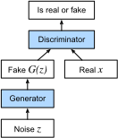

# Generatyviniai priešiškieji tinklai
:label:`sec_basic_gan`

Didžiojoje šios knygos dalyje kalbėjome apie tai, kaip daryti prognozes. Vienaip ar kitaip naudojome giliuosius neuroninius tinklus, kad išmoktume atvaizdžius iš duomenų pavyzdžių į žymes. Toks mokymasis vadinamas diskriminatyviuoju mokymusi, nes norime sugebėti atskirti kačių nuotraukas nuo šunų nuotraukų. Klasifikatoriai ir regresoriai yra diskriminatyviojo mokymosi pavyzdžiai. O neuroniniai tinklai, apmokyti skleidimu atgal, apvertė aukštyn kojomis viską, ką manėme žinoję apie diskriminatyvųjį mokymąsi dideliuose sudėtinguose duomenų rinkiniuose. Didelės raiškos vaizdų klasifikavimo tikslumas per vos 5–6 metus pakilo nuo nenaudingo iki žmogaus lygio (su tam tikromis išlygomis). Nekartosime dar vienos kalbos apie visas kitas diskriminatyviąsias užduotis, kuriose giliesiems neuroniniams tinklams sekasi stulbinamai gerai.

Tačiau mašininis mokymasis nėra vien diskriminatyviųjų užduočių sprendimas. Pavyzdžiui, turėdami didelį duomenų rinkinį be jokių žymių, galime norėti išmokti modelį, kuris glaustai užfiksuotų šių duomenų ypatybes. Turėdami tokį modelį, galėtume atrinkti sintetinius duomenų pavyzdžius, kurie primena apmokymo duomenų skirstinį. Pavyzdžiui, turėdami didelį veidų nuotraukų korpusą, galime norėti sugebėti sugeneruoti naują fotorealistišką vaizdą, kuris atrodytų taip, lyg galėtų tikėtinai būti kilęs iš to paties duomenų rinkinio. Toks mokymasis vadinamas generatyviuoju modeliavimu.

Dar visai neseniai neturėjome metodo, galinčio sintezuoti naujus fotorealistiškus vaizdus. Tačiau gilių neuroninių tinklų sėkmė diskriminatyviajame mokyme atvėrė naujų galimybių. Viena didelė pastarųjų trejų metų tendencija – diskriminatyviųjų gilių tinklų taikymas problemoms įveikti uždaviniuose, kurių paprastai nelaikome prižiūrimojo mokymosi uždaviniais. Rekurentinių neuroninių tinklų kalbos modeliai yra vienas diskriminatyviojo tinklo (apmokyto prognozuoti kitą simbolį) naudojimo pavyzdys, kuris, kai tik apmokomas, gali veikti kaip generatyvusis modelis.

2014 m. proveržio straipsnis pristatė generatyvinius priešiškuosius tinklus (angl. *generative adversarial networks*, GAN) :cite:`Goodfellow.Pouget-Abadie.Mirza.ea.2014` – gudrų naują būdą išnaudoti diskriminatyviųjų modelių galią geriems generatyviesiems modeliams gauti. GAN esmė remiasi mintimi, kad duomenų generatorius yra geras, jei negalime atskirti netikrų duomenų nuo tikrų. Statistikoje tai vadinama dviejų imčių testu – testu, atsakančiu į klausimą, ar duomenų rinkiniai $X=\{x_1,\ldots, x_n\}$ ir $X'=\{x'_1,\ldots, x'_n\}$ buvo atrinkti iš to paties skirstinio. Pagrindinis daugumos statistikos straipsnių ir GAN skirtumas yra tas, kad pastarieji šią idėją naudoja konstruktyviai. Kitaip tariant, užuot tiesiog mokę modelį sakyti „ei, atrodo, kad šie du duomenų rinkiniai nėra kilę iš to paties skirstinio“, jie naudoja [dviejų imčių testą](https://en.wikipedia.org/wiki/Two-sample_hypothesis_testing), kad suteiktų apmokymo signalus generatyviajam modeliui. Tai leidžia tobulinti duomenų generatorių, kol jis sugeneruoja kažką, kas primena tikrus duomenis. Mažų mažiausiai jis turi apgauti klasifikatorių, net jei mūsų klasifikatorius yra pažangiausias gilusis neuroninis tinklas.


:label:`fig_gan`


GAN architektūra iliustruota :numref:`fig_gan`.
Kaip matote, GAN architektūroje yra dvi dalys. Pirma, mums reikia įtaiso (tarkime, gilaus tinklo, bet iš tikrųjų tai galėtų būti bet kas, pavyzdžiui, žaidimo vaizdavimo variklis), kuris galėtų sugeneruoti duomenis, atrodančius lygiai kaip tikri. Jei dirbame su vaizdais, jis turi generuoti vaizdus. Jei dirbame su kalba, jis turi generuoti garso sekas ir pan. Tai vadiname generatoriaus tinklu. Antroji dalis yra diskriminatoriaus tinklas. Jis bando atskirti netikrus ir tikrus duomenis. Abu tinklai konkuruoja tarpusavyje. Generatoriaus tinklas bando apgauti diskriminatoriaus tinklą. Tada diskriminatoriaus tinklas prisitaiko prie naujų netikrų duomenų. Ši informacija savo ruožtu naudojama generatoriaus tinklui tobulinti ir taip toliau.


Diskriminatorius yra dvejetainis klasifikatorius, atskiriantis, ar įvestis $x$ yra tikra (iš tikrų duomenų), ar netikra (iš generatoriaus). Paprastai diskriminatorius išveda skaliarinę prognozę $o\in\mathbb R$ įvesčiai $\mathbf x$, pavyzdžiui, naudodamas pilnai sujungtą sluoksnį su paslėptuoju dydžiu 1, o tada pritaiko sigmoidinę funkciją, kad gautų prognozuojamą tikimybę $D(\mathbf x) = 1/(1+e^{-o})$. Tarkime, kad tikrų duomenų žymė $y$ yra $1$, o netikrų – $0$. Diskriminatorių apmokome minimizuoti kryžminės entropijos nuostolį, *t. y.*

$$ \min_D \{ - y \log D(\mathbf x) - (1-y)\log(1-D(\mathbf x)) \},$$

Generatorius pirmiausia atrenka tam tikrą parametrą $\mathbf z\in\mathbb R^d$ iš atsitiktinumo šaltinio, *pvz.*, normaliojo skirstinio $\mathbf z \sim \mathcal{N} (0, 1)$. Dažnai $\mathbf z$ vadiname latentiniu kintamuoju.
Tada jis pritaiko funkciją, kad sugeneruotų $\mathbf x'=G(\mathbf z)$. Generatoriaus tikslas yra apgauti diskriminatorių, kad jis $\mathbf x'=G(\mathbf z)$ klasifikuotų kaip tikrus duomenis, *t. y.* norime, kad $D( G(\mathbf z)) \approx 1$.
Kitaip tariant, esant duotam diskriminatoriui $D$, atnaujiname generatoriaus $G$ parametrus, kad maksimizuotume kryžminės entropijos nuostolį, kai $y=0$, *t. y.*

$$ \max_G \{ - (1-y) \log(1-D(G(\mathbf z))) \} = \max_G \{ - \log(1-D(G(\mathbf z))) \}.$$

Jei generatorius atlieka darbą tobulai, tada $D(\mathbf x')\approx 1$, todėl aukščiau pateiktas nuostolis yra artimas 0, o tai lemia pernelyg mažus gradientus, kad diskriminatorius galėtų daryti gerą pažangą. Todėl dažniausiai minimizuojame šį nuostolį:

$$ \min_G \{ - y \log(D(G(\mathbf z))) \} = \min_G \{ - \log(D(G(\mathbf z))) \}, $$

o tai yra tiesiog $\mathbf x'=G(\mathbf z)$ paduodimas diskriminatoriui, bet suteikiant žymę $y=1$.


Apibendrinant, $D$ ir $G$ žaidžia „minimax“ žaidimą su šia visapusiška tikslo funkcija:

$$\min_D \max_G \{ -E_{x \sim \textrm{Data}} \log D(\mathbf x) - E_{z \sim \textrm{Noise}} \log(1 - D(G(\mathbf z))) \}.$$


Daug GAN taikymų yra susiję su vaizdais. Demonstracijos tikslais pirmiausia pasitenkinsime daug paprastesnio skirstinio pritaikymu. Parodysime, kas atsitinka, jei naudojame GAN, kad sukurtume pasaulyje neefektyviausią Gauso skirstinio parametrų vertintuvą. Pradėkime.

```{.python .input}
#@tab mxnet
%matplotlib inline
from d2l import mxnet as d2l
from mxnet import autograd, gluon, init, np, npx
from mxnet.gluon import nn
npx.set_np()
```

```{.python .input}
#@tab pytorch
%matplotlib inline
from d2l import torch as d2l
import torch
from torch import nn
```

```{.python .input}
#@tab tensorflow
from d2l import tensorflow as d2l
import tensorflow as tf
```

## „Tikrų“ duomenų generavimas

Kadangi tai bus nuobodžiausias pasaulyje pavyzdys, tiesiog sugeneruojame duomenis, atrinktus iš Gauso skirstinio.

```{.python .input}
#@tab mxnet, pytorch
X = d2l.normal(0.0, 1, (1000, 2))
A = d2l.tensor([[1, 2], [-0.1, 0.5]])
b = d2l.tensor([1, 2])
data = d2l.matmul(X, A) + b
```

```{.python .input}
#@tab tensorflow
X = d2l.normal((1000, 2), 0.0, 1)
A = d2l.tensor([[1, 2], [-0.1, 0.5]])
b = d2l.tensor([1, 2], tf.float32)
data = d2l.matmul(X, A) + b
```

Pažiūrėkime, ką gavome. Tai turėtų būti kiek savavališkai pastumtas Gauso skirstinys su vidurkiu $b$ ir kovariacijų matrica $A^TA$.

```{.python .input}
#@tab mxnet, pytorch
d2l.set_figsize()
d2l.plt.scatter(d2l.numpy(data[:100, 0]), d2l.numpy(data[:100, 1]));
print(f'The covariance matrix is\n{d2l.matmul(A.T, A)}')
```

```{.python .input}
#@tab tensorflow
d2l.set_figsize()
d2l.plt.scatter(d2l.numpy(data[:100, 0]), d2l.numpy(data[:100, 1]));
print(f'The covariance matrix is\n{tf.matmul(A, A, transpose_a=True)}')
```

```{.python .input}
#@tab all
batch_size = 8
data_iter = d2l.load_array((data,), batch_size)
```

## Generatorius

Mūsų generatoriaus tinklas bus paprasčiausias įmanomas tinklas – vieno sluoksnio tiesinis modelis. Taip yra todėl, kad šį tiesinį tinklą valdysime Gauso duomenų generatoriumi. Todėl jam tiesiogine prasme reikia išmokti tik parametrus, kad puikiai suklastotų duomenis.

```{.python .input}
#@tab mxnet
net_G = nn.Sequential()
net_G.add(nn.Dense(2))
```

```{.python .input}
#@tab pytorch
net_G = nn.Sequential(nn.Linear(2, 2))
```

```{.python .input}
#@tab tensorflow
net_G = tf.keras.layers.Dense(2)
```

## Diskriminatorius

Diskriminatoriui būsime kiek išrankesni: naudosime 3 sluoksnių MLP, kad viskas būtų šiek tiek įdomiau.

```{.python .input}
#@tab mxnet
net_D = nn.Sequential()
net_D.add(nn.Dense(5, activation='tanh'),
          nn.Dense(3, activation='tanh'),
          nn.Dense(1))
```

```{.python .input}
#@tab pytorch
net_D = nn.Sequential(
    nn.Linear(2, 5), nn.Tanh(),
    nn.Linear(5, 3), nn.Tanh(),
    nn.Linear(3, 1))
```

```{.python .input}
#@tab tensorflow
net_D = tf.keras.models.Sequential([
    tf.keras.layers.Dense(5, activation="tanh", input_shape=(2,)),
    tf.keras.layers.Dense(3, activation="tanh"),
    tf.keras.layers.Dense(1)
])
```

## Apmokymas

Pirmiausia apibrėžiame funkciją diskriminatoriui atnaujinti.

```{.python .input}
#@tab mxnet
#@save
def update_D(X, Z, net_D, net_G, loss, trainer_D):
    """Update discriminator."""
    batch_size = X.shape[0]
    ones = np.ones((batch_size,), ctx=X.ctx)
    zeros = np.zeros((batch_size,), ctx=X.ctx)
    with autograd.record():
        real_Y = net_D(X)
        fake_X = net_G(Z)
        # Do not need to compute gradient for `net_G`, detach it from
        # computing gradients.
        fake_Y = net_D(fake_X.detach())
        loss_D = (loss(real_Y, ones) + loss(fake_Y, zeros)) / 2
    loss_D.backward()
    trainer_D.step(batch_size)
    return float(loss_D.sum())
```

```{.python .input}
#@tab pytorch
#@save
def update_D(X, Z, net_D, net_G, loss, trainer_D):
    """Update discriminator."""
    batch_size = X.shape[0]
    ones = torch.ones((batch_size,), device=X.device)
    zeros = torch.zeros((batch_size,), device=X.device)
    trainer_D.zero_grad()
    real_Y = net_D(X)
    fake_X = net_G(Z)
    # Do not need to compute gradient for `net_G`, detach it from
    # computing gradients.
    fake_Y = net_D(fake_X.detach())
    loss_D = (loss(real_Y, ones.reshape(real_Y.shape)) +
              loss(fake_Y, zeros.reshape(fake_Y.shape))) / 2
    loss_D.backward()
    trainer_D.step()
    return loss_D
```

```{.python .input}
#@tab tensorflow
#@save
def update_D(X, Z, net_D, net_G, loss, optimizer_D):
    """Update discriminator."""
    batch_size = X.shape[0]
    ones = tf.ones((batch_size,)) # Labels corresponding to real data
    zeros = tf.zeros((batch_size,)) # Labels corresponding to fake data
    # Do not need to compute gradient for `net_G`, so it is outside GradientTape
    fake_X = net_G(Z)
    with tf.GradientTape() as tape:
        real_Y = net_D(X)
        fake_Y = net_D(fake_X)
        # We multiply the loss by batch_size to match PyTorch's BCEWithLogitsLoss
        loss_D = (loss(ones, tf.squeeze(real_Y)) + loss(
            zeros, tf.squeeze(fake_Y))) * batch_size / 2
    grads_D = tape.gradient(loss_D, net_D.trainable_variables)
    optimizer_D.apply_gradients(zip(grads_D, net_D.trainable_variables))
    return loss_D
```

Generatorius atnaujinamas panašiai. Čia pakartotinai naudojame kryžminės entropijos nuostolį, bet netikrų duomenų žymę keičiame iš $0$ į $1$.

```{.python .input}
#@tab mxnet
#@save
def update_G(Z, net_D, net_G, loss, trainer_G):
    """Update generator."""
    batch_size = Z.shape[0]
    ones = np.ones((batch_size,), ctx=Z.ctx)
    with autograd.record():
        # We could reuse `fake_X` from `update_D` to save computation
        fake_X = net_G(Z)
        # Recomputing `fake_Y` is needed since `net_D` is changed
        fake_Y = net_D(fake_X)
        loss_G = loss(fake_Y, ones)
    loss_G.backward()
    trainer_G.step(batch_size)
    return float(loss_G.sum())
```

```{.python .input}
#@tab pytorch
#@save
def update_G(Z, net_D, net_G, loss, trainer_G):
    """Update generator."""
    batch_size = Z.shape[0]
    ones = torch.ones((batch_size,), device=Z.device)
    trainer_G.zero_grad()
    # We could reuse `fake_X` from `update_D` to save computation
    fake_X = net_G(Z)
    # Recomputing `fake_Y` is needed since `net_D` is changed
    fake_Y = net_D(fake_X)
    loss_G = loss(fake_Y, ones.reshape(fake_Y.shape))
    loss_G.backward()
    trainer_G.step()
    return loss_G
```

```{.python .input}
#@tab tensorflow
#@save
def update_G(Z, net_D, net_G, loss, optimizer_G):
    """Update generator."""
    batch_size = Z.shape[0]
    ones = tf.ones((batch_size,))
    with tf.GradientTape() as tape:
        # We could reuse `fake_X` from `update_D` to save computation
        fake_X = net_G(Z)
        # Recomputing `fake_Y` is needed since `net_D` is changed
        fake_Y = net_D(fake_X)
        # We multiply the loss by batch_size to match PyTorch's BCEWithLogits loss
        loss_G = loss(ones, tf.squeeze(fake_Y)) * batch_size
    grads_G = tape.gradient(loss_G, net_G.trainable_variables)
    optimizer_G.apply_gradients(zip(grads_G, net_G.trainable_variables))
    return loss_G
```

Ir diskriminatorius, ir generatorius atlieka dvejetainę logistinę regresiją su kryžminės entropijos nuostoliu. Naudojame Adam apmokymo procesui sušvelninti. Kiekvienoje iteracijoje pirmiausia atnaujiname diskriminatorių, o paskui generatorių. Vizualizuojame abu nuostolius ir sugeneruotus pavyzdžius.

```{.python .input}
#@tab mxnet
def train(net_D, net_G, data_iter, num_epochs, lr_D, lr_G, latent_dim, data):
    loss = gluon.loss.SigmoidBCELoss()
    net_D.initialize(init=init.Normal(0.02), force_reinit=True)
    net_G.initialize(init=init.Normal(0.02), force_reinit=True)
    trainer_D = gluon.Trainer(net_D.collect_params(),
                              'adam', {'learning_rate': lr_D})
    trainer_G = gluon.Trainer(net_G.collect_params(),
                              'adam', {'learning_rate': lr_G})
    animator = d2l.Animator(xlabel='epoch', ylabel='loss',
                            xlim=[1, num_epochs], nrows=2, figsize=(5, 5),
                            legend=['discriminator', 'generator'])
    animator.fig.subplots_adjust(hspace=0.3)
    for epoch in range(num_epochs):
        # Train one epoch
        timer = d2l.Timer()
        metric = d2l.Accumulator(3)  # loss_D, loss_G, num_examples
        for X in data_iter:
            batch_size = X.shape[0]
            Z = np.random.normal(0, 1, size=(batch_size, latent_dim))
            metric.add(update_D(X, Z, net_D, net_G, loss, trainer_D),
                       update_G(Z, net_D, net_G, loss, trainer_G),
                       batch_size)
        # Visualize generated examples
        Z = np.random.normal(0, 1, size=(100, latent_dim))
        fake_X = net_G(Z).asnumpy()
        animator.axes[1].cla()
        animator.axes[1].scatter(data[:, 0], data[:, 1])
        animator.axes[1].scatter(fake_X[:, 0], fake_X[:, 1])
        animator.axes[1].legend(['real', 'generated'])
        # Show the losses
        loss_D, loss_G = metric[0]/metric[2], metric[1]/metric[2]
        animator.add(epoch + 1, (loss_D, loss_G))
    print(f'loss_D {loss_D:.3f}, loss_G {loss_G:.3f}, '
          f'{metric[2] / timer.stop():.1f} examples/sec')
```

```{.python .input}
#@tab pytorch
def train(net_D, net_G, data_iter, num_epochs, lr_D, lr_G, latent_dim, data):
    loss = nn.BCEWithLogitsLoss(reduction='sum')
    for w in net_D.parameters():
        nn.init.normal_(w, 0, 0.02)
    for w in net_G.parameters():
        nn.init.normal_(w, 0, 0.02)
    trainer_D = torch.optim.Adam(net_D.parameters(), lr=lr_D)
    trainer_G = torch.optim.Adam(net_G.parameters(), lr=lr_G)
    animator = d2l.Animator(xlabel='epoch', ylabel='loss',
                            xlim=[1, num_epochs], nrows=2, figsize=(5, 5),
                            legend=['discriminator', 'generator'])
    animator.fig.subplots_adjust(hspace=0.3)
    for epoch in range(num_epochs):
        # Train one epoch
        timer = d2l.Timer()
        metric = d2l.Accumulator(3)  # loss_D, loss_G, num_examples
        for (X,) in data_iter:
            batch_size = X.shape[0]
            Z = torch.normal(0, 1, size=(batch_size, latent_dim))
            metric.add(update_D(X, Z, net_D, net_G, loss, trainer_D),
                       update_G(Z, net_D, net_G, loss, trainer_G),
                       batch_size)
        # Visualize generated examples
        Z = torch.normal(0, 1, size=(100, latent_dim))
        fake_X = net_G(Z).detach().numpy()
        animator.axes[1].cla()
        animator.axes[1].scatter(data[:, 0], data[:, 1])
        animator.axes[1].scatter(fake_X[:, 0], fake_X[:, 1])
        animator.axes[1].legend(['real', 'generated'])
        # Show the losses
        loss_D, loss_G = metric[0]/metric[2], metric[1]/metric[2]
        animator.add(epoch + 1, (loss_D, loss_G))
    print(f'loss_D {loss_D:.3f}, loss_G {loss_G:.3f}, '
          f'{metric[2] / timer.stop():.1f} examples/sec')
```

```{.python .input}
#@tab tensorflow
def train(net_D, net_G, data_iter, num_epochs, lr_D, lr_G, latent_dim, data):
    loss = tf.keras.losses.BinaryCrossentropy(
        from_logits=True, reduction=tf.keras.losses.Reduction.SUM)
    for w in net_D.trainable_variables:
        w.assign(tf.random.normal(mean=0, stddev=0.02, shape=w.shape))
    for w in net_G.trainable_variables:
        w.assign(tf.random.normal(mean=0, stddev=0.02, shape=w.shape))
    optimizer_D = tf.keras.optimizers.Adam(learning_rate=lr_D)
    optimizer_G = tf.keras.optimizers.Adam(learning_rate=lr_G)
    animator = d2l.Animator(
        xlabel="epoch", ylabel="loss", xlim=[1, num_epochs], nrows=2,
        figsize=(5, 5), legend=["discriminator", "generator"])
    animator.fig.subplots_adjust(hspace=0.3)
    for epoch in range(num_epochs):
        # Train one epoch
        timer = d2l.Timer()
        metric = d2l.Accumulator(3)  # loss_D, loss_G, num_examples
        for (X,) in data_iter:
            batch_size = X.shape[0]
            Z = tf.random.normal(
                mean=0, stddev=1, shape=(batch_size, latent_dim))
            metric.add(update_D(X, Z, net_D, net_G, loss, optimizer_D),
                       update_G(Z, net_D, net_G, loss, optimizer_G),
                       batch_size)
        # Visualize generated examples
        Z = tf.random.normal(mean=0, stddev=1, shape=(100, latent_dim))
        fake_X = net_G(Z)
        animator.axes[1].cla()
        animator.axes[1].scatter(data[:, 0], data[:, 1])
        animator.axes[1].scatter(fake_X[:, 0], fake_X[:, 1])
        animator.axes[1].legend(["real", "generated"])

        # Show the losses
        loss_D, loss_G = metric[0] / metric[2], metric[1] / metric[2]
        animator.add(epoch + 1, (loss_D, loss_G))

    print(f'loss_D {loss_D:.3f}, loss_G {loss_G:.3f}, '
          f'{metric[2] / timer.stop():.1f} examples/sec')
```

Dabar nurodome hiperparametrus Gauso skirstiniui pritaikyti.

```{.python .input}
#@tab all
lr_D, lr_G, latent_dim, num_epochs = 0.05, 0.005, 2, 20
train(net_D, net_G, data_iter, num_epochs, lr_D, lr_G,
      latent_dim, d2l.numpy(data[:100]))
```

## Santrauka

* Generatyviniai priešiškieji tinklai (GAN) sudaryti iš dviejų gilių tinklų – generatoriaus ir diskriminatoriaus.
* Generatorius generuoja vaizdą kuo labiau panašų į tikrąjį, kad apgautų diskriminatorių, maksimizuodamas kryžminės entropijos nuostolį, *t. y.* $\max \log(D(\mathbf{x'}))$.
* Diskriminatorius bando atskirti sugeneruotus vaizdus nuo tikrųjų, minimizuodamas kryžminės entropijos nuostolį, *t. y.* $\min - y \log D(\mathbf{x}) - (1-y)\log(1-D(\mathbf{x}))$.

## Pratimai

* Ar egzistuoja pusiausvyra, kurioje laimi generatorius, *t. y.* diskriminatorius galiausiai nebegali atskirti dviejų skirstinių baigtinėse imtyse?

:begin_tab:`mxnet`
[Diskusijos](https://discuss.d2l.ai/t/408)
:end_tab:

:begin_tab:`pytorch`
[Diskusijos](https://discuss.d2l.ai/t/1082)
:end_tab:
