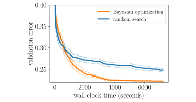

```{.python .input  n=1}
%load_ext d2lbook.tab
tab.interact_select(["pytorch"])
```

# Hiperparametrų optimizavimo API
:label:`sec_api_hpo`

Prieš gilindamiesi į metodiką, pirmiausia aptarsime pagrindinę kodo
struktūrą, leidžiančią efektyviai įgyvendinti įvairius HPO algoritmus. Apskritai
visi čia nagrinėjami HPO algoritmai turi įgyvendinti du sprendimų priėmimo
primityvus: *paiešką* ir *planavimą*. Pirma, jie turi atrinkti naujas
hiperparametrų konfigūracijas, o tai dažnai apima tam tikrą paiešką
konfigūracijų erdvėje. Antra, kiekvienai konfigūracijai HPO algoritmas turi
suplanuoti jos įvertinimą ir nuspręsti, kiek išteklių jai skirti. Pradėję
vertinti konfigūraciją, ją vadinsime *bandymu*. Šiuos
sprendimus atvaizduojame į dvi klases: `HPOSearcher` ir `HPOScheduler`. Be to,
pateikiame klasę `HPOTuner`, kuri vykdo optimizavimo procesą.

Ši planuoklio ir ieškiklio koncepcija taip pat įgyvendinta populiariose HPO
bibliotekose, tokiose kaip Syne Tune :cite:`salinas-automl22`, Ray Tune
:cite:`liaw-arxiv18` ar Optuna :cite:`akiba-sigkdd19`.

```{.python .input  n=2}
%%tab pytorch
import time
from d2l import torch as d2l
from scipy import stats
```

## Ieškiklis

Toliau apibrėžiame bazinę ieškiklių klasę, kuri pateikia naują kandidatinę
konfigūraciją per funkciją `sample_configuration`. Paprastas šios funkcijos
įgyvendinimo būdas būtų atrinkti konfigūracijas tolygiai atsitiktinai,
kaip darėme atsitiktinės paieškos atveju :numref:`sec_what_is_hpo`. Sudėtingesni
algoritmai, pavyzdžiui, Bajeso optimizavimas, šiuos sprendimus priims
pagal ankstesnių bandymų našumą. Dėl to šie
algoritmai laikui bėgant gali atrinkti perspektyvesnius kandidatus. Pridedame
funkciją `update`, kad atnaujintume ankstesnių bandymų istoriją, kuri
gali būti panaudota atrankos skirstiniui pagerinti.

```{.python .input  n=3}
%%tab pytorch
class HPOSearcher(d2l.HyperParameters):  #@save
    def sample_configuration() -> dict:
        raise NotImplementedError

    def update(self, config: dict, error: float, additional_info=None):
        pass
```

Šis kodas parodo, kaip įgyvendinti mūsų atsitiktinės paieškos optimizatorių iš
ankstesnio skyrelio naudojant šią API. Kaip nedidelį pratęsimą, leidžiame
naudotojui nurodyti pirmąją įvertinamą konfigūraciją per `initial_config`, o
vėlesnės atrenkamos atsitiktinai.

```{.python .input  n=4}
%%tab pytorch
class RandomSearcher(HPOSearcher):  #@save
    def __init__(self, config_space: dict, initial_config=None):
        self.save_hyperparameters()

    def sample_configuration(self) -> dict:
        if self.initial_config is not None:
            result = self.initial_config
            self.initial_config = None
        else:
            result = {
                name: domain.rvs()
                for name, domain in self.config_space.items()
            }
        return result
```

## Planuoklis

Be naujų bandymų konfigūracijų atrankos, taip pat turime nuspręsti, kada ir
kiek laiko vykdyti bandymą. Praktikoje visus šiuos sprendimus priima
`HPOScheduler`, kuris naujų konfigūracijų pasirinkimą deleguoja
`HPOSearcher`. Metodas `suggest` iškviečiamas, kai tik atsiranda koks nors apmokymui
skirtas išteklius. Be ieškiklio `sample_configuration` iškvietimo, jis
taip pat gali nuspręsti dėl tokių parametrų kaip `max_epochs` (t. y. kiek laiko
apmokyti modelį). Metodas `update` iškviečiamas, kai tik bandymas grąžina naują
stebėjimą.

```{.python .input  n=5}
%%tab pytorch
class HPOScheduler(d2l.HyperParameters):  #@save
    def suggest(self) -> dict:
        raise NotImplementedError
    
    def update(self, config: dict, error: float, info=None):
        raise NotImplementedError
```

Norint įgyvendinti atsitiktinę paiešką, taip pat ir kitus HPO algoritmus, mums reikia tik paprasto
planuoklio, kuris suplanuoja naują konfigūraciją kaskart, kai atsiranda nauji
ištekliai.

```{.python .input  n=6}
%%tab pytorch
class BasicScheduler(HPOScheduler):  #@save
    def __init__(self, searcher: HPOSearcher):
        self.save_hyperparameters()

    def suggest(self) -> dict:
        return self.searcher.sample_configuration()

    def update(self, config: dict, error: float, info=None):
        self.searcher.update(config, error, additional_info=info)
```

## Derintojas

Galiausiai mums reikia komponento, kuris vykdo planuoklį ir (arba) ieškiklį ir
tvarko rezultatų apskaitą. Šis kodas įgyvendina nuoseklų
HPO bandymų vykdymą, kuris įvertina vieną apmokymo užduotį po kitos ir
bus pagrindinis pavyzdys. Vėliau naudosime *Syne Tune* labiau mastelio didėjimui pritaikytiems
paskirstytojo HPO atvejams.

```{.python .input  n=7}
%%tab pytorch
class HPOTuner(d2l.HyperParameters):  #@save
    def __init__(self, scheduler: HPOScheduler, objective: callable):
        self.save_hyperparameters()
        # Bookeeping results for plotting
        self.incumbent = None
        self.incumbent_error = None
        self.incumbent_trajectory = []
        self.cumulative_runtime = []
        self.current_runtime = 0
        self.records = []

    def run(self, number_of_trials):
        for i in range(number_of_trials):
            start_time = time.time()
            config = self.scheduler.suggest()
            print(f"Trial {i}: config = {config}")
            error = self.objective(**config)
            error = float(d2l.numpy(error.cpu()))
            self.scheduler.update(config, error)
            runtime = time.time() - start_time
            self.bookkeeping(config, error, runtime)
            print(f"    error = {error}, runtime = {runtime}")
```

## HPO algoritmų našumo apskaita

Su bet kuriuo HPO algoritmu mus daugiausia domina geriausiai veikianti
konfigūracija (vadinama *geriausia esama konfigūracija*, angl. *incumbent*) ir jos patikros paklaida po duoto
sienos laikrodžio laiko. Todėl sekame `runtime` kiekvienoje iteracijoje, kuris apima
ir įvertinimo vykdymo laiką (`objective` iškvietimas), ir
sprendimo priėmimo laiką (`scheduler.suggest` iškvietimas). Toliau
braižysime `cumulative_runtime` prieš `incumbent_trajectory`, kad vizualizuotume
HPO algoritmo, apibrėžto per `scheduler`
(ir `searcher`), *bet kuriuo metu pasiekiamą našumą*. Tai leidžia įvertinti ne tik tai, kaip gerai veikia
optimizatoriaus rasta konfigūracija, bet ir tai, kaip greitai optimizatorius ją randa.

```{.python .input  n=8}
%%tab pytorch
@d2l.add_to_class(HPOTuner)  #@save
def bookkeeping(self, config: dict, error: float, runtime: float):
    self.records.append({"config": config, "error": error, "runtime": runtime})
    # Check if the last hyperparameter configuration performs better 
    # than the incumbent
    if self.incumbent is None or self.incumbent_error > error:
        self.incumbent = config
        self.incumbent_error = error
    # Add current best observed performance to the optimization trajectory
    self.incumbent_trajectory.append(self.incumbent_error)
    # Update runtime
    self.current_runtime += runtime
    self.cumulative_runtime.append(self.current_runtime)
```

## Pavyzdys: konvoliucinio neuroninio tinklo hiperparametrų optimizavimas

Dabar naudojame naują atsitiktinės paieškos įgyvendinimą, kad optimizuotume
konvoliucinio neuroninio tinklo `LeNet` iš :numref:`sec_lenet`
*rinkinio dydį* ir *mokymosi greitį*. Pradedame apibrėždami tikslo funkciją, kuri
vėl bus patikros paklaida.

```{.python .input  n=9}
%%tab pytorch
def hpo_objective_lenet(learning_rate, batch_size, max_epochs=10):  #@save
    model = d2l.LeNet(lr=learning_rate, num_classes=10)
    trainer = d2l.HPOTrainer(max_epochs=max_epochs, num_gpus=1)
    data = d2l.FashionMNIST(batch_size=batch_size)
    model.apply_init([next(iter(data.get_dataloader(True)))[0]], d2l.init_cnn)
    trainer.fit(model=model, data=data)
    validation_error = trainer.validation_error()
    return validation_error
```

Taip pat turime apibrėžti konfigūracijų erdvę. Be to, pirmoji įvertinama konfigūracija
yra numatytasis nustatymas, naudotas :numref:`sec_lenet`.

```{.python .input  n=10}
config_space = {
    "learning_rate": stats.loguniform(1e-2, 1),
    "batch_size": stats.randint(32, 256),
}
initial_config = {
    "learning_rate": 0.1,
    "batch_size": 128,
}
```

Dabar galime pradėti atsitiktinę paiešką:

```{.python .input}
searcher = RandomSearcher(config_space, initial_config=initial_config)
scheduler = BasicScheduler(searcher=searcher)
tuner = HPOTuner(scheduler=scheduler, objective=hpo_objective_lenet)
tuner.run(number_of_trials=5)
```

Toliau nubraižome geriausios esamos konfigūracijos optimizavimo trajektoriją, kad gautume
atsitiktinės paieškos bet kuriuo metu pasiekiamą našumą:

```{.python .input  n=11}
board = d2l.ProgressBoard(xlabel="time", ylabel="error")
for time_stamp, error in zip(
    tuner.cumulative_runtime, tuner.incumbent_trajectory
):
    board.draw(time_stamp, error, "random search", every_n=1)
```

## HPO algoritmų palyginimas

Kaip ir apmokymo algoritmus ar modelių architektūras, svarbu
suprasti, kaip geriausiai palyginti skirtingus HPO algoritmus. Kiekvienas HPO vykdymas priklauso
nuo dviejų pagrindinių atsitiktinumo šaltinių: apmokymo proceso atsitiktinių efektų,
tokių kaip atsitiktinė svorių inicializacija ar minirinkinių tvarka, ir paties HPO algoritmo
būdingo atsitiktinumo, pavyzdžiui, atsitiktinės paieškos atsitiktinės atrankos.
Todėl lyginant skirtingus algoritmus, labai svarbu kiekvieną
eksperimentą vykdyti kelis kartus ir pateikti statistiką, pavyzdžiui, vidurkį ar medianą,
per kelių algoritmo pakartojimų populiaciją, pagrįstą skirtingomis
atsitiktinių skaičių generatoriaus pradinėmis reikšmėmis.

Kad tai iliustruotume, lyginame atsitiktinę paiešką (žr. :numref:`sec_rs`) ir Bajeso
optimizavimą :cite:`snoek-nips12` derinant tiesioginio sklidimo
neuroninio tinklo hiperparametrus. Kiekvienas algoritmas buvo įvertintas
$50$ kartų su skirtinga atsitiktine pradine reikšme. Ištisinė linija rodo vidutinį
geriausios esamos konfigūracijos našumą per šiuos $50$ pakartojimų, o punktyrinė linija –
standartinį nuokrypį. Matome, kad atsitiktinė paieška ir Bajeso optimizavimas
veikia maždaug vienodai iki ~1000 sekundžių, bet Bajeso optimizavimas gali
pasinaudoti ankstesniais stebėjimais, kad nustatytų geresnes konfigūracijas, todėl
vėliau greitai aplenkia atsitiktinę paiešką.



:label:`example_anytime_performance`

## Santrauka

Šiame skyrelyje pateikta paprasta, bet lanksti sąsaja įvairiems HPO
algoritmams, kuriuos nagrinėsime šiame skyriuje, įgyvendinti. Panašias sąsajas galima rasti
populiariuose atvirojo kodo HPO karkasuose. Taip pat apžvelgėme, kaip galime palyginti HPO
algoritmus, ir galimas klaidas, apie kurias reikia žinoti.

## Pratimai

1. Šio pratimo tikslas yra įgyvendinti tikslo funkciją kiek sudėtingesniam HPO uždaviniui ir vykdyti realistiškesnius eksperimentus. Naudosime dviejų paslėptųjų sluoksnių MLP `DropoutMLP`, įgyvendintą :numref:`sec_dropout`.
    1. Užprogramuokite tikslo funkciją, kuri turėtų priklausyti nuo visų modelio hiperparametrų ir `batch_size`. Naudokite `max_epochs=50`. GPU čia nepadeda, todėl `num_gpus=0`. Užuomina: modifikuokite `hpo_objective_lenet`.
    2. Pasirinkite prasmingą paieškos erdvę, kur `num_hiddens_1`, `num_hiddens_2` yra sveikieji skaičiai intervale $[8, 1024]$, dropout reikšmės yra intervale $[0, 0.95]$, o `batch_size` yra intervale $[16, 384]$. Pateikite `config_space` kodą, naudodami prasmingus skirstinius iš `scipy.stats`.
    3. Vykdykite atsitiktinę paiešką šiame pavyzdyje su `number_of_trials=20` ir nubraižykite rezultatus. Būtinai pirmiausia įvertinkite numatytąją :numref:`sec_dropout` konfigūraciją, kuri yra `initial_config = {'num_hiddens_1': 256, 'num_hiddens_2': 256, 'dropout_1': 0.5, 'dropout_2': 0.5, 'lr': 0.1, 'batch_size': 256}`.
2. Šiame pratime įgyvendinsite naują ieškiklį (`HPOSearcher` poklasę), kuris sprendimus priima pagal ankstesnius duomenis. Jis priklauso nuo parametrų `probab_local`, `num_init_random`. Jo metodas `sample_configuration` veikia taip. Pirmiems `num_init_random` iškvietimų daro tą patį, ką `RandomSearcher.sample_configuration`. Kitu atveju su tikimybe `1 - probab_local` daro tą patį, ką `RandomSearcher.sample_configuration`. Kitu atveju pasirenka konfigūraciją, kuri iki šiol pasiekė mažiausią patikros paklaidą, atsitiktinai pasirenka vieną jos hiperparametrą ir atsitiktinai atrenka jo reikšmę kaip `RandomSearcher.sample_configuration`, bet visas kitas reikšmes palieka tokias pačias. Grąžinkite šią konfigūraciją, kuri yra identiška iki šiol geriausiai konfigūracijai, išskyrus šį vieną hiperparametrą.
    1. Užprogramuokite šį naują `LocalSearcher`. Užuomina: jūsų ieškikliui kuriant reikia `config_space` kaip argumento. Galite naudoti `RandomSearcher` tipo narį. Taip pat turėsite įgyvendinti metodą `update`.
    2. Pakartokite ankstesnio pratimo eksperimentą, bet vietoj `RandomSearcher` naudokite savo naują ieškiklį. Eksperimentuokite su skirtingomis `probab_local`, `num_init_random` reikšmėmis. Tačiau atkreipkite dėmesį, kad tinkamam skirtingų HPO metodų palyginimui reikia kelis kartus kartoti eksperimentus ir idealiu atveju nagrinėti kelias lyginamąsias užduotis.


:begin_tab:`pytorch`
[Diskusijos](https://discuss.d2l.ai/t/12092)
:end_tab:
