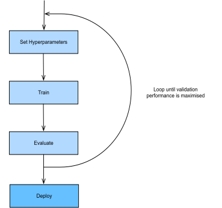

```{.python .input}
%load_ext d2lbook.tab
tab.interact_select(["pytorch"])
```

# Kas yra hiperparametrų optimizavimas?
:label:`sec_what_is_hpo`

Kaip matėme ankstesniuose skyriuose, giliesiems neuroniniams tinklams būdingas
didelis parametrų ar svorių skaičius, kurie išmokstami apmokymo metu. Be jų, kiekvienas neuroninis tinklas turi papildomų *hiperparametrų*, kuriuos
turi sukonfigūruoti naudotojas. Pavyzdžiui, kad užtikrintume, jog stochastinis
gradientinis nusileidimas konverguoja į lokalųjį apmokymo nuostolio optimumą
(žr. :numref:`chap_optimization`), turime koreguoti mokymosi greitį ir rinkinio
dydį. Kad išvengtume persimokymo apmokymo duomenų rinkiniuose,
gali tekti nustatyti reguliarizavimo parametrus, pavyzdžiui, svorių nykimą
(žr. :numref:`sec_weight_decay`) arba dropout (žr. :numref:`sec_dropout`). Galime
apibrėžti modelio talpą ir indukcinį polinkį nustatydami sluoksnių skaičių
ir vienetų ar filtrų skaičių kiekviename sluoksnyje (t. y. efektyvų svorių skaičių).

Deja, šių hiperparametrų negalime tiesiog koreguoti minimizuodami
apmokymo nuostolį, nes tai lemtų persimokymą apmokymo duomenyse. Pavyzdžiui, nustačius reguliarizavimo parametrus, tokius kaip dropout ar svorių nykimas,
lygius nuliui, apmokymo nuostolis tampa mažas, bet gali nukentėti apibendrinimo
našumas.


:label:`ml_workflow`

Be kitokios formos automatizavimo hiperparametrai turi būti nustatomi rankiniu būdu
bandymų ir klaidų principu, o tai yra daug laiko reikalaujanti ir sudėtinga
mašininio mokymosi darbo eigos dalis. Pavyzdžiui, panagrinėkime
ResNet (žr. :numref:`sec_resnet`) apmokymą su CIFAR-10, kuriam reikia daugiau nei 2 valandų
Amazon Elastic Cloud Compute (EC2) `g4dn.xlarge` egzemplioriuje. Net tik
išbandžius dešimt hiperparametrų konfigūracijų iš eilės, tai jau užimtų
maždaug vieną dieną. Kad reikalai būtų dar blogesni, hiperparametrai paprastai nėra tiesiogiai
perkeliami tarp architektūrų ir duomenų rinkinių
:cite:`feurer-arxiv22,wistuba-ml18,bardenet-icml13a`, ir juos reikia iš naujo optimizuoti
kiekvienai naujai užduočiai. Be to, daugumai hiperparametrų nėra empirinių taisyklių,
ir prasmingoms reikšmėms rasti reikia ekspertų žinių.

*Hiperparametrų optimizavimo (HPO)* algoritmai sukurti šiai problemai spręsti
principingu ir automatizuotu būdu :cite:`feurer-automlbook18a`,
formuluojant ją kaip globaliojo optimizavimo uždavinį. Numatytasis tikslas yra paklaida
atidėtame patikros duomenų rinkinyje, tačiau iš principo tai galėtų būti bet kuri kita verslo
metrika. Ji gali būti derinama su antriniais tikslais, tokiais kaip
apmokymo laikas, inferencijos laikas ar modelio sudėtingumas, arba jais apribota.

Neseniai hiperparametrų optimizavimas buvo išplėstas į *neuroninių architektūrų
paiešką (NAS)* :cite:`elsken-arxiv18a,wistuba-arxiv19`, kurios tikslas yra rasti
visiškai naujas neuroninių tinklų architektūras. Palyginti su klasikiniu HPO, NAS yra dar
brangesnė skaičiavimo požiūriu ir reikalauja papildomų pastangų, kad išliktų
įgyvendinama praktikoje. Tiek HPO, tiek NAS galima laikyti
AutoML :cite:`hutter-book19a` posritimis, kurios tikslas yra automatizuoti visą mašininio mokymosi grandinę.

Šiame skyrelyje pristatysime HPO ir parodysime, kaip galime automatiškai rasti
geriausius logistinės regresijos pavyzdžio, pristatyto
:numref:`sec_softmax_concise`, hiperparametrus.

##  Optimizavimo uždavinys
:label:`sec_definition_hpo`

Pradėsime nuo paprasto žaislinio uždavinio: ieškosime daugiaklasio logistinės regresijos modelio `SoftmaxRegression` iš
:numref:`sec_softmax_concise` mokymosi greičio, kad minimizuotume patikros paklaidą Fashion
MNIST duomenų rinkinyje. Nors kitus hiperparametrus, tokius kaip rinkinio dydis ar epochų skaičius,
taip pat verta derinti, paprastumo dėlei sutelkiame dėmesį tik į mokymosi greitį.

```{.python .input}
%%tab pytorch
from d2l import torch as d2l
import numpy as np
import torch
from torch import nn
from scipy import stats
```

Prieš galėdami vykdyti HPO, pirmiausia turime apibrėžti du ingredientus: tikslo
funkciją ir konfigūracijų erdvę.

### Tikslo funkcija

Mokymosi algoritmo našumą galima laikyti funkcija
$f: \mathcal{X} \rightarrow \mathbb{R}$, kuri atvaizduoja hiperparametrų erdvę
$\mathbf{x} \in \mathcal{X}$ į patikros nuostolį. Kiekvienam $f(\mathbf{x})$
įvertinimui turime apmokyti ir patikrinti savo mašininio mokymosi modelį, o tai
gali reikalauti daug laiko ir skaičiavimų, kai giliesiems neuroniniams tinklams
apmokyti naudojami dideli duomenų rinkiniai. Turint kriterijų $f(\mathbf{x})$, mūsų tikslas yra rasti
$\mathbf{x}_{\star} \in \mathrm{argmin}_{\mathbf{x} \in \mathcal{X}} f(\mathbf{x})$.

Nėra paprasto būdo apskaičiuoti $f$ gradientus $\mathbf{x}$ atžvilgiu,
nes tam reikėtų sklidinti gradientą per visą apmokymo
procesą. Nors yra naujesnių darbų :cite:`maclaurin-icml15,franceschi-icml17a`,
siūlančių vadovautis HPO apytiksliais „hipergradientais“, nė vienas esamas metodas
dar nekonkuruoja su pažangiausiais, todėl jų čia neaptarsime. Be to, $f$ įvertinimo skaičiavimo našta reikalauja,
kad HPO algoritmai priartėtų prie globaliojo optimumo su kuo mažiau imčių.

Neuroninių tinklų apmokymas yra stochastinis (pavyzdžiui, svoriai inicializuojami
atsitiktinai, minirinkiniai atrenkami atsitiktinai), todėl mūsų stebėjimai bus
triukšmingi: $y \sim f(\mathbf{x}) + \epsilon$, kur paprastai darome prielaidą, kad
$\epsilon \sim N(0, \sigma)$ stebėjimo triukšmas yra normaliai pasiskirstęs.

Susidūrę su visais šiais iššūkiais, paprastai bandome greitai nustatyti nedidelę gerai
veikiančių hiperparametrų konfigūracijų aibę, užuot tiksliai pataikę į globaliuosius
optimumus. Vis dėlto dėl didelių daugumos neuroninių tinklų modelių skaičiavimo reikalavimų
net tai gali užtrukti dienas ar savaites skaičiavimo. :numref:`sec_mf_hpo` išnagrinėsime,
kaip galime pagreitinti optimizavimo procesą arba paskirstydami paiešką, arba naudodami pigiau įvertinamus
tikslo funkcijos aproksimavimus.

Pradedame nuo modelio patikros paklaidos skaičiavimo metodo.

```{.python .input  n=8}
%%tab pytorch
class HPOTrainer(d2l.Trainer):  #@save
    def validation_error(self):
        self.model.eval()
        accuracy = 0
        val_batch_idx = 0
        for batch in self.val_dataloader:
            with torch.no_grad():
                x, y = self.prepare_batch(batch)
                y_hat = self.model(x)
                accuracy += self.model.accuracy(y_hat, y)
            val_batch_idx += 1
        return 1 -  accuracy / val_batch_idx
```

Optimizuojame patikros paklaidą hiperparametrų konfigūracijos
`config`, sudarytos iš `learning_rate`, atžvilgiu. Kiekvienam įvertinimui apmokome savo
modelį `max_epochs` epochų, tada apskaičiuojame ir grąžiname jo patikros paklaidą:

```{.python .input  n=5}
%%tab pytorch
def hpo_objective_softmax_classification(config, max_epochs=8):
    learning_rate = config["learning_rate"]
    trainer = d2l.HPOTrainer(max_epochs=max_epochs)
    data = d2l.FashionMNIST(batch_size=16)
    model = d2l.SoftmaxRegression(num_outputs=10, lr=learning_rate)
    trainer.fit(model=model, data=data)
    return d2l.numpy(trainer.validation_error())
```

### Konfigūracijų erdvė
:label:`sec_intro_config_spaces`

Kartu su tikslo funkcija $f(\mathbf{x})$ taip pat turime apibrėžti
leistinąją aibę $\mathbf{x} \in \mathcal{X}$, kurioje optimizuojame, vadinamą
*konfigūracijų erdve* arba *paieškos erdve*. Mūsų logistinės regresijos pavyzdžiui
naudosime:

```{.python .input  n=6}
config_space = {"learning_rate": stats.loguniform(1e-4, 1)}
```

Čia naudojame SciPy objektą `loguniform`, kuris atitinka
tolygųjį skirstinį tarp -4 ir -1 logaritminėje erdvėje. Šis objektas
leidžia atrinkti atsitiktinius kintamuosius iš šio skirstinio.

Kiekvienas hiperparametras turi duomenų tipą, pavyzdžiui, `float` `learning_rate`, taip pat
uždarą aprėžtą intervalą (t. y. apatinę ir viršutinę ribas). Paprastai kiekvienam hiperparametrui priskiriame
apriorinį skirstinį (pvz., tolygųjį ar log-tolygųjį), iš kurio atrenkame. Kai kurie teigiami parametrai, pavyzdžiui, `learning_rate`, geriausiai
vaizduojami logaritminėje skalėje, nes optimalios reikšmės gali skirtis keliomis
eilėmis, o kiti, pavyzdžiui, momentas, turi tiesinę skalę.

Toliau pateikiame paprastą konfigūracijų erdvės pavyzdį, sudarytą iš tipinių
daugiasluoksnio perceptrono hiperparametrų, įskaitant jų tipą ir standartinius
intervalus.

: Daugiasluoksnio perceptrono konfigūracijų erdvės pavyzdys
:label:`tab_example_configspace`

| Pavadinimas         | Tipas       | Hiperparametrų intervalai      | log-skalė |
| :----:              | :----:      |:------------------------------:|:---------:|
| mokymosi greitis    | float       |      $[10^{-6},10^{-1}]$       |    taip   |
| rinkinio dydis      | integer     |           $[8,256]$            |    taip   |
| momentas            | float       |           $[0,0.99]$           |    ne     |
| aktyvacijos funkcija | categorical | $\{\textrm{tanh}, \textrm{relu}\}$ |     -     |
| vienetų skaičius    | integer     |          $[32, 1024]$          |    taip   |
| sluoksnių skaičius  | integer     |            $[1, 6]$            |    ne     |


Apskritai konfigūracijų erdvės $\mathcal{X}$ struktūra gali būti sudėtinga
ir gerokai skirtis nuo $\mathbb{R}^d$. Praktikoje kai kurie
hiperparametrai gali priklausyti nuo kitų reikšmių. Pavyzdžiui, tarkime, kad bandome
derinti daugiasluoksnio perceptrono sluoksnių skaičių ir kiekvieno sluoksnio
vienetų skaičių. $l$-ojo sluoksnio vienetų skaičius yra
svarbus tik tuo atveju, jei tinklas turi bent $l+1$ sluoksnių. Šie sudėtingi HPO
uždaviniai nepatenka į šio skyriaus apimtį. Besidominčius skaitytojus nukreipiame
į :cite:`hutter-lion11a,jenatton-icml17a,baptista-icml18a`.

Konfigūracijų erdvė atlieka svarbų vaidmenį hiperparametrų optimizavime,
nes joks algoritmas negali rasti to, kas neįtraukta į konfigūracijų
erdvę. Kita vertus, jei intervalai per dideli, skaičiavimo biudžetas,
reikalingas gerai veikiančioms konfigūracijoms rasti, gali tapti neįgyvendinamas.

## Atsitiktinė paieška
:label:`sec_rs`

*Atsitiktinė paieška* yra pirmasis hiperparametrų optimizavimo algoritmas, kurį
nagrinėsime. Pagrindinė atsitiktinės paieškos idėja yra nepriklausomai atrinkti iš
konfigūracijų erdvės, kol išnaudojamas iš anksto apibrėžtas biudžetas (pvz., didžiausias
iteracijų skaičius), ir grąžinti geriausią stebėtą
konfigūraciją. Visi įvertinimai gali būti vykdomi nepriklausomai lygiagrečiai (žr.
:numref:`sec_rs_async`), tačiau čia paprastumo dėlei naudojame nuoseklų ciklą.

```{.python .input  n=7}
errors, values = [], []
num_iterations = 5

for i in range(num_iterations):
    learning_rate = config_space["learning_rate"].rvs()
    print(f"Trial {i}: learning_rate = {learning_rate}")
    y = hpo_objective_softmax_classification({"learning_rate": learning_rate})
    print(f"    validation_error = {y}")
    values.append(learning_rate)
    errors.append(y)
```

Geriausias mokymosi greitis yra tiesiog tas, kurio patikros paklaida mažiausia.

```{.python .input  n=7}
best_idx = np.argmin(errors)
print(f"optimal learning rate = {values[best_idx]}")
```

Dėl savo paprastumo ir bendrumo atsitiktinė paieška yra vienas dažniausiai
naudojamų HPO algoritmų. Jai nereikia sudėtingo įgyvendinimo ir ji
gali būti taikoma bet kuriai konfigūracijų erdvei, jei tik galime apibrėžti
tikimybinį skirstinį kiekvienam hiperparametrui.

Deja, atsitiktinė paieška turi ir keletą trūkumų. Pirma, ji
neadaptuoja atrankos skirstinio pagal ankstesnius stebėjimus, kuriuos
iki šiol surinko. Todėl ji vienodai tikėtinai atrenka prastai veikiančią
konfigūraciją kaip ir geriau veikiančią konfigūraciją. Antra, tiek pat
išteklių skiriama visoms konfigūracijoms, nors kai kurios gali rodyti prastą
pradinį našumą ir yra mažiau linkusios pralenkti anksčiau matytas
konfigūracijas.

Kituose skyreliuose apžvelgsime imčių požiūriu efektyvesnius hiperparametrų
optimizavimo algoritmus, kurie įveikia atsitiktinės paieškos trūkumus
naudodami modelį paieškai nukreipti. Taip pat apžvelgsime algoritmus, kurie
automatiškai sustabdo prastai veikiančių konfigūracijų įvertinimo procesą,
kad paspartintų optimizavimo procesą.

## Santrauka

Šiame skyrelyje pristatėme hiperparametrų optimizavimą (HPO) ir tai, kaip galime
jį suformuluoti kaip globalųjį optimizavimą apibrėždami konfigūracijų erdvę ir
tikslo funkciją. Taip pat įgyvendinome savo pirmąjį HPO algoritmą – atsitiktinę paiešką –
ir pritaikėme jį paprastam softmax klasifikavimo uždaviniui.

Nors atsitiktinė paieška labai paprasta, ji yra geresnė alternatyva tinklelio
paieškai, kuri tiesiog įvertina fiksuotą hiperparametrų aibę. Atsitiktinė paieška
šiek tiek sušvelnina dimensijų prakeikimą :cite:`bellman-science66` ir
gali būti kur kas efektyvesnė už tinklelio paiešką, jei kriterijus stipriausiai
priklauso nuo nedidelio hiperparametrų poaibio.

## Pratimai

1. Šiame skyriuje optimizuojame modelio patikros paklaidą po apmokymo nesikertančioje apmokymo aibėje. Paprastumo dėlei mūsų kodas naudoja `Trainer.val_dataloader`, kuris atitinka įkėliklį aplink `FashionMNIST.val`.
    1. Įsitikinkite (žiūrėdami į kodą), kad tai reiškia, jog apmokymui naudojame originalią FashionMNIST apmokymo aibę (60000 pavyzdžių), o patikrai – originalią *testavimo aibę* (10000 pavyzdžių).
    2. Kodėl ši praktika galėtų būti problemiška? Užuomina: dar kartą perskaitykite :numref:`sec_generalization_basics`, ypač apie *modelio atranką*.
    3. Ką turėjome daryti vietoj to?
2. Aukščiau teigėme, kad hiperparametrų optimizavimas gradientiniu nusileidimu yra labai sunkus. Panagrinėkime nedidelį uždavinį, pavyzdžiui, dvisluoksnio perceptrono apmokymą FashionMNIST duomenų rinkinyje (:numref:`sec_mlp-implementation`) su 256 rinkinio dydžiu. Norėtume suderinti SGD mokymosi greitį, kad minimizuotume patikros metriką po vienos apmokymo epochos.
    1. Kodėl šiam tikslui negalime naudoti patikros *paklaidos*? Kokią patikros aibės metriką naudotumėte?
    2. (Apytiksliai) nubraižykite patikros metrikos skaičiavimo grafą po vienos epochos apmokymo. Galite daryti prielaidą, kad pradiniai svoriai ir hiperparametrai (pvz., mokymosi greitis) yra šio grafo įvesties mazgai. Užuomina: dar kartą perskaitykite apie skaičiavimo grafus :numref:`sec_backprop`.
    3. Apytiksliai įvertinkite slankiojo kablelio reikšmių skaičių, kurį reikia saugoti tiesioginio sklidimo per šį grafą metu. Užuomina: FashionMNIST turi 60000 atvejų. Darykite prielaidą, kad reikalingoje atmintyje dominuoja aktyvacijos po kiekvieno sluoksnio, ir sluoksnių plotį suraskite :numref:`sec_mlp-implementation`.
    5. Be didžiulio reikalingų skaičiavimų ir saugojimo kiekio, su kokiomis dar problemomis susidurtų gradientiniu požiūriu pagrįstas hiperparametrų optimizavimas? Užuomina: dar kartą perskaitykite apie nykstančius ir sprogstančius gradientus :numref:`sec_numerical_stability`.
    6. *Pažengusiems*: perskaitykite :cite:`maclaurin-icml15`, kur pateiktas elegantiškas (bet vis dar kiek nepraktiškas) gradientiniu požiūriu pagrįsto HPO metodas.
3. Tinklelio paieška yra dar viena HPO bazinė linija, kai kiekvienam hiperparametrui apibrėžiame vienodais intervalais išdėstytą tinklelį, o tada iteruojame per (kombinatorinę) Dekarto sandaugą, kad pasiūlytume konfigūracijas.
    1. Aukščiau teigėme, kad atsitiktinė paieška gali būti daug efektyvesnė už tinklelio paiešką HPO su dideliu hiperparametrų skaičiumi, jei kriterijus stipriausiai priklauso nuo nedidelio hiperparametrų poaibio. Kodėl taip yra? Užuomina: perskaitykite :cite:`bergstra2011algorithms`.


:begin_tab:`pytorch`
[Diskusijos](https://discuss.d2l.ai/t/12090)
:end_tab:
