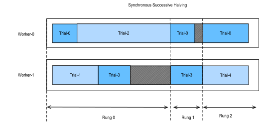
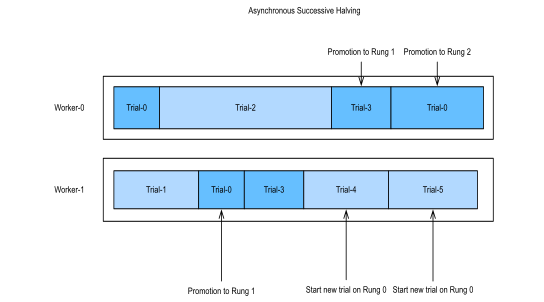

```{.python .input}
%load_ext d2lbook.tab
tab.interact_select(["pytorch"])
#required_libs("syne-tune[gpsearchers]==0.3.2")
```

# Asinchroninis nuoseklus dalijimas pusiau

:label:`sec_sh_async`

Kaip matėme :numref:`sec_rs_async`, HPO galime pagreitinti paskirstydami
hiperparametrų konfigūracijų įvertinimą arba tarp kelių egzempliorių,
arba tarp kelių CPU / GPU viename egzemplioriuje. Tačiau,
palyginti su atsitiktine paieška, nuosekliojo dalijimo pusiau (SH) vykdyti asinchroniškai
paskirstytoje aplinkoje nėra paprasta. Prieš galėdami
nuspręsti, kurią konfigūraciją vykdyti toliau, pirmiausia turime surinkti visus
dabartinės pakopos stebėjimus. Tam reikia
sinchronizuoti darbininkus kiekvienoje pakopoje. Pavyzdžiui, žemiausioje pakopoje
$r_{\mathrm{min}}$ pirmiausia turime įvertinti visas $N = \eta^K$ konfigūracijų, kad
galėtume paaukštinti $\frac{1}{\eta}$ jų į kitą pakopą.

Bet kurioje paskirstytoje sistemoje sinchronizavimas paprastai reiškia darbininkų dykinimo laiką.
Pirma, dažnai matome dideles apmokymo laiko variacijas tarp hiperparametrų
konfigūracijų. Pavyzdžiui, jei filtrų skaičius sluoksnyje yra
hiperparametras, tinklai su mažiau filtrų baigia apmokymą greičiau nei
tinklai su daugiau filtrų, o tai reiškia darbininkų dykinimo laiką dėl atsiliekančių bandymų.
Be to, vietų skaičius pakopoje ne visada yra darbininkų skaičiaus
kartotinis, ir tokiu atveju kai kurie darbininkai gali dykinėti net visą partiją.

:numref:`synchronous_sh` paveiksle parodytas sinchroninio SH su $\eta=2$ planavimas
keturiems skirtingiems bandymams su dviem darbininkais. Pradedame įvertindami Trial-0 ir
Trial-1 vieną epochą ir iš karto tęsiame su kitais dviem bandymais, kai šie
baigiasi. Pirmiausia turime palaukti, kol baigsis Trial-2, kuris trunka
gerokai ilgiau nei kiti bandymai, ir tik tada galime paaukštinti du geriausius
bandymus, t. y. Trial-0 ir Trial-3, į kitą pakopą. Tai sukelia Worker-1 dykinimo laiką.
Tada tęsiame su Rung 1. Čia taip pat Trial-3 trunka ilgiau nei Trial-0,
o tai lemia papildomą Worker-0 dykinimo laiką. Pasiekus Rung-2, lieka tik
geriausias bandymas Trial-0, kuris užima tik vieną darbininką. Kad Worker-1 tuo metu
nedykinėtų, dauguma SH įgyvendinimų jau tęsia su
kitu raundu ir pradeda vertinti naujus bandymus (pvz., Trial-4) pirmoje pakopoje.


:label:`synchronous_sh`

Asinchroninis nuoseklus dalijimas pusiau (ASHA) :cite:`li-arxiv18` pritaiko SH asinchroniniam
lygiagrečiam scenarijui. Pagrindinė ASHA idėja yra paaukštinti konfigūracijas į kitą pakopą,
kai tik dabartinėje pakopoje surenkame bent $\eta$ stebėjimų.
Ši sprendimo taisyklė gali lemti neoptimalius paaukštinimus: į kitą
pakopą gali būti paaukštintos konfigūracijos, kurios, žvelgiant iš ateities, nepalankiai lyginasi su dauguma kitų
toje pačioje pakopoje. Kita vertus, tokiu būdu atsisakome visų sinchronizavimo taškų.
Praktikoje tokie neoptimalūs ankstyvieji paaukštinimai turi tik nedidelį poveikį
našumui ne vien todėl, kad hiperparametrų konfigūracijų reitingas dažnai yra
gana nuoseklus tarp pakopų, bet ir todėl, kad pakopos laikui bėgant auga ir
vis geriau atspindi metrikos reikšmių skirstinį šiame lygyje. Jei
darbininkas laisvas, bet jokios konfigūracijos paaukštinti negalima, pradedame naują konfigūraciją
su $r = r_{\mathrm{min}}$, t. y. pirmoje pakopoje.

:numref:`asha` parodytas tų pačių konfigūracijų planavimas su ASHA. Kai Trial-1
baigiasi, surenkame dviejų bandymų (t. y. Trial-0 ir Trial-1) rezultatus ir
nedelsdami paaukštiname geresnį iš jų (Trial-0) į kitą pakopą. Kai Trial-0
baigiasi 1 pakopoje, ten yra per mažai bandymų, kad būtų galima atlikti tolesnį
paaukštinimą. Todėl tęsiame su 0 pakopa ir įvertiname Trial-3. Kai Trial-3 baigiasi,
Trial-2 vis dar vykdomas. Šiuo metu turime 3 bandymus, įvertintus 0 pakopoje, ir vieną
bandymą, jau įvertintą 1 pakopoje. Kadangi Trial-3 0 pakopoje veikia prasčiau nei Trial-0,
o $\eta=2$, dar negalime paaukštinti jokio naujo bandymo, ir Worker-1 vietoj to pradeda Trial-4
nuo nulio. Tačiau kai Trial-2 baigiasi ir
įvertinamas prasčiau nei Trial-3, pastarasis paaukštinamas į 1 pakopą. Po to
surinkome 2 įvertinimus 1 pakopoje, o tai reiškia, kad dabar galime paaukštinti Trial-0 į
2 pakopą. Tuo pačiu metu Worker-1 tęsia naujų bandymų (t. y.
Trial-5) vertinimą 0 pakopoje.



:label:`asha`

```{.python .input}
from d2l import torch as d2l
import logging
logging.basicConfig(level=logging.INFO)
import matplotlib.pyplot as plt
from syne_tune.config_space import loguniform, randint
from syne_tune.backend.python_backend import PythonBackend
from syne_tune.optimizer.baselines import ASHA
from syne_tune import Tuner, StoppingCriterion
from syne_tune.experiments import load_experiment
```

## Tikslo funkcija

Naudosime *Syne Tune* su ta pačia tikslo funkcija kaip
:numref:`sec_rs_async`.

```{.python .input  n=54}
def hpo_objective_lenet_synetune(learning_rate, batch_size, max_epochs):
    from d2l import torch as d2l
    from syne_tune import Reporter

    model = d2l.LeNet(lr=learning_rate, num_classes=10)
    trainer = d2l.HPOTrainer(max_epochs=1, num_gpus=1)
    data = d2l.FashionMNIST(batch_size=batch_size)
    model.apply_init([next(iter(data.get_dataloader(True)))[0]], d2l.init_cnn)
    report = Reporter()
    for epoch in range(1, max_epochs + 1):
        if epoch == 1:
            # Initialize the state of Trainer
            trainer.fit(model=model, data=data)
        else:
            trainer.fit_epoch()
        validation_error = d2l.numpy(trainer.validation_error().cpu())
        report(epoch=epoch, validation_error=float(validation_error))
```

Taip pat naudosime tą pačią konfigūracijų erdvę kaip anksčiau:

```{.python .input  n=55}
min_number_of_epochs = 2
max_number_of_epochs = 10
eta = 2

config_space = {
    "learning_rate": loguniform(1e-2, 1),
    "batch_size": randint(32, 256),
    "max_epochs": max_number_of_epochs,
}
initial_config = {
    "learning_rate": 0.1,
    "batch_size": 128,
}
```

## Asinchroninis planuoklis

Pirmiausia apibrėžiame darbininkų, kurie vienu metu vertina bandymus, skaičių. Taip pat
turime nurodyti, kiek laiko norime vykdyti atsitiktinę paiešką, apibrėždami
viršutinę bendro sienos laikrodžio laiko ribą.

```{.python .input  n=56}
n_workers = 2  # Needs to be <= the number of available GPUs
max_wallclock_time = 12 * 60  # 12 minutes
```

ASHA vykdymo kodas yra paprastas asinchroninės atsitiktinės
paieškos kodo variantas.

```{.python .input  n=56}
mode = "min"
metric = "validation_error"
resource_attr = "epoch"

scheduler = ASHA(
    config_space,
    metric=metric,
    mode=mode,
    points_to_evaluate=[initial_config],
    max_resource_attr="max_epochs",
    resource_attr=resource_attr,
    grace_period=min_number_of_epochs,
    reduction_factor=eta,
)
```

Čia `metric` ir `resource_attr` nurodo raktų pavadinimus, naudojamus su atgaliniu iškvietimu `report`,
o `max_resource_attr` nurodo, kuri tikslo funkcijos įvestis
atitinka $r_{\mathrm{max}}$. Be to, `grace_period` nurodo $r_{\mathrm{min}}$, o
`reduction_factor` yra $\eta$. Syne Tune galime vykdyti kaip anksčiau (tai
užtruks apie 12 minučių):

```{.python .input  n=57}
trial_backend = PythonBackend(
    tune_function=hpo_objective_lenet_synetune,
    config_space=config_space,
)

stop_criterion = StoppingCriterion(max_wallclock_time=max_wallclock_time)
tuner = Tuner(
    trial_backend=trial_backend,
    scheduler=scheduler,
    stop_criterion=stop_criterion,
    n_workers=n_workers,
    print_update_interval=int(max_wallclock_time * 0.6),
)
tuner.run()
```

Atkreipkite dėmesį, kad vykdome ASHA variantą, kuriame prastai veikiantys bandymai
sustabdomi anksti. Tai skiriasi nuo mūsų įgyvendinimo
:numref:`sec_mf_hpo_sh`, kur kiekviena apmokymo užduotis pradedama su fiksuotu
`max_epochs`. Pastaruoju atveju gerai veikiantis bandymas, pasiekiantis
visas 10 epochų, pirmiausia turi apsimokyti 1, paskui 2, paskui 4, paskui 8 epochas, kiekvieną
kartą pradėdamas nuo nulio. Šio tipo pristabdymo ir atnaujinimo planavimą
galima efektyviai įgyvendinti po kiekvienos epochos išsaugant apmokymo būsenos kontrolinius taškus,
tačiau čia šio papildomo sudėtingumo vengiame. Pasibaigus eksperimentui
galime gauti rezultatus ir juos nubraižyti.

```{.python .input  n=59}
d2l.set_figsize()
e = load_experiment(tuner.name)
e.plot()
```

## Optimizavimo proceso vizualizavimas

Dar kartą vizualizuojame kiekvieno bandymo mokymosi kreives (kiekviena grafiko spalva atitinka bandymą). Palyginkite tai su
asinchronine atsitiktine paieška :numref:`sec_rs_async`. Kaip matėme nuosekliajam
dalijimui pusiau :numref:`sec_mf_hpo`, dauguma bandymų sustabdomi
po 1 ar 2 epochų ($r_{\mathrm{min}}$ arba $\eta * r_{\mathrm{min}}$). Tačiau bandymai nesustoja
tame pačiame taške, nes jiems reikia skirtingo laiko vienai epochai. Jei
vietoj ASHA vykdytume standartinį nuoseklų dalijimą pusiau, turėtume sinchronizuoti
savo darbininkus, kad galėtume paaukštinti konfigūracijas į kitą pakopą.

```{.python .input  n=60}
d2l.set_figsize([6, 2.5])
results = e.results
for trial_id in results.trial_id.unique():
    df = results[results["trial_id"] == trial_id]
    d2l.plt.plot(
        df["st_tuner_time"],
        df["validation_error"],
        marker="o"
    )
d2l.plt.xlabel("wall-clock time")
d2l.plt.ylabel("objective function")
```

## Santrauka

Palyginti su atsitiktine paieška, nuosekliojo dalijimo pusiau vykdyti
asinchroninėje paskirstytoje aplinkoje nėra visiškai paprasta. Kad išvengtume sinchronizavimo taškų, paaukštiname
konfigūracijas į kitą pakopą kuo greičiau, net jei tai reiškia
kai kurių netinkamų paaukštinimą. Praktikoje tai paprastai nedaug kenkia, o
asinchroninio planavimo, palyginti su sinchroniniu, nauda paprastai yra daug didesnė
nei neoptimalaus sprendimų priėmimo nuostoliai.


:begin_tab:`pytorch`
[Diskusijos](https://discuss.d2l.ai/t/12101)
:end_tab:
