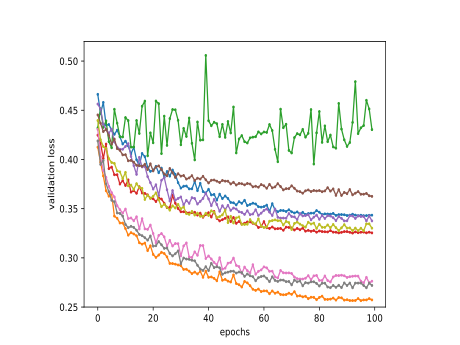
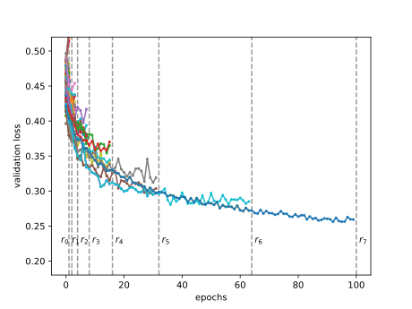

```{.python .input}
%load_ext d2lbook.tab
tab.interact_select(["pytorch"])
```

# Daugiapakopis hiperparametrų optimizavimas
:label:`sec_mf_hpo`

Neuroninių tinklų apmokymas gali būti brangus net vidutinio dydžio duomenų rinkiniuose.
Priklausomai nuo konfigūracijų erdvės (:numref:`sec_intro_config_spaces`),
hiperparametrų optimizavimui reikia dešimčių ar šimtų funkcijos įvertinimų,
kad būtų rasta gerai veikianti hiperparametrų konfigūracija. Kaip matėme
:numref:`sec_rs_async`, galime žymiai sutrumpinti bendrą HPO sienos laikrodžio
laiką išnaudodami lygiagrečius išteklius, tačiau tai nesumažina bendro
reikalingo skaičiavimo kiekio.

Šiame skyrelyje parodysime, kaip galima pagreitinti hiperparametrų konfigūracijų
įvertinimą. Tokie metodai kaip atsitiktinė paieška kiekvienam hiperparametrų
įvertinimui skiria tą patį išteklių kiekį (pvz., epochų skaičių, apmokymo duomenų taškus). :numref:`img_samples_lc` pavaizduotos
skirtingomis hiperparametrų konfigūracijomis apmokytų neuroninių
tinklų mokymosi kreivės. Po kelių epochų jau galime
vizualiai atskirti gerai veikiančias konfigūracijas nuo neoptimalių.
Tačiau mokymosi kreivės yra triukšmingos, ir gali vis tiek prireikti
visų 100 epochų, kad nustatytume geriausiai veikiančią.


:label:`img_samples_lc`

Daugiapakopis hiperparametrų optimizavimas skiria daugiau išteklių
perspektyvioms konfigūracijoms ir anksti nutraukia prastai veikiančių konfigūracijų įvertinimą.
Tai pagreitina optimizavimo procesą, nes galime išbandyti didesnį
konfigūracijų skaičių su tuo pačiu bendru išteklių kiekiu.

Formaliau, išplečiame savo apibrėžimą iš :numref:`sec_definition_hpo`,
kad mūsų tikslo funkcija $f(\mathbf{x}, r)$ gautų papildomą įvestį
$r \in [r_{\mathrm{min}}, r_{max}]$, nurodančią išteklių kiekį, kurį
esame pasirengę skirti konfigūracijos $\mathbf{x}$ įvertinimui. Darome prielaidą, kad
paklaida $f(\mathbf{x}, r)$ mažėja didėjant $r$, o skaičiavimo
kaštai $c(\mathbf{x}, r)$ didėja. Paprastai $r$ žymi
neuroninio tinklo apmokymo epochų skaičių, bet tai taip pat gali būti apmokymo
poaibio dydis arba kryžminės patikros sluoksnių skaičius.

```{.python .input}
%%tab pytorch
from d2l import torch as d2l
import numpy as np
from scipy import stats
from collections import defaultdict
d2l.set_figsize()
```

## Nuoseklus dalijimas pusiau
:label:`sec_mf_hpo_sh`

Vienas paprasčiausių būdų pritaikyti atsitiktinę paiešką daugiapakopiam atvejui yra
*nuoseklus dalijimas pusiau* (angl. *successive halving*) :cite:`jamieson-aistats16,karnin-icml13`. Pagrindinė
idėja yra pradėti nuo $N$ konfigūracijų, pavyzdžiui, atsitiktinai atrinktų iš
konfigūracijų erdvės, ir apmokyti kiekvieną iš jų tik $r_{\mathrm{min}}$ epochų. Tada
atmetame dalį prasčiausiai veikiančių bandymų, o likusius apmokome ilgiau.
Kartojant šį procesą, vis mažiau bandymų vykdoma vis ilgiau, kol bent
vienas bandymas pasiekia $r_{max}$ epochų.

Formaliau, panagrinėkime minimalų biudžetą $r_{\mathrm{min}}$ (pavyzdžiui, 1 epocha), didžiausią
biudžetą $r_{max}$, pavyzdžiui, `max_epochs` ankstesniame pavyzdyje, ir dalijimo
konstantą $\eta\in\{2, 3, \dots\}$. Paprastumo dėlei tarkime, kad
$r_{max} = r_{\mathrm{min}} \eta^K$, kur $K \in \mathbb{I}$. Pradinių
konfigūracijų skaičius tada yra $N = \eta^K$. Apibrėžkime pakopų aibę
$\mathcal{R} = \{ r_{\mathrm{min}}, r_{\mathrm{min}}\eta, r_{\mathrm{min}}\eta^2, \dots, r_{max} \}$.

Vienas nuoseklaus dalijimo pusiau raundas vyksta taip. Pradedame vykdydami $N$
bandymų iki pirmosios pakopos $r_{\mathrm{min}}$. Surūšiavę patikros paklaidas, paliekame
geriausią $1 / \eta$ dalį (tai sudaro $\eta^{K-1}$ konfigūracijų) ir
visas likusias atmetame. Išlikę bandymai apmokomi iki kitos pakopos
($r_{\mathrm{min}}\eta$ epochų), ir procesas kartojamas. Kiekvienoje pakopoje
išlieka $1 / \eta$ dalis bandymų, o jų apmokymas tęsiamas su
$\eta$ kartų didesniu biudžetu. Su šiuo konkrečiu $N$ pasirinkimu iki viso biudžeto $r_{max}$ bus apmokytas tik vienas
bandymas. Pasibaigus tokiam nuoseklaus dalijimo pusiau raundui, pradedame kitą su nauja pradinių
konfigūracijų aibe ir kartojame, kol išnaudojamas visas biudžetas.



Nuoseklų dalijimą pusiau įgyvendiname kurdami `HPOScheduler` bazinės klasės poklasį iš :numref:`sec_api_hpo`,
leisdami bendram `HPOSearcher` objektui
atrinkti konfigūracijas (mūsų pavyzdyje tai bus `RandomSearcher`).
Be to, naudotojas turi perduoti minimalų išteklių kiekį $r_{\mathrm{min}}$, didžiausią
išteklių kiekį $r_{max}$ ir $\eta$ kaip įvestį. Planuoklio viduje palaikome
konfigūracijų, kurias dar reikia įvertinti dabartinei pakopai
$r_i$, eilę. Eilę atnaujiname kaskart, kai pereiname į kitą pakopą.

```{.python .input  n=2}
class SuccessiveHalvingScheduler(d2l.HPOScheduler):  #@save
    def __init__(self, searcher, eta, r_min, r_max, prefact=1):
        self.save_hyperparameters()
        # Compute K, which is later used to determine the number of configurations
        self.K = int(np.log(r_max / r_min) / np.log(eta))
        # Define the rungs
        self.rung_levels = [r_min * eta ** k for k in range(self.K + 1)]
        if r_max not in self.rung_levels:
            # The final rung should be r_max
            self.rung_levels.append(r_max)
            self.K += 1
        # Bookkeeping
        self.observed_error_at_rungs = defaultdict(list)
        self.all_observed_error_at_rungs = defaultdict(list)
        # Our processing queue
        self.queue = []
```

Pradžioje mūsų eilė tuščia, ir ją užpildome
$n = \textrm{prefact} \cdot \eta^{K}$ konfigūracijų, kurios pirmiausia įvertinamos
mažiausioje pakopoje $r_{\mathrm{min}}$. Čia $\textrm{prefact}$ leidžia pakartotinai naudoti
mūsų kodą kitame kontekste. Šio skyrelio tikslais fiksuojame
$\textrm{prefact} = 1$. Kaskart, kai atsiranda išteklių ir `HPOTuner`
objektas kreipiasi į funkciją `suggest`, grąžiname eilės elementą. Kai
baigiame vieną nuoseklaus dalijimo pusiau raundą, t. y. įvertinome visas
išlikusias konfigūracijas aukščiausiame išteklių lygyje $r_{max}$ ir mūsų eilė
tuščia, visą procesą pradedame iš naujo su nauja atsitiktinai atrinkta
konfigūracijų aibe.

```{.python .input  n=12}
%%tab pytorch
@d2l.add_to_class(SuccessiveHalvingScheduler)  #@save
def suggest(self):
    if len(self.queue) == 0:
        # Start a new round of successive halving
        # Number of configurations for the first rung:
        n0 = int(self.prefact * self.eta ** self.K)
        for _ in range(n0):
            config = self.searcher.sample_configuration()
            config["max_epochs"] = self.r_min  # Set r = r_min
            self.queue.append(config)
    # Return an element from the queue
    return self.queue.pop()
```

Kai surenkame naują duomenų tašką, pirmiausia atnaujiname ieškiklio modulį.
Po to patikriname, ar jau surinkome visus dabartinės pakopos duomenų taškus.
Jei taip, surūšiuojame visas konfigūracijas ir geriausias $\frac{1}{\eta}$
konfigūracijų dalį įstumiame į eilę.

```{.python .input  n=4}
%%tab pytorch
@d2l.add_to_class(SuccessiveHalvingScheduler)  #@save
def update(self, config: dict, error: float, info=None):
    ri = int(config["max_epochs"])  # Rung r_i
    # Update our searcher, e.g if we use Bayesian optimization later
    self.searcher.update(config, error, additional_info=info)
    self.all_observed_error_at_rungs[ri].append((config, error))
    if ri < self.r_max:
        # Bookkeeping
        self.observed_error_at_rungs[ri].append((config, error))
        # Determine how many configurations should be evaluated on this rung
        ki = self.K - self.rung_levels.index(ri)
        ni = int(self.prefact * self.eta ** ki)
        # If we observed all configuration on this rung r_i, we estimate the
        # top 1 / eta configuration, add them to queue and promote them for
        # the next rung r_{i+1}
        if len(self.observed_error_at_rungs[ri]) >= ni:
            kiplus1 = ki - 1
            niplus1 = int(self.prefact * self.eta ** kiplus1)
            best_performing_configurations = self.get_top_n_configurations(
                rung_level=ri, n=niplus1
            )
            riplus1 = self.rung_levels[self.K - kiplus1]  # r_{i+1}
            # Queue may not be empty: insert new entries at the beginning
            self.queue = [
                dict(config, max_epochs=riplus1)
                for config in best_performing_configurations
            ] + self.queue
            self.observed_error_at_rungs[ri] = []  # Reset
```

Konfigūracijos rūšiuojamos pagal jų stebėtą našumą dabartinėje
pakopoje.

```{.python .input  n=4}
%%tab pytorch

@d2l.add_to_class(SuccessiveHalvingScheduler)  #@save
def get_top_n_configurations(self, rung_level, n):
    rung = self.observed_error_at_rungs[rung_level]
    if not rung:
        return []
    sorted_rung = sorted(rung, key=lambda x: x[1])
    return [x[0] for x in sorted_rung[:n]]
```

Pažiūrėkime, kaip nuoseklus dalijimas pusiau veikia mūsų neuroninio tinklo pavyzdyje.
Naudosime $r_{\mathrm{min}} = 2$, $\eta = 2$, $r_{max} = 10$, taigi pakopų lygiai yra
$2, 4, 8, 10$.

```{.python .input  n=5}
min_number_of_epochs = 2
max_number_of_epochs = 10
eta = 2
num_gpus=1

config_space = {
    "learning_rate": stats.loguniform(1e-2, 1),
    "batch_size": stats.randint(32, 256),
}
initial_config = {
    "learning_rate": 0.1,
    "batch_size": 128,
}
```

Tiesiog pakeičiame planuoklį savo nauju `SuccessiveHalvingScheduler`.

```{.python .input  n=14}
searcher = d2l.RandomSearcher(config_space, initial_config=initial_config)
scheduler = SuccessiveHalvingScheduler(
    searcher=searcher,
    eta=eta,
    r_min=min_number_of_epochs,
    r_max=max_number_of_epochs,
)
tuner = d2l.HPOTuner(
    scheduler=scheduler,
    objective=d2l.hpo_objective_lenet,
)
tuner.run(number_of_trials=30)
```

Galime vizualizuoti visų įvertintų konfigūracijų mokymosi kreives.
Dauguma konfigūracijų nutraukiamos anksti, ir iki $r_{max}$ išlieka tik geriau
veikiančios konfigūracijos. Palyginkite tai su įprasta atsitiktine paieška,
kuri kiekvienai konfigūracijai skirtų $r_{max}$.

```{.python .input  n=19}
for rung_index, rung in scheduler.all_observed_error_at_rungs.items():
    errors = [xi[1] for xi in rung]
    d2l.plt.scatter([rung_index] * len(errors), errors)
d2l.plt.xlim(min_number_of_epochs - 0.5, max_number_of_epochs + 0.5)
d2l.plt.xticks(
    np.arange(min_number_of_epochs, max_number_of_epochs + 1),
    np.arange(min_number_of_epochs, max_number_of_epochs + 1)
)
d2l.plt.ylabel("validation error")
d2l.plt.xlabel("epochs")
```

Galiausiai atkreipkite dėmesį į tam tikrą mūsų `SuccessiveHalvingScheduler`
įgyvendinimo sudėtingumą. Tarkime, kad darbininkas yra laisvas vykdyti užduotį, o
`suggest` iškviečiamas, kai dabartinė pakopa jau beveik visiškai užpildyta, bet
kitas darbininkas vis dar užimtas įvertinimu. Kadangi neturime
šio darbininko metrikos reikšmės, negalime nustatyti geriausios $1 / \eta$ dalies, kad atvertume
kitą pakopą. Kita vertus, norime priskirti užduotį savo laisvam darbininkui,
kad jis nedykinėtų. Mūsų sprendimas yra pradėti naują nuoseklaus
dalijimo pusiau raundą ir priskirti darbininką pirmajam jo bandymui. Tačiau kai tik pakopa
baigiama `update`, užtikriname, kad naujos konfigūracijos būtų įterptos į
eilės pradžią, kad jos turėtų pirmenybę prieš kito raundo
konfigūracijas.

## Santrauka

Šiame skyrelyje pristatėme daugiapakopio hiperparametrų
optimizavimo sąvoką, kai darome prielaidą, kad turime prieigą prie pigiai įvertinamų
tikslo funkcijos aproksimacijų, pavyzdžiui, patikros paklaidos po tam tikro
apmokymo epochų skaičiaus kaip pakaitalo patikros paklaidai po viso epochų skaičiaus.
Daugiapakopis hiperparametrų optimizavimas leidžia sumažinti bendrą
HPO skaičiavimą, o ne tik sienos laikrodžio laiką.

Įgyvendinome ir įvertinome nuoseklų dalijimą pusiau – paprastą, bet efektyvų
daugiapakopį HPO algoritmą.


:begin_tab:`pytorch`
[Diskusijos](https://discuss.d2l.ai/t/12094)
:end_tab:
