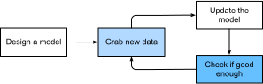
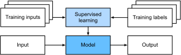
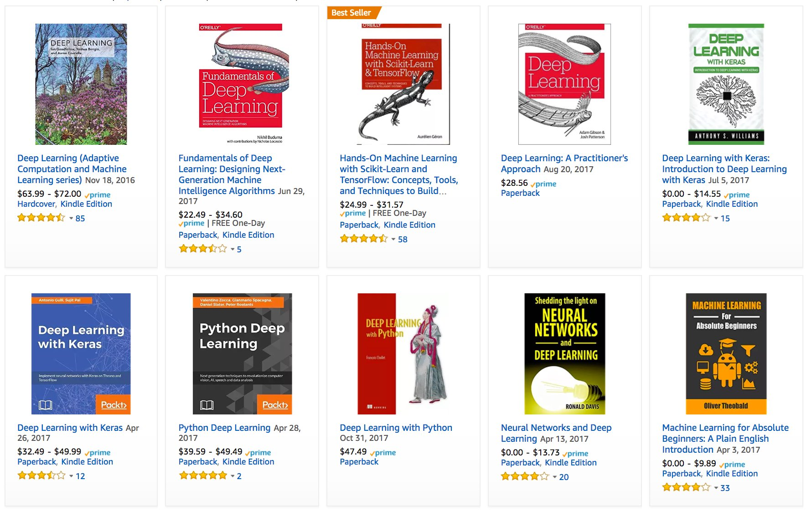
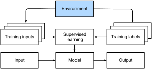
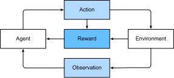
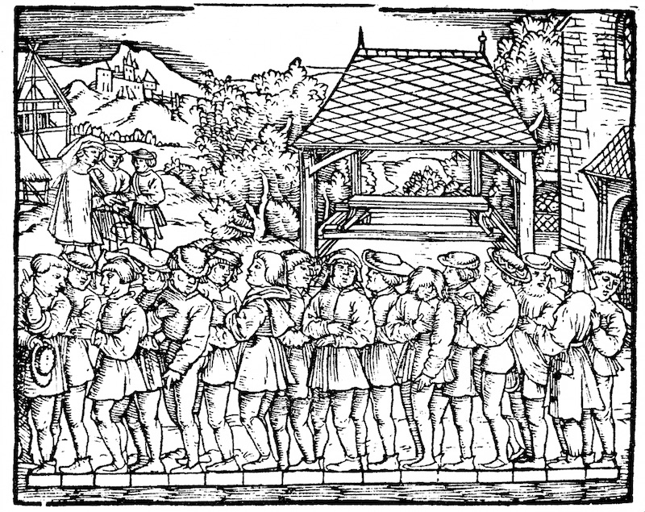

# Įvadas
:label:`chap_introduction`

Dar visai neseniai beveik kiekviena kompiuterio programa,
su kuria galėjote bendrauti
įprastą dieną,
buvo sukurta kaip griežtas taisyklių rinkinys,
tiksliai nurodantis, kaip ji turi elgtis.
Tarkime, kad norėjome parašyti programą
elektroninės prekybos platformai valdyti.
Kelias valandas susikūprinę prie lentos
ir svarstydami uždavinį,
galime sutarti dėl bendrų veikiančio sprendimo brūkšnių, pavyzdžiui:
(i) naudotojai su programa bendrauja per sąsają,
veikiančią interneto naršyklėje ar mobiliojoje programėlėje;
(ii) mūsų programa bendrauja su komercinio lygio duomenų bazių varikliu,
kad sektų kiekvieno naudotojo būseną ir saugotų
istorinių sandorių įrašus;
ir (iii) mūsų programos šerdyje
*verslo logika* (galima sakyti, mūsų programos *smegenys*)
išdėsto taisyklių rinkinį, kuris kiekvieną įsivaizduojamą aplinkybę
susieja su atitinkamu veiksmu, kurį mūsų programa turi atlikti.

Kad sukurtume savo programos smegenis,
galime išvardyti visus dažnus įvykius,
kuriuos mūsų programa turi apdoroti.
Pavyzdžiui, kai tik klientas spusteli,
kad pridėtų prekę į savo krepšelį,
mūsų programa turi pridėti įrašą
į krepšelio duomenų bazės lentelę,
susiedama to naudotojo ID
su užsakytos prekės ID.
Tada galėtume bandyti peržiūrėti
visus įmanomus ribinius atvejus,
tikrindami savo taisyklių tinkamumą
ir atlikdami reikiamus pakeitimus.
Kas atsitinka, jei naudotojas
pradeda pirkimą su tuščiu krepšeliu?
Nors nedaug kūrėjų iš pirmo karto viską padaro
visiškai teisingai
(gali prireikti kelių bandomųjų paleidimų klaidoms ištaisyti),
daugumą tokių programų galime parašyti
ir užtikrintai paleisti
*dar prieš* pamatydami tikrą klientą.
Mūsų gebėjimas rankiniu būdu projektuoti automatizuotas sistemas,
kurios valdo veikiančius produktus ir sistemas,
dažnai naujose situacijose,
yra nepaprastas pažintinis žygdarbis.
O kai sugebate sukurti sprendimus,
veikiančius $100\%$ atvejų,
paprastai neturėtumėte
sukti galvos dėl mašininio mokymosi.

Mašininio mokymosi mokslininkų bendruomenei augant,
daugelis užduočių, kurias norėtume automatizuoti,
taip lengvai nepasiduoda žmogaus išradingumui.
Įsivaizduokite, kad vėl susikūprinę prie lentos
su protingiausiais jums žinomais žmonėmis,
bet šįkart sprendžiate
vieną iš šių uždavinių:

* Parašyti programą, kuri prognozuoja rytojaus orus pagal geografinę informaciją, palydovų vaizdus ir pastarojo laikotarpio orų duomenis.
* Parašyti programą, kuri priima laisvos formos tekstu išreikštą faktinį klausimą ir jį teisingai atsako.
* Parašyti programą, kuri pagal vaizdą atpažįsta kiekvieną jame pavaizduotą žmogų ir apveda kiekvieną kontūru.
* Parašyti programą, kuri naudotojams pateikia produktus, kurie jiems greičiausiai patiks, bet kurių jie tikriausiai nesutiktų įprastai naršydami.

Šiems uždaviniams spręsti
net elitiniams programuotojams būtų sunku
sukurti sprendimus nuo nulio.
Priežastys gali būti įvairios.
Kartais ieškoma programa
atitinka šabloną, kuris keičiasi laikui bėgant,
todėl nėra fiksuoto teisingo atsakymo!
Tokiais atvejais bet kuris sėkmingas sprendimas
turi sklandžiai prisitaikyti prie besikeičiančio pasaulio.
Kitais atvejais ryšys (tarkime, tarp pikselių
ir abstrakčių kategorijų) gali būti per sudėtingas,
reikalaujantis tūkstančių ar milijonų skaičiavimų
ir besiremiantis nežinomais principais.
Vaizdų atpažinimo atveju
tikslūs užduočiai atlikti reikalingi žingsniai
yra už mūsų sąmoningo supratimo ribų,
nors mūsų pasąmonės pažintiniai procesai
užduotį atlieka be pastangų.


*Mašininis mokymasis* yra algoritmų,
galinčių mokytis iš patirties, tyrimas.
Mašininio mokymosi algoritmui kaupiant vis daugiau patirties,
dažniausiai stebėjimo duomenų
ar sąveikos su aplinka forma,
jo našumas gerėja.
Palyginkite tai su mūsų deterministine elektroninės prekybos platforma,
kuri laikosi tos pačios verslo logikos,
kad ir kiek patirties sukauptų,
kol patys kūrėjai išmoksta ir nusprendžia,
kad laikas atnaujinti programinę įrangą.
Šioje knygoje išmokysime jus
mašininio mokymosi pagrindų,
ypač daug dėmesio skirdami *giliajam mokymuisi* –
galingam metodų rinkiniui,
skatinančiam inovacijas tokiose skirtingose srityse
kaip kompiuterinė rega,
natūraliosios kalbos apdorojimas, sveikatos priežiūra ir genomika.

## Motyvuojantis pavyzdys

Prieš pradėdami rašyti, šios knygos autoriai,
kaip ir didelė dalis darbo jėgos, turėjo prisigerti kofeino.
Sėdome į automobilį ir pajudėjome.
Naudodamas „iPhone", Alex tarė „Hey Siri",
pažadindamas telefono balso atpažinimo sistemą.
Tada Mu įsakė „kelias į kavinę „Blue Bottle"".
Telefonas greitai parodė jo komandos transkripciją.
Jis taip pat atpažino, kad prašome nurodyti kelią,
ir paleido žemėlapių programą (angl. *app*),
kad įvykdytų mūsų prašymą.
Paleista žemėlapių programa nustatė keletą maršrutų.
Šalia kiekvieno maršruto telefonas parodė prognozuojamą kelionės laiką.
Nors ši istorija sugalvota pedagoginiam patogumui,
ji rodo, kad vos per kelias sekundes
mūsų kasdienė sąveika su išmaniuoju telefonu
gali pasitelkti kelis mašininio mokymosi modelius.


Įsivaizduokite, kad tiesiog rašote programą, reaguojančią į *žadinimo žodį* (angl. *wake word*),
tokį kaip „Alexa", „OK Google" ir „Hey Siri".
Pabandykite ją užprogramuoti vieni kambaryje,
turėdami tik kompiuterį ir kodo redaktorių,
kaip parodyta :numref:`fig_wake_word`.
Kaip tokią programą parašytumėte iš pirmųjų principų?
Pagalvokite... uždavinys sunkus.
Kas sekundę mikrofonas surenka maždaug
44 000 atskaitų.
Kiekviena atskaita yra garso bangos amplitudės matavimas.
Kokia taisyklė galėtų patikimai susieti neapdoroto garso fragmentą su patikliomis prognozėmis
$\{\textrm{taip}, \textrm{ne}\}$
apie tai, ar fragmente yra žadinimo žodis?
Jei užstrigote, nesijaudinkite.
Mes irgi nežinome, kaip tokią programą parašyti nuo nulio.
Todėl ir naudojame mašininį mokymąsi.


:label:`fig_wake_word`


Štai gudrybė.
Dažnai, net kai nežinome, kaip kompiuteriui
aiškiai nurodyti, kaip susieti įvestis su išvestimis,
mes vis tiek patys sugebame atlikti tą pažintinį žygdarbį.
Kitaip tariant, net jei nežinote,
kaip užprogramuoti kompiuterį atpažinti žodį „Alexa",
jūs pats jį sugebate atpažinti.
Turėdami šį gebėjimą, galime surinkti didžiulį *duomenų rinkinį* (angl. *dataset*),
kuriame yra garso fragmentų pavyzdžių ir susijusių žymių,
nurodančių, kuriuose fragmentuose yra žadinimo žodis.
Šiuo metu vyraujančiame mašininio mokymosi požiūryje
nebandome kurti sistemos, skirtos
*aiškiai* atpažinti žadinimo žodžius.
Vietoj to apibrėžiame lanksčią programą,
kurios elgesį lemia keletas *parametrų*.
Tada naudojame duomenų rinkinį geriausioms galimoms parametrų reikšmėms nustatyti,
t. y. toms, kurios pagerina mūsų programos veikimą
pagal pasirinktą veikimo matą.

Parametrus galite įsivaizduoti kaip rankenėles, kurias galime sukti,
keisdami programos elgesį.
Kai parametrai fiksuoti, programą vadiname *modeliu*.
Visų skirtingų programų (įvesčių ir išvesčių atvaizdžių),
kurias galime sukurti vien keisdami parametrus,
aibė vadinama modelių *šeima*.
O „metaprograma", kuri naudoja mūsų duomenų rinkinį
parametrams parinkti, vadinama *mokymosi algoritmu*.

Prieš pradėdami taikyti mokymosi algoritmą,
turime tiksliai apibrėžti uždavinį,
tiksliai nustatydami įvesčių ir išvesčių pobūdį
ir pasirinkdami tinkamą modelių šeimą.
Šiuo atveju
mūsų modelis kaip *įvestį* gauna garso fragmentą,
o kaip *išvestį* modelis
pateikia pasirinkimą iš
$\{\textrm{taip}, \textrm{ne}\}$.
Jei viskas vyks pagal planą,
modelio spėjimai paprastai bus teisingi
dėl to, ar fragmente yra žadinimo žodis.

Jei pasirinksime tinkamą modelių šeimą,
turėtų egzistuoti viena rankenėlių padėtis,
kuriai esant modelis pasako „taip" kiekvieną kartą išgirdęs žodį „Alexa".
Kadangi žadinimo žodžio pasirinkimas yra savavališkas,
mums greičiausiai prireiks pakankamai turtingos modelių šeimos, kuri,
pakeitus rankenėlių padėtį, galėtų pasakyti „taip"
tik išgirdusi žodį „Apricot".
Tikimės, kad ta pati modelių šeima turėtų tikti
„Alexa" ir „Apricot" atpažinimui,
nes intuityviai jos atrodo panašios užduotys.
Tačiau mums gali prireikti visiškai kitokios modelių šeimos,
jei norime dirbti su iš esmės skirtingomis įvestimis ar išvestimis,
pavyzdžiui, jei norėtume atvaizduoti paveikslėlius į jų aprašymus
arba anglų kalbos sakinius į kinų kalbos sakinius.

Kaip galite nuspėti, jei visas rankenėles nustatytume atsitiktinai,
vargu ar mūsų modelis atpažins „Alexa",
„Apricot" ar bet kurį kitą anglų kalbos žodį.
Mašininiame mokymesi
*mokymasis* yra procesas,
kurio metu surandame tinkamą rankenėlių padėtį,
kad iš modelio išgautume norimą elgesį.
Kitaip tariant,
mes *apmokome* savo modelį naudodami duomenis.
Kaip parodyta :numref:`fig_ml_loop`, apmokymo procesas paprastai atrodo taip:

1. Pradėkite nuo atsitiktinai inicializuoto modelio, kuris nieko naudingo negali.
1. Paimkite dalį savo duomenų (pvz., garso fragmentus ir atitinkamas $\{\textrm{taip}, \textrm{ne}\}$ žymes).
1. Pakoreguokite rankenėles, kad modelis geriau veiktų pagal šiuos pavyzdžius.
1. Kartokite 2 ir 3 žingsnius, kol modelis taps puikus.


:label:`fig_ml_loop`

Apibendrinant, užuot programavę žadinimo žodžio atpažintuvą,
programuojame programą, kuri gali *išmokti* atpažinti žadinimo žodžius,
jei jai pateikiamas didelis žymėtas duomenų rinkinys.
Šį programos elgesio nustatymą pateikiant jai duomenų rinkinį
galite laikyti *programavimu duomenimis*.
Tai reiškia, kad galime „užprogramuoti" kačių detektorių,
pateikdami savo mašininio mokymosi sistemai
daug kačių ir šunų pavyzdžių.
Taip detektorius galiausiai išmoks išduoti
labai didelį teigiamą skaičių, jei tai katė,
labai didelį neigiamą skaičių, jei tai šuo,
ir kažką arčiau nulio, jei neužtikrintas.
Tai vos paliečia tai, ką gali mašininis mokymasis.
Gilusis mokymasis, kurį vėliau paaiškinsime išsamiau,
yra tik vienas iš daugelio populiarių metodų
mašininio mokymosi uždaviniams spręsti.


## Pagrindiniai komponentai

Savo žadinimo žodžio pavyzdyje aprašėme duomenų rinkinį,
sudarytą iš garso fragmentų ir dvejetainių žymių,
ir bendrais bruožais parodėme, kaip galėtume apmokyti
modelį, aproksimuojantį fragmentų atvaizdavimą į klasifikavimo rezultatus.
Tokio tipo uždavinys,
kai bandome prognozuoti nurodytą nežinomą žymę
pagal žinomas įvestis,
turėdami duomenų rinkinį, sudarytą iš pavyzdžių,
kurių žymės žinomos,
vadinamas *prižiūrimu mokymu*.
Tai tik vienas iš daugelio mašininio mokymosi uždavinių tipų.
Prieš nagrinėdami kitas atmainas,
norėtume daugiau papasakoti
apie kai kuriuos pagrindinius komponentus, kurie mus lydės,
kad ir kokio tipo mašininio mokymosi uždavinį spręstume:

1. *Duomenys*, iš kurių galime mokytis.
1. *Modelis*, nurodantis, kaip transformuoti duomenis.
1. *Tikslo funkcija*, kiekybiškai įvertinanti, kaip gerai (ar blogai) veikia modelis.
1. *Algoritmas*, koreguojantis modelio parametrus tikslo funkcijai optimizuoti.

### Duomenys

Galbūt savaime suprantama, kad be duomenų duomenų mokslo daryti neįmanoma.
Galėtume praleisti šimtus puslapių svarstydami, kas tiksliai yra *duomenys*,
tačiau kol kas sutelksime dėmesį į pagrindines
mus dominančių duomenų rinkinių savybes.
Paprastai mus domina pavyzdžių rinkinys.
Kad galėtume naudingai dirbti su duomenimis, paprastai
reikia sugalvoti tinkamą skaitinį vaizdavimą.
Kiekvieną *pavyzdį* (angl. *example*, arba *data point*, *data instance*, *sample*)
paprastai sudaro atributų rinkinys,
vadinamas *požymiais* (angl. *features*; kartais vadinamais *kovariantėmis* arba *įvestimis*),
pagal kuriuos modelis turi pateikti savo prognozes.
Prižiūrimo mokymo uždaviniuose
mūsų tikslas yra prognozuoti ypatingo atributo reikšmę,
vadinamo *žyme* (angl. *label*, arba *target*),
kuris nėra modelio įvesties dalis.

Jei dirbtume su vaizdų duomenimis,
kiekvieną pavyzdį galėtų sudaryti
atskira nuotrauka (požymiai)
ir skaičius, nurodantis kategoriją,
kuriai nuotrauka priklauso (žymė).
Nuotrauka skaitiniu būdu būtų vaizduojama
trimis skaitinių reikšmių tinklais, žyminčiais
raudonos, žalios ir mėlynos šviesos ryškumą
kiekvienoje pikselio vietoje.
Pavyzdžiui, $200\times 200$ pikselių spalvotą nuotrauką
sudarytų $200\times200\times3=120000$ skaitinių reikšmių.

Arba galėtume dirbti su elektroninių sveikatos įrašų duomenimis
ir spręsti užduotį prognozuoti tikimybę,
kad duotas pacientas išgyvens kitas 30 dienų.
Čia mūsų požymius galėtų sudaryti
lengvai prieinamų atributų
ir dažnai registruojamų matavimų rinkinys,
įskaitant amžių, gyvybinius požymius, gretutines ligas,
dabartinius vaistus ir neseniai atliktas procedūras.
Apmokymui prieinama žymė būtų dvejetainė reikšmė,
nurodanti, ar kiekvienas istorinių duomenų pacientas
išgyveno per 30 dienų laikotarpį.

Tokiais atvejais, kai kiekvieną pavyzdį apibūdina
tas pats skaitinių požymių skaičius,
sakome, kad įvestys yra fiksuoto ilgio vektoriai,
o (pastovų) vektorių ilgį vadiname
duomenų *dimensija*.
Kaip galite įsivaizduoti, fiksuoto ilgio įvestys gali būti patogios,
nes viena problema mažiau, dėl kurios reikia sukti galvą.
Tačiau ne visus duomenis galima lengvai
pavaizduoti kaip *fiksuoto ilgio* vektorius.
Nors galime tikėtis, kad mikroskopo vaizdai
gaunami iš standartinės įrangos,
negalime tikėtis, kad iš interneto surinkti vaizdai
visi turės tą pačią skiriamąją gebą ar formą.
Vaizdams galėtume apsvarstyti
apkirpimą iki standartinio dydžio,
tačiau ši strategija mus nuveda tik iki tam tikros ribos.
Rizikuojame prarasti informaciją apkirptose dalyse.
Be to, tekstiniai duomenys dar atkakliau priešinasi fiksuoto ilgio
vaizdavimui.
Pagalvokite apie klientų atsiliepimus,
paliekamus elektroninės prekybos svetainėse, tokiose kaip Amazon, IMDb ir TripAdvisor.
Kai kurie trumpi: „smirdi!".
Kiti dėstomi puslapiais.
Vienas pagrindinių gilaus mokymosi pranašumų prieš tradicinius metodus
yra santykinis lengvumas, kuriuo šiuolaikiniai modeliai
gali apdoroti *kintamo ilgio* duomenis.

Paprastai kuo daugiau turime duomenų, tuo lengviau mums dirbti.
Kai turime daugiau duomenų, galime apmokyti galingesnius modelius
ir mažiau remtis išankstinėmis prielaidomis.
Perėjimas nuo (santykinai) mažų prie didžiųjų duomenų
labai prisideda prie šiuolaikinio gilaus mokymosi sėkmės.
Kad tai būtų aiškiau, daugelis
įdomiausių gilaus mokymosi modelių
be didelių duomenų rinkinių neveikia.
Kai kurie kiti gali veikti ir su nedideliu duomenų kiekiu,
tačiau nėra geresni už tradicinius metodus.

Galiausiai nepakanka turėti daug duomenų
ir juos išmaniai apdoroti.
Mums reikia *tinkamų* duomenų.
Jei duomenyse pilna klaidų
arba jei pasirinkti požymiai nėra prognostiniai
dominančiam tiksliniam dydžiui,
mokymasis nepavyks.
Šią situaciją gerai atspindi štampas:
*šiukšlės įėjime – šiukšlės išėjime* (angl. *garbage in, garbage out*).
Be to, prasta prognozavimo kokybė
nėra vienintelė galima pasekmė.
Jautriuose mašininio mokymosi taikymuose,
tokiuose kaip nusikaltimų prognozavimas, gyvenimo aprašymų atranka
ir skolinimo rizikos modeliai,
turime būti ypač budrūs
dėl šiukšlių duomenų pasekmių.
Vienas dažnai pasitaikantis nesėkmės būdas susijęs su duomenų rinkiniais,
kuriuose kai kurios žmonių grupės nėra atstovaujamos
apmokymo duomenyse.
Įsivaizduokite, kad taikote odos vėžio atpažinimo sistemą,
kuri niekada nebuvo mačiusi juodos odos.
Nesėkmė taip pat gali įvykti, kai duomenys
ne tik nepakankamai atstovauja kai kurioms grupėms,
bet ir atspindi visuomenės išankstinį nusistatymą.
Pavyzdžiui, jei ankstesni įdarbinimo sprendimai
naudojami apmokyti prognozavimo modelį,
kuris bus naudojamas gyvenimo aprašymams atrinkti,
mašininio mokymosi modeliai gali netyčia
perimti ir automatizuoti istorines neteisybes.
Atkreipkite dėmesį, kad visa tai gali nutikti be to, kad duomenų mokslininkas
aktyviai sąmokslautų ar net žinotų.


### Modeliai

Dauguma mašininio mokymosi tam tikra prasme reiškia duomenų transformavimą.
Galime norėti sukurti sistemą, kuri priima nuotraukas ir prognozuoja šypsenos intensyvumą.
Arba
galime norėti priimti jutiklių rodmenų rinkinį
ir prognozuoti, kiek normalūs ar anomalūs tie rodmenys.
*Modeliu* vadiname skaičiavimo mechanizmą, priimantį
vieno tipo duomenis
ir išduodantį galbūt kitokio tipo prognozes.
Visų pirma mus domina *statistiniai modeliai*,
kuriuos galima įvertinti iš duomenų.
Nors paprasti modeliai puikiai tinka
atitinkamai paprastiems uždaviniams spręsti,
uždaviniai,
kuriems skiriame dėmesį šioje knygoje, peržengia klasikinių metodų ribas.
Gilusis mokymasis nuo klasikinių požiūrių skiriasi
visų pirma galingų modelių, į kuriuos sutelkia dėmesį, rinkiniu.
Šiuos modelius sudaro daug iš eilės einančių duomenų transformacijų,
sujungtų iš viršaus į apačią, todėl ir pavadinimas – *gilusis mokymasis*.
Eidami prie giliųjų modelių aptarimo,
aptarsime ir keletą tradicinių metodų.

### Tikslo funkcijos

Anksčiau mašininį mokymąsi pristatėme kaip mokymąsi iš patirties.
*Mokymusi* čia vadiname
tam tikros užduoties atlikimo gerėjimą laikui bėgant.
Bet kas gali pasakyti, kas laikytina pagerėjimu?
Galite įsivaizduoti, kad galėtume pasiūlyti atnaujinti savo modelį,
o kai kurie žmonės gali nesutikti, ar mūsų pasiūlymas
yra pagerėjimas, ar ne.

Kad sukurtume formalią matematinę mokymosi mašinų sistemą,
mums reikia formalių matų, kaip gerai (ar blogai) veikia mūsų modeliai.
Mašininiame mokymesi ir bendriau optimizavime
juos vadiname *tikslo funkcijomis*.
Pagal susitarimą tikslo funkcijas paprastai apibrėžiame taip,
kad mažesnė reikšmė būtų geresnė.
Tai tik susitarimas.
Bet kurią funkciją,
kurios didesnė reikšmė geresnė, galite paversti nauja funkcija,
kokybiškai identiška, bet kurios mažesnė reikšmė geresnė,
pakeisdami ženklą.
Kadangi pasirenkame, kad mažesnė reikšmė yra geresnė, šios funkcijos kartais vadinamos
*nuostolių funkcijomis*.

Bandant prognozuoti skaitines reikšmes,
dažniausia nuostolių funkcija yra *kvadratinė paklaida*,
t. y. skirtumo tarp prognozės ir
etaloninės tikslinės reikšmės kvadratas.
Klasifikavimo atveju dažniausias tikslas
yra minimizuoti klaidų dažnį,
t. y. pavyzdžių dalį,
kurių mūsų prognozės nesutampa su etalonu.
Kai kurias tikslo funkcijas (pvz., kvadratinę paklaidą) lengva optimizuoti,
o kitas (pvz., klaidų dažnį) tiesiogiai optimizuoti sunku
dėl nediferencijuojamumo ar kitų sunkumų.
Šiais atvejais įprasta optimizuoti *pakaitinę tikslo funkciją*.

Optimizavimo metu nuostolius laikome
modelio parametrų funkcija
ir apmokymo duomenų rinkinį traktuojame kaip konstantą.
Geriausias modelio parametrų reikšmes randame
minimizuodami nuostolius, patirtus rinkinyje,
kurį sudaro apmokymui surinkti pavyzdžiai.
Tačiau gerai veikti apmokymo duomenims
negarantuoja, kad gerai veiksime nematytiems duomenims.
Todėl paprastai norėsime padalyti turimus duomenis į dvi dalis:
*apmokymo duomenų rinkinį* (angl. *training dataset*, arba *training set*), skirtą modelio parametrams išmokti;
ir *testavimo duomenų rinkinį* (angl. *test dataset*, arba *test set*), kuris paliekamas vertinimui.
Galų gale paprastai pateikiame,
kaip mūsų modeliai veikia abiejose dalyse.
Apmokymo rezultatus galite laikyti
analogiškais balams, kuriuos studentas gauna
per bandomuosius egzaminus, naudojamus ruošiantis tikram baigiamajam egzaminui.
Net jei rezultatai teikia vilčių,
tai negarantuoja sėkmės per baigiamąjį egzaminą.
Mokymosi metu studentas
gali pradėti įsiminti bandomuosius klausimus
ir atrodyti įvaldęs temą, bet suklupti,
susidūręs su anksčiau nematytais klausimais
tikrame baigiamajame egzamine.
Kai modelis gerai veikia apmokymo duomenų rinkinyje,
bet nesugeba generalizuotis nematytiems duomenims,
sakome, kad jis *persimokė* (angl. *overfitting*) apmokymo duomenims.


### Optimizavimo algoritmai

Kai turime duomenų šaltinį ir jų vaizdavimą,
modelį ir gerai apibrėžtą tikslo funkciją,
mums reikia algoritmo, galinčio ieškoti
geriausių galimų parametrų nuostolių funkcijai minimizuoti.
Populiarūs giliojo mokymosi optimizavimo algoritmai
remiasi metodu, vadinamu *gradientiniu nusileidimu*.
Trumpai tariant, kiekviename žingsnyje šis metodas
kiekvienam parametrui patikrina,
kaip pasikeistų apmokymo rinkinio nuostoliai,
jei tą parametrą sutrikdytume vos nežymiai.
Tada jis atnaujintų parametrą
kryptimi, mažinančia nuostolius.


## Mašininio mokymosi uždavinių rūšys

Žadinimo žodžio uždavinys mūsų motyvuojančiame pavyzdyje
yra tik vienas iš daugelio,
kuriuos gali spręsti mašininis mokymasis.
Kad toliau motyvuotume skaitytoją
ir suteiktume bendrą kalbą,
kuri mus lydės visoje knygoje,
dabar pateikiame bendrą mašininio mokymosi uždavinių
panoramos apžvalgą.

### Prižiūrimas mokymas

Prižiūrimas mokymas apibūdina užduotis,
kuriose mums pateikiamas duomenų rinkinys,
turintis ir požymius, ir žymes,
ir prašoma sukurti modelį, kuris prognozuoja žymes, kai
pateikiami įvesties požymiai.
Kiekviena požymių ir žymės pora vadinama pavyzdžiu.
Kartais, kai kontekstas aiškus,
terminą *pavyzdžiai* galime vartoti
įvesčių rinkiniui žymėti,
net kai atitinkamos žymės nežinomos.
Priežiūra atsiranda todėl, kad parametrams parinkti
mes (prižiūrėtojai) pateikiame modeliui
duomenų rinkinį, sudarytą iš pažymėtų pavyzdžių.
Tikimybiniais terminais paprastai mus domina įvertinti
žymės sąlyginę tikimybę, kai duoti įvesties požymiai.
Nors tai tik viena iš kelių paradigmų,
prižiūrimas mokymas sudaro daugumą sėkmingų
mašininio mokymosi taikymų pramonėje.
Iš dalies taip yra todėl, kad daug svarbių užduočių
galima aiškiai apibūdinti kaip kažko nežinomo tikimybės įvertinimą,
kai duotas konkretus turimų duomenų rinkinys:

* Prognozuoti vėžys ar ne vėžys, kai duotas kompiuterinės tomografijos vaizdas.
* Prognozuoti teisingą vertimą į prancūzų kalbą, kai duotas sakinys anglų kalba.
* Prognozuoti akcijos kainą kitą mėnesį pagal šio mėnesio finansinės atskaitomybės duomenis.

Nors visi prižiūrimo mokymo uždaviniai
apibūdinami paprastu aprašymu
„žymių prognozavimas pagal įvesties požymius",
pats prižiūrimas mokymas gali įgauti įvairias formas
ir reikalauti daugybės modeliavimo sprendimų,
priklausomai (be kitų aplinkybių) nuo
įvesčių ir išvesčių tipo, dydžio ir kiekio.
Pavyzdžiui, naudojame skirtingus modelius
savavališko ilgio sekoms
ir fiksuoto ilgio vektorių vaizdavimams apdoroti.
Daugelį šių uždavinių nuodugniai nagrinėsime visoje knygoje.

Neformaliai kalbant, mokymosi procesas atrodo maždaug taip.
Pirmiausia paimkite didelį pavyzdžių rinkinį, kurių požymiai žinomi,
ir pasirinkite iš jų atsitiktinį poaibį,
gaudami kiekvieno etalonines žymes.
Kartais šios žymės gali būti jau surinkti turimi duomenys
(pvz., ar pacientas mirė per ateinančius metus?),
o kitais atvejais gali tekti pasitelkti žmones anotatorius duomenims pažymėti
(pvz., priskirti vaizdus kategorijoms).
Šios įvestys ir atitinkamos žymės kartu sudaro apmokymo rinkinį.
Apmokymo duomenų rinkinį pateikiame prižiūrimo mokymosi algoritmui,
funkcijai, kuri kaip įvestį priima duomenų rinkinį
ir išveda kitą funkciją – išmoktą modelį.
Galiausiai išmoktam modeliui galime pateikti anksčiau nematytas įvestis
ir jo išvestis naudoti kaip atitinkamos žymės prognozes.
Visas procesas pavaizduotas :numref:`fig_supervised_learning`.


:label:`fig_supervised_learning`

#### Regresija

Gal paprasčiausia prižiūrimo mokymo užduotis,
kurią lengva suvokti, yra *regresija*.
Panagrinėkime, pavyzdžiui, duomenų rinkinį, surinktą
iš būsto pardavimų duomenų bazės.
Galėtume sudaryti lentelę,
kurioje kiekviena eilutė atitinka skirtingą namą,
o kiekvienas stulpelis – tam tikrą svarbų atributą,
pavyzdžiui, namo plotą kvadratiniais pėdomis,
miegamųjų skaičių, vonios kambarių skaičių
ir minučių (pėsčiomis) iki miesto centro skaičių.
Šiame duomenų rinkinyje kiekvienas pavyzdys būtų konkretus namas,
o atitinkamas požymių vektorius – viena lentelės eilutė.
Jei gyvenate Niujorke ar San Franciske
ir nesate „Amazon", „Google", „Microsoft" ar „Facebook" vadovas,
jūsų namų požymių vektorius
(plotas kv. pėdomis, miegamųjų skaičius, vonios kambarių skaičius, atstumas pėsčiomis)
galėtų atrodyti maždaug taip: $[600, 1, 1, 60]$.
Tačiau jei gyvenate Pitsburge, jis galėtų atrodyti labiau panašiai į $[3000, 4, 3, 10]$.
Tokie fiksuoto ilgio požymių vektoriai yra būtini
daugumai klasikinių mašininio mokymosi algoritmų.

Tai, kas uždavinį paverčia regresija, iš tikrųjų yra
tikslinio dydžio forma.
Tarkime, kad ketinate įsigyti naują namą.
Galbūt norėsite įvertinti teisingą namo rinkos vertę,
kai duoti kai kurie požymiai, pavyzdžiui, minėtieji.
Duomenys čia galėtų būti istoriniai būsto skelbimai,
o žymės – stebėtos pardavimo kainos.
Kai žymės įgyja savavališkas skaitines reikšmes
(net tam tikrame intervale),
tai vadiname *regresijos* uždaviniu.
Tikslas – sukurti modelį, kurio prognozės
glaudžiai aproksimuoja tikrąsias žymių reikšmes.


Daug praktinių uždavinių lengvai apibūdinami kaip regresijos uždaviniai.
Prognozuoti, kokį įvertinimą naudotojas skirs filmui,
galima laikyti regresijos uždaviniu,
ir jei 2009 m. sukūrėte puikų algoritmą šiam žygdarbiui atlikti,
galbūt būtumėte laimėję [1 milijono dolerių „Netflix" prizą](https://en.wikipedia.org/wiki/Netflix_Prize).
Prognozuoti pacientų gydymo ligoninėje trukmę
taip pat yra regresijos uždavinys.
Gera nykščio taisyklė: bet kuris *kiek?* arba *kiek daug?* uždavinys
greičiausiai yra regresija. Pavyzdžiui:

* Kiek valandų truks ši operacija?
* Kiek kritulių iškris šiame mieste per ateinančias šešias valandas?


Net jei niekada nedirbote su mašininiu mokymusi,
tikriausiai neformaliai sprendėte regresijos uždavinį.
Įsivaizduokite, pavyzdžiui, kad remontavote kanalizaciją
ir meistras 3 valandas
valė nešvarumus iš jūsų kanalizacijos vamzdžių.
Tada jis atsiuntė 350 dolerių sąskaitą.
Dabar įsivaizduokite, kad jūsų draugas pasamdė tą patį meistrą 2 valandoms
ir gavo 250 dolerių sąskaitą.
Jei kas nors paklaustų, ko tikėtis
iš jo būsimos nešvarumų valymo sąskaitos,
galėtumėte padaryti keletą pagrįstų prielaidų,
pavyzdžiui, kad daugiau dirbtų valandų kainuoja daugiau dolerių.
Taip pat galėtumėte manyti, kad yra tam tikras bazinis mokestis,
o meistras toliau skaičiuoja už valandą.
Jei šios prielaidos teisingos, turėdami šiuos du duomenų pavyzdžius,
jau galėtumėte nustatyti meistro kainodarą:
100 dolerių už valandą ir 50 dolerių už atvykimą į jūsų namus.
Jei tai suprantate, jau suprantate
aukšto lygio idėją, slypinčią už *tiesinės* regresijos.

Šiuo atveju galėjome nustatyti parametrus,
tiksliai atitinkančius meistro kainas.
Kartais tai neįmanoma,
pvz., jei dalis kitimo
atsiranda dėl veiksnių, nepatenkančių tarp jūsų dviejų požymių.
Tokiais atvejais bandysime išmokti modelius,
minimizuojančius atstumą tarp mūsų prognozių ir stebėtų reikšmių.
Daugumoje savo skyrių sutelksime dėmesį į
kvadratinės paklaidos nuostolių funkcijos minimizavimą.
Kaip vėliau pamatysime, šie nuostoliai atitinka prielaidą,
kad mūsų duomenis iškreipė Gauso triukšmas.

#### Klasifikavimas

Nors regresijos modeliai puikiai tinka
atsakyti į *kiek?* klausimus,
daug uždavinių netelpa patogiai į šį šabloną.
Panagrinėkime, pavyzdžiui, banką, kuris nori
sukurti čekių skenavimo funkciją savo mobiliajai programėlei.
Idealiu atveju klientas tiesiog nufotografuotų čekį,
o programėlė automatiškai atpažintų tekstą iš vaizdo.
Darant prielaidą, kad turime kokį nors gebėjimą
išskirti vaizdo fragmentus,
atitinkančius kiekvieną ranka parašytą simbolį,
pagrindinė likusi užduotis būtų
nustatyti, kuris simbolis iš tam tikros žinomos aibės
pavaizduotas kiekviename vaizdo fragmente.
Tokio tipo *kuris?* uždaviniai vadinami *klasifikavimu*
ir reikalauja kitokio įrankių rinkinio
nei naudojami regresijai,
nors daug metodų persikelia.

*Klasifikavimo* metu norime, kad mūsų modelis pažvelgtų į požymius,
pvz., vaizdo pikselių reikšmes,
ir prognozuotų, kuriai *kategorijai*
(kartais vadinamai *klase*)
iš tam tikros diskrečios variantų aibės
priklauso pavyzdys.
Ranka rašytiems skaitmenims galėtume turėti dešimt klasių,
atitinkančių skaitmenis nuo 0 iki 9.
Paprasčiausia klasifikavimo forma yra tada, kai yra tik dvi klasės,
tokį uždavinį vadiname *dviejų klasių klasifikavimu*.
Pavyzdžiui, mūsų duomenų rinkinį galėtų sudaryti gyvūnų vaizdai,
o žymės galėtų būti klasės $\textrm{\{katė, šuo\}}$.
Kaip regresijoje ieškojome regresoriaus, išvedančio skaitinę reikšmę,
taip klasifikavime ieškome klasifikatoriaus,
kurio išvestis yra prognozuojamas klasės priskyrimas.

Dėl priežasčių, kurias aptarsime, knygai tapus techniškesnei,
gali būti sunku optimizuoti modelį, galintį išvesti tik
*griežtą* kategorinį priskyrimą,
pvz., arba „katė", arba „šuo".
Tokiais atvejais paprastai daug lengviau išreikšti
mūsų modelį tikimybių kalba.
Kai duoti pavyzdžio požymiai,
mūsų modelis kiekvienai galimai klasei
priskiria tikimybę.
Grįždami prie gyvūnų klasifikavimo pavyzdžio,
kuriame klasės yra $\textrm{\{katė, šuo\}}$,
klasifikatorius gali pamatyti vaizdą ir išvesti tikimybę,
kad vaizde yra katė, lygią 0,9.
Šį skaičių galime interpretuoti sakydami, kad klasifikatorius
yra 90\% įsitikinęs, kad vaizde pavaizduota katė.
Prognozuojamos klasės tikimybės dydis
perteikia neapibrėžtumo sampratą.
Tai nėra vienintelė galima,
ir kitas aptarsime skyriuose apie sudėtingesnes temas.

Kai galimų klasių yra daugiau nei dvi,
uždavinį vadiname *daugelio klasių klasifikavimu*.
Įprasti pavyzdžiai – ranka rašytų simbolių atpažinimas
$\textrm{\{0, 1, 2, ... 9, a, b, c, ...\}}$.
Kaip regresijos uždavinius sprendėme bandydami
minimizuoti kvadratinės paklaidos nuostolių funkciją,
taip įprasta klasifikavimo uždavinių nuostolių funkcija vadinama *kryžmine entropija*,
kurios pavadinimas taps aiškus,
kai vėlesniuose skyriuose pristatysime informacijos teoriją.

Atkreipkite dėmesį, kad labiausiai tikėtina klasė nebūtinai
yra ta, kuria remsitės priimdami sprendimą.
Tarkime, kad savo kieme radote gražų grybą,
kaip parodyta :numref:`fig_death_cap`.


:width:`200px`
:label:`fig_death_cap`

Dabar tarkime, kad sukūrėte klasifikatorių ir jį apmokėte,
kad pagal nuotrauką prognozuotų, ar grybas nuodingas.
Tarkime, mūsų nuodų aptikimo klasifikatorius išveda,
kad tikimybė, jog
:numref:`fig_death_cap` pavaizduota žalioji musmirė, yra 0,2.
Kitaip tariant, klasifikatorius yra 80\% įsitikinęs,
kad mūsų grybas nėra žalioji musmirė.
Vis tiek reikėtų būti kvailiu, norint jį valgyti.
Taip yra todėl, kad tikra skanios vakarienės nauda
neverta 20\% rizikos nuo jos mirti.
Kitaip tariant, neapibrėžtos rizikos poveikis
gerokai nusveria naudą.
Taigi, norėdami priimti sprendimą, ar valgyti grybą,
turime apskaičiuoti tikėtiną žalą,
susijusią su kiekvienu veiksmu,
kuri priklauso ir nuo tikėtinų baigčių,
ir nuo su kiekviena susijusios naudos ar žalos.
Šiuo atveju žala, patirta
suvalgius grybą,
galėtų būti $0.2 \times \infty + 0.8 \times 0 = \infty$,
o jo išmetimo nuostolis
yra $0.2 \times 0 + 0.8 \times 1 = 0.8$.
Mūsų atsargumas pasiteisino:
kaip pasakytų bet kuris mikologas, grybas
:numref:`fig_death_cap`
iš tiesų yra žalioji musmirė.

Klasifikavimas gali būti daug sudėtingesnis nei vien
dviejų ar daugelio klasių klasifikavimas.
Pavyzdžiui, yra keletas klasifikavimo variantų,
skirtų hierarchiškai struktūrizuotoms klasėms.
Tokiais atvejais ne visos klaidos vienodos – jei
privalome suklysti, galime teikti pirmenybę klasifikavimui
į giminingą, o ne tolimą klasę.
Paprastai tai vadinama *hierarchiniu klasifikavimu*.
Kaip įkvėpimą galite prisiminti [Linėjų](https://en.wikipedia.org/wiki/Carl_Linnaeus),
kuris suorganizavo fauną hierarchijoje.

Gyvūnų klasifikavimo atveju
nebūtų taip blogai supainioti
pudelį su šnauceriu,
tačiau mūsų modelis sulauktų didžiulės baudos,
jei supainiotų pudelį su dinozauru.
Kuri hierarchija aktuali, gali priklausyti
nuo to, kaip planuojate naudoti modelį.
Pavyzdžiui, barškuolės ir juostinės gyvatės
filogenetiniame medyje gali būti arti,
tačiau supainioti barškuolę su juostine gali turėti mirtinų pasekmių.

#### Žymėjimas

Kai kurie klasifikavimo uždaviniai tvarkingai telpa
į dviejų ar daugelio klasių klasifikavimo schemas.
Pavyzdžiui, galėtume apmokyti įprastą dviejų klasių klasifikatorių,
skiriantį kates nuo šunų.
Atsižvelgiant į dabartinę kompiuterinės regos būklę,
tai galime padaryti lengvai, naudodami paruoštus įrankius.
Vis dėlto, kad ir kokiu tikslumu pasižymėtų mūsų modelis,
galime patekti į bėdą, kai klasifikatorius
sutinka *Brėmeno miesto muzikantų* vaizdą,
populiarią vokiečių pasaką, kurioje vaidina keturi gyvūnai
(:numref:`fig_stackedanimals`).


:width:`300px`
:label:`fig_stackedanimals`

Kaip matote, nuotraukoje yra katė,
gaidys, šuo ir asilas,
fone – keli medžiai.
Jei tikimės susidurti su tokiais vaizdais,
daugelio klasių klasifikavimas gali nebūti
tinkama uždavinio formuluotė.
Vietoj to galbūt norėtume suteikti modeliui galimybę
pasakyti, kad vaizde yra katė, šuo, asilas
*ir* gaidys.

Uždavinys išmokti prognozuoti klases, kurios
nėra viena kitą paneigiančios, vadinamas *daugelio žymenų klasifikavimu*.
Automatinio žymėjimo uždaviniai paprastai geriausiai apibūdinami
daugelio žymenų klasifikavimu.
Pagalvokite apie žymes, kurias žmonės gali priskirti
techninio tinklaraščio įrašams,
pvz., „mašininis mokymasis", „technologijos", „įrenginiai",
„programavimo kalbos", „Linux", „debesų kompiuterija", „AWS".
Tipiniam straipsniui gali būti priskirta 5–10 žymių.
Paprastai žymės pasižymės tam tikra koreliacijos struktūra.
Įrašuose apie „debesų kompiuteriją" greičiausiai minimas „AWS",
o įrašuose apie „mašininį mokymąsi" greičiausiai minimi „GPU".

Kartais tokie žymėjimo uždaviniai
remiasi milžiniškomis žymių aibėmis.
Nacionalinė medicinos biblioteka
samdo daug profesionalių anotatorių,
kurie kiekvieną straipsnį, indeksuojamą PubMed,
susieja su žymių rinkiniu, paimtu iš
Medicinos dalykinių rubrikų (angl. *Medical Subject Headings*, MeSH) ontologijos,
kurioje yra maždaug 28 000 žymių.
Teisingas straipsnių žymėjimas svarbus,
nes leidžia tyrėjams atlikti
išsamias literatūros apžvalgas.
Tai daug laiko reikalaujantis procesas, o tarp archyvavimo ir žymėjimo paprastai būna vienerių metų atotrūkis.
Mašininis mokymasis gali pateikti laikinas žymes,
kol kiekvienas straipsnis bus tinkamai peržiūrėtas rankiniu būdu.
Iš tiesų jau kelerius metus BioASQ organizacija
[rengia konkursus](http://bioasq.org/)
šiai užduočiai.

#### Paieška

Informacijos paieškos srityje
dažnai nustatome elementų aibių reitingus.
Paimkime, pavyzdžiui, paiešką internete.
Tikslas yra ne tiek nustatyti, *ar*
konkretus puslapis aktualus užklausai,
bet kuris iš aktualių rezultatų aibės
turėtų būti rodomas ryškiausiai
konkrečiam naudotojui.
Vienas būdas tai padaryti galėtų būti
pirmiausia kiekvienam aibės elementui priskirti
įvertį
ir tada gauti aukščiausiai įvertintus elementus.
[PageRank](https://en.wikipedia.org/wiki/PageRank),
pradinė „Google" paieškos variklio paslaptis,
buvo ankstyvas tokios vertinimo sistemos pavyzdys.
Keista, bet „PageRank" suteiktas įvertinimas
nepriklausė nuo tikrosios užklausos.
Vietoj to jie rėmėsi paprastu aktualumo filtru,
kad nustatytų aktualių kandidatų aibę,
ir tada naudojo „PageRank", kad teiktų pirmenybę
autoritetingesniems puslapiams.
Šiais laikais paieškos sistemos naudoja mašininį mokymąsi ir elgsenos modelius,
kad gautų nuo užklausos priklausančius aktualumo įverčius.
Šiai temai skirtos ištisos akademinės konferencijos.

#### Rekomendacinės sistemos
:label:`subsec_recommender_systems`

Rekomendacinės sistemos yra dar viena uždavinių aplinka,
susijusi su paieška ir reitingavimu.
Uždaviniai panašūs tiek, kiek tikslas
yra parodyti naudotojui aktualių elementų aibę.
Pagrindinis skirtumas – akcentas į *personalizavimą*
konkretiems naudotojams rekomendacinių sistemų kontekste.
Pavyzdžiui, filmų rekomendacijų atveju
mokslinės fantastikos gerbėjo rezultatų puslapis
ir Peterio Sellerso komedijų žinovo
rezultatų puslapis
gali smarkiai skirtis.
Panašūs uždaviniai kyla ir kitose rekomendacijų aplinkose,
pvz., mažmeninės prekybos produktų, muzikos ir naujienų rekomendacijose.

Kai kuriais atvejais klientai pateikia aiškų grįžtamąjį ryšį,
nurodydami, kiek jiems patiko konkretus produktas
(pvz., produktų įvertinimai ir atsiliepimai
„Amazon", IMDb ar „Goodreads").
Kitais atvejais jie pateikia numanomą grįžtamąjį ryšį,
pvz., praleisdami kūrinius grojaraštyje,
o tai gali rodyti
nepasitenkinimą arba galbūt tik tai,
kad daina buvo netinkama kontekste.
Paprasčiausiose formuluotėse šios sistemos apmokomos
įvertinti kokį nors įvertį,
pvz., tikėtiną žvaigždučių įvertinimą
arba tikimybę, kad tam tikras naudotojas
nupirks konkretų elementą.

Turėdami tokį modelį, bet kuriam duotam naudotojui
galime gauti objektų aibę su didžiausiais įverčiais,
kuri vėliau galėtų būti rekomenduojama naudotojui.
Gamybinės sistemos yra gerokai pažangesnės
ir skaičiuodamos tokius įverčius atsižvelgia į išsamią naudotojo veiklą
ir elementų charakteristikas.
:numref:`fig_deeplearning_amazon` parodytos gilaus mokymosi knygos,
kurias „Amazon" rekomendavo pagal personalizavimo algoritmus,
suderintus Astono pageidavimams užfiksuoti.


:label:`fig_deeplearning_amazon`

Nepaisant didžiulės ekonominės vertės,
rekomendacinės sistemos,
naiviai sukurtos ant prognozavimo modelių,
turi rimtų konceptualių trūkumų.
Pirmiausia, stebime tik *cenzūruotą grįžtamąjį ryšį*:
naudotojai pirmiausia vertina filmus,
dėl kurių jaučia stiprias emocijas.
Pavyzdžiui, penkių balų skalėje
galite pastebėti, kad elementai gauna
daug vienos ir penkių žvaigždučių įvertinimų,
bet akivaizdžiai mažai trijų žvaigždučių įvertinimų.
Be to, dabartiniai pirkimo įpročiai dažnai yra šiuo metu
naudojamo rekomendavimo algoritmo rezultatas,
tačiau mokymosi algoritmai ne visada atsižvelgia į šią detalę.
Taigi gali susidaryti grįžtamojo ryšio kilpos,
kai rekomendacinė sistema pirmiausia siūlo elementą,
kuris vėliau laikomas geresniu (dėl didesnio pirkimų skaičiaus)
ir savo ruožtu rekomenduojamas dar dažniau.
Daugelis šių problemų – apie tai,
kaip tvarkyti cenzūravimą,
paskatas ir grįžtamojo ryšio kilpas – yra svarbūs atviri tyrimų klausimai.

#### Nuoseklių duomenų mokymasis

Iki šiol nagrinėjome uždavinius, kuriuose turime
fiksuotą skaičių įvesčių ir pateikiame fiksuotą skaičių išvesčių.
Pavyzdžiui, svarstėme namų kainų prognozavimą
pagal fiksuotą požymių rinkinį:
plotą kvadratiniais pėdomis, miegamųjų skaičių,
vonios kambarių skaičių ir kelionės iki miesto centro laiką.
Taip pat aptarėme atvaizdavimą iš vaizdo (fiksuotos dimensijos)
į prognozuojamas tikimybes, kad jis priklauso
kiekvienai iš fiksuoto skaičiaus klasių,
ir su pirkimais susijusių žvaigždučių įvertinimų prognozavimą
vien pagal naudotojo ID ir produkto ID.
Šiais atvejais, kai mūsų modelis apmokytas,
kiekvienas testavimo pavyzdys, pateiktas modeliui,
iškart užmirštamas.
Darėme prielaidą, kad paeiliui einantys stebėjimai nepriklausomi,
todėl nebuvo reikalo išlaikyti šio konteksto.

Bet kaip turėtume elgtis su vaizdo įrašų fragmentais?
Šiuo atveju kiekvieną fragmentą gali sudaryti skirtingas kadrų skaičius.
O mūsų spėjimas, kas vyksta kiekviename kadre, gali būti daug tikslesnis,
jei atsižvelgsime į ankstesnius ar vėlesnius kadrus.
Tas pats pasakytina apie kalbą.
Pavyzdžiui, viena populiari gilaus mokymosi problema yra mašininis vertimas:
užduotis priimti sakinius pradine kalba
ir prognozuoti jų vertimus kita kalba.

Tokie uždaviniai kyla ir medicinoje.
Galime norėti modelio, kuris stebėtų pacientus intensyviosios terapijos skyriuje
ir pateiktų įspėjimus, kai tik jų rizika mirti per artimiausias 24 valandas
viršija tam tikrą slenkstį.
Čia nenumestume visko,
ką žinome apie paciento istoriją kas valandą,
nes galime nenorėti prognozuoti remdamiesi tik
naujausiais matavimais.

Tokie klausimai yra vieni
įdomiausių mašininio mokymosi taikymų,
ir jie yra *nuoseklių duomenų mokymosi* atvejai.
Jie reikalauja, kad modelis priimtų įvesčių sekas
arba išvestų išvesčių sekas (arba abu).
Konkrečiai, *sekos į seką mokymasis* nagrinėja uždavinius,
kuriuose ir įvestis, ir išvestis yra kintamo ilgio sekos.
Pavyzdžiai – mašininis vertimas
ir šnekos transkribavimas į tekstą.
Nors neįmanoma aptarti
visų sekų transformacijų tipų,
verta paminėti šiuos ypatinguosius atvejus.

**Žymėjimas ir sintaksinė analizė**.
Tai teksto sekos anotavimas atributais.
Čia įvestys ir išvestys yra *sulygiuotos*,
t. y. jų yra tiek pat
ir jos išdėstytos atitinkama tvarka.
Pavyzdžiui, *kalbos dalių (angl. part-of-speech, PoS) žymėjimo* metu
kiekvieną sakinio žodį anotuojame
atitinkama kalbos dalimi,
t. y. „daiktavardis" arba „tiesioginis papildinys".
Arba galime norėti sužinoti,
kurios gretimų žodžių grupės nurodo įvardytas esybes,
tokias kaip *žmonės*, *vietos* ar *organizacijos*.
Toliau pateiktame karikatūriškai paprastame pavyzdyje
galime tik norėti nurodyti, ar bet kuris sakinio žodis yra įvardytos esybės dalis (pažymėta „Ent").

```text
Tom has dinner in Washington with Sally
Ent  -    -    -     Ent      -    Ent
```


**Automatinis šnekos atpažinimas**.
Šnekos atpažinimo atveju įvesties seka
yra kalbėtojo garso įrašas (:numref:`fig_speech`),
o išvestis – to, ką kalbėtojas pasakė, transkripcija.
Sunkumas tas, kad garso kadrų yra gerokai daugiau
(garsas paprastai diskretizuojamas 8 kHz arba 16 kHz dažniu)
nei teksto, t. y. tarp garso ir teksto nėra 1:1 atitikmens,
nes tūkstančiai atskaitų gali
atitikti vieną ištartą žodį.
Tai sekos į seką mokymosi uždaviniai,
kuriuose išvestis yra gerokai trumpesnė už įvestį.
Nors žmonės nepaprastai gerai atpažįsta šneką,
net iš prastos kokybės garso,
priversti kompiuterius atlikti tą patį žygdarbį
yra didžiulis iššūkis.


:width:`700px`
:label:`fig_speech`

**Teksto į kalbą pavertimas**.
Tai atvirkštinis automatiniam šnekos atpažinimui uždavinys.
Čia įvestis yra tekstas, o išvestis – garso failas.
Šiuo atveju išvestis yra gerokai ilgesnė už įvestį.

**Mašininis vertimas**.
Skirtingai nei šnekos atpažinimo atveju,
kai atitinkamos įvestys ir išvestys
išdėstytos ta pačia tvarka,
mašininiame vertime
nesulygiuoti duomenys kelia naują iššūkį.
Čia įvesties ir išvesties sekos
gali būti skirtingo ilgio,
o atitinkamos
atitinkamų sekų sritys
gali atsirasti skirtinga tvarka.
Panagrinėkime šį iliustruojantį pavyzdį,
rodantį savotišką vokiečių polinkį
dėti veiksmažodžius sakinių gale:

```text
Vokiškai:               Haben Sie sich schon dieses grossartige Lehrwerk angeschaut?
Angliškai:              Have you already looked at this excellent textbook?
Neteisingas sulygiavimas:  Have you yourself already this excellent textbook looked at?
```


Daug susijusių uždavinių iškyla ir kitose mokymosi užduotyse.
Pavyzdžiui, nustatyti, kokia tvarka naudotojas
skaito tinklalapį, yra dvimatės maketo analizės uždavinys.
Dialogo uždaviniai pasižymi įvairiausiomis papildomomis komplikacijomis,
kai norint nustatyti, ką pasakyti toliau, reikia atsižvelgti į
realaus pasaulio žinias ir ankstesnę pokalbio būseną
dideliais laiko atstumais.
Tokios temos yra aktyvios tyrimų sritys.

### Neprižiūrimas ir savaime prižiūrimas mokymasis

Ankstesni pavyzdžiai sutelkė dėmesį į prižiūrimą mokymą,
kai modeliui pateikiame milžinišką duomenų rinkinį,
turintį ir požymius, ir atitinkamas žymių reikšmes.
Galite įsivaizduoti, kad prižiūrimas besimokantysis turi
itin specializuotą darbą ir itin diktatorišką viršininką.
Viršininkas stovi besimokančiajam už nugaros ir tiksliai sako, ką daryti
kiekvienoje situacijoje, kol šis išmoksta atvaizduoti situacijas į veiksmus.
Dirbti pas tokį viršininką skamba gana nuobodžiai.
Kita vertus, tokį viršininką patenkinti gana lengva.
Tereikia kuo greičiau atpažinti šabloną
ir imituoti viršininko veiksmus.

Pažvelgus į priešingą situaciją,
gali būti varginančiai dirbti pas viršininką,
kuris neturi supratimo, ką jis nori, kad darytumėte.
Tačiau jei planuojate tapti duomenų mokslininku,
verčiau pripraskite.
Viršininkas gali tiesiog įteikti jums milžinišką duomenų krūvą
ir pasakyti *„padaryk su tuo šiek tiek duomenų mokslo!"*
Tai skamba miglotai, nes ir yra miglota.
Šią uždavinių klasę vadiname *neprižiūrimu mokymu*,
o klausimų, kuriuos galime užduoti, tipą ir skaičių
riboja tik mūsų kūrybiškumas.
Neprižiūrimo mokymo metodus nagrinėsime
vėlesniuose skyriuose.
Kol kas, kad sužadintume jūsų apetitą,
aprašome keletą toliau pateiktų klausimų, kuriuos galėtumėte užduoti.

* Ar galime rasti nedidelį skaičių prototipų,
kurie tiksliai apibendrina duomenis?
Turėdami nuotraukų rinkinį, ar galime jas sugrupuoti į kraštovaizdžių nuotraukas,
šunų, kūdikių, kačių ir kalnų viršūnių paveikslus?
Panašiai, turėdami naudotojų naršymo veiklos rinkinį,
ar galime juos sugrupuoti į panašaus elgesio naudotojus?
Šis uždavinys paprastai žinomas kaip *klasterizavimas*.
* Ar galime rasti nedidelį parametrų skaičių,
kuris tiksliai atspindi svarbias duomenų savybes?
Kamuoliuko trajektorijas gerai aprašo
kamuoliuko greitis, skersmuo ir masė.
Siuvėjai sukūrė nedidelį parametrų skaičių,
gana tiksliai aprašantį žmogaus kūno formą
drabužių derinimo tikslais.
Šie uždaviniai vadinami *poerdvio įvertinimu*.
Jei priklausomybė tiesinė, tai vadinama *pagrindinių komponenčių analize*.
* Ar yra (savavališkos struktūros) objektų
atvaizdis Euklido erdvėje,
kuriame simbolines savybes būtų galima gerai suderinti?
Tai galima naudoti esybėms ir jų ryšiams aprašyti,
pavyzdžiui, „Roma" $-$ „Italija" $+$ „Prancūzija" $=$ „Paryžius".
* Ar yra didžiosios dalies mūsų stebimų duomenų
pagrindinių priežasčių aprašymas?
Pavyzdžiui, jei turime demografinių duomenų
apie būsto kainas, taršą, nusikalstamumą, vietovę,
išsilavinimą ir atlyginimus, ar galime išsiaiškinti,
kaip jie susiję, vien remdamiesi empiriniais duomenimis?
Su *priežastingumu* ir
*tikimybiniais grafiniais modeliais* susijusios sritys nagrinėja tokius klausimus.
* Kita svarbi ir įdomi neseniai įvykusi neprižiūrimo mokymo raida
yra *giliųjų generatyvinių modelių* atsiradimas.
Šie modeliai įvertina duomenų tankį,
aiškiai arba *neaiškiai*.
Apmokę generatyvinį modelį,
galime jį naudoti
pavyzdžiams įvertinti pagal tai, kiek jie tikėtini,
arba sintetiniams pavyzdžiams iš išmokto skirstinio generuoti.
Ankstyvieji gilaus mokymosi proveržiai generatyviniame modeliavime
atėjo išradus *variacinius auto-enkoderius* :cite:`Kingma.Welling.2014,rezende2014stochastic`
ir tęsėsi kuriant *generatyvinius adversarinius tinklus* :cite:`Goodfellow.Pouget-Abadie.Mirza.ea.2014`.
Naujesni pasiekimai apima normalizuojančius srautus :cite:`dinh2014nice,dinh2017density` ir
difuzijos modelius :cite:`sohl2015deep,song2019generative,ho2020denoising,song2021score`.


Dar viena neprižiūrimo mokymo raida
buvo *savaime prižiūrimo mokymosi* iškilimas –
metodų, kurie naudoja tam tikrą nepažymėtų duomenų aspektą
priežiūrai suteikti.
Tekstui galime apmokyti modelius
„užpildyti tuščias vietas"
prognozuodami atsitiktinai užmaskuotus žodžius
pagal juos supančius žodžius (kontekstus)
dideliuose duomenų rinkiniuose be jokių žymėjimo pastangų :cite:`Devlin.Chang.Lee.ea.2018`!
Vaizdams galime apmokyti modelius
nustatyti santykinę padėtį
tarp dviejų to paties vaizdo
iškirptų sričių :cite:`Doersch.Gupta.Efros.2015`,
prognozuoti uždengtą vaizdo dalį
pagal likusias vaizdo dalis
arba prognozuoti, ar du pavyzdžiai
yra sutrikdytos to paties pagrindinio vaizdo versijos.
Savaime prižiūrimi modeliai dažnai išmoksta reprezentacijas,
kurios vėliau panaudojamos
adaptuojant gautus modelius
tolesnei dominančiai užduočiai.


### Sąveika su aplinka

Iki šiol neaptarėme, iš kur iš tikrųjų atsiranda duomenys
ar kas iš tikrųjų vyksta, kai mašininio mokymosi modelis sugeneruoja išvestį.
Taip yra todėl, kad prižiūrimas ir neprižiūrimas mokymas
šių klausimų neaptaria labai išsamiai.
Kiekvienu atveju iš anksto pasiimame didelę duomenų krūvą,
tada paleidžiame savo šablonų atpažinimo mašinas
niekada daugiau nebendraudami su aplinka.
Kadangi visas mokymasis vyksta
algoritmui atsijungus nuo aplinkos,
tai kartais vadinama *mokymusi neprisijungus* (angl. *offline learning*).
Pavyzdžiui, prižiūrimas mokymas daro prielaidą apie paprastą
sąveikos šabloną, pavaizduotą
:numref:`fig_data_collection`.


:label:`fig_data_collection`

Šis mokymosi neprisijungus paprastumas turi savo žavesio.
Pranašumas tas, kad galime rūpintis
šablonų atpažinimu atskirai,
nesirūpindami dėl komplikacijų, kylančių
iš sąveikos su dinamine aplinka.
Tačiau tokia uždavinio formuluotė riboja.
Jei užaugote skaitydami Asimovo robotų romanus,
tikriausiai įsivaizduojate dirbtinio intelekto agentus,
galinčius ne tik prognozuoti,
bet ir veikti pasaulyje.
Norime galvoti apie intelektualius *agentus*,
o ne vien prognozavimo modelius.
Tai reiškia, kad turime galvoti apie *veiksmų* pasirinkimą,
o ne vien prognozių darymą.
Skirtingai nei prognozės,
veiksmai iš tikrųjų veikia aplinką.
Jei norime apmokyti intelektualų agentą,
turime atsižvelgti į tai, kaip jo veiksmai gali
paveikti būsimus agento stebėjimus, todėl mokymasis neprisijungus netinka.

Sąveikos su aplinka svarstymas
atveria visą naujų modeliavimo klausimų rinkinį.
Štai keletas pavyzdžių.

* Ar aplinka prisimena, ką darėme anksčiau?
* Ar aplinka nori mums padėti, pvz., naudotojas, kuris skaito tekstą šnekos atpažintuvui?
* Ar aplinka nori mus nugalėti, pvz., šlamšto siuntėjai, pritaikantys savo laiškus, kad apeitų šlamšto filtrus?
* Ar aplinkos dinamika kinta? Pavyzdžiui, ar būsimi duomenys visada primins praeities duomenis, ar šablonai keisis laikui bėgant, natūraliai arba reaguodami į mūsų automatizuotas priemones?

Šie klausimai iškelia *pasiskirstymo pokyčio* problemą,
kai apmokymo ir testavimo duomenys skiriasi.
To pavyzdys, su kuriuo daugelis susidūrė, – kai laikome dėstytojo parengtus egzaminus,
o namų darbus sudarė jo asistentai.
Toliau trumpai aprašome skatinamąjį mokymąsi –
turtingą sistemą mokymosi uždaviniams formuluoti, kai
agentas sąveikauja su aplinka.


### Skatinamasis mokymasis

Jei jus domina naudoti mašininį mokymąsi
sukurti agentą, kuris sąveikauja su aplinka
ir imasi veiksmų, tikriausiai galiausiai
sutelksite dėmesį į *skatinamąjį mokymąsi*.
Tai gali apimti taikymus robotikoje,
dialogo sistemose
ir net dirbtinio intelekto (DI) kūrime
vaizdo žaidimams.
*Giliojo skatinamojo mokymosi*, kuris taiko
gilųjį mokymąsi skatinamojo mokymosi uždaviniams,
populiarumas išaugo.
Proveržio gilusis Q tinklas, kuris įveikė žmones
„Atari" žaidimuose naudodamas tik regimąją įvestį :cite:`mnih2015human`,
ir „AlphaGo" programa, nuversusi pasaulio čempioną
stalo žaidime „Go" :cite:`Silver.Huang.Maddison.ea.2016`,
yra du žymūs pavyzdžiai.

Skatinamasis mokymasis pateikia labai bendrą uždavinio formuluotę,
kurioje agentas sąveikauja su aplinka per laiko žingsnių seriją.
Kiekvienu laiko žingsniu agentas gauna tam tikrą *stebėjimą*
iš aplinkos ir turi pasirinkti *veiksmą*,
kuris vėliau per kokį nors mechanizmą (kartais vadinamą *vykdikliu*, angl. *actuator*)
perduodamas atgal į aplinką, o po kiekvienos kilpos
agentas gauna atlygį iš aplinkos.
Šis procesas iliustruotas :numref:`fig_rl-environment`.
Tada agentas gauna paskesnį stebėjimą
ir pasirenka paskesnį veiksmą ir t. t.
Skatinamojo mokymosi agento elgesį lemia *strategija*.
Trumpai tariant, *strategija* yra tiesiog funkcija, atvaizduojanti
aplinkos stebėjimus į veiksmus.
Skatinamojo mokymosi tikslas – sukurti gerąsias strategijas.


:label:`fig_rl-environment`

Sunku pervertinti skatinamojo mokymosi sistemos
bendrumą.
Pavyzdžiui, prižiūrimą mokymąsi
galima perfrazuoti kaip skatinamąjį mokymąsi.
Tarkime, turime klasifikavimo uždavinį.
Galėtume sukurti skatinamojo mokymosi agentą,
turintį po vieną veiksmą kiekvienai klasei.
Tada galėtume sukurti aplinką, kuri duotų atlygį,
tiksliai lygų nuostolių funkcijai
iš pradinio prižiūrimo mokymo uždavinio.

Be to, skatinamasis mokymasis
gali spręsti ir daug uždavinių,
kurių prižiūrimas mokymas išspręsti negali.
Pavyzdžiui, prižiūrimame mokyme
visada tikimės, kad apmokymo įvestis
turi susietą teisingą žymę.
Tačiau skatinamajame mokyme
nepriimame prielaidos, kad kiekvienam stebėjimui
aplinka pasako optimalų veiksmą.
Paprastai tiesiog gauname tam tikrą atlygį.
Be to, aplinka gali net nepasakyti,
kurie veiksmai lėmė atlygį.

Panagrinėkime šachmatų žaidimą.
Vienintelis tikras atlygio signalas ateina žaidimo pabaigoje,
kai arba laimime ir gauname, tarkime, $1$ atlygį,
arba pralaimime ir gauname, tarkime, $-1$ atlygį.
Todėl skatinamojo mokymosi agentai turi spręsti
*nuopelnų priskyrimo* problemą:
nustatyti, kuriems veiksmams priskirti nuopelnus ar kaltę už rezultatą.
Tas pats pasakytina apie darbuotoją,
kuris spalio 11 d. gauna paaukštinimą.
Tas paaukštinimas greičiausiai atspindi daugelį
gerai parinktų veiksmų per praėjusius metus.
Norint ateityje gauti paaukštinimą, reikia išsiaiškinti,
kurie veiksmai pakeliui lėmė ankstesnius paaukštinimus.

Skatinamojo mokymosi agentams taip pat gali tekti spręsti
dalinio stebimumo problemą.
Tai reiškia, kad dabartinis stebėjimas gali neparodyti
visko apie jūsų dabartinę būseną.
Tarkime, jūsų valymo robotas atsidūrė spąstuose
viename iš daugelio vienodų jūsų namų sandėliukų.
Roboto gelbėjimas reiškia
tikslios jo vietos nustatymą, kuriam gali reikėti atsižvelgti į ankstesnius stebėjimus prieš jam patenkant į sandėliuką.

Galiausiai bet kuriuo momentu skatinamojo mokymosi agentai
gali žinoti vieną gerą strategiją,
tačiau gali būti daug kitų geresnių strategijų,
kurių agentas niekada nebandė.
Skatinamojo mokymosi agentas turi nuolat rinktis,
ar *išnaudoti* geriausią (šiuo metu) žinomą strategiją,
ar *tyrinėti* strategijų erdvę,
galbūt atsisakydamas trumpalaikio atlygio
mainais už žinias.

Bendrasis skatinamojo mokymosi uždavinys
turi labai bendrą nuostatą.
Veiksmai veikia paskesnius stebėjimus.
Atlygiai stebimi tik tada, kai jie atitinka pasirinktus veiksmus.
Aplinka gali būti stebima visiškai arba iš dalies.
Visą šį sudėtingumą apimti iš karto gali būti per daug.
Be to, ne kiekvienas praktinis uždavinys pasižymi visu šiuo sudėtingumu.
Todėl tyrėjai nagrinėjo keletą
specialių skatinamojo mokymosi uždavinių atvejų.

Kai aplinka stebima visiškai,
skatinamojo mokymosi uždavinį vadiname *Markovo sprendimo priėmimo procesu*.
Kai būsena nepriklauso nuo ankstesnių veiksmų,
tai vadiname *kontekstinio banditų uždaviniu*.
Kai būsenos nėra, yra tik turimų veiksmų rinkinys
su iš pradžių nežinomais atlygiais, turime klasikinį *daugiarankio banditų uždavinį*.

## Šaknys

Ką tik apžvelgėme nedidelį poaibį uždavinių,
kuriuos gali spręsti mašininis mokymasis.
Įvairiems mašininio mokymosi uždaviniams
gilusis mokymasis suteikia galingų jų sprendimo įrankių.
Nors daugelis gilaus mokymosi metodų yra neseniai išrasti,
pagrindinės mokymosi iš duomenų idėjos
nagrinėjamos šimtmečius.
Tiesą sakant, žmonės nuo seno trokšta analizuoti duomenis
ir prognozuoti būsimus rezultatus,
ir būtent šis troškimas yra didelės gamtos mokslų ir matematikos dalies šaknis.
Du pavyzdžiai – Bernulio skirstinys, pavadintas
[Jacob Bernoulli (1655–1705)](https://en.wikipedia.org/wiki/Jacob_Bernoulli) vardu,
ir Gauso skirstinys, atrastas
[Carl Friedrich Gauss (1777–1855)](https://en.wikipedia.org/wiki/Carl_Friedrich_Gauss).
Gaussas išrado, pavyzdžiui, mažiausių kvadratų algoritmą,
kuris iki šiol naudojamas daugybei uždavinių –
nuo draudimo skaičiavimų iki medicininės diagnostikos.
Tokios priemonės sustiprino eksperimentinį požiūrį
gamtos moksluose – pavyzdžiui, Omo dėsnis,
siejantis srovę ir įtampą rezistoriuje,
puikiai aprašomas tiesiniu modeliu.

Net viduramžiais matematikai
puikiai intuityviai jautė įverčius.
Pavyzdžiui, [Jacob Köbel (1460–1533)](https://www.maa.org/press/periodicals/convergence/mathematical-treasures-jacob-kobels-geometry) geometrijos knygoje
iliustruojama, kaip suvidurkinamas 16 suaugusių vyrų pėdų ilgis,
siekiant įvertinti tipinį pėdos ilgį populiacijoje (:numref:`fig_koebel`).


:width:`500px`
:label:`fig_koebel`


Kai asmenų grupė išėjo iš bažnyčios,
16 suaugusių vyrų buvo paprašyta išsirikiuoti į eilę
ir išmatuoti jų pėdas.
Šių matavimų suma buvo padalyta iš 16,
kad būtų gautas įvertis to, kas dabar vadinama viena pėda.
Šis „algoritmas" vėliau buvo patobulintas,
kad tiktų netaisyklingos formos pėdoms:
du vyrai su trumpiausiomis ir ilgiausiomis pėdomis buvo išsiųsti,
o vidurkis skaičiuotas tik iš likusiųjų.
Tai vienas ankstyviausių
nukirsto vidurkio įverčio pavyzdžių.

Statistika tikrai suklestėjo atsiradus duomenims ir jų rinkimui.
Vienas iš jos pradininkų, [Ronald Fisher (1890–1962)](https://en.wikipedia.org/wiki/Ronald_Fisher),
reikšmingai prisidėjo prie jos teorijos
ir taip pat prie jos taikymų genetikoje.
Daugelis jo algoritmų (pvz., tiesinė diskriminantinė analizė)
ir sąvokų (pvz., Fišerio informacijos matrica)
vis dar užima svarbią vietą
šiuolaikinės statistikos pagrinduose.
Net jo duomenų šaltiniai paliko ilgalaikį poveikį.
Irisų duomenų rinkinys, kurį Fisher išleido 1936 m.,
vis dar kartais naudojamas
mašininio mokymosi algoritmams demonstruoti.
Fisher taip pat buvo eugenikos šalininkas,
o tai turėtų priminti, kad moraliai abejotinas duomenų mokslo naudojimas
turi tokią pat ilgą ir ištvermingą istoriją kaip ir produktyvus jo naudojimas
pramonėje ir gamtos moksluose.


Kita įtaka mašininiam mokymuisi
atėjo iš [Claude Shannon (1916–2001)](https://en.wikipedia.org/wiki/Claude_Shannon)
informacijos teorijos
ir [Alan Turing (1912–1954)](https://en.wikipedia.org/wiki/Alan_Turing)
pasiūlytos skaičiavimo teorijos.
Turing iškėlė klausimą „ar mašinos gali mąstyti?"
savo garsiajame straipsnyje *Computing Machinery and Intelligence* :cite:`Turing.1950`.
Aprašydamas tai, kas dabar žinoma kaip Tiuringo testas, jis pasiūlė, kad mašiną
galima laikyti *intelektualia*, jei žmogui vertintojui sunku
atskirti mašinos ir žmogaus atsakymus,
remiantis vien tekstine sąveika.

Kita įtaka atėjo iš neurologijos ir psichologijos.
Juk žmonės akivaizdžiai pasižymi intelektualiu elgesiu.
Daug mokslininkų klausė, ar šį gebėjimą būtų galima paaiškinti
ir galbūt atkurti atvirkštinės inžinerijos būdu.
Vieną pirmųjų biologiškai įkvėptų algoritmų
suformulavo [Donald Hebb (1904–1985)](https://en.wikipedia.org/wiki/Donald_O._Hebb).
Savo novatoriškoje knygoje *The Organization of Behavior* :cite:`Hebb.1949`
jis teigė, kad neuronai mokosi pagal teigiamą pastiprinimą.
Tai tapo žinoma kaip Hebo mokymosi taisyklė.
Šios idėjos įkvėpė vėlesnius darbus, pavyzdžiui,
Rosenblatto perceptrono mokymosi algoritmą,
ir padėjo pamatus daugeliui stochastinio gradientinio nusileidimo algoritmų,
kuriais remiasi šiandienis gilusis mokymasis:
sustiprinti pageidaujamą elgesį ir sumažinti nepageidaujamą,
kad gautume gerus neuroninio tinklo parametrų nustatymus.

Biologinė įkvėptis davė *neuroniniams tinklams* pavadinimą.
Daugiau nei šimtmetį (nuo Alexander Bain 1873 m.
ir James Sherrington 1890 m. modelių) tyrėjai bandė sukurti
skaičiavimo grandines, primenančias sąveikaujančių neuronų tinklus.
Laikui bėgant biologijos interpretacija tapo ne tokia tiesioginė,
tačiau pavadinimas prigijo. Jo šerdyje yra keli pagrindiniai principai,
kuriuos galima rasti daugumoje šiandienių tinklų:

* Tiesinių ir netiesinių apdorojimo vienetų kaitaliojimas, dažnai vadinamas *sluoksniais*.
* Grandinės taisyklės (taip pat žinomos kaip *atgalinis sklidimas*) naudojimas visiems tinklo parametrams koreguoti vienu metu.

Po pradinės sparčios pažangos neuroninių tinklų tyrimai
merdėjo maždaug nuo 1995 iki 2005 m.
Tai daugiausia lėmė dvi priežastys.
Pirma, tinklo apmokymas skaičiavimo požiūriu labai brangus.
Nors atsitiktinės prieigos atminties pasibaigusio amžiaus pabaigoje buvo daug,
skaičiavimo galios trūko.
Antra, duomenų rinkiniai buvo palyginti maži.
Tiesą sakant, Fisher Irisų duomenų rinkinys iš 1936 m.
vis dar buvo populiari priemonė algoritmų veiksmingumui tikrinti.
MNIST duomenų rinkinys su 60 000 ranka rašytų skaitmenų buvo laikomas milžinišku.

Dėl duomenų ir skaičiavimo stokos
stiprios statistinės priemonės, tokios kaip branduolio metodai,
sprendimų medžiai ir grafiniai modeliai,
daugelyje taikymų empiriškai pasirodė pranašesnės.
Be to, skirtingai nei neuroniniams tinklams,
jiems apmokyti nereikėjo savaičių
ir jie pateikė nuspėjamus rezultatus
su stipriomis teorinėmis garantijomis.


## Kelias į gilųjį mokymąsi

Didelė dalis to pasikeitė atsiradus
didžiuliam duomenų kiekiui
dėka pasaulinio tinklo (angl. *World Wide Web*),
bendrovių, aptarnaujančių
šimtus milijonų naudotojų internete, atsiradimo,
pigių aukštos kokybės jutiklių paplitimo,
pigaus duomenų saugojimo (Kryderio dėsnis)
ir pigių skaičiavimų (Moore'o dėsnis).
Visų pirma giliojo mokymosi skaičiavimų kraštovaizdį
pakeitė pažanga grafiniuose procesoriuose (GPU), iš pradžių sukurtuose kompiuteriniams žaidimams.
Staiga algoritmai ir modeliai,
kurie atrodė skaičiavimo požiūriu neįgyvendinami,
tapo pasiekiami.
Tai geriausiai iliustruoja :numref:`tab_intro_decade`.

:Duomenų rinkinys, kompiuterio atmintis ir skaičiavimo galia
:label:`tab_intro_decade`

|Dešimtmetis|Duomenų rinkinys|Atmintis|Slankiojo kablelio operacijos per sekundę|
|:--|:-|:-|:-|
|1970|100 (Irisai)|1 KB|100 KF (Intel 8080)|
|1980|1 K (Bostono būsto kainos)|100 KB|1 MF (Intel 80186)|
|1990|10 K (optinis simbolių atpažinimas)|10 MB|10 MF (Intel 80486)|
|2000|10 M (tinklalapiai)|100 MB|1 GF (Intel Core)|
|2010|10 G (reklama)|1 GB|1 TF (NVIDIA C2050)|
|2020|1 T (socialinis tinklas)|100 GB|1 PF (NVIDIA DGX-2)|


Atkreipkite dėmesį, kad atsitiktinės prieigos atmintis neatsiliko nuo duomenų augimo.
Tuo pat metu skaičiavimo galios augimas
pralenkė duomenų rinkinių augimą.
Tai reiškia, kad statistiniai modeliai
turi tapti efektyvesni atminties požiūriu,
todėl jie gali laisvai skirti daugiau skaičiavimo ciklų
parametrams optimizuoti dėl
išaugusio skaičiavimo biudžeto.
Todėl mašininio mokymosi ir statistikos optimali sritis
persikėlė nuo (apibendrintų) tiesinių modelių ir branduolio metodų
prie giliųjų neuroninių tinklų.
Tai taip pat viena iš priežasčių, kodėl daug giliojo mokymosi pagrindų,
tokių kaip daugiasluoksniai perceptronai
:cite:`McCulloch.Pitts.1943`, konvoliuciniai neuroniniai tinklai
:cite:`LeCun.Bottou.Bengio.ea.1998`, ilgos trumpalaikės atminties modeliai
:cite:`Hochreiter.Schmidhuber.1997`
ir Q mokymasis :cite:`Watkins.Dayan.1992`,
iš esmės buvo „iš naujo atrasti" per pastarąjį dešimtmetį,
palyginti ilgą laiką būdami daugiau mažiau užmigę.

Neseniai padaryta pažanga statistiniuose modeliuose, taikymuose ir algoritmuose
kartais lyginama su Kambro sprogimu –
spartaus rūšių evoliucijos progreso momentu.
Iš tiesų geriausi srities sprendimai nėra vien tik
turimų išteklių, pritaikytų dešimtmečius senų algoritmų, pasekmė.
Atkreipkite dėmesį, kad toliau pateiktas idėjų sąrašas vos paliečia tai,
kas padėjo tyrėjams pasiekti didžiulę pažangą
per pastarąjį dešimtmetį.


* Nauji talpos kontrolės metodai, tokie kaip *atsitiktinis praretinimas* (angl. *dropout*)
  :cite:`Srivastava.Hinton.Krizhevsky.ea.2014`,
  padėjo sušvelninti persimokymą.
  Čia apmokymo metu triukšmas įterpiamas :cite:`Bishop.1995`
  visame neuroniniame tinkle.
* *Dėmesio sutelkimo mechanizmai* išsprendė antrą problemą,
  kuri kankino statistiką daugiau nei šimtmetį:
  kaip padidinti sistemos atmintį ir sudėtingumą
  nedidinant mokomų parametrų skaičiaus.
  Tyrėjai rado elegantišką sprendimą
  naudodami tai, ką galima vertinti tik kaip
  *mokomą rodyklių struktūrą* :cite:`Bahdanau.Cho.Bengio.2014`.
  Užuot turėję įsiminti visą teksto seką, pvz.,
  mašininiam vertimui, fiksuotos dimensijos reprezentacijoje,
  reikėjo saugoti tik rodyklę į tarpinę
  vertimo proceso būseną. Tai leido gerokai
  padidinti ilgų sekų tikslumą, nes modeliui
  nebereikėjo įsiminti visos sekos prieš
  pradedant generuoti naują.
* Sukurta vien iš dėmesio sutelkimo mechanizmų,
  transformerių neuroninio tinklo (angl. *Transformer*) architektūra :cite:`Vaswani.Shazeer.Parmar.ea.2017` parodė puikią *mastelio keitimo* elgseną: ji veikia geriau didėjant duomenų rinkinio dydžiui, modelio dydžiui ir apmokymo skaičiavimų kiekiui :cite:`kaplan2020scaling`. Ši architektūra parodė įtikinamą sėkmę įvairiose srityse,
  tokiose kaip natūraliosios kalbos apdorojimas :cite:`Devlin.Chang.Lee.ea.2018,brown2020language`, kompiuterinė rega :cite:`Dosovitskiy.Beyer.Kolesnikov.ea.2021,liu2021swin`, šnekos atpažinimas :cite:`gulati2020conformer`, skatinamasis mokymasis :cite:`chen2021decision` ir grafų neuroniniai tinklai :cite:`dwivedi2020generalization`. Pavyzdžiui, vienas transformerių neuroninis tinklas, iš anksto apmokytas su tokiomis skirtingomis modalumo rūšimis
  kaip tekstas, vaizdai, sąnarių sukimo momentai ir mygtukų paspaudimai,
  gali žaisti „Atari", aprašyti vaizdus, kalbėtis
  ir valdyti robotą :cite:`reed2022generalist`.
* Modeliuodami teksto sekų tikimybes, *kalbos modeliai* gali prognozuoti tekstą pagal kitą tekstą. Didinant duomenis, modelį ir skaičiavimus, atsivėrė vis daugiau kalbos modelių galimybių atlikti norimas užduotis generuojant žmogiškąjį tekstą pagal įvesties tekstą :cite:`brown2020language,rae2021scaling,hoffmann2022training,chowdhery2022palm,openai2023gpt4,anil2023palm,touvron2023llama,touvron2023llama2`. Pavyzdžiui, suderinus kalbos modelius su žmogaus ketinimais :cite:`ouyang2022training`, OpenAI [ChatGPT](https://chat.openai.com/) leidžia naudotojams su juo bendrauti pokalbio forma sprendžiant uždavinius, tokius kaip kodo derinimas ir kūrybinis rašymas.
* Daugiapakopiai sprendimai, pvz., per atminties tinklus
  :cite:`Sukhbaatar.Weston.Fergus.ea.2015`
  ir neuroninį programuotoją-interpretatorių :cite:`Reed.De-Freitas.2015`,
  leido statistiniams modeliuotojams aprašyti iteracinius samprotavimo metodus.
  Šios priemonės leidžia giliojo neuroninio tinklo vidinę būseną
  keisti pakartotinai,
  taip atliekant paskesnius žingsnius
  samprotavimo grandinėje, kaip procesorius
  gali keisti atmintį skaičiavimui.
* Esminė *giliojo generatyvinio modeliavimo* raida buvo
  *generatyvinių adversarinių tinklų* išradimas
  :cite:`Goodfellow.Pouget-Abadie.Mirza.ea.2014`.
  Tradiciškai statistiniai tankio įvertinimo
  ir generatyvinių modelių metodai sutelkė dėmesį į tinkamų tikimybių skirstinių radimą
  ir (dažnai apytikslius) algoritmus atrinkti iš jų.
  Todėl šiuos algoritmus daugiausia ribojo
  statistiniams modeliams būdingo lankstumo trūkumas.
  Lemiama generatyvinių adversarinių tinklų naujovė buvo atrankos algoritmą pakeisti
  savavališku algoritmu su diferencijuojamais parametrais.
  Šie parametrai koreguojami taip, kad diskriminatorius
  (iš esmės dviejų imčių testas) negalėtų atskirti netikrų duomenų nuo tikrų.
  Dėl galimybės naudoti savavališkus algoritmus duomenims generuoti
  tankio įvertinimas buvo atvertas daugybei metodų.
  Šuoliuojančių zebrų pavyzdžiai :cite:`Zhu.Park.Isola.ea.2017`
  ir netikrų įžymybių veidų pavyzdžiai :cite:`Karras.Aila.Laine.ea.2017`
  yra šios pažangos liudijimai.
  Net mėgėjai piešėjai gali sukurti
  fotorealistiškus vaizdus vien pagal eskizus, aprašančius scenos išdėstymą :cite:`Park.Liu.Wang.ea.2019`.
* Be to, kol difuzijos procesas palaipsniui prideda atsitiktinį triukšmą prie duomenų pavyzdžių, *difuzijos modeliai* :cite:`sohl2015deep,ho2020denoising` išmoksta triukšmo šalinimo procesą, kad palaipsniui sukonstruotų duomenų pavyzdžius iš atsitiktinio triukšmo, apgręždami difuzijos procesą. Jie pradėjo keisti generatyvinius adversarinius tinklus naujesniuose giliuosiuose generatyviniuose modeliuose, tokiuose kaip DALL-E 2 :cite:`ramesh2022hierarchical` ir Imagen :cite:`saharia2022photorealistic`, skirtuose kūrybiniam menui ir vaizdų generavimui pagal tekstinius aprašymus.
* Daugeliu atvejų vieno GPU nepakanka dideliems apmokymui prieinamų duomenų kiekiams apdoroti.
  Per pastarąjį dešimtmetį gebėjimas kurti lygiagrečius ir
  paskirstytus apmokymo algoritmus gerokai pagerėjo.
  Vienas pagrindinių iššūkių projektuojant keičiamo mastelio algoritmus
  yra tas, kad giliojo mokymosi optimizavimo darbinis arklys –
  stochastinis gradientinis nusileidimas – remiasi santykinai
  mažų duomenų minirinkinių (angl. *minibatches*) apdorojimu.
  Tuo pat metu maži rinkiniai riboja GPU efektyvumą.
  Todėl apmokymas su 1 024 GPU, kai minirinkinio dydis, tarkime,
  32 vaizdai viename rinkinyje, sudaro bendrą minirinkinį
  maždaug iš 32 000 vaizdų. :citet:`Li.2017` darbas,
  o vėliau :citet:`You.Gitman.Ginsburg.2017`
  ir :citet:`Jia.Song.He.ea.2018` padidino dydį iki 64 000 stebėjimų,
  sutrumpindami ResNet-50 modelio apmokymo laiką
  ImageNet duomenų rinkinyje iki mažiau nei 7 minučių.
  Palyginimui, apmokymo laikas iš pradžių siekė kelias dienas.
* Gebėjimas lygiagretinti skaičiavimus
  taip pat prisidėjo prie *skatinamojo mokymosi* pažangos.
  Tai lėmė didelę pažangą, kai kompiuteriai pasiekė
  pranašesnį už žmogaus našumą tokiose užduotyse kaip „Go", „Atari" žaidimai,
  „Starcraft" ir fizikos simuliacijos (pvz., naudojant MuJoCo),
  kur yra aplinkos simuliatorių.
  Tokių pasiekimų AlphaGo aprašymą žr., pvz., :citet:`Silver.Huang.Maddison.ea.2016`.
  Trumpai tariant,
  skatinamasis mokymasis geriausiai veikia,
  kai yra daug (būsena, veiksmas, atlygis) rinkinių.
  Simuliacija suteikia tokią galimybę.
* Giliojo mokymosi karkasai atliko lemiamą vaidmenį
  skleidžiant idėjas.
  Pirmąją atvirojo kodo karkasų
  neuroninių tinklų modeliavimui kartą sudarė
  [Caffe](https://github.com/BVLC/caffe),
  [Torch](https://github.com/torch) ir
  [Theano](https://github.com/Theano/Theano).
  Daug pagrindinių straipsnių parašyta naudojant šias priemones.
  Dabar jas pakeitė
  [TensorFlow](https://github.com/tensorflow/tensorflow) (dažnai naudojamas per aukšto lygio API [Keras](https://github.com/keras-team/keras)), [CNTK](https://github.com/Microsoft/CNTK), [Caffe 2](https://github.com/caffe2/caffe2) ir [Apache MXNet](https://github.com/apache/incubator-mxnet).
  Trečiąją karkasų kartą sudaro
  vadinamosios *imperatyvios* giliojo mokymosi priemonės –
  tendenciją, galima sakyti, uždegė [Chainer](https://github.com/chainer/chainer),
  kuris modeliams aprašyti naudojo sintaksę, panašią į Python NumPy.
  Šią idėją perėmė ir [PyTorch](https://github.com/pytorch/pytorch),
  MXNet [Gluon API](https://github.com/apache/incubator-mxnet)
  bei [JAX](https://github.com/google/jax).


Darbo pasidalijimas tarp sistemų tyrėjų, kuriančių geresnes priemones,
ir statistinių modeliuotojų, kuriančių geresnius neuroninius tinklus,
labai viską supaprastino. Pavyzdžiui,
tiesinės logistinės regresijos modelio apmokymas
anksčiau buvo nebanalus namų darbų uždavinys,
vertas skirti naujiems mašininio mokymosi
doktorantams Carnegie Mellon universitete 2014 m.
Dabar šią užduotį galima atlikti
naudojant mažiau nei 10 kodo eilučių,
todėl ji tvirtai pasiekiama bet kuriam programuotojui.


## Sėkmės istorijos

Dirbtinis intelektas turi ilgą istoriją, kai pasiekiami rezultatai,
kurių kitaip būtų sunku pasiekti.
Pavyzdžiui, laiškų rūšiavimo sistemos,
naudojančios optinį simbolių atpažinimą,
diegiamos nuo 1990-ųjų.
Juk tai yra garsiojo ranka rašytų skaitmenų
MNIST duomenų rinkinio šaltinis.
Tas pats pasakytina apie čekių skaitymą banko indėliams ir pareiškėjų
kreditingumo vertinimą.
Finansiniai sandoriai automatiškai tikrinami dėl sukčiavimo.
Tai yra daugelio elektroninės prekybos mokėjimo sistemų pagrindas,
tokių kaip PayPal, Stripe, AliPay, WeChat, Apple, Visa ir MasterCard.
Šachmatų kompiuterinės programos konkurencingos jau dešimtmečius.
Mašininis mokymasis maitina paiešką, rekomendacijas, personalizavimą
ir reitingavimą internete.
Kitaip tariant, mašininis mokymasis yra visur paplitęs, nors dažnai paslėptas nuo akių.

Tik neseniai DI
atsidūrė dėmesio centre, daugiausia dėl
sprendimų uždaviniams,
kurie anksčiau buvo laikomi neįveikiamais
ir yra tiesiogiai susiję su vartotojais.
Daug tokių pasiekimų priskiriama giliajam mokymuisi.

* Išmanieji asistentai, tokie kaip „Apple" Siri,
  „Amazon" Alexa ir „Google" asistentas,
  gali atsakyti į šnekamas užklausas
  su pagrįstu tikslumo lygiu.
  Tai apima menkus darbus, pvz., šviesos jungiklių įjungimą,
  ir sudėtingesnes užduotis, pvz., apsilankymo pas kirpėją suderinimą
  ir telefoninės pagalbos dialogo teikimą.
  Tai tikriausiai pats pastebimiausias ženklas,
  kad DI veikia mūsų gyvenimus.
* Pagrindinė skaitmeninių asistentų dalis
  yra jų gebėjimas tiksliai atpažinti šneką.
  Tokių sistemų tikslumas palaipsniui
  išaugo tiek,
  kad kai kuriems taikymams pasiekė
  lygiavertiškumą su žmonėmis :cite:`Xiong.Wu.Alleva.ea.2018`.
* Objektų atpažinimas taip pat nuėjo ilgą kelią.
  Objekto paveikslėlyje nustatymas
  2010 m. buvo gana sudėtinga užduotis.
  ImageNet lyginamajame teste NEC Labs
  ir Ilinojaus universiteto Urbana-Champaign tyrėjai
  pasiekė 28 % penkių geriausių klaidų dažnį :cite:`Lin.Lv.Zhu.ea.2010`.
  Iki 2017 m. šis klaidų dažnis sumažėjo iki 2,25 % :cite:`Hu.Shen.Sun.2018`.
  Panašūs stulbinantys rezultatai pasiekti
  atpažįstant paukščių giesmes ir diagnozuojant odos vėžį.
* Žaidimų meistriškumas anksčiau būdavo
  žmogaus gebėjimų matas.
  Pradedant TD-Gammon – programa backgammon žaisti,
  naudojančia skirtumų laike skatinamąjį mokymąsi,
  algoritminė ir skaičiavimo pažanga
  lėmė algoritmus plačiam taikymų spektrui.
  Palyginti su backgammon, šachmatai turi
  daug sudėtingesnę būsenų erdvę ir veiksmų rinkinį.
  DeepBlue nugalėjo Garry Kasparovą naudodama didžiulį lygiagretumą,
  specialios paskirties aparatinę įrangą ir efektyvią paiešką
  žaidimo medyje :cite:`Campbell.Hoane-Jr.Hsu.2002`.
  Go dar sunkesnis dėl milžiniškos būsenų erdvės.
  AlphaGo 2015 m. pasiekė žmogaus lygį,
  naudodamas gilųjį mokymąsi kartu su Monte Karlo medžio atranka :cite:`Silver.Huang.Maddison.ea.2016`.
  Pokerio iššūkis buvo tas, kad būsenų erdvė didelė
  ir stebima tik iš dalies
  (nežinome priešininkų kortų).
  Libratus pranoko žmogaus rezultatus pokeryje
  naudodama efektyviai struktūrizuotas strategijas :cite:`Brown.Sandholm.2017`.
* Dar vienas DI pažangos ženklas
  yra savarankiškai vairuojančių transporto priemonių atsiradimas.
  Nors visiško savarankiškumo dar nepasiekta,
  šia kryptimi padaryta puiki pažanga,
  o tokios bendrovės kaip „Tesla", NVIDIA
  ir „Waymo" pateikia produktus,
  įgalinančius dalinį savarankiškumą.
  Visišką savarankiškumą daro tokį sudėtingą tai,
  kad tinkamam vairavimui reikia
  gebėjimo suvokti, samprotauti
  ir į sistemą įtraukti taisykles.
  Šiuo metu gilusis mokymasis daugiausia naudojamas
  vizualiniam šių uždavinių aspektui.
  Likusią dalį labai kruopščiai derina inžinieriai.


Tai vos paliečia reikšmingus
mašininio mokymosi taikymus.
Pavyzdžiui, robotika, logistika, skaičiuojamoji biologija,
dalelių fizika ir astronomija
bent iš dalies skolingos mašininiam mokymuisi
kai kuriais įspūdingiausiais pastarojo meto pasiekimais, todėl jis tampa
visur paplitusia inžinierių ir mokslininkų priemone.

Dažnai ne techniniuose straipsniuose
keliami klausimai apie artėjančią DI apokalipsę
ir *singuliarumo* tikėtinumą.
Baiminamasi, kad mašininio mokymosi sistemos kažkaip
taps jaučiančios ir priims sprendimus
nepriklausomai nuo savo programuotojų,
tiesiogiai veikiančius žmonių gyvenimus.
Tam tikru mastu DI jau veikia
žmonių pragyvenimą tiesioginiais būdais:
kreditingumas vertinamas automatiškai,
autopilotai daugiausia valdo transporto priemones, sprendimai dėl
užstato skyrimo naudoja statistinius duomenis kaip įvestį.
Dar nerimtiau, galime paprašyti Alexa įjungti kavos aparatą.

Laimei, esame toli nuo jaučiančios DI sistemos,
kuri galėtų sąmoningai manipuliuoti savo kūrėjais žmonėmis.
Pirma, DI sistemos projektuojamos,
apmokomos ir diegiamos
konkrečiu, į tikslą orientuotu būdu.
Nors jų elgesys gali sukurti bendrojo intelekto iliuziją,
dizaino pagrindą sudaro taisyklių, euristikų
ir statistinių modelių derinys.
Antra, šiuo metu tiesiog nėra *bendrojo dirbtinio intelekto* priemonių,
kurios gebėtų pačios save tobulinti,
samprotauti apie save ir keisti,
plėsti bei tobulinti savo architektūrą,
bandydamos spręsti bendrąsias užduotis.

Daug aktualesnis rūpestis yra tai, kaip DI naudojamas mūsų kasdieniame gyvenime.
Tikėtina, kad daug įprastų užduočių, šiuo metu atliekamų žmonių, gali būti ir bus automatizuotos.
Ūkio robotai greičiausiai sumažins ekologinių ūkininkų išlaidas,
bet taip pat automatizuos derliaus nuėmimo operacijas.
Ši pramonės revoliucijos fazė
gali turėti didelių pasekmių didelėms visuomenės grupėms,
nes menki darbai daugelyje šalių
užtikrina didelę užimtumo dalį.
Be to, statistiniai modeliai, taikomi nesirūpinant,
gali lemti rasinį, lyčių ar amžiaus šališkumą ir kelti
pagrįstų abejonių dėl procedūrinio teisingumo,
jei automatizuojami priimant reikšmingus sprendimus.
Svarbu užtikrinti, kad šie algoritmai būtų naudojami rūpestingai.
Su tuo, ką žinome šiandien, tai mums atrodo daug aktualesnis rūpestis
nei piktavalio superintelekto galimybė sunaikinti žmoniją.


## Giliojo mokymosi esmė

Iki šiol kalbėjome bendrais bruožais apie mašininį mokymąsi.
Gilusis mokymasis yra mašininio mokymosi poaibis,
susijęs su modeliais, pagrįstais daugiasluoksniais neuroniniais tinklais.
Jis yra *gilus* būtent ta prasme, kad jo modeliai
išmoksta daug transformacijų *sluoksnių*.
Nors tai gali skambėti siaurai,
gilusis mokymasis sukėlė
svaiginantį modelių, metodų,
uždavinių formuluočių ir taikymų pasirinkimą.
Sukurta daug intuicijų
gylio privalumams paaiškinti.
Galima sakyti, kad visas mašininis mokymasis
turi daug skaičiavimo sluoksnių,
iš kurių pirmąjį sudaro požymių apdorojimo žingsniai.
Giliąjį mokymąsi išskiria tai, kad
operacijos, išmokstamos kiekviename iš daugelio
reprezentacijų sluoksnių, išmokstamos kartu iš duomenų.

Uždaviniai, kuriuos aptarėme iki šiol,
tokie kaip mokymasis iš neapdoroto garso signalo,
neapdorotų vaizdų pikselių reikšmių
ar atvaizdavimas tarp savavališko ilgio sakinių ir
jų atitikmenų užsienio kalbomis,
yra tie, kuriuose gilusis mokymasis pasižymi,
o tradiciniai metodai klumpa.
Paaiškėjo, kad šie daugiasluoksniai modeliai
geba apdoroti žemo lygio suvokimo duomenis
taip, kaip ankstesnės priemonės negalėjo.
Galima sakyti, kad svarbiausias giliojo mokymosi metodų bendras bruožas
yra *apmokymas nuo pradžios iki galo* (angl. *end-to-end training*).
Tai reiškia, kad užuot rinkę sistemą
iš atskirai suderintų komponentų,
sukuriama sistema ir tada jų veikimas derinamas kartu.
Pavyzdžiui, kompiuterinėje regoje mokslininkai
anksčiau atskirdavo *požymių inžinerijos*
procesą nuo mašininio mokymosi modelių kūrimo proceso.
Canny kraštų detektorius :cite:`Canny.1987`
ir Lowe SIFT požymių išskyrimo metodas :cite:`Lowe.2004`
daugiau nei dešimtmetį viešpatavo kaip algoritmai,
atvaizduojantys vaizdus į požymių vektorius.
Praėjusiais laikais lemiama mašininio mokymosi taikymo šiems uždaviniams dalis
buvo sugalvoti rankiniu būdu sukurtus
duomenų transformavimo į tam tikrą sekliems modeliams tinkamą formą būdus.
Deja, žmonės savo išradingumu gali pasiekti tik tiek,
palyginti su nuosekliu vertinimu
milijonuose pasirinkimų, kurį automatiškai atlieka algoritmas.
Kai viršų ėmė gilusis mokymasis,
šiuos požymių išskyrimo metodus pakeitė
automatiškai derinami filtrai, davę pranašesnį tikslumą.

Taigi vienas pagrindinių giliojo mokymosi privalumų yra tas, kad jis pakeičia
ne tik sekliuosius modelius tradicinių mokymosi procesų pabaigoje,
bet ir daug darbo reikalaujantį požymių inžinerijos procesą.
Be to, pakeisdamas didelę dalį konkrečiai sričiai skirto išankstinio apdorojimo,
gilusis mokymasis panaikino daugelį ribų,
kurios anksčiau skyrė kompiuterinę regą, šnekos atpažinimą,
natūraliosios kalbos apdorojimą, medicinos informatiką ir kitas taikymo sritis,
taip suteikdamas vieningą priemonių rinkinį įvairiems uždaviniams spręsti.

Be apmokymo nuo pradžios iki galo, išgyvename perėjimą
nuo parametrinių statistinių aprašymų prie visiškai neparametrinių modelių.
Kai duomenų trūksta, reikia pasikliauti supaprastinančiomis prielaidomis apie tikrovę,
kad gautume naudingus modelius.
Kai duomenų gausu, jas galima pakeisti
neparametriniais modeliais, geriau atitinkančiais duomenis.
Tam tikru mastu tai atspindi pažangą,
kurią fizika patyrė praėjusio amžiaus viduryje
atsiradus kompiuteriams.
Užuot rankomis sprendę parametrines aproksimacijas, kaip elgiasi elektronai,
dabar galima griebtis atitinkamų dalinių diferencialinių lygčių skaitinių simuliacijų.
Tai lėmė daug tikslesnius modelius,
nors dažnai interpretavimo sąskaita.

Kitas skirtumas nuo ankstesnių darbų yra suboptimalių sprendimų priėmimas,
nekonveksinių netiesinių optimizavimo uždavinių sprendimas
ir noras bandyti dalykus, kol jų neįrodžius.
Šis naujai atrastas empirizmas sprendžiant statistinius uždavinius,
kartu su sparčiu talentų antplūdžiu, lėmė
greitą pažangą kuriant praktinius algoritmus,
nors daugeliu atvejų pakeičiant
ir iš naujo išradinėjant dešimtmečius egzistavusias priemones.

Galiausiai gilaus mokymosi bendruomenė didžiuojasi
dalydamasi priemonėmis per akademines ir korporacines ribas,
išleisdama daug puikių bibliotekų, statistinių modelių
ir apmokytų tinklų kaip atvirąjį kodą.
Būtent šia dvasia šią knygą sudarantys sąsiuviniai
yra laisvai prieinami platinti ir naudoti.
Stengėmės sumažinti prieigos kliūtis
visiems, norintiems išmokti giliojo mokymosi,
ir tikimės, kad mūsų skaitytojai iš to pasinaudos.


## Santrauka

Mašininis mokymasis tiria, kaip kompiuterinės sistemos
gali pasinaudoti patirtimi (dažnai duomenimis)
konkrečių užduočių našumui pagerinti.
Jis jungia idėjas iš statistikos, duomenų gavybos ir optimizavimo.
Dažnai jis naudojamas kaip DI sprendimų įgyvendinimo priemonė.
Kaip mašininio mokymosi klasė, reprezentacijų mokymasis
sutelkia dėmesį į tai, kaip automatiškai rasti
tinkamą duomenų vaizdavimo būdą.
Laikomas daugiapakopiu reprezentacijų mokymusi,
išmokstant daug transformacijų sluoksnių,
gilusis mokymasis pakeičia ne tik sekliuosius modelius
tradicinių mašininio mokymosi procesų pabaigoje,
bet ir daug darbo reikalaujantį požymių inžinerijos procesą.
Didelė pastarojo meto giliojo mokymosi pažangos dalis
buvo paskatinta duomenų gausos,
atsiradusios dėl pigių jutiklių ir interneto masto taikymų,
bei didelės skaičiavimų pažangos, daugiausia per GPU.
Be to, efektyvių giliojo mokymosi karkasų prieinamumas
gerokai palengvino visos sistemos optimizavimo projektavimą ir įgyvendinimą,
o tai yra pagrindinis komponentas siekiant aukšto našumo.

## Pratimai

1. Kurias šiuo metu rašomo kodo dalis galima būtų „išmokyti",
   t. y. pagerinti mokantis ir automatiškai nustatant projektavimo pasirinkimus,
   kurie daromi jūsų kode?
   Ar jūsų kode yra euristinių projektavimo pasirinkimų?
   Kokių duomenų jums galėtų prireikti norimam elgesiui išmokti?
1. Kurie jūsų sutinkami uždaviniai turi daug sprendimo pavyzdžių,
   tačiau neturi konkretaus jų automatizavimo būdo?
   Tai gali būti pagrindiniai kandidatai giliajam mokymuisi taikyti.
1. Aprašykite ryšius tarp algoritmų, duomenų ir skaičiavimų. Kaip duomenų savybės ir šiuo metu turimi skaičiavimo ištekliai veikia įvairių algoritmų tinkamumą?
1. Įvardykite kelias aplinkas, kuriose apmokymas nuo pradžios iki galo šiuo metu nėra numatytasis požiūris, bet kuriose jis galėtų būti naudingas.

[Diskusijos](https://discuss.d2l.ai/t/22)
