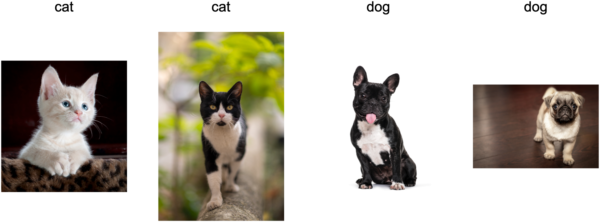

# Aplinka ir skirstinio poslinkis
:label:`sec_environment-and-distribution-shift`

Ankstesniuose skyreliuose išnagrinėjome
keletą praktinių mašininio mokymosi taikymų,
pritaikydami modelius įvairiems duomenų rinkiniams.
Ir vis dėlto niekada nesustojome pamąstyti,
nei iš kur iš pradžių atsirado duomenys,
nei ką galiausiai planuojame daryti
su savo modelių išvestimis.
Per dažnai mašininio mokymosi kūrėjai,
turėdami duomenų, skuba kurti modelius,
nesustodami apsvarstyti šių fundamentalių klausimų.

Daugelio nesėkmingų mašininio mokymosi diegimų priežastis
galima atsekti iki šios klaidos.
Kartais modeliai atrodo veikiantys puikiai,
vertinant pagal testavimo aibės tikslumą,
bet katastrofiškai suklysta diegimo metu,
kai duomenų skirstinys staiga pasikeičia.
Klastingiau, kartais pats modelio diegimas
gali būti katalizatorius, sutrikdantis duomenų skirstinį.
Tarkime, pavyzdžiui, kad apmokėme modelį
prognozuoti, kas grąžins paskolą, o kas nevykdys įsipareigojimų,
ir nustatėme, kad kreditą prašančiojo avalynės pasirinkimas
susijęs su nemokumo rizika
(oksfordai rodo grąžinimą, sportbačiai – nemokumą).
Po to galėtume būti linkę
suteikti paskolą
kiekvienam oksfordus avinčiam pareiškėjui
ir atmesti visus sportbačius avinčius pareiškėjus.

Tokiu atveju mūsų nepagrįstas šuolis
nuo dėsningumų atpažinimo prie sprendimų priėmimo
ir mūsų nesugebėjimas kritiškai apsvarstyti aplinkos
gali turėti pražūtingų pasekmių.
Pirmiausia, vos pradėjus
priimti sprendimus pagal avalynę,
klientai tai supras ir pakeis savo elgesį.
Netrukus visi pareiškėjai avės oksfordus,
nesant jokio kartu vykstančio kreditingumo pagerėjimo.
Skirkite minutę tam suvokti, nes panašių problemų
yra daugelyje mašininio mokymosi taikymų:
įvesdami savo modeliu pagrįstus sprendimus į aplinką,
galime sugadinti modelį.

Nors negalime išsamiai nagrinėti šių temų
viename skyrelyje,
čia siekiame atskleisti kai kuriuos dažnus rūpesčius
ir paskatinti kritinį mąstymą,
reikalingą tokioms situacijoms laiku aptikti,
žalai sumažinti ir mašininiam mokymuisi naudoti atsakingai.
Kai kurie sprendimai paprasti
(paprašyti „tinkamų" duomenų),
kai kurie techniškai sudėtingi
(įgyvendinti skatinamojo mokymo sistemą),
o kiti reikalauja, kad išeitume už
statistinės prognozės srities ribų
ir imtumės sudėtingų filosofinių klausimų,
susijusių su etišku algoritmų taikymu.

## Skirstinio poslinkio tipai

Pradėkime pasilikdami pasyvios prognozės aplinkoje,
nagrinėdami įvairius būdus, kuriais gali pasikeisti duomenų skirstiniai,
ir ką galima padaryti, kad išgelbėtume modelio veikimą.
Vienoje klasikinėje sąrankoje darome prielaidą, kad mūsų apmokymo duomenys
paimti iš kokio nors skirstinio $p_S(\mathbf{x},y)$,
bet mūsų testavimo duomenis sudarys
nepažymėti pavyzdžiai, paimti iš
kokio nors kito skirstinio $p_T(\mathbf{x},y)$.
Jau dabar turime susidurti su blaivinančia tikrove.
Neturint jokių prielaidų apie tai, kaip $p_S$
ir $p_T$ susiję tarpusavyje,
išmokti patikimą klasifikatorių neįmanoma.

Panagrinėkime dvejetainio klasifikavimo uždavinį,
kuriame norime atskirti šunis ir kates.
Jei skirstinys gali kisti savavališkais būdais,
tuomet mūsų sąranka leidžia patologinį atvejį,
kai įvesčių skirstinys išlieka
pastovus: $p_S(\mathbf{x}) = p_T(\mathbf{x})$,
bet visi žymenys yra apversti:
$p_S(y \mid \mathbf{x}) = 1 - p_T(y \mid \mathbf{x})$.
Kitaip tariant, jei Dievas gali staiga nuspręsti,
kad ateityje visos „katės" yra šunys,
o tai, ką anksčiau vadinome „šunimis", dabar yra katės – be
jokio įvesčių skirstinio $p(\mathbf{x})$ pasikeitimo,
tuomet jokiu būdu negalime atskirti šios situacijos
nuo tos, kurioje skirstinys visai nepasikeitė.

Laimei, esant tam tikroms ribojančioms prielaidoms
apie tai, kaip mūsų duomenys gali keistis ateityje,
principingi algoritmai gali aptikti poslinkį
ir kartais net prisitaikyti skrydžio metu,
pagerindami pradinio klasifikatoriaus tikslumą.

### Kovariantų poslinkis

Tarp skirstinio poslinkio kategorijų
kovariantų poslinkis galbūt yra plačiausiai tyrinėjamas.
Čia darome prielaidą, kad nors įvesčių skirstinys
gali kisti laikui bėgant, žymėjimo funkcija,
t. y. sąlyginis skirstinys
$P(y \mid \mathbf{x})$, nesikeičia.
Statistikai tai vadina *kovariantų poslinkiu*,
nes problema kyla dėl
kovariantų (požymių) skirstinio poslinkio.
Nors kartais galime samprotauti apie skirstinio poslinkį
nesiremdami priežastingumu, pažymime, kad kovariantų poslinkis
yra natūrali prielaida aplinkoje,
kur tikime, kad $\mathbf{x}$ sukelia $y$.

Panagrinėkime iššūkį atskirti kates ir šunis.
Mūsų apmokymo duomenis gali sudaryti tokie vaizdai, kaip :numref:`fig_cat-dog-train`.

:label:`fig_cat-dog-train`

Testavimo metu mūsų prašoma klasifikuoti vaizdus :numref:`fig_cat-dog-test`.

:label:`fig_cat-dog-test`

Apmokymo aibę sudaro nuotraukos,
o testavimo aibėje yra tik karikatūros.
Apmokymas duomenų rinkinyje, kurio charakteristikos
gerokai skiriasi nuo testavimo aibės,
gali sukelti bėdų, jei nėra nuoseklaus plano,
kaip prisitaikyti prie naujos srities.

### Žymenų poslinkis

*Žymenų poslinkis* aprašo atvirkštinę problemą.
Čia darome prielaidą, kad žymenų marginalusis skirstinys $P(y)$
gali kisti,
bet klasės sąlyginis skirstinys
$P(\mathbf{x} \mid y)$ išlieka fiksuotas skirtingose srityse.
Žymenų poslinkis yra pagrįsta prielaida,
kai tikime, kad $y$ sukelia $\mathbf{x}$.
Pavyzdžiui, galime norėti prognozuoti diagnozes
pagal jų simptomus (ar kitas apraiškas),
net kai santykinis diagnozių paplitimas
laikui bėgant keičiasi.
Žymenų poslinkis čia yra tinkama prielaida,
nes ligos sukelia simptomus.
Kai kuriais išsigimusiais atvejais žymenų poslinkio
ir kovariantų poslinkio prielaidos gali galioti vienu metu.
Pavyzdžiui, kai žymuo yra deterministinis,
kovariantų poslinkio prielaida bus patenkinta,
net kai $y$ sukelia $\mathbf{x}$.
Įdomu tai, kad šiais atvejais
dažnai naudinga dirbti su metodais,
kylančiais iš žymenų poslinkio prielaidos.
Taip yra todėl, kad šie metodai paprastai
apima manipuliavimą objektais, panašiais į žymenis (dažnai mažos dimensijos),
o ne objektais, panašiais į įvestis,
kurie giliajame mokyme paprastai yra didelės dimensijos.

### Sąvokų poslinkis

Taip pat galime susidurti su susijusia *sąvokų poslinkio* problema,
kuri kyla, kai gali keistis pats žymenų apibrėžimas.
Tai skamba keistai – *katė* yra *katė*, ar ne?
Tačiau kitų kategorijų vartojimas laikui bėgant kinta.
Psichikos ligų diagnostiniai kriterijai,
tai, kas laikoma madinga, ir darbo pareigybių pavadinimai
patiria nemažai
sąvokų poslinkio.
Pasirodo, kad jei keliautume po Jungtines Valstijas,
keisdami savo duomenų šaltinį pagal geografiją,
rastume didelį sąvokų poslinkį dėl
*gaiviųjų gėrimų* pavadinimų skirstinio,
kaip parodyta :numref:`fig_popvssoda`.

:width:`400px`
:label:`fig_popvssoda`

Jei kurtume mašininio vertimo sistemą,
skirstinys $P(y \mid \mathbf{x})$ galėtų skirtis
priklausomai nuo mūsų buvimo vietos.
Šią problemą gali būti sunku pastebėti.
Galime tikėtis pasinaudoti žiniomis,
kad poslinkis vyksta tik laipsniškai,
tiek laiko, tiek geografine prasme.

## Skirstinio poslinkio pavyzdžiai

Prieš gilindamiesi į formalizmą ir algoritmus,
galime aptarti kelias konkrečias situacijas,
kuriose kovariantų ar sąvokų poslinkis gali būti neakivaizdus.

### Medicininė diagnostika

Įsivaizduokite, kad norite sukurti algoritmą vėžiui aptikti.
Surenkate duomenis iš sveikų ir sergančių žmonių
ir apmokote savo algoritmą.
Jis veikia gerai, suteikia jums aukštą tikslumą,
ir darote išvadą, kad esate pasirengę
sėkmingai medicininės diagnostikos karjerai.
*Ne taip greitai.*

Skirstiniai, sukūrę apmokymo duomenis,
ir tie, su kuriais susidursite realiame pasaulyje, gali gerokai skirtis.
Taip nutiko nelaimingam startuoliui,
su kuriuo prieš keletą metų dirbo kai kurie iš mūsų, autorių.
Jie kūrė kraujo tyrimą ligai,
kuri daugiausia veikia vyresnio amžiaus vyrus,
ir tikėjosi ją ištirti naudodami kraujo mėginius,
kuriuos surinko iš pacientų.
Tačiau gerokai sunkiau
gauti kraujo mėginius iš sveikų vyrų
nei iš jau sistemoje esančių sergančių pacientų.
Kad tai kompensuotų, startuolis paprašė
universiteto miestelio studentų aukoti kraują,
kad jie būtų sveikų žmonių kontrolė kuriant jų tyrimą.
Tada jie paklausė, ar galėtume padėti jiems
sukurti klasifikatorių ligai aptikti.

Kaip paaiškinome jiems,
iš tiesų būtų lengva atskirti
sveikų ir sergančių žmonių grupes
beveik tobulu tikslumu.
Tačiau taip yra todėl, kad tiriamieji
skyrėsi amžiumi, hormonų lygiu,
fiziniu aktyvumu, mityba, alkoholio vartojimu
ir daugeliu kitų veiksnių, nesusijusių su liga.
Realių pacientų atveju taip vargu ar būtų.
Dėl jų imčių ėmimo procedūros
galėjome tikėtis susidurti su kraštutiniu kovariantų poslinkiu.
Be to, šio atvejo vargu ar buvo galima
ištaisyti įprastais metodais.
Trumpai tariant, jie iššvaistė nemažą pinigų sumą.

### Savaeigiai automobiliai

Tarkime, kad bendrovė norėjo pasinaudoti mašininiu mokymusi
savaeigiams automobiliams kurti.
Vienas pagrindinių komponentų čia yra kelkraščio detektorius.
Kadangi tikrus anotuotus duomenis gauti brangu,
jie sugalvojo (gudrią ir abejotiną) idėją
kaip papildomus apmokymo duomenis naudoti
sintetinius duomenis iš žaidimų atvaizdavimo variklio.
Tai labai gerai veikė su „testavimo duomenimis",
paimtais iš atvaizdavimo variklio.
Deja, tikrame automobilyje tai buvo katastrofa.
Pasirodo, kelkraštis buvo atvaizduotas
labai primityvia tekstūra.
Dar svarbiau, *visas* kelkraštis buvo atvaizduotas
su *ta pačia* tekstūra, o kelkraščio detektorius
labai greitai išmoko šį „požymį".

Panašiai nutiko JAV armijai,
kai ji pirmą kartą bandė aptikti tankus miške.
Jie padarė miško aerofotonuotraukas be tankų,
tada įvarė tankus į mišką
ir padarė dar vieną nuotraukų rinkinį.
Atrodė, kad klasifikatorius veikia *tobulai*.
Deja, jis tiesiog išmoko
atskirti medžius su šešėliais
nuo medžių be šešėlių – pirmasis nuotraukų rinkinys
buvo padarytas anksti ryte,
antrasis – vidurdienį.

### Nestacionarūs skirstiniai

Kur kas subtilesnė situacija atsiranda,
kai skirstinys kinta lėtai
(dar vadinamas *nestacionariu skirstiniu*),
o modelis nėra tinkamai atnaujinamas.
Žemiau pateikiami keli tipiški atvejai.

* Apmokome skaičiuojamosios reklamos modelį, o paskui nesugebame jo dažnai atnaujinti (pvz., pamirštame įtraukti, kad ką tik buvo išleistas mažai žinomas naujas įrenginys, vadinamas iPad).
* Sukuriame šlamšto filtrą. Jis gerai aptinka visą iki šiol matytą šlamštą. Tačiau tada šlamšto siuntėjai pasidaro gudresni ir sukuria naujus laiškus, kurie nepanašūs į nieką, ką esame matę anksčiau.
* Sukuriame produktų rekomendavimo sistemą. Ji veikia visą žiemą, bet paskui ir toliau rekomenduoja Kalėdų Senelio kepures ilgai po Kalėdų.

### Daugiau anekdotų

* Sukuriame veido detektorių. Jis gerai veikia visuose lyginamuosiuose rinkiniuose. Deja, jis nepavyksta su testavimo duomenimis – kenkiantys pavyzdžiai yra stambūs planai, kuriuose veidas užpildo visą vaizdą (tokių duomenų apmokymo aibėje nebuvo).
* Sukuriame interneto paieškos sistemą JAV rinkai ir norime ją įdiegti Jungtinėje Karalystėje.
* Apmokome vaizdų klasifikatorių, sudarydami didelį duomenų rinkinį, kuriame kiekviena iš didelio klasių rinkinio yra vienodai atstovaujama, tarkime, 1000 kategorijų, kiekviena atstovaujama 1000 vaizdų. Tada diegiame sistemą realiame pasaulyje, kur tikrasis nuotraukų žymenų skirstinys yra aiškiai nevienodas.

## Skirstinio poslinkio korekcija

Kaip aptarėme, yra daug atvejų,
kai apmokymo ir testavimo skirstiniai
$P(\mathbf{x}, y)$ skiriasi.
Kai kuriais atvejais mums pasiseka ir modeliai veikia
nepaisant kovariantų, žymenų ar sąvokų poslinkio.
Kitais atvejais galime pasiekti geriau, taikydami
principingas strategijas poslinkiui įveikti.
Likusi šio skyrelio dalis tampa gerokai techniškesnė.
Nekantrus skaitytojas gali pereiti prie kito skyrelio,
nes ši medžiaga nėra būtina vėlesnėms sąvokoms suprasti.

### Empirinė rizika ir rizika
:label:`subsec_empirical-risk-and-risk`

Pirmiausia pamąstykime, kas tiksliai
vyksta modelio apmokymo metu:
iteruojame per apmokymo duomenų
požymius ir susijusius žymenis
$\{(\mathbf{x}_1, y_1), \ldots, (\mathbf{x}_n, y_n)\}$
ir po kiekvieno minirinkinio atnaujiname modelio $f$ parametrus.
Dėl paprastumo nenagrinėjame reguliarizavimo,
todėl iš esmės minimizuojame nuostolius apmokymo duomenyse:

$$\mathop{\mathrm{minimize}}_f \frac{1}{n} \sum_{i=1}^n l(f(\mathbf{x}_i), y_i),$$
:eqlabel:`eq_empirical-risk-min`

kur $l$ yra nuostolių funkcija,
matuojanti, „kiek bloga" yra prognozė $f(\mathbf{x}_i)$ esant susijusiam žymeniui $y_i$.
Statistikai narį :eqref:`eq_empirical-risk-min` vadina *empirine rizika*.
*Empirinė rizika* yra vidutiniai nuostoliai apmokymo duomenyse,
skirti aproksimuoti *riziką*,
kuri yra
nuostolių vidurkis visoje duomenų populiacijoje, paimtoje iš tikrojo jos skirstinio
$p(\mathbf{x},y)$:

$$E_{p(\mathbf{x}, y)} [l(f(\mathbf{x}), y)] = \int\int l(f(\mathbf{x}), y) p(\mathbf{x}, y) \;d\mathbf{x}dy.$$
:eqlabel:`eq_true-risk`

Tačiau praktikoje paprastai negalime gauti visos duomenų populiacijos.
Todėl *empirinės rizikos minimizavimas*,
t. y. empirinės rizikos minimizavimas :eqref:`eq_empirical-risk-min`,
yra praktinė mašininio mokymosi strategija,
tikintis apytiksliai
minimizuoti riziką.

### Kovariantų poslinkio korekcija
:label:`subsec_covariate-shift-correction`

Tarkime, kad norime įvertinti
kokią nors priklausomybę $P(y \mid \mathbf{x})$,
kuriai turime pažymėtus duomenis $(\mathbf{x}_i, y_i)$.
Deja, stebiniai $\mathbf{x}_i$ paimti
iš kokio nors *šaltinio skirstinio* $q(\mathbf{x})$,
o ne iš *tikslinio skirstinio* $p(\mathbf{x})$.
Laimei,
priklausomybės prielaida reiškia,
kad sąlyginis skirstinys nesikeičia: $p(y \mid \mathbf{x}) = q(y \mid \mathbf{x})$.
Jei šaltinio skirstinys $q(\mathbf{x})$ yra „neteisingas",
galime tai pataisyti naudodami šią paprastą tapatybę rizikoje:

$$
\begin{aligned}
\int\int l(f(\mathbf{x}), y) p(y \mid \mathbf{x})p(\mathbf{x}) \;d\mathbf{x}dy =
\int\int l(f(\mathbf{x}), y) q(y \mid \mathbf{x})q(\mathbf{x})\frac{p(\mathbf{x})}{q(\mathbf{x})} \;d\mathbf{x}dy.
\end{aligned}
$$

Kitaip tariant, turime perskaičiuoti kiekvieno duomenų pavyzdžio svorį
pagal santykį
tikimybės,
kad jis būtų paimtas iš teisingo skirstinio, su tikimybe iš neteisingo:

$$\beta_i \stackrel{\textrm{def}}{=} \frac{p(\mathbf{x}_i)}{q(\mathbf{x}_i)}.$$

Įstatę svorį $\beta_i$
kiekvienam duomenų pavyzdžiui $(\mathbf{x}_i, y_i)$,
galime apmokyti savo modelį naudodami
*svertinį empirinės rizikos minimizavimą*:

$$\mathop{\mathrm{minimize}}_f \frac{1}{n} \sum_{i=1}^n \beta_i l(f(\mathbf{x}_i), y_i).$$
:eqlabel:`eq_weighted-empirical-risk-min`

Deja, to santykio nežinome,
todėl prieš darydami ką nors naudingo, turime jį įvertinti.
Yra daug metodų,
įskaitant kai kuriuos įmantrius operatorių teorijos metodus,
kurie bando tiesiogiai perkalibruoti vidurkio operatorių,
naudodami minimalios normos ar didžiausios entropijos principą.
Atkreipkite dėmesį, kad bet kuriam tokiam metodui mums reikia imčių,
paimtų iš abiejų skirstinių – „tikrojo" $p$, pvz.,
turint prieigą prie testavimo duomenų, ir to, kuris naudojamas
apmokymo aibei generuoti, $q$ (pastarasis lengvai prieinamas).
Tačiau atkreipkite dėmesį, kad mums reikia tik požymių $\mathbf{x} \sim p(\mathbf{x})$;
mums nereikia prieigos prie žymenų $y \sim p(y)$.

Šiuo atveju egzistuoja labai efektyvus metodas,
kuris duos beveik tokius pat gerus rezultatus kaip pradinis: būtent logistinė regresija,
kuri yra atskiras softmax regresijos atvejis (žr. :numref:`sec_softmax`)
dvejetainiam klasifikavimui.
Tai viskas, ko reikia apytikslėms tikimybių santykių reikšmėms apskaičiuoti.
Išmokstame klasifikatorių, atskiriantį
duomenis, paimtus iš $p(\mathbf{x})$,
nuo duomenų, paimtų iš $q(\mathbf{x})$.
Jei neįmanoma atskirti
šių dviejų skirstinių,
tai reiškia, kad atitinkami egzemplioriai
vienodai tikėtinai kyla iš
bet kurio iš šių dviejų skirstinių.
Kita vertus, bet kurie egzemplioriai,
kuriuos galima gerai atskirti,
turėtų būti atitinkamai gerokai per daug arba
per mažai svertiniai.

Dėl paprastumo tarkime, kad turime
vienodą egzempliorių skaičių iš abiejų skirstinių
$p(\mathbf{x})$
ir $q(\mathbf{x})$.
Dabar pažymėkime $z$ žymenis, kurie yra $1$
duomenims, paimtiems iš $p$, ir $-1$ duomenims, paimtiems iš $q$.
Tada tikimybė mišriame duomenų rinkinyje yra

$$P(z=1 \mid \mathbf{x}) = \frac{p(\mathbf{x})}{p(\mathbf{x})+q(\mathbf{x})} \textrm{ and hence } \frac{P(z=1 \mid \mathbf{x})}{P(z=-1 \mid \mathbf{x})} = \frac{p(\mathbf{x})}{q(\mathbf{x})}.$$

Taigi, jei naudojame logistinės regresijos metodą,
kur $P(z=1 \mid \mathbf{x})=\frac{1}{1+\exp(-h(\mathbf{x}))}$ ($h$ yra parametrizuota funkcija),
iš to išplaukia, kad

$$
\beta_i = \frac{1/(1 + \exp(-h(\mathbf{x}_i)))}{\exp(-h(\mathbf{x}_i))/(1 + \exp(-h(\mathbf{x}_i)))} = \exp(h(\mathbf{x}_i)).
$$

Todėl turime išspręsti dvi problemas:
pirma, atskirti
duomenis, paimtus iš abiejų skirstinių,
ir tada svertinio empirinės rizikos minimizavimo problemą
:eqref:`eq_weighted-empirical-risk-min`,
kur narius sveriame $\beta_i$.

Dabar esame pasirengę aprašyti korekcijos algoritmą.
Tarkime, kad turime apmokymo aibę $\{(\mathbf{x}_1, y_1), \ldots, (\mathbf{x}_n, y_n)\}$ ir nepažymėtą testavimo aibę $\{\mathbf{u}_1, \ldots, \mathbf{u}_m\}$.
Kovariantų poslinkio atveju
darome prielaidą, kad $\mathbf{x}_i$ visiems $1 \leq i \leq n$ paimti iš kokio nors šaltinio skirstinio,
o $\mathbf{u}_i$ visiems $1 \leq i \leq m$
paimti iš tikslinio skirstinio.
Štai prototipinis algoritmas
kovariantų poslinkiui ištaisyti:

1. Sukurkite dvejetainio klasifikavimo apmokymo aibę: $\{(\mathbf{x}_1, -1), \ldots, (\mathbf{x}_n, -1), (\mathbf{u}_1, 1), \ldots, (\mathbf{u}_m, 1)\}$.
1. Apmokykite dvejetainį klasifikatorių naudodami logistinę regresiją, kad gautumėte funkciją $h$.
1. Sverkite apmokymo duomenis naudodami $\beta_i = \exp(h(\mathbf{x}_i))$ arba geriau $\beta_i = \min(\exp(h(\mathbf{x}_i)), c)$ su kokia nors konstanta $c$.
1. Naudokite svorius $\beta_i$ apmokymui su $\{(\mathbf{x}_1, y_1), \ldots, (\mathbf{x}_n, y_n)\}$ :eqref:`eq_weighted-empirical-risk-min`.

Atkreipkite dėmesį, kad aukščiau pateiktas algoritmas remiasi esmine prielaida.
Kad ši schema veiktų, reikia, kad kiekvienas duomenų pavyzdys
tiksliniame (pvz., testavimo metu) skirstinyje
turėtų nenulinę atsiradimo tikimybę apmokymo metu.
Jei randame tašką, kuriame $p(\mathbf{x}) > 0$, bet $q(\mathbf{x}) = 0$,
tada atitinkamas svarbos svoris turėtų būti begalinis.

### Žymenų poslinkio korekcija

Tarkime, kad sprendžiame
klasifikavimo užduotį su $k$ kategorijų.
Naudodami tą patį žymėjimą kaip :numref:`subsec_covariate-shift-correction`,
$q$ ir $p$ yra atitinkamai šaltinio skirstinys (pvz., apmokymo metu) ir tikslinis skirstinys (pvz., testavimo metu).
Tarkime, kad žymenų skirstinys laikui bėgant keičiasi:
$q(y) \neq p(y)$, bet klasės sąlyginis skirstinys
išlieka tas pats: $q(\mathbf{x} \mid y)=p(\mathbf{x} \mid y)$.
Jei šaltinio skirstinys $q(y)$ yra „neteisingas",
galime tai pataisyti
pagal
šią tapatybę rizikoje,
apibrėžtoje
:eqref:`eq_true-risk`:

$$
\begin{aligned}
\int\int l(f(\mathbf{x}), y) p(\mathbf{x} \mid y)p(y) \;d\mathbf{x}dy =
\int\int l(f(\mathbf{x}), y) q(\mathbf{x} \mid y)q(y)\frac{p(y)}{q(y)} \;d\mathbf{x}dy.
\end{aligned}
$$

Čia mūsų svarbos svoriai atitiks
žymenų tikėtinumo santykius:

$$\beta_i \stackrel{\textrm{def}}{=} \frac{p(y_i)}{q(y_i)}.$$

Viena gera žymenų poslinkio savybė yra ta,
kad jei turime pakankamai gerą modelį
šaltinio skirstiniui,
tuomet galime gauti nuoseklius šių svorių įverčius,
niekada nesusidurdami su aplinkine dimensija.
Giliajame mokyme įvestys paprastai
yra didelės dimensijos objektai, pvz., vaizdai,
o žymenys dažnai yra paprastesni objektai, pvz., kategorijos.

Kad įvertintume tikslinį žymenų skirstinį,
pirmiausia imame savo pakankamai gerą paruoštą klasifikatorių
(paprastai apmokytą apmokymo duomenimis)
ir apskaičiuojame jo „painiavos" matricą, naudodami validavimo aibę
(taip pat iš apmokymo skirstinio).
*Painiavos matrica* $\mathbf{C}$ yra tiesiog $k \times k$ matrica,
kurios kiekvienas stulpelis atitinka žymens kategoriją (tikrąją reikšmę),
o kiekviena eilutė – mūsų modelio prognozuotą kategoriją.
Kiekvienos ląstelės reikšmė $c_{ij}$ yra validavimo aibės prognozių dalis,
kai tikrasis žymuo buvo $j$, o mūsų modelis prognozavo $i$.

Dabar negalime apskaičiuoti painiavos matricos
tiksliniuose duomenyse tiesiogiai,
nes nematome žymenų pavyzdžiams,
kuriuos matome realiame pasaulyje,
nebent investuotume į sudėtingą realaus laiko anotavimo konvejerį.
Tačiau galime suvidurkinti visas savo modelio prognozes
testavimo metu, gaudami vidutines modelio išvestis $\mu(\hat{\mathbf{y}}) \in \mathbb{R}^k$,
kur $i$-asis elementas $\mu(\hat{y}_i)$
yra testavimo aibės prognozių dalis,
kai mūsų modelis prognozavo $i$.

Pasirodo, kad esant kai kurioms švelnioms sąlygoms – jei
mūsų klasifikatorius iš pradžių buvo pakankamai tikslus,
jei tiksliniai duomenys turi tik kategorijas,
kurias esame matę anksčiau,
ir jei žymenų poslinkio prielaida iš pradžių galioja
(stipriausia čia prielaida) – galime įvertinti testavimo aibės žymenų skirstinį,
išspręsdami paprastą tiesinę sistemą

$$\mathbf{C} p(\mathbf{y}) = \mu(\hat{\mathbf{y}}),$$

nes kaip įvertis $\sum_{j=1}^k c_{ij} p(y_j) = \mu(\hat{y}_i)$ galioja visiems $1 \leq i \leq k$,
kur $p(y_j)$ yra $j$-asis $k$ dimensijų žymenų skirstinio vektoriaus $p(\mathbf{y})$ elementas.
Jei mūsų klasifikatorius iš pradžių yra pakankamai tikslus,
tada painiavos matrica $\mathbf{C}$ bus apverčiama,
ir gausime sprendinį $p(\mathbf{y}) = \mathbf{C}^{-1} \mu(\hat{\mathbf{y}})$.

Kadangi šaltinio duomenyse stebime žymenis,
lengva įvertinti skirstinį $q(y)$.
Tada bet kuriam apmokymo pavyzdžiui $i$ su žymeniu $y_i$
galime paimti mūsų įvertinto $p(y_i)/q(y_i)$ santykį,
kad apskaičiuotume svorį $\beta_i$,
ir įstatyti jį į svertinį empirinės rizikos minimizavimą
:eqref:`eq_weighted-empirical-risk-min`.

### Sąvokų poslinkio korekcija

Sąvokų poslinkį kur kas sunkiau ištaisyti principingu būdu.
Pavyzdžiui, situacijoje, kai problema staiga pasikeičia
iš kačių ir šunų atskyrimo į
baltų ir juodų gyvūnų atskyrimą,
būtų nepagrįsta manyti,
kad galime padaryti daug daugiau nei tiesiog surinkti naujus žymenis
ir apmokyti iš naujo.
Laimei, praktikoje tokie kraštutiniai poslinkiai yra reti.
Vietoj to paprastai nutinka, kad užduotis keičiasi lėtai.
Kad viskas būtų konkretesnė, štai keli pavyzdžiai:

* Skaičiuojamojoje reklamoje išleidžiami nauji produktai,
seni produktai tampa mažiau populiarūs. Tai reiškia, kad reklamų ir jų populiarumo skirstinys keičiasi laipsniškai, ir bet kuris paspaudimų dažnio prognozuotojas turi laipsniškai keistis kartu.
* Eismo kamerų lęšiai laipsniškai blogėja dėl aplinkos dėvėjimosi, palaipsniui veikdami vaizdo kokybę.
* Naujienų turinys keičiasi laipsniškai (t. y. dauguma naujienų išlieka tos pačios, bet atsiranda naujų istorijų).

Tokiais atvejais galime naudoti tą patį metodą, kurį naudojome tinklams apmokyti, kad jie prisitaikytų prie duomenų pokyčių. Kitaip tariant, naudojame esamus tinklo svorius ir tiesiog atliekame kelis atnaujinimo žingsnius su naujais duomenimis, užuot apmokę iš naujo.

## Mokymosi uždavinių taksonomija

Apsiginklavę žiniomis, kaip tvarkytis su skirstinių pokyčiais, dabar galime apsvarstyti kai kuriuos kitus mašininio mokymosi uždavinio formulavimo aspektus.

### Paketinis mokymasis

*Paketiniame mokymesi* turime prieigą prie apmokymo požymių ir žymenų $\{(\mathbf{x}_1, y_1), \ldots, (\mathbf{x}_n, y_n)\}$, kuriuos naudojame modeliui $f(\mathbf{x})$ apmokyti. Vėliau diegiame šį modelį naujiems duomenims $(\mathbf{x}, y)$, paimtiems iš to paties skirstinio, įvertinti. Tai numatytoji prielaida bet kuriam čia aptariamam uždaviniui. Pavyzdžiui, galime apmokyti kačių detektorių pagal daugybę kačių ir šunų nuotraukų. Kai jį apmokome, pristatome jį kaip išmaniosios katėms skirtos durų kompiuterinio matymo sistemos dalį, kuri įleidžia tik kates. Tada tai įrengiama kliento namuose ir daugiau niekada neatnaujinama (nebent esant kraštutinėms aplinkybėms).

### Nuolatinis mokymasis

Dabar įsivaizduokite, kad duomenys $(\mathbf{x}_i, y_i)$ ateina po vieną imtį. Tiksliau, tarkime, kad pirmiausia stebime $\mathbf{x}_i$, tada turime pateikti įvertį $f(\mathbf{x}_i)$. Tik tai padarę stebime $y_i$ ir taip gauname atlygį ar patiriame nuostolių, atsižvelgiant į mūsų sprendimą.
Daugelis realių uždavinių patenka į šią kategoriją. Pavyzdžiui, turime prognozuoti rytojaus akcijų kainą, kuri leidžia mums prekiauti pagal šį įvertį, o dienos pabaigoje sužinome, ar mūsų įvertis atnešė pelną. Kitaip tariant, *nuolatiniame mokymesi* turime tokį ciklą, kuriame nuolat tobulename modelį, gaudami naujų stebinių:

$$\begin{aligned}&\textrm{model } f_t \longrightarrow \textrm{data }  \mathbf{x}_t \longrightarrow \textrm{estimate } f_t(\mathbf{x}_t) \longrightarrow\\ \textrm{obs}&\textrm{ervation } y_t \longrightarrow \textrm{loss } l(y_t, f_t(\mathbf{x}_t)) \longrightarrow \textrm{model } f_{t+1}\end{aligned}$$

### Banditai

*Banditai* yra atskiras aukščiau aprašytos problemos atvejis. Nors daugumoje mokymosi uždavinių turime tolydžiai parametrizuotą funkciją $f$, kurios parametrus norime išmokti (pvz., gilusis tinklas), *banditų* uždavinyje turime tik baigtinį skaičių svirčių, kurias galime traukti, t. y. baigtinį veiksmų, kuriuos galime atlikti, skaičių. Nėra labai stebėtina, kad šiam paprastesniam uždaviniui galima gauti stipresnes teorines garantijas optimalumo požiūriu. Jį išvardijame daugiausia todėl, kad šis uždavinys dažnai (klaidinančiai) traktuojamas taip, tarsi tai būtų atskira mokymosi aplinka.

### Valdymas

Daugeliu atvejų aplinka prisimena, ką darėme. Nebūtinai priešiškai, bet ji tiesiog prisimins, ir atsakas priklausys nuo to, kas įvyko anksčiau. Pavyzdžiui, kavos virimo katilo valdiklis stebės skirtingas temperatūras, priklausomai nuo to, ar anksčiau jis šildė katilą. PID (proporcinio-integralinio-diferencialinio) valdiklio algoritmai yra populiarus pasirinkimas.
Panašiai naudotojo elgesys naujienų svetainėje priklausys nuo to, ką jam anksčiau parodėme (pvz., daugumą naujienų jis perskaitys tik vieną kartą). Daugelis tokių algoritmų sudaro aplinkos, kurioje veikia, modelį, kad jų sprendimai atrodytų mažiau atsitiktiniai.
Neseniai
valdymo teorija (pvz., PID variantai) taip pat buvo naudojama
hiperparametrams automatiškai derinti,
siekiant geresnio atskyrimo ir rekonstrukcijos kokybės
ir sugeneruoto teksto įvairovės bei sugeneruotų vaizdų rekonstrukcijos kokybės pagerinimo :cite:`Shao.Yao.Sun.ea.2020`.

### Skatinamasis mokymas

Bendresniu atveju aplinkoje su atmintimi galime susidurti su situacijomis, kai aplinka bando bendradarbiauti su mumis (kooperaciniai žaidimai, ypač nenulinės sumos žaidimai), arba kitomis, kai aplinka bandys laimėti. Šachmatai, Go, Backgammon ar StarCraft yra keli *skatinamojo mokymo* atvejai. Panašiai galime norėti sukurti gerą valdiklį savaeigiams automobiliams. Kiti automobiliai greičiausiai reaguos į savaeigio automobilio vairavimo stilių netrivialiais būdais, pvz., bandydami jo išvengti, bandydami sukelti avariją arba bandydami su juo bendradarbiauti.

### Aplinkos svarstymas

Vienas esminis skirtumas tarp aukščiau aprašytų situacijų yra tas, kad strategija, kuri galėjo veikti visą laiką stacionarioje aplinkoje, gali neveikti visą laiką aplinkoje, galinčioje prisitaikyti. Pavyzdžiui, prekiautojo atrasta arbitražo galimybė greičiausiai išnyks, kai tik bus išnaudota. Greitis ir būdas, kuriuo keičiasi aplinka, didele dalimi nulemia algoritmų, kuriuos galime pritaikyti, tipą. Pavyzdžiui, jei žinome, kad viskas gali keistis tik lėtai, galime priversti ir bet kokį įvertį keistis tik lėtai. Jei žinome, kad aplinka gali pasikeisti akimirksniu, bet tik labai retai, galime tam numatyti išimtis. Tokios žinios yra esminės siekiančiam tapti duomenų mokslininku, tvarkantis su sąvokų poslinkiu, t. y. kai sprendžiama problema gali keistis laikui bėgant.

## Sąžiningumas, atskaitomybė ir skaidrumas mašininiame mokyme

Galiausiai svarbu prisiminti,
kad diegdami mašininio mokymosi sistemas
jūs ne tik optimizuojate prognozavimo modelį – jūs
paprastai teikiate įrankį, kuris
bus naudojamas (iš dalies ar visiškai) sprendimams automatizuoti.
Šios techninės sistemos gali paveikti
asmenų, kuriems taikomi gauti sprendimai, gyvenimus.
Šuolis nuo prognozių svarstymo prie sprendimų priėmimo
kelia ne tik naujų techninių klausimų,
bet ir daugybę etinių klausimų,
kuriuos reikia atidžiai apsvarstyti.
Jei diegiame medicininės diagnostikos sistemą,
turime žinoti, kurioms populiacijoms
ji gali veikti, o kurioms – ne.
Pamiršę numatomą riziką subpopuliacijos gerovei,
galime teikti prastesnę priežiūrą.
Be to, kai tik pradedame svarstyti sprendimų priėmimo sistemas,
turime žengti žingsnį atgal ir iš naujo apsvarstyti, kaip vertiname savo technologiją.
Tarp kitų šio taikymo srities pokyčio pasekmių
paaiškės, kad *tikslumas* retai kada yra tinkamas matas.
Pavyzdžiui, versdami prognozes į veiksmus,
dažnai norėsime atsižvelgti
į galimą jautrumą išlaidoms klystant įvairiais būdais.
Jei vienas vaizdo neteisingo klasifikavimo būdas
galėtų būti suvoktas kaip rasinis pasityčiojimas,
o neteisingas klasifikavimas į kitą kategoriją
būtų nekenksmingas, tuomet galbūt norėsime pakoreguoti
savo slenksčius, atsižvelgdami į visuomenės vertybes
projektuojant sprendimų priėmimo protokolą.
Taip pat norime būti atsargūs dėl to,
kaip prognozavimo sistemos gali sukelti grįžtamojo ryšio kilpas.
Pavyzdžiui, panagrinėkime prognozuojamosios policijos sistemas,
kurios paskirsto patruliuojančius pareigūnus
į vietas su dideliu prognozuojamu nusikalstamumu.
Nesunku suprasti, kaip gali atsirasti nerimą keliantis dėsningumas:

 1. Kvartalai su didesniu nusikalstamumu gauna daugiau patrulių.
 1. Todėl šiuose kvartaluose aptinkama daugiau nusikaltimų, kurie patenka į apmokymo duomenis, prieinamus būsimoms iteracijoms.
 1. Susidūręs su daugiau teigiamų atvejų, modelis prognozuoja dar daugiau nusikaltimų šiuose kvartaluose.
 1. Kitoje iteracijoje atnaujintas modelis dar stipriau taikosi į tą patį kvartalą, todėl aptinkama dar daugiau nusikaltimų ir t. t.

Dažnai įvairūs mechanizmai, kuriais
modelio prognozės susiejamos su jo apmokymo duomenimis,
nėra įvertinami modeliavimo procese.
Tai gali sukelti tai, ką tyrėjai vadina *pabėgančiomis grįžtamojo ryšio kilpomis*.
Be to, norime būti atsargūs,
ar apskritai sprendžiame tinkamą problemą.
Prognozavimo algoritmai dabar atlieka neproporcingai didelį vaidmenį
tarpininkaujant informacijos sklaidoje.
Ar naujienos, su kuriomis susiduria asmuo,
turėtų būti nulemtos „Facebook" puslapių, kuriuos jis *pamėgo*, rinkinio?
Tai tik keletas iš daugelio neatidėliotinų etinių dilemų,
su kuriomis galite susidurti mašininio mokymosi karjeroje.

## Santrauka

Daugeliu atvejų apmokymo ir testavimo aibės nėra iš to paties skirstinio. Tai vadinama skirstinio poslinkiu.
Rizika yra nuostolių vidurkis visoje duomenų populiacijoje, paimtoje iš tikrojo jos skirstinio. Tačiau ši visa populiacija paprastai nėra prieinama. Empirinė rizika yra vidutiniai nuostoliai apmokymo duomenyse, skirti rizikai aproksimuoti. Praktikoje atliekame empirinės rizikos minimizavimą.

Esant atitinkamoms prielaidoms, kovariantų ir žymenų poslinkį galima aptikti ir ištaisyti testavimo metu. Nesugebėjimas atsižvelgti į šį paslinkimą gali tapti problema testavimo metu.
Kai kuriais atvejais aplinka gali prisiminti automatizuotus veiksmus ir reaguoti stebinančiais būdais. Turime atsižvelgti į šią galimybę kurdami modelius ir toliau stebėti veikiančias sistemas, būdami atviri galimybei, kad mūsų modeliai ir aplinka susipins nenumatytais būdais.

## Pratimai

1. Kas gali nutikti, kai pakeičiame paieškos sistemos elgesį? Ką gali daryti naudotojai? O reklamuotojai?
1. Įgyvendinkite kovariantų poslinkio detektorių. Užuomina: sukurkite klasifikatorių.
1. Įgyvendinkite kovariantų poslinkio korektorių.
1. Be skirstinio poslinkio, kas dar galėtų paveikti, kaip empirinė rizika aproksimuoja riziką?

[Diskusijos](https://discuss.d2l.ai/t/105)
