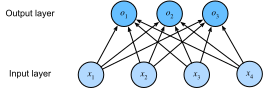

# Softmax regresija
:label:`sec_softmax`

:numref:`sec_linear_regression` pristatėme tiesinę regresiją,
išnagrinėdami įgyvendinimus nuo nulio :numref:`sec_linear_scratch`
ir dar kartą naudodami giliojo mokymosi karkaso aukšto lygio API
:numref:`sec_linear_concise`, kad atliktume sunkųjį darbą.

Regresija yra plaktukas, kurio griebiamės,
kai norime atsakyti į klausimus *kiek?* ar *kiek vienetų?*.
Jei norite prognozuoti dolerių skaičių (kainą),
už kurį bus parduotas namas,
arba pergalių skaičių, kurį gali pasiekti beisbolo komanda,
arba dienų skaičių, kurį pacientas
praleis ligoninėje prieš išrašymą,
tuomet tikriausiai ieškote regresijos modelio.
Tačiau net ir tarp regresijos modelių
yra svarbių skirtumų.
Pavyzdžiui, namo kaina
niekada nebus neigiama, o pokyčiai dažnai gali būti *santykiniai* pagal jo bazinę kainą.
Todėl gali būti efektyviau atlikti regresiją
kainos logaritmui.
Panašiai dienų skaičius, kurį pacientas praleidžia ligoninėje,
yra *diskretus neneigiamas* atsitiktinis dydis.
Todėl mažiausių kvadratų metodas taip pat gali nebūti idealus būdas.
Šis laiko iki įvykio modeliavimo tipas
turi daugybę kitų komplikacijų, kurias sprendžia
specializuota sritis, vadinama *išgyvenamumo modeliavimu*.

Čia tikslas nėra jūsų priblokšti, o tiesiog
leisti suprasti, kad vertinimas apima daug daugiau
nei tiesiog kvadratinių paklaidų minimizavimas.
O plačiau žiūrint, prižiūrimas mokymas apima daug daugiau nei regresija.
Šiame skyrelyje sutelkiame dėmesį į *klasifikavimo* uždavinius,
kuriuose atidedame klausimus *kiek?*
ir vietoj to koncentruojamės į klausimus *kuri kategorija?*.

* Ar šis el. laiškas priklauso šlamšto aplankui, ar gautiesiems?
* Ar šis klientas labiau linkęs
  užsisakyti, ar neužsisakyti prenumeratos paslaugos?
* Ar šiame paveikslėlyje pavaizduotas asilas, šuo, katė ar gaidys?
* Kokį filmą Astonas greičiausiai žiūrės toliau?
* Kurią knygos dalį skaitysite toliau?

Šnekamojoje kalboje mašininio mokymosi specialistai
žodį *klasifikavimas* vartoja
dviem subtiliai skirtingoms problemoms apibūdinti:
(i) tos, kuriose mus domina tik
griežtas pavyzdžių priskyrimas kategorijoms (klasėms);
ir (ii) tos, kuriose norime atlikti švelnų priskyrimą,
t. y. įvertinti tikimybę, kad taikoma kiekviena kategorija.
Skirtumas linkęs išsitrinti iš dalies todėl,
kad dažnai, net kai mums rūpi tik griežti priskyrimai,
vis tiek naudojame modelius, atliekančius švelnius priskyrimus.

Be to, pasitaiko atvejų, kai teisingų žymenų gali būti daugiau nei vienas.
Pavyzdžiui, naujienų straipsnis gali vienu metu apimti
pramogų, verslo ir kosminių skrydžių temas,
bet ne medicinos ar sporto temas.
Todėl priskirti jį vienai iš aukščiau išvardytų kategorijų
atskirai nebūtų labai naudinga.
Ši problema paprastai žinoma kaip [daugelio žymenų klasifikavimas](https://en.wikipedia.org/wiki/Multi-label_classification).
Apžvalgą žr. :citet:`Tsoumakas.Katakis.2007`,
o efektyvų algoritmą paveikslėlių žymėjimui – :citet:`Huang.Xu.Yu.2015`.

## Klasifikavimas
:label:`subsec_classification-problem`

Kad pramintume taką, pradėkime nuo
paprasto vaizdų klasifikavimo uždavinio.
Čia kiekviena įvestis yra $2\times2$ pilkumo atspalvių vaizdas.
Kiekvieną pikselio reikšmę galime pavaizduoti vienu skaliaru,
gaudami keturis požymius $x_1, x_2, x_3, x_4$.
Be to, tarkime, kad kiekvienas vaizdas priklauso vienai
iš kategorijų „katė", „višta" ir „šuo".

Toliau turime pasirinkti, kaip atvaizduoti žymenis.
Turime du akivaizdžius pasirinkimus.
Galbūt natūraliausias impulsas būtų
pasirinkti $y \in \{1, 2, 3\}$,
kur sveikieji skaičiai atitinkamai atvaizduoja
$\{\textrm{šuo}, \textrm{katė}, \textrm{višta}\}$.
Tai puikus būdas tokią informaciją *saugoti* kompiuteryje.
Jei kategorijos turėtų natūralią tvarką,
tarkime, jei bandytume prognozuoti
$\{\textrm{kūdikis}, \textrm{mažylis}, \textrm{paauglys}, \textrm{jaunas suaugęs}, \textrm{suaugęs}, \textrm{senyvas}\}$,
tada gali net būti prasminga laikyti tai
[eilinės regresijos](https://en.wikipedia.org/wiki/Ordinal_regression) uždaviniu
ir išlaikyti žymenis tokiu formatu.
Įvairių rangavimo nuostolių funkcijų tipų apžvalgą žr. :citet:`Moon.Smola.Chang.ea.2010`,
o Bajeso metodą, sprendžiantį atsakymus su daugiau nei viena moda, – :citet:`Beutel.Murray.Faloutsos.ea.2014`.

Apskritai klasifikavimo uždaviniai neturi
natūralios klasių tvarkos.
Laimei, statistikai seniai išrado paprastą būdą
kategoriniams duomenims atvaizduoti: *fiktyvųjį (angl. one-hot) kodavimą*.
Fiktyvusis kodavimas yra vektorius,
turintis tiek komponenčių, kiek turime kategorijų.
Komponentė, atitinkanti konkretaus egzemplioriaus kategoriją, nustatoma lygi 1,
o visos kitos komponentės – 0.
Mūsų atveju žymuo $y$ būtų trimatis vektorius,
kur $(1, 0, 0)$ atitinka „katę", $(0, 1, 0)$ – „vištą",
o $(0, 0, 1)$ – „šunį":

$$y \in \{(1, 0, 0), (0, 1, 0), (0, 0, 1)\}.$$

### Tiesinis modelis

Norėdami įvertinti sąlygines tikimybes,
susijusias su visomis galimomis klasėmis,
mums reikia modelio su keliomis išvestimis, po vieną kiekvienai klasei.
Kad klasifikavimą spręstume tiesiniais modeliais,
mums reikės tiek afininių funkcijų, kiek turime išvesčių.
Griežtai kalbant, mums reikia vienos mažiau,
nes paskutinė kategorija turi būti skirtumas
tarp $1$ ir kitų kategorijų sumos,
bet dėl simetrijos
naudojame šiek tiek perteklinę parametrizaciją.
Kiekviena išvestis atitinka savo afininę funkciją.
Mūsų atveju, kadangi turime 4 požymius ir 3 galimas išvesties kategorijas,
mums reikia 12 skaliarų svoriams atvaizduoti ($w$ su apatiniais indeksais)
ir 3 skaliarų poslinkiams atvaizduoti ($b$ su apatiniais indeksais). Gauname:

$$
\begin{aligned}
o_1 &= x_1 w_{11} + x_2 w_{12} + x_3 w_{13} + x_4 w_{14} + b_1,\\
o_2 &= x_1 w_{21} + x_2 w_{22} + x_3 w_{23} + x_4 w_{24} + b_2,\\
o_3 &= x_1 w_{31} + x_2 w_{32} + x_3 w_{33} + x_4 w_{34} + b_3.
\end{aligned}
$$

Atitinkama neuroninio tinklo diagrama
parodyta :numref:`fig_softmaxreg`.
Kaip ir tiesinėje regresijoje,
naudojame vieno sluoksnio neuroninį tinklą.
O kadangi kiekvienos išvesties $o_1, o_2$ ir $o_3$ skaičiavimas
priklauso nuo kiekvienos įvesties $x_1$, $x_2$, $x_3$ ir $x_4$,
išvesties sluoksnį taip pat galima apibūdinti kaip *pilnai sujungtą sluoksnį*.

:label:`fig_softmaxreg`

Glaustesniam žymėjimui naudojame vektorius ir matricas:
$\mathbf{o} = \mathbf{W} \mathbf{x} + \mathbf{b}$
daug geriau tinka matematikai ir kodui.
Atkreipkite dėmesį, kad visus savo svorius surinkome į $3 \times 4$ matricą, o visus poslinkius
$\mathbf{b} \in \mathbb{R}^3$ – į vektorių.

### Softmax funkcija
:label:`subsec_softmax_operation`

Darydami prielaidą, kad turime tinkamą nuostolių funkciją,
galėtume bandyti tiesiogiai minimizuoti skirtumą
tarp $\mathbf{o}$ ir žymenų $\mathbf{y}$.
Nors pasirodo, kad klasifikavimo traktavimas
kaip vektorinės reikšmės regresijos uždavinio veikia stebėtinai gerai,
vis dėlto jis nėra patenkinamas šiais atžvilgiais:

* Nėra garantijos, kad išvestys $o_i$ sudės į $1$ taip, kaip tikimės iš tikimybių.
* Nėra garantijos, kad išvestys $o_i$ yra net neneigiamos, net jei jų suma lygi $1$, arba kad jos neviršija $1$.

Abu aspektai apsunkina vertinimo uždavinį
ir daro sprendinį labai jautrų nuokrypiams.
Pavyzdžiui, jei darome prielaidą, kad
yra teigiama tiesinė priklausomybė
tarp miegamųjų skaičiaus ir tikimybės,
kad kas nors nupirks namą,
tikimybė gali viršyti $1$,
kai kalbama apie dvaro pirkimą!
Todėl mums reikia mechanizmo išvestims „suspausti".

Yra daug būdų šiam tikslui pasiekti.
Pavyzdžiui, galėtume daryti prielaidą, kad išvestys
$\mathbf{o}$ yra iškraipytos $\mathbf{y}$ versijos,
kur iškraipymas atsiranda pridedant triukšmą $\boldsymbol{\epsilon}$,
paimtą iš normaliojo skirstinio.
Kitaip tariant, $\mathbf{y} = \mathbf{o} + \boldsymbol{\epsilon}$,
kur $\epsilon_i \sim \mathcal{N}(0, \sigma^2)$.
Tai vadinamasis [probito modelis](https://en.wikipedia.org/wiki/Probit_model),
pirmą kartą pristatytas :citet:`Fechner.1860`.
Nors patrauklus, jis neveikia taip gerai
ir neveda prie ypač gražaus optimizavimo uždavinio,
palyginti su softmax.

Kitas būdas šiam tikslui pasiekti
(ir užtikrinti neneigiamumą) yra naudoti
eksponentinę funkciją $P(y = i) \propto \exp o_i$.
Tai iš tiesų tenkina reikalavimą,
kad sąlyginė klasės tikimybė
didėja didėjant $o_i$, ji yra monotoninė,
ir visos tikimybės yra neneigiamos.
Tada šias reikšmes galime transformuoti taip, kad jos sudėtų į $1$,
kiekvieną padalydami iš jų sumos.
Šis procesas vadinamas *normalizavimu*.
Sujungus šias dvi dalis,
gauname *softmax* funkciją:

$$\hat{\mathbf{y}} = \mathrm{softmax}(\mathbf{o}) \quad \textrm{where}\quad \hat{y}_i = \frac{\exp(o_i)}{\sum_j \exp(o_j)}.$$
:eqlabel:`eq_softmax_y_and_o`

Atkreipkite dėmesį, kad didžiausia $\mathbf{o}$ koordinatė
atitinka labiausiai tikėtiną klasę pagal $\hat{\mathbf{y}}$.
Be to, kadangi softmax operacija
išsaugo savo argumentų tvarką,
mums nereikia skaičiuoti softmax,
kad nustatytume, kuriai klasei priskirta didžiausia tikimybė. Taigi,

$$
\operatorname*{argmax}_j \hat y_j = \operatorname*{argmax}_j o_j.
$$

Softmax idėja siekia :citet:`Gibbs.1902`,
kuris pritaikė fizikos idėjas.
Dar anksčiau Bolcmanas,
šiuolaikinės statistinės fizikos tėvas,
šį triuką naudojo energijos būsenų skirstiniui
dujų molekulėse modeliuoti.
Visų pirma jis atrado, kad energijos būsenos
paplitimas termodinaminiame ansamblyje,
pavyzdžiui, dujų molekulėse,
yra proporcingas $\exp(-E/kT)$.
Čia $E$ yra būsenos energija,
$T$ – temperatūra, o $k$ – Bolcmano konstanta.
Kai statistikai kalba apie statistinės sistemos „temperatūros"
didinimą ar mažinimą,
jie turi omenyje $T$ keitimą,
siekiant palankesnių žemesnės ar aukštesnės energijos būsenų.
Sekant Gibbso idėja, energija prilygsta paklaidai.
Energija pagrįsti modeliai :cite:`Ranzato.Boureau.Chopra.ea.2007`
šį požiūrį naudoja aprašydami
giliojo mokymosi uždavinius.

### Vektorizacija
:label:`subsec_softmax_vectorization`

Kad pagerintume skaičiavimo efektyvumą,
skaičiavimus vektorizuojame duomenų minirinkiniuose.
Tarkime, kad mums duotas minirinkinys $\mathbf{X} \in \mathbb{R}^{n \times d}$
iš $n$ pavyzdžių, kurių dimensija (įvesčių skaičius) $d$.
Be to, tarkime, kad išvestyje turime $q$ kategorijų.
Tada svoriai tenkina $\mathbf{W} \in \mathbb{R}^{d \times q}$,
o poslinkis tenkina $\mathbf{b} \in \mathbb{R}^{1\times q}$.

$$ \begin{aligned} \mathbf{O} &= \mathbf{X} \mathbf{W} + \mathbf{b}, \\ \hat{\mathbf{Y}} & = \mathrm{softmax}(\mathbf{O}). \end{aligned} $$
:eqlabel:`eq_minibatch_softmax_reg`

Tai pagreitina dominuojančią operaciją
iki matricos ir matricos sandaugos $\mathbf{X} \mathbf{W}$.
Be to, kadangi kiekviena $\mathbf{X}$ eilutė atvaizduoja duomenų pavyzdį,
pačią softmax operaciją galima apskaičiuoti *eilutėmis*:
kiekvienai $\mathbf{O}$ eilutei pakeliame eksponente visus įrašus
ir tada normalizuojame juos suma.
Tačiau atkreipkite dėmesį, kad reikia būti atsargiems,
kad nebūtų keliami eksponente ir logaritmuojami dideli skaičiai,
nes tai gali sukelti skaitinį perpildymą ar nepakankamumą.
Giliojo mokymosi karkasai tuo pasirūpina automatiškai.

## Nuostolių funkcija
:label:`subsec_softmax-regression-loss-func`

Kai jau turime atvaizdį iš požymių $\mathbf{x}$
į tikimybes $\mathbf{\hat{y}}$,
mums reikia būdo optimizuoti šio atvaizdžio tikslumą.
Remsimės didžiausio tikėtinumo vertinimu,
tuo pačiu metodu, su kuriuo susidūrėme,
teikdami tikimybinį pagrindimą
vidutinės kvadratinės paklaidos nuostoliams
:numref:`subsec_normal_distribution_and_squared_loss`.

### Logaritminis tikėtinumas

Softmax funkcija pateikia mums vektorių $\hat{\mathbf{y}}$,
kurį galime interpretuoti kaip (įvertintas) sąlygines tikimybes
kiekvienos klasės, kai duota bet kuri įvestis $\mathbf{x}$,
pavyzdžiui, $\hat{y}_1$ = $P(y=\textrm{katė} \mid \mathbf{x})$.
Toliau darome prielaidą, kad duomenų rinkiniui
su požymiais $\mathbf{X}$ žymenys $\mathbf{Y}$
atvaizduojami fiktyviuoju žymenų vektoriumi.
Įverčius galime palyginti su tikrove,
patikrindami, kiek tikėtinos faktinės klasės
pagal mūsų modelį, kai duoti požymiai:

$$
P(\mathbf{Y} \mid \mathbf{X}) = \prod_{i=1}^n P(\mathbf{y}^{(i)} \mid \mathbf{x}^{(i)}).
$$

Galime naudoti faktorizaciją,
nes darome prielaidą, kad kiekvienas žymuo paimtas nepriklausomai
iš savo atitinkamo skirstinio $P(\mathbf{y}\mid\mathbf{x}^{(i)})$.
Kadangi narių sandaugos maksimizavimas yra nepatogus,
imame neigiamą logaritmą ir gauname ekvivalentų
neigiamo logaritminio tikėtinumo minimizavimo uždavinį:

$$
-\log P(\mathbf{Y} \mid \mathbf{X}) = \sum_{i=1}^n -\log P(\mathbf{y}^{(i)} \mid \mathbf{x}^{(i)})
= \sum_{i=1}^n l(\mathbf{y}^{(i)}, \hat{\mathbf{y}}^{(i)}),
$$

kur bet kuriai žymens $\mathbf{y}$
ir modelio prognozės $\hat{\mathbf{y}}$
per $q$ klasių porai nuostolių funkcija $l$ yra

$$ l(\mathbf{y}, \hat{\mathbf{y}}) = - \sum_{j=1}^q y_j \log \hat{y}_j. $$
:eqlabel:`eq_l_cross_entropy`

Dėl priežasčių, kurios paaiškinamos vėliau,
nuostolių funkcija :eqref:`eq_l_cross_entropy`
paprastai vadinama *kryžminės entropijos nuostoliais*.
Kadangi $\mathbf{y}$ yra $q$ ilgio fiktyvusis vektorius,
suma per visas jo koordinates $j$ išnyksta visiems nariams, išskyrus vieną.
Atkreipkite dėmesį, kad nuostoliai $l(\mathbf{y}, \hat{\mathbf{y}})$
yra apriboti iš apačios $0$,
kai tik $\hat{\mathbf{y}}$ yra tikimybių vektorius:
nė vienas įrašas nėra didesnis nei $1$,
todėl jų neigiamas logaritmas negali būti mažesnis nei $0$;
$l(\mathbf{y}, \hat{\mathbf{y}}) = 0$ tik tada, jei prognozuojame
faktinį žymenį su *tikrumu*.
Taip niekada negali nutikti jokiam baigtiniam svorių nustatymui,
nes softmax išvesties artinimas link $1$
reikalauja atitinkamos įvesties $o_i$ artinimo į begalybę
(arba visų kitų išvesčių $o_j$, kai $j \neq i$, į neigiamą begalybę).
Net jei mūsų modelis galėtų priskirti išvesties tikimybę $0$,
bet kokia klaida, padaryta priskiriant tokį didelį pasitikėjimą,
sukeltų begalinius nuostolius ($-\log 0 = \infty$).

### Softmax ir kryžminės entropijos nuostoliai
:label:`subsec_softmax_and_derivatives`

Kadangi softmax funkcija
ir atitinkami kryžminės entropijos nuostoliai yra tokie dažni,
verta šiek tiek geriau suprasti, kaip jie skaičiuojami.
Įstatę :eqref:`eq_softmax_y_and_o` į nuostolių apibrėžimą
:eqref:`eq_l_cross_entropy`
ir pasinaudoję softmax apibrėžimu, gauname

$$
\begin{aligned}
l(\mathbf{y}, \hat{\mathbf{y}}) &=  - \sum_{j=1}^q y_j \log \frac{\exp(o_j)}{\sum_{k=1}^q \exp(o_k)} \\
&= \sum_{j=1}^q y_j \log \sum_{k=1}^q \exp(o_k) - \sum_{j=1}^q y_j o_j \\
&= \log \sum_{k=1}^q \exp(o_k) - \sum_{j=1}^q y_j o_j.
\end{aligned}
$$

Kad šiek tiek geriau suprastume, kas vyksta,
panagrinėkime išvestinę bet kurio logito $o_j$ atžvilgiu. Gauname

$$
\partial_{o_j} l(\mathbf{y}, \hat{\mathbf{y}}) = \frac{\exp(o_j)}{\sum_{k=1}^q \exp(o_k)} - y_j = \mathrm{softmax}(\mathbf{o})_j - y_j.
$$

Kitaip tariant, išvestinė yra skirtumas
tarp tikimybės, priskirtos mūsų modelio,
išreikštos softmax operacija,
ir to, kas iš tikrųjų įvyko, išreikšto
fiktyviojo žymenų vektoriaus elementais.
Šia prasme tai labai panašu
į tai, ką matėme regresijoje,
kur gradientas buvo skirtumas
tarp stebinio $y$ ir įverčio $\hat{y}$.
Tai nėra sutapimas.
Bet kuriame eksponentinės šeimos modelyje
logaritminio tikėtinumo gradientai yra išreiškiami būtent šiuo nariu.
Šis faktas praktikoje palengvina gradientų skaičiavimą.

Dabar panagrinėkime atvejį, kai stebime ne tik vieną baigtį,
bet visą baigčių skirstinį.
Žymeniui $\mathbf{y}$ galime naudoti tą patį atvaizdavimą kaip ir anksčiau.
Vienintelis skirtumas yra tas, kad užuot turėję vektorių, kurio įrašai tik dvejetainiai,
tarkime, $(0, 0, 1)$, dabar turime bendrą tikimybių vektorių,
tarkime, $(0.1, 0.2, 0.7)$.
Matematika, kurią anksčiau naudojome nuostoliams $l$ apibrėžti
:eqref:`eq_l_cross_entropy`,
vis dar gerai veikia,
tik interpretacija yra šiek tiek bendresnė.
Tai nuostolių tikėtina reikšmė žymenų skirstiniui.
Šie nuostoliai vadinami *kryžminės entropijos nuostoliais*, ir tai yra
vieni dažniausiai naudojamų klasifikavimo uždavinių nuostolių.
Pavadinimą galime išmistifikuoti pristatę tik informacijos teorijos pagrindus.
Trumpai tariant, jie matuoja bitų skaičių, reikalingą užkoduoti tai, ką matome, $\mathbf{y}$,
palyginti su tuo, ką prognozuojame, kad turėtų nutikti, $\hat{\mathbf{y}}$.
Toliau pateikiame labai paprastą paaiškinimą. Daugiau
detalių apie informacijos teoriją žr.
:citet:`Cover.Thomas.1999` arba :citet:`mackay2003information`.

## Informacijos teorijos pagrindai
:label:`subsec_info_theory_basics`

Daugelis giliojo mokymosi straipsnių naudoja intuiciją ir terminus iš informacijos teorijos.
Kad juos suprastume, mums reikia kokios nors bendros kalbos.
Tai išgyvenimo vadovas.
*Informacijos teorija* nagrinėja informacijos (taip pat žinomos kaip duomenys)
kodavimo, dekodavimo, perdavimo
ir manipuliavimo ja problemą.

### Entropija

Pagrindinė informacijos teorijos idėja yra kiekybiškai įvertinti
duomenyse esančios informacijos kiekį.
Tai nustato ribą mūsų gebėjimui suspausti duomenis.
Skirstinio $P$ *entropija*, $H[P]$, apibrėžiama taip:

$$H[P] = \sum_j - P(j) \log P(j).$$
:eqlabel:`eq_softmax_reg_entropy`

Viena iš fundamentalių informacijos teorijos teoremų teigia,
kad norint užkoduoti duomenis, atsitiktinai paimtus iš skirstinio $P$,
mums reikia bent $H[P]$ „natų" jiems užkoduoti :cite:`Shannon.1948`.
Jei susimąstote, kas yra „nata", tai yra bito atitikmuo,
bet naudojant kodą su pagrindu $e$, o ne su pagrindu 2.
Taigi viena nata yra $\frac{1}{\log(2)} \approx 1.44$ bito.

### Netikėtumas

Galbūt susimąstote, ką bendro suspaudimas turi su prognozavimu.
Įsivaizduokite, kad turime duomenų srautą, kurį norime suspausti.
Jei mums visada lengva prognozuoti kitą ženklą,
tada šiuos duomenis lengva suspausti.
Paimkime kraštutinį pavyzdį, kai kiekvienas srauto ženklas
visada įgyja tą pačią reikšmę.
Tai labai nuobodus duomenų srautas!
Ir ne tik nuobodus, bet ir lengvai prognozuojamas.
Kadangi ženklai visada tokie patys,
mums nereikia perduoti jokios informacijos,
kad perteiktume srauto turinį.
Lengva prognozuoti, lengva suspausti.

Tačiau jei negalime tobulai prognozuoti kiekvieno įvykio,
kartais galime būti nustebinti.
Mūsų nustebimas didesnis, kai įvykiui priskirta mažesnė tikimybė.
Claude'as Shannonas apsisprendė dėl $\log \frac{1}{P(j)} = -\log P(j)$,
kad kiekybiškai įvertintų savo *netikėtumą* (angl. *surprisal*), stebint įvykį $j$,
kuriam priskyrė (subjektyvią) tikimybę $P(j)$.
Entropija, apibrėžta :eqref:`eq_softmax_reg_entropy`,
tada yra *tikėtinas netikėtumas*,
kai priskiriamos teisingos tikimybės,
tiksliai atitinkančios duomenis generuojantį procesą.

### Dar kartą apie kryžminę entropiją

Taigi, jei entropija yra nustebimo lygis,
kurį patiria žinantis tikrąją tikimybę,
tai galbūt susimąstote, kas yra kryžminė entropija?
Kryžminė entropija *iš* $P$ *į* $Q$, žymima $H(P, Q)$,
yra tikėtinas stebėtojo su subjektyviomis tikimybėmis $Q$ netikėtumas,
pamačius duomenis, kurie iš tikrųjų sugeneruoti pagal tikimybes $P$.
Ji duodama $H(P, Q) \stackrel{\textrm{def}}{=} \sum_j - P(j) \log Q(j)$.
Mažiausia galima kryžminė entropija pasiekiama, kai $P=Q$.
Šiuo atveju kryžminė entropija iš $P$ į $Q$ yra $H(P, P)= H(P)$.

Trumpai tariant, kryžminės entropijos klasifikavimo tikslą galime suprasti
dvejopai: (i) kaip stebėtų duomenų tikėtinumo maksimizavimą;
ir (ii) kaip mūsų netikėtumo (ir taigi bitų skaičiaus),
reikalingo žymenims perduoti, minimizavimą.

## Santrauka ir diskusija

Šiame skyrelyje susidūrėme su pirmąja netrivialia nuostolių funkcija,
leidžiančia optimizuoti *diskrečiose* išvesties erdvėse.
Svarbiausia jos kūrime buvo tai, kad taikėme tikimybinį požiūrį,
diskrečias kategorijas traktuodami kaip tikimybių skirstinio imčių egzempliorius.
Kaip šalutinį poveikį, susidūrėme su softmax,
patogia aktyvacijos funkcija, kuri paverčia
įprasto neuroninio tinklo sluoksnio išvestis
tinkamais diskrečiaisiais tikimybių skirstiniais.
Matėme, kad kryžminės entropijos nuostolių išvestinė,
kai derinama su softmax,
elgiasi labai panašiai
kaip kvadratinės paklaidos išvestinė;
būtent, imant skirtumą tarp
tikėtino elgesio ir jo prognozės.
Ir nors pavyko tik
paliesti paviršių,
susidūrėme su įdomiais ryšiais
su statistine fizika ir informacijos teorija.

Nors to pakanka, kad pradėtumėte,
ir, tikimės, pakankamai, kad sužadintumėte apetitą,
čia giliai nenėrėme.
Be kita ko, praleidome skaičiavimo aspektus.
Visų pirma bet kuriam pilnai sujungtam sluoksniui su $d$ įvesčių ir $q$ išvesčių
parametrizavimo ir skaičiavimo kaštai yra $\mathcal{O}(dq)$,
o tai praktikoje gali būti nepagrįstai didelė kaina.
Laimei, šią $d$ įvesčių transformavimo į $q$ išvesčių kainą
galima sumažinti aproksimacija ir suspaudimu.
Pavyzdžiui, Deep Fried Convnets :cite:`Yang.Moczulski.Denil.ea.2015`
naudoja permutacijų, Furjė transformacijų
ir mastelio keitimo derinį,
kad sumažintų kainą nuo kvadratinės iki logaritminės tiesinės.
Panašūs metodai veikia pažangesniems
struktūrinių matricų aproksimavimams :cite:`sindhwani2015structured`.
Galiausiai galime naudoti į kvaternionus panašias dekompozicijas,
kad sumažintume kainą iki $\mathcal{O}(\frac{dq}{n})$,
vėlgi, jei esame pasirengę aukoti nedidelį tikslumo kiekį
skaičiavimo ir saugojimo kainos naudai :cite:`Zhang.Tay.Zhang.ea.2021`,
remiantis suspaudimo koeficientu $n$.
Tai aktyvi tyrimų sritis.
Sudėtinga tai, kad
mes nebūtinai siekiame
kompaktiškiausio atvaizdavimo
ar mažiausio slankiojo kablelio operacijų skaičiaus,
o veikiau sprendinio,
kurį galima efektyviausiai vykdyti šiuolaikiniuose GPU.

## Pratimai

1. Galime šiek tiek giliau ištirti ryšį tarp eksponentinių šeimų ir softmax.
    1. Apskaičiuokite kryžminės entropijos nuostolių $l(\mathbf{y},\hat{\mathbf{y}})$ antrąją išvestinę softmax atveju.
    1. Apskaičiuokite skirstinio, duodamo $\mathrm{softmax}(\mathbf{o})$, dispersiją ir parodykite, kad ji sutampa su aukščiau apskaičiuota antrąja išvestine.
1. Tarkime, kad turime tris klases, kurios pasitaiko su vienoda tikimybe, t. y. tikimybių vektorius yra $(\frac{1}{3}, \frac{1}{3}, \frac{1}{3})$.
    1. Kokia problema kyla bandant jai sukurti dvejetainį kodą?
    1. Ar galite sukurti geresnį kodą? Užuomina: kas nutinka, jei bandome koduoti du nepriklausomus stebinius? O jei koduojame $n$ stebinių kartu?
1. Koduodami signalus, perduodamus fiziniu laidu, inžinieriai ne visada naudoja dvejetainius kodus. Pavyzdžiui, [PAM-3](https://en.wikipedia.org/wiki/Ternary_signal) naudoja tris signalo lygius $\{-1, 0, 1\}$, o ne du lygius $\{0, 1\}$. Kiek trejetainių vienetų jums reikia sveikajam skaičiui iš intervalo $\{0, \ldots, 7\}$ perduoti? Kodėl tai gali būti geresnė idėja elektronikos požiūriu?
1. [Bradley ir Terry modelis](https://en.wikipedia.org/wiki/Bradley%E2%80%93Terry_model) naudoja
logistinį modelį pirmenybėms užfiksuoti. Kad naudotojas rinktųsi tarp obuolių ir apelsinų,
daroma prielaida apie balus $o_{\textrm{apple}}$ ir $o_{\textrm{orange}}$. Mūsų reikalavimai yra tokie, kad didesni balai turėtų lemti didesnį tikėtinumą pasirinkti susijusį elementą ir kad
elementas su didžiausiu balu yra labiausiai tikėtinas pasirinkimas :cite:`Bradley.Terry.1952`.
    1. Įrodykite, kad softmax tenkina šį reikalavimą.
    1. Kas nutinka, jei norite leisti numatytąjį pasirinkimą – nei obuolių, nei apelsinų? Užuomina: dabar naudotojas turi tris pasirinkimus.
1. Softmax savo pavadinimą gavo iš šio atvaizdžio: $\textrm{RealSoftMax}(a, b) = \log (\exp(a) + \exp(b))$.
    1. Įrodykite, kad $\textrm{RealSoftMax}(a, b) > \mathrm{max}(a, b)$.
    1. Kiek mažą galite padaryti skirtumą tarp abiejų funkcijų? Užuomina: be bendrumo apribojimo
    galite nustatyti $b = 0$ ir $a \geq b$.
    1. Įrodykite, kad tai galioja $\lambda^{-1} \textrm{RealSoftMax}(\lambda a, \lambda b)$, jei $\lambda > 0$.
    1. Parodykite, kad kai $\lambda \to \infty$, turime $\lambda^{-1} \textrm{RealSoftMax}(\lambda a, \lambda b) \to \mathrm{max}(a, b)$.
    1. Sukonstruokite analogišką softmin funkciją.
    1. Išplėskite tai daugiau nei dviem skaičiams.
1. Funkcija $g(\mathbf{x}) \stackrel{\textrm{def}}{=} \log \sum_i \exp x_i$ kartais taip pat vadinama [logaritmine statistine suma](https://en.wikipedia.org/wiki/Partition_function_(mathematics)).
    1. Įrodykite, kad ši funkcija yra iškila. Užuomina: tam pasinaudokite faktu, kad pirmoji išvestinė lygi softmax funkcijos tikimybėms, ir parodykite, kad antroji išvestinė yra dispersija.
    1. Parodykite, kad $g$ yra invariantiška postūmiui, t. y. $g(\mathbf{x} + b) = g(\mathbf{x})$.
    1. Kas nutinka, jei kai kurios koordinatės $x_i$ yra labai didelės? Kas nutinka, jei jos visos labai mažos?
    1. Parodykite, kad jei pasirinksime $b = \mathrm{max}_i x_i$, gausime skaitiškai stabilų įgyvendinimą.
1. Tarkime, kad turime tam tikrą tikimybių skirstinį $P$. Tarkime, pasirenkame kitą skirstinį $Q$ su $Q(i) \propto P(i)^\alpha$, kai $\alpha > 0$.
    1. Kuris $\alpha$ pasirinkimas atitinka temperatūros padvigubinimą? Kuris pasirinkimas atitinka jos perpus sumažinimą?
    1. Kas nutinka, jei leidžiame temperatūrai artėti prie $0$?
    1. Kas nutinka, jei leidžiame temperatūrai artėti prie $\infty$?

[Diskusijos](https://discuss.d2l.ai/t/46)
