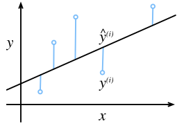
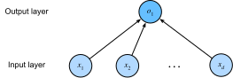
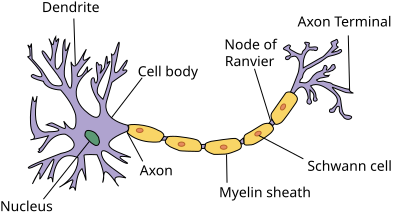

```{.python .input}
%load_ext d2lbook.tab
tab.interact_select(['mxnet', 'pytorch', 'tensorflow', 'jax'])
```

# Tiesinė regresija
:label:`sec_linear_regression`

*Regresijos* uždaviniai iškyla, kai tik norime prognozuoti skaitinę reikšmę.
Įprasti pavyzdžiai: kainų (namų, akcijų ir pan.) prognozė,
gydymo trukmės (ligoninėje besigydančių pacientų) prognozė,
paklausos (mažmeninėje prekyboje) prognozavimas ir daugelis kitų.
Ne kiekvienas prognozavimo uždavinys yra klasikinė regresija.
Vėliau pristatysime klasifikavimo uždavinius,
kuriuose tikslas yra prognozuoti priklausymą kategorijų aibei.

Kaip bėgamąjį pavyzdį tarkime, kad norime
įvertinti namų kainas (doleriais)
pagal jų plotą (kvadratiniais pėdais) ir amžių (metais).
Norėdami sukurti namų kainų prognozavimo modelį,
turime gauti duomenų,
įskaitant kiekvieno namo pardavimo kainą, plotą ir amžių.
Mašininio mokymosi terminologijoje
duomenų rinkinys vadinamas *apmokymo duomenų rinkiniu* arba *apmokymo aibe*,
o kiekviena eilutė (kurioje yra vieno pardavimo duomenys)
vadinama *pavyzdžiu* (arba *duomenų tašku*, *egzemplioriumi*, *imtimi*).
Tai, ką bandome prognozuoti (kaina),
vadinama *žymeniu* (arba *tikslu*).
Kintamieji (amžius ir plotas),
kuriais remiasi prognozės,
vadinami *požymiais* (arba *kovariantėmis*).

```{.python .input}
%%tab mxnet
%matplotlib inline
from d2l import mxnet as d2l
import math
from mxnet import np
import time
```

```{.python .input}
%%tab pytorch
%matplotlib inline
from d2l import torch as d2l
import math
import torch
import numpy as np
import time
```

```{.python .input}
%%tab tensorflow
%matplotlib inline
from d2l import tensorflow as d2l
import math
import tensorflow as tf
import numpy as np
import time
```

```{.python .input}
%%tab jax
%matplotlib inline
from d2l import jax as d2l
from jax import numpy as jnp
import math
import time
```

## Pagrindai

*Tiesinė regresija* yra ir paprasčiausia,
ir populiariausia iš standartinių priemonių
regresijos uždaviniams spręsti.
Ji siekia XIX amžiaus aušrą :cite:`Legendre.1805,Gauss.1809`,
o tiesinė regresija išplaukia iš kelių paprastų prielaidų.
Pirma, darome prielaidą, kad ryšys
tarp požymių $\mathbf{x}$ ir tikslo $y$
yra apytiksliai tiesinis,
t. y. kad sąlyginis vidurkis $E[Y \mid X=\mathbf{x}]$
gali būti išreikštas kaip požymių $\mathbf{x}$
svertinė suma.
Tokia sąranka leidžia, kad tikslinė reikšmė
vis dar gali nukrypti nuo savo tikėtinos reikšmės
dėl stebėjimo triukšmo.
Toliau galime numatyti prielaidą, kad bet koks toks triukšmas
yra tvarkingas ir pasiskirstęs pagal Gauso skirstinį.
Paprastai $n$ žymėsime
pavyzdžių skaičių mūsų duomenų rinkinyje.
Viršutinius indeksus naudojame imtims ir tikslams numeruoti,
o apatinius – koordinatėms indeksuoti.
Konkrečiau,
$\mathbf{x}^{(i)}$ žymi $i$-ąją imtį,
o $x_j^{(i)}$ – jos $j$-ąją koordinatę.

### Modelis
:label:`subsec_linear_model`

Kiekvieno sprendimo širdyje yra modelis,
aprašantis, kaip požymiai gali būti paversti
tikslo įverčiu.
Tiesiškumo prielaida reiškia, kad
tikėtina tikslo (kainos) reikšmė gali būti išreikšta
kaip požymių (ploto ir amžiaus) svertinė suma:

$$\textrm{price} = w_{\textrm{area}} \cdot \textrm{area} + w_{\textrm{age}} \cdot \textrm{age} + b.$$
:eqlabel:`eq_price-area`

Čia $w_{\textrm{area}}$ ir $w_{\textrm{age}}$
vadinami *svoriais*, o $b$ – *poslinkiu*
(arba *postūmiu*, *laisvuoju nariu*).
Svoriai nulemia kiekvieno požymio įtaką mūsų prognozei.
Poslinkis nulemia įverčio reikšmę, kai visi požymiai lygūs nuliui.
Nors niekada nepamatysime naujai pastatytų namų su tiksliai nuliniu plotu,
poslinkio vis tiek reikia, nes jis leidžia mums
išreikšti visas tiesines požymių funkcijas
(užuot mus apribojęs tiesėmis, einančiomis per koordinačių pradžią).
Griežtai kalbant, :eqref:`eq_price-area` yra įvesties požymių *afininė transformacija*, kuriai būdinga požymių *tiesinė transformacija* per svertinę sumą, kartu su *postūmiu* per pridėtą poslinkį.
Turėdami duomenų rinkinį, siekiame pasirinkti
svorius $\mathbf{w}$ ir poslinkį $b$,
kad vidutiniškai mūsų modelio prognozės
kuo tiksliau atitiktų duomenyse stebėtas tikras kainas.


Disciplinose, kuriose įprasta sutelkti dėmesį
į duomenų rinkinius su vos keliais požymiais,
dažnai modeliai išreiškiami išplėstine forma,
kaip :eqref:`eq_price-area`.
Mašininiame mokyme paprastai dirbame
su didelės dimensijos duomenų rinkiniais,
kuriems patogiau naudoti
glaustą tiesinės algebros žymėjimą.
Kai mūsų įvestis sudaro $d$ požymių,
galime kiekvienam priskirti indeksą (nuo $1$ iki $d$)
ir išreikšti savo prognozę $\hat{y}$
(apskritai „kepurėlės" simbolis žymi įvertį) taip:

$$\hat{y} = w_1  x_1 + \cdots + w_d  x_d + b.$$

Surinkę visus požymius į vektorių $\mathbf{x} \in \mathbb{R}^d$,
o visus svorius – į vektorių $\mathbf{w} \in \mathbb{R}^d$,
galime glaustai išreikšti savo modelį per skaliarinę sandaugą
tarp $\mathbf{w}$ ir $\mathbf{x}$:

$$\hat{y} = \mathbf{w}^\top \mathbf{x} + b.$$
:eqlabel:`eq_linreg-y`

:eqref:`eq_linreg-y` vektorius $\mathbf{x}$
atitinka vieno pavyzdžio požymius.
Dažnai bus patogu
kalbėti apie viso $n$ pavyzdžių duomenų rinkinio požymius
per *požymių matricą* $\mathbf{X} \in \mathbb{R}^{n \times d}$.
Čia $\mathbf{X}$ turi po vieną eilutę kiekvienam pavyzdžiui
ir po vieną stulpelį kiekvienam požymiui.
Požymių rinkiniui $\mathbf{X}$
prognozės $\hat{\mathbf{y}} \in \mathbb{R}^n$
gali būti išreikštos matricos ir vektoriaus sandauga:

$${\hat{\mathbf{y}}} = \mathbf{X} \mathbf{w} + b,$$
:eqlabel:`eq_linreg-y-vec`

kur sumuojant taikomas transliavimas (:numref:`subsec_broadcasting`).
Turint apmokymo duomenų rinkinio požymius $\mathbf{X}$
ir atitinkamus (žinomus) žymenis $\mathbf{y}$,
tiesinės regresijos tikslas yra rasti
svorių vektorių $\mathbf{w}$ ir poslinkio narį $b$
taip, kad turint naujo duomenų pavyzdžio požymius,
paimtus iš to paties skirstinio kaip $\mathbf{X}$,
naujo pavyzdžio žymuo (vidutiniškai)
būtų prognozuojamas su mažiausia paklaida.

Net jei manome, kad geriausias modelis
$y$ prognozuoti pagal $\mathbf{x}$ yra tiesinis,
nesitikėtume rasti realaus pasaulio duomenų rinkinio su $n$ pavyzdžių, kuriame
$y^{(i)}$ tiksliai lygus $\mathbf{w}^\top \mathbf{x}^{(i)}+b$
visiems $1 \leq i \leq n$.
Pavyzdžiui, kad ir kokius prietaisus naudotume
požymiams $\mathbf{X}$ ir žymenims $\mathbf{y}$ stebėti, gali būti nedidelė matavimo paklaida.
Todėl net kai esame įsitikinę,
kad pagrindinis ryšys yra tiesinis,
įtrauksime triukšmo narį tokioms paklaidoms paaiškinti.

Prieš pradėdami ieškoti geriausių *parametrų*
(arba *modelio parametrų*) $\mathbf{w}$ ir $b$,
mums reikės dar dviejų dalykų:
(i) tam tikro duoto modelio kokybės matas;
ir (ii) modelio atnaujinimo, siekiant pagerinti jo kokybę, procedūra.

### Nuostolių funkcija
:label:`subsec_linear-regression-loss-function`

Natūralu, kad modelio pritaikymui duomenims reikia
susitarti dėl kokio nors *tinkamumo* mato
(arba, atitinkamai, *netinkamumo* matas).
*Nuostolių funkcijos* kiekybiškai išreiškia atstumą
tarp *tikrųjų* ir *prognozuotų* tikslo reikšmių.
Nuostoliai paprastai yra neneigiamas skaičius,
kur mažesnės reikšmės geresnės,
o tobulos prognozės turi nulinius nuostolius.
Regresijos uždaviniams įprasčiausia nuostolių funkcija yra kvadratinė paklaida.
Kai mūsų prognozė pavyzdžiui $i$ yra $\hat{y}^{(i)}$,
o atitinkamas tikrasis žymuo yra $y^{(i)}$,
*kvadratinė paklaida* yra:

$$l^{(i)}(\mathbf{w}, b) = \frac{1}{2} \left(\hat{y}^{(i)} - y^{(i)}\right)^2.$$
:eqlabel:`eq_mse`

Konstanta $\frac{1}{2}$ realaus skirtumo nesukuria,
bet pasirodo patogi žymėjimo požiūriu,
nes ji suprastėja, kai imame nuostolių išvestinę.
Kadangi apmokymo duomenų rinkinys mums duotas
ir todėl nuo mūsų nepriklauso,
empirinė paklaida yra tik modelio parametrų funkcija.
:numref:`fig_fit_linreg` pavaizduojame tiesinės regresijos modelio pritaikymą
uždaviniui su vienmatėmis įvestimis.


:label:`fig_fit_linreg`

Atkreipkite dėmesį, kad dideli skirtumai tarp
įverčių $\hat{y}^{(i)}$ ir tikslų $y^{(i)}$
duoda dar didesnį indėlį į nuostolius
dėl kvadratinės jų formos
(šis kvadratiškumas gali būti dviašmenis kardas: nors jis skatina modelį vengti didelių paklaidų,
jis taip pat gali sukelti pernelyg didelį jautrumą anomaliems duomenims).
Kad įvertintume modelio kokybę visame $n$ pavyzdžių duomenų rinkinyje,
tiesiog suvidurkiname (arba, ekvivalentiškai, susumuojame)
nuostolius apmokymo aibėje:

$$L(\mathbf{w}, b) =\frac{1}{n}\sum_{i=1}^n l^{(i)}(\mathbf{w}, b) =\frac{1}{n} \sum_{i=1}^n \frac{1}{2}\left(\mathbf{w}^\top \mathbf{x}^{(i)} + b - y^{(i)}\right)^2.$$

Apmokydami modelį ieškome parametrų ($\mathbf{w}^*, b^*$),
kurie minimizuoja bendrus nuostolius visuose apmokymo pavyzdžiuose:

$$\mathbf{w}^*, b^* = \operatorname*{argmin}_{\mathbf{w}, b}\  L(\mathbf{w}, b).$$

### Analizinis sprendinys

Skirtingai nuo daugumos modelių, kuriuos nagrinėsime,
tiesinė regresija pateikia stebėtinai lengvą optimizavimo uždavinį.
Visų pirma, optimalius parametrus
(vertinamus pagal apmokymo duomenis)
galime rasti analiziškai, taikydami paprastą formulę.
Pirmiausia galime poslinkį $b$ įtraukti į parametrą $\mathbf{w}$,
pridėdami prie požymių matricos stulpelį, sudarytą iš vienetų.
Tada mūsų prognozavimo uždavinys yra minimizuoti $\|\mathbf{y} - \mathbf{X}\mathbf{w}\|^2$.
Kol požymių matrica $\mathbf{X}$ turi pilnąjį rangą
(nė vienas požymis nėra tiesiškai priklausomas nuo kitų),
nuostolių paviršiuje bus tik vienas kritinis taškas,
atitinkantis nuostolių minimumą visoje srityje.
Paėmę nuostolių išvestinę $\mathbf{w}$ atžvilgiu
ir prilyginę ją nuliui, gauname:

$$\begin{aligned}
    \partial_{\mathbf{w}} \|\mathbf{y} - \mathbf{X}\mathbf{w}\|^2 =
    2 \mathbf{X}^\top (\mathbf{X} \mathbf{w} - \mathbf{y}) = 0
    \textrm{ and hence }
    \mathbf{X}^\top \mathbf{y} = \mathbf{X}^\top \mathbf{X} \mathbf{w}.
\end{aligned}$$

Išsprendę $\mathbf{w}$, gauname optimalų
optimizavimo uždavinio sprendinį.
Atkreipkite dėmesį, kad šis sprendinys

$$\mathbf{w}^* = (\mathbf X^\top \mathbf X)^{-1}\mathbf X^\top \mathbf{y}$$

bus vienintelis tik tada,
kai matrica $\mathbf X^\top \mathbf X$ yra apverčiama,
t. y. kai požymių matricos stulpeliai
yra tiesiškai nepriklausomi :cite:`Golub.Van-Loan.1996`.


Nors paprasti uždaviniai, tokie kaip tiesinė regresija,
gali turėti analizinius sprendinius,
neturėtumėte priprasti prie tokio sėkmės.
Nors analiziniai sprendiniai leidžia atlikti gražią matematinę analizę,
reikalavimas turėti analizinį sprendinį yra toks ribojantis,
kad atmestų beveik visus įdomiausius giliojo mokymosi aspektus.

### Minirinkinio stochastinis gradientinis nusileidimas

Laimei, net tais atvejais, kai negalime modelių išspręsti analiziškai,
praktikoje vis tiek dažnai galime juos efektyviai apmokyti.
Be to, daugelyje užduočių tie sunkiai optimizuojami modeliai
pasirodo tokie daug geresni, kad išsiaiškinti, kaip juos apmokyti,
galiausiai yra visiškai verta vargo.

Pagrindinė technika, skirta optimizuoti beveik kiekvieną giliojo mokymosi modelį
ir kurią naudosime visoje šioje knygoje,
yra iteratyvus paklaidos mažinimas,
atnaujinant parametrus kryptimi,
kuri laipsniškai mažina nuostolių funkciją.
Šis algoritmas vadinamas *gradientiniu nusileidimu*.

Naiviausias gradientinio nusileidimo taikymas
yra nuostolių funkcijos išvestinės ėmimas,
kuri yra nuostolių vidurkis, apskaičiuotas
kiekvienam duomenų rinkinio pavyzdžiui.
Praktikoje tai gali būti nepaprastai lėta:
turime peržvelgti visą duomenų rinkinį prieš atlikdami vieną atnaujinimą,
net jei atnaujinimo žingsniai gali būti labai galingi :cite:`Liu.Nocedal.1989`.
Dar blogiau, jei apmokymo duomenyse daug pertekliaus,
viso atnaujinimo nauda yra ribota.

Kita kraštutinė yra nagrinėti tik vieną pavyzdį vienu metu ir atlikti
atnaujinimo žingsnius pagal vieną stebinį.
Gautas algoritmas, *stochastinis gradientinis nusileidimas* (SGD),
gali būti efektyvi strategija :cite:`Bottou.2010`, net dideliems duomenų rinkiniams.
Deja, SGD turi trūkumų, tiek skaičiavimo, tiek statistinių.
Viena problema kyla dėl to, kad procesoriai daug greičiau
daugina ir sudeda skaičius, nei
perkelia duomenis iš pagrindinės atminties į procesoriaus podėlį.
Matricos ir vektoriaus daugyba yra net iki dydžio eilės efektyvesnė
nei atitinkamas skaičius vektorių tarpusavio operacijų.
Tai reiškia, kad vieno pavyzdžio apdorojimas vienu metu
gali užtrukti daug ilgiau, palyginti su visu rinkiniu.
Antra problema yra ta, kad kai kurie sluoksniai,
pavyzdžiui, paketinė normalizacija (aprašyta :numref:`sec_batch_norm`),
gerai veikia tik tada, kai turime prieigą
daugiau nei prie vieno stebinio vienu metu.

Abiejų problemų sprendimas yra pasirinkti tarpinę strategiją:
užuot ėmę visą rinkinį ar tik vieną imtį vienu metu,
imame stebinių *minirinkinį* :cite:`Li.Zhang.Chen.ea.2014`.
Konkretus minėto minirinkinio dydžio pasirinkimas priklauso nuo daugelio veiksnių,
tokių kaip atminties kiekis, spartintuvų skaičius,
sluoksnių pasirinkimas ir bendras duomenų rinkinio dydis.
Nepaisant to, skaičius tarp 32 ir 256,
pageidautina didelio dvejeto laipsnio kartotinis, yra geras pradinis taškas.
Tai veda prie *minirinkinio stochastinio gradientinio nusileidimo*.

Pačia paprasčiausia forma kiekvienoje iteracijoje $t$
pirmiausia atsitiktinai atrenkame minirinkinį $\mathcal{B}_t$,
sudarytą iš fiksuoto skaičiaus $|\mathcal{B}|$ apmokymo pavyzdžių.
Tada apskaičiuojame vidutinių nuostolių minirinkinyje
išvestinę (gradientą) modelio parametrų atžvilgiu.
Galiausiai gradientą padauginame
iš iš anksto nustatytos mažos teigiamos reikšmės $\eta$,
vadinamos *mokymosi sparta*,
ir gautą narį atimame iš dabartinių parametrų reikšmių.
Atnaujinimą galime išreikšti taip:

$$(\mathbf{w},b) \leftarrow (\mathbf{w},b) - \frac{\eta}{|\mathcal{B}|} \sum_{i \in \mathcal{B}_t} \partial_{(\mathbf{w},b)} l^{(i)}(\mathbf{w},b).$$

Apibendrinant, minirinkinio SGD vyksta taip:
(i) inicializuojamos modelio parametrų reikšmės, paprastai atsitiktinai;
(ii) iteratyviai atrenkami atsitiktiniai minirinkiniai iš duomenų,
atnaujinant parametrus neigiamo gradiento kryptimi.
Kvadratiniams nuostoliams ir afininėms transformacijoms
tai turi uždarą išraišką:

$$\begin{aligned} \mathbf{w} & \leftarrow \mathbf{w} - \frac{\eta}{|\mathcal{B}|} \sum_{i \in \mathcal{B}_t} \partial_{\mathbf{w}} l^{(i)}(\mathbf{w}, b) && = \mathbf{w} - \frac{\eta}{|\mathcal{B}|} \sum_{i \in \mathcal{B}_t} \mathbf{x}^{(i)} \left(\mathbf{w}^\top \mathbf{x}^{(i)} + b - y^{(i)}\right)\\ b &\leftarrow b -  \frac{\eta}{|\mathcal{B}|} \sum_{i \in \mathcal{B}_t} \partial_b l^{(i)}(\mathbf{w}, b) &&  = b - \frac{\eta}{|\mathcal{B}|} \sum_{i \in \mathcal{B}_t} \left(\mathbf{w}^\top \mathbf{x}^{(i)} + b - y^{(i)}\right). \end{aligned}$$
:eqlabel:`eq_linreg_batch_update`

Kadangi pasirenkame minirinkinį $\mathcal{B}$,
turime normalizuoti pagal jo dydį $|\mathcal{B}|$.
Dažnai minirinkinio dydį ir mokymosi spartą nustato vartotojas.
Tokie derinami parametrai, kurie
apmokymo cikle neatnaujinami, vadinami *hiperparametrais*.
Juos galima derinti automatiškai keliais metodais, pvz., Bajeso optimizavimu
:cite:`Frazier.2018`. Galiausiai sprendinio kokybė
paprastai vertinama atskirame *validavimo duomenų rinkinyje* (arba *validavimo aibėje*).

Apmokę iš anksto nustatytą iteracijų skaičių
(arba kol įvykdomas kitas sustojimo kriterijus),
užfiksuojame įvertintus modelio parametrus,
žymimus $\hat{\mathbf{w}}, \hat{b}$.
Atkreipkite dėmesį, kad net jei mūsų funkcija iš tiesų tiesinė ir be triukšmo,
šie parametrai nebus tikslūs nuostolių minimizatoriai ir net nebus deterministiniai.
Nors algoritmas lėtai konverguoja link minimizatorių,
paprastai jis jų tiksliai nesuras per baigtinį žingsnių skaičių.
Be to, minirinkiniai $\mathcal{B}$,
naudojami parametrams atnaujinti, parenkami atsitiktinai.
Tai sulaužo determinizmą.

Tiesinė regresija yra mokymosi uždavinys
su globaliuoju minimumu
(kai tik $\mathbf{X}$ turi pilnąjį rangą arba, ekvivalentiškai,
kai tik $\mathbf{X}^\top \mathbf{X}$ yra apverčiama).
Tačiau giliųjų tinklų nuostolių paviršiuose yra daug balno taškų ir minimumų.
Laimei, paprastai mums nerūpi rasti
tikslų parametrų rinkinį, o tik bet kokį parametrų rinkinį,
kuris veda prie tikslių prognozių (taigi ir mažų nuostolių).
Praktikoje giliojo mokymosi specialistams
retai kyla sunkumų ieškant parametrų,
kurie minimizuoja nuostolius *apmokymo aibėse*
:cite:`Izmailov.Podoprikhin.Garipov.ea.2018,Frankle.Carbin.2018`.
Sunkesnė užduotis yra rasti parametrus,
kurie veda prie tikslių prognozių anksčiau nematytiems duomenims,
o šis iššūkis vadinamas *apibendrinimu*.
Prie šių temų sugrįšime visoje knygoje.

### Prognozės

Turėdami modelį $\hat{\mathbf{w}}^\top \mathbf{x} + \hat{b}$,
dabar galime daryti naujo pavyzdžio *prognozes*,
pvz., prognozuoti anksčiau nematyto namo pardavimo kainą
pagal jo plotą $x_1$ ir amžių $x_2$.
Giliojo mokymosi specialistai įprato prognozavimo etapą vadinti *inferencija*,
bet tai yra šiek tiek klaidingas pavadinimas – *inferencija* apskritai reiškia
bet kokią išvadą, padarytą remiantis įrodymais,
įskaitant ir parametrų reikšmes,
ir tikėtiną anksčiau nematyto egzemplioriaus žymenį.
Statistikos literatūroje
*inferencija* dažniau reiškia parametrų inferenciją,
ir šis terminijos perkrovimas sukuria nereikalingą painiavą,
kai giliojo mokymosi specialistai kalbasi su statistikais.
Toliau, kai tik įmanoma, laikysimės termino *prognozė*.


## Vektorizacija spartai

Apmokydami modelius dažniausiai norime apdoroti
visus pavyzdžių minirinkinius vienu metu.
Kad tai būtų daroma efektyviai, (**turime**) (~~should~~)
(**vektorizuoti skaičiavimus ir pasinaudoti
greitomis tiesinės algebros bibliotekomis,
užuot rašę brangius ciklus „for" Python kalba.**)

Kad suprastume, kodėl tai taip svarbu,
(**panagrinėkime du vektorių sudėjimo metodus.**)
Pradžioje sukuriame du 10 000 dimensijų vektorius,
sudarytus vien iš vienetų.
Pirmuoju metodu einame per vektorius Python ciklu „for".
Antruoju remiamės vienu operatoriaus `+` iškvietimu.

```{.python .input}
%%tab all
n = 10000
a = d2l.ones(n)
b = d2l.ones(n)
```

Dabar galime išmatuoti darbo krūvių spartą.
Pirmiausia [**sudedame juos po vieną koordinatę,
naudodami ciklą „for".**]

```{.python .input}
%%tab mxnet, pytorch
c = d2l.zeros(n)
t = time.time()
for i in range(n):
    c[i] = a[i] + b[i]
f'{time.time() - t:.5f} sec'
```

```{.python .input}
%%tab tensorflow
c = tf.Variable(d2l.zeros(n))
t = time.time()
for i in range(n):
    c[i].assign(a[i] + b[i])
f'{time.time() - t:.5f} sec'
```

```{.python .input}
%%tab jax
# JAX arrays are immutable, meaning that once created their contents
# cannot be changed. For updating individual elements, JAX provides
# an indexed update syntax that returns an updated copy
c = d2l.zeros(n)
t = time.time()
for i in range(n):
    c = c.at[i].set(a[i] + b[i])
f'{time.time() - t:.5f} sec'
```

(**Arba remiamės perkrautu operatoriumi `+`, kad apskaičiuotume elementinę sumą.**)

```{.python .input}
%%tab all
t = time.time()
d = a + b
f'{time.time() - t:.5f} sec'
```

Antrasis metodas yra stebėtinai greitesnis už pirmąjį.
Vektorizavimas dažnai suteikia dydžio eilės pagreitį.
Be to, daugiau matematikos perkeliame bibliotekai,
todėl mums nereikia patiems rašyti tiek skaičiavimų,
o tai mažina klaidų galimybę ir didina kodo perkeliamumą.


## Normalusis skirstinys ir kvadratiniai nuostoliai
:label:`subsec_normal_distribution_and_squared_loss`

Iki šiol kvadratinių nuostolių tikslui pateikėme gana funkcinį
pagrindimą:
optimalūs parametrai grąžina sąlyginį vidurkį $E[Y\mid X]$,
kai tik pagrindinis dėsningumas yra tikrai tiesinis,
o nuostoliai skiria dideles baudas už nuokrypius.
Taip pat galime pateikti formalesnį
kvadratinių nuostolių tikslo pagrindimą,
darydami tikimybines prielaidas
apie triukšmo skirstinį.

Tiesinė regresija buvo išrasta XIX amžiaus sandūroje.
Nors ilgai buvo diskutuojama, ar Gaussas, ar Legendre'as
pirmasis sugalvojo šią idėją,
būtent Gaussas taip pat atrado normalųjį skirstinį
(vadinamą ir *Gauso skirstiniu*).
Pasirodo, kad normalusis skirstinys
ir tiesinė regresija su kvadratiniais nuostoliais
turi gilesnį ryšį nei bendra kilmė.

Pirmiausia prisiminkite, kad normalusis skirstinys
su vidurkiu $\mu$ ir dispersija $\sigma^2$ (standartiniu nuokrypiu $\sigma$)
duodamas taip:

$$p(x) = \frac{1}{\sqrt{2 \pi \sigma^2}} \exp\left(-\frac{1}{2 \sigma^2} (x - \mu)^2\right).$$

Žemiau [**apibrėžiame funkciją normaliajam skirstiniui apskaičiuoti**].

```{.python .input}
%%tab all
def normal(x, mu, sigma):
    p = 1 / math.sqrt(2 * math.pi * sigma**2)
    if tab.selected('jax'):
        return p * jnp.exp(-0.5 * (x - mu)**2 / sigma**2)
    if tab.selected('pytorch', 'mxnet', 'tensorflow'):
        return p * np.exp(-0.5 * (x - mu)**2 / sigma**2)
```

Dabar galime (**vizualizuoti normaliuosius skirstinius**).

```{.python .input}
%%tab mxnet
# Use NumPy again for visualization
x = np.arange(-7, 7, 0.01)

# Mean and standard deviation pairs
params = [(0, 1), (0, 2), (3, 1)]
d2l.plot(x.asnumpy(), [normal(x, mu, sigma).asnumpy() for mu, sigma in params], xlabel='x',
         ylabel='p(x)', figsize=(4.5, 2.5),
         legend=[f'mean {mu}, std {sigma}' for mu, sigma in params])
```

```{.python .input}

%%tab pytorch, tensorflow, jax
if tab.selected('jax'):
    # Use JAX NumPy for visualization
    x = jnp.arange(-7, 7, 0.01)
if tab.selected('pytorch', 'mxnet', 'tensorflow'):
    # Use NumPy again for visualization
    x = np.arange(-7, 7, 0.01)

# Mean and standard deviation pairs
params = [(0, 1), (0, 2), (3, 1)]
d2l.plot(x, [normal(x, mu, sigma) for mu, sigma in params], xlabel='x',
         ylabel='p(x)', figsize=(4.5, 2.5),
         legend=[f'mean {mu}, std {sigma}' for mu, sigma in params])
```

Atkreipkite dėmesį, kad vidurkio keitimas atitinka
postūmį išilgai $x$ ašies,
o dispersijos didinimas
išplečia skirstinį,
sumažindamas jo viršūnę.

Vienas būdas pagrįsti tiesinę regresiją su kvadratiniais nuostoliais
yra daryti prielaidą, kad stebiniai atsiranda iš triukšmingų matavimų,
kur triukšmas $\epsilon$ pasiskirstęs pagal normalųjį skirstinį
$\mathcal{N}(0, \sigma^2)$:

$$y = \mathbf{w}^\top \mathbf{x} + b + \epsilon \textrm{ where } \epsilon \sim \mathcal{N}(0, \sigma^2).$$

Taigi dabar galime užrašyti *tikėtinumą*
pamatyti konkretų $y$ esant duotam $\mathbf{x}$:

$$P(y \mid \mathbf{x}) = \frac{1}{\sqrt{2 \pi \sigma^2}} \exp\left(-\frac{1}{2 \sigma^2} (y - \mathbf{w}^\top \mathbf{x} - b)^2\right).$$

Taigi tikėtinumas faktorizuojasi.
Pagal *didžiausio tikėtinumo principą*
geriausios parametrų $\mathbf{w}$ ir $b$ reikšmės yra tos,
kurios maksimizuoja viso duomenų rinkinio *tikėtinumą*:

$$P(\mathbf y \mid \mathbf X) = \prod_{i=1}^{n} p(y^{(i)} \mid \mathbf{x}^{(i)}).$$

Lygybė išplaukia, nes visos poros $(\mathbf{x}^{(i)}, y^{(i)})$
buvo paimtos nepriklausomai viena nuo kitos.
Įvertiniai, parinkti pagal didžiausio tikėtinumo principą,
vadinami *didžiausio tikėtinumo įvertiniais*.
Nors daugelio eksponentinių funkcijų sandaugos maksimizavimas
gali atrodyti sudėtingas,
galime žymiai viską supaprastinti, nekeisdami tikslo,
vietoj to maksimizuodami tikėtinumo logaritmą.
Dėl istorinių priežasčių optimizavimas dažniau išreiškiamas
kaip minimizavimas, o ne maksimizavimas.
Taigi, nieko nekeisdami,
galime *minimizuoti* *neigiamą logaritminį tikėtinumą*,
kurį galime išreikšti taip:

$$-\log P(\mathbf y \mid \mathbf X) = \sum_{i=1}^n \frac{1}{2} \log(2 \pi \sigma^2) + \frac{1}{2 \sigma^2} \left(y^{(i)} - \mathbf{w}^\top \mathbf{x}^{(i)} - b\right)^2.$$

Jei darome prielaidą, kad $\sigma$ yra fiksuotas,
pirmąjį narį galime ignoruoti,
nes jis nepriklauso nuo $\mathbf{w}$ ar $b$.
Antrasis narys yra identiškas
anksčiau pristatytiems kvadratinės paklaidos nuostoliams,
išskyrus daugiklį $\frac{1}{\sigma^2}$.
Laimei, sprendinys taip pat nepriklauso nuo $\sigma$.
Iš to išplaukia, kad vidutinės kvadratinės paklaidos minimizavimas
yra ekvivalentus tiesinio modelio didžiausio tikėtinumo vertinimui
darant adityvaus Gauso triukšmo prielaidą.


## Tiesinė regresija kaip neuroninis tinklas

Nors tiesiniai modeliai nėra pakankamai turtingi
išreikšti daugeliui sudėtingų tinklų,
kuriuos pristatysime šioje knygoje,
(dirbtiniai) neuroniniai tinklai yra pakankamai turtingi,
kad apimtų tiesinius modelius kaip tinklus,
kuriuose kiekvienas požymis atvaizduojamas įvesties neuronu,
ir visi jie sujungti tiesiogiai su išvestimi.

:numref:`fig_single_neuron` pavaizduota
tiesinė regresija kaip neuroninis tinklas.
Diagrama pabrėžia jungčių struktūrą,
pavyzdžiui, kaip kiekviena įvestis sujungta su išvestimi,
bet ne konkrečias svorių ar poslinkių reikšmes.


:label:`fig_single_neuron`

Įvestys yra $x_1, \ldots, x_d$.
$d$ vadiname *įvesčių skaičiumi*
arba įvesties sluoksnio *požymių dimensija*.
Tinklo išvestis yra $o_1$.
Kadangi bandome prognozuoti tik
vieną skaitinę reikšmę,
turime tik vieną išvesties neuroną.
Atkreipkite dėmesį, kad visos įvesties reikšmės yra *duotos*.
Yra tik vienas *apskaičiuojamas* neuronas.
Apibendrinant, tiesinę regresiją galime laikyti
vieno sluoksnio pilnai sujungtu neuroniniu tinklu.
Vėlesniuose skyriuose susidursime su tinklais,
turinčiais gerokai daugiau sluoksnių.

### Biologija

Kadangi tiesinė regresija atsirado anksčiau nei skaičiuojamoji neurologija,
tiesinę regresiją aprašyti neuroninių tinklų terminais
gali pasirodyti anachronizmas.
Vis dėlto tai buvo natūrali pradžia,
kai kibernetikai ir neurofiziologai
Warrenas McCullochas ir Walteris Pittsas pradėjo kurti
dirbtinių neuronų modelius.
Panagrinėkime schematinį
biologinio neurono paveikslėlį :numref:`fig_Neuron`,
sudarytą iš *dendritų* (įvesties gnybtų),
*branduolio* (CPU), *aksono* (išvesties laido)
ir *aksono galūnių* (išvesties gnybtų),
leidžiančių jungtis su kitais neuronais per *sinapses*.


:label:`fig_Neuron`

Informacija $x_i$, atkeliaujanti iš kitų neuronų
(arba aplinkos jutiklių), priimama dendrituose.
Visų pirma ši informacija sveriama
*sinapsiniais svoriais* $w_i$,
nulemiančiais įvesčių poveikį,
pvz., aktyvavimą ar slopinimą per sandaugą $x_i w_i$.
Svertinės įvestys, ateinančios iš kelių šaltinių,
branduolyje agreguojamos
kaip svertinė suma $y = \sum_i x_i w_i + b$,
galbūt papildomai netiesiškai apdorojama funkcija $\sigma(y)$.
Tada ši informacija aksonu siunčiama į aksono galūnes,
kur ji pasiekia paskirties vietą
(pvz., vykdiklį, tokį kaip raumuo)
arba perduodama kitam neuronui per jo dendritus.

Be abejo, aukšto lygio idėja, kad daug tokių vienetų
galėtų būti sujungti, jei jie turi teisingą jungčių struktūrą ir mokymosi algoritmą,
sukurti daug įdomesnį ir sudėtingesnį elgesį,
nei galėtų išreikšti vienas neuronas,
kyla iš tikrųjų biologinių nervų sistemų tyrimo.
Tuo pat metu dauguma šiandienos giliojo mokymosi tyrimų
įkvėpimo semiasi iš kur kas platesnio šaltinio.
Remiamės :citet:`Russell.Norvig.2016`,
kurie pažymėjo, kad nors lėktuvus galbūt *įkvėpė* paukščiai,
ornitologija jau kelis šimtmečius nėra
pagrindinė aeronautikos naujovių varomoji jėga.
Panašiai šiais laikais giliojo mokymosi įkvėpimas
vienodai ar net labiau kyla
iš matematikos, kalbotyros, psichologijos,
statistikos, informatikos ir daugelio kitų sričių.

## Santrauka

Šiame skyrelyje pristatėme
tradicinę tiesinę regresiją,
kurioje tiesinės funkcijos parametrai
parenkami taip, kad minimizuotų kvadratinius nuostolius apmokymo aibėje.
Šį tikslo pasirinkimą taip pat pagrindėme
ir praktiniais sumetimais,
ir tiesinės regresijos interpretacija
kaip didžiausio tikėtinumo vertinimu
darant tiesiškumo ir Gauso triukšmo prielaidą.
Aptarę ir skaičiavimo aspektus,
ir ryšius su statistika,
parodėme, kaip tokius tiesinius modelius galima išreikšti
kaip paprastus neuroninius tinklus, kuriuose įvestys
tiesiogiai sujungtos su išvestimi (-mis).
Nors netrukus apskritai pereisime prie netiesinių modelių,
jie yra pakankami pristatyti daugumą komponentų,
kurių reikia visiems mūsų modeliams:
parametrinėms formoms, diferencijuojamiems tikslams,
optimizavimui minirinkinio stochastiniu gradientiniu nusileidimu
ir galiausiai vertinimui anksčiau nematytuose duomenyse.


## Pratimai

1. Tarkime, turime duomenis $x_1, \ldots, x_n \in \mathbb{R}$. Mūsų tikslas yra rasti konstantą $b$, kuri minimizuotų $\sum_i (x_i - b)^2$.
    1. Raskite analizinį optimalios $b$ reikšmės sprendinį.
    1. Kaip šis uždavinys ir jo sprendinys susiję su normaliuoju skirstiniu?
    1. Kas bus, jei nuostolius pakeisime iš $\sum_i (x_i - b)^2$ į $\sum_i |x_i-b|$? Ar galite rasti optimalų $b$ sprendinį?
1. Įrodykite, kad afininės funkcijos, išreiškiamos $\mathbf{x}^\top \mathbf{w} + b$, yra ekvivalenčios tiesinėms funkcijoms nuo $(\mathbf{x}, 1)$.
1. Tarkime, norite rasti kvadratines $\mathbf{x}$ funkcijas, t. y. $f(\mathbf{x}) = b + \sum_i w_i x_i + \sum_{j \leq i} w_{ij} x_{i} x_{j}$. Kaip tai suformuluotumėte giliajame tinkle?
1. Prisiminkite, kad viena iš tiesinės regresijos uždavinio išsprendžiamumo sąlygų buvo, kad požymių matrica $\mathbf{X}^\top \mathbf{X}$ turi pilnąjį rangą.
    1. Kas nutinka, jei taip nėra?
    1. Kaip tai galėtumėte ištaisyti? Kas nutinka, jei prie visų $\mathbf{X}$ įrašų pridedate nedidelį kiekį koordinatėmis nepriklausomo Gauso triukšmo?
    1. Kokia yra požymių matricos $\mathbf{X}^\top \mathbf{X}$ tikėtina reikšmė šiuo atveju?
    1. Kas nutinka su stochastiniu gradientiniu nusileidimu, kai $\mathbf{X}^\top \mathbf{X}$ neturi pilnojo rango?
1. Tarkime, kad adityvųjį triukšmą $\epsilon$ valdantis triukšmo modelis yra eksponentinis skirstinys. T. y. $p(\epsilon) = \frac{1}{2} \exp(-|\epsilon|)$.
    1. Užrašykite duomenų neigiamą logaritminį tikėtinumą pagal modelį $-\log P(\mathbf y \mid \mathbf X)$.
    1. Ar galite rasti uždaros formos sprendinį?
    1. Pasiūlykite minirinkinio stochastinio gradientinio nusileidimo algoritmą šiam uždaviniui spręsti. Kas galėtų nepavykti (užuomina: kas nutinka šalia stacionaraus taško, toliau atnaujinant parametrus)? Ar galite tai ištaisyti?
1. Tarkime, norime sukurti dviejų sluoksnių neuroninį tinklą, sukomponuodami du tiesinius sluoksnius. T. y. pirmojo sluoksnio išvestis tampa antrojo sluoksnio įvestimi. Kodėl tokia naivi kompozicija neveiktų?
1. Kas nutinka, jei norite naudoti regresiją realistiškam namų kainų ar akcijų kainų vertinimui?
    1. Parodykite, kad adityvaus Gauso triukšmo prielaida netinkama. Užuomina: ar gali būti neigiamų kainų? O svyravimai?
    1. Kodėl regresija kainos logaritmui būtų daug geresnė, t. y. $y = \log \textrm{price}$?
    1. Dėl ko reikia sunerimti dirbant su centų akcijomis, t. y. labai žemos kainos akcijomis? Užuomina: ar galite prekiauti visomis galimomis kainomis? Kodėl tai didesnė problema pigioms akcijoms? Daugiau informacijos rasite perskaitę garsųjį Blacko ir Scholeso modelį opcionų kainodarai :cite:`Black.Scholes.1973`.
1. Tarkime, norime naudoti regresiją, kad įvertintume parduotuvėje parduotų obuolių *skaičių*.
    1. Kokios yra Gauso adityvaus triukšmo modelio problemos? Užuomina: jūs parduodate obuolius, o ne naftą.
    1. [Puasono skirstinys](https://en.wikipedia.org/wiki/Poisson_distribution) aprašo skaičių skirstinius. Jis duodamas $p(k \mid \lambda) = \lambda^k e^{-\lambda}/k!$. Čia $\lambda$ yra intensyvumo funkcija, o $k$ – matomų įvykių skaičius. Įrodykite, kad $\lambda$ yra skaičiaus $k$ tikėtina reikšmė.
    1. Sukurkite nuostolių funkciją, susijusią su Puasono skirstiniu.
    1. Sukurkite nuostolių funkciją, skirtą vietoj to įvertinti $\log \lambda$.

:begin_tab:`mxnet`
[Diskusijos](https://discuss.d2l.ai/t/40)
:end_tab:

:begin_tab:`pytorch`
[Diskusijos](https://discuss.d2l.ai/t/258)
:end_tab:

:begin_tab:`tensorflow`
[Diskusijos](https://discuss.d2l.ai/t/259)
:end_tab:
