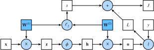

# Tiesioginis sklidimas, atgalinis sklidimas ir skaičiavimo grafai
:label:`sec_backprop`

Iki šiol savo modelius apmokėme
minirinkinio stochastiniu gradientiniu nusileidimu.
Tačiau įgyvendindami algoritmą,
rūpinomės tik skaičiavimais,
susijusiais su *tiesioginiu sklidimu* per modelį.
Kai atėjo laikas apskaičiuoti gradientus,
tiesiog iškvietėme atgalinio sklidimo funkciją, kurią suteikia giliojo mokymosi karkasas.

Automatinis gradientų skaičiavimas
iš esmės supaprastina
giliojo mokymosi algoritmų įgyvendinimą.
Prieš atsirandant automatiniam diferencijavimui,
net nedideli sudėtingų modelių pakeitimai reikalavo
rankomis perskaičiuoti sudėtingas išvestines.
Stebėtinai dažnai moksliniuose straipsniuose tekdavo skirti
daugybę puslapių atnaujinimo taisyklėms išvesti.
Nors turime ir toliau remtis automatiniu diferencijavimu,
kad galėtume susitelkti į įdomiąsias dalis,
turėtumėte žinoti, kaip šie gradientai
apskaičiuojami „po gaubtu“,
jei norite peržengti paviršutinišką
giliojo mokymosi supratimą.

Šiame skyrelyje gilinamės
į *atgalinio sklidimo*
(dažniau vadinamo *atgaliniu skleidimu*) detales.
Kad suteiktume įžvalgų apie
metodus ir jų įgyvendinimą,
remiamės elementaria matematika ir skaičiavimo grafais.
Pradžioje savo pateikimą sutelkiame į
vieno paslėptojo sluoksnio MLP
su svorių nykimu ($\ell_2$ reguliarizavimu, kuris bus aprašytas tolesniuose skyriuose).

## Tiesioginis sklidimas

*Tiesioginis sklidimas* (arba *tiesioginis praėjimas*) reiškia tarpinių kintamųjų
(įskaitant išvestis) skaičiavimą ir saugojimą
neuroniniam tinklui iš eilės
nuo įvesties sluoksnio iki išvesties sluoksnio.
Dabar žingsnis po žingsnio išnagrinėsime
neuroninio tinklo su vienu paslėptuoju sluoksniu mechaniką.
Tai gali pasirodyti nuobodu, bet pagal
funko virtuozo Jameso Browno amžinuosius žodžius,
turite „sumokėti kainą, kad taptumėte bosu“.

Paprastumo dėlei tarkime,
kad įvesties pavyzdys yra $\mathbf{x}\in \mathbb{R}^d$,
o mūsų paslėptasis sluoksnis neturi poslinkio nario.
Čia tarpinis kintamasis yra:

$$\mathbf{z}= \mathbf{W}^{(1)} \mathbf{x},$$

kur $\mathbf{W}^{(1)} \in \mathbb{R}^{h \times d}$
yra paslėptojo sluoksnio svorių parametras.
Praleidę tarpinį kintamąjį
$\mathbf{z}\in \mathbb{R}^h$ per
aktyvacijos funkciją $\phi$,
gauname savo paslėptųjų aktyvacijų vektorių, kurio ilgis $h$:

$$\mathbf{h}= \phi (\mathbf{z}).$$

Paslėptojo sluoksnio išvestis $\mathbf{h}$
taip pat yra tarpinis kintamasis.
Tarkime, kad išvesties sluoksnio parametrai
turi tik svorį
$\mathbf{W}^{(2)} \in \mathbb{R}^{q \times h}$,
tada galime gauti išvesties sluoksnio kintamąjį,
kuris yra $q$ ilgio vektorius:

$$\mathbf{o}= \mathbf{W}^{(2)} \mathbf{h}.$$

Tarkime, kad nuostolių funkcija yra $l$,
o pavyzdžio žymuo yra $y$,
tada galime apskaičiuoti nuostolių narį
vienam duomenų pavyzdžiui:

$$L = l(\mathbf{o}, y).$$

Kaip pamatysime iš vėliau pristatomo $\ell_2$ reguliarizavimo apibrėžimo,
turint hiperparametrą $\lambda$,
reguliarizavimo narys yra

$$s = \frac{\lambda}{2} \left(\|\mathbf{W}^{(1)}\|_\textrm{F}^2 + \|\mathbf{W}^{(2)}\|_\textrm{F}^2\right),$$
:eqlabel:`eq_forward-s`

kur matricos Frobenijaus norma
yra tiesiog $\ell_2$ norma, pritaikyta
suplokštinus matricą į vektorių.
Galiausiai modelio reguliarizuoti nuostoliai
duotam duomenų pavyzdžiui yra:

$$J = L + s.$$

Toliau diskusijoje $J$ vadinsime *tikslo funkcija*.

## Tiesioginio sklidimo skaičiavimo grafas

*Skaičiavimo grafų* braižymas padeda vizualizuoti
operatorių ir kintamųjų priklausomybes
skaičiavimo viduje.
:numref:`fig_forward` pateiktas grafas, susijęs
su aukščiau aprašytu paprastu tinklu,
kuriame kvadratai žymi kintamuosius, o apskritimai – operatorius.
Apatinis kairysis kampas žymi įvestį,
o viršutinis dešinysis – išvestį.
Atkreipkite dėmesį, kad rodyklių kryptys
(iliustruojančios duomenų srautą)
daugiausia yra į dešinę ir aukštyn.

:label:`fig_forward`

## Atgalinis sklidimas

*Atgalinis sklidimas* reiškia neuroninio tinklo parametrų
gradiento skaičiavimo metodą.
Trumpai tariant, metodas apeina tinklą atvirkštine tvarka,
nuo išvesties iki įvesties sluoksnio,
pagal *grandinės taisyklę* iš matematinės analizės.
Algoritmas saugo bet kuriuos tarpinius kintamuosius
(dalines išvestines),
reikalingus skaičiuojant gradientą
kokių nors parametrų atžvilgiu.
Tarkime, kad turime funkcijas
$\mathsf{Y}=f(\mathsf{X})$
ir $\mathsf{Z}=g(\mathsf{Y})$,
kuriose įvestis ir išvestis
$\mathsf{X}, \mathsf{Y}, \mathsf{Z}$
yra savavališkų formų tenzoriai.
Naudodami grandinės taisyklę,
galime apskaičiuoti
$\mathsf{Z}$ išvestinę $\mathsf{X}$ atžvilgiu pagal

$$\frac{\partial \mathsf{Z}}{\partial \mathsf{X}} = \textrm{prod}\left(\frac{\partial \mathsf{Z}}{\partial \mathsf{Y}}, \frac{\partial \mathsf{Y}}{\partial \mathsf{X}}\right).$$

Čia naudojame operatorių $\textrm{prod}$,
kad sudaugintume jo argumentus
atlikus reikiamas operacijas,
tokias kaip transponavimas ir įvesties pozicijų sukeitimas.
Vektoriams tai paprasta:
tai tiesiog matricų daugyba.
Aukštesnių dimensijų tenzoriams
naudojame atitinkamą analogą.
Operatorius $\textrm{prod}$ paslepia visą žymėjimo naštą.

Prisiminkite, kad
paprasto tinklo su vienu paslėptuoju sluoksniu,
kurio skaičiavimo grafas pateiktas :numref:`fig_forward`,
parametrai yra $\mathbf{W}^{(1)}$ ir $\mathbf{W}^{(2)}$.
Atgalinio sklidimo tikslas yra
apskaičiuoti gradientus $\partial J/\partial \mathbf{W}^{(1)}$
ir $\partial J/\partial \mathbf{W}^{(2)}$.
Tam taikome grandinės taisyklę
ir paeiliui skaičiuojame
kiekvieno tarpinio kintamojo ir parametro gradientą.
Skaičiavimų tvarka yra atvirkštinė
nei atliekama tiesioginio sklidimo metu,
nes turime pradėti nuo skaičiavimo grafo rezultato
ir judėti link parametrų.
Pirmasis žingsnis yra apskaičiuoti
tikslo funkcijos $J=L+s$ gradientus
nuostolių nario $L$
ir reguliarizavimo nario $s$ atžvilgiu:

$$\frac{\partial J}{\partial L} = 1 \; \textrm{and} \; \frac{\partial J}{\partial s} = 1.$$

Toliau, pagal grandinės taisyklę, apskaičiuojame tikslo funkcijos
gradientą išvesties sluoksnio kintamojo $\mathbf{o}$ atžvilgiu:

$$
\frac{\partial J}{\partial \mathbf{o}}
= \textrm{prod}\left(\frac{\partial J}{\partial L}, \frac{\partial L}{\partial \mathbf{o}}\right)
= \frac{\partial L}{\partial \mathbf{o}}
\in \mathbb{R}^q.
$$

Toliau apskaičiuojame reguliarizavimo nario
gradientus abiejų parametrų atžvilgiu:

$$\frac{\partial s}{\partial \mathbf{W}^{(1)}} = \lambda \mathbf{W}^{(1)}
\; \textrm{and} \;
\frac{\partial s}{\partial \mathbf{W}^{(2)}} = \lambda \mathbf{W}^{(2)}.$$

Dabar galime apskaičiuoti
arčiausiai išvesties sluoksnio esančių modelio parametrų
gradientą $\partial J/\partial \mathbf{W}^{(2)} \in \mathbb{R}^{q \times h}$.
Naudodami grandinės taisyklę gauname:

$$\frac{\partial J}{\partial \mathbf{W}^{(2)}}= \textrm{prod}\left(\frac{\partial J}{\partial \mathbf{o}}, \frac{\partial \mathbf{o}}{\partial \mathbf{W}^{(2)}}\right) + \textrm{prod}\left(\frac{\partial J}{\partial s}, \frac{\partial s}{\partial \mathbf{W}^{(2)}}\right)= \frac{\partial J}{\partial \mathbf{o}} \mathbf{h}^\top + \lambda \mathbf{W}^{(2)}.$$
:eqlabel:`eq_backprop-J-h`

Kad gautume gradientą $\mathbf{W}^{(1)}$ atžvilgiu,
turime tęsti atgalinį sklidimą
nuo išvesties sluoksnio iki paslėptojo sluoksnio.
Gradientas paslėptojo sluoksnio išvesties atžvilgiu
$\partial J/\partial \mathbf{h} \in \mathbb{R}^h$ yra

$$
\frac{\partial J}{\partial \mathbf{h}}
= \textrm{prod}\left(\frac{\partial J}{\partial \mathbf{o}}, \frac{\partial \mathbf{o}}{\partial \mathbf{h}}\right)
= {\mathbf{W}^{(2)}}^\top \frac{\partial J}{\partial \mathbf{o}}.
$$

Kadangi aktyvacijos funkcija $\phi$ taikoma elementas po elemento,
tarpinio kintamojo $\mathbf{z}$ gradiento $\partial J/\partial \mathbf{z} \in \mathbb{R}^h$
skaičiavimui
reikia naudoti elementų daugybos operatorių,
kurį žymime $\odot$:

$$
\frac{\partial J}{\partial \mathbf{z}}
= \textrm{prod}\left(\frac{\partial J}{\partial \mathbf{h}}, \frac{\partial \mathbf{h}}{\partial \mathbf{z}}\right)
= \frac{\partial J}{\partial \mathbf{h}} \odot \phi'\left(\mathbf{z}\right).
$$

Galiausiai galime gauti
arčiausiai įvesties sluoksnio esančių modelio parametrų
gradientą $\partial J/\partial \mathbf{W}^{(1)} \in \mathbb{R}^{h \times d}$.
Pagal grandinės taisyklę gauname

$$
\frac{\partial J}{\partial \mathbf{W}^{(1)}}
= \textrm{prod}\left(\frac{\partial J}{\partial \mathbf{z}}, \frac{\partial \mathbf{z}}{\partial \mathbf{W}^{(1)}}\right) + \textrm{prod}\left(\frac{\partial J}{\partial s}, \frac{\partial s}{\partial \mathbf{W}^{(1)}}\right)
= \frac{\partial J}{\partial \mathbf{z}} \mathbf{x}^\top + \lambda \mathbf{W}^{(1)}.
$$

## Neuroninių tinklų apmokymas

Apmokant neuroninius tinklus,
tiesioginis ir atgalinis sklidimai priklauso vienas nuo kito.
Visų pirma, tiesioginio sklidimo metu
apeiname skaičiavimo grafą priklausomybių kryptimi
ir apskaičiuojame visus kintamuosius jo kelyje.
Jie vėliau naudojami atgaliniam sklidimui,
kai skaičiavimo tvarka grafe apverčiama.

Kaip iliustracinį pavyzdį paimkime minėtą paprastą tinklą.
Viena vertus,
reguliarizavimo nario :eqref:`eq_forward-s` skaičiavimas
tiesioginio sklidimo metu
priklauso nuo dabartinių modelio parametrų $\mathbf{W}^{(1)}$ ir $\mathbf{W}^{(2)}$ reikšmių.
Jas pateikia optimizavimo algoritmas pagal atgalinį sklidimą paskutinėje iteracijoje.
Kita vertus,
parametro gradiento skaičiavimas
:eqref:`eq_backprop-J-h` atgalinio sklidimo metu
priklauso nuo dabartinės paslėptojo sluoksnio išvesties $\mathbf{h}$ reikšmės,
kurią pateikia tiesioginis sklidimas.

Todėl apmokant neuroninius tinklus, kai tik modelio parametrai inicializuoti,
kaitaliojame tiesioginį sklidimą su atgaliniu sklidimu,
atnaujindami modelio parametrus naudodami gradientus, gautus atgalinio sklidimo metu.
Atkreipkite dėmesį, kad atgalinis sklidimas pakartotinai naudoja išsaugotas tarpines reikšmes iš tiesioginio sklidimo, kad išvengtų dubliuotų skaičiavimų.
Viena iš pasekmių yra ta, kad turime išlaikyti
tarpines reikšmes, kol atgalinis sklidimas bus baigtas.
Tai taip pat viena iš priežasčių, kodėl apmokymui
reikia gerokai daugiau atminties nei paprastai prognozei.
Be to, tokių tarpinių reikšmių dydis yra maždaug
proporcingas tinklo sluoksnių skaičiui ir paketo dydžiui.
Todėl
apmokant gilesnius tinklus su didesniais paketų dydžiais
lengviau susiduriama su *atminties trūkumo* klaidomis.

## Santrauka

Tiesioginis sklidimas nuosekliai apskaičiuoja ir saugo tarpinius kintamuosius neuroninio tinklo apibrėžtame skaičiavimo grafe. Jis vyksta nuo įvesties iki išvesties sluoksnio.
Atgalinis sklidimas nuosekliai apskaičiuoja ir saugo tarpinių kintamųjų ir parametrų gradientus neuroniniame tinkle atvirkštine tvarka.
Apmokant giliojo mokymosi modelius, tiesioginis ir atgalinis sklidimai yra tarpusavyje priklausomi,
o apmokymui reikia gerokai daugiau atminties nei prognozei.

## Pratimai

1. Tarkime, kad kokios nors skaliarinės funkcijos $f$ įvestys $\mathbf{X}$ yra $n \times m$ matricos. Kokia yra $f$ gradiento $\mathbf{X}$ atžvilgiu dimensija?
1. Pridėkite poslinkį prie šiame skyrelyje aprašyto modelio paslėptojo sluoksnio (poslinkio į reguliarizavimo narį įtraukti nereikia).
    1. Nubraižykite atitinkamą skaičiavimo grafą.
    1. Išveskite tiesioginio ir atgalinio sklidimo lygtis.
1. Apskaičiuokite atminties apimtį apmokymui ir prognozei šiame skyrelyje aprašytame modelyje.
1. Tarkime, kad norite apskaičiuoti antrąsias išvestines. Kas nutinka skaičiavimo grafui? Kiek laiko tikitės, kad užtruks skaičiavimas?
1. Tarkime, kad skaičiavimo grafas per didelis jūsų GPU.
    1. Ar galite jį išskaidyti per daugiau nei vieną GPU?
    1. Kokie pranašumai ir trūkumai, palyginti su apmokymu mažesniu minirinkiniu?

[Diskusijos](https://discuss.d2l.ai/t/102)
