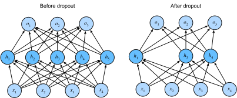

```{.python .input}
%load_ext d2lbook.tab
tab.interact_select(['mxnet', 'pytorch', 'tensorflow', 'jax'])
```

# Dropout
:label:`sec_dropout`


Trumpai pamąstykime, ko tikimės iš gero prognozavimo modelio.
Norime, kad jis gerai veiktų su nematytais duomenimis.
Klasikinė apibendrinimo teorija
teigia, kad norint sumažinti atotrūkį tarp
apmokymo ir testavimo našumo,
turėtume siekti paprasto modelio.
Paprastumas gali reikštis
nedideliu dimensijų skaičiumi.
Tai nagrinėjome aptardami
tiesinių modelių monominius bazines funkcijas
:numref:`sec_generalization_basics`.
Be to, kaip matėme aptardami svorių nykimą
($\ell_2$ reguliarizavimą) :numref:`sec_weight_decay`,
parametrų (atvirkštinė) norma taip pat
yra naudingas paprastumo matas.
Kita naudinga paprastumo samprata yra glotnumas,
t. y. kad funkcija neturėtų būti jautri
nedideliems jos įvesčių pokyčiams.
Pavyzdžiui, klasifikuodami vaizdus,
tikėtumės, kad šiek tiek atsitiktinio triukšmo
pridėjimas prie pikselių daugiausia turėtų būti nekenksmingas.

:citet:`Bishop.1995` suformalizavo
šią idėją, įrodydamas, kad apmokymas su įvesties triukšmu
yra ekvivalentus Tichonovo reguliarizavimui.
Šis darbas nubrėžė aiškų matematinį ryšį
tarp reikalavimo, kad funkcija būtų glotni (taigi ir paprasta),
ir reikalavimo, kad ji būtų atspari
įvesties trikdžiams.

Vėliau :citet:`Srivastava.Hinton.Krizhevsky.ea.2014`
sukūrė gudrią idėją, kaip taikyti Bishopo idėją
ir vidiniams tinklo sluoksniams.
Jų idėja, vadinama *dropout*, apima
triukšmo injektavimą skaičiuojant
kiekvieną vidinį sluoksnį tiesioginio sklidimo metu,
ir ji tapo standartine neuroninių tinklų
apmokymo technika.
Metodas vadinamas *dropout* (angl. „iškritimas“), nes apmokymo metu mes pažodžiui
*išmetame* kai kuriuos neuronus.
Viso apmokymo metu, kiekvienoje iteracijoje,
standartinis dropout susideda iš tam tikros
kiekvieno sluoksnio mazgų dalies nuliavimo
prieš skaičiuojant kitą sluoksnį.

Kad būtų aišku, ryšiu su Bishopu mes
primetame savo pasakojimą.
Originalus straipsnis apie dropout
pateikia intuiciją per stebinančią
analogiją su lytiniu dauginimusi.
Autoriai teigia, kad neuroninio tinklo persimokymą
apibūdina būsena, kai
kiekvienas sluoksnis remiasi tam tikru
ankstesnio sluoksnio aktyvacijų dėsningumu,
šią būseną pavadindami *bendra adaptacija*.
Jų teigimu, dropout sutraukia bendrą adaptaciją
taip, kaip, manoma, lytinis dauginimasis
sutraukia kartu prisitaikiusius genus.
Nors tokio šios teorijos pagrindimo tikrai galima diskutuoti,
pati dropout technika pasirodė esanti ilgaamžė,
ir įvairios dropout formos yra įgyvendintos
daugumoje giliojo mokymosi bibliotekų.


Pagrindinis iššūkis yra, kaip injektuoti šį triukšmą.
Viena idėja yra injektuoti jį *nešališku* būdu,
kad kiekvieno sluoksnio laukiamoji reikšmė – fiksavus
kitus – lygiavertų reikšmei, kurią jis būtų įgijęs be triukšmo.
Bishopo darbe jis pridėjo Gauso triukšmą
prie tiesinio modelio įvesčių.
Kiekvienoje apmokymo iteracijoje jis pridėdavo triukšmą,
paimtą iš skirstinio su nuliniu vidurkiu
$\epsilon \sim \mathcal{N}(0,\sigma^2)$, prie įvesties $\mathbf{x}$,
gaudamas sutrikdytą tašką $\mathbf{x}' = \mathbf{x} + \epsilon$.
Laukiamoji reikšmė $E[\mathbf{x}'] = \mathbf{x}$.

Standartiniame dropout reguliarizavime
nuliuojama tam tikra kiekvieno sluoksnio mazgų dalis,
o tada kiekvienas sluoksnis *pašalinamas iš šališkumo*, normalizuojant
pagal išlaikytų (neišmestų) mazgų dalį.
Kitaip tariant,
su *dropout tikimybe* $p$
kiekviena tarpinė aktyvacija $h$ pakeičiama
atsitiktiniu dydžiu $h'$ taip:

$$
\begin{aligned}
h' =
\begin{cases}
    0 & \textrm{ with probability } p \\
    \frac{h}{1-p} & \textrm{ otherwise}
\end{cases}
\end{aligned}
$$

Pagal konstrukciją laukiamoji reikšmė lieka nepakitusi, t. y. $E[h'] = h$.

```{.python .input}
%%tab mxnet
from d2l import mxnet as d2l
from mxnet import autograd, gluon, init, np, npx
from mxnet.gluon import nn
npx.set_np()
```

```{.python .input}
%%tab pytorch
from d2l import torch as d2l
import torch
from torch import nn
```

```{.python .input}
%%tab tensorflow
from d2l import tensorflow as d2l
import tensorflow as tf
```

```{.python .input}
%%tab jax
from d2l import jax as d2l
from flax import linen as nn
from functools import partial
import jax
from jax import numpy as jnp
import optax
```

## Dropout praktikoje

Prisiminkite MLP su paslėptuoju sluoksniu ir penkiais paslėptaisiais vienetais
iš :numref:`fig_mlp`.
Kai taikome dropout paslėptajam sluoksniui,
nuliuodami kiekvieną paslėptąjį vienetą su tikimybe $p$,
rezultatą galima vertinti kaip tinklą,
kuriame yra tik pradinių neuronų poaibis.
:numref:`fig_dropout2` pašalinti $h_2$ ir $h_5$.
Todėl išvesčių skaičiavimas
nebepriklauso nuo $h_2$ ar $h_5$,
ir jų atitinkamas gradientas taip pat išnyksta
atliekant atgalinį sklidimą.
Tokiu būdu išvesties sluoksnio skaičiavimas
negali pernelyg priklausyti nuo
nė vieno iš $h_1, \ldots, h_5$ elementų.


:label:`fig_dropout2`

Paprastai testavimo metu dropout išjungiame.
Turint apmokytą modelį ir naują pavyzdį,
neišmetame jokių mazgų,
todėl normalizuoti nereikia.
Tačiau yra keletas išimčių:
kai kurie tyrėjai naudoja dropout testavimo metu kaip euristiką
neuroninio tinklo prognozių *netikrumui* įvertinti:
jei prognozės sutampa per daugelį skirtingų dropout išvesčių,
galime sakyti, kad tinklas yra labiau pasitikintis.

## Įgyvendinimas nuo nulio

Kad įgyvendintume dropout funkciją vienam sluoksniui,
turime paimti tiek imčių
iš Bernulio (dvejetainio) atsitiktinio dydžio,
kiek mūsų sluoksnis turi dimensijų,
kur atsitiktinis dydis įgyja reikšmę $1$ (palikti)
su tikimybe $1-p$ ir $0$ (išmesti) su tikimybe $p$.
Vienas lengvas būdas tai įgyvendinti yra pirmiausia paimti imtis
iš tolygiojo skirstinio $U[0, 1]$.
Tada galime palikti tuos mazgus, kurių atitinkama
imtis yra didesnė nei $p$, o likusius išmesti.

Šiame kode (**įgyvendiname funkciją `dropout_layer`,
kuri išmeta tenzoriaus įvesties `X` elementus
su tikimybe `dropout`**),
likusius perskalindami, kaip aprašyta aukščiau:
išlikusius dalydami iš `1.0-dropout`.

```{.python .input}
%%tab mxnet
def dropout_layer(X, dropout):
    assert 0 <= dropout <= 1
    if dropout == 1: return np.zeros_like(X)
    mask = np.random.uniform(0, 1, X.shape) > dropout
    return mask.astype(np.float32) * X / (1.0 - dropout)
```

```{.python .input}
%%tab pytorch
def dropout_layer(X, dropout):
    assert 0 <= dropout <= 1
    if dropout == 1: return torch.zeros_like(X)
    mask = (torch.rand(X.shape) > dropout).float()
    return mask * X / (1.0 - dropout)
```

```{.python .input}
%%tab tensorflow
def dropout_layer(X, dropout):
    assert 0 <= dropout <= 1
    if dropout == 1: return tf.zeros_like(X)
    mask = tf.random.uniform(
        shape=tf.shape(X), minval=0, maxval=1) < 1 - dropout
    return tf.cast(mask, dtype=tf.float32) * X / (1.0 - dropout)
```

```{.python .input}
%%tab jax
def dropout_layer(X, dropout, key=d2l.get_key()):
    assert 0 <= dropout <= 1
    if dropout == 1: return jnp.zeros_like(X)
    mask = jax.random.uniform(key, X.shape) > dropout
    return jnp.asarray(mask, dtype=jnp.float32) * X / (1.0 - dropout)
```

Galime [**išbandyti funkciją `dropout_layer` keliais pavyzdžiais**].
Šiose kodo eilutėse
perduodame savo įvestį `X` per dropout operaciją
su tikimybėmis atitinkamai 0, 0,5 ir 1.

```{.python .input}
%%tab all
if tab.selected('mxnet'):
    X = np.arange(16).reshape(2, 8)
if tab.selected('pytorch'):
    X = torch.arange(16, dtype = torch.float32).reshape((2, 8))
if tab.selected('tensorflow'):
    X = tf.reshape(tf.range(16, dtype=tf.float32), (2, 8))
if tab.selected('jax'):
    X = jnp.arange(16, dtype=jnp.float32).reshape(2, 8)
print('dropout_p = 0:', dropout_layer(X, 0))
print('dropout_p = 0.5:', dropout_layer(X, 0.5))
print('dropout_p = 1:', dropout_layer(X, 1))
```

### Modelio apibrėžimas

Žemiau pateiktas modelis taiko dropout
kiekvieno paslėptojo sluoksnio išvesčiai (po aktyvacijos funkcijos).
Kiekvienam sluoksniui dropout tikimybes galime nustatyti atskirai.
Įprastas pasirinkimas yra
nustatyti mažesnę dropout tikimybę arčiau įvesties sluoksnio.
Užtikriname, kad dropout būtų aktyvus tik apmokymo metu.

```{.python .input}
%%tab mxnet
class DropoutMLPScratch(d2l.Classifier):
    def __init__(self, num_outputs, num_hiddens_1, num_hiddens_2,
                 dropout_1, dropout_2, lr):
        super().__init__()
        self.save_hyperparameters()
        self.lin1 = nn.Dense(num_hiddens_1, activation='relu')
        self.lin2 = nn.Dense(num_hiddens_2, activation='relu')
        self.lin3 = nn.Dense(num_outputs)
        self.initialize()

    def forward(self, X):
        H1 = self.lin1(X)
        if autograd.is_training():
            H1 = dropout_layer(H1, self.dropout_1)
        H2 = self.lin2(H1)
        if autograd.is_training():
            H2 = dropout_layer(H2, self.dropout_2)
        return self.lin3(H2)
```

```{.python .input}
%%tab pytorch
class DropoutMLPScratch(d2l.Classifier):
    def __init__(self, num_outputs, num_hiddens_1, num_hiddens_2,
                 dropout_1, dropout_2, lr):
        super().__init__()
        self.save_hyperparameters()
        self.lin1 = nn.LazyLinear(num_hiddens_1)
        self.lin2 = nn.LazyLinear(num_hiddens_2)
        self.lin3 = nn.LazyLinear(num_outputs)
        self.relu = nn.ReLU()

    def forward(self, X):
        H1 = self.relu(self.lin1(X.reshape((X.shape[0], -1))))
        if self.training:  
            H1 = dropout_layer(H1, self.dropout_1)
        H2 = self.relu(self.lin2(H1))
        if self.training:
            H2 = dropout_layer(H2, self.dropout_2)
        return self.lin3(H2)
```

```{.python .input}
%%tab tensorflow
class DropoutMLPScratch(d2l.Classifier):
    def __init__(self, num_outputs, num_hiddens_1, num_hiddens_2,
                 dropout_1, dropout_2, lr):
        super().__init__()
        self.save_hyperparameters()
        self.lin1 = tf.keras.layers.Dense(num_hiddens_1, activation='relu')
        self.lin2 = tf.keras.layers.Dense(num_hiddens_2, activation='relu')
        self.lin3 = tf.keras.layers.Dense(num_outputs)

    def forward(self, X):
        H1 = self.lin1(tf.reshape(X, (X.shape[0], -1)))
        if self.training:
            H1 = dropout_layer(H1, self.dropout_1)
        H2 = self.lin2(H1)
        if self.training:
            H2 = dropout_layer(H2, self.dropout_2)
        return self.lin3(H2)
```

```{.python .input}
%%tab jax
class DropoutMLPScratch(d2l.Classifier):
    num_hiddens_1: int
    num_hiddens_2: int
    num_outputs: int
    dropout_1: float
    dropout_2: float
    lr: float
    training: bool = True

    def setup(self):
        self.lin1 = nn.Dense(self.num_hiddens_1)
        self.lin2 = nn.Dense(self.num_hiddens_2)
        self.lin3 = nn.Dense(self.num_outputs)
        self.relu = nn.relu

    def forward(self, X):
        H1 = self.relu(self.lin1(X.reshape(X.shape[0], -1)))
        if self.training:
            H1 = dropout_layer(H1, self.dropout_1)
        H2 = self.relu(self.lin2(H1))
        if self.training:
            H2 = dropout_layer(H2, self.dropout_2)
        return self.lin3(H2)
```

### [**Apmokymas**]

Toliau pateikta panašu į anksčiau aprašytą MLP apmokymą.

```{.python .input}
%%tab all
hparams = {'num_outputs':10, 'num_hiddens_1':256, 'num_hiddens_2':256,
           'dropout_1':0.5, 'dropout_2':0.5, 'lr':0.1}
model = DropoutMLPScratch(**hparams)
data = d2l.FashionMNIST(batch_size=256)
trainer = d2l.Trainer(max_epochs=10)
trainer.fit(model, data)
```

## [**Glaustas įgyvendinimas**]

Su aukšto lygio API viskas, ko mums reikia, yra pridėti `Dropout` sluoksnį
po kiekvieno pilnai sujungto sluoksnio,
perduodant dropout tikimybę
kaip vienintelį jo konstruktoriaus argumentą.
Apmokymo metu `Dropout` sluoksnis atsitiktinai
išmes ankstesnio sluoksnio išvestis
(arba, lygiavertiškai, kito sluoksnio įvestis)
pagal nurodytą dropout tikimybę.
Kai ne apmokymo režimu,
`Dropout` sluoksnis testavimo metu tiesiog praleidžia duomenis.

```{.python .input}
%%tab mxnet
class DropoutMLP(d2l.Classifier):
    def __init__(self, num_outputs, num_hiddens_1, num_hiddens_2,
                 dropout_1, dropout_2, lr):
        super().__init__()
        self.save_hyperparameters()
        self.net = nn.Sequential()
        self.net.add(nn.Dense(num_hiddens_1, activation="relu"),
                     nn.Dropout(dropout_1),
                     nn.Dense(num_hiddens_2, activation="relu"),
                     nn.Dropout(dropout_2),
                     nn.Dense(num_outputs))
        self.net.initialize()
```

```{.python .input}
%%tab pytorch
class DropoutMLP(d2l.Classifier):
    def __init__(self, num_outputs, num_hiddens_1, num_hiddens_2,
                 dropout_1, dropout_2, lr):
        super().__init__()
        self.save_hyperparameters()
        self.net = nn.Sequential(
            nn.Flatten(), nn.LazyLinear(num_hiddens_1), nn.ReLU(), 
            nn.Dropout(dropout_1), nn.LazyLinear(num_hiddens_2), nn.ReLU(), 
            nn.Dropout(dropout_2), nn.LazyLinear(num_outputs))
```

```{.python .input}
%%tab tensorflow
class DropoutMLP(d2l.Classifier):
    def __init__(self, num_outputs, num_hiddens_1, num_hiddens_2,
                 dropout_1, dropout_2, lr):
        super().__init__()
        self.save_hyperparameters()
        self.net = tf.keras.models.Sequential([
            tf.keras.layers.Flatten(),
            tf.keras.layers.Dense(num_hiddens_1, activation=tf.nn.relu),
            tf.keras.layers.Dropout(dropout_1),
            tf.keras.layers.Dense(num_hiddens_2, activation=tf.nn.relu),
            tf.keras.layers.Dropout(dropout_2),
            tf.keras.layers.Dense(num_outputs)])
```

```{.python .input}
%%tab jax
class DropoutMLP(d2l.Classifier):
    num_hiddens_1: int
    num_hiddens_2: int
    num_outputs: int
    dropout_1: float
    dropout_2: float
    lr: float
    training: bool = True

    @nn.compact
    def __call__(self, X):
        x = nn.relu(nn.Dense(self.num_hiddens_1)(X.reshape((X.shape[0], -1))))
        x = nn.Dropout(self.dropout_1, deterministic=not self.training)(x)
        x = nn.relu(nn.Dense(self.num_hiddens_2)(x))
        x = nn.Dropout(self.dropout_2, deterministic=not self.training)(x)
        return nn.Dense(self.num_outputs)(x)
```

:begin_tab:`jax`
Atkreipkite dėmesį, kad turime iš naujo apibrėžti nuostolių funkciją, nes tinklui
su dropout sluoksniu, naudojant `Module.apply()`, reikia PRNGKey,
o šis ATS sėklos raktas turi būti aiškiai pavadintas `dropout`. Šį raktą
`dropout` sluoksnis Flax naudoja atsitiktinei dropout
kaukei viduje generuoti. Svarbu kiekvienai apmokymo ciklo epochai naudoti unikalų `dropout_rng` raktą,
kitaip sugeneruota dropout
kaukė nebus stochastinė ir skirtingų epochų paleidimuose bus ta pati.
Šį `dropout_rng` galima saugoti
`TrainState` objekte (klasėje `d2l.Trainer`, apibrėžtoje
:numref:`oo-design-training`) kaip atributą, o kiekvienoje epochoje
jis pakeičiamas nauju `dropout_rng`. Tai jau sutvarkėme
metodu `fit_epoch`, apibrėžtu :numref:`sec_linear_scratch`.
:end_tab:

```{.python .input}
%%tab jax
@d2l.add_to_class(d2l.Classifier)  #@save
@partial(jax.jit, static_argnums=(0, 5))
def loss(self, params, X, Y, state, averaged=True):
    Y_hat = state.apply_fn({'params': params}, *X,
                           mutable=False,  # To be used later (e.g., batch norm)
                           rngs={'dropout': state.dropout_rng})
    Y_hat = d2l.reshape(Y_hat, (-1, Y_hat.shape[-1]))
    Y = d2l.reshape(Y, (-1,))
    fn = optax.softmax_cross_entropy_with_integer_labels
    # The returned empty dictionary is a placeholder for auxiliary data,
    # which will be used later (e.g., for batch norm)
    return (fn(Y_hat, Y).mean(), {}) if averaged else (fn(Y_hat, Y), {})
```

Toliau [**apmokome modelį**].

```{.python .input}
%%tab all
model = DropoutMLP(**hparams)
trainer.fit(model, data)
```

## Santrauka

Be dimensijų skaičiaus ir svorių vektoriaus dydžio kontroliavimo, dropout yra dar vienas įrankis persimokymui išvengti. Dažnai įrankiai naudojami kartu.
Atkreipkite dėmesį, kad dropout
naudojamas tik apmokymo metu:
jis pakeičia aktyvaciją $h$ atsitiktiniu dydžiu, kurio laukiamoji reikšmė yra $h$.


## Pratimai

1. Kas nutinka, jei pakeičiate pirmojo ir antrojo sluoksnių dropout tikimybes? Visų pirma, kas nutinka, jei sukeičiate abiejų sluoksnių tikimybes? Suplanuokite eksperimentą šiems klausimams atsakyti, aprašykite savo rezultatus kiekybiškai ir apibendrinkite kokybines išvadas.
1. Padidinkite epochų skaičių ir palyginkite rezultatus, gautus naudojant dropout, su gautais jo nenaudojant.
1. Kokia yra aktyvacijų dispersija kiekviename paslėptajame sluoksnyje, kai dropout taikomas ir netaikomas? Nubraižykite grafiką, rodantį, kaip šis dydis kinta laikui bėgant abiem modeliams.
1. Kodėl dropout paprastai nenaudojamas testavimo metu?
1. Naudodami šiame skyrelyje pateiktą modelį kaip pavyzdį, palyginkite dropout ir svorių nykimo poveikį. Kas nutinka, kai dropout ir svorių nykimas naudojami vienu metu? Ar rezultatai adityvūs? Ar yra mažėjanti grąža (ar dar blogiau)? Ar jie vienas kitą panaikina?
1. Kas nutinka, jei dropout taikome atskiriems svorių matricos svoriams, o ne aktyvacijoms?
1. Išrasti kitą atsitiktinio triukšmo injektavimo kiekviename sluoksnyje techniką, besiskiriančią nuo standartinės dropout technikos. Ar galite sukurti metodą, kuris pralenktų dropout su Fashion-MNIST duomenų rinkiniu (fiksuotai architektūrai)?

:begin_tab:`mxnet`
[Diskusijos](https://discuss.d2l.ai/t/100)
:end_tab:

:begin_tab:`pytorch`
[Diskusijos](https://discuss.d2l.ai/t/101)
:end_tab:

:begin_tab:`tensorflow`
[Diskusijos](https://discuss.d2l.ai/t/261)
:end_tab:

:begin_tab:`jax`
[Diskusijos](https://discuss.d2l.ai/t/17987)
:end_tab:
