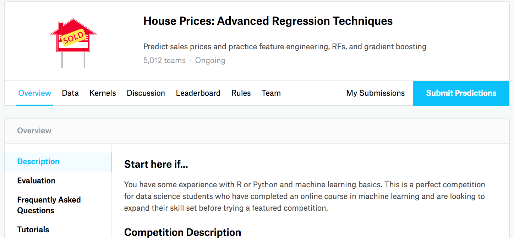
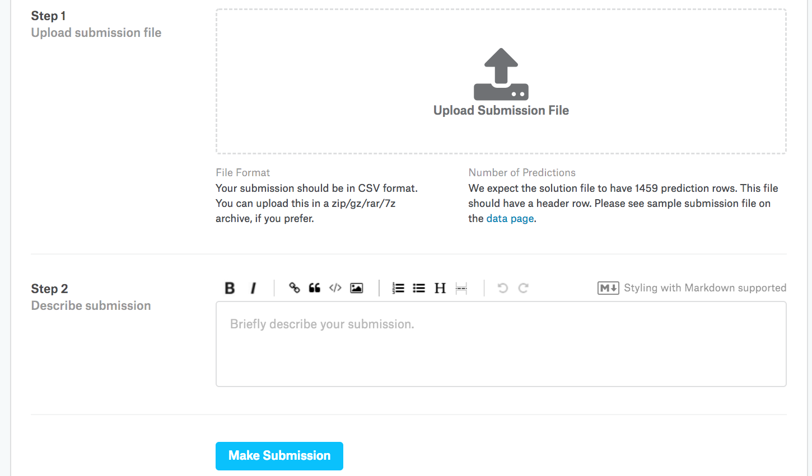

```{.python .input  n=1}
%load_ext d2lbook.tab
tab.interact_select(['mxnet', 'pytorch', 'tensorflow', 'jax'])
```

# Namų kainų prognozavimas Kaggle platformoje
:label:`sec_kaggle_house`

Dabar, kai pristatėme keletą pagrindinių įrankių
giliesiems tinklams kurti ir apmokyti
bei reguliarizuoti juos tokiomis technikomis kaip
svorių nykimas ir dropout,
esame pasirengę visas šias žinias pritaikyti praktikoje,
dalyvaudami Kaggle konkurse.
Namų kainų prognozavimo konkursas
yra puiki vieta pradėti.
Duomenys gana bendri ir neturi egzotiškos struktūros,
kuriai galėtų prireikti specializuotų modelių (kaip garso ar vaizdo įrašams).
Šis duomenų rinkinys, surinktas :citet:`De-Cock.2011`,
apima namų kainas Eimse, Ajovoje, 2006–2010 m. laikotarpiu.
Jis yra gerokai didesnis nei garsusis Harrisono ir Rubinfeldo (1978) [Bostono būsto duomenų rinkinys](https://archive.ics.uci.edu/ml/machine-learning-databases/housing/housing.names),
turintis ir daugiau pavyzdžių, ir daugiau požymių.


Šiame skyrelyje išsamiai apžvelgsime
duomenų išankstinį apdorojimą, modelio projektavimą ir hiperparametrų parinkimą.
Tikimės, kad praktiniu metodu
įgysite šiek tiek intuicijos, kuri padės jums
duomenų mokslininko karjeroje.

```{.python .input}
%%tab mxnet
%matplotlib inline
from d2l import mxnet as d2l
from mxnet import gluon, autograd, init, np, npx
from mxnet.gluon import nn
import pandas as pd

npx.set_np()
```

```{.python .input}
%%tab pytorch
%matplotlib inline
from d2l import torch as d2l
import torch
from torch import nn
import pandas as pd
```

```{.python .input}
%%tab tensorflow
%matplotlib inline
from d2l import tensorflow as d2l
import tensorflow as tf
import pandas as pd
```

```{.python .input}
%%tab jax
%matplotlib inline
from d2l import jax as d2l
import jax
from jax import numpy as jnp
import numpy as np
import pandas as pd
```

## Duomenų atsisiuntimas

Visoje knygoje apmokysime ir testuosime modelius
su įvairiais atsisiųstais duomenų rinkiniais.
Čia (**įgyvendiname dvi pagalbines funkcijas**)
zip ar tar failams atsisiųsti ir išskleisti.
Vėlgi, tokių pagalbinių funkcijų įgyvendinimo detales praleidžiame.

```{.python .input  n=2}
%%tab all
def download(url, folder, sha1_hash=None):
    """Download a file to folder and return the local filepath."""

def extract(filename, folder):
    """Extract a zip/tar file into folder."""
```

## Kaggle

[Kaggle](https://www.kaggle.com) yra populiari platforma,
kurioje vyksta mašininio mokymosi konkursai.
Kiekvienas konkursas sukasi apie duomenų rinkinį, o daugelį
remia suinteresuotosios šalys, siūlančios prizus
laimėjusiems sprendimams.
Platforma padeda naudotojams bendrauti
per forumus ir bendrinamą kodą,
skatindama ir bendradarbiavimą, ir konkurenciją.
Nors lyderių lentelės vaikymasis dažnai nesuvaldomai išsiplečia,
tyrėjams trumparegiškai susitelkus į išankstinio apdorojimo žingsnius,
užuot kėlus esminius klausimus,
taip pat yra didžiulė vertė platformos objektyvume,
leidžiančiame tiesiogiai kiekybiškai palyginti
konkuruojančius metodus ir dalytis kodu,
kad kiekvienas galėtų išmokti, kas veikė ir kas neveikė.
Jei norite dalyvauti Kaggle konkurse,
pirmiausia turėsite užsiregistruoti ir susikurti paskyrą
(žr. :numref:`fig_kaggle`).


:width:`400px`
:label:`fig_kaggle`

Namų kainų prognozavimo konkurso puslapyje, kaip parodyta
:numref:`fig_house_pricing`,
galite rasti duomenų rinkinį (skirtuke „Data“),
pateikti prognozes ir pamatyti savo reitingą.
URL yra čia:

> https://www.kaggle.com/c/house-prices-advanced-regression-techniques


:width:`400px`
:label:`fig_house_pricing`

## Duomenų rinkinio pasiekimas ir skaitymas

Atkreipkite dėmesį, kad konkurso duomenys yra padalyti
į apmokymo ir testavimo aibes.
Kiekvienas įrašas apima namo nekilnojamojo turto vertę
ir tokius atributus kaip gatvės tipas, statybos metai,
stogo tipas, rūsio būklė ir kt.
Požymiai sudaryti iš įvairių duomenų tipų.
Pavyzdžiui, statybos metai
pavaizduoti sveikuoju skaičiumi,
stogo tipas – diskrečiais kategoriniais priskyrimais,
o kiti požymiai – slankiojo kablelio skaičiais.
Ir čia tikrovė viską sukomplikuoja:
kai kuriems pavyzdžiams kai kurių duomenų visai trūksta,
o trūkstama reikšmė tiesiog pažymėta „na“.
Kiekvieno namo kaina pateikta
tik apmokymo aibei
(juk tai konkursas).
Norėsime padalyti apmokymo aibę,
kad sukurtume validavimo aibę,
bet savo modelius oficialioje testavimo aibėje galime įvertinti tik
įkėlę prognozes į Kaggle.
Konkurso skirtuke „Data“,
:numref:`fig_house_pricing`,
yra nuorodos duomenims atsisiųsti.

Pradėdami, [**nuskaitysime ir apdorosime duomenis
naudodami `pandas`**], kurį pristatėme :numref:`sec_pandas`.
Patogumo dėlei galime atsisiųsti ir išsaugoti talpykloje
Kaggle būsto duomenų rinkinį.
Jei failas, atitinkantis šį duomenų rinkinį, jau egzistuoja talpyklos kataloge ir jo SHA-1 atitinka `sha1_hash`, mūsų kodas naudos talpykloje esantį failą, kad neužkimštų jūsų interneto nereikalingais atsisiuntimais.

```{.python .input  n=30}
%%tab all
class KaggleHouse(d2l.DataModule):
    def __init__(self, batch_size, train=None, val=None):
        super().__init__()
        self.save_hyperparameters()
        if self.train is None:
            self.raw_train = pd.read_csv(d2l.download(
                d2l.DATA_URL + 'kaggle_house_pred_train.csv', self.root,
                sha1_hash='585e9cc93e70b39160e7921475f9bcd7d31219ce'))
            self.raw_val = pd.read_csv(d2l.download(
                d2l.DATA_URL + 'kaggle_house_pred_test.csv', self.root,
                sha1_hash='fa19780a7b011d9b009e8bff8e99922a8ee2eb90'))
```

Apmokymo duomenų rinkinyje yra 1460 pavyzdžių,
80 požymių ir vienas žymuo, o validavimo duomenyse
yra 1459 pavyzdžiai ir 80 požymių.

```{.python .input  n=31}
%%tab all
data = KaggleHouse(batch_size=64)
print(data.raw_train.shape)
print(data.raw_val.shape)
```

## Duomenų išankstinis apdorojimas

Pažvelkime į [**pirmus keturis ir paskutinius du požymius
bei žymenį (SalePrice)**] iš pirmųjų keturių pavyzdžių.

```{.python .input  n=10}
%%tab all
print(data.raw_train.iloc[:4, [0, 1, 2, 3, -3, -2, -1]])
```

Matome, kad kiekviename pavyzdyje pirmasis požymis yra identifikatorius.
Tai padeda modeliui atpažinti kiekvieną apmokymo pavyzdį.
Nors tai patogu, prognozavimo tikslais
jis neneša jokios informacijos.
Todėl pašalinsime jį iš duomenų rinkinio
prieš paduodami duomenis į modelį.
Be to, turint daugybę duomenų tipų,
turėsime apdoroti duomenis prieš pradėdami modeliuoti.


Pradėkime nuo skaitinių požymių.
Pirmiausia taikome euristiką,
[**pakeisdami visas trūkstamas reikšmes
atitinkamo požymio vidurkiu.**]
Tada, kad visus požymius suvestume į bendrą mastelį,
(***standartizuojame* duomenis,
perskalindami požymius iki nulinio vidurkio ir vienetinės dispersijos**):

$$x \leftarrow \frac{x - \mu}{\sigma},$$

kur $\mu$ ir $\sigma$ atitinkamai žymi vidurkį ir standartinį nuokrypį.
Kad patikrintume, jog tai iš tiesų transformuoja
mūsų požymį (kintamąjį) taip, kad jis turėtų nulinį vidurkį ir vienetinę dispersiją,
pastebėkime, kad $E[\frac{x-\mu}{\sigma}] = \frac{\mu - \mu}{\sigma} = 0$
ir kad $E[(x-\mu)^2] = (\sigma^2 + \mu^2) - 2\mu^2+\mu^2 = \sigma^2$.
Intuityviai duomenis standartizuojame
dėl dviejų priežasčių.
Pirma, tai patogu optimizavimui.
Antra, kadangi iš anksto nežinome,
kurie požymiai bus svarbūs,
nenorime labiau bausti koeficientų,
priskirtų vienam požymiui, nei bet kuriam kitam.

[**Toliau tvarkomės su diskrečiomis reikšmėmis.**]
Tai apima tokius požymius kaip „MSZoning“.
(**Pakeičiame jas vieno karšto kodavimu (angl. *one-hot*)**)
taip pat, kaip anksčiau transformavome
daugiaklasius žymenis į vektorius (žr. :numref:`subsec_classification-problem`).
Pavyzdžiui, „MSZoning“ įgyja reikšmes „RL“ ir „RM“.
Pašalinus požymį „MSZoning“,
sukuriami du nauji indikatoriniai požymiai
„MSZoning_RL“ ir „MSZoning_RM“ su reikšmėmis 0 arba 1.
Pagal vieno karšto kodavimą,
jei pradinė „MSZoning“ reikšmė yra „RL“,
tada „MSZoning_RL“ yra 1, o „MSZoning_RM“ yra 0.
Paketas `pandas` tai atlieka automatiškai.

```{.python .input  n=32}
%%tab all
@d2l.add_to_class(KaggleHouse)
def preprocess(self):
    # Remove the ID and label columns
    label = 'SalePrice'
    features = pd.concat(
        (self.raw_train.drop(columns=['Id', label]),
         self.raw_val.drop(columns=['Id'])))
    # Standardize numerical columns
    numeric_features = features.dtypes[features.dtypes!='object'].index
    features[numeric_features] = features[numeric_features].apply(
        lambda x: (x - x.mean()) / (x.std()))
    # Replace NAN numerical features by 0
    features[numeric_features] = features[numeric_features].fillna(0)
    # Replace discrete features by one-hot encoding
    features = pd.get_dummies(features, dummy_na=True)
    # Save preprocessed features
    self.train = features[:self.raw_train.shape[0]].copy()
    self.train[label] = self.raw_train[label]
    self.val = features[self.raw_train.shape[0]:].copy()
```

Matote, kad ši konversija padidina
požymių skaičių nuo 79 iki 331 (neįskaitant ID ir žymens stulpelių).

```{.python .input  n=33}
%%tab all
data.preprocess()
data.train.shape
```

## Paklaidos matas

Pradžiai apmokysime tiesinį modelį su kvadratiniais nuostoliais. Nenuostabu, kad mūsų tiesinis modelis nepaskatins konkursą laimėsiančio pateikimo, bet jis suteikia sveiko proto patikrą, ar duomenyse yra prasmingos informacijos. Jei čia negalime pasiekti geresnio rezultato nei atsitiktinis spėliojimas, tuomet gali būti didelė tikimybė, kad turime duomenų apdorojimo klaidą. O jei viskas veikia, tiesinis modelis bus atskaitos taškas, suteikiantis šiek tiek intuicijos, kaip arti geriausių pateiktų modelių priartėja paprastas modelis, ir leisiantis suprasti, kokio laimėjimo galime tikėtis iš įmantresnių modelių.

Su namų kainomis, kaip ir su akcijų kainomis,
labiau rūpi santykiniai dydžiai
nei absoliutūs dydžiai.
Taigi [**mums labiau rūpi
santykinė paklaida $\frac{y - \hat{y}}{y}$**]
nei absoliutinė paklaida $y - \hat{y}$.
Pavyzdžiui, jei mūsų prognozė klysta \$100 000,
įvertinant namo kainą kaimiškame Ohajuje,
kur tipinio namo vertė yra \$125 000,
tai greičiausiai dirbame siaubingai.
Kita vertus, jei tokiu dydžiu suklystume
Los Altos Hilse, Kalifornijoje,
tai galėtų reikšti stulbinamai tikslią prognozę
(ten medianinė namo kaina viršija \$4 milijonus).

(**Vienas būdas spręsti šią problemą yra
matuoti neatitikimą kainų įverčių logaritme.**)
Iš tiesų tai taip pat yra oficialus paklaidos matas,
kurį konkursas naudoja pateikimų kokybei vertinti.
Juk maža reikšmė $\delta$, kai $|\log y - \log \hat{y}| \leq \delta$,
virsta $e^{-\delta} \leq \frac{\hat{y}}{y} \leq e^\delta$.
Tai veda prie tokios šaknies iš vidutinės kvadratinės paklaidos tarp prognozuojamos kainos logaritmo ir žymens kainos logaritmo:

$$\sqrt{\frac{1}{n}\sum_{i=1}^n\left(\log y_i -\log \hat{y}_i\right)^2}.$$

```{.python .input  n=60}
%%tab all
@d2l.add_to_class(KaggleHouse)
def get_dataloader(self, train):
    label = 'SalePrice'
    data = self.train if train else self.val
    if label not in data: return
    get_tensor = lambda x: d2l.tensor(x.values.astype(float),
                                      dtype=d2l.float32)
    # Logarithm of prices 
    tensors = (get_tensor(data.drop(columns=[label])),  # X
               d2l.reshape(d2l.log(get_tensor(data[label])), (-1, 1)))  # Y
    return self.get_tensorloader(tensors, train)
```

## $K$ dalių kryžminis validavimas

Galbūt prisimenate, kad [**kryžminį validavimą**] pristatėme
:numref:`subsec_generalization-model-selection`, kur aptarėme, kaip spręsti
modelio parinkimo klausimus.
Tai gerai panaudosime modelio dizainui parinkti
ir hiperparametrams reguliuoti.
Pirmiausia mums reikia funkcijos, kuri grąžina
$i$-ąją duomenų dalį
$K$ dalių kryžminio validavimo procedūroje.
Ji veikia išpjaudama $i$-ąjį segmentą
kaip validavimo duomenis, o likusius grąžindama kaip apmokymo duomenis.
Atkreipkite dėmesį, kad tai nėra efektyviausias būdas tvarkyti duomenis,
ir tikrai darytume ką nors daug gudresnio,
jei mūsų duomenų rinkinys būtų gerokai didesnis.
Bet šis papildomas sudėtingumas galėtų be reikalo užgožti mūsų kodą,
todėl dėl mūsų problemos paprastumo čia galime saugiai jo atsisakyti.

```{.python .input}
%%tab all
def k_fold_data(data, k):
    rets = []
    fold_size = data.train.shape[0] // k
    for j in range(k):
        idx = range(j * fold_size, (j+1) * fold_size)
        rets.append(KaggleHouse(data.batch_size, data.train.drop(index=idx),  
                                data.train.loc[idx]))    
    return rets
```

[**Vidutinė validavimo paklaida grąžinama**],
kai apmokome $K$ kartų $K$ dalių kryžminiame validavime.

```{.python .input}
%%tab all
def k_fold(trainer, data, k, lr):
    val_loss, models = [], []
    for i, data_fold in enumerate(k_fold_data(data, k)):
        model = d2l.LinearRegression(lr)
        model.board.yscale='log'
        if i != 0: model.board.display = False
        trainer.fit(model, data_fold)
        val_loss.append(float(model.board.data['val_loss'][-1].y))
        models.append(model)
    print(f'average validation log mse = {sum(val_loss)/len(val_loss)}')
    return models
```

## [**Modelio parinkimas**]

Šiame pavyzdyje pasirenkame nesuderintą hiperparametrų rinkinį
ir paliekame skaitytojui patobulinti modelį.
Rasti gerą pasirinkimą gali užtrukti,
priklausomai nuo to, per kiek kintamųjų optimizuojama.
Turint pakankamai didelį duomenų rinkinį
ir įprastų tipų hiperparametrus,
$K$ dalių kryžminis validavimas paprastai yra
pakankamai atsparus daugkartiniam testavimui.
Tačiau jei išbandytume nepagrįstai didelį variantų skaičių,
galime pamatyti, kad mūsų validavimo
našumas nebeatspindi tikrosios paklaidos.

```{.python .input}
%%tab all
trainer = d2l.Trainer(max_epochs=10)
models = k_fold(trainer, data, k=5, lr=0.01)
```

Atkreipkite dėmesį, kad kartais apmokymo paklaidų skaičius
tam tikram hiperparametrų rinkiniui gali būti labai mažas,
net kai $K$ dalių kryžminio validavimo klaidų skaičius
auga gerokai didesnis.
Tai rodo, kad persimokome.
Viso apmokymo metu norėsite stebėti abu skaičius.
Mažesnis persimokymas gali rodyti, kad mūsų duomenys gali palaikyti galingesnį modelį.
Didžiulis persimokymas gali rodyti, kad galime laimėti,
įtraukdami reguliarizavimo technikas.

##  [**Prognozių pateikimas Kaggle platformoje**]

Dabar, kai žinome, koks turėtų būti geras hiperparametrų pasirinkimas,
galime
apskaičiuoti vidutines prognozes
testavimo aibėje
iš visų $K$ modelių.
Prognozių išsaugojimas csv faile
supaprastins rezultatų įkėlimą į Kaggle.
Šis kodas sugeneruos failą, vadinamą `submission.csv`.

```{.python .input}
%%tab all
if tab.selected('pytorch', 'mxnet', 'tensorflow'):
    preds = [model(d2l.tensor(data.val.values.astype(float), dtype=d2l.float32))
             for model in models]
if tab.selected('jax'):
    preds = [model.apply({'params': trainer.state.params},
             d2l.tensor(data.val.values.astype(float), dtype=d2l.float32))
             for model in models]
# Taking exponentiation of predictions in the logarithm scale
ensemble_preds = d2l.reduce_mean(d2l.exp(d2l.concat(preds, 1)), 1)
submission = pd.DataFrame({'Id':data.raw_val.Id,
                           'SalePrice':d2l.numpy(ensemble_preds)})
submission.to_csv('submission.csv', index=False)
```

Toliau, kaip parodyta :numref:`fig_kaggle_submit2`,
galime pateikti savo prognozes Kaggle
ir pamatyti, kaip jos palyginamos su tikrosiomis namų kainomis (žymenimis)
testavimo aibėje.
Žingsniai gana paprasti:

* Prisijunkite prie Kaggle svetainės ir apsilankykite namų kainų prognozavimo konkurso puslapyje.
* Spustelėkite mygtuką „Submit Predictions“ arba „Late Submission“.
* Spustelėkite mygtuką „Upload Submission File“ punktyriniame langelyje puslapio apačioje ir pasirinkite prognozių failą, kurį norite įkelti.
* Spustelėkite mygtuką „Make Submission“ puslapio apačioje, kad pamatytumėte savo rezultatus.


:width:`400px`
:label:`fig_kaggle_submit2`

## Santrauka ir diskusija

Tikri duomenys dažnai turi įvairių duomenų tipų mišinį ir juos reikia apdoroti iš anksto.
Realiųjų verčių duomenų perskalinimas iki nulinio vidurkio ir vienetinės dispersijos yra geras numatytasis sprendimas. Kaip ir trūkstamų reikšmių pakeitimas jų vidurkiu.
Be to, kategorinių požymių transformavimas į indikatorinius požymius leidžia traktuoti juos kaip vieno karšto vektorius.
Kai labiau rūpi
santykinė, o ne absoliutinė paklaida,
galime
matuoti neatitikimą prognozės logaritme.
Modeliui parinkti ir hiperparametrams reguliuoti
galime naudoti $K$ dalių kryžminį validavimą.


## Pratimai

1. Pateikite šio skyrelio prognozes Kaggle platformai. Kokios jos geros?
1. Ar visada gera idėja pakeisti trūkstamas reikšmes vidurkiu? Užuomina: ar galite sukonstruoti situaciją, kai reikšmės trūksta ne atsitiktinai?
1. Pagerinkite rezultatą suderindami hiperparametrus per $K$ dalių kryžminį validavimą.
1. Pagerinkite rezultatą tobulindami modelį (pvz., sluoksnius, svorių nykimą ir dropout).
1. Kas nutinka, jei nestandartizuojame tolydžiųjų skaitinių požymių, kaip tai darėme šiame skyrelyje?

:begin_tab:`mxnet`
[Diskusijos](https://discuss.d2l.ai/t/106)
:end_tab:

:begin_tab:`pytorch`
[Diskusijos](https://discuss.d2l.ai/t/107)
:end_tab:

:begin_tab:`tensorflow`
[Diskusijos](https://discuss.d2l.ai/t/237)
:end_tab:

:begin_tab:`jax`
[Diskusijos](https://discuss.d2l.ai/t/17988)
:end_tab:
