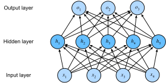

```{.python .input}
%load_ext d2lbook.tab
tab.interact_select(['mxnet', 'pytorch', 'tensorflow', 'jax'])
```

# Daugiasluoksniai perceptronai
:label:`sec_mlp`

:numref:`sec_softmax` pristatėme
softmax regresiją,
įgyvendindami algoritmą nuo nulio
(:numref:`sec_softmax_scratch`) ir naudodami aukšto lygio API
(:numref:`sec_softmax_concise`). Tai leido mums
apmokyti klasifikatorius, gebančius atpažinti
10 drabužių kategorijų iš mažos skyros vaizdų.
Šio proceso metu išmokome tvarkyti duomenis,
versti savo išvestis į tinkamą tikimybių skirstinį,
taikyti tinkamą nuostolių funkciją
ir minimizuoti ją pagal savo modelio parametrus.
Dabar, kai įvaldėme šią mechaniką
paprastų tiesinių modelių kontekste,
galime pradėti giliųjų neuroninių tinklų tyrinėjimą –
palyginti turtingos modelių klasės,
kuriai ir skirta ši knyga.

```{.python .input}
%%tab mxnet
%matplotlib inline
from d2l import mxnet as d2l
from mxnet import autograd, np, npx
npx.set_np()
```

```{.python .input}
%%tab pytorch
%matplotlib inline
from d2l import torch as d2l
import torch
```

```{.python .input}
%%tab tensorflow
%matplotlib inline
from d2l import tensorflow as d2l
import tensorflow as tf
```

```{.python .input}
%%tab jax
%matplotlib inline
from d2l import jax as d2l
import jax
from jax import numpy as jnp
from jax import grad, vmap
```

## Paslėptieji sluoksniai

Afinines transformacijas
:numref:`subsec_linear_model` aprašėme kaip
tiesines transformacijas su pridėtu poslinkiu.
Pradėkime prisimindami modelio architektūrą,
atitinkančią mūsų softmax regresijos pavyzdį,
pavaizduotą :numref:`fig_softmaxreg`.
Šis modelis atvaizduoja įvestis tiesiogiai į išvestis
per vieną afininę transformaciją,
po kurios seka softmax operacija.
Jei mūsų žymenys iš tiesų būtų susiję
su įvesties duomenimis paprasta afinine transformacija,
tada šio metodo pakaktų.
Tačiau tiesiškumas (afininėse transformacijose) yra *stipri* prielaida.

### Tiesinių modelių apribojimai

Pavyzdžiui, tiesiškumas reiškia *silpnesnę*
*monotoniškumo* prielaidą, t. y.
kad bet koks mūsų požymio padidėjimas turi
arba visada sukelti modelio išvesties padidėjimą
(jei atitinkamas svoris teigiamas),
arba visada sukelti modelio išvesties sumažėjimą
(jei atitinkamas svoris neigiamas).
Kartais tai prasminga.
Pavyzdžiui, jei bandytume prognozuoti,
ar asmuo grąžins paskolą,
galėtume pagrįstai manyti, kad kitiems dalykams esant vienodiems,
didesnes pajamas gaunantis pareiškėjas
visada labiau tikėtinai grąžins,
nei gaunantis mažesnes pajamas.
Nors tai monotoniška, šis ryšys greičiausiai
nėra tiesiškai susijęs su grąžinimo
tikimybe. Pajamų padidėjimas nuo \$0 iki \$50 000
greičiausiai atitinka didesnį grąžinimo
tikimybės padidėjimą
nei padidėjimas nuo \$1 milijono iki \$1,05 milijono.
Vienas būdas tai išspręsti galėtų būti rezultato paskesnis apdorojimas,
kad tiesiškumas taptų labiau tikėtinas,
naudojant logistinį atvaizdį (taigi ir rezultato tikimybės logaritmą).

Atkreipkite dėmesį, kad lengvai galime sugalvoti pavyzdžių,
pažeidžiančių monotoniškumą.
Tarkime, pavyzdžiui, kad norime prognozuoti sveikatą kaip
kūno temperatūros funkciją.
Asmenims, kurių normali kūno temperatūra
yra aukščiau 37 °C (98,6 °F),
aukštesnė temperatūra rodo didesnę riziką.
Tačiau jei kūno temperatūra nukrenta
žemiau 37 °C, žemesnė temperatūra rodo didesnę riziką!
Vėlgi, problemą galėtume išspręsti
kokiu nors gudriu išankstiniu apdorojimu, pavyzdžiui, naudodami atstumą nuo 37 °C
kaip požymį.


O kaip klasifikuoti kačių ir šunų vaizdus?
Ar pikselio vietoje (13, 17) intensyvumo didinimas
visada turėtų didinti (arba visada mažinti)
tikimybę, kad vaizde pavaizduotas šuo?
Pasikliovimas tiesiniu modeliu atitinka numanomą
prielaidą, kad vienintelis reikalavimas
katėms ir šunims atskirti yra įvertinti
atskirų pikselių ryškumą.
Šis metodas pasmerktas nesėkmei pasaulyje,
kuriame vaizdo invertavimas išsaugo kategoriją.

Ir vis dėlto, nepaisant akivaizdaus tiesiškumo absurdiškumo čia,
palyginti su ankstesniais pavyzdžiais,
mažiau akivaizdu, ar galėtume spręsti problemą
paprastu išankstinio apdorojimo pataisymu.
Taip yra todėl, kad bet kurio pikselio reikšmingumas
sudėtingais būdais priklauso nuo jo konteksto
(aplinkinių pikselių reikšmių).
Nors gali egzistuoti mūsų duomenų atvaizdas,
kuris atsižvelgtų į
svarbias sąveikas tarp mūsų požymių
ir kuriame tiesinis modelis būtų tinkamas,
mes tiesiog nežinome, kaip jį apskaičiuoti rankomis.
Su giliaisiais neuroniniais tinklais naudojome stebėjimo duomenis,
kad kartu išmoktume ir atvaizdą per paslėptuosius sluoksnius,
ir tiesinį prognozuotoją, veikiantį pagal tą atvaizdą.

Ši netiesiškumo problema nagrinėjama bent jau
šimtmetį :cite:`Fisher.1928`. Pavyzdžiui, sprendimų medžiai
pačia paprasčiausia forma naudoja dvejetainių sprendimų seką,
kad nuspręstų dėl priklausymo klasei :cite:`quinlan2014c4`. Panašiai branduolių
metodai jau daugelį dešimtmečių naudojami netiesinėms priklausomybėms modeliuoti
:cite:`Aronszajn.1950`. Tai rado kelią į
neparametrinius splainų modelius :cite:`Wahba.1990` ir branduolių metodus
:cite:`Scholkopf.Smola.2002`. Tai taip pat yra tai, ką smegenys sprendžia
visiškai natūraliai. Juk neuronai maitina kitus neuronus, kurie,
savo ruožtu, vėl maitina kitus neuronus :cite:`Cajal.Azoulay.1894`.
Todėl turime santykinai paprastų transformacijų seką.

### Paslėptųjų sluoksnių įtraukimas

Tiesinių modelių apribojimus galime įveikti
įtraukdami vieną ar kelis paslėptuosius sluoksnius.
Lengviausias būdas tai padaryti yra sukrauti
daug pilnai sujungtų sluoksnių vieną ant kito.
Kiekvienas sluoksnis maitina aukščiau esantį sluoksnį,
kol sugeneruojame išvestis.
Pirmuosius $L-1$ sluoksnius galime laikyti
savo atvaizdu, o paskutinį sluoksnį –
savo tiesiniu prognozuotoju.
Ši architektūra paprastai vadinama
*daugiasluoksniu perceptronu*,
dažnai sutrumpintai *MLP* (:numref:`fig_mlp`).


:label:`fig_mlp`

Šis MLP turi keturias įvestis, tris išvestis,
o jo paslėptajame sluoksnyje yra penki paslėptieji vienetai.
Kadangi įvesties sluoksnis neatlieka jokių skaičiavimų,
išvestims šiuo tinklu gauti
reikia įgyvendinti skaičiavimus
ir paslėptajam, ir išvesties sluoksniams;
todėl šio MLP sluoksnių skaičius yra du.
Atkreipkite dėmesį, kad abu sluoksniai yra pilnai sujungti.
Kiekviena įvestis veikia kiekvieną paslėptojo sluoksnio neuroną,
o kiekvienas iš jų, savo ruožtu, veikia
kiekvieną išvesties sluoksnio neuroną. Deja, dar nesame
visai baigę.

### Nuo tiesinio iki netiesinio

Kaip ir anksčiau, matrica $\mathbf{X} \in \mathbb{R}^{n \times d}$ žymime
$n$ pavyzdžių minirinkinį, kur kiekvienas pavyzdys turi $d$ įvesčių (požymių).
Vieno paslėptojo sluoksnio MLP, kurio paslėptasis sluoksnis turi $h$ paslėptųjų vienetų,
paslėptojo sluoksnio išvestis žymime $\mathbf{H} \in \mathbb{R}^{n \times h}$,
kurios yra *paslėptieji atvaizdai*.
Kadangi paslėptasis ir išvesties sluoksniai yra pilnai sujungti,
turime paslėptojo sluoksnio svorius $\mathbf{W}^{(1)} \in \mathbb{R}^{d \times h}$ ir poslinkius $\mathbf{b}^{(1)} \in \mathbb{R}^{1 \times h}$
bei išvesties sluoksnio svorius $\mathbf{W}^{(2)} \in \mathbb{R}^{h \times q}$ ir poslinkius $\mathbf{b}^{(2)} \in \mathbb{R}^{1 \times q}$.
Tai leidžia mums apskaičiuoti vieno paslėptojo sluoksnio MLP išvestis $\mathbf{O} \in \mathbb{R}^{n \times q}$
taip:

$$
\begin{aligned}
    \mathbf{H} & = \mathbf{X} \mathbf{W}^{(1)} + \mathbf{b}^{(1)}, \\
    \mathbf{O} & = \mathbf{H}\mathbf{W}^{(2)} + \mathbf{b}^{(2)}.
\end{aligned}
$$

Atkreipkite dėmesį, kad pridėjus paslėptąjį sluoksnį,
mūsų modeliui dabar reikia sekti ir atnaujinti
papildomas parametrų aibes.
Taigi ką gavome mainais?
Galbūt nustebsite sužinoję,
kad – aukščiau apibrėžtame modelyje – *nieko
negavome už savo vargus*!
Priežastis aiški.
Aukščiau esantys paslėptieji vienetai gaunami
afinine įvesčių funkcija,
o išvestys (prieš softmax) yra tiesiog
afininė paslėptųjų vienetų funkcija.
Afininė afininės funkcijos funkcija
pati yra afininė funkcija.
Be to, mūsų tiesinis modelis jau galėjo
atvaizduoti bet kurią afininę funkciją.

Kad tai pamatytume formaliai, galime tiesiog suskleisti paslėptąjį sluoksnį aukščiau pateiktame apibrėžime,
gaudami ekvivalentų vieno sluoksnio modelį su parametrais
$\mathbf{W} = \mathbf{W}^{(1)}\mathbf{W}^{(2)}$ ir $\mathbf{b} = \mathbf{b}^{(1)} \mathbf{W}^{(2)} + \mathbf{b}^{(2)}$:

$$
\mathbf{O} = (\mathbf{X} \mathbf{W}^{(1)} + \mathbf{b}^{(1)})\mathbf{W}^{(2)} + \mathbf{b}^{(2)} = \mathbf{X} \mathbf{W}^{(1)}\mathbf{W}^{(2)} + \mathbf{b}^{(1)} \mathbf{W}^{(2)} + \mathbf{b}^{(2)} = \mathbf{X} \mathbf{W} + \mathbf{b}.
$$

Kad realizuotume daugiasluoksnių architektūrų potencialą,
mums reikia dar vieno esminio ingrediento:
netiesinės *aktyvacijos funkcijos* $\sigma$,
taikomos kiekvienam paslėptajam vienetui
po afininės transformacijos. Pavyzdžiui, populiarus
pasirinkimas yra ReLU (angl. *rectified linear unit*, tiesinis lygintuvas) aktyvacijos funkcija :cite:`Nair.Hinton.2010`
$\sigma(x) = \mathrm{max}(0, x)$, veikianti savo argumentus elementas po elemento.
Aktyvacijos funkcijų $\sigma(\cdot)$ išvestys
vadinamos *aktyvacijomis*.
Apskritai, esant aktyvacijos funkcijoms,
nebegalima suskleisti mūsų MLP į tiesinį modelį:

$$
\begin{aligned}
    \mathbf{H} & = \sigma(\mathbf{X} \mathbf{W}^{(1)} + \mathbf{b}^{(1)}), \\
    \mathbf{O} & = \mathbf{H}\mathbf{W}^{(2)} + \mathbf{b}^{(2)}.\\
\end{aligned}
$$

Kadangi kiekviena $\mathbf{X}$ eilutė atitinka minirinkinio pavyzdį,
šiek tiek laisvai vartodami žymėjimą, apibrėžiame netiesiškumą
$\sigma$ taip, kad jis būtų taikomas savo įvestims eilutėmis,
t. y. po vieną pavyzdį vienu metu.
Atkreipkite dėmesį, kad tą patį žymėjimą naudojome softmax,
kai žymėjome eilutėmis atliekamą operaciją :numref:`subsec_softmax_vectorization`.
Gana dažnai mūsų naudojamos aktyvacijos funkcijos taikomos ne tik
eilutėmis, bet ir elementas po elemento. Tai reiškia, kad apskaičiavę tiesinę sluoksnio dalį,
galime apskaičiuoti kiekvieną aktyvaciją,
nežiūrėdami į kitų paslėptųjų vienetų įgyjamas reikšmes.

Kad sukurtume bendresnius MLP, galime toliau krauti
tokius paslėptuosius sluoksnius,
pvz., $\mathbf{H}^{(1)} = \sigma_1(\mathbf{X} \mathbf{W}^{(1)} + \mathbf{b}^{(1)})$
ir $\mathbf{H}^{(2)} = \sigma_2(\mathbf{H}^{(1)} \mathbf{W}^{(2)} + \mathbf{b}^{(2)})$,
vieną ant kito, gaudami vis raiškesnius modelius.

### Universalieji aproksimatoriai

Žinome, kad smegenys geba atlikti labai sudėtingą statistinę analizę. Todėl
verta paklausti, *kokio galingumo* gali būti gilusis tinklas. Į šį klausimą
buvo atsakyta ne kartą, pvz., :citet:`Cybenko.1989` MLP kontekste
ir :citet:`micchelli1984interpolation` atkuriančiojo branduolio
Hilberto erdvių kontekste, kurį galima laikyti radialinių bazinių funkcijų (RBF) tinklais su vienu paslėptuoju sluoksniu.
Šie (ir susiję) rezultatai rodo, kad net su vieno paslėptojo sluoksnio tinklu,
turint pakankamai mazgų (galbūt absurdiškai daug)
ir tinkamą svorių rinkinį,
galime modeliuoti bet kurią funkciją.
Tačiau iš tiesų išmokti tą funkciją yra sunkioji dalis.
Savo neuroninį tinklą galite įsivaizduoti
šiek tiek kaip programavimo kalbą C.
Ši kalba, kaip ir bet kuri kita šiuolaikinė kalba,
geba išreikšti bet kurią apskaičiuojamą programą.
Bet iš tiesų sugalvoti programą,
atitinkančią jūsų specifikacijas, yra sunkioji dalis.

Be to, tai, kad vieno paslėptojo sluoksnio tinklas
*gali* išmokti bet kurią funkciją,
nereiškia, kad turėtumėte bandyti
išspręsti visas savo problemas
su tokiu tinklu. Tiesą sakant, šiuo atveju branduolių metodai
yra gerokai efektyvesni, nes jie geba išspręsti problemą
*tiksliai* net begalinės dimensijos erdvėse :cite:`Kimeldorf.Wahba.1971,Scholkopf.Herbrich.Smola.2001`.
Iš tikrųjų daugelį funkcijų galime aproksimuoti
daug kompaktiškiau naudodami gilesnius (o ne platesnius) tinklus :cite:`Simonyan.Zisserman.2014`.
Prie griežtesnių argumentų grįšime tolesniuose skyriuose.


## Aktyvacijos funkcijos
:label:`subsec_activation-functions`

Aktyvacijos funkcijos nusprendžia, ar neuronas turėtų būti aktyvuotas, ar ne,
apskaičiuodamos svertinę sumą ir prie jos pridėdamos poslinkį.
Tai diferencijuojami operatoriai, transformuojantys įvesties signalus į išvestis,
o dauguma jų prideda netiesiškumo.
Kadangi aktyvacijos funkcijos yra fundamentalios giliajam mokymuisi,
(**trumpai apžvelkime kai kurias dažniausias**).

### ReLU funkcija

Populiariausias pasirinkimas,
dėl įgyvendinimo paprastumo ir
gero veikimo įvairiose prognozavimo užduotyse,
yra *tiesinis lygintuvas* (angl. *rectified linear unit*, *ReLU*) :cite:`Nair.Hinton.2010`.
[**ReLU suteikia labai paprastą netiesinę transformaciją**].
Turint elementą $x$, funkcija apibrėžiama
kaip to elemento ir $0$ maksimumas:

$$\operatorname{ReLU}(x) = \max(x, 0).$$

Neformaliai ReLU funkcija išsaugo tik teigiamus
elementus ir atmeta visus neigiamus elementus,
nustatydama atitinkamas aktyvacijas lygias 0.
Kad įgytume šiek tiek intuicijos, galime nubraižyti funkciją.
Kaip matote, aktyvacijos funkcija yra dalimis tiesinė.

```{.python .input}
%%tab mxnet
x = np.arange(-8.0, 8.0, 0.1)
x.attach_grad()
with autograd.record():
    y = npx.relu(x)
d2l.plot(x, y, 'x', 'relu(x)', figsize=(5, 2.5))
```

```{.python .input}
%%tab pytorch
x = torch.arange(-8.0, 8.0, 0.1, requires_grad=True)
y = torch.relu(x)
d2l.plot(x.detach(), y.detach(), 'x', 'relu(x)', figsize=(5, 2.5))
```

```{.python .input}
%%tab tensorflow
x = tf.Variable(tf.range(-8.0, 8.0, 0.1), dtype=tf.float32)
y = tf.nn.relu(x)
d2l.plot(x.numpy(), y.numpy(), 'x', 'relu(x)', figsize=(5, 2.5))
```

```{.python .input}
%%tab jax
x = jnp.arange(-8.0, 8.0, 0.1)
y = jax.nn.relu(x)
d2l.plot(x, y, 'x', 'relu(x)', figsize=(5, 2.5))
```

Kai įvestis neigiama,
ReLU funkcijos išvestinė yra 0,
o kai įvestis teigiama,
ReLU funkcijos išvestinė yra 1.
Atkreipkite dėmesį, kad ReLU funkcija nėra diferencijuojama,
kai įvestis įgyja reikšmę tiksliai lygią 0.
Tokiais atvejais numatytuoju laikome kairiąją
išvestinę ir sakome, kad išvestinė yra 0, kai įvestis yra 0.
Tai galime padaryti, nes
įvestis gali niekada nebūti lygi nuliui (matematikai
sakytų, kad ji nediferencijuojama nulinio mato aibėje).
Yra sena patarlė, kad jei svarbios subtilios ribinės sąlygos,
tikriausiai užsiimame (*tikrąja*) matematika, o ne inžinerija.
Ši įprasta išmintis gali būti taikoma čia, arba bent jau tai, kad
neatliekame apribotojo optimizavimo :cite:`Mangasarian.1965,Rockafellar.1970`.
Žemiau nubraižome ReLU funkcijos išvestinę.

```{.python .input}
%%tab mxnet
y.backward()
d2l.plot(x, x.grad, 'x', 'grad of relu', figsize=(5, 2.5))
```

```{.python .input}
%%tab pytorch
y.backward(torch.ones_like(x), retain_graph=True)
d2l.plot(x.detach(), x.grad, 'x', 'grad of relu', figsize=(5, 2.5))
```

```{.python .input}
%%tab tensorflow
with tf.GradientTape() as t:
    y = tf.nn.relu(x)
d2l.plot(x.numpy(), t.gradient(y, x).numpy(), 'x', 'grad of relu',
         figsize=(5, 2.5))
```

```{.python .input}
%%tab jax
grad_relu = vmap(grad(jax.nn.relu))
d2l.plot(x, grad_relu(x), 'x', 'grad of relu', figsize=(5, 2.5))
```

ReLU naudojimo priežastis yra ta,
kad jos išvestinės yra ypač gerai elgiasi:
jos arba išnyksta, arba tiesiog praleidžia argumentą.
Dėl to optimizavimas elgiasi geriau,
ir tai sušvelnino gerai dokumentuotą
nykstančių gradientų problemą, kuri kamavo
ankstesnes neuroninių tinklų versijas (apie tai vėliau).

Atkreipkite dėmesį, kad yra daug ReLU funkcijos variantų,
įskaitant *parametrizuotą ReLU* (*pReLU*) funkciją :cite:`He.Zhang.Ren.ea.2015`.
Šis variantas prideda tiesinį narį prie ReLU,
todėl šiek tiek informacijos vis tiek praeina,
net kai argumentas neigiamas:

$$\operatorname{pReLU}(x) = \max(0, x) + \alpha \min(0, x).$$

### Sigmoidinė funkcija

[**Sigmoidinė funkcija transformuoja tas įvestis**],
kurių reikšmės yra srityje $\mathbb{R}$,
(**į išvestis, esančias intervale (0, 1).**)
Dėl šios priežasties sigmoidinė funkcija
dažnai vadinama *spaudimo funkcija*:
ji suspaudžia bet kurią įvestį diapazone (-inf, inf)
į kokią nors reikšmę diapazone (0, 1):

$$\operatorname{sigmoid}(x) = \frac{1}{1 + \exp(-x)}.$$

Ankstyviausiuose neuroniniuose tinkluose mokslininkai
domėjosi biologinių neuronų, kurie arba *šauna*, arba *nešauna*,
modeliavimu.
Todėl šios srities pradininkai,
siekiantys net McCullocho ir Pittso,
dirbtinio neurono išradėjų,
sutelkė dėmesį į slenkstinius vienetus :cite:`McCulloch.Pitts.1943`.
Slenkstinė aktyvacija įgyja reikšmę 0,
kai jos įvestis yra žemiau tam tikro slenksčio,
ir reikšmę 1, kai įvestis viršija slenkstį.

Kai dėmesys persikėlė į gradientinį mokymąsi,
sigmoidinė funkcija buvo natūralus pasirinkimas,
nes ji yra glotni, diferencijuojama
slenkstinio vieneto aproksimacija.
Sigmoidinės funkcijos vis dar plačiai naudojamos kaip
aktyvacijos funkcijos išvesties vienetuose,
kai norime interpretuoti išvestis kaip tikimybes
dvejetainio klasifikavimo uždaviniuose: sigmoidinę funkciją galite laikyti atskiru softmax atveju.
Tačiau sigmoidinę funkciją daugiausia pakeitė
paprastesnė ir lengviau apmokoma ReLU,
daugumai naudojimų paslėptuosiuose sluoksniuose. Tai daugiausia susiję
su tuo, kad sigmoidinė funkcija kelia iššūkių optimizavimui
:cite:`LeCun.Bottou.Orr.ea.1998`, nes jos gradientas išnyksta didelėms teigiamoms *ir* neigiamoms argumentų reikšmėms.
Tai gali sukelti plynaukštes, iš kurių sunku išsivaduoti.
Vis dėlto sigmoidinės funkcijos yra svarbios. Vėlesniuose skyriuose (pvz., :numref:`sec_lstm`) apie rekurentinius neuroninius tinklus
aprašysime architektūras, naudojančias sigmoidinius vienetus
informacijos srautui per laiką valdyti.

Žemiau nubraižome sigmoidinę funkciją.
Atkreipkite dėmesį, kad kai įvestis artima 0,
sigmoidinė funkcija artėja prie
tiesinės transformacijos.

```{.python .input}
%%tab mxnet
with autograd.record():
    y = npx.sigmoid(x)
d2l.plot(x, y, 'x', 'sigmoid(x)', figsize=(5, 2.5))
```

```{.python .input}
%%tab pytorch
y = torch.sigmoid(x)
d2l.plot(x.detach(), y.detach(), 'x', 'sigmoid(x)', figsize=(5, 2.5))
```

```{.python .input}
%%tab tensorflow
y = tf.nn.sigmoid(x)
d2l.plot(x.numpy(), y.numpy(), 'x', 'sigmoid(x)', figsize=(5, 2.5))
```

```{.python .input}
%%tab jax
y = jax.nn.sigmoid(x)
d2l.plot(x, y, 'x', 'sigmoid(x)', figsize=(5, 2.5))
```

Sigmoidinės funkcijos išvestinė duodama šia lygtimi:

$$\frac{d}{dx} \operatorname{sigmoid}(x) = \frac{\exp(-x)}{(1 + \exp(-x))^2} = \operatorname{sigmoid}(x)\left(1-\operatorname{sigmoid}(x)\right).$$


Sigmoidinės funkcijos išvestinė nubraižyta žemiau.
Atkreipkite dėmesį, kad kai įvestis yra 0,
sigmoidinės funkcijos išvestinė
pasiekia didžiausią reikšmę 0,25.
Kai įvestis tolsta nuo 0 bet kuria kryptimi,
išvestinė artėja prie 0.

```{.python .input}
%%tab mxnet
y.backward()
d2l.plot(x, x.grad, 'x', 'grad of sigmoid', figsize=(5, 2.5))
```

```{.python .input}
%%tab pytorch
# Clear out previous gradients
x.grad.data.zero_()
y.backward(torch.ones_like(x),retain_graph=True)
d2l.plot(x.detach(), x.grad, 'x', 'grad of sigmoid', figsize=(5, 2.5))
```

```{.python .input}
%%tab tensorflow
with tf.GradientTape() as t:
    y = tf.nn.sigmoid(x)
d2l.plot(x.numpy(), t.gradient(y, x).numpy(), 'x', 'grad of sigmoid',
         figsize=(5, 2.5))
```

```{.python .input}
%%tab jax
grad_sigmoid = vmap(grad(jax.nn.sigmoid))
d2l.plot(x, grad_sigmoid(x), 'x', 'grad of sigmoid', figsize=(5, 2.5))
```

### Tanh funkcija
:label:`subsec_tanh`

Kaip ir sigmoidinė funkcija, [**tanh (hiperbolinio tangento)
funkcija taip pat suspaudžia savo įvestis**],
paversdama jas elementais intervale (**tarp $-1$ ir $1$**):

$$\operatorname{tanh}(x) = \frac{1 - \exp(-2x)}{1 + \exp(-2x)}.$$

Žemiau nubraižome tanh funkciją. Atkreipkite dėmesį, kad kai įvestis artėja prie 0, tanh funkcija artėja prie tiesinės transformacijos. Nors funkcijos forma panaši į sigmoidinės funkcijos, tanh funkcija pasižymi taškine simetrija koordinačių sistemos pradžios atžvilgiu :cite:`Kalman.Kwasny.1992`.

```{.python .input}
%%tab mxnet
with autograd.record():
    y = np.tanh(x)
d2l.plot(x, y, 'x', 'tanh(x)', figsize=(5, 2.5))
```

```{.python .input}
%%tab pytorch
y = torch.tanh(x)
d2l.plot(x.detach(), y.detach(), 'x', 'tanh(x)', figsize=(5, 2.5))
```

```{.python .input}
%%tab tensorflow
y = tf.nn.tanh(x)
d2l.plot(x.numpy(), y.numpy(), 'x', 'tanh(x)', figsize=(5, 2.5))
```

```{.python .input}
%%tab jax
y = jax.nn.tanh(x)
d2l.plot(x, y, 'x', 'tanh(x)', figsize=(5, 2.5))
```

Tanh funkcijos išvestinė yra:

$$\frac{d}{dx} \operatorname{tanh}(x) = 1 - \operatorname{tanh}^2(x).$$

Ji nubraižyta žemiau.
Kai įvestis artėja prie 0,
tanh funkcijos išvestinė artėja prie didžiausios reikšmės 1.
Ir kaip matėme su sigmoidine funkcija,
kai įvestis tolsta nuo 0 bet kuria kryptimi,
tanh funkcijos išvestinė artėja prie 0.

```{.python .input}
%%tab mxnet
y.backward()
d2l.plot(x, x.grad, 'x', 'grad of tanh', figsize=(5, 2.5))
```

```{.python .input}
%%tab pytorch
# Clear out previous gradients
x.grad.data.zero_()
y.backward(torch.ones_like(x),retain_graph=True)
d2l.plot(x.detach(), x.grad, 'x', 'grad of tanh', figsize=(5, 2.5))
```

```{.python .input}
%%tab tensorflow
with tf.GradientTape() as t:
    y = tf.nn.tanh(x)
d2l.plot(x.numpy(), t.gradient(y, x).numpy(), 'x', 'grad of tanh',
         figsize=(5, 2.5))
```

```{.python .input}
%%tab jax
grad_tanh = vmap(grad(jax.nn.tanh))
d2l.plot(x, grad_tanh(x), 'x', 'grad of tanh', figsize=(5, 2.5))
```

## Santrauka ir diskusija

Dabar žinome, kaip įtraukti netiesiškumus,
kad sukurtume raiškias daugiasluoksnes neuroninių tinklų architektūras.
Pastebėsime, kad jūsų žinios jau
suteikia jums panašų įrankių rinkinį
kaip specialistui apie 1990 m.
Tam tikrais atžvilgiais turite pranašumą
prieš bet ką, dirbusį tada,
nes galite pasinaudoti galingais
atvirojo kodo giliojo mokymosi karkasais,
kad greitai kurtumėte modelius naudodami vos kelias kodo eilutes.
Anksčiau šiems tinklams apmokyti
tyrėjai turėdavo aiškiai užkoduoti sluoksnius ir išvestines
C, Fortran ar net Lisp kalbomis (LeNet atveju).

Antrinė nauda yra ta, kad ReLU yra gerokai geriau pritaikyta
optimizavimui nei sigmoidinė ar tanh funkcija. Galima teigti,
kad tai buvo viena pagrindinių naujovių, padėjusių giliojo mokymosi
atgimimui per pastarąjį dešimtmetį. Tačiau atkreipkite dėmesį, kad aktyvacijos funkcijų
tyrimai nesustojo.
Pavyzdžiui,
GELU (angl. *Gaussian error linear unit*, Gauso paklaidos tiesinis vienetas)
aktyvacijos funkcija $x \Phi(x)$, kurią pasiūlė :citet:`Hendrycks.Gimpel.2016` ($\Phi(x)$
yra standartinė Gauso kaupiamojo skirstinio funkcija),
ir
Swish aktyvacijos
funkcija $\sigma(x) = x \operatorname{sigmoid}(\beta x)$, pasiūlyta :citet:`Ramachandran.Zoph.Le.2017`, daugeliu atvejų gali duoti geresnį tikslumą.

## Pratimai

1. Parodykite, kad sluoksnių pridėjimas prie *tiesinio* gilaus tinklo, t. y. tinklo be
   netiesiškumo $\sigma$, niekada negali padidinti tinklo raiškos galios.
   Pateikite pavyzdį, kai jis aktyviai ją sumažina.
1. Apskaičiuokite pReLU aktyvacijos funkcijos išvestinę.
1. Apskaičiuokite Swish aktyvacijos funkcijos $x \operatorname{sigmoid}(\beta x)$ išvestinę.
1. Parodykite, kad MLP, naudojantis tik ReLU (arba pReLU), sukonstruoja
   tolydžią dalimis tiesinę funkciją.
1. Sigmoidinė ir tanh funkcijos yra labai panašios.
    1. Parodykite, kad $\operatorname{tanh}(x) + 1 = 2 \operatorname{sigmoid}(2x)$.
    1. Įrodykite, kad abiejų netiesiškumų parametrizuotos funkcijų klasės yra identiškos. Užuomina: afininiai sluoksniai taip pat turi poslinkio narius.
1. Tarkime, kad turime netiesiškumą, kuris taikomas vienam minirinkiniui vienu metu, pvz., paketinė normalizacija :cite:`Ioffe.Szegedy.2015`. Kokių problemų tikitės dėl to?
1. Pateikite pavyzdį, kai sigmoidinės aktyvacijos funkcijos gradientai išnyksta.

:begin_tab:`mxnet`
[Diskusijos](https://discuss.d2l.ai/t/90)
:end_tab:

:begin_tab:`pytorch`
[Diskusijos](https://discuss.d2l.ai/t/91)
:end_tab:

:begin_tab:`tensorflow`
[Diskusijos](https://discuss.d2l.ai/t/226)
:end_tab:

:begin_tab:`jax`
[Diskusijos](https://discuss.d2l.ai/t/17984)
:end_tab:
