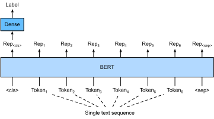
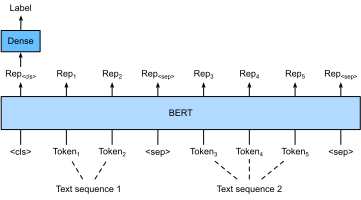
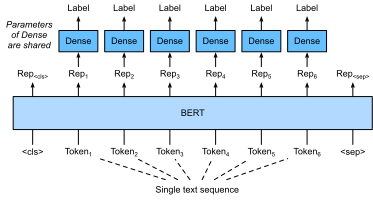
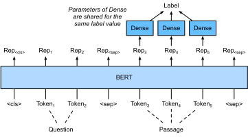

# BERT patikslinimas sekos lygmens ir teksto vieneto lygmens taikymams
:label:`sec_finetuning-bert`

Ankstesniuose šio skyriaus skyreliuose
suprojektavome skirtingus modelius natūraliosios kalbos apdorojimo taikymams,
pavyzdžiui, pagrįstus RNN, CNN, dėmesio sutelkimu ir MLP.
Šie modeliai naudingi, kai yra vietos ar laiko apribojimų,
tačiau
praktiškai neįmanoma sukurti specifinį modelį kiekvienai natūraliosios kalbos apdorojimo užduočiai.
:numref:`sec_bert`
pristatėme išankstinio apmokymo modelį BERT,
kuriam reikia minimalių architektūros pakeitimų
plačiam natūraliosios kalbos apdorojimo užduočių spektrui.
Viena vertus,
jo pasiūlymo metu
BERT pagerino pažangiausius rezultatus įvairiose natūraliosios kalbos apdorojimo užduotyse.
Kita vertus,
kaip pažymėta :numref:`sec_bert-pretraining`,
dvi originalaus BERT modelio versijos
turi 110 milijonų ir 340 milijonų parametrų.
Todėl, kai yra pakankamai skaičiavimo išteklių,
galime apsvarstyti
BERT patikslinimą tolesniems natūraliosios kalbos apdorojimo taikymams.

Toliau
apibendriname natūraliosios kalbos apdorojimo taikymų poaibį
kaip sekos lygmens ir teksto vieneto lygmens.
Sekos lygmeniu
pristatome, kaip paversti teksto įvesties BERT vaizdavimą
išvesties žymeniu
vieno teksto klasifikavime
ir tekstų porų klasifikavime ar regresijoje.
Teksto vieneto lygmeniu trumpai pristatysime naujus taikymus,
tokius kaip teksto žymėjimas ir atsakymas į klausimus,
ir paaiškinsime, kaip BERT gali vaizduoti jų įvestis ir būti paverstas išvesties žymenimis.
Patikslinimo metu
„minimalūs architektūros pakeitimai“, kurių BERT reikalauja skirtinguose taikymuose,
yra papildomi pilnai sujungti sluoksniai.
Prižiūrimo tolesnio taikymo mokymosi metu
papildomų sluoksnių parametrai išmokstami nuo nulio, o
visi iš anksto apmokyto BERT modelio parametrai yra patikslinami.

## Vieno teksto klasifikavimas

*Vieno teksto klasifikavimas* kaip įvestį priima vieną teksto seką ir išveda jos klasifikavimo rezultatą.
Be nuotaikų analizės, kurią nagrinėjome šiame skyriuje,
Kalbinio priimtinumo tekstynas (angl. *Corpus of Linguistic Acceptability*, CoLA)
taip pat yra vieno teksto klasifikavimo duomenų rinkinys,
kuriame vertinama, ar duotas sakinys yra gramatiškai priimtinas, ar ne :cite:`Warstadt.Singh.Bowman.2019`.
Pavyzdžiui, „I should study.“ yra priimtinas, bet „I should studying.“ – ne.

:label:`fig_bert-one-seq`

:numref:`sec_bert` aprašytas BERT įvesties vaizdavimas.
BERT įvesties seka vienareikšmiškai vaizduoja ir vieną tekstą, ir tekstų poras,
kur specialus klasifikavimo teksto vienetas
„&lt;cls&gt;“ naudojamas sekos klasifikavimui, o
specialus klasifikavimo teksto vienetas
„&lt;sep&gt;“ žymi vieno teksto pabaigą arba atskiria tekstų porą.
Kaip parodyta :numref:`fig_bert-one-seq`,
vieno teksto klasifikavimo taikymuose
specialaus klasifikavimo teksto vieneto
„&lt;cls&gt;“ BERT vaizdavimas užkoduoja visos įvesties teksto sekos informaciją.
Kaip įvesties vieno teksto vaizdavimas,
jis bus paduotas į mažą MLP, sudarytą iš pilnai sujungtų (tankiųjų) sluoksnių,
kad išvestų visų diskrečių žymenų reikšmių pasiskirstymą.

## Tekstų porų klasifikavimas arba regresija

Šiame skyriuje taip pat nagrinėjome natūraliosios kalbos išvadų darymą.
Jis priklauso *tekstų porų klasifikavimui* –
taikymo tipui, klasifikuojančiam tekstų porą.

Kaip įvestį priimdamas tekstų porą, bet išvesdamas tolydžią reikšmę,
*semantinis teksto panašumas* yra populiari *tekstų porų regresijos* užduotis.
Ši užduotis matuoja sakinių semantinį panašumą.
Pavyzdžiui, Semantinio teksto panašumo lyginamajame duomenų rinkinyje
sakinių poros panašumo balas
yra tvarkos skalė nuo 0 (reikšmės nepersidengia) iki 5 (reikšmės ekvivalentiškos) :cite:`Cer.Diab.Agirre.ea.2017`.
Tikslas yra prognozuoti šiuos balus.
Pavyzdžiai iš Semantinio teksto panašumo lyginamojo duomenų rinkinio apima (1 sakinys, 2 sakinys, panašumo balas):

* „A plane is taking off.“, „An air plane is taking off.“, 5.000;
* „A woman is eating something.“, „A woman is eating meat.“, 3.000;
* „A woman is dancing.“, „A man is talking.“, 0.000.

:label:`fig_bert-two-seqs`

Palyginti su vieno teksto klasifikavimu :numref:`fig_bert-one-seq`,
BERT patikslinimas tekstų porų klasifikavimui :numref:`fig_bert-two-seqs`
skiriasi įvesties vaizdavimu.
Tekstų porų regresijos užduotims, tokioms kaip semantinis teksto panašumas,
galima taikyti nesudėtingus pakeitimus, pavyzdžiui, išvesti tolydžią žymens reikšmę
ir naudoti vidutinį kvadratinį nuostolį: jie įprasti regresijai.

## Teksto žymėjimas

Dabar panagrinėkime teksto vieneto lygmens užduotis, tokias kaip *teksto žymėjimas*,
kur kiekvienam teksto vienetui priskiriamas žymuo.
Tarp teksto žymėjimo užduočių
*kalbos dalių žymėjimas* priskiria kiekvienam žodžiui kalbos dalies žymą (pvz., būdvardis ir determinantas)
pagal žodžio vaidmenį sakinyje.
Pavyzdžiui,
pagal Penn Treebank II žymų rinkinį
sakinys „John Smith 's car is new“
turėtų būti pažymėtas kaip
„NNP (daiktavardis, tikrinis vienaskaitos) NNP POS (priklausomybės galūnė) NN (daiktavardis, vienaskaitos arba bendrinis) VB (veiksmažodis, bazinė forma) JJ (būdvardis)“.

:label:`fig_bert-tagging`

BERT patikslinimas teksto žymėjimo taikymams
iliustruotas :numref:`fig_bert-tagging`.
Palyginti su :numref:`fig_bert-one-seq`,
vienintelis skirtumas yra tas, kad
teksto žymėjime *kiekvieno įvesties teksto teksto vieneto* BERT vaizdavimas
paduodamas į tuos pačius papildomus pilnai sujungtus sluoksnius, kad išvestų teksto vieneto žymenį,
pavyzdžiui, kalbos dalies žymą.

## Atsakymas į klausimus

Kaip kitas teksto vieneto lygmens taikymas,
*atsakymas į klausimus* atspindi skaitymo supratimo gebėjimus.
Pavyzdžiui,
Stanfordo klausimų atsakymo duomenų rinkinį (SQuAD v1.1)
sudaro skaitymo ištraukos ir klausimai,
kur atsakymas į kiekvieną klausimą
yra tiesiog teksto segmentas (teksto intervalas) iš ištraukos, apie kurią klausiama :cite:`Rajpurkar.Zhang.Lopyrev.ea.2016`.
Kad paaiškintume,
panagrinėkime ištrauką
„Some experts report that a mask's efficacy is inconclusive. However, mask makers insist that their products, such as N95 respirator masks, can guard against the virus.“
(Kai kurie ekspertai praneša, kad kaukės veiksmingumas neįrodytas. Tačiau kaukių gamintojai tvirtina, kad jų produktai, tokie kaip N95 respiratoriai, gali apsaugoti nuo viruso.)
ir klausimą „Who say that N95 respirator masks can guard against the virus?“ (Kas sako, kad N95 respiratoriai gali apsaugoti nuo viruso?).
Atsakymas turėtų būti teksto intervalas „mask makers“ ištraukoje.
Taigi SQuAD v1.1 tikslas yra prognozuoti teksto intervalo pradžią ir pabaigą ištraukoje, turint klausimo ir ištraukos porą.

:label:`fig_bert-qa`

Kad patikslintume BERT atsakymui į klausimus,
klausimas ir ištrauka supakuojami kaip
atitinkamai pirmoji ir antroji teksto sekos
BERT įvestyje.
Kad prognozuotume teksto intervalo pradžios padėtį,
tas pats papildomas pilnai sujungtas sluoksnis paverčia
bet kurio ištraukos teksto vieneto, esančio padėtyje $i$, BERT vaizdavimą
skaliariniu balu $s_i$.
Tokie visų ištraukos teksto vienetų balai
toliau paverčiami softmax operacija
į tikimybinį pasiskirstymą,
kad kiekvienai teksto vieneto padėčiai $i$ ištraukoje būtų priskirta
tikimybė $p_i$ būti teksto intervalo pradžia.
Teksto intervalo pabaigos prognozavimas
yra toks pat kaip aukščiau, tik
jo papildomo pilnai sujungto sluoksnio parametrai
yra nepriklausomi nuo pradžios prognozavimo parametrų.
Prognozuojant pabaigą,
bet kuris ištraukos teksto vienetas padėtyje $i$
tuo pačiu pilnai sujungtu sluoksniu paverčiamas
skaliariniu balu $e_i$.
:numref:`fig_bert-qa`
pavaizduotas BERT patikslinimas atsakymui į klausimus.

Atsakymui į klausimus
prižiūrimo mokymosi apmokymo tikslas yra toks pat paprastas, kaip
maksimizuoti tikrųjų pradžios ir pabaigos padėčių logaritminius tikėtinumus.
Prognozuojant intervalą,
galime apskaičiuoti balą $s_i + e_j$ galiojančiam intervalui
nuo padėties $i$ iki padėties $j$ ($i \leq j$)
ir išvesti intervalą su didžiausiu balu.

## Santrauka

* BERT reikalauja minimalių architektūros pakeitimų (papildomų pilnai sujungtų sluoksnių) sekos lygmens ir teksto vieneto lygmens natūraliosios kalbos apdorojimo taikymams, tokiems kaip vieno teksto klasifikavimas (pvz., nuotaikų analizė ir kalbinio priimtinumo tikrinimas), tekstų porų klasifikavimas ar regresija (pvz., natūraliosios kalbos išvadų darymas ir semantinis teksto panašumas), teksto žymėjimas (pvz., kalbos dalių žymėjimas) ir atsakymas į klausimus.
* Prižiūrimo tolesnio taikymo mokymosi metu papildomų sluoksnių parametrai išmokstami nuo nulio, o visi iš anksto apmokyto BERT modelio parametrai yra patikslinami.

## Pratimai

1. Suprojektuokime paieškos sistemos algoritmą naujienų straipsniams. Kai sistema gauna užklausą (pvz., „naftos pramonė koronaviruso protrūkio metu“), ji turėtų grąžinti surikiuotą naujienų straipsnių sąrašą, labiausiai atitinkantį užklausą. Tarkime, kad turime milžinišką naujienų straipsnių rinkinį ir didelį užklausų skaičių. Kad supaprastintume problemą, tarkime, kad kiekvienai užklausai pažymėtas labiausiai tinkamas straipsnis. Kaip galime taikyti neigiamų pavyzdžių atranką (žr. :numref:`subsec_negative-sampling`) ir BERT algoritmo dizaine?
1. Kaip galime pasinaudoti BERT apmokant kalbos modelius?
1. Ar galime pasinaudoti BERT mašininiame vertime?

[Diskusijos](https://discuss.d2l.ai/t/396)
