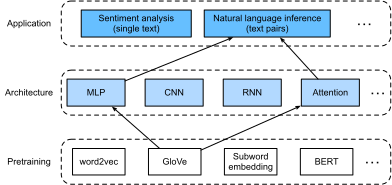
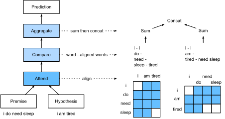

# Natūraliosios kalbos išvadų darymas: naudojant dėmesio sutelkimą
:label:`sec_natural-language-inference-attention`

:numref:`sec_natural-language-inference-and-dataset` pristatėme natūraliosios kalbos išvadų darymo užduotį ir SNLI duomenų rinkinį. Turėdami omenyje daugelį modelių, pagrįstų sudėtingomis ir giliomis architektūromis, :citet:`Parikh.Tackstrom.Das.ea.2016` pasiūlė spręsti natūraliosios kalbos išvadų darymą dėmesio sutelkimo mechanizmais ir pavadino tai „skaidomos dėmesio sutelkimo transformacijos modeliu“.
Taip gaunamas modelis be rekurentinių ar konvoliucinių sluoksnių, pasiekęs geriausią to meto rezultatą SNLI duomenų rinkinyje su daug mažiau parametrų.
Šiame skyrelyje aprašysime ir įgyvendinsime šį dėmesio sutelkimu pagrįstą metodą (su MLP) natūraliosios kalbos išvadų darymui, kaip pavaizduota :numref:`fig_nlp-map-nli-attention`.


:label:`fig_nlp-map-nli-attention`


## Modelis

Paprasčiau nei išsaugoti teksto vienetų tvarką prielaidose ir hipotezėse,
galime tiesiog sulygiuoti vienos teksto sekos teksto vienetus su kiekvienu kitos sekos teksto vienetu ir atvirkščiai,
tada palyginti ir agreguoti tokią informaciją, kad prognozuotume loginius sąryšius
tarp prielaidų ir hipotezių.
Panašiai kaip teksto vienetų sulygiavimas tarp šaltinio ir tikslo sakinių mašininiame vertime,
teksto vienetų sulygiavimą tarp prielaidų ir hipotezių
galima tvarkingai atlikti dėmesio sutelkimo mechanizmais.


:label:`fig_nli_attention`

:numref:`fig_nli_attention` pavaizduotas natūraliosios kalbos išvadų darymo metodas, naudojantis dėmesio sutelkimo mechanizmus.
Aukštu lygiu jį sudaro trys kartu apmokomi žingsniai: dėmesio sutelkimas, palyginimas ir agregavimas.
Juos iliustruosime žingsnis po žingsnio toliau.

```{.python .input}
#@tab mxnet
from d2l import mxnet as d2l
from mxnet import gluon, init, np, npx
from mxnet.gluon import nn

npx.set_np()
```

```{.python .input}
#@tab pytorch
from d2l import torch as d2l
import torch
from torch import nn
from torch.nn import functional as F
```

### Dėmesio sutelkimas

Pirmasis žingsnis yra sulygiuoti vienos teksto sekos teksto vienetus su kiekvienu kitos sekos teksto vienetu.
Tarkime, kad prielaida yra „i do need sleep“ (man tikrai reikia miego), o hipotezė – „i am tired“ (aš pavargęs).
Dėl semantinio panašumo
galime norėti sulygiuoti „i“ hipotezėje su „i“ prielaidoje
ir sulygiuoti „tired“ hipotezėje su „sleep“ prielaidoje.
Panašiai galime norėti sulygiuoti „i“ prielaidoje su „i“ hipotezėje
ir sulygiuoti „need“ bei „sleep“ prielaidoje su „tired“ hipotezėje.
Atkreipkite dėmesį, kad toks sulygiavimas yra *minkštas* naudojant svertinį vidurkį,
kur idealiu atveju dideli svoriai priskiriami sulygiuotiniems teksto vienetams.
Demonstravimo patogumui :numref:`fig_nli_attention` rodo tokį sulygiavimą *kietuoju* būdu.

Dabar išsamiau aprašome minkštąjį sulygiavimą naudojant dėmesio sutelkimo mechanizmus.
Pažymėkime $\mathbf{A} = (\mathbf{a}_1, \ldots, \mathbf{a}_m)$
ir $\mathbf{B} = (\mathbf{b}_1, \ldots, \mathbf{b}_n)$ prielaidą ir hipotezę,
kurių teksto vienetų skaičius yra atitinkamai $m$ ir $n$,
kur $\mathbf{a}_i, \mathbf{b}_j \in \mathbb{R}^{d}$ ($i = 1, \ldots, m, j = 1, \ldots, n$) yra $d$ dimensijų žodžio vektorius.
Minkštajam sulygiavimui apskaičiuojame dėmesio svorius $e_{ij} \in \mathbb{R}$ kaip

$$e_{ij} = f(\mathbf{a}_i)^\top f(\mathbf{b}_j),$$
:eqlabel:`eq_nli_e`

kur funkcija $f$ yra MLP, apibrėžtas šioje funkcijoje `mlp`.
$f$ išvesties dimensiją nurodo `mlp` argumentas `num_hiddens`.

```{.python .input}
#@tab mxnet
def mlp(num_hiddens, flatten):
    net = nn.Sequential()
    net.add(nn.Dropout(0.2))
    net.add(nn.Dense(num_hiddens, activation='relu', flatten=flatten))
    net.add(nn.Dropout(0.2))
    net.add(nn.Dense(num_hiddens, activation='relu', flatten=flatten))
    return net
```

```{.python .input}
#@tab pytorch
def mlp(num_inputs, num_hiddens, flatten):
    net = []
    net.append(nn.Dropout(0.2))
    net.append(nn.Linear(num_inputs, num_hiddens))
    net.append(nn.ReLU())
    if flatten:
        net.append(nn.Flatten(start_dim=1))
    net.append(nn.Dropout(0.2))
    net.append(nn.Linear(num_hiddens, num_hiddens))
    net.append(nn.ReLU())
    if flatten:
        net.append(nn.Flatten(start_dim=1))
    return nn.Sequential(*net)
```

Reikia pabrėžti, kad :eqref:`eq_nli_e`
$f$ priima įvestis $\mathbf{a}_i$ ir $\mathbf{b}_j$ atskirai, o ne kaip jų porą kartu.
Šis *dekompozicijos* triukas lemia tik $m + n$ $f$ taikymų (tiesinis sudėtingumas), o ne $mn$ taikymų
(kvadratinis sudėtingumas).


Normuodami dėmesio svorius :eqref:`eq_nli_e`,
apskaičiuojame visų hipotezės teksto vienetų vektorių svertinį vidurkį,
kad gautume hipotezės vaizdavimą, minkštai sulygiuotą su prielaidos teksto vienetu, indeksuotu $i$:

$$
\boldsymbol{\beta}_i = \sum_{j=1}^{n}\frac{\exp(e_{ij})}{ \sum_{k=1}^{n} \exp(e_{ik})} \mathbf{b}_j.
$$

Panašiai apskaičiuojame prielaidos teksto vienetų minkštąjį sulygiavimą kiekvienam hipotezės teksto vienetui, indeksuotam $j$:

$$
\boldsymbol{\alpha}_j = \sum_{i=1}^{m}\frac{\exp(e_{ij})}{ \sum_{k=1}^{m} \exp(e_{kj})} \mathbf{a}_i.
$$

Toliau apibrėžiame klasę `Attend`, kad apskaičiuotume hipotezių minkštąjį sulygiavimą (`beta`) su įvesties prielaidomis `A` ir prielaidų minkštąjį sulygiavimą (`alpha`) su įvesties hipotezėmis `B`.

```{.python .input}
#@tab mxnet
class Attend(nn.Block):
    def __init__(self, num_hiddens, **kwargs):
        super(Attend, self).__init__(**kwargs)
        self.f = mlp(num_hiddens=num_hiddens, flatten=False)

    def forward(self, A, B):
        # Shape of `A`/`B`: (b`atch_size`, no. of tokens in sequence A/B,
        # `embed_size`)
        # Shape of `f_A`/`f_B`: (`batch_size`, no. of tokens in sequence A/B,
        # `num_hiddens`)
        f_A = self.f(A)
        f_B = self.f(B)
        # Shape of `e`: (`batch_size`, no. of tokens in sequence A,
        # no. of tokens in sequence B)
        e = npx.batch_dot(f_A, f_B, transpose_b=True)
        # Shape of `beta`: (`batch_size`, no. of tokens in sequence A,
        # `embed_size`), where sequence B is softly aligned with each token
        # (axis 1 of `beta`) in sequence A
        beta = npx.batch_dot(npx.softmax(e), B)
        # Shape of `alpha`: (`batch_size`, no. of tokens in sequence B,
        # `embed_size`), where sequence A is softly aligned with each token
        # (axis 1 of `alpha`) in sequence B
        alpha = npx.batch_dot(npx.softmax(e.transpose(0, 2, 1)), A)
        return beta, alpha
```

```{.python .input}
#@tab pytorch
class Attend(nn.Module):
    def __init__(self, num_inputs, num_hiddens, **kwargs):
        super(Attend, self).__init__(**kwargs)
        self.f = mlp(num_inputs, num_hiddens, flatten=False)

    def forward(self, A, B):
        # Shape of `A`/`B`: (`batch_size`, no. of tokens in sequence A/B,
        # `embed_size`)
        # Shape of `f_A`/`f_B`: (`batch_size`, no. of tokens in sequence A/B,
        # `num_hiddens`)
        f_A = self.f(A)
        f_B = self.f(B)
        # Shape of `e`: (`batch_size`, no. of tokens in sequence A,
        # no. of tokens in sequence B)
        e = torch.bmm(f_A, f_B.permute(0, 2, 1))
        # Shape of `beta`: (`batch_size`, no. of tokens in sequence A,
        # `embed_size`), where sequence B is softly aligned with each token
        # (axis 1 of `beta`) in sequence A
        beta = torch.bmm(F.softmax(e, dim=-1), B)
        # Shape of `alpha`: (`batch_size`, no. of tokens in sequence B,
        # `embed_size`), where sequence A is softly aligned with each token
        # (axis 1 of `alpha`) in sequence B
        alpha = torch.bmm(F.softmax(e.permute(0, 2, 1), dim=-1), A)
        return beta, alpha
```

### Palyginimas

Kitame žingsnyje palyginame vienos sekos teksto vienetą su kita seka, kuri yra minkštai sulygiuota su tuo teksto vienetu.
Atkreipkite dėmesį, kad minkštajame sulygiavime visi vienos sekos teksto vienetai, nors ir su tikriausiai skirtingais dėmesio svoriais, bus lyginami su kitos sekos teksto vienetu.
Demonstravimo patogumui :numref:`fig_nli_attention` poruoja teksto vienetus su sulygiuotais teksto vienetais *kietuoju* būdu.
Pavyzdžiui, tarkime, kad dėmesio sutelkimo žingsnis nustato, jog „need“ ir „sleep“ prielaidoje abu yra sulygiuoti su „tired“ hipotezėje; tuomet bus lyginama pora „tired–need sleep“.

Palyginimo žingsnyje į funkciją $g$ (MLP) paduodame vienos sekos teksto vienetų ir kitos sekos sulygiuotų teksto vienetų konkatenaciją (operatorius $[\cdot, \cdot]$):

$$\mathbf{v}_{A,i} = g([\mathbf{a}_i, \boldsymbol{\beta}_i]), i = 1, \ldots, m\\ \mathbf{v}_{B,j} = g([\mathbf{b}_j, \boldsymbol{\alpha}_j]), j = 1, \ldots, n.$$

:eqlabel:`eq_nli_v_ab`


:eqref:`eq_nli_v_ab` $\mathbf{v}_{A,i}$ yra prielaidos teksto vieneto $i$ ir visų hipotezės teksto vienetų, minkštai sulygiuotų su teksto vienetu $i$, palyginimas;
o $\mathbf{v}_{B,j}$ yra hipotezės teksto vieneto $j$ ir visų prielaidos teksto vienetų, minkštai sulygiuotų su teksto vienetu $j$, palyginimas.
Šį palyginimo žingsnį apibrėžia šioji klasė `Compare`.

```{.python .input}
#@tab mxnet
class Compare(nn.Block):
    def __init__(self, num_hiddens, **kwargs):
        super(Compare, self).__init__(**kwargs)
        self.g = mlp(num_hiddens=num_hiddens, flatten=False)

    def forward(self, A, B, beta, alpha):
        V_A = self.g(np.concatenate([A, beta], axis=2))
        V_B = self.g(np.concatenate([B, alpha], axis=2))
        return V_A, V_B
```

```{.python .input}
#@tab pytorch
class Compare(nn.Module):
    def __init__(self, num_inputs, num_hiddens, **kwargs):
        super(Compare, self).__init__(**kwargs)
        self.g = mlp(num_inputs, num_hiddens, flatten=False)

    def forward(self, A, B, beta, alpha):
        V_A = self.g(torch.cat([A, beta], dim=2))
        V_B = self.g(torch.cat([B, alpha], dim=2))
        return V_A, V_B
```

### Agregavimas

Turėdami dvi palyginimo vektorių aibes $\mathbf{v}_{A,i}$ ($i = 1, \ldots, m$) ir $\mathbf{v}_{B,j}$ ($j = 1, \ldots, n$),
paskutiniame žingsnyje agreguosime šią informaciją, kad padarytume išvadą apie loginį sąryšį.
Pradedame susumuodami abi aibes:

$$
\mathbf{v}_A = \sum_{i=1}^{m} \mathbf{v}_{A,i}, \quad \mathbf{v}_B = \sum_{j=1}^{n}\mathbf{v}_{B,j}.
$$

Toliau abiejų sumavimo rezultatų konkatenaciją paduodame į funkciją $h$ (MLP), kad gautume loginio sąryšio klasifikavimo rezultatą:

$$
\hat{\mathbf{y}} = h([\mathbf{v}_A, \mathbf{v}_B]).
$$

Agregavimo žingsnis apibrėžtas šioje klasėje `Aggregate`.

```{.python .input}
#@tab mxnet
class Aggregate(nn.Block):
    def __init__(self, num_hiddens, num_outputs, **kwargs):
        super(Aggregate, self).__init__(**kwargs)
        self.h = mlp(num_hiddens=num_hiddens, flatten=True)
        self.h.add(nn.Dense(num_outputs))

    def forward(self, V_A, V_B):
        # Sum up both sets of comparison vectors
        V_A = V_A.sum(axis=1)
        V_B = V_B.sum(axis=1)
        # Feed the concatenation of both summarization results into an MLP
        Y_hat = self.h(np.concatenate([V_A, V_B], axis=1))
        return Y_hat
```

```{.python .input}
#@tab pytorch
class Aggregate(nn.Module):
    def __init__(self, num_inputs, num_hiddens, num_outputs, **kwargs):
        super(Aggregate, self).__init__(**kwargs)
        self.h = mlp(num_inputs, num_hiddens, flatten=True)
        self.linear = nn.Linear(num_hiddens, num_outputs)

    def forward(self, V_A, V_B):
        # Sum up both sets of comparison vectors
        V_A = V_A.sum(dim=1)
        V_B = V_B.sum(dim=1)
        # Feed the concatenation of both summarization results into an MLP
        Y_hat = self.linear(self.h(torch.cat([V_A, V_B], dim=1)))
        return Y_hat
```

### Viskas kartu

Sudėję kartu dėmesio sutelkimo, palyginimo ir agregavimo žingsnius,
apibrėžiame skaidomos dėmesio sutelkimo transformacijos modelį, kad kartu apmokytume šiuos tris žingsnius.

```{.python .input}
#@tab mxnet
class DecomposableAttention(nn.Block):
    def __init__(self, vocab, embed_size, num_hiddens, **kwargs):
        super(DecomposableAttention, self).__init__(**kwargs)
        self.embedding = nn.Embedding(len(vocab), embed_size)
        self.attend = Attend(num_hiddens)
        self.compare = Compare(num_hiddens)
        # There are 3 possible outputs: entailment, contradiction, and neutral
        self.aggregate = Aggregate(num_hiddens, 3)

    def forward(self, X):
        premises, hypotheses = X
        A = self.embedding(premises)
        B = self.embedding(hypotheses)
        beta, alpha = self.attend(A, B)
        V_A, V_B = self.compare(A, B, beta, alpha)
        Y_hat = self.aggregate(V_A, V_B)
        return Y_hat
```

```{.python .input}
#@tab pytorch
class DecomposableAttention(nn.Module):
    def __init__(self, vocab, embed_size, num_hiddens, num_inputs_attend=100,
                 num_inputs_compare=200, num_inputs_agg=400, **kwargs):
        super(DecomposableAttention, self).__init__(**kwargs)
        self.embedding = nn.Embedding(len(vocab), embed_size)
        self.attend = Attend(num_inputs_attend, num_hiddens)
        self.compare = Compare(num_inputs_compare, num_hiddens)
        # There are 3 possible outputs: entailment, contradiction, and neutral
        self.aggregate = Aggregate(num_inputs_agg, num_hiddens, num_outputs=3)

    def forward(self, X):
        premises, hypotheses = X
        A = self.embedding(premises)
        B = self.embedding(hypotheses)
        beta, alpha = self.attend(A, B)
        V_A, V_B = self.compare(A, B, beta, alpha)
        Y_hat = self.aggregate(V_A, V_B)
        return Y_hat
```

## Modelio apmokymas ir vertinimas

Dabar apmokysime ir įvertinsime apibrėžtą skaidomos dėmesio sutelkimo transformacijos modelį SNLI duomenų rinkinyje.
Pradedame nuo duomenų rinkinio skaitymo.


### Duomenų rinkinio skaitymas

Atsisiunčiame ir nuskaitome SNLI duomenų rinkinį naudodami funkciją, apibrėžtą :numref:`sec_natural-language-inference-and-dataset`. Rinkinio dydis ir sekos ilgis nustatomi atitinkamai $256$ ir $50$.

```{.python .input}
#@tab all
batch_size, num_steps = 256, 50
train_iter, test_iter, vocab = d2l.load_data_snli(batch_size, num_steps)
```

### Modelio sukūrimas

Įvesties teksto vienetams vaizduoti naudojame iš anksto apmokytą 100 dimensijų GloVe įterpinį.
Todėl iš anksto apibrėžiame vektorių $\mathbf{a}_i$ ir $\mathbf{b}_j$ dimensiją :eqref:`eq_nli_e` kaip 100.
Funkcijų $f$ :eqref:`eq_nli_e` ir $g$ :eqref:`eq_nli_v_ab` išvesties dimensija nustatoma 200.
Tada sukuriame modelio egzempliorių, inicializuojame jo parametrus
ir įkeliame GloVe įterpinį įvesties teksto vienetų vektoriams inicializuoti.

```{.python .input}
#@tab mxnet
embed_size, num_hiddens, devices = 100, 200, d2l.try_all_gpus()
net = DecomposableAttention(vocab, embed_size, num_hiddens)
net.initialize(init.Xavier(), ctx=devices)
glove_embedding = d2l.TokenEmbedding('glove.6b.100d')
embeds = glove_embedding[vocab.idx_to_token]
net.embedding.weight.set_data(embeds)
```

```{.python .input}
#@tab pytorch
embed_size, num_hiddens, devices = 100, 200, d2l.try_all_gpus()
net = DecomposableAttention(vocab, embed_size, num_hiddens)
glove_embedding = d2l.TokenEmbedding('glove.6b.100d')
embeds = glove_embedding[vocab.idx_to_token]
net.embedding.weight.data.copy_(embeds);
```

### Modelio apmokymas ir vertinimas

Priešingai nei funkcija `split_batch` :numref:`sec_multi_gpu`, kuri priima vieną įvestį, pavyzdžiui, teksto sekas (ar vaizdus),
apibrėžiame funkciją `split_batch_multi_inputs`, kad ji priimtų kelias įvestis, pavyzdžiui, prielaidas ir hipotezes minirinkiniuose.

```{.python .input}
#@tab mxnet
#@save
def split_batch_multi_inputs(X, y, devices):
    """Split multi-input `X` and `y` into multiple devices."""
    X = list(zip(*[gluon.utils.split_and_load(
        feature, devices, even_split=False) for feature in X]))
    return (X, gluon.utils.split_and_load(y, devices, even_split=False))
```

Dabar galime apmokyti ir įvertinti modelį SNLI duomenų rinkinyje.

```{.python .input}
#@tab mxnet
lr, num_epochs = 0.001, 4
trainer = gluon.Trainer(net.collect_params(), 'adam', {'learning_rate': lr})
loss = gluon.loss.SoftmaxCrossEntropyLoss()
d2l.train_ch13(net, train_iter, test_iter, loss, trainer, num_epochs, devices,
               split_batch_multi_inputs)
```

```{.python .input}
#@tab pytorch
lr, num_epochs = 0.001, 4
trainer = torch.optim.Adam(net.parameters(), lr=lr)
loss = nn.CrossEntropyLoss(reduction="none")
d2l.train_ch13(net, train_iter, test_iter, loss, trainer, num_epochs, devices)
```

### Modelio naudojimas

Galiausiai apibrėžiame prognozavimo funkciją, kuri išveda loginį sąryšį tarp prielaidos ir hipotezės poros.

```{.python .input}
#@tab mxnet
#@save
def predict_snli(net, vocab, premise, hypothesis):
    """Predict the logical relationship between the premise and hypothesis."""
    premise = np.array(vocab[premise], ctx=d2l.try_gpu())
    hypothesis = np.array(vocab[hypothesis], ctx=d2l.try_gpu())
    label = np.argmax(net([premise.reshape((1, -1)),
                           hypothesis.reshape((1, -1))]), axis=1)
    return 'entailment' if label == 0 else 'contradiction' if label == 1 \
            else 'neutral'
```

```{.python .input}
#@tab pytorch
#@save
def predict_snli(net, vocab, premise, hypothesis):
    """Predict the logical relationship between the premise and hypothesis."""
    net.eval()
    premise = torch.tensor(vocab[premise], device=d2l.try_gpu())
    hypothesis = torch.tensor(vocab[hypothesis], device=d2l.try_gpu())
    label = torch.argmax(net([premise.reshape((1, -1)),
                           hypothesis.reshape((1, -1))]), dim=1)
    return 'entailment' if label == 0 else 'contradiction' if label == 1 \
            else 'neutral'
```

Galime naudoti apmokytą modelį, kad gautume natūraliosios kalbos išvadų darymo rezultatą pavyzdinei sakinių porai.

```{.python .input}
#@tab all
predict_snli(net, vocab, ['he', 'is', 'good', '.'], ['he', 'is', 'bad', '.'])
```

## Santrauka

* Skaidomos dėmesio sutelkimo transformacijos modelį sudaro trys žingsniai loginiams sąryšiams tarp prielaidų ir hipotezių prognozuoti: dėmesio sutelkimas, palyginimas ir agregavimas.
* Naudodami dėmesio sutelkimo mechanizmus, galime sulygiuoti vienos teksto sekos teksto vienetus su kiekvienu kitos sekos teksto vienetu ir atvirkščiai. Toks sulygiavimas yra minkštas naudojant svertinį vidurkį, kur idealiu atveju dideli svoriai priskiriami sulygiuotiniems teksto vienetams.
* Dekompozicijos triukas lemia pageidautinesnį tiesinį sudėtingumą, o ne kvadratinį, skaičiuojant dėmesio svorius.
* Iš anksto apmokytus žodžių vektorius galime naudoti kaip įvesties vaizdavimą tolesnėms natūraliosios kalbos apdorojimo užduotims, tokioms kaip natūraliosios kalbos išvadų darymas.


## Pratimai

1. Apmokykite modelį su kitais hiperparametrų deriniais. Ar galite gauti didesnį tikslumą testavimo aibėje?
1. Kokie yra pagrindiniai skaidomos dėmesio sutelkimo transformacijos modelio trūkumai natūraliosios kalbos išvadų darymui?
1. Tarkime, kad norime gauti bet kurios sakinių poros semantinio panašumo lygį (pvz., tolydžią reikšmę tarp 0 ir 1). Kaip turėtume surinkti ir pažymėti duomenų rinkinį? Ar galite suprojektuoti modelį su dėmesio sutelkimo mechanizmais?

:begin_tab:`mxnet`
[Diskusijos](https://discuss.d2l.ai/t/395)
:end_tab:

:begin_tab:`pytorch`
[Diskusijos](https://discuss.d2l.ai/t/1530)
:end_tab:
