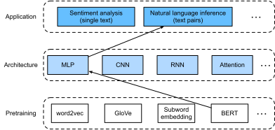

# Natūraliosios kalbos išvadų darymas: BERT patikslinimas
:label:`sec_natural-language-inference-bert`

Ankstesniuose šio skyriaus skyreliuose
suprojektavome dėmesio sutelkimu pagrįstą architektūrą
(:numref:`sec_natural-language-inference-attention`)
natūraliosios kalbos išvadų darymo užduočiai
SNLI duomenų rinkinyje (kaip aprašyta :numref:`sec_natural-language-inference-and-dataset`).
Dabar grįžtame prie šios užduoties patikslindami BERT.
Kaip aptarta :numref:`sec_finetuning-bert`,
natūraliosios kalbos išvadų darymas yra sekos lygmens tekstų porų klasifikavimo problema,
o BERT patikslinimui reikia tik papildomos MLP pagrįstos architektūros,
kaip iliustruota :numref:`fig_nlp-map-nli-bert`.


:label:`fig_nlp-map-nli-bert`

Šiame skyrelyje
atsisiųsime iš anksto apmokytą mažą BERT versiją,
tada ją patikslinsime
natūraliosios kalbos išvadų darymui SNLI duomenų rinkinyje.

```{.python .input}
#@tab mxnet
from d2l import mxnet as d2l
import json
import multiprocessing
from mxnet import gluon, np, npx
from mxnet.gluon import nn
import os

npx.set_np()
```

```{.python .input}
#@tab pytorch
from d2l import torch as d2l
import json
import multiprocessing
import torch
from torch import nn
import os
```

## [**Iš anksto apmokyto BERT įkėlimas**]

Paaiškinome, kaip iš anksto apmokyti BERT WikiText-2 duomenų rinkinyje
:numref:`sec_bert-dataset` ir :numref:`sec_bert-pretraining`
(atkreipkite dėmesį, kad originalus BERT modelis iš anksto apmokytas daug didesniuose tekstynuose).
Kaip aptarta :numref:`sec_bert-pretraining`,
originalus BERT modelis turi šimtus milijonų parametrų.
Toliau
pateikiame dvi iš anksto apmokyto BERT versijas:
„bert.base“ yra maždaug tokio dydžio kaip originalus bazinis BERT modelis, kuriam patikslinti reikia daug skaičiavimo išteklių,
o „bert.small“ yra maža versija demonstravimui palengvinti.

```{.python .input}
#@tab mxnet
d2l.DATA_HUB['bert.base'] = (d2l.DATA_URL + 'bert.base.zip',
                             '7b3820b35da691042e5d34c0971ac3edbd80d3f4')
d2l.DATA_HUB['bert.small'] = (d2l.DATA_URL + 'bert.small.zip',
                              'a4e718a47137ccd1809c9107ab4f5edd317bae2c')
```

```{.python .input}
#@tab pytorch
d2l.DATA_HUB['bert.base'] = (d2l.DATA_URL + 'bert.base.torch.zip',
                             '225d66f04cae318b841a13d32af3acc165f253ac')
d2l.DATA_HUB['bert.small'] = (d2l.DATA_URL + 'bert.small.torch.zip',
                              'c72329e68a732bef0452e4b96a1c341c8910f81f')
```

Abiejuose iš anksto apmokytuose BERT modeliuose yra failas „vocab.json“, apibrėžiantis žodyno aibę,
ir failas „pretrained.params“ su iš anksto apmokytais parametrais.
Įgyvendiname šią funkciją `load_pretrained_model`, kad [**įkeltume iš anksto apmokytus BERT parametrus**].

```{.python .input}
#@tab mxnet
def load_pretrained_model(pretrained_model, num_hiddens, ffn_num_hiddens,
                          num_heads, num_blks, dropout, max_len, devices):
    data_dir = d2l.download_extract(pretrained_model)
    # Define an empty vocabulary to load the predefined vocabulary
    vocab = d2l.Vocab()
    vocab.idx_to_token = json.load(open(os.path.join(data_dir, 'vocab.json')))
    vocab.token_to_idx = {token: idx for idx, token in enumerate(
        vocab.idx_to_token)}
    bert = d2l.BERTModel(len(vocab), num_hiddens, ffn_num_hiddens, num_heads, 
                         num_blks, dropout, max_len)
    # Load pretrained BERT parameters
    bert.load_parameters(os.path.join(data_dir, 'pretrained.params'),
                         ctx=devices)
    return bert, vocab
```

```{.python .input}
#@tab pytorch
def load_pretrained_model(pretrained_model, num_hiddens, ffn_num_hiddens,
                          num_heads, num_blks, dropout, max_len, devices):
    data_dir = d2l.download_extract(pretrained_model)
    # Define an empty vocabulary to load the predefined vocabulary
    vocab = d2l.Vocab()
    vocab.idx_to_token = json.load(open(os.path.join(data_dir, 'vocab.json')))
    vocab.token_to_idx = {token: idx for idx, token in enumerate(
        vocab.idx_to_token)}
    bert = d2l.BERTModel(
        len(vocab), num_hiddens, ffn_num_hiddens=ffn_num_hiddens, num_heads=4,
        num_blks=2, dropout=0.2, max_len=max_len)
    # Load pretrained BERT parameters
    bert.load_state_dict(torch.load(os.path.join(data_dir,
                                                 'pretrained.params')))
    return bert, vocab
```

Kad demonstravimą būtų galima atlikti daugumoje kompiuterių,
šiame skyrelyje įkelsime ir patikslinsime mažą iš anksto apmokyto BERT versiją („bert.small“).
Pratime parodysime, kaip patikslinti daug didesnį „bert.base“, kad gerokai pagerintume testavimo tikslumą.

```{.python .input}
#@tab all
devices = d2l.try_all_gpus()
bert, vocab = load_pretrained_model(
    'bert.small', num_hiddens=256, ffn_num_hiddens=512, num_heads=4,
    num_blks=2, dropout=0.1, max_len=512, devices=devices)
```

## [**Duomenų rinkinys BERT patikslinimui**]

Tolesnei užduočiai – natūraliosios kalbos išvadų darymui SNLI duomenų rinkinyje –
apibrėžiame pritaikytą duomenų rinkinio klasę `SNLIBERTDataset`.
Kiekviename pavyzdyje
prielaida ir hipotezė sudaro teksto sekų porą,
kuri supakuojama į vieną BERT įvesties seką, kaip pavaizduota :numref:`fig_bert-two-seqs`.
Prisiminkite :numref:`subsec_bert_input_rep`, kad segmentų ID
naudojami atskirti prielaidą ir hipotezę BERT įvesties sekoje.
Esant iš anksto apibrėžtam didžiausiam BERT įvesties sekos ilgiui (`max_len`),
ilgesnės įvesties teksto poros paskutinis teksto vienetas ir toliau šalinamas, kol
pasiekiamas `max_len`.
Kad paspartintume SNLI duomenų rinkinio generavimą
BERT patikslinimui,
naudojame 4 darbinius procesus apmokymo ar testavimo pavyzdžiams generuoti lygiagrečiai.

```{.python .input}
#@tab mxnet
class SNLIBERTDataset(gluon.data.Dataset):
    def __init__(self, dataset, max_len, vocab=None):
        all_premise_hypothesis_tokens = [[
            p_tokens, h_tokens] for p_tokens, h_tokens in zip(
            *[d2l.tokenize([s.lower() for s in sentences])
              for sentences in dataset[:2]])]
        
        self.labels = np.array(dataset[2])
        self.vocab = vocab
        self.max_len = max_len
        (self.all_token_ids, self.all_segments,
         self.valid_lens) = self._preprocess(all_premise_hypothesis_tokens)
        print('read ' + str(len(self.all_token_ids)) + ' examples')

    def _preprocess(self, all_premise_hypothesis_tokens):
        pool = multiprocessing.Pool(4)  # Use 4 worker processes
        out = pool.map(self._mp_worker, all_premise_hypothesis_tokens)
        all_token_ids = [
            token_ids for token_ids, segments, valid_len in out]
        all_segments = [segments for token_ids, segments, valid_len in out]
        valid_lens = [valid_len for token_ids, segments, valid_len in out]
        return (np.array(all_token_ids, dtype='int32'),
                np.array(all_segments, dtype='int32'), 
                np.array(valid_lens))

    def _mp_worker(self, premise_hypothesis_tokens):
        p_tokens, h_tokens = premise_hypothesis_tokens
        self._truncate_pair_of_tokens(p_tokens, h_tokens)
        tokens, segments = d2l.get_tokens_and_segments(p_tokens, h_tokens)
        token_ids = self.vocab[tokens] + [self.vocab['<pad>']] \
                             * (self.max_len - len(tokens))
        segments = segments + [0] * (self.max_len - len(segments))
        valid_len = len(tokens)
        return token_ids, segments, valid_len

    def _truncate_pair_of_tokens(self, p_tokens, h_tokens):
        # Reserve slots for '<CLS>', '<SEP>', and '<SEP>' tokens for the BERT
        # input
        while len(p_tokens) + len(h_tokens) > self.max_len - 3:
            if len(p_tokens) > len(h_tokens):
                p_tokens.pop()
            else:
                h_tokens.pop()

    def __getitem__(self, idx):
        return (self.all_token_ids[idx], self.all_segments[idx],
                self.valid_lens[idx]), self.labels[idx]

    def __len__(self):
        return len(self.all_token_ids)
```

```{.python .input}
#@tab pytorch
class SNLIBERTDataset(torch.utils.data.Dataset):
    def __init__(self, dataset, max_len, vocab=None):
        all_premise_hypothesis_tokens = [[
            p_tokens, h_tokens] for p_tokens, h_tokens in zip(
            *[d2l.tokenize([s.lower() for s in sentences])
              for sentences in dataset[:2]])]
        
        self.labels = torch.tensor(dataset[2])
        self.vocab = vocab
        self.max_len = max_len
        (self.all_token_ids, self.all_segments,
         self.valid_lens) = self._preprocess(all_premise_hypothesis_tokens)
        print('read ' + str(len(self.all_token_ids)) + ' examples')

    def _preprocess(self, all_premise_hypothesis_tokens):
        pool = multiprocessing.Pool(4)  # Use 4 worker processes
        out = pool.map(self._mp_worker, all_premise_hypothesis_tokens)
        all_token_ids = [
            token_ids for token_ids, segments, valid_len in out]
        all_segments = [segments for token_ids, segments, valid_len in out]
        valid_lens = [valid_len for token_ids, segments, valid_len in out]
        return (torch.tensor(all_token_ids, dtype=torch.long),
                torch.tensor(all_segments, dtype=torch.long), 
                torch.tensor(valid_lens))

    def _mp_worker(self, premise_hypothesis_tokens):
        p_tokens, h_tokens = premise_hypothesis_tokens
        self._truncate_pair_of_tokens(p_tokens, h_tokens)
        tokens, segments = d2l.get_tokens_and_segments(p_tokens, h_tokens)
        token_ids = self.vocab[tokens] + [self.vocab['<pad>']] \
                             * (self.max_len - len(tokens))
        segments = segments + [0] * (self.max_len - len(segments))
        valid_len = len(tokens)
        return token_ids, segments, valid_len

    def _truncate_pair_of_tokens(self, p_tokens, h_tokens):
        # Reserve slots for '<CLS>', '<SEP>', and '<SEP>' tokens for the BERT
        # input
        while len(p_tokens) + len(h_tokens) > self.max_len - 3:
            if len(p_tokens) > len(h_tokens):
                p_tokens.pop()
            else:
                h_tokens.pop()

    def __getitem__(self, idx):
        return (self.all_token_ids[idx], self.all_segments[idx],
                self.valid_lens[idx]), self.labels[idx]

    def __len__(self):
        return len(self.all_token_ids)
```

Atsisiuntę SNLI duomenų rinkinį,
[**sugeneruojame apmokymo ir testavimo pavyzdžius**]
sukurdami klasės `SNLIBERTDataset` egzempliorius.
Tokie pavyzdžiai bus skaitomi minirinkiniais natūraliosios kalbos išvadų darymo
apmokymo ir testavimo metu.

```{.python .input}
#@tab mxnet
# Reduce `batch_size` if there is an out of memory error. In the original BERT
# model, `max_len` = 512
batch_size, max_len, num_workers = 512, 128, d2l.get_dataloader_workers()
data_dir = d2l.download_extract('SNLI')
train_set = SNLIBERTDataset(d2l.read_snli(data_dir, True), max_len, vocab)
test_set = SNLIBERTDataset(d2l.read_snli(data_dir, False), max_len, vocab)
train_iter = gluon.data.DataLoader(train_set, batch_size, shuffle=True,
                                   num_workers=num_workers)
test_iter = gluon.data.DataLoader(test_set, batch_size,
                                  num_workers=num_workers)
```

```{.python .input}
#@tab pytorch
# Reduce `batch_size` if there is an out of memory error. In the original BERT
# model, `max_len` = 512
batch_size, max_len, num_workers = 512, 128, d2l.get_dataloader_workers()
data_dir = d2l.download_extract('SNLI')
train_set = SNLIBERTDataset(d2l.read_snli(data_dir, True), max_len, vocab)
test_set = SNLIBERTDataset(d2l.read_snli(data_dir, False), max_len, vocab)
train_iter = torch.utils.data.DataLoader(train_set, batch_size, shuffle=True,
                                   num_workers=num_workers)
test_iter = torch.utils.data.DataLoader(test_set, batch_size,
                                  num_workers=num_workers)
```

## BERT patikslinimas

Kaip rodo :numref:`fig_bert-two-seqs`,
BERT patikslinimui natūraliosios kalbos išvadų darymui
reikia tik papildomo MLP, sudaryto iš dviejų pilnai sujungtų sluoksnių
(žr. `self.hidden` ir `self.output` šioje klasėje `BERTClassifier`).
[**Šis MLP paverčia
specialaus teksto vieneto „&lt;cls&gt;“ BERT vaizdavimą**],
kuris užkoduoja ir prielaidos, ir hipotezės informaciją,
(**į tris natūraliosios kalbos išvadų darymo išvestis**):
išplaukimą, prieštarą ir neutralumą.

```{.python .input}
#@tab mxnet
class BERTClassifier(nn.Block):
    def __init__(self, bert):
        super(BERTClassifier, self).__init__()
        self.encoder = bert.encoder
        self.hidden = bert.hidden
        self.output = nn.Dense(3)

    def forward(self, inputs):
        tokens_X, segments_X, valid_lens_x = inputs
        encoded_X = self.encoder(tokens_X, segments_X, valid_lens_x)
        return self.output(self.hidden(encoded_X[:, 0, :]))
```

```{.python .input}
#@tab pytorch
class BERTClassifier(nn.Module):
    def __init__(self, bert):
        super(BERTClassifier, self).__init__()
        self.encoder = bert.encoder
        self.hidden = bert.hidden
        self.output = nn.LazyLinear(3)

    def forward(self, inputs):
        tokens_X, segments_X, valid_lens_x = inputs
        encoded_X = self.encoder(tokens_X, segments_X, valid_lens_x)
        return self.output(self.hidden(encoded_X[:, 0, :]))
```

Toliau
iš anksto apmokytas BERT modelis `bert` paduodamas į `BERTClassifier` egzempliorių `net`
tolesniam taikymui.
Įprastuose BERT patikslinimo įgyvendinimuose
tik papildomo MLP išvesties sluoksnio (`net.output`) parametrai bus išmokstami nuo nulio.
Visi iš anksto apmokyto BERT kodavimo bloko (`net.encoder`) ir papildomo MLP paslėptojo sluoksnio (`net.hidden`) parametrai bus patikslinami.

```{.python .input}
#@tab mxnet
net = BERTClassifier(bert)
net.output.initialize(ctx=devices)
```

```{.python .input}
#@tab pytorch
net = BERTClassifier(bert)
```

Prisiminkite, kad
:numref:`sec_bert`
tiek klasė `MaskLM`, tiek klasė `NextSentencePred`
turi parametrų savo naudojamuose MLP.
Šie parametrai yra dalis tų, kurie yra iš anksto apmokytame BERT modelyje
`bert`, taigi ir dalis `net` parametrų.
Tačiau tokie parametrai skirti tik
užmaskuoto kalbos modeliavimo nuostoliui
ir kito sakinio prognozavimo nuostoliui apskaičiuoti
išankstinio apmokymo metu.
Šios dvi nuostolių funkcijos nėra svarbios tolesnių taikymų patikslinimui,
todėl `MaskLM` ir `NextSentencePred` naudojamų MLP parametrai
nėra atnaujinami (yra pasenę), kai BERT patikslinamas.

Kad būtų leidžiami parametrai su pasenusiais gradientais,
funkcijoje `step` iš `d2l.train_batch_ch13` nustatoma vėliavėlė `ignore_stale_grad=True`.
Šią funkciją naudojame modeliui `net` apmokyti ir įvertinti naudodami SNLI apmokymo aibę
(`train_iter`) ir testavimo aibę (`test_iter`).
Dėl ribotų skaičiavimo išteklių [**apmokymo**] ir testavimo tikslumą
galima dar pagerinti: jo aptarimą paliekame pratimams.

```{.python .input}
#@tab mxnet
lr, num_epochs = 1e-4, 5
trainer = gluon.Trainer(net.collect_params(), 'adam', {'learning_rate': lr})
loss = gluon.loss.SoftmaxCrossEntropyLoss()
d2l.train_ch13(net, train_iter, test_iter, loss, trainer, num_epochs, devices,
               d2l.split_batch_multi_inputs)
```

```{.python .input}
#@tab pytorch
lr, num_epochs = 1e-4, 5
trainer = torch.optim.Adam(net.parameters(), lr=lr)
loss = nn.CrossEntropyLoss(reduction='none')
net(next(iter(train_iter))[0])
d2l.train_ch13(net, train_iter, test_iter, loss, trainer, num_epochs, devices)
```

## Santrauka

* Iš anksto apmokytą BERT modelį galime patikslinti tolesniems taikymams, pavyzdžiui, natūraliosios kalbos išvadų darymui SNLI duomenų rinkinyje.
* Patikslinimo metu BERT modelis tampa tolesnio taikymo modelio dalimi. Parametrai, susiję tik su išankstinio apmokymo nuostoliu, patikslinimo metu nebus atnaujinami.


## Pratimai

1. Jei leidžia jūsų skaičiavimo ištekliai, patikslinkite daug didesnį iš anksto apmokytą BERT modelį, maždaug tokio dydžio kaip originalus bazinis BERT modelis. Nustatykite funkcijos `load_pretrained_model` argumentus taip: pakeiskite „bert.small“ į „bert.base“, padidinkite reikšmes `num_hiddens=256`, `ffn_num_hiddens=512`, `num_heads=4` ir `num_blks=2` atitinkamai iki 768, 3072, 12 ir 12. Padidinę patikslinimo epochų skaičių (ir galbūt derindami kitus hiperparametrus), ar galite gauti didesnį nei 0,86 testavimo tikslumą?
1. Kaip nukirsti sekų porą pagal jų ilgių santykį? Palyginkite šį porų nukirtimo metodą su naudojamu klasėje `SNLIBERTDataset`. Kokie jų privalumai ir trūkumai?

:begin_tab:`mxnet`
[Diskusijos](https://discuss.d2l.ai/t/397)
:end_tab:

:begin_tab:`pytorch`
[Diskusijos](https://discuss.d2l.ai/t/1526)
:end_tab:
