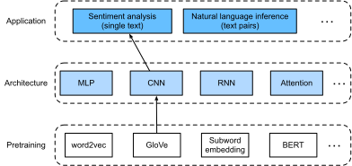
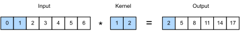
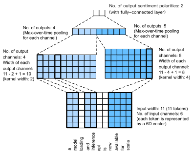

# Nuotaikų analizė: naudojant konvoliucinius neuroninius tinklus
:label:`sec_sentiment_cnn`


:numref:`chap_cnn`
nagrinėjome mechanizmus
dvimačiams vaizdų duomenims apdoroti
dvimačiais CNN,
kurie buvo taikomi
lokaliems požymiams, tokiems kaip gretimi pikseliai.
Nors iš pradžių
buvo sukurti kompiuterinei regai,
CNN taip pat plačiai naudojami
natūraliosios kalbos apdorojime.
Paprastai tariant,
tiesiog įsivaizduokite bet kurią teksto seką
kaip vienmatį vaizdą.
Taip
vienmačiai CNN
gali apdoroti lokalius požymius,
tokius kaip $n$-gramos tekste.

Šiame skyrelyje
naudosime *textCNN* modelį,
kad parodytume,
kaip suprojektuoti CNN architektūrą
atskiram tekstui vaizduoti :cite:`Kim.2014`.
Palyginti su
:numref:`fig_nlp-map-sa-rnn`,
kuriame nuotaikų analizei naudojama RNN architektūra su GloVe išankstiniu apmokymu,
vienintelis skirtumas :numref:`fig_nlp-map-sa-cnn`
yra
architektūros pasirinkimas.



:label:`fig_nlp-map-sa-cnn`

```{.python .input}
#@tab mxnet
from d2l import mxnet as d2l
from mxnet import gluon, init, np, npx
from mxnet.gluon import nn
npx.set_np()

batch_size = 64
train_iter, test_iter, vocab = d2l.load_data_imdb(batch_size)
```

```{.python .input}
#@tab pytorch
from d2l import torch as d2l
import torch
from torch import nn

batch_size = 64
train_iter, test_iter, vocab = d2l.load_data_imdb(batch_size)
```

## Vienmatės konvoliucijos

Prieš pristatydami modelį,
pažiūrėkime, kaip veikia vienmatė konvoliucija.
Atminkite, kad tai tik ypatingas
dvimatės konvoliucijos atvejis,
pagrįstas kryžminės koreliacijos operacija.


:label:`fig_conv1d`

Kaip parodyta :numref:`fig_conv1d`,
vienmačiu atveju
konvoliucijos langas
slenka iš kairės į dešinę
per įvesties tenzorių.
Slinkdamas
įvesties potenzorius (pvz., $0$ ir $1$ :numref:`fig_conv1d`), esantis konvoliucijos lange
tam tikroje padėtyje,
ir branduolio tenzorius (pvz., $1$ ir $2$ :numref:`fig_conv1d`) dauginami elementas po elemento.
Šių sandaugų suma
duoda vieną skaliarinę reikšmę (pvz., $0\times1+1\times2=2$ :numref:`fig_conv1d`)
atitinkamoje išvesties tenzoriaus padėtyje.

Vienmatę kryžminę koreliaciją įgyvendiname šioje funkcijoje `corr1d`.
Turint įvesties tenzorių `X`
ir branduolio tenzorių `K`,
ji grąžina išvesties tenzorių `Y`.

```{.python .input}
#@tab all
def corr1d(X, K):
    w = K.shape[0]
    Y = d2l.zeros((X.shape[0] - w + 1))
    for i in range(Y.shape[0]):
        Y[i] = (X[i: i + w] * K).sum()
    return Y
```

Galime sukonstruoti įvesties tenzorių `X` ir branduolio tenzorių `K` iš :numref:`fig_conv1d`, kad patvirtintume aukščiau pateikto vienmatės kryžminės koreliacijos įgyvendinimo išvestį.

```{.python .input}
#@tab all
X, K = d2l.tensor([0, 1, 2, 3, 4, 5, 6]), d2l.tensor([1, 2])
corr1d(X, K)
```

Bet kuriai
vienmatei įvesčiai su keliais kanalais
konvoliucijos branduolys
turi turėti tiek pat įvesties kanalų.
Tada kiekvienam kanalui
atliekama kryžminės koreliacijos operacija su vienmačiu įvesties tenzoriumi ir vienmačiu konvoliucijos branduolio tenzoriumi,
rezultatus susumuojant per visus kanalus,
kad gautume vienmatį išvesties tenzorių.
:numref:`fig_conv1d_channel` parodyta vienmatė kryžminės koreliacijos operacija su 3 įvesties kanalais.


:label:`fig_conv1d_channel`


Galime įgyvendinti vienmatę kryžminės koreliacijos operaciją kelių įvesties kanalų atveju
ir patvirtinti rezultatus :numref:`fig_conv1d_channel`.

```{.python .input}
#@tab all
def corr1d_multi_in(X, K):
    # First, iterate through the 0th dimension (channel dimension) of `X` and
    # `K`. Then, add them together
    return sum(corr1d(x, k) for x, k in zip(X, K))

X = d2l.tensor([[0, 1, 2, 3, 4, 5, 6],
              [1, 2, 3, 4, 5, 6, 7],
              [2, 3, 4, 5, 6, 7, 8]])
K = d2l.tensor([[1, 2], [3, 4], [-1, -3]])
corr1d_multi_in(X, K)
```

Atkreipkite dėmesį, kad
vienmatės kryžminės koreliacijos su keliais įvesties kanalais
yra ekvivalentios
dvimatėms kryžminėms koreliacijoms
su vienu įvesties kanalu.
Kad iliustruotume,
ekvivalentiška
vienmatės kryžminės koreliacijos su keliais įvesties kanalais
:numref:`fig_conv1d_channel` forma
yra
dvimatė kryžminė koreliacija
su vienu įvesties kanalu
:numref:`fig_conv1d_2d`,
kur konvoliucijos branduolio aukštis
turi būti toks pat kaip įvesties tenzoriaus.


:label:`fig_conv1d_2d`

Abiejų :numref:`fig_conv1d` ir :numref:`fig_conv1d_channel` išvestys turi tik vieną kanalą.
Kaip ir dvimatėms konvoliucijoms su keliais išvesties kanalais, aprašytoms :numref:`subsec_multi-output-channels`,
vienmatėms konvoliucijoms taip pat galime nurodyti kelis išvesties kanalus.

## Sutelkimas imant maksimumą per laiką

Panašiai galime naudoti sutelkimą,
kad iš sekos vaizdavimų išgautume
didžiausią reikšmę
kaip svarbiausią požymį
per laiko žingsnius.
textCNN naudojamas *sutelkimas imant maksimumą per laiką*
veikia kaip
vienmatis globalus sutelkimas imant maksimumą
:cite:`Collobert.Weston.Bottou.ea.2011`.
Kelių kanalų įvesčiai,
kurioje kiekvienas kanalas saugo reikšmes
skirtingais laiko žingsniais,
kiekvieno kanalo išvestis
yra
to kanalo didžiausia reikšmė.
Atkreipkite dėmesį, kad
sutelkimas imant maksimumą per laiką
leidžia skirtingą laiko žingsnių skaičių
skirtinguose kanaluose.

## textCNN modelis

Naudodamas vienmatę konvoliuciją
ir sutelkimą imant maksimumą per laiką,
textCNN modelis
kaip įvestį priima atskirus iš anksto apmokytus teksto vienetų vaizdavimus,
tada gauna ir paverčia sekos vaizdavimus
tolesniam taikymui.

Vienai teksto sekai
su $n$ teksto vienetų, vaizduojamų
$d$ dimensijų vektoriais,
įvesties tenzoriaus plotis, aukštis ir kanalų skaičius
yra atitinkamai $n$, $1$ ir $d$.
textCNN modelis paverčia įvestį
išvestimi taip:

1. Apibrėžkite kelis vienmačius konvoliucijos branduolius ir atlikite konvoliucijos operacijas atskirai su įvestimis. Skirtingo pločio konvoliucijos branduoliai gali užfiksuoti lokalius požymius tarp skirtingo skaičiaus gretimų teksto vienetų.
1. Atlikite sutelkimą imant maksimumą per laiką visiems išvesties kanalams, o tada sukonkatenuokite visas skaliarines sutelkimo išvestis į vieną vektorių.
1. Paverskite sukonkatenuotą vektorių išvesties kategorijomis naudodami pilnai sujungtą sluoksnį. Persimokymui sumažinti galima naudoti dropout.


:label:`fig_conv1d_textcnn`

:numref:`fig_conv1d_textcnn`
iliustruoja textCNN modelio architektūrą
konkrečiu pavyzdžiu.
Įvestis yra sakinys su 11 teksto vienetų,
kur
kiekvienas teksto vienetas vaizduojamas 6 dimensijų vektoriais.
Taigi turime 6 kanalų įvestį, kurios plotis 11.
Apibrėžiame
du vienmačius konvoliucijos branduolius,
kurių plotis 2 ir 4,
su atitinkamai 4 ir 5 išvesties kanalais.
Jie sukuria
4 išvesties kanalus, kurių plotis $11-2+1=10$,
ir 5 išvesties kanalus, kurių plotis $11-4+1=8$.
Nepaisant skirtingų šių 9 kanalų pločių,
sutelkimas imant maksimumą per laiką
duoda sukonkatenuotą 9 dimensijų vektorių,
kuris galiausiai paverčiamas
2 dimensijų išvesties vektoriumi
dvejetainėms nuotaikų prognozėms.


### Modelio apibrėžimas

textCNN modelį įgyvendiname šioje klasėje.
Palyginti su dvikrypčiu RNN modeliu
:numref:`sec_sentiment_rnn`,
be rekurentinių sluoksnių pakeitimo konvoliuciniais sluoksniais,
taip pat naudojame du įterpinių sluoksnius:
vieną su apmokomais svoriais, o kitą
su fiksuotais svoriais.

```{.python .input}
#@tab mxnet
class TextCNN(nn.Block):
    def __init__(self, vocab_size, embed_size, kernel_sizes, num_channels,
                 **kwargs):
        super(TextCNN, self).__init__(**kwargs)
        self.embedding = nn.Embedding(vocab_size, embed_size)
        # The embedding layer not to be trained
        self.constant_embedding = nn.Embedding(vocab_size, embed_size)
        self.dropout = nn.Dropout(0.5)
        self.decoder = nn.Dense(2)
        # The max-over-time pooling layer has no parameters, so this instance
        # can be shared
        self.pool = nn.GlobalMaxPool1D()
        # Create multiple one-dimensional convolutional layers
        self.convs = nn.Sequential()
        for c, k in zip(num_channels, kernel_sizes):
            self.convs.add(nn.Conv1D(c, k, activation='relu'))

    def forward(self, inputs):
        # Concatenate two embedding layer outputs with shape (batch size, no.
        # of tokens, token vector dimension) along vectors
        embeddings = np.concatenate((
            self.embedding(inputs), self.constant_embedding(inputs)), axis=2)
        # Per the input format of one-dimensional convolutional layers,
        # rearrange the tensor so that the second dimension stores channels
        embeddings = embeddings.transpose(0, 2, 1)
        # For each one-dimensional convolutional layer, after max-over-time
        # pooling, a tensor of shape (batch size, no. of channels, 1) is
        # obtained. Remove the last dimension and concatenate along channels
        encoding = np.concatenate([
            np.squeeze(self.pool(conv(embeddings)), axis=-1)
            for conv in self.convs], axis=1)
        outputs = self.decoder(self.dropout(encoding))
        return outputs
```

```{.python .input}
#@tab pytorch
class TextCNN(nn.Module):
    def __init__(self, vocab_size, embed_size, kernel_sizes, num_channels,
                 **kwargs):
        super(TextCNN, self).__init__(**kwargs)
        self.embedding = nn.Embedding(vocab_size, embed_size)
        # The embedding layer not to be trained
        self.constant_embedding = nn.Embedding(vocab_size, embed_size)
        self.dropout = nn.Dropout(0.5)
        self.decoder = nn.Linear(sum(num_channels), 2)
        # The max-over-time pooling layer has no parameters, so this instance
        # can be shared
        self.pool = nn.AdaptiveAvgPool1d(1)
        self.relu = nn.ReLU()
        # Create multiple one-dimensional convolutional layers
        self.convs = nn.ModuleList()
        for c, k in zip(num_channels, kernel_sizes):
            self.convs.append(nn.Conv1d(2 * embed_size, c, k))

    def forward(self, inputs):
        # Concatenate two embedding layer outputs with shape (batch size, no.
        # of tokens, token vector dimension) along vectors
        embeddings = torch.cat((
            self.embedding(inputs), self.constant_embedding(inputs)), dim=2)
        # Per the input format of one-dimensional convolutional layers,
        # rearrange the tensor so that the second dimension stores channels
        embeddings = embeddings.permute(0, 2, 1)
        # For each one-dimensional convolutional layer, after max-over-time
        # pooling, a tensor of shape (batch size, no. of channels, 1) is
        # obtained. Remove the last dimension and concatenate along channels
        encoding = torch.cat([
            torch.squeeze(self.relu(self.pool(conv(embeddings))), dim=-1)
            for conv in self.convs], dim=1)
        outputs = self.decoder(self.dropout(encoding))
        return outputs
```

Sukurkime textCNN egzempliorių.
Jis turi 3 konvoliucinius sluoksnius su branduolių pločiais 3, 4 ir 5, visi su 100 išvesties kanalų.

```{.python .input}
#@tab mxnet
embed_size, kernel_sizes, nums_channels = 100, [3, 4, 5], [100, 100, 100]
devices = d2l.try_all_gpus()
net = TextCNN(len(vocab), embed_size, kernel_sizes, nums_channels)
net.initialize(init.Xavier(), ctx=devices)
```

```{.python .input}
#@tab pytorch
embed_size, kernel_sizes, nums_channels = 100, [3, 4, 5], [100, 100, 100]
devices = d2l.try_all_gpus()
net = TextCNN(len(vocab), embed_size, kernel_sizes, nums_channels)

def init_weights(module):
    if type(module) in (nn.Linear, nn.Conv1d):
        nn.init.xavier_uniform_(module.weight)

net.apply(init_weights);
```

### Iš anksto apmokytų žodžių vektorių įkėlimas

Kaip ir :numref:`sec_sentiment_rnn`,
įkeliame iš anksto apmokytus 100 dimensijų GloVe įterpinius
kaip pradinius teksto vienetų vaizdavimus.
Šie teksto vienetų vaizdavimai (įterpinių svoriai)
bus apmokomi `embedding`
ir fiksuoti `constant_embedding`.

```{.python .input}
#@tab mxnet
glove_embedding = d2l.TokenEmbedding('glove.6b.100d')
embeds = glove_embedding[vocab.idx_to_token]
net.embedding.weight.set_data(embeds)
net.constant_embedding.weight.set_data(embeds)
net.constant_embedding.collect_params().setattr('grad_req', 'null')
```

```{.python .input}
#@tab pytorch
glove_embedding = d2l.TokenEmbedding('glove.6b.100d')
embeds = glove_embedding[vocab.idx_to_token]
net.embedding.weight.data.copy_(embeds)
net.constant_embedding.weight.data.copy_(embeds)
net.constant_embedding.weight.requires_grad = False
```

### Modelio apmokymas ir vertinimas

Dabar galime apmokyti textCNN modelį nuotaikų analizei.

```{.python .input}
#@tab mxnet
lr, num_epochs = 0.001, 5
trainer = gluon.Trainer(net.collect_params(), 'adam', {'learning_rate': lr})
loss = gluon.loss.SoftmaxCrossEntropyLoss()
d2l.train_ch13(net, train_iter, test_iter, loss, trainer, num_epochs, devices)
```

```{.python .input}
#@tab pytorch
lr, num_epochs = 0.001, 5
trainer = torch.optim.Adam(net.parameters(), lr=lr)
loss = nn.CrossEntropyLoss(reduction="none")
d2l.train_ch13(net, train_iter, test_iter, loss, trainer, num_epochs, devices)
```

Toliau naudojame apmokytą modelį dviejų paprastų sakinių nuotaikai prognozuoti.

```{.python .input}
#@tab all
d2l.predict_sentiment(net, vocab, 'this movie is so great')
```

```{.python .input}
#@tab all
d2l.predict_sentiment(net, vocab, 'this movie is so bad')
```

## Santrauka

* Vienmačiai CNN gali apdoroti lokalius požymius, tokius kaip $n$-gramos tekste.
* Vienmatės kryžminės koreliacijos su keliais įvesties kanalais yra ekvivalentios dvimatėms kryžminėms koreliacijoms su vienu įvesties kanalu.
* Sutelkimas imant maksimumą per laiką leidžia skirtingą laiko žingsnių skaičių skirtinguose kanaluose.
* textCNN modelis paverčia atskirus teksto vienetų vaizdavimus tolesnio taikymo išvestimis naudodamas vienmačius konvoliucinius sluoksnius ir sutelkimo imant maksimumą per laiką sluoksnius.


## Pratimai

1. Derinkite hiperparametrus ir palyginkite dvi nuotaikų analizės architektūras :numref:`sec_sentiment_rnn` ir šiame skyrelyje, pavyzdžiui, klasifikavimo tikslumu ir skaičiavimo efektyvumu.
1. Ar galite dar labiau pagerinti modelio klasifikavimo tikslumą naudodami metodus, pristatytus :numref:`sec_sentiment_rnn` pratimuose?
1. Pridėkite pozicinį kodavimą įvesties vaizdavimuose. Ar tai pagerina klasifikavimo tikslumą?

:begin_tab:`mxnet`
[Diskusijos](https://discuss.d2l.ai/t/393)
:end_tab:

:begin_tab:`pytorch`
[Diskusijos](https://discuss.d2l.ai/t/1425)
:end_tab:
