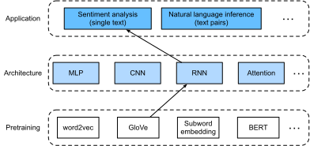

# Nuotaikų analizė: naudojant rekurentinius neuroninius tinklus
:label:`sec_sentiment_rnn`


Kaip ir žodžių panašumo bei analogijos užduotims,
iš anksto apmokytus žodžių vektorius
galime taikyti ir nuotaikų analizei.
Kadangi IMDb apžvalgų duomenų rinkinys
:numref:`sec_sentiment`
nėra labai didelis,
teksto vaizdavimų,
iš anksto apmokytų
dideliuose tekstynuose,
naudojimas
gali sumažinti modelio persimokymą.
Kaip konkretus pavyzdys,
iliustruotas :numref:`fig_nlp-map-sa-rnn`,
kiekvieną teksto vienetą pavaizduosime
naudodami iš anksto apmokytą GloVe modelį
ir šiuos teksto vienetų vaizdavimus paduosime
į daugiasluoksnį dvikryptį RNN,
kad gautume teksto sekos vaizdavimą,
kuris bus
paverstas
nuotaikų analizės išvestimis :cite:`Maas.Daly.Pham.ea.2011`.
Tam pačiam tolesniam taikymui
vėliau nagrinėsime kitokį architektūros
pasirinkimą.


:label:`fig_nlp-map-sa-rnn`

```{.python .input}
#@tab mxnet
from d2l import mxnet as d2l
from mxnet import gluon, init, np, npx
from mxnet.gluon import nn, rnn
npx.set_np()

batch_size = 64
train_iter, test_iter, vocab = d2l.load_data_imdb(batch_size)
```

```{.python .input}
#@tab pytorch
from d2l import torch as d2l
import torch
from torch import nn

batch_size = 64
train_iter, test_iter, vocab = d2l.load_data_imdb(batch_size)
```

## Atskiro teksto vaizdavimas naudojant RNN

Teksto klasifikavimo užduotyse,
tokiose kaip nuotaikų analizė,
kintamo ilgio teksto seka
bus paversta fiksuoto ilgio kategorijomis.
Toliau pateiktoje klasėje `BiRNN`
kiekvienas teksto sekos teksto vienetas
gauna savo individualų
iš anksto apmokytą GloVe
vaizdavimą per įterpinių sluoksnį
(`self.embedding`),
o visa seka
užkoduojama dvikrypčiu RNN (`self.encoder`).
Konkrečiau,
dvikrypčio LSTM paslėptosios būsenos (paskutiniame sluoksnyje)
tiek pradiniame, tiek paskutiniame laiko žingsnyje
sukonkatenuojamos
kaip teksto sekos vaizdavimas.
Šis vieno teksto vaizdavimas
tada paverčiamas išvesties kategorijomis
pilnai sujungtu sluoksniu (`self.decoder`)
su dviem išvestimis („teigiama“ ir „neigiama“).

```{.python .input}
#@tab mxnet
class BiRNN(nn.Block):
    def __init__(self, vocab_size, embed_size, num_hiddens,
                 num_layers, **kwargs):
        super(BiRNN, self).__init__(**kwargs)
        self.embedding = nn.Embedding(vocab_size, embed_size)
        # Set `bidirectional` to True to get a bidirectional RNN
        self.encoder = rnn.LSTM(num_hiddens, num_layers=num_layers,
                                bidirectional=True, input_size=embed_size)
        self.decoder = nn.Dense(2)

    def forward(self, inputs):
        # The shape of `inputs` is (batch size, no. of time steps). Because
        # LSTM requires its input's first dimension to be the temporal
        # dimension, the input is transposed before obtaining token
        # representations. The output shape is (no. of time steps, batch size,
        # word vector dimension)
        embeddings = self.embedding(inputs.T)
        # Returns hidden states of the last hidden layer at different time
        # steps. The shape of `outputs` is (no. of time steps, batch size,
        # 2 * no. of hidden units)
        outputs = self.encoder(embeddings)
        # Concatenate the hidden states at the initial and final time steps as
        # the input of the fully connected layer. Its shape is (batch size,
        # 4 * no. of hidden units)
        encoding = np.concatenate((outputs[0], outputs[-1]), axis=1)
        outs = self.decoder(encoding)
        return outs
```

```{.python .input}
#@tab pytorch
class BiRNN(nn.Module):
    def __init__(self, vocab_size, embed_size, num_hiddens,
                 num_layers, **kwargs):
        super(BiRNN, self).__init__(**kwargs)
        self.embedding = nn.Embedding(vocab_size, embed_size)
        # Set `bidirectional` to True to get a bidirectional RNN
        self.encoder = nn.LSTM(embed_size, num_hiddens, num_layers=num_layers,
                                bidirectional=True)
        self.decoder = nn.Linear(4 * num_hiddens, 2)

    def forward(self, inputs):
        # The shape of `inputs` is (batch size, no. of time steps). Because
        # LSTM requires its input's first dimension to be the temporal
        # dimension, the input is transposed before obtaining token
        # representations. The output shape is (no. of time steps, batch size,
        # word vector dimension)
        embeddings = self.embedding(inputs.T)
        self.encoder.flatten_parameters()
        # Returns hidden states of the last hidden layer at different time
        # steps. The shape of `outputs` is (no. of time steps, batch size,
        # 2 * no. of hidden units)
        outputs, _ = self.encoder(embeddings)
        # Concatenate the hidden states at the initial and final time steps as
        # the input of the fully connected layer. Its shape is (batch size,
        # 4 * no. of hidden units)
        encoding = torch.cat((outputs[0], outputs[-1]), dim=1) 
        outs = self.decoder(encoding)
        return outs
```

Sukonstruokime dvikryptį RNN su dviem paslėptaisiais sluoksniais, kad pavaizduotume atskirą tekstą nuotaikų analizei.

```{.python .input}
#@tab all
embed_size, num_hiddens, num_layers, devices = 100, 100, 2, d2l.try_all_gpus()
net = BiRNN(len(vocab), embed_size, num_hiddens, num_layers)
```

```{.python .input}
#@tab mxnet
net.initialize(init.Xavier(), ctx=devices)
```

```{.python .input}
#@tab pytorch
def init_weights(module):
    if type(module) == nn.Linear:
        nn.init.xavier_uniform_(module.weight)
    if type(module) == nn.LSTM:
        for param in module._flat_weights_names:
            if "weight" in param:
                nn.init.xavier_uniform_(module._parameters[param])
net.apply(init_weights);
```

## Iš anksto apmokytų žodžių vektorių įkėlimas

Toliau įkeliame iš anksto apmokytus 100 dimensijų (turi atitikti `embed_size`) GloVe įterpinius žodyno teksto vienetams.

```{.python .input}
#@tab all
glove_embedding = d2l.TokenEmbedding('glove.6b.100d')
```

Atspausdinkite vektorių formą
visiems žodyno teksto vienetams.

```{.python .input}
#@tab all
embeds = glove_embedding[vocab.idx_to_token]
embeds.shape
```

Šiuos iš anksto apmokytus
žodžių vektorius naudojame
apžvalgų teksto vienetams vaizduoti
ir apmokymo metu
šių vektorių neatnaujinsime.

```{.python .input}
#@tab mxnet
net.embedding.weight.set_data(embeds)
net.embedding.collect_params().setattr('grad_req', 'null')
```

```{.python .input}
#@tab pytorch
net.embedding.weight.data.copy_(embeds)
net.embedding.weight.requires_grad = False
```

## Modelio apmokymas ir vertinimas

Dabar galime apmokyti dvikryptį RNN nuotaikų analizei.

```{.python .input}
#@tab mxnet
lr, num_epochs = 0.01, 5
trainer = gluon.Trainer(net.collect_params(), 'adam', {'learning_rate': lr})
loss = gluon.loss.SoftmaxCrossEntropyLoss()
d2l.train_ch13(net, train_iter, test_iter, loss, trainer, num_epochs, devices)
```

```{.python .input}
#@tab pytorch
lr, num_epochs = 0.01, 5
trainer = torch.optim.Adam(net.parameters(), lr=lr)
loss = nn.CrossEntropyLoss(reduction="none")
d2l.train_ch13(net, train_iter, test_iter, loss, trainer, num_epochs, devices)
```

Apibrėžiame šią funkciją, kad prognozuotume teksto sekos nuotaiką naudodami apmokytą modelį `net`.

```{.python .input}
#@tab mxnet
#@save
def predict_sentiment(net, vocab, sequence):
    """Predict the sentiment of a text sequence."""
    sequence = np.array(vocab[sequence.split()], ctx=d2l.try_gpu())
    label = np.argmax(net(sequence.reshape(1, -1)), axis=1)
    return 'positive' if label == 1 else 'negative'
```

```{.python .input}
#@tab pytorch
#@save
def predict_sentiment(net, vocab, sequence):
    """Predict the sentiment of a text sequence."""
    sequence = torch.tensor(vocab[sequence.split()], device=d2l.try_gpu())
    label = torch.argmax(net(sequence.reshape(1, -1)), dim=1)
    return 'positive' if label == 1 else 'negative'
```

Galiausiai panaudokime apmokytą modelį dviejų paprastų sakinių nuotaikai prognozuoti.

```{.python .input}
#@tab all
predict_sentiment(net, vocab, 'this movie is so great')
```

```{.python .input}
#@tab all
predict_sentiment(net, vocab, 'this movie is so bad')
```

## Santrauka

* Iš anksto apmokyti žodžių vektoriai gali vaizduoti atskirus teksto sekos teksto vienetus.
* Dvikrypčiai RNN gali vaizduoti teksto seką, pavyzdžiui, sukonkatenuojant jos paslėptąsias būsenas pradiniame ir paskutiniame laiko žingsniuose. Šį vieno teksto vaizdavimą galima paversti kategorijomis naudojant pilnai sujungtą sluoksnį.


## Pratimai

1. Padidinkite epochų skaičių. Ar galite pagerinti apmokymo ir testavimo tikslumą? O kaip su kitų hiperparametrų derinimu?
1. Naudokite didesnius iš anksto apmokytus žodžių vektorius, pavyzdžiui, 300 dimensijų GloVe įterpinius. Ar tai pagerina klasifikavimo tikslumą?
1. Ar galime pagerinti klasifikavimo tikslumą naudodami spaCy teksto skaidymą į teksto vienetus? Reikia įdiegti spaCy (`pip install spacy`) ir anglų kalbos paketą (`python -m spacy download en`). Kode pirmiausia importuokite spaCy (`import spacy`). Tada įkelkite spaCy anglų kalbos paketą (`spacy_en = spacy.load('en')`). Galiausiai apibrėžkite funkciją `def tokenizer(text): return [tok.text for tok in spacy_en.tokenizer(text)]` ir pakeiskite pradinę funkciją `tokenizer`. Atkreipkite dėmesį į skirtingas frazių teksto vienetų formas GloVe ir spaCy. Pavyzdžiui, frazės teksto vienetas „new york“ GloVe turi formą „new-york“, o po spaCy teksto skaidymo – formą „new york“.

:begin_tab:`mxnet`
[Diskusijos](https://discuss.d2l.ai/t/392)
:end_tab:

:begin_tab:`pytorch`
[Diskusijos](https://discuss.d2l.ai/t/1424)
:end_tab:
