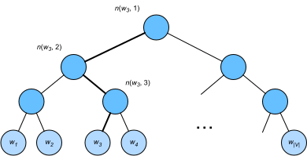

# Apytikris apmokymas
:label:`sec_approx_train`

Prisiminkite mūsų diskusijas :numref:`sec_word2vec`.
Pagrindinė skip-gram modelio idėja yra
naudoti softmax operacijas, kad būtų apskaičiuota
sąlyginė tikimybė generuoti konteksto žodį $w_o$
remiantis duotu centriniu žodžiu $w_c$
:eqref:`eq_skip-gram-softmax`,
kurios atitinkamas logaritminis nuostolis pateiktas
:eqref:`eq_skip-gram-log` priešingu dydžiu.

Dėl softmax operacijos prigimties,
kadangi konteksto žodis gali būti bet kuris
žodyno $\mathcal{V}$ žodis,
:eqref:`eq_skip-gram-log` priešingas dydis
apima narių sumą,
kurios narių skaičius lygus visam žodyno dydžiui.
Todėl
skip-gram modelio gradiento skaičiavimas
:eqref:`eq_skip-gram-grad`
ir nuolatinio žodžių krepšio modelio
gradiento skaičiavimas :eqref:`eq_cbow-gradient`
abu apima
šią sumą.
Deja,
tokių gradientų, sumuojančių
per didelį žodyną
(dažnai
su šimtais tūkstančių ar milijonais žodžių),
skaičiavimo sąnaudos
yra milžiniškos!

Kad sumažintume minėtą skaičiavimo sudėtingumą, šiame skyrelyje pristatysime du apytikrio apmokymo metodus:
*neigiamų pavyzdžių atranką* ir *hierarchinę softmax*.
Dėl skip-gram modelio ir
nuolatinio žodžių krepšio modelio
panašumo
šiems dviem apytikrio apmokymo metodams aprašyti
tiesiog imsime skip-gram modelį kaip pavyzdį.

## Neigiamų pavyzdžių atranka
:label:`subsec_negative-sampling`

Neigiamų pavyzdžių atranka modifikuoja pradinę tikslo funkciją.
Turint centrinio žodžio $w_c$ konteksto langą,
faktas, kad bet kuris (konteksto) žodis $w_o$
yra iš šio konteksto lango,
laikomas įvykiu, kurio tikimybė
modeliuojama

$$P(D=1\mid w_c, w_o) = \sigma(\mathbf{u}_o^\top \mathbf{v}_c),$$

kur $\sigma$ naudoja sigmoidinės aktyvinimo funkcijos apibrėžimą:

$$\sigma(x) = \frac{1}{1+\exp(-x)}.$$
:eqlabel:`eq_sigma-f`

Pradėkime
maksimizuodami bendrąją visų tokių įvykių
tikimybę teksto sekose,
kad apmokytume žodžių įterpinius.
Konkrečiai,
turint $T$ ilgio teksto seką,
pažymėkime $w^{(t)}$ žodį laiko žingsnyje $t$,
o konteksto lango dydį – $m$;
panagrinėkime bendrosios tikimybės maksimizavimą

$$ \prod_{t=1}^{T} \prod_{-m \leq j \leq m,\ j \neq 0} P(D=1\mid w^{(t)}, w^{(t+j)}).$$
:eqlabel:`eq-negative-sample-pos`

Tačiau
:eqref:`eq-negative-sample-pos`
nagrinėja tik tuos įvykius,
kurie apima teigiamus pavyzdžius.
Todėl
bendroji tikimybė
:eqref:`eq-negative-sample-pos`
maksimizuojama iki 1
tik tada, jei visi žodžių vektoriai yra lygūs begalybei.
Žinoma,
tokie rezultatai yra beprasmiai.
Kad tikslo funkcija
taptų prasmingesnė,
*neigiamų pavyzdžių atranka*
prideda neigiamų pavyzdžių, atrinktų
iš iš anksto apibrėžto pasiskirstymo.

Pažymėkime $S$
įvykį, kad
konteksto žodis $w_o$ yra iš
centrinio žodžio $w_c$ konteksto lango.
Šiam įvykiui, apimančiam $w_o$,
iš iš anksto apibrėžto pasiskirstymo $P(w)$
atrenkame $K$ *triukšmo žodžių*,
kurie nėra iš šio konteksto lango.
Pažymėkime $N_k$
įvykį, kad
triukšmo žodis $w_k$ ($k=1, \ldots, K$)
nėra iš
$w_c$ konteksto lango.
Tarkime,
kad šie įvykiai, apimantys
ir teigiamą pavyzdį, ir neigiamus pavyzdžius,
$S, N_1, \ldots, N_K$ yra tarpusavyje nepriklausomi.
Neigiamų pavyzdžių atranka
perrašo bendrąją tikimybę (apimančią tik teigiamus pavyzdžius)
:eqref:`eq-negative-sample-pos`
kaip

$$ \prod_{t=1}^{T} \prod_{-m \leq j \leq m,\ j \neq 0} P(w^{(t+j)} \mid w^{(t)}),$$

kur sąlyginė tikimybė aproksimuojama per
įvykius $S, N_1, \ldots, N_K$:

$$ P(w^{(t+j)} \mid w^{(t)}) =P(D=1\mid w^{(t)}, w^{(t+j)})\prod_{k=1,\ w_k \sim P(w)}^K P(D=0\mid w^{(t)}, w_k).$$
:eqlabel:`eq-negative-sample-conditional-prob`

Pažymėkime
$i_t$ ir $h_k$
atitinkamai
žodžio $w^{(t)}$ laiko žingsnyje $t$
teksto sekoje
ir triukšmo žodžio $w_k$
indeksus.
Logaritminis nuostolis sąlyginių tikimybių :eqref:`eq-negative-sample-conditional-prob` atžvilgiu yra

$$
\begin{aligned}
-\log P(w^{(t+j)} \mid w^{(t)})
=& -\log P(D=1\mid w^{(t)}, w^{(t+j)}) - \sum_{k=1,\ w_k \sim P(w)}^K \log P(D=0\mid w^{(t)}, w_k)\\
=&-  \log\, \sigma\left(\mathbf{u}_{i_{t+j}}^\top \mathbf{v}_{i_t}\right) - \sum_{k=1,\ w_k \sim P(w)}^K \log\left(1-\sigma\left(\mathbf{u}_{h_k}^\top \mathbf{v}_{i_t}\right)\right)\\
=&-  \log\, \sigma\left(\mathbf{u}_{i_{t+j}}^\top \mathbf{v}_{i_t}\right) - \sum_{k=1,\ w_k \sim P(w)}^K \log\sigma\left(-\mathbf{u}_{h_k}^\top \mathbf{v}_{i_t}\right).
\end{aligned}
$$

Matome, kad
dabar gradientų skaičiavimo sąnaudos
kiekviename apmokymo žingsnyje
nieko bendra neturi su žodyno dydžiu,
bet tiesiškai priklauso nuo $K$.
Kai hiperparametras $K$ nustatomas
į mažesnę reikšmę,
gradientų skaičiavimo sąnaudos
kiekviename apmokymo žingsnyje su neigiamų pavyzdžių atranka
yra mažesnės.

## Hierarchinė softmax

Kaip alternatyvus apytikrio apmokymo metodas,
*hierarchinė softmax*
naudoja dvejetainį medį,
duomenų struktūrą,
iliustruotą :numref:`fig_hi_softmax`,
kur kiekvienas medžio lapo mazgas
vaizduoja
žodyno $\mathcal{V}$ žodį.

:label:`fig_hi_softmax`

Pažymėkime $L(w)$
mazgų (įskaitant abu galus) skaičių
kelyje
nuo šakninio mazgo iki lapo mazgo, vaizduojančio žodį $w$,
dvejetainiame medyje.
Tegul $n(w,j)$ yra $j$-asis šio kelio mazgas,
kurio konteksto žodžio vektorius yra
$\mathbf{u}_{n(w, j)}$.
Pavyzdžiui,
$L(w_3) = 4$ :numref:`fig_hi_softmax`.
Hierarchinė softmax aproksimuoja sąlyginę tikimybę :eqref:`eq_skip-gram-softmax` kaip

$$P(w_o \mid w_c) = \prod_{j=1}^{L(w_o)-1} \sigma\left( [\![  n(w_o, j+1) = \textrm{leftChild}(n(w_o, j)) ]\!] \cdot \mathbf{u}_{n(w_o, j)}^\top \mathbf{v}_c\right),$$

kur funkcija $\sigma$
apibrėžta :eqref:`eq_sigma-f`,
o $\textrm{leftChild}(n)$ yra mazgo $n$ kairysis vaiko mazgas: jei $x$ teisinga, $[\![x]\!] = 1$; kitaip $[\![x]\!] = -1$.

Kad iliustruotume,
apskaičiuokime
sąlyginę tikimybę
generuoti žodį $w_3$
turint žodį $w_c$ :numref:`fig_hi_softmax`.
Tam reikia skaliarinių sandaugų
tarp žodžio vektoriaus
$\mathbf{v}_c$ žodžio $w_c$
ir
ne lapo mazgų vektorių
kelyje (kelias paryškintas :numref:`fig_hi_softmax`) nuo šaknies iki $w_3$,
kuris einamas kairėn, dešinėn, tada kairėn:

$$P(w_3 \mid w_c) = \sigma(\mathbf{u}_{n(w_3, 1)}^\top \mathbf{v}_c) \cdot \sigma(-\mathbf{u}_{n(w_3, 2)}^\top \mathbf{v}_c) \cdot \sigma(\mathbf{u}_{n(w_3, 3)}^\top \mathbf{v}_c).$$

Kadangi $\sigma(x)+\sigma(-x) = 1$,
teisinga, kad
sąlyginės tikimybės
generuoti visus
žodyno $\mathcal{V}$ žodžius
remiantis bet kuriuo žodžiu $w_c$
sumuojasi į vienetą:

$$\sum_{w \in \mathcal{V}} P(w \mid w_c) = 1.$$
:eqlabel:`eq_hi-softmax-sum-one`

Laimei, kadangi $L(w_o)-1$ dėl dvejetainio medžio struktūros yra $\mathcal{O}(\textrm{log}_2|\mathcal{V}|)$ eilės,
kai žodyno dydis $\mathcal{V}$ yra milžiniškas,
kiekvieno apmokymo žingsnio skaičiavimo sąnaudos naudojant hierarchinę softmax
yra gerokai sumažintos, palyginti su tomis,
kai apytikris apmokymas nenaudojamas.

## Santrauka

* Neigiamų pavyzdžių atranka sukonstruoja nuostolių funkciją nagrinėdama tarpusavyje nepriklausomus įvykius, apimančius ir teigiamus, ir neigiamus pavyzdžius. Apmokymo skaičiavimo sąnaudos tiesiškai priklauso nuo triukšmo žodžių skaičiaus kiekviename žingsnyje.
* Hierarchinė softmax sukonstruoja nuostolių funkciją naudodama kelią nuo šakninio mazgo iki lapo mazgo dvejetainiame medyje. Apmokymo skaičiavimo sąnaudos kiekviename žingsnyje priklauso nuo žodyno dydžio logaritmo.

## Pratimai

1. Kaip galime atrinkti triukšmo žodžius neigiamų pavyzdžių atrankoje?
1. Patikrinkite, ar teisinga :eqref:`eq_hi-softmax-sum-one`.
1. Kaip apmokyti nuolatinio žodžių krepšio modelį naudojant atitinkamai neigiamų pavyzdžių atranką ir hierarchinę softmax?

[Diskusijos](https://discuss.d2l.ai/t/382)
