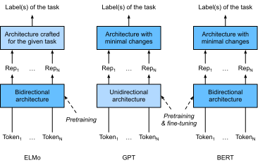

# Dvikryptės kodavimo bloko reprezentacijos iš transformerių (BERT)
:label:`sec_bert`

Pristatėme kelis žodžių įterpinių modelius natūraliosios kalbos supratimui.
Po išankstinio apmokymo išvestį galima laikyti matrica,
kurios kiekviena eilutė yra vektorius, vaizduojantis iš anksto apibrėžto žodyno žodį.
Iš tikrųjų visi šie žodžių įterpinių modeliai yra *nuo konteksto nepriklausomi*.
Pradėkime iliustruodami šią savybę.


## Nuo konteksto nepriklausomų prie nuo konteksto priklausomų

Prisiminkite eksperimentus :numref:`sec_word2vec_pretraining` ir :numref:`sec_synonyms`.
Pavyzdžiui, word2vec ir GloVe abu priskiria tą patį iš anksto apmokytą vektorių tam pačiam žodžiui nepriklausomai nuo žodžio konteksto (jei toks yra).
Formaliai nuo konteksto nepriklausomas bet kurio teksto vieneto $x$ vaizdavimas
yra funkcija $f(x)$, kuri kaip įvestį priima tik $x$.
Turint omenyje daugiareikšmiškumo ir sudėtingos semantikos gausą natūraliosiose kalbose,
nuo konteksto nepriklausomi vaizdavimai turi akivaizdžių apribojimų.
Pavyzdžiui, žodis „crane“ kontekstuose
„a crane is flying“ (skrenda gervė) ir „a crane driver came“ (atvyko krano operatorius) turi visiškai skirtingas reikšmes;
todėl tam pačiam žodžiui gali būti priskirti skirtingi vaizdavimai priklausomai nuo konteksto.

Tai skatina kurti *nuo konteksto priklausomus* žodžių vaizdavimus,
kuriuose žodžių vaizdavimai priklauso nuo jų konteksto.
Taigi nuo konteksto priklausomas teksto vieneto $x$ vaizdavimas yra funkcija $f(x, c(x))$,
priklausanti ir nuo $x$, ir nuo jo konteksto $c(x)$.
Populiarūs nuo konteksto priklausomi vaizdavimai
apima TagLM (kalbos modeliu papildytą sekų žymėtoją) :cite:`Peters.Ammar.Bhagavatula.ea.2017`,
CoVe (konteksto vektorius) :cite:`McCann.Bradbury.Xiong.ea.2017`
ir ELMo (įterpinius iš kalbos modelių) :cite:`Peters.Neumann.Iyyer.ea.2018`.

Pavyzdžiui, kaip įvestį imdamas visą seką,
ELMo yra funkcija, kuri kiekvienam įvesties sekos žodžiui priskiria vaizdavimą.
Konkrečiai, ELMo kaip išvesties vaizdavimą sujungia visų iš anksto apmokyto dvikrypčio LSTM tarpinių sluoksnių vaizdavimus.
Tada ELMo vaizdavimas pridedamas prie tolesnės užduoties esamo prižiūrimo modelio
kaip papildomi požymiai, pavyzdžiui, sukonkatenuojant ELMo vaizdavimą ir esamo modelio teksto vienetų pradinį vaizdavimą (pvz., GloVe).
Viena vertus,
visi iš anksto apmokyto dvikrypčio LSTM modelio svoriai užšaldomi pridėjus ELMo vaizdavimus.
Kita vertus,
esamas prižiūrimas modelis yra specialiai pritaikytas duotai užduočiai.
Pasinaudojus tuo metu skirtingiems uždaviniams geriausiais skirtingais modeliais,
pridėjus ELMo pagerėjo pažangiausi rezultatai šešiose natūraliosios kalbos apdorojimo užduotyse:
nuotaikų analizėje, natūraliosios kalbos išvadų darymo,
semantinių vaidmenų žymėjime, koreferencijos nustatyme,
įvardytų esybių atpažinime ir atsakyme į klausimus.


## Nuo užduočiai specifinių prie užduoties atžvilgiu agnostinių

Nors ELMo gerokai pagerino įvairių natūraliosios kalbos apdorojimo užduočių sprendimus,
kiekvienas sprendimas vis dar remiasi *užduočiai specifine* architektūra.
Tačiau praktiškai nėra paprasta sukurti specifinę architektūrą kiekvienai natūraliosios kalbos apdorojimo užduočiai.
GPT (angl. *Generative Pre-Training*, generatyvusis išankstinis apmokymas) modelis atspindi pastangas suprojektuoti
bendrą *užduoties atžvilgiu agnostinį* modelį nuo konteksto priklausomiems vaizdavimams :cite:`Radford.Narasimhan.Salimans.ea.2018`.
Sukurtas ant transformerio dekodavimo bloko,
GPT iš anksto apmoko kalbos modelį, kuris bus naudojamas teksto sekoms vaizduoti.
Taikant GPT tolesnei užduočiai,
kalbos modelio išvestis bus paduodama į pridėtą tiesinį išvesties sluoksnį,
kad būtų prognozuojamas užduoties žymuo.
Visiškai priešingai nei ELMo, kuris užšaldo iš anksto apmokyto modelio parametrus,
GPT patikslina *visus* iš anksto apmokyto transformerio dekodavimo bloko parametrus
prižiūrimo mokymosi tolesnėje užduotyje metu.
GPT buvo įvertintas dvylikoje natūraliosios kalbos išvadų darymo,
atsakymo į klausimus, sakinių panašumo ir klasifikavimo užduočių
ir pagerino pažangiausius rezultatus devyniose iš jų su minimaliais
modelio architektūros pakeitimais.

Tačiau dėl kalbos modelių autoregresinės prigimties
GPT žiūri tik į priekį (iš kairės į dešinę).
Kontekstuose „i went to the bank to deposit cash“ (nuėjau į banką įnešti grynųjų) ir „i went to the bank to sit down“ (nuėjau į krantą atsisėsti),
kadangi „bank“ yra jautrus savo kairiajam kontekstui,
GPT grąžins tą patį „bank“ vaizdavimą,
nors jis turi skirtingas reikšmes.


## BERT: geriausia iš abiejų pasaulių

Kaip matėme,
ELMo koduoja kontekstą dvikrypčiai, bet naudoja užduočiai specifines architektūras;
o GPT yra agnostinis užduoties atžvilgiu, bet koduoja kontekstą iš kairės į dešinę.
Sujungdamas geriausia iš abiejų pasaulių,
BERT (angl. *Bidirectional Encoder Representations from Transformers*, dvikryptės kodavimo bloko reprezentacijos iš transformerių)
koduoja kontekstą dvikrypčiai ir reikalauja minimalių architektūros pakeitimų
plačiam natūraliosios kalbos apdorojimo užduočių spektrui :cite:`Devlin.Chang.Lee.ea.2018`.
Naudodamas iš anksto apmokytą transformerio kodavimo bloką,
BERT geba pavaizduoti bet kurį teksto vienetą remdamasis jo dvikrypčiu kontekstu.
Prižiūrimo tolesnių užduočių mokymosi metu
BERT yra panašus į GPT dviem aspektais.
Pirma, BERT vaizdavimai bus paduodami į pridėtą išvesties sluoksnį,
su minimaliais modelio architektūros pakeitimais priklausomai nuo užduočių pobūdžio,
pavyzdžiui, prognozuojant kiekvienam teksto vienetui ar prognozuojant visai sekai.
Antra,
visi iš anksto apmokyto transformerio kodavimo bloko parametrai yra patikslinami,
o papildomas išvesties sluoksnis bus apmokomas nuo nulio.
:numref:`fig_elmo-gpt-bert` pavaizduoti ELMo, GPT ir BERT skirtumai.


:label:`fig_elmo-gpt-bert`


BERT dar labiau pagerino pažangiausius rezultatus vienuolikoje natūraliosios kalbos apdorojimo užduočių
pagal plačias kategorijas: (i) vieno teksto klasifikavimas (pvz., nuotaikų analizė), (ii) tekstų porų klasifikavimas (pvz., natūraliosios kalbos išvadų darymas),
(iii) atsakymas į klausimus, (iv) teksto žymėjimas (pvz., įvardytų esybių atpažinimas).
Visi pasiūlyti 2018 m.,
nuo kontekstui jautraus ELMo iki užduoties atžvilgiu agnostinių GPT ir BERT,
konceptualiai paprastas, bet empiriškai galingas giliųjų vaizdavimų išankstinis apmokymas natūraliosioms kalboms
padarė revoliuciją įvairių natūraliosios kalbos apdorojimo užduočių sprendimuose.

Likusioje šio skyriaus dalyje
gilinsimės į BERT išankstinį apmokymą.
Kai natūraliosios kalbos apdorojimo taikymai bus paaiškinti :numref:`chap_nlp_app`,
iliustruosime BERT patikslinimą tolesniems taikymams.

```{.python .input}
#@tab mxnet
from d2l import mxnet as d2l
from mxnet import gluon, np, npx
from mxnet.gluon import nn

npx.set_np()
```

```{.python .input}
#@tab pytorch
from d2l import torch as d2l
import torch
from torch import nn
```

## [**Įvesties vaizdavimas**]
:label:`subsec_bert_input_rep`

Natūraliosios kalbos apdorojime
kai kurios užduotys (pvz., nuotaikų analizė) kaip įvestį priima vieną tekstą,
o kitose užduotyse (pvz., natūraliosios kalbos išvadų darymas)
įvestis yra teksto sekų pora.
BERT įvesties seka vienareikšmiškai vaizduoja ir vieną tekstą, ir tekstų poras.
Pirmuoju atveju
BERT įvesties seka yra
specialaus klasifikavimo teksto vieneto „&lt;cls&gt;“,
teksto sekos teksto vienetų
ir specialaus atskyrimo teksto vieneto „&lt;sep&gt;“ konkatenacija.
Antruoju atveju
BERT įvesties seka yra
„&lt;cls&gt;“, pirmosios teksto sekos teksto vienetų,
„&lt;sep&gt;“, antrosios teksto sekos teksto vienetų ir „&lt;sep&gt;“ konkatenacija.
Nuosekliai atskirsime terminą „BERT įvesties seka“
nuo kitų „sekų“ tipų.
Pavyzdžiui, viena *BERT įvesties seka* gali apimti arba vieną *teksto seką*, arba dvi *teksto sekas*.

Kad atskirtume tekstų poras,
išmokti segmentų įterpiniai $\mathbf{e}_A$ ir $\mathbf{e}_B$
pridedami atitinkamai prie pirmosios ir antrosios sekos teksto vienetų įterpinių.
Vieno teksto įvestims naudojamas tik $\mathbf{e}_A$.

Toliau pateikta funkcija `get_tokens_and_segments` kaip įvestį priima arba vieną sakinį, arba du sakinius,
tada grąžina BERT įvesties sekos teksto vienetus
ir jų atitinkamus segmentų ID.

```{.python .input}
#@tab all
#@save
def get_tokens_and_segments(tokens_a, tokens_b=None):
    """Get tokens of the BERT input sequence and their segment IDs."""
    tokens = ['<cls>'] + tokens_a + ['<sep>']
    # 0 and 1 are marking segment A and B, respectively
    segments = [0] * (len(tokens_a) + 2)
    if tokens_b is not None:
        tokens += tokens_b + ['<sep>']
        segments += [1] * (len(tokens_b) + 1)
    return tokens, segments
```

BERT kaip savo dvikryptę architektūrą pasirenka transformerio kodavimo bloką.
Kaip įprasta transformerio kodavimo bloke,
pozicijų įterpiniai pridedami kiekvienoje BERT įvesties sekos pozicijoje.
Tačiau, skirtingai nei pradiniame transformerio kodavimo bloke,
BERT naudoja *išmokstamus* pozicijų įterpinius.
Apibendrinant, :numref:`fig_bert-input` rodo, kad
BERT įvesties sekos įterpiniai yra
teksto vienetų įterpinių, segmentų įterpinių ir pozicijų įterpinių suma.


:label:`fig_bert-input`

Toliau pateikta [**klasė `BERTEncoder`**] yra panaši į klasę `TransformerEncoder`,
įgyvendintą :numref:`sec_transformer`.
Skirtingai nuo `TransformerEncoder`, `BERTEncoder` naudoja
segmentų įterpinius ir išmokstamus pozicijų įterpinius.

```{.python .input}
#@tab mxnet
#@save
class BERTEncoder(nn.Block):
    """BERT encoder."""
    def __init__(self, vocab_size, num_hiddens, ffn_num_hiddens, num_heads,
                 num_blks, dropout, max_len=1000, **kwargs):
        super(BERTEncoder, self).__init__(**kwargs)
        self.token_embedding = nn.Embedding(vocab_size, num_hiddens)
        self.segment_embedding = nn.Embedding(2, num_hiddens)
        self.blks = nn.Sequential()
        for _ in range(num_blks):
            self.blks.add(d2l.TransformerEncoderBlock(
                num_hiddens, ffn_num_hiddens, num_heads, dropout, True))
        # In BERT, positional embeddings are learnable, thus we create a
        # parameter of positional embeddings that are long enough
        self.pos_embedding = self.params.get('pos_embedding',
                                             shape=(1, max_len, num_hiddens))

    def forward(self, tokens, segments, valid_lens):
        # Shape of `X` remains unchanged in the following code snippet:
        # (batch size, max sequence length, `num_hiddens`)
        X = self.token_embedding(tokens) + self.segment_embedding(segments)
        X = X + self.pos_embedding.data(ctx=X.ctx)[:, :X.shape[1], :]
        for blk in self.blks:
            X = blk(X, valid_lens)
        return X
```

```{.python .input}
#@tab pytorch
#@save
class BERTEncoder(nn.Module):
    """BERT encoder."""
    def __init__(self, vocab_size, num_hiddens, ffn_num_hiddens, num_heads,
                 num_blks, dropout, max_len=1000, **kwargs):
        super(BERTEncoder, self).__init__(**kwargs)
        self.token_embedding = nn.Embedding(vocab_size, num_hiddens)
        self.segment_embedding = nn.Embedding(2, num_hiddens)
        self.blks = nn.Sequential()
        for i in range(num_blks):
            self.blks.add_module(f"{i}", d2l.TransformerEncoderBlock(
                num_hiddens, ffn_num_hiddens, num_heads, dropout, True))
        # In BERT, positional embeddings are learnable, thus we create a
        # parameter of positional embeddings that are long enough
        self.pos_embedding = nn.Parameter(torch.randn(1, max_len,
                                                      num_hiddens))

    def forward(self, tokens, segments, valid_lens):
        # Shape of `X` remains unchanged in the following code snippet:
        # (batch size, max sequence length, `num_hiddens`)
        X = self.token_embedding(tokens) + self.segment_embedding(segments)
        X = X + self.pos_embedding[:, :X.shape[1], :]
        for blk in self.blks:
            X = blk(X, valid_lens)
        return X
```

Tarkime, kad žodyno dydis yra 10000.
Kad parodytume `BERTEncoder` [**tiesioginį išvedimą**],
sukurkime jo egzempliorių ir inicializuokime jo parametrus.

```{.python .input}
#@tab mxnet
vocab_size, num_hiddens, ffn_num_hiddens, num_heads = 10000, 768, 1024, 4
num_blks, dropout = 2, 0.2
encoder = BERTEncoder(vocab_size, num_hiddens, ffn_num_hiddens, num_heads,
                      num_blks, dropout)
encoder.initialize()
```

```{.python .input}
#@tab pytorch
vocab_size, num_hiddens, ffn_num_hiddens, num_heads = 10000, 768, 1024, 4
ffn_num_input, num_blks, dropout = 768, 2, 0.2
encoder = BERTEncoder(vocab_size, num_hiddens, ffn_num_hiddens, num_heads,
                      num_blks, dropout)
```

`tokens` apibrėžiame kaip 2 BERT įvesties sekas, kurių ilgis 8,
kur kiekvienas teksto vienetas yra žodyno indeksas.
`BERTEncoder` tiesioginis išvedimas su įvestimi `tokens`
grąžina užkoduotą rezultatą, kur kiekvienas teksto vienetas vaizduojamas vektoriumi,
kurio ilgį iš anksto apibrėžia hiperparametras `num_hiddens`.
Šis hiperparametras paprastai vadinamas transformerio kodavimo bloko *paslėptuoju dydžiu*
(paslėptųjų vienetų skaičiumi).

```{.python .input}
#@tab mxnet
tokens = np.random.randint(0, vocab_size, (2, 8))
segments = np.array([[0, 0, 0, 0, 1, 1, 1, 1], [0, 0, 0, 1, 1, 1, 1, 1]])
encoded_X = encoder(tokens, segments, None)
encoded_X.shape
```

```{.python .input}
#@tab pytorch
tokens = torch.randint(0, vocab_size, (2, 8))
segments = torch.tensor([[0, 0, 0, 0, 1, 1, 1, 1], [0, 0, 0, 1, 1, 1, 1, 1]])
encoded_X = encoder(tokens, segments, None)
encoded_X.shape
```

## Išankstinio apmokymo užduotys
:label:`subsec_bert_pretraining_tasks`

`BERTEncoder` tiesioginis išvedimas pateikia BERT vaizdavimą
kiekvieno įvesties teksto teksto vieneto ir įterptų
specialių teksto vienetų „&lt;cls&gt;“ bei „&lt;seq&gt;“.
Toliau naudosime šiuos vaizdavimus nuostolių funkcijai apskaičiuoti
BERT išankstiniam apmokymui.
Išankstinį apmokymą sudaro šios dvi užduotys:
užmaskuoto kalbos modeliavimo ir kito sakinio prognozavimo.

### [**Užmaskuotas kalbos modeliavimas**]
:label:`subsec_mlm`

Kaip iliustruota :numref:`sec_language-model`,
kalbos modelis prognozuoja teksto vienetą naudodamas jo kairįjį kontekstą.
Kad kontekstas būtų koduojamas dvikrypčiai kiekvienam teksto vienetui vaizduoti,
BERT atsitiktinai užmaskuoja teksto vienetus ir naudoja dvikrypčio konteksto teksto vienetus
užmaskuotiems teksto vienetams prognozuoti savaime prižiūrimu būdu.
Ši užduotis vadinama *užmaskuotu kalbos modeliu*.

Šioje išankstinio apmokymo užduotyje
15 % teksto vienetų bus atsitiktinai atrinkti kaip užmaskuoti teksto vienetai prognozei.
Kad užmaskuotą teksto vienetą prognozuotume neapgaudinėdami naudodami žymenį,
vienas paprastas būdas yra visada pakeisti jį specialiu „&lt;mask&gt;“ teksto vienetu BERT įvesties sekoje.
Tačiau dirbtinis specialus teksto vienetas „&lt;mask&gt;“ niekada nepasirodys
patikslinant.
Kad išvengtume tokio neatitikimo tarp išankstinio apmokymo ir patikslinimo,
jei teksto vienetas užmaskuojamas prognozei (pvz., „great“ pasirenkamas užmaskuoti ir prognozuoti sakinyje „this movie is great“),
įvestyje jis bus pakeistas:

* specialiu „&lt;mask&gt;“ teksto vienetu 80 % laiko (pvz., „this movie is great“ tampa „this movie is &lt;mask&gt;“);
* atsitiktiniu teksto vienetu 10 % laiko (pvz., „this movie is great“ tampa „this movie is drink“);
* nepakeistu žymens teksto vienetu 10 % laiko (pvz., „this movie is great“ tampa „this movie is great“).

Atkreipkite dėmesį, kad 10 % iš 15 % laiko įterpiamas atsitiktinis teksto vienetas.
Šis retkarčiais pasitaikantis triukšmas skatina BERT mažiau būti šališkam užmaskuoto teksto vieneto atžvilgiu (ypač kai žymens teksto vienetas lieka nepakeistas) dvikrypčiame konteksto kodavime.

Įgyvendiname šią klasę `MaskLM` užmaskuotiems teksto vienetams prognozuoti
BERT išankstinio apmokymo užmaskuoto kalbos modelio užduotyje.
Prognozė naudoja vieno paslėptojo sluoksnio MLP (`self.mlp`).
Tiesioginiame išvedime ji priima dvi įvestis:
`BERTEncoder` užkoduotą rezultatą ir teksto vienetų pozicijas prognozei.
Išvestis yra prognozės rezultatai šiose pozicijose.

```{.python .input}
#@tab mxnet
#@save
class MaskLM(nn.Block):
    """The masked language model task of BERT."""
    def __init__(self, vocab_size, num_hiddens, **kwargs):
        super(MaskLM, self).__init__(**kwargs)
        self.mlp = nn.Sequential()
        self.mlp.add(
            nn.Dense(num_hiddens, flatten=False, activation='relu'))
        self.mlp.add(nn.LayerNorm())
        self.mlp.add(nn.Dense(vocab_size, flatten=False))

    def forward(self, X, pred_positions):
        num_pred_positions = pred_positions.shape[1]
        pred_positions = pred_positions.reshape(-1)
        batch_size = X.shape[0]
        batch_idx = np.arange(0, batch_size)
        # Suppose that `batch_size` = 2, `num_pred_positions` = 3, then
        # `batch_idx` is `np.array([0, 0, 0, 1, 1, 1])`
        batch_idx = np.repeat(batch_idx, num_pred_positions)
        masked_X = X[batch_idx, pred_positions]
        masked_X = masked_X.reshape((batch_size, num_pred_positions, -1))
        mlm_Y_hat = self.mlp(masked_X)
        return mlm_Y_hat
```

```{.python .input}
#@tab pytorch
#@save
class MaskLM(nn.Module):
    """The masked language model task of BERT."""
    def __init__(self, vocab_size, num_hiddens, **kwargs):
        super(MaskLM, self).__init__(**kwargs)
        self.mlp = nn.Sequential(nn.LazyLinear(num_hiddens),
                                 nn.ReLU(),
                                 nn.LayerNorm(num_hiddens),
                                 nn.LazyLinear(vocab_size))

    def forward(self, X, pred_positions):
        num_pred_positions = pred_positions.shape[1]
        pred_positions = pred_positions.reshape(-1)
        batch_size = X.shape[0]
        batch_idx = torch.arange(0, batch_size)
        # Suppose that `batch_size` = 2, `num_pred_positions` = 3, then
        # `batch_idx` is `torch.tensor([0, 0, 0, 1, 1, 1])`
        batch_idx = torch.repeat_interleave(batch_idx, num_pred_positions)
        masked_X = X[batch_idx, pred_positions]
        masked_X = masked_X.reshape((batch_size, num_pred_positions, -1))
        mlm_Y_hat = self.mlp(masked_X)
        return mlm_Y_hat
```

Kad parodytume [**`MaskLM` tiesioginį išvedimą**],
sukuriame jo egzempliorių `mlm` ir jį inicializuojame.
Prisiminkite, kad `encoded_X` iš `BERTEncoder` tiesioginio išvedimo
vaizduoja 2 BERT įvesties sekas.
`mlm_positions` apibrėžiame kaip 3 indeksus, kuriuos reikia prognozuoti bet kurioje `encoded_X` BERT įvesties sekoje.
`mlm` tiesioginis išvedimas grąžina prognozės rezultatus `mlm_Y_hat`
visose `encoded_X` užmaskuotose pozicijose `mlm_positions`.
Kiekvienai prognozei rezultato dydis lygus žodyno dydžiui.

```{.python .input}
#@tab mxnet
mlm = MaskLM(vocab_size, num_hiddens)
mlm.initialize()
mlm_positions = np.array([[1, 5, 2], [6, 1, 5]])
mlm_Y_hat = mlm(encoded_X, mlm_positions)
mlm_Y_hat.shape
```

```{.python .input}
#@tab pytorch
mlm = MaskLM(vocab_size, num_hiddens)
mlm_positions = torch.tensor([[1, 5, 2], [6, 1, 5]])
mlm_Y_hat = mlm(encoded_X, mlm_positions)
mlm_Y_hat.shape
```

Turėdami prognozuotų užmaskuotų teksto vienetų `mlm_Y_hat` tikrąsias žymenų reikšmes `mlm_Y`,
galime apskaičiuoti užmaskuoto kalbos modelio užduoties kryžminės entropijos nuostolį BERT išankstiniame apmokyme.

```{.python .input}
#@tab mxnet
mlm_Y = np.array([[7, 8, 9], [10, 20, 30]])
loss = gluon.loss.SoftmaxCrossEntropyLoss()
mlm_l = loss(mlm_Y_hat.reshape((-1, vocab_size)), mlm_Y.reshape(-1))
mlm_l.shape
```

```{.python .input}
#@tab pytorch
mlm_Y = torch.tensor([[7, 8, 9], [10, 20, 30]])
loss = nn.CrossEntropyLoss(reduction='none')
mlm_l = loss(mlm_Y_hat.reshape((-1, vocab_size)), mlm_Y.reshape(-1))
mlm_l.shape
```

### [**Kito sakinio prognozavimas**]
:label:`subsec_nsp`

Nors užmaskuotas kalbos modeliavimas geba užkoduoti dvikryptį kontekstą
žodžiams vaizduoti, jis aiškiai nemodeliuoja loginio sąryšio
tarp tekstų porų.
Kad padėtų suprasti sąryšį tarp dviejų teksto sekų,
BERT išankstiniame apmokyme nagrinėja dvejetainio klasifikavimo užduotį – *kito sakinio prognozavimą*.
Generuojant sakinių poras išankstiniam apmokymui,
pusę laiko jie iš tiesų yra iš eilės einantys sakiniai su žymeniu „True“;
o kitą pusę laiko antrasis sakinys atsitiktinai atrenkamas iš tekstyno su žymeniu „False“.

Toliau pateikta klasė `NextSentencePred` naudoja vieno paslėptojo sluoksnio MLP,
kad prognozuotų, ar antrasis sakinys yra pirmojo kitas sakinys
BERT įvesties sekoje.
Dėl saviraiškės dėmesio sutelkimo transformacijos transformerio kodavimo bloke
specialaus teksto vieneto „&lt;cls&gt;“ BERT vaizdavimas
užkoduoja abu įvesties sakinius.
Todėl MLP klasifikatoriaus išvesties sluoksnis (`self.output`) kaip įvestį priima `X`,
kur `X` yra MLP paslėptojo sluoksnio išvestis, kurios įvestis yra užkoduotas „&lt;cls&gt;“ teksto vienetas.

```{.python .input}
#@tab mxnet
#@save
class NextSentencePred(nn.Block):
    """The next sentence prediction task of BERT."""
    def __init__(self, **kwargs):
        super(NextSentencePred, self).__init__(**kwargs)
        self.output = nn.Dense(2)

    def forward(self, X):
        # `X` shape: (batch size, `num_hiddens`)
        return self.output(X)
```

```{.python .input}
#@tab pytorch
#@save
class NextSentencePred(nn.Module):
    """The next sentence prediction task of BERT."""
    def __init__(self, **kwargs):
        super(NextSentencePred, self).__init__(**kwargs)
        self.output = nn.LazyLinear(2)

    def forward(self, X):
        # `X` shape: (batch size, `num_hiddens`)
        return self.output(X)
```

Matome, kad [**`NextSentencePred` egzemplioriaus tiesioginis išvedimas**]
grąžina dvejetaines prognozes kiekvienai BERT įvesties sekai.

```{.python .input}
#@tab mxnet
nsp = NextSentencePred()
nsp.initialize()
nsp_Y_hat = nsp(encoded_X)
nsp_Y_hat.shape
```

```{.python .input}
#@tab pytorch
# PyTorch by default will not flatten the tensor as seen in mxnet where, if
# flatten=True, all but the first axis of input data are collapsed together
encoded_X = torch.flatten(encoded_X, start_dim=1)
# input_shape for NSP: (batch size, `num_hiddens`)
nsp = NextSentencePred()
nsp_Y_hat = nsp(encoded_X)
nsp_Y_hat.shape
```

Taip pat galima apskaičiuoti 2 dvejetainių klasifikavimų kryžminės entropijos nuostolį.

```{.python .input}
#@tab mxnet
nsp_y = np.array([0, 1])
nsp_l = loss(nsp_Y_hat, nsp_y)
nsp_l.shape
```

```{.python .input}
#@tab pytorch
nsp_y = torch.tensor([0, 1])
nsp_l = loss(nsp_Y_hat, nsp_y)
nsp_l.shape
```

Verta pažymėti, kad visus abiejų aukščiau minėtų išankstinio apmokymo užduočių žymenis
galima paprastai gauti iš išankstinio apmokymo tekstyno be rankinio žymėjimo pastangų.
Originalus BERT buvo iš anksto apmokytas BookCorpus :cite:`Zhu.Kiros.Zemel.ea.2015` ir anglų kalbos Vikipedijos
konkatenacijoje.
Šie du tekstynai yra milžiniški:
juose yra atitinkamai 800 milijonų ir 2,5 milijardo žodžių.


## [**Viskas kartu**]

Apmokant BERT iš anksto, galutinė nuostolių funkcija yra abiejų
užmaskuoto kalbos modeliavimo ir kito sakinio prognozavimo nuostolių funkcijų tiesinis derinys.
Dabar galime apibrėžti klasę `BERTModel` sukurdami trijų klasių
`BERTEncoder`, `MaskLM` ir `NextSentencePred` egzempliorius.
Tiesioginis išvedimas grąžina užkoduotus BERT vaizdavimus `encoded_X`,
užmaskuoto kalbos modeliavimo prognozes `mlm_Y_hat`
ir kito sakinio prognozes `nsp_Y_hat`.

```{.python .input}
#@tab mxnet
#@save
class BERTModel(nn.Block):
    """The BERT model."""
    def __init__(self, vocab_size, num_hiddens, ffn_num_hiddens, num_heads,
                 num_blks, dropout, max_len=1000):
        super(BERTModel, self).__init__()
        self.encoder = BERTEncoder(vocab_size, num_hiddens, ffn_num_hiddens,
                                   num_heads, num_blks, dropout, max_len)
        self.hidden = nn.Dense(num_hiddens, activation='tanh')
        self.mlm = MaskLM(vocab_size, num_hiddens)
        self.nsp = NextSentencePred()

    def forward(self, tokens, segments, valid_lens=None, pred_positions=None):
        encoded_X = self.encoder(tokens, segments, valid_lens)
        if pred_positions is not None:
            mlm_Y_hat = self.mlm(encoded_X, pred_positions)
        else:
            mlm_Y_hat = None
        # The hidden layer of the MLP classifier for next sentence prediction.
        # 0 is the index of the '<cls>' token
        nsp_Y_hat = self.nsp(self.hidden(encoded_X[:, 0, :]))
        return encoded_X, mlm_Y_hat, nsp_Y_hat
```

```{.python .input}
#@tab pytorch
#@save
class BERTModel(nn.Module):
    """The BERT model."""
    def __init__(self, vocab_size, num_hiddens, ffn_num_hiddens, 
                 num_heads, num_blks, dropout, max_len=1000):
        super(BERTModel, self).__init__()
        self.encoder = BERTEncoder(vocab_size, num_hiddens, ffn_num_hiddens,
                                   num_heads, num_blks, dropout,
                                   max_len=max_len)
        self.hidden = nn.Sequential(nn.LazyLinear(num_hiddens),
                                    nn.Tanh())
        self.mlm = MaskLM(vocab_size, num_hiddens)
        self.nsp = NextSentencePred()

    def forward(self, tokens, segments, valid_lens=None, pred_positions=None):
        encoded_X = self.encoder(tokens, segments, valid_lens)
        if pred_positions is not None:
            mlm_Y_hat = self.mlm(encoded_X, pred_positions)
        else:
            mlm_Y_hat = None
        # The hidden layer of the MLP classifier for next sentence prediction.
        # 0 is the index of the '<cls>' token
        nsp_Y_hat = self.nsp(self.hidden(encoded_X[:, 0, :]))
        return encoded_X, mlm_Y_hat, nsp_Y_hat
```

## Santrauka

* Žodžių įterpinių modeliai, tokie kaip word2vec ir GloVe, yra nuo konteksto nepriklausomi. Jie priskiria tą patį iš anksto apmokytą vektorių tam pačiam žodžiui nepriklausomai nuo žodžio konteksto (jei toks yra). Jiems sunku gerai apdoroti daugiareikšmiškumą ar sudėtingą natūraliųjų kalbų semantiką.
* Nuo konteksto priklausomuose žodžių vaizdavimuose, tokiuose kaip ELMo ir GPT, žodžių vaizdavimai priklauso nuo jų konteksto.
* ELMo koduoja kontekstą dvikrypčiai, bet naudoja užduočiai specifines architektūras (tačiau praktiškai nėra paprasta sukurti specifinę architektūrą kiekvienai natūraliosios kalbos apdorojimo užduočiai); o GPT yra agnostinis užduoties atžvilgiu, bet koduoja kontekstą iš kairės į dešinę.
* BERT sujungia geriausia iš abiejų pasaulių: jis koduoja kontekstą dvikrypčiai ir reikalauja minimalių architektūros pakeitimų plačiam natūraliosios kalbos apdorojimo užduočių spektrui.
* BERT įvesties sekos įterpiniai yra teksto vienetų įterpinių, segmentų įterpinių ir pozicijų įterpinių suma.
* BERT išankstinį apmokymą sudaro dvi užduotys: užmaskuotas kalbos modeliavimas ir kito sakinio prognozavimas. Pirmoji geba užkoduoti dvikryptį kontekstą žodžiams vaizduoti, o antroji aiškiai modeliuoja loginį sąryšį tarp tekstų porų.


## Pratimai

1. Kitoms sąlygoms esant vienodoms, ar užmaskuotam kalbos modeliui reikės daugiau, ar mažiau išankstinio apmokymo žingsnių, kad konverguotų, nei kalbos modeliui iš kairės į dešinę? Kodėl?
1. Originaliame BERT įgyvendinime pozicinis tiesioginio sklidimo tinklas `BERTEncoder` (per `d2l.TransformerEncoderBlock`) ir pilnai sujungtas sluoksnis `MaskLM` abu kaip aktyvinimo funkciją naudoja Gauso paklaidos tiesinį vienetą (GELU) :cite:`Hendrycks.Gimpel.2016`. Pasidomėkite GELU ir ReLU skirtumu.

:begin_tab:`mxnet`
[Diskusijos](https://discuss.d2l.ai/t/388)
:end_tab:

:begin_tab:`pytorch`
[Diskusijos](https://discuss.d2l.ai/t/1490)
:end_tab:
