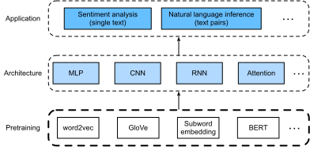

# Skaitmeninis natūraliosios kalbos apdorojimas: išankstinis apmokymas
:label:`chap_nlp_pretrain`


Žmonėms reikia bendrauti.
Iš šio pagrindinio žmogaus būties poreikio kasdien sukuriama didžiulė rašytinio teksto apimtis.
Turint gausų tekstą socialinėje žiniasklaidoje, pokalbių programėlėse, el. laiškuose, produktų atsiliepimuose, naujienų straipsniuose, mokslinėse publikacijose ir knygose, tampa gyvybiškai svarbu suteikti kompiuteriams gebėjimą juos suprasti, kad jie galėtų padėti arba priimti sprendimus remdamiesi žmonių kalbomis.

*Skaitmeninis natūraliosios kalbos apdorojimas* (angl. *natural language processing*, NLP) tiria kompiuterių ir žmonių sąveiką naudojant natūraliąsias kalbas.
Praktikoje labai įprasta naudoti natūraliosios kalbos apdorojimo technikas tekstui (žmonių natūraliajai kalbai) apdoroti ir analizuoti, pavyzdžiui, kalbos modelius :numref:`sec_language-model` ir mašininio vertimo modelius :numref:`sec_machine_translation`.

Kad suprastume tekstą, galime pradėti nuo
jo vaizdavimų mokymosi.
Pasinaudojant esamomis teksto sekomis
iš didelių tekstynų,
*savaiminė priežiūra* (angl. *self-supervised learning*)
plačiai
naudojama tekstų vaizdavimams iš anksto apmokyti,
pavyzdžiui, prognozuojant kokią nors paslėptą teksto dalį
naudojant kitą aplinkinio teksto dalį.
Taip
modeliai mokosi, gaudami priežiūrą
iš *didžiulių* teksto duomenų
be *brangaus* žymėjimo pastangų!


Kaip pamatysime šiame skyriuje,
kai kiekvieną žodį ar jo dalį laikome atskiru teksto vienetu,
kiekvieno teksto vieneto vaizdavimą galima iš anksto apmokyti
naudojant word2vec, GloVe arba žodžių dalių įterpinių modelius
dideliuose tekstynuose.
Po išankstinio apmokymo kiekvieno teksto vieneto vaizdavimas gali būti vektorius,
tačiau jis išlieka tas pats nepriklausomai nuo konteksto.
Pavyzdžiui, žodžio „bank“ (krantas / bankas) vektorinis vaizdavimas yra tas pats
tiek sakinyje
„go to the bank to deposit some money“ (eiti į banką įnešti pinigų),
tiek sakinyje
„go to the bank to sit down“ (eiti į krantą atsisėsti).
Todėl daugelis naujesnių išankstinio apmokymo modelių pritaiko to paties teksto vieneto vaizdavimą
skirtingiems kontekstams.
Vienas iš jų yra BERT – daug gilesnis savaiminės priežiūros modelis, pagrįstas transformerio kodavimo bloku.
Šiame skyriuje susitelksime į tai, kaip iš anksto apmokyti tokius teksto vaizdavimus,
kaip pabrėžta :numref:`fig_nlp-map-pretrain`.


:label:`fig_nlp-map-pretrain`


Bendram vaizdui susidaryti
:numref:`fig_nlp-map-pretrain` parodyta, kad
iš anksto apmokytus teksto vaizdavimus galima paduoti į
įvairias giliojo mokymosi architektūras skirtingiems tolesniems natūraliosios kalbos apdorojimo taikymams.
Juos aptarsime :numref:`chap_nlp_app`.

```toc
:maxdepth: 2

word2vec
approx-training
word-embedding-dataset
word2vec-pretraining
glove
subword-embedding
similarity-analogy
bert
bert-dataset
bert-pretraining

```

