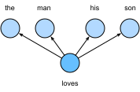
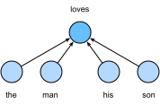

# Žodžių įterpiniai (word2vec)
:label:`sec_word2vec`

Natūralioji kalba yra sudėtinga sistema, naudojama reikšmėms reikšti.
Šioje sistemoje žodžiai yra pagrindinis reikšmės vienetas.
Kaip rodo pavadinimas,
*žodžių vektoriai* yra vektoriai, naudojami žodžiams vaizduoti,
ir juos taip pat galima laikyti žodžių požymių vektoriais arba vaizdavimais.
Žodžių atvaizdavimo realiaisiais vektoriais technika
vadinama *žodžių įterpimu* (angl. *word embedding*).
Pastaraisiais metais
žodžių įterpimas pamažu tapo
natūraliosios kalbos apdorojimo pagrindinėmis žiniomis.

## Fiktyvūs vektoriai yra prastas pasirinkimas

:numref:`sec_rnn-scratch` žodžiams (simboliai yra žodžiai) vaizduoti naudojome fiktyvius vektorius.
Tarkime, kad skirtingų žodžių skaičius žodyne (žodyno dydis) yra $N$,
o kiekvienas žodis atitinka
skirtingą sveikąjį skaičių (indeksą) nuo $0$ iki $N-1$.
Kad gautume bet kurio žodžio su indeksu $i$
fiktyvaus vektoriaus vaizdavimą,
sukuriame $N$ ilgio vektorių, sudarytą iš nulių,
ir $i$ padėties elementą nustatome į 1.
Taip kiekvienas žodis vaizduojamas $N$ ilgio vektoriumi, ir jį
galima tiesiogiai naudoti neuroniniuose tinkluose.

Nors fiktyvius žodžių vektorius lengva sukonstruoti,
jie paprastai nėra geras pasirinkimas.
Pagrindinė priežastis ta, kad fiktyvūs žodžių vektoriai negali tiksliai išreikšti skirtingų žodžių panašumo, pavyzdžiui, *kosinuso panašumo*, kurį dažnai naudojame.
Vektorių $\mathbf{x}, \mathbf{y} \in \mathbb{R}^d$ kosinuso panašumas yra kampo tarp jų kosinusas:

$$\frac{\mathbf{x}^\top \mathbf{y}}{\|\mathbf{x}\| \|\mathbf{y}\|} \in [-1, 1].$$

Kadangi bet kurių dviejų skirtingų žodžių fiktyvių vektorių kosinuso panašumas yra 0,
fiktyvūs vektoriai negali užkoduoti žodžių panašumų.

## Savaime prižiūrimas word2vec

Įrankis [word2vec](https://code.google.com/archive/p/word2vec/) buvo pasiūlytas aukščiau minėtai problemai spręsti.
Jis kiekvieną žodį atvaizduoja fiksuoto ilgio vektoriumi, ir šie vektoriai gali geriau išreikšti skirtingų žodžių panašumą ir analogijos sąryšį.
Įrankį word2vec sudaro du modeliai, būtent *skip-gram* :cite:`Mikolov.Sutskever.Chen.ea.2013` ir *nuolatinis žodžių krepšys* (angl. *continuous bag of words*, CBOW) :cite:`Mikolov.Chen.Corrado.ea.2013`.
Kad vaizdavimai būtų semantiškai prasmingi,
jų apmokymas remiasi
sąlyginėmis tikimybėmis,
kurias galima laikyti
kai kurių žodžių prognozavimu
naudojant kai kuriuos jų aplinkinius žodžius
tekstynuose.
Kadangi priežiūra gaunama iš duomenų be žymenų,
ir skip-gram, ir nuolatinis žodžių krepšys
yra savaime prižiūrimi modeliai.

Toliau pristatysime šiuos du modelius ir jų apmokymo metodus.

## Skip-gram modelis
:label:`subsec_skip-gram`

*Skip-gram* modelis daro prielaidą, kad žodį galima naudoti jo aplinkiniams žodžiams teksto sekoje generuoti.
Paimkime teksto seką „the“, „man“, „loves“, „his“, „son“ kaip pavyzdį.
Pasirinkime „loves“ kaip *centrinį žodį* ir nustatykime konteksto lango dydį 2.
Kaip parodyta :numref:`fig_skip_gram`,
turint centrinį žodį „loves“,
skip-gram modelis nagrinėja
sąlyginę tikimybę generuoti *konteksto žodžius*: „the“, „man“, „his“ ir „son“,
kurie nuo centrinio žodžio nutolę ne daugiau kaip 2 žodžiais:

$$P(\textrm{"the"},\textrm{"man"},\textrm{"his"},\textrm{"son"}\mid\textrm{"loves"}).$$

Tarkime,
kad konteksto žodžiai generuojami nepriklausomai
turint centrinį žodį (t. y. sąlyginis nepriklausomumas).
Tokiu atveju aukščiau pateiktą sąlyginę tikimybę
galima perrašyti kaip

$$P(\textrm{"the"}\mid\textrm{"loves"})\cdot P(\textrm{"man"}\mid\textrm{"loves"})\cdot P(\textrm{"his"}\mid\textrm{"loves"})\cdot P(\textrm{"son"}\mid\textrm{"loves"}).$$

:label:`fig_skip_gram`

Skip-gram modelyje kiekvienas žodis
turi du $d$ dimensijų vektorių vaizdavimus
sąlyginėms tikimybėms apskaičiuoti.
Konkrečiau,
bet kuriam žodžiui su indeksu $i$ žodyne
pažymėkime $\mathbf{v}_i\in\mathbb{R}^d$
ir $\mathbf{u}_i\in\mathbb{R}^d$
du jo vektorius,
kai jis naudojamas atitinkamai kaip *centrinis* žodis ir *konteksto* žodis.
Sąlyginę tikimybę generuoti bet kurį
konteksto žodį $w_o$ (su indeksu $o$ žodyne) turint centrinį žodį $w_c$ (su indeksu $c$ žodyne) galima modeliuoti
softmax operacija vektorių skaliarinėms sandaugoms:

$$P(w_o \mid w_c) = \frac{\exp(\mathbf{u}_o^\top \mathbf{v}_c)}{ \sum_{i \in \mathcal{V}} \exp(\mathbf{u}_i^\top \mathbf{v}_c)},$$
:eqlabel:`eq_skip-gram-softmax`

kur žodyno indeksų aibė $\mathcal{V} = \{0, 1, \ldots, |\mathcal{V}|-1\}$.
Duota $T$ ilgio teksto seka, kurioje žodis laiko žingsnyje $t$ žymimas $w^{(t)}$.
Tarkime,
kad konteksto žodžiai generuojami nepriklausomai
turint bet kurį centrinį žodį.
Kai konteksto lango dydis yra $m$,
skip-gram modelio tikėtinumo funkcija
yra tikimybė generuoti visus konteksto žodžius
turint bet kurį centrinį žodį:

$$ \prod_{t=1}^{T} \prod_{-m \leq j \leq m,\ j \neq 0} P(w^{(t+j)} \mid w^{(t)}),$$

kur bet kurį laiko žingsnį, mažesnį už $1$ arba didesnį už $T$, galima praleisti.

### Apmokymas

Skip-gram modelio parametrai yra kiekvieno žodyno žodžio centrinio žodžio vektorius ir konteksto žodžio vektorius.
Apmokymo metu modelio parametrus išmokstame maksimizuodami tikėtinumo funkciją (t. y. maksimalaus tikėtinumo vertinimas). Tai ekvivalentu minimizuoti šią nuostolių funkciją:

$$ - \sum_{t=1}^{T} \sum_{-m \leq j \leq m,\ j \neq 0} \textrm{log}\, P(w^{(t+j)} \mid w^{(t)}).$$

Naudodami stochastinį gradientinį nusileidimą nuostoliui minimizuoti,
kiekvienoje iteracijoje
galime
atsitiktinai atrinkti trumpesnę posekį ir apskaičiuoti šio posekio (stochastinį) gradientą modelio parametrams atnaujinti.
Kad apskaičiuotume šį (stochastinį) gradientą,
turime gauti
logaritminės sąlyginės tikimybės
gradientus centrinio žodžio vektoriaus ir konteksto žodžio vektoriaus atžvilgiu.
Apskritai pagal :eqref:`eq_skip-gram-softmax`
logaritminė sąlyginė tikimybė,
apimanti bet kurią centrinio žodžio $w_c$ ir
konteksto žodžio $w_o$ porą, yra

$$\log P(w_o \mid w_c) =\mathbf{u}_o^\top \mathbf{v}_c - \log\left(\sum_{i \in \mathcal{V}} \exp(\mathbf{u}_i^\top \mathbf{v}_c)\right).$$
:eqlabel:`eq_skip-gram-log`

Diferencijuodami galime gauti jos gradientą
centrinio žodžio vektoriaus $\mathbf{v}_c$ atžvilgiu:

$$\begin{aligned}\frac{\partial \textrm{log}\, P(w_o \mid w_c)}{\partial \mathbf{v}_c}&= \mathbf{u}_o - \frac{\sum_{j \in \mathcal{V}} \exp(\mathbf{u}_j^\top \mathbf{v}_c)\mathbf{u}_j}{\sum_{i \in \mathcal{V}} \exp(\mathbf{u}_i^\top \mathbf{v}_c)}\\&= \mathbf{u}_o - \sum_{j \in \mathcal{V}} \left(\frac{\exp(\mathbf{u}_j^\top \mathbf{v}_c)}{ \sum_{i \in \mathcal{V}} \exp(\mathbf{u}_i^\top \mathbf{v}_c)}\right) \mathbf{u}_j\\&= \mathbf{u}_o - \sum_{j \in \mathcal{V}} P(w_j \mid w_c) \mathbf{u}_j.\end{aligned}$$
:eqlabel:`eq_skip-gram-grad`

Atkreipkite dėmesį, kad skaičiavimui :eqref:`eq_skip-gram-grad` reikia visų žodyno žodžių sąlyginių tikimybių, kai centrinis žodis yra $w_c$.
Kitų žodžių vektorių gradientus galima gauti tokiu pačiu būdu.

Po apmokymo bet kuriam žodžiui su indeksu $i$ žodyne gauname abu žodžio vektorius
$\mathbf{v}_i$ (kaip centrinio žodžio) ir $\mathbf{u}_i$ (kaip konteksto žodžio).
Natūraliosios kalbos apdorojimo taikymuose skip-gram modelio centrinių žodžių vektoriai paprastai
naudojami kaip žodžių vaizdavimai.

## Nuolatinio žodžių krepšio (CBOW) modelis

*Nuolatinio žodžių krepšio* (CBOW) modelis panašus į skip-gram modelį.
Pagrindinis skirtumas
nuo skip-gram modelio yra tas, kad
nuolatinio žodžių krepšio modelis
daro prielaidą, kad centrinis žodis generuojamas
remiantis jo aplinkiniais konteksto žodžiais teksto sekoje.
Pavyzdžiui,
toje pačioje teksto sekoje „the“, „man“, „loves“, „his“ ir „son“, kai „loves“ yra centrinis žodis, o konteksto lango dydis yra 2,
nuolatinio žodžių krepšio modelis
nagrinėja
sąlyginę tikimybę generuoti centrinį žodį „loves“ remiantis konteksto žodžiais „the“, „man“, „his“ ir „son“ (kaip parodyta :numref:`fig_cbow`), kuri yra

$$P(\textrm{"loves"}\mid\textrm{"the"},\textrm{"man"},\textrm{"his"},\textrm{"son"}).$$

:label:`fig_cbow`

Kadangi nuolatinio žodžių krepšio modelyje yra
keli konteksto žodžiai,
šių konteksto žodžių vektoriai vidurkinami
skaičiuojant sąlyginę tikimybę.
Konkrečiau,
bet kuriam žodžiui su indeksu $i$ žodyne
pažymėkime $\mathbf{v}_i\in\mathbb{R}^d$
ir $\mathbf{u}_i\in\mathbb{R}^d$
du jo vektorius,
kai jis naudojamas atitinkamai kaip *konteksto* žodis ir *centrinis* žodis
(reikšmės sukeistos, palyginti su skip-gram modeliu).
Sąlyginę tikimybę generuoti bet kurį
centrinį žodį $w_c$ (su indeksu $c$ žodyne) turint jo aplinkinius konteksto žodžius $w_{o_1}, \ldots, w_{o_{2m}}$ (su indeksais $o_1, \ldots, o_{2m}$ žodyne) galima modeliuoti kaip

$$P(w_c \mid w_{o_1}, \ldots, w_{o_{2m}}) = \frac{\exp\left(\frac{1}{2m}\mathbf{u}_c^\top (\mathbf{v}_{o_1} + \ldots + \mathbf{v}_{o_{2m}}) \right)}{ \sum_{i \in \mathcal{V}} \exp\left(\frac{1}{2m}\mathbf{u}_i^\top (\mathbf{v}_{o_1} + \ldots + \mathbf{v}_{o_{2m}}) \right)}.$$
:eqlabel:`fig_cbow-full`

Trumpumo dėlei tegul $\mathcal{W}_o= \{w_{o_1}, \ldots, w_{o_{2m}}\}$ ir $\bar{\mathbf{v}}_o = \left(\mathbf{v}_{o_1} + \ldots + \mathbf{v}_{o_{2m}} \right)/(2m)$. Tada :eqref:`fig_cbow-full` galima supaprastinti iki

$$P(w_c \mid \mathcal{W}_o) = \frac{\exp\left(\mathbf{u}_c^\top \bar{\mathbf{v}}_o\right)}{\sum_{i \in \mathcal{V}} \exp\left(\mathbf{u}_i^\top \bar{\mathbf{v}}_o\right)}.$$

Duota $T$ ilgio teksto seka, kurioje žodis laiko žingsnyje $t$ žymimas $w^{(t)}$.
Kai konteksto lango dydis yra $m$,
nuolatinio žodžių krepšio modelio tikėtinumo funkcija
yra tikimybė generuoti visus centrinius žodžius
turint jų konteksto žodžius:

$$ \prod_{t=1}^{T}  P(w^{(t)} \mid  w^{(t-m)}, \ldots, w^{(t-1)}, w^{(t+1)}, \ldots, w^{(t+m)}).$$

### Apmokymas

Nuolatinio žodžių krepšio modelių apmokymas
beveik toks pat kaip
skip-gram modelių apmokymas.
Nuolatinio žodžių krepšio modelio maksimalaus tikėtinumo vertinimas
ekvivalentus šios nuostolių funkcijos minimizavimui:

$$  -\sum_{t=1}^T  \textrm{log}\, P(w^{(t)} \mid  w^{(t-m)}, \ldots, w^{(t-1)}, w^{(t+1)}, \ldots, w^{(t+m)}).$$

Atkreipkite dėmesį, kad

$$\log\,P(w_c \mid \mathcal{W}_o) = \mathbf{u}_c^\top \bar{\mathbf{v}}_o - \log\,\left(\sum_{i \in \mathcal{V}} \exp\left(\mathbf{u}_i^\top \bar{\mathbf{v}}_o\right)\right).$$

Diferencijuodami galime gauti jos gradientą
bet kurio konteksto žodžio vektoriaus $\mathbf{v}_{o_i}$ ($i = 1, \ldots, 2m$) atžvilgiu:

$$\frac{\partial \log\, P(w_c \mid \mathcal{W}_o)}{\partial \mathbf{v}_{o_i}} = \frac{1}{2m} \left(\mathbf{u}_c - \sum_{j \in \mathcal{V}} \frac{\exp(\mathbf{u}_j^\top \bar{\mathbf{v}}_o)\mathbf{u}_j}{ \sum_{i \in \mathcal{V}} \exp(\mathbf{u}_i^\top \bar{\mathbf{v}}_o)} \right) = \frac{1}{2m}\left(\mathbf{u}_c - \sum_{j \in \mathcal{V}} P(w_j \mid \mathcal{W}_o) \mathbf{u}_j \right).$$
:eqlabel:`eq_cbow-gradient`

Kitų žodžių vektorių gradientus galima gauti tokiu pačiu būdu.
Skirtingai nei skip-gram modelis,
nuolatinio žodžių krepšio modelis
paprastai
kaip žodžių vaizdavimus naudoja konteksto žodžių vektorius.

## Santrauka

* Žodžių vektoriai yra vektoriai, naudojami žodžiams vaizduoti, ir juos taip pat galima laikyti žodžių požymių vektoriais arba vaizdavimais. Žodžių atvaizdavimo realiaisiais vektoriais technika vadinama žodžių įterpimu.
* Įrankį word2vec sudaro ir skip-gram, ir nuolatinio žodžių krepšio modeliai.
* Skip-gram modelis daro prielaidą, kad žodį galima naudoti jo aplinkiniams žodžiams teksto sekoje generuoti; o nuolatinio žodžių krepšio modelis daro prielaidą, kad centrinis žodis generuojamas remiantis jo aplinkiniais konteksto žodžiais.

## Pratimai

1. Koks yra kiekvieno gradiento apskaičiavimo skaičiavimo sudėtingumas? Kokia gali būti problema, jei žodyno dydis yra milžiniškas?
1. Kai kurios fiksuotos anglų kalbos frazės sudarytos iš kelių žodžių, pavyzdžiui, „new york“. Kaip apmokyti jų žodžių vektorius? Užuomina: žr. word2vec straipsnio 4 skyrių :cite:`Mikolov.Sutskever.Chen.ea.2013`.
1. Apmąstykime word2vec dizainą imdami skip-gram modelį kaip pavyzdį. Koks yra sąryšis tarp dviejų žodžių vektorių skaliarinės sandaugos skip-gram modelyje ir kosinuso panašumo? Kodėl panašios semantikos žodžių porai jų žodžių vektorių (apmokytų skip-gram modeliu) kosinuso panašumas gali būti didelis?

[Diskusijos](https://discuss.d2l.ai/t/381)
