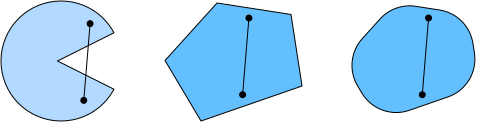
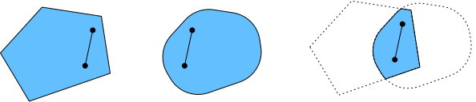
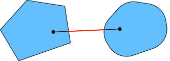
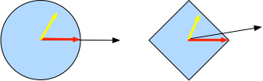

# Iškilumas
:label:`sec_convexity`

Iškilumas atlieka esminį vaidmenį projektuojant optimizavimo algoritmus.
Tai iš esmės lemia faktas, kad tokiame kontekste daug lengviau analizuoti ir testuoti algoritmus.
Kitaip tariant,
jei algoritmas prastai veikia net iškiliojoje aplinkoje,
paprastai neturėtume tikėtis puikių rezultatų ir kitais atvejais.
Be to, nors giliojo mokymosi optimizavimo uždaviniai paprastai yra neiškilieji, netoli lokaliųjų minimumų jie dažnai pasižymi kai kuriomis iškiliųjų uždavinių savybėmis. Tai gali lemti įdomius naujus optimizavimo variantus, tokius kaip :cite:`Izmailov.Podoprikhin.Garipov.ea.2018`.

```{.python .input}
#@tab mxnet
%matplotlib inline
from d2l import mxnet as d2l
from mpl_toolkits import mplot3d
from mxnet import np, npx
npx.set_np()
```

```{.python .input}
#@tab pytorch
%matplotlib inline
from d2l import torch as d2l
import numpy as np
from mpl_toolkits import mplot3d
import torch
```

```{.python .input}
#@tab tensorflow
%matplotlib inline
from d2l import tensorflow as d2l
import numpy as np
from mpl_toolkits import mplot3d
import tensorflow as tf
```

## Apibrėžimai

Prieš iškilumo analizę
turime apibrėžti *iškiliąsias aibes* ir *iškiliąsias funkcijas*.
Jos veda prie matematinių įrankių, kurie įprastai taikomi mašininiam mokymuisi.


### Iškiliosios aibės

Aibės yra iškilumo pagrindas. Paprasčiau tariant, vektorinės erdvės aibė $\mathcal{X}$ yra *iškiloji*, jei bet kuriems $a, b \in \mathcal{X}$ atkarpa, jungianti $a$ ir $b$, taip pat yra $\mathcal{X}$. Matematiškai tai reiškia, kad visiems $\lambda \in [0, 1]$ turime

$$\lambda  a + (1-\lambda)  b \in \mathcal{X} \textrm{ whenever } a, b \in \mathcal{X}.$$

Tai skamba šiek tiek abstrakčiai. Panagrinėkime :numref:`fig_pacman`. Pirmoji aibė nėra iškiloji, nes yra atkarpų, kurios joje nesitelpa.
Kitos dvi aibės tokios problemos neturi.


:label:`fig_pacman`

Patys apibrėžimai nėra ypač naudingi, nebent galite su jais ką nors padaryti.
Šiuo atveju galime pažvelgti į sankirtas, kaip parodyta :numref:`fig_convex_intersect`.
Tarkime, kad $\mathcal{X}$ ir $\mathcal{Y}$ yra iškilosios aibės. Tada $\mathcal{X} \cap \mathcal{Y}$ taip pat yra iškiloji. Kad tai pamatytume, panagrinėkime bet kuriuos $a, b \in \mathcal{X} \cap \mathcal{Y}$. Kadangi $\mathcal{X}$ ir $\mathcal{Y}$ yra iškilosios, atkarpos, jungiančios $a$ ir $b$, yra ir $\mathcal{X}$, ir $\mathcal{Y}$. Tai reiškia, kad jos taip pat turi būti $\mathcal{X} \cap \mathcal{Y}$, taigi įrodome savo teoremą.


:label:`fig_convex_intersect`

Šį rezultatą galime sustiprinti be didelių pastangų: turint iškiliąsias aibes $\mathcal{X}_i$, jų sankirta $\cap_{i} \mathcal{X}_i$ yra iškiloji.
Kad pamatytume, jog atvirkštinis teiginys nėra teisingas, panagrinėkime dvi nesikertančias aibes $\mathcal{X} \cap \mathcal{Y} = \emptyset$. Dabar pasirinkime $a \in \mathcal{X}$ ir $b \in \mathcal{Y}$. Atkarpa :numref:`fig_nonconvex`, jungianti $a$ ir $b$, turi turėti tam tikrą dalį, kuri nėra nei $\mathcal{X}$, nei $\mathcal{Y}$, nes darėme prielaidą, kad $\mathcal{X} \cap \mathcal{Y} = \emptyset$. Todėl atkarpa nėra ir $\mathcal{X} \cup \mathcal{Y}$, taigi įrodome, kad apskritai iškiliųjų aibių sąjungos nebūtinai yra iškilosios.


:label:`fig_nonconvex`

Paprastai giliojo mokymosi uždaviniai apibrėžiami iškiliosiose aibėse. Pavyzdžiui, $\mathbb{R}^d$,
$d$ dimensijų realiųjų skaičių vektorių aibė,
yra iškiloji aibė (juk atkarpa tarp bet kurių dviejų taškų $\mathbb{R}^d$ lieka $\mathbb{R}^d$). Kai kuriais atvejais dirbame su aprėžto ilgio kintamaisiais, pavyzdžiui, $r$ spindulio rutuliais, apibrėžtais kaip $\{\mathbf{x} | \mathbf{x} \in \mathbb{R}^d \textrm{ ir } \|\mathbf{x}\| \leq r\}$.

### Iškiliosios funkcijos

Dabar, kai turime iškiliąsias aibes, galime pristatyti *iškiliąsias funkcijas* $f$.
Duota iškilioji aibė $\mathcal{X}$, funkcija $f: \mathcal{X} \to \mathbb{R}$ yra *iškiloji*, jei visiems $x, x' \in \mathcal{X}$ ir visiems $\lambda \in [0, 1]$ turime

$$\lambda f(x) + (1-\lambda) f(x') \geq f(\lambda x + (1-\lambda) x').$$

Kad tai iliustruotume, nubraižykime kelias funkcijas ir patikrinkime, kurios tenkina šį reikalavimą.
Toliau apibrėžiame kelias funkcijas, tiek iškiliąsias, tiek neiškiliąsias.

```{.python .input}
#@tab all
f = lambda x: 0.5 * x**2  # Convex
g = lambda x: d2l.cos(np.pi * x)  # Nonconvex
h = lambda x: d2l.exp(0.5 * x)  # Convex

x, segment = d2l.arange(-2, 2, 0.01), d2l.tensor([-1.5, 1])
d2l.use_svg_display()
_, axes = d2l.plt.subplots(1, 3, figsize=(9, 3))
for ax, func in zip(axes, [f, g, h]):
    d2l.plot([x, segment], [func(x), func(segment)], axes=ax)
```

Kaip ir tikėtasi, kosinuso funkcija yra *neiškiloji*, o parabolė ir eksponentinė funkcija yra iškilosios. Atkreipkite dėmesį, kad reikalavimas, jog $\mathcal{X}$ yra iškilioji aibė, yra būtinas, kad sąlyga turėtų prasmę. Priešingu atveju $f(\lambda x + (1-\lambda) x')$ rezultatas gali būti nepakankamai apibrėžtas.


### Jenseno nelygybė

Turint iškiliąją funkciją $f$,
vienas naudingiausių matematinių įrankių
yra *Jenseno nelygybė*.
Ji reiškia iškilumo apibrėžimo apibendrinimą:

$$\sum_i \alpha_i f(x_i)  \geq f\left(\sum_i \alpha_i x_i\right)    \textrm{ and }    E_X[f(X)]  \geq f\left(E_X[X]\right),$$
:eqlabel:`eq_jensens-inequality`

kur $\alpha_i$ yra neneigiami realieji skaičiai, kad $\sum_i \alpha_i = 1$, o $X$ yra atsitiktinis kintamasis.
Kitaip tariant, iškiliosios funkcijos vidurkis yra ne mažesnis už iškiliąją vidurkio funkciją, kur pastaroji paprastai yra paprastesnė išraiška.
Kad įrodytume pirmąją nelygybę, pakartotinai taikome iškilumo apibrėžimą vienam sumos nariui vienu metu.


Vienas įprastų Jenseno nelygybės taikymų yra
sudėtingesnę išraišką aprėžti paprastesne.
Pavyzdžiui,
ją galima taikyti
iš dalies stebėtų atsitiktinių kintamųjų logaritminiam tikėtinumui. Tai yra, naudojame

$$E_{Y \sim P(Y)}[-\log P(X \mid Y)] \geq -\log P(X),$$

nes $\int P(Y) P(X \mid Y) dY = P(X)$.
Tai galima naudoti variaciniuose metoduose. Čia $Y$ paprastai yra nestebimas atsitiktinis kintamasis, $P(Y)$ yra geriausias spėjimas, kaip jis gali būti pasiskirstęs, o $P(X)$ yra skirstinys, iš kurio $Y$ suintegruotas. Pavyzdžiui, klasterizavime $Y$ gali būti klasterių žymenys, o $P(X \mid Y)$ yra generatyvinis modelis taikant klasterių žymenis.


## Savybės

Iškiliosios funkcijos turi daug naudingų savybių. Toliau aprašome kelias dažniausiai naudojamas.


### Lokalieji minimumai yra globalieji minimumai

Pirmiausia, iškiliųjų funkcijų lokalieji minimumai yra ir globalieji minimumai.
Tai galime įrodyti prieštaros metodu taip.

Panagrinėkime iškiliąją funkciją $f$, apibrėžtą iškiliojoje aibėje $\mathcal{X}$.
Tarkime, kad $x^{\ast} \in \mathcal{X}$ yra lokalusis minimumas:
egzistuoja nedidelė teigiama reikšmė $p$, kad $x \in \mathcal{X}$, tenkinantiems $0 < |x - x^{\ast}| \leq p$, turime $f(x^{\ast}) < f(x)$.

Tarkime, kad lokalusis minimumas $x^{\ast}$
nėra globalusis $f$ minimumas:
egzistuoja $x' \in \mathcal{X}$, kuriam $f(x') < f(x^{\ast})$.
Taip pat egzistuoja
$\lambda \in [0, 1)$, pavyzdžiui, $\lambda = 1 - \frac{p}{|x^{\ast} - x'|}$,
kad
$0 < |\lambda x^{\ast} + (1-\lambda) x' - x^{\ast}| \leq p$.

Tačiau
pagal iškiliųjų funkcijų apibrėžimą turime

$$\begin{aligned}
    f(\lambda x^{\ast} + (1-\lambda) x') &\leq \lambda f(x^{\ast}) + (1-\lambda) f(x') \\
    &< \lambda f(x^{\ast}) + (1-\lambda) f(x^{\ast}) \\
    &= f(x^{\ast}),
\end{aligned}$$

o tai prieštarauja mūsų teiginiui, kad $x^{\ast}$ yra lokalusis minimumas.
Todėl neegzistuoja $x' \in \mathcal{X}$, kuriam $f(x') < f(x^{\ast})$. Lokalusis minimumas $x^{\ast}$ taip pat yra globalusis minimumas.

Pavyzdžiui, iškilioji funkcija $f(x) = (x-1)^2$ turi lokalųjį minimumą ties $x=1$, kuris taip pat yra globalusis minimumas.

```{.python .input}
#@tab all
f = lambda x: (x - 1) ** 2
d2l.set_figsize()
d2l.plot([x, segment], [f(x), f(segment)], 'x', 'f(x)')
```

Faktas, kad iškiliųjų funkcijų lokalieji minimumai yra ir globalieji minimumai, yra labai patogus.
Tai reiškia, kad minimizuodami funkcijas negalime „įstrigti“.
Vis dėlto atkreipkite dėmesį, kad tai nereiškia, jog negali būti daugiau nei vieno globaliojo minimumo ar kad jis apskritai egzistuoja. Pavyzdžiui, funkcija $f(x) = \mathrm{max}(|x|-1, 0)$ pasiekia savo minimalią reikšmę intervale $[-1, 1]$. Ir atvirkščiai, funkcija $f(x) = \exp(x)$ nepasiekia minimalios reikšmės $\mathbb{R}$: kai $x \to -\infty$, ji asimptotiškai artėja prie $0$, bet nėra $x$, kuriam $f(x) = 0$.

### Iškiliųjų funkcijų žemutinės aibės yra iškilosios

Iškiliąsias aibes galime patogiai
apibrėžti
per iškiliųjų funkcijų *žemutines aibes*.
Konkrečiai,
turint iškiliąją funkciją $f$, apibrėžtą iškiliojoje aibėje $\mathcal{X}$,
bet kuri žemutinė aibė

$$\mathcal{S}_b \stackrel{\textrm{def}}{=} \{x | x \in \mathcal{X} \textrm{ and } f(x) \leq b\}$$

yra iškiloji.

Greitai tai įrodykime. Prisiminkite, kad bet kuriems $x, x' \in \mathcal{S}_b$ turime parodyti, kad $\lambda x + (1-\lambda) x' \in \mathcal{S}_b$, kol $\lambda \in [0, 1]$.
Kadangi $f(x) \leq b$ ir $f(x') \leq b$,
pagal iškilumo apibrėžimą turime

$$f(\lambda x + (1-\lambda) x') \leq \lambda f(x) + (1-\lambda) f(x') \leq b.$$


### Iškilumas ir antrosios išvestinės

Kai tik egzistuoja funkcijos $f: \mathbb{R}^n \rightarrow \mathbb{R}$ antroji išvestinė, labai lengva patikrinti, ar $f$ yra iškiloji.
Tereikia patikrinti, ar $f$ Hesės matrica yra teigiamai pusiau apibrėžta: $\nabla^2f \succeq 0$, t. y.,
Hesės matricą $\nabla^2f$ pažymėjus $\mathbf{H}$,
$\mathbf{x}^\top \mathbf{H} \mathbf{x} \geq 0$
visiems $\mathbf{x} \in \mathbb{R}^n$.
Pavyzdžiui, funkcija $f(\mathbf{x}) = \frac{1}{2} \|\mathbf{x}\|^2$ yra iškilioji, nes $\nabla^2 f = \mathbf{1}$, t. y. jos Hesės matrica yra vienetinė matrica.


Formaliai, du kartus diferencijuojama vienmatė funkcija $f: \mathbb{R} \rightarrow \mathbb{R}$ yra iškilioji
tada ir tik tada, kai jos antroji išvestinė $f'' \geq 0$. Bet kuri du kartus diferencijuojama daugiamatė funkcija $f: \mathbb{R}^{n} \rightarrow \mathbb{R}$
yra iškilioji tada ir tik tada, kai jos Hesės matrica $\nabla^2f \succeq 0$.

Pirmiausia turime įrodyti vienmatį atvejį.
Kad pamatytume, jog
$f$ iškilumas implikuoja
$f'' \geq 0$, naudojame faktą, kad

$$\frac{1}{2} f(x + \epsilon) + \frac{1}{2} f(x - \epsilon) \geq f\left(\frac{x + \epsilon}{2} + \frac{x - \epsilon}{2}\right) = f(x).$$

Kadangi antroji išvestinė yra baigtinių skirtumų riba, išplaukia, kad

$$f''(x) = \lim_{\epsilon \to 0} \frac{f(x+\epsilon) + f(x - \epsilon) - 2f(x)}{\epsilon^2} \geq 0.$$

Kad pamatytume, jog
$f'' \geq 0$ implikuoja, kad $f$ yra iškilioji,
naudojame faktą, kad $f'' \geq 0$ implikuoja, jog $f'$ yra monotoniškai nemažėjanti funkcija. Tegul $a < x < b$ yra trys $\mathbb{R}$ taškai,
kur $x = (1-\lambda)a + \lambda b$ ir $\lambda \in (0, 1)$.
Pagal vidutinės reikšmės teoremą
egzistuoja $\alpha \in [a, x]$ ir $\beta \in [x, b]$,
kad

$$f'(\alpha) = \frac{f(x) - f(a)}{x-a} \textrm{ and } f'(\beta) = \frac{f(b) - f(x)}{b-x}.$$


Pagal monotoniškumą $f'(\beta) \geq f'(\alpha)$, taigi

$$\frac{x-a}{b-a}f(b) + \frac{b-x}{b-a}f(a) \geq f(x).$$

Kadangi $x = (1-\lambda)a + \lambda b$,
turime

$$\lambda f(b) + (1-\lambda)f(a) \geq f((1-\lambda)a + \lambda b),$$

taigi įrodome iškilumą.

Antra, prieš įrodant daugiamatį atvejį
mums reikia lemos:
$f: \mathbb{R}^n \rightarrow \mathbb{R}$
yra iškilioji tada ir tik tada, kai visiems $\mathbf{x}, \mathbf{y} \in \mathbb{R}^n$

$$g(z) \stackrel{\textrm{def}}{=} f(z \mathbf{x} + (1-z)  \mathbf{y}) \textrm{ where } z \in [0,1]$$

yra iškilioji.

Kad įrodytume, jog $f$ iškilumas implikuoja, kad $g$ yra iškilioji,
galime parodyti, kad visiems $a, b, \lambda \in [0, 1]$ (taigi
$0 \leq \lambda a + (1-\lambda) b \leq 1$)

$$\begin{aligned} &g(\lambda a + (1-\lambda) b)\\
=&f\left(\left(\lambda a + (1-\lambda) b\right)\mathbf{x} + \left(1-\lambda a - (1-\lambda) b\right)\mathbf{y} \right)\\
=&f\left(\lambda \left(a \mathbf{x} + (1-a)  \mathbf{y}\right)  + (1-\lambda) \left(b \mathbf{x} + (1-b)  \mathbf{y}\right) \right)\\
\leq& \lambda f\left(a \mathbf{x} + (1-a)  \mathbf{y}\right)  + (1-\lambda) f\left(b \mathbf{x} + (1-b)  \mathbf{y}\right) \\
=& \lambda g(a) + (1-\lambda) g(b).
\end{aligned}$$

Kad įrodytume atvirkštinį teiginį,
galime parodyti, kad
visiems $\lambda \in [0, 1]$

$$\begin{aligned} &f(\lambda \mathbf{x} + (1-\lambda) \mathbf{y})\\
=&g(\lambda \cdot 1 + (1-\lambda) \cdot 0)\\
\leq& \lambda g(1)  + (1-\lambda) g(0) \\
=& \lambda f(\mathbf{x}) + (1-\lambda) f(\mathbf{y}).
\end{aligned}$$


Galiausiai,
naudodami aukščiau pateiktą lemą ir vienmačio atvejo rezultatą,
daugiamatį atvejį
galime įrodyti taip.
Daugiamatė funkcija $f: \mathbb{R}^n \rightarrow \mathbb{R}$ yra iškilioji
tada ir tik tada, kai visiems $\mathbf{x}, \mathbf{y} \in \mathbb{R}^n$ funkcija $g(z) \stackrel{\textrm{def}}{=} f(z \mathbf{x} + (1-z)  \mathbf{y})$, kur $z \in [0,1]$,
yra iškilioji.
Pagal vienmatį atvejį
tai galioja tada ir tik tada, kai
$g'' = (\mathbf{x} - \mathbf{y})^\top \mathbf{H}(\mathbf{x} - \mathbf{y}) \geq 0$ ($\mathbf{H} \stackrel{\textrm{def}}{=} \nabla^2f$)
visiems $\mathbf{x}, \mathbf{y} \in \mathbb{R}^n$,
o tai ekvivalentu $\mathbf{H} \succeq 0$
pagal teigiamai pusiau apibrėžtų matricų apibrėžimą.


## Apribojimai

Viena iš gerų iškiliojo optimizavimo savybių yra ta, kad jis leidžia efektyviai tvarkyti apribojimus. Tai yra, jis leidžia spręsti *optimizavimo su apribojimais* uždavinius tokios formos:

$$\begin{aligned} \mathop{\textrm{minimize~}}_{\mathbf{x}} & f(\mathbf{x}) \\
    \textrm{ subject to } & c_i(\mathbf{x}) \leq 0 \textrm{ for all } i \in \{1, \ldots, n\},
\end{aligned}$$

kur $f$ yra tikslas, o funkcijos $c_i$ yra apribojimų funkcijos. Kad pamatytume, ką tai reiškia, panagrinėkime atvejį, kai $c_1(\mathbf{x}) = \|\mathbf{x}\|_2 - 1$. Šiuo atveju parametrai $\mathbf{x}$ apriboti vienetiniu rutuliu. Jei antrasis apribojimas yra $c_2(\mathbf{x}) = \mathbf{v}^\top \mathbf{x} + b$, tai atitinka visus $\mathbf{x}$, esančius pusiaerdvėje. Abiejų apribojimų tenkinimas vienu metu reiškia rutulio skiltelės pasirinkimą.

### Lagranžianas

Apskritai spręsti optimizavimo su apribojimais uždavinį sunku. Vienas būdas jį spręsti kyla iš fizikos su gana paprasta intuicija. Įsivaizduokite rutulį dėžėje. Rutulys nuriedės į žemiausią vietą, o sunkio jėgos bus subalansuotos su jėgomis, kurias dėžės sienelės gali veikti rutulį. Trumpai tariant, tikslo funkcijos gradientą (t. y. sunkį) atsvers apribojimų funkcijos gradientas (rutulys turi likti dėžėje, nes sienelės „stumia atgal“).
Atkreipkite dėmesį, kad kai kurie apribojimai gali būti neaktyvūs:
sienelės, kurių rutulys neliečia,
negalės veikti rutulio jokia jėga.


Praleidžiant *Lagranžiano* $L$ išvedimą,
aukščiau pateiktą samprotavimą
galima išreikšti šiuo balno taško optimizavimo uždaviniu:

$$L(\mathbf{x}, \alpha_1, \ldots, \alpha_n) = f(\mathbf{x}) + \sum_{i=1}^n \alpha_i c_i(\mathbf{x}) \textrm{ where } \alpha_i \geq 0.$$

Čia kintamieji $\alpha_i$ ($i=1,\ldots,n$) yra vadinamieji *Lagranžo daugikliai*, kurie užtikrina, kad apribojimai būtų tinkamai vykdomi. Jie parenkami tik pakankamai dideli, kad $c_i(\mathbf{x}) \leq 0$ visiems $i$. Pavyzdžiui, bet kuriam $\mathbf{x}$, kur $c_i(\mathbf{x}) < 0$ natūraliai, galiausiai pasirinktume $\alpha_i = 0$. Be to, tai yra balno taško optimizavimo uždavinys, kur norima *maksimizuoti* $L$ visų $\alpha_i$ atžvilgiu ir kartu *minimizuoti* jį $\mathbf{x}$ atžvilgiu. Yra gausi literatūra, aiškinanti, kaip gauti funkciją $L(\mathbf{x}, \alpha_1, \ldots, \alpha_n)$. Mūsų tikslams pakanka žinoti, kad $L$ balno taškas yra ten, kur pradinis optimizavimo su apribojimais uždavinys išsprendžiamas optimaliai.

### Baudos

Vienas būdas tenkinti optimizavimo su apribojimais uždavinius bent *apytiksliai* yra pritaikyti Lagranžianą $L$.
Užuot tenkinę $c_i(\mathbf{x}) \leq 0$, tiesiog pridedame $\alpha_i c_i(\mathbf{x})$ prie tikslo funkcijos $f(x)$. Tai užtikrina, kad apribojimai nebus pažeisti per daug.

Iš tikrųjų visą laiką naudojome šį triuką. Panagrinėkime svorių nykimą :numref:`sec_weight_decay`. Jame prie tikslo funkcijos pridedame $\frac{\lambda}{2} \|\mathbf{w}\|^2$, kad užtikrintume, jog $\mathbf{w}$ neišaugs per daug. Iš optimizavimo su apribojimais požiūrio matome, kad tai užtikrins $\|\mathbf{w}\|^2 - r^2 \leq 0$ tam tikram spinduliui $r$. Keisdami $\lambda$ reikšmę, galime keisti $\mathbf{w}$ dydį.

Apskritai baudų pridėjimas yra geras būdas užtikrinti apytikslį apribojimų tenkinimą. Praktikoje tai pasirodo esąs daug patikimesnis nei tikslus tenkinimas. Be to, neiškiliesiems uždaviniams daugelis savybių, dėl kurių tikslus metodas iškiliuoju atveju yra toks patrauklus (pvz., optimalumas), nebegalioja.

### Projekcijos

Alternatyvi apribojimų tenkinimo strategija yra projekcijos. Su jomis taip pat susidūrėme anksčiau, pavyzdžiui, nagrinėdami gradientų apkarpymą :numref:`sec_rnn-scratch`. Ten užtikrinome, kad gradiento ilgis būtų aprėžtas $\theta$, taip:

$$\mathbf{g} \leftarrow \mathbf{g} \cdot \mathrm{min}(1, \theta/\|\mathbf{g}\|).$$

Paaiškėja, kad tai yra $\mathbf{g}$ *projekcija* į $\theta$ spindulio rutulį. Bendriau, projekcija į iškiliąją aibę $\mathcal{X}$ apibrėžiama kaip

$$\textrm{Proj}_\mathcal{X}(\mathbf{x}) = \mathop{\mathrm{argmin}}_{\mathbf{x}' \in \mathcal{X}} \|\mathbf{x} - \mathbf{x}'\|,$$

tai yra artimiausias $\mathcal{X}$ taškas taškui $\mathbf{x}$.


:label:`fig_projections`

Matematinis projekcijų apibrėžimas gali skambėti šiek tiek abstrakčiai. :numref:`fig_projections` paaiškina jį kiek aiškiau. Jame turime dvi iškiliąsias aibes – apskritimą ir rombą.
Taškai abiejose aibėse viduje (geltoni) projekcijų metu nesikeičia.
Taškai už abiejų aibių ribų (juodi) projektuojami į
aibių viduje esančius taškus (raudonus), kurie yra artimiausi pradiniams taškams (juodiems).
Nors $\ell_2$ rutuliams tai palieka kryptį nepakeistą, apskritai taip būti nebūtinai, kaip matyti rombo atveju.


Vienas iškiliųjų projekcijų panaudojimo būdų yra retų svorių vektorių skaičiavimas. Tokiu atveju svorių vektorius projektuojame į $\ell_1$ rutulį,
kuris yra apibendrinta rombo atvejo :numref:`fig_projections` versija.


## Santrauka

Giliojo mokymosi kontekste pagrindinis iškiliųjų funkcijų tikslas yra motyvuoti optimizavimo algoritmus ir padėti mums juos suprasti išsamiai. Toliau pamatysime, kaip atitinkamai galima išvesti gradientinį nusileidimą ir stochastinį gradientinį nusileidimą.


* Iškiliųjų aibių sankirtos yra iškilosios. Sąjungos – ne.
* Iškiliosios funkcijos vidurkis yra ne mažesnis už iškiliąją vidurkio funkciją (Jenseno nelygybė).
* Du kartus diferencijuojama funkcija yra iškilioji tada ir tik tada, kai jos Hesės matrica (antrųjų išvestinių matrica) yra teigiamai pusiau apibrėžta.
* Iškiliuosius apribojimus galima pridėti per Lagranžianą. Praktikoje galime juos tiesiog pridėti su bauda prie tikslo funkcijos.
* Projekcijos atvaizduoja į iškiliosios aibės taškus, artimiausius pradiniams taškams.

## Pratimai

1. Tarkime, kad norime patikrinti aibės iškilumą nubrėždami visas linijas tarp aibės taškų ir patikrindami, ar linijos yra aibėje.
    1. Įrodykite, kad pakanka patikrinti tik ribos taškus.
    1. Įrodykite, kad pakanka patikrinti tik aibės viršūnes.
1. Pažymėkime $\mathcal{B}_p[r] \stackrel{\textrm{def}}{=} \{\mathbf{x} | \mathbf{x} \in \mathbb{R}^d \textrm{ ir } \|\mathbf{x}\|_p \leq r\}$ $r$ spindulio rutulį, naudojantį $p$-normą. Įrodykite, kad $\mathcal{B}_p[r]$ yra iškiloji visiems $p \geq 1$.
1. Turint iškiliąsias funkcijas $f$ ir $g$, parodykite, kad $\mathrm{max}(f, g)$ taip pat yra iškilioji. Įrodykite, kad $\mathrm{min}(f, g)$ nėra iškilioji.
1. Įrodykite, kad softmax funkcijos normalizavimas yra iškilioji funkcija. Konkrečiau, įrodykite
    $f(x) = \log \sum_i \exp(x_i)$ iškilumą.
1. Įrodykite, kad tiesiniai poerdviai, t. y. $\mathcal{X} = \{\mathbf{x} | \mathbf{W} \mathbf{x} = \mathbf{b}\}$, yra iškilosios aibės.
1. Įrodykite, kad tiesinių poerdvių su $\mathbf{b} = \mathbf{0}$ atveju projekciją $\textrm{Proj}_\mathcal{X}$ galima užrašyti kaip $\mathbf{M} \mathbf{x}$ su tam tikra matrica $\mathbf{M}$.
1. Parodykite, kad du kartus diferencijuojamoms iškiliosioms funkcijoms $f$ galime rašyti $f(x + \epsilon) = f(x) + \epsilon f'(x) + \frac{1}{2} \epsilon^2 f''(x + \xi)$ su tam tikru $\xi \in [0, \epsilon]$.
1. Turint iškiliąją aibę $\mathcal{X}$ ir du vektorius $\mathbf{x}$ ir $\mathbf{y}$, įrodykite, kad projekcijos niekada nepadidina atstumų, t. y. $\|\mathbf{x} - \mathbf{y}\| \geq \|\textrm{Proj}_\mathcal{X}(\mathbf{x}) - \textrm{Proj}_\mathcal{X}(\mathbf{y})\|$.


[Diskusijos](https://discuss.d2l.ai/t/350)
