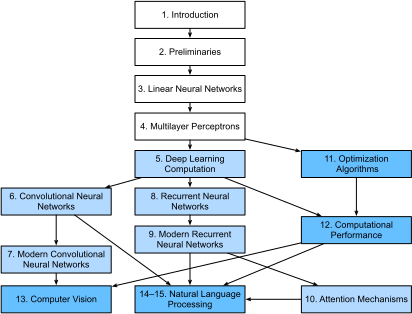

# Pratarmė

Dar prieš keletą metų gilaus mokymosi mokslininkų legionų,
kuriančių išmaniuosius produktus ir paslaugas didžiosiose bendrovėse ir naujai įsteigtose įmonėse (angl. *startups*), nebuvo.
Kai mes įžengėme į šią sritį, mašininis mokymasis
dienraščių antraštėse dar nefigūravo.
Mūsų tėvai nenutuokė, kas yra mašininis mokymasis,
juo labiau – kodėl galėtume jį rinktis vietoj medicinos ar teisės karjeros.
Mašininis mokymasis buvo „mėlynojo dangaus" akademinė disciplina,
kurios pramoninė reikšmė apsiribojo
nedidele realaus pasaulio taikymų aibe,
įskaitant šnekos atpažinimą ir kompiuterinę regą.
Be to, daugeliui šių taikymų
reikėjo tiek srities žinių,
kad jie dažnai būdavo laikomi visiškai atskiromis sritimis,
kuriose mašininis mokymasis buvo tik maža dalis.
Tuo metu neuroniniai tinklai – 
šioje knygoje nagrinėjamų gilaus mokymosi metodų
pirmtakai – 
paprastai buvo laikomi pasenusiais.


Tačiau vos per keletą metų gilusis mokymasis pasauliui buvo netikėtas,
paskatinęs sparčią pažangą tokiose skirtingose srityse
kaip kompiuterinė rega, natūraliosios kalbos apdorojimas,
automatinis šnekos atpažinimas, skatinamasis mokymasis
ir biomedicinos informatika.
Be to, gilaus mokymosi sėkmė
atliekant tiek daug praktiškai svarbių užduočių
netgi paskatino pokyčius
teoriniame mašininiame mokyme ir statistikoje.
Pasitelkę šiuos pasiekimus,
dabar galime kurti automobilius, kurie vairuoja patys
savarankiškiau nei bet kada anksčiau
(nors ne tokie savarankiški, kaip kai kurios bendrovės norėtų jus įtikinti),
dialogo sistemas, kurios derina kodą uždavinėdamos patikslinančius klausimus,
ir programinius agentus, įveikiančius geriausius pasaulio žmones stalo žaidimuose, tokiuose kaip „Go" – tokį žygdarbį dar neseniai laikėme esant dešimtmečių atstumu.
Šios priemonės jau daro vis platesnę įtaką pramonei ir visuomenei,
keičia filmų kūrimo būdus, ligų diagnostiką
ir vis labiau įsitvirtina fundamentiniuose moksluose – nuo astrofizikos iki klimato modeliavimo, orų prognozavimo ir biomedicinos.


## Apie šią knygą

Šia knyga siekiame, kad gilusis mokymasis taptų prieinamas,
mokydami jus *sąvokų*, *konteksto* ir *kodo*.

### Viena terpė, jungianti kodą, matematiką ir HTML

Kad bet kuri skaičiavimo technologija pasiektų visą savo poveikį,
ji turi būti gerai suprasta, gerai dokumentuota ir palaikoma
brandžių, gerai prižiūrimų įrankių.
Pagrindinės idėjos turi būti aiškiai išgrynintos,
kad nauji praktikai kuo greičiau
įsisavintų reikiamas žinias.
Brandžios bibliotekos turi automatizuoti įprastas užduotis,
o pavyzdinis kodas turi leisti praktikams lengvai
keisti, taikyti ir plėsti įprastus taikymus pagal savo poreikius.


Paimkime dinamines internetines programas kaip pavyzdį.
Nors 1990-aisiais daug bendrovių, tokių kaip „Amazon",
kūrė sėkmingas duomenų bazėmis grįstas internetines programas,
šios technologijos potencialas padėti kūrybingiems verslininkams
buvo gerokai geriau išnaudotas tik per pastaruosius dešimt metų,
iš dalies dėl galingų, gerai dokumentuotų karkasų (angl. *frameworks*) atsiradimo.


Gilaus mokymosi potencialo išbandymas kelia ypatingų iššūkių,
nes bet kuriame taikyme susitinka įvairios disciplinos.
Taikant gilųjį mokymąsi, reikia vienu metu suprasti
(i) motyvus, kodėl uždavinys formuluojamas būtent taip;
(ii) duoto modelio matematinę formą;
(iii) optimizavimo algoritmus, kuriais modeliai pritaikomi duomenims;
(iv) statistinius principus, kurie nurodo,
kada galime tikėtis, kad mūsų modeliai
generalizuosis nematytiems duomenims,
ir praktinius metodus, leidžiančius patvirtinti,
kad jie iš tiesų generalizavosi;
ir (v) inžinerinius metodus,
reikalingus modeliams efektyviai apmokyti,
išvengiant skaitinio skaičiavimo spąstų
ir kuo geriau išnaudojant turimą aparatinę įrangą.
Vienoje vietoje mokyti kritinio mąstymo įgūdžių,
reikalingų uždaviniams formuluoti,
matematikos jiems spręsti
ir programinių įrankių tiems sprendimams įgyvendinti
yra didelis iššūkis.
Šios knygos tikslas – pateikti vieningą šaltinį,
padedantį būsimiems praktikams greitai įsisavinti reikiamas žinias.

Kai pradėjome šį knygos projektą,
nebuvo šaltinių, kurie vienu metu
(i) būtų atnaujinami;
(ii) pakankamai techniškai gilai apimtų
šiuolaikinės mašininio mokymosi praktikos platumą;
ir (iii) derintų vadovėlio lygio
dėstymą
su gražiu paleidžiamu kodu,
kokio tikimasi iš praktinio vadovo.
Rasdavome daug kodo pavyzdžių, iliustruojančių,
kaip naudoti tam tikrą gilaus mokymosi karkasą
(pvz., kaip atlikti pagrindinius skaitinius skaičiavimus su matricomis naudojant TensorFlow)
arba kaip įgyvendinti konkrečius metodus
(pvz., LeNet, AlexNet, ResNet ir kitų kodo fragmentus),
išsibarsčiusių po įvairius tinklaraščių įrašus ir „GitHub" saugyklas.
Tačiau šie pavyzdžiai paprastai pabrėždavo,
*kaip* įgyvendinti tam tikrą metodą,
bet nenagrinėdavo,
*kodėl* priimami tam tikri algoritmų sprendimai.
Nors kartais atsirasdavo interaktyvių šaltinių,
skirtų atskirai temai,
pvz., įdomūs tinklaraščių įrašai,
skelbiami svetainėje [Distill](http://distill.pub), ar asmeniniai tinklaraščiai,
jie apėmė tik pasirinktas gilaus mokymosi temas
ir dažnai neturėjo susieto kodo.
Kita vertus, nors pasirodė keli gilaus mokymosi vadovėliai,
pvz., :citet:`Goodfellow.Bengio.Courville.2016`,
kuriame pateikiama išsami gilaus mokymosi pagrindų apžvalga,
šie šaltiniai nesieja aprašymų
su sąvokų įgyvendinimu kode,
todėl skaitytojai kartais nesupranta,
kaip jas įgyvendinti.
Be to, per daug šaltinių
yra paslėpta už komercinių kursų teikėjų
mokamų sienų.

Siekėme sukurti šaltinį, kuris
(i) būtų laisvai prieinamas visiems;
(ii) suteiktų pakankamai techninio gylio,
kad taptų pradžios tašku kelyje
į taikomojo mašininio mokymosi mokslininko profesiją;
(iii) turėtų paleidžiamą kodą, parodantį skaitytojams,
*kaip* spręsti uždavinius praktikoje;
(iv) leistų greitai atnaujinti tiek mums,
tiek platesnei bendruomenei;
ir (v) būtų papildytas [forumu](https://discuss.d2l.ai/c/5),
skirtu interaktyviai aptarti technines detales ir atsakyti į klausimus.

Šie tikslai dažnai prieštaravo vienas kitam.
Lygtis, teoremas ir citatas
geriausia tvarkyti ir maketuoti LaTeX.
Kodą geriausia aprašyti Python kalba.
O tinklalapių gimtoji kalba yra HTML ir JavaScript.
Be to, norime, kad turinys būtų
prieinamas ir kaip vykdomas kodas, ir kaip fizinė knyga,
ir kaip atsisiunčiamas PDF, ir internete kaip svetainė.
Atrodė, kad joks darbo procesas šių reikalavimų neatitinka,
todėl nusprendėme sukurti savo (:numref:`sec_how_to_contribute`).
Pasirinkome „GitHub" šaltiniui dalytis
ir bendruomenės indėliui palengvinti;
„Jupyter" sąsiuvinius kodui, lygtims ir tekstui jungti;
Sphinx kaip atvaizdavimo variklį;
ir „Discourse" kaip diskusijų platformą.
Nors mūsų sistema nėra tobula,
šie pasirinkimai yra kompromisas
tarp konkuruojančių poreikių.
Manome, kad *Dive into Deep Learning*
gali būti pirmoji knyga, išleista
naudojant tokį integruotą darbo procesą.


### Mokymasis praktiškai

Daugelis vadovėlių dėsto sąvokas paeiliui,
išsamiai nagrinėdami kiekvieną.
Pavyzdžiui,
puikus
:citet:`Bishop.2006`
vadovėlis kiekvieną temą dėsto taip kruopščiai,
kad iki skyriaus
apie tiesinę regresiją
prireikia nemažai pastangų.
Nors ekspertai šią knygą vertina
būtent dėl jos kruopštumo,
tikriems pradedantiesiems ši savybė riboja
jos naudą kaip įvadinio vadovėlio.

Šioje knygoje daugumą sąvokų dėstome *tiksliai laiku*.
Kitaip tariant, sąvokas išmoksite tuo momentu,
kai jų prireikia kokiam nors praktiniam tikslui pasiekti.
Nors pradžioje skiriame šiek tiek laiko pagrindinėms
pradinėms žinioms, tokioms kaip tiesinė algebra ir tikimybių teorija, dėstyti,
norime, kad pajustumėte pasitenkinimą apmokę pirmąjį savo modelį,
dar nesukdami galvos dėl egzotiškesnių sąvokų.

Be kelių pradinių sąsiuvinių, kuriuose pateikiamas greitasis
pagrindinio matematinio pagrindo kursas,
kiekviename tolesniame skyriuje pristatomas pagrįstas naujų sąvokų skaičius
ir pateikiama keletas savarankiškų veikiančių pavyzdžių su realiais duomenų rinkiniais.
Tai sukėlė organizacinį iššūkį.
Kai kurie modeliai logiškai galėtų būti sugrupuoti viename sąsiuvinyje.
O kai kurias idėjas geriausia dėstyti
paeiliui vykdant kelis modelius.
Tačiau laikytis politikos *vienas veikiantis pavyzdys – vienas sąsiuvinis*
turi didelį privalumą:
taip jums kuo lengviau
pradėti savo tyrimų projektus panaudojant mūsų kodą.
Tiesiog nukopijuokite sąsiuvinį ir pradėkite jį keisti.

Visur paleidžiamą kodą pagal poreikį perpinome
su pagrindine medžiaga.
Paprastai linkę esame pirmiausia suteikti įrankius
ir tik paskui juos išsamiai paaiškinti
(dažnai pagrindus užpildydami vėliau).
Pavyzdžiui, galime naudoti *stochastinį gradientinį nusileidimą*
dar nepaaiškinę, kodėl jis naudingas,
ar nesuteikę intuicijos, kodėl jis veikia.
Tai suteikia praktikams reikiamos
„amunicijos" uždaviniams greitai spręsti,
tačiau skaitytojas turi pasitikėti mūsų
kai kuriais atrankos sprendimais.

Ši knyga moko gilaus mokymosi sąvokų nuo nulio.
Kartais gilinamės į smulkias modelių detales,
kurias šiuolaikiniai gilaus mokymosi karkasai
paprastai paslepia nuo naudotojų.
Tai ypač pasitaiko pradiniuose vadovėliuose,
kuriuose norime, kad suprastumėte viską,
kas vyksta konkrečiame sluoksnyje ar optimizatoriuje.
Šiais atvejais dažnai pateikiame
dvi pavyzdžio versijas:
vieną, kurioje viskas įgyvendinama nuo nulio,
remiantis tik NumPy panašia funkcija
ir automatiniu diferencijavimu,
ir praktiškesnį pavyzdį,
kuriame glaustą kodą rašome
naudodami aukšto lygio gilaus mokymosi karkasų API.
Paaiškinę, kaip veikia tam tikras komponentas,
tolesniuose vadovėliuose remiamės aukšto lygio API.


### Turinys ir struktūra

Knygą galima apytiksliai padalyti į tris dalis,
kuriose nagrinėjami pradiniai pagrindai,
gilaus mokymosi metodai
ir sudėtingesnės temos,
nukreiptos į realias sistemas
ir taikymus (:numref:`fig_book_org`).


:label:`fig_book_org`


* **1 dalis: pagrindai ir pradinės žinios**.
:numref:`chap_introduction` yra
gilaus mokymosi įvadas.
Tada :numref:`chap_preliminaries`
greitai supažindiname su būtinomis žiniomis,
reikalingomis praktiniam giliajam mokymuisi,
tokiomis kaip duomenų saugojimas ir apdorojimas
bei įvairių skaitinių operacijų taikymas,
remiantis pradinėmis tiesinės algebros,
matematinės analizės ir tikimybių teorijos sąvokomis.
:numref:`chap_regression` ir :numref:`chap_perceptrons`
apima pačias pagrindines gilaus mokymosi sąvokas ir metodus,
įskaitant regresiją ir klasifikavimą,
tiesinius modelius, daugiasluoksnius perceptronus
bei persimokymą ir reguliarizaciją.

* **2 dalis: šiuolaikiniai gilaus mokymosi metodai**.
:numref:`chap_computation` aprašo
pagrindinius gilaus mokymosi sistemų
skaičiavimo komponentus
ir paruošia pagrindą
tolesniam sudėtingesnių modelių
įgyvendinimui.
Toliau :numref:`chap_cnn` ir :numref:`chap_modern_cnn`
pristato konvoliucinius neuroninius tinklus (CNN),
galingas priemones, sudarančias daugumos
šiuolaikinių kompiuterinės regos sistemų pagrindą.
Panašiai :numref:`chap_rnn` ir :numref:`chap_modern_rnn`
pristato rekurentinius neuroninius tinklus (RNN),
modelius, išnaudojančius nuoseklią (pvz., laikinę)
duomenų struktūrą ir plačiai naudojamus
natūraliosios kalbos apdorojimui
ir laiko eilučių prognozavimui.
:numref:`chap_attention-and-transformers`
aprašome gana naują modelių klasę,
pagrįstą vadinamaisiais *dėmesio sutelkimo mechanizmais*,
kuri išstūmė RNN kaip vyraujančią architektūrą
daugumai natūraliosios kalbos apdorojimo užduočių.
Šie skyriai padės jums įsisavinti
galingiausias ir universaliausias priemones,
kurias plačiai naudoja gilaus mokymosi praktikai.

* **3 dalis: mastelio keitimas, efektyvumas ir taikymai** (prieinama [internete](https://d2l.ai)).
12 skyriuje
aptariame kelis dažnus optimizavimo algoritmus,
naudojamus giliojo mokymosi modeliams apmokyti.
Toliau 13 skyriuje
nagrinėjame keletą pagrindinių veiksnių,
darančių įtaką gilaus mokymosi kodo
skaičiavimo našumui.
Tada 14 skyriuje
iliustruojame pagrindinius
gilaus mokymosi taikymus kompiuterinėje regoje.
Galiausiai 15 ir 16 skyriuose
parodome, kaip iš anksto apmokyti kalbos reprezentacijų modelius
ir taikyti juos natūraliosios kalbos apdorojimo užduotims.


### Kodas
:label:`sec_code`

Daugumoje šios knygos skyrelių yra vykdomo kodo.
Manome, kad kai kurią intuiciją geriausia ugdyti
bandymų ir klaidų keliu,
nedaug pakeičiant kodą ir stebint rezultatus.
Idealiu atveju elegantiška matematinė teorija mums galėtų pasakyti,
kaip tiksliai keisti kodą norimam rezultatui pasiekti.
Tačiau šiandien gilaus mokymosi praktikai
dažnai turi eiti ten, kur jokia tvirta teorija nepadeda.
Nepaisant visų pastangų, formalių įvairių metodų
veiksmingumo paaiškinimų
vis dar trūksta dėl įvairių priežasčių: matematika šiems modeliams apibūdinti
gali būti labai sudėtinga;
paaiškinimas tikriausiai priklauso nuo duomenų savybių,
kurios šiuo metu neturi aiškių apibrėžčių;
o rimti šių temų tyrimai
tik neseniai įsibėgėjo.
Tikimės, kad gilaus mokymosi teorijai tobulėjant,
kiekviename būsimame šios knygos leidime bus pateikta įžvalgų,
pranokstančių dabar turimas.

Kad išvengtume nereikalingo kartojimo, kai kurias savo dažniausiai importuojamas ir naudojamas
funkcijas ir klases sutalpiname `d2l` pakete.
Visur kodo blokus
(pvz., funkcijas, klases
ar importo sakinių rinkinius) žymime `#@save`,
kad nurodytume, jog vėliau jie bus pasiekiami
per `d2l` paketą.
Išsamią šių klasių ir funkcijų apžvalgą pateikiame
:numref:`sec_d2l`.
`d2l` paketas yra lengvas ir reikalauja tik
šių priklausomybių:

```{.python .input}
#@tab all
#@save
import inspect
import collections
from collections import defaultdict
from IPython import display
import math
from matplotlib import pyplot as plt
from matplotlib_inline import backend_inline
import os
import pandas as pd
import random
import re
import shutil
import sys
import tarfile
import time
import requests
import zipfile
import hashlib
d2l = sys.modules[__name__]
```

:begin_tab:`mxnet`
Didžioji šios knygos kodo dalis pagrįsta Apache MXNet,
atvirojo kodo gilaus mokymosi karkasu,
kurį renkasi AWS (Amazon Web Services),
taip pat daug kolegijų ir bendrovių.
Visas šios knygos kodas išbandytas
su naujausia MXNet versija.
Tačiau dėl spartaus gilaus mokymosi vystymosi
kai kuris kodas *spausdintame leidime*
gali neveikti tinkamai būsimose MXNet versijose.
Planuojame palaikyti naujausią internetinę versiją.
Jei kiltų problemų,
kreipkitės į :ref:`chap_installation`,
kad atnaujintumėte savo kodą ir vykdymo aplinką.
Toliau išvardytos mūsų MXNet įgyvendinimo priklausomybės.
:end_tab:

:begin_tab:`pytorch`
Didžioji šios knygos kodo dalis pagrįsta PyTorch,
populiariu atvirojo kodo karkasu,
entuziastingai priimtu
gilaus mokymosi tyrimų bendruomenės.
Visas šios knygos kodas išbandytas
su naujausia stabilia PyTorch versija.
Tačiau dėl spartaus gilaus mokymosi vystymosi
kai kuris kodas *spausdintame leidime*
gali neveikti tinkamai būsimose PyTorch versijose.
Planuojame palaikyti naujausią internetinę versiją.
Jei kiltų problemų,
kreipkitės į :ref:`chap_installation`,
kad atnaujintumėte savo kodą ir vykdymo aplinką.
Toliau išvardytos mūsų PyTorch įgyvendinimo priklausomybės.
:end_tab:

:begin_tab:`tensorflow`
Didžioji šios knygos kodo dalis pagrįsta TensorFlow,
atvirojo kodo gilaus mokymosi karkasu,
plačiai taikomu pramonėje
ir populiariu tarp tyrėjų.
Visas šios knygos kodas išbandytas
su naujausia stabilia TensorFlow versija.
Tačiau dėl spartaus gilaus mokymosi vystymosi
kai kuris kodas *spausdintame leidime*
gali neveikti tinkamai būsimose TensorFlow versijose.
Planuojame palaikyti naujausią internetinę versiją.
Jei kiltų problemų,
kreipkitės į :ref:`chap_installation`,
kad atnaujintumėte savo kodą ir vykdymo aplinką.
Toliau išvardytos mūsų TensorFlow įgyvendinimo priklausomybės.
:end_tab:

:begin_tab:`jax`
Didžioji šios knygos kodo dalis pagrįsta Jax,
atvirojo kodo karkasu, leidžiančiu komponuoti funkcijų
transformacijas, tokias kaip savavališkų
Python ir NumPy funkcijų diferencijavimas, taip pat JIT kompiliavimas,
vektorizavimas ir daug daugiau! Jis tampa populiarus
mašininio mokymosi tyrimų srityje ir turi
lengvai išmokstamą NumPy panašią API. Iš tikrųjų JAX siekia
1:1 atitikimo su NumPy, todėl kodo perjungimas
gali būti toks paprastas kaip vieno importo sakinio pakeitimas!
Tačiau dėl spartaus gilaus mokymosi vystymosi
kai kuris kodas *spausdintame leidime*
gali neveikti tinkamai būsimose Jax versijose.
Planuojame palaikyti naujausią internetinę versiją.
Jei kiltų problemų,
kreipkitės į :ref:`chap_installation`,
kad atnaujintumėte savo kodą ir vykdymo aplinką.
Toliau išvardytos mūsų JAX įgyvendinimo priklausomybės.
:end_tab:

```{.python .input}
#@tab mxnet
#@save
from mxnet import autograd, context, gluon, image, init, np, npx
from mxnet.gluon import nn, rnn
```

```{.python .input}
#@tab pytorch
#@save
import numpy as np
import torch
import torchvision
from torch import nn
from torch.nn import functional as F
from torchvision import transforms
from PIL import Image
from scipy.spatial import distance_matrix
```

```{.python .input}
#@tab tensorflow
#@save
import numpy as np
import tensorflow as tf
```

```{.python .input}
#@tab jax
#@save
from dataclasses import field
from functools import partial
import flax
from flax import linen as nn
from flax.training import train_state
import jax
from jax import numpy as jnp
from jax import grad, vmap
import numpy as np
import optax
import tensorflow as tf
import tensorflow_datasets as tfds
from types import FunctionType
from typing import Any
```

### Tikslinė auditorija

Ši knyga skirta studentams (bakalauro ar magistrantūros),
inžinieriams ir tyrėjams, siekiantiems tvirtai įvaldyti
praktinius gilaus mokymosi metodus.
Kadangi kiekvieną sąvoką aiškiname nuo nulio,
ankstesnio gilaus ar mašininio mokymosi pasirengimo nereikia.
Išsamiai paaiškinti gilaus mokymosi metodus
reikia šiek tiek matematikos ir programavimo,
tačiau tikimės tik tai, kad turite pagrindų,
įskaitant nedidelį tiesinės algebros,
matematinės analizės, tikimybių teorijos ir Python programavimo kiekį.
Jei ką nors pamiršote,
[priedas internete](https://d2l.ai/chapter_appendix-mathematics-for-deep-learning/index.html) primena
didžiąją dalį matematikos,
su kuria susidursite šioje knygoje.
Paprastai teiksime pirmenybę
intuicijai ir idėjoms
prieš matematinį griežtumą.
Jei norėtumėte išplėsti šiuos pagrindus
už reikalavimų, būtinų mūsų knygai suprasti,
mielai rekomenduojame kitų puikių šaltinių:
*Linear Analysis*, parašyta :citet:`Bollobas.1999`,
labai išsamiai aprėpia tiesinę algebrą ir funkcinę analizę.
*All of Statistics* :cite:`Wasserman.2013`
yra nuostabus statistikos įvadas.
Joe Blitzsteino [knygos](https://www.amazon.com/Introduction-Probability-Chapman-Statistical-Science/dp/1138369918)
ir [kursai](https://projects.iq.harvard.edu/stat110/home)
apie tikimybes ir statistinę inferenciją yra pedagoginiai perlai.
O jei anksčiau nenaudojote Python,
galbūt norėsite peržvelgti šį [Python vadovėlį](http://learnpython.org/).


### Sąsiuviniai, svetainė, GitHub ir forumas

Visus mūsų sąsiuvinius galima atsisiųsti
iš [D2L.ai svetainės](https://d2l.ai)
ir iš [GitHub](https://github.com/d2l-ai/d2l-en).
Kartu su šia knyga paleidome diskusijų forumą
adresu [discuss.d2l.ai](https://discuss.d2l.ai/c/5).
Kai tik kyla klausimų apie bet kurį knygos skyrelį,
nuorodą į atitinkamą diskusijų puslapį rasite
kiekvieno sąsiuvinio pabaigoje.


## Padėkos

Esame skolingi šimtams bendradarbių tiek
anglų, tiek kinų kalbos juodraščių rengime.
Jie padėjo tobulinti turinį ir pateikė vertingų atsiliepimų.
Ši knyga iš pradžių buvo įgyvendinta naudojant MXNet kaip pagrindinį karkasą.
Dėkojame Anirudh Dagar ir Yuan Tang už tai, kad didžiąją ankstesnio MXNet kodo dalį pritaikė atitinkamai PyTorch ir TensorFlow įgyvendinimams.
Nuo 2021 m. liepos mėnesio šią knygą perprojektavome ir iš naujo įgyvendinome PyTorch, MXNet ir TensorFlow, pagrindiniu karkasu pasirinkdami PyTorch.
Dėkojame Anirudh Dagar už tai, kad didžiąją naujesnio PyTorch kodo dalį pritaikė JAX įgyvendinimams.
Dėkojame Baidu darbuotojams Gaosheng Wu, Liujun Hu, Ge Zhang ir Jiehang Xie už tai, kad didžiąją naujesnio PyTorch kodo dalį pritaikė PaddlePaddle įgyvendinimams kinų kalbos juodraštyje.
Dėkojame Shuai Zhang už leidyklos LaTeX stiliaus integravimą į PDF kūrimą.

„GitHub" platformoje dėkojame kiekvienam šio anglų kalbos juodraščio
bendradarbiui už tai, kad jį pagerino visiems.
Jų „GitHub" ID arba vardai yra (jokia tvarka):
alxnorden, avinashingit, bowen0701, brettkoonce, Chaitanya Prakash Bapat,
cryptonaut, Davide Fiocco, edgarroman, gkutiel, John Mitro, Liang Pu,
Rahul Agarwal, Mohamed Ali Jamaoui, Michael (Stu) Stewart, Mike Müller,
NRauschmayr, Prakhar Srivastav, sad-, sfermigier, Sheng Zha, sundeepteki,
topecongiro, tpdi, vermicelli, Vishaal Kapoor, Vishwesh Ravi Shrimali, YaYaB, Yuhong Chen,
Evgeniy Smirnov, lgov, Simon Corston-Oliver, Igor Dzreyev, Ha Nguyen, pmuens,
Andrei Lukovenko, senorcinco, vfdev-5, dsweet, Mohammad Mahdi Rahimi, Abhishek Gupta,
uwsd, DomKM, Lisa Oakley, Bowen Li, Aarush Ahuja, Prasanth Buddareddygari, brianhendee,
mani2106, mtn, lkevinzc, caojilin, Lakshya, Fiete Lüer, Surbhi Vijayvargeeya,
Muhyun Kim, dennismalmgren, adursun, Anirudh Dagar, liqingnz, Pedro Larroy,
lgov, ati-ozgur, Jun Wu, Matthias Blume, Lin Yuan, geogunow, Josh Gardner,
Maximilian Böther, Rakib Islam, Leonard Lausen, Abhinav Upadhyay, rongruosong,
Steve Sedlmeyer, Ruslan Baratov, Rafael Schlatter, liusy182, Giannis Pappas,
ati-ozgur, qbaza, dchoi77, Adam Gerson, Phuc Le, Mark Atwood, christabella, vn09,
Haibin Lin, jjangga0214, RichyChen, noelo, hansent, Giel Dops, dvincent1337, WhiteD3vil,
Peter Kulits, codypenta, joseppinilla, ahmaurya, karolszk, heytitle, Peter Goetz, rigtorp,
Tiep Vu, sfilip, mlxd, Kale-ab Tessera, Sanjar Adilov, MatteoFerrara, hsneto,
Katarzyna Biesialska, Gregory Bruss, Duy–Thanh Doan, paulaurel, graytowne, Duc Pham,
sl7423, Jaedong Hwang, Yida Wang, cys4, clhm, Jean Kaddour, austinmw, trebeljahr, tbaums,
Cuong V. Nguyen, pavelkomarov, vzlamal, NotAnotherSystem, J-Arun-Mani, jancio, eldarkurtic,
the-great-shazbot, doctorcolossus, gducharme, cclauss, Daniel-Mietchen, hoonose, biagiom,
abhinavsp0730, jonathanhrandall, ysraell, Nodar Okroshiashvili, UgurKap, Jiyang Kang,
StevenJokes, Tomer Kaftan, liweiwp, netyster, ypandya, NishantTharani, heiligerl, SportsTHU,
Hoa Nguyen, manuel-arno-korfmann-webentwicklung, aterzis-personal, nxby, Xiaoting He, Josiah Yoder,
mathresearch, mzz2017, jroberayalas, iluu, ghejc, BSharmi, vkramdev, simonwardjones, LakshKD,
TalNeoran, djliden, Nikhil95, Oren Barkan, guoweis, haozhu233, pratikhack, Yue Ying, tayfununal,
steinsag, charleybeller, Andrew Lumsdaine, Jiekui Zhang, Deepak Pathak, Florian Donhauser, Tim Gates,
Adriaan Tijsseling, Ron Medina, Gaurav Saha, Murat Semerci, Lei Mao, Levi McClenny, Joshua Broyde,
jake221, jonbally, zyhazwraith, Brian Pulfer, Nick Tomasino, Lefan Zhang, Hongshen Yang, Vinney Cavallo,
yuntai, Yuanxiang Zhu, amarazov, pasricha, Ben Greenawald, Shivam Upadhyay, Quanshangze Du, Biswajit Sahoo,
Parthe Pandit, Ishan Kumar, HomunculusK, Lane Schwartz, varadgunjal, Jason Wiener, Armin Gholampoor,
Shreshtha13, eigen-arnav, Hyeonggyu Kim, EmilyOng, Bálint Mucsányi, Chase DuBois, Juntian Tao,
Wenxiang Xu, Lifu Huang, filevich, quake2005, nils-werner, Yiming Li, Marsel Khisamutdinov,
Francesco "Fuma" Fumagalli, Peilin Sun, Vincent Gurgul, qingfengtommy, Janmey Shukla, Mo Shan,
Kaan Sancak, regob, AlexSauer, Gopalakrishna Ramachandra, Tobias Uelwer, Chao Wang, Tian Cao,
Nicolas Corthorn, akash5474, kxxt, zxydi1992, Jacob Britton, Shuangchi He, zhmou, krahets, Jie-Han Chen,
Atishay Garg, Marcel Flygare, adtygan, Nik Vaessen, bolded, Louis Schlessinger, Balaji Varatharajan,
atgctg, Kaixin Li, Victor Barbaros, Riccardo Musto, Elizabeth Ho, azimjonn, Guilherme Miotto, Alessandro Finamore,
Joji Joseph, Anthony Biel, Zeming Zhao, shjustinbaek, gab-chen, nantekoto, Yutaro Nishiyama, Oren Amsalem,
Tian-MaoMao, Amin Allahyar, Gijs van Tulder, Mikhail Berkov, iamorphen, Matthew Caseres, Andrew Walsh,
pggPL, RohanKarthikeyan, Ryan Choi, and Likun Lei.

Dėkojame „Amazon Web Services", ypač Wen-Ming Ye, George Karypis, Swami Sivasubramanian, Peter DeSantis, Adam Selipsky
ir Andrew Jassy už dosnią paramą rašant šią knygą.
Be turimo laiko, išteklių, diskusijų su kolegomis
ir nuolatinio padrąsinimo ši knyga nebūtų atsiradusi.
Rengiant knygą leidybai,
Cambridge University Press suteikė puikią pagalbą.
Dėkojame mūsų užsakančiajam redaktoriui David Tranah
už pagalbą ir profesionalumą.


## Santrauka

Gilusis mokymasis padarė perversmą šablonų atpažinime,
pristatydamas technologiją, kuri dabar valdo daugybę technologijų
tokiose skirtingose srityse kaip kompiuterinė rega,
natūraliosios kalbos apdorojimas
ir automatinis šnekos atpažinimas.
Norint sėkmingai taikyti gilųjį mokymąsi,
reikia suprasti, kaip formuluoti uždavinį,
pagrindinę modeliavimo matematiką,
algoritmus modeliams pritaikyti duomenims
ir inžinerinius metodus visam tam įgyvendinti.
Ši knyga pateikia išsamų šaltinį,
apimantį tekstą, paveikslus, matematiką ir kodą, viską vienoje vietoje.


## Pratimai

1. Užsiregistruokite šios knygos diskusijų forume [discuss.d2l.ai](https://discuss.d2l.ai/).
1. Įdiekite Python savo kompiuteryje.
1. Sekite nuorodas skyrelio apačioje į forumą, kur galėsite ieškoti pagalbos, aptarti knygą ir rasti atsakymų į savo klausimus bendraudami su autoriais ir platesne bendruomene.

:begin_tab:`mxnet`
[Diskusijos](https://discuss.d2l.ai/t/18)
:end_tab:

:begin_tab:`pytorch`
[Diskusijos](https://discuss.d2l.ai/t/20)
:end_tab:

:begin_tab:`tensorflow`
[Diskusijos](https://discuss.d2l.ai/t/186)
:end_tab:

:begin_tab:`jax`
[Diskusijos](https://discuss.d2l.ai/t/17963)
:end_tab:
