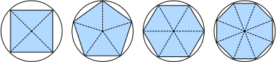

```{.python .input}
%load_ext d2lbook.tab
tab.interact_select(['mxnet', 'pytorch', 'tensorflow', 'jax'])
```

# Matematinė analizė
:label:`sec_calculus`

Ilgą laiką apskritimo ploto
apskaičiavimas išliko paslaptimi.
Tada senovės Graikijoje matematikas Archimedas
sugalvojo gudrią idėją –
į apskritimo vidų įbrėžti daugiakampių seką
su vis didesniu viršūnių skaičiumi
(:numref:`fig_circle_area`).
Daugiakampiui su $n$ viršūnių
gauname $n$ trikampių.
Kiekvieno trikampio aukštis artėja prie spindulio $r$,
kai apskritimą skaidome vis smulkiau.
Tuo pat metu jo pagrindas artėja prie $2 \pi r/n$,
nes lanko ir sekantės santykis artėja prie 1,
kai viršūnių skaičius didelis.
Taigi daugiakampio plotas artėja prie
$n \cdot r \cdot \frac{1}{2} (2 \pi r/n) = \pi r^2$.


:label:`fig_circle_area`

Ši ribinė procedūra yra tiek *diferencialinio*, tiek *integralinio skaičiavimo*
šaknis.
Pirmasis gali pasakyti, kaip padidinti
arba sumažinti funkcijos reikšmę
keičiant jos argumentus.
Tai praverčia sprendžiant *optimizavimo uždavinius*,
su kuriais susiduriame giliajame mokyme,
kai pakartotinai atnaujiname savo parametrus,
kad sumažintume nuostolių funkciją.
Optimizavimas nagrinėja, kaip pritaikyti modelius apmokymo duomenims,
o matematinė analizė yra svarbiausia jo būtina sąlyga.
Tačiau nepamirškite, kad mūsų galutinis tikslas
yra gerai veikti su *anksčiau nematytais* duomenimis.
Ši problema vadinama *generalizacija*
ir bus pagrindinis kitų skyrių dėmesio objektas.

```{.python .input}
%%tab mxnet
%matplotlib inline
from d2l import mxnet as d2l
from matplotlib_inline import backend_inline
from mxnet import np, npx
npx.set_np()
```

```{.python .input}
%%tab pytorch
%matplotlib inline
from d2l import torch as d2l
from matplotlib_inline import backend_inline
import numpy as np
```

```{.python .input}
%%tab tensorflow
%matplotlib inline
from d2l import tensorflow as d2l
from matplotlib_inline import backend_inline
import numpy as np
```

```{.python .input}
%%tab jax
%matplotlib inline
from d2l import jax as d2l
from matplotlib_inline import backend_inline
import numpy as np
```

## Išvestinės ir diferencijavimas

Paprasčiau tariant, *išvestinė* yra funkcijos kitimo greitis
atsižvelgiant į jos argumentų pokyčius.
Išvestinės gali pasakyti, kaip sparčiai nuostolių funkcija
didėtų ar mažėtų, jei
kiekvieną parametrą *padidintume* arba *sumažintume*
be galo mažu dydžiu.
Formaliai funkcijoms $f: \mathbb{R} \rightarrow \mathbb{R}$,
atvaizduojančioms skaliarus į skaliarus,
[**$f$ *išvestinė* taške $x$ apibrėžiama kaip**]

(**$$f'(x) = \lim_{h \rightarrow 0} \frac{f(x+h) - f(x)}{h}.$$**)
:eqlabel:`eq_derivative`

Šis narys dešinėje pusėje vadinamas *riba*
ir parodo, kas nutinka
išraiškos reikšmei,
kai nurodytas kintamasis
artėja prie tam tikros reikšmės.
Ši riba parodo,
prie ko konverguoja pokyčio $h$
ir funkcijos reikšmės pokyčio
$f(x + h) - f(x)$ santykis,
kai jo dydį mažiname iki nulio.

Kai $f'(x)$ egzistuoja, sakoma, kad $f$
yra *diferencijuojama* taške $x$;
ir kai $f'(x)$ egzistuoja visiems $x$
tam tikroje aibėje, pvz., intervale $[a,b]$,
sakome, kad $f$ yra diferencijuojama šioje aibėje.
Ne visos funkcijos yra diferencijuojamos,
įskaitant daugelį tų, kurias norime optimizuoti,
pvz., tikslumą ir plotą po imtuvo darbo charakteristikos kreive (angl. *area under the receiving operating characteristic*, AUC).
Tačiau kadangi nuostolių išvestinės skaičiavimas yra lemiamas žingsnis beveik visuose
giliųjų neuroninių tinklų apmokymo algoritmuose,
dažnai vietoj to optimizuojame diferencijuojamą *pakaitinę* funkciją.


Išvestinę
$f'(x)$
galime interpretuoti kaip $f(x)$ *momentinį* kitimo greitį
$x$ atžvilgiu.
Sudarykime šiek tiek intuicijos pavyzdžiu.
(**Apibrėžkime $u = f(x) = 3x^2-4x$.**)

```{.python .input}
%%tab mxnet
def f(x):
    return 3 * x ** 2 - 4 * x
```

```{.python .input}
%%tab pytorch
def f(x):
    return 3 * x ** 2 - 4 * x
```

```{.python .input}
%%tab tensorflow
def f(x):
    return 3 * x ** 2 - 4 * x
```

```{.python .input}
%%tab jax
def f(x):
    return 3 * x ** 2 - 4 * x
```

[**Nustatę $x=1$, matome, kad $\frac{f(x+h) - f(x)}{h}$**] (**artėja prie $2$,
kai $h$ artėja prie $0$.**)
Nors šiam eksperimentui trūksta
matematinio įrodymo griežtumo,
greitai matome, kad iš tiesų $f'(1) = 2$.

```{.python .input}
%%tab all
for h in 10.0**np.arange(-1, -6, -1):
    print(f'h={h:.5f}, numerical limit={(f(1+h)-f(1))/h:.5f}')
```

Yra keletas ekvivalenčių išvestinių žymėjimo sutarčių.
Kai duota $y = f(x)$, šios išraiškos yra ekvivalenčios:

$$f'(x) = y' = \frac{dy}{dx} = \frac{df}{dx} = \frac{d}{dx} f(x) = Df(x) = D_x f(x),$$

kur simboliai $\frac{d}{dx}$ ir $D$ yra *diferencijavimo operatoriai*.
Toliau pateikiame kai kurių dažnų funkcijų išvestines:

$$\begin{aligned} \frac{d}{dx} C & = 0 && \textrm{for any constant $C$} \\ \frac{d}{dx} x^n & = n x^{n-1} && \textrm{for } n \neq 0 \\ \frac{d}{dx} e^x & = e^x \\ \frac{d}{dx} \ln x & = x^{-1}. \end{aligned}$$

Funkcijos, sudarytos iš diferencijuojamų funkcijų,
dažnai pačios yra diferencijuojamos.
Šios taisyklės praverčia
dirbant su bet kurių diferencijuojamų funkcijų $f$ ir $g$
bei konstantos $C$ kompozicijomis.

$$\begin{aligned} \frac{d}{dx} [C f(x)] & = C \frac{d}{dx} f(x) && \textrm{Constant multiple rule} \\ \frac{d}{dx} [f(x) + g(x)] & = \frac{d}{dx} f(x) + \frac{d}{dx} g(x) && \textrm{Sum rule} \\ \frac{d}{dx} [f(x) g(x)] & = f(x) \frac{d}{dx} g(x) + g(x) \frac{d}{dx} f(x) && \textrm{Product rule} \\ \frac{d}{dx} \frac{f(x)}{g(x)} & = \frac{g(x) \frac{d}{dx} f(x) - f(x) \frac{d}{dx} g(x)}{g^2(x)} && \textrm{Quotient rule} \end{aligned}$$

Pasinaudoję tuo, galime pritaikyti taisykles
ir rasti $3 x^2 - 4x$ išvestinę:

$$\frac{d}{dx} [3 x^2 - 4x] = 3 \frac{d}{dx} x^2 - 4 \frac{d}{dx} x = 6x - 4.$$

Įrašę $x = 1$, matome, kad iš tiesų
išvestinė šioje vietoje lygi $2$.
Atkreipkite dėmesį, kad išvestinės mums pasako
funkcijos *nuolydį*
tam tikroje vietoje.

## Vizualizavimo priemonės

[**Funkcijų nuolydžius galime vizualizuoti naudodami `matplotlib` biblioteką**].
Turime apibrėžti keletą funkcijų.
Kaip rodo pavadinimas, `use_svg_display`
nurodo `matplotlib` išvesti grafiką
SVG formatu, kad vaizdai būtų ryškesni.
Komentaras `#@save` yra speciali modifikacija,
leidžianti išsaugoti bet kurią funkciją,
klasę ar kitą kodo bloką `d2l` pakete,
kad galėtume jį iškviesti vėliau
nekartodami kodo,
pvz., per `d2l.use_svg_display()`.

```{.python .input}
%%tab all
def use_svg_display():  #@save
    """Use the svg format to display a plot in Jupyter."""
    backend_inline.set_matplotlib_formats('svg')
```

Patogiai galime nustatyti paveikslų dydžius funkcija `set_figsize`.
Kadangi importo sakinys `from matplotlib import pyplot as plt`
`d2l` pakete buvo pažymėtas `#@save`, galime kviesti `d2l.plt`.

```{.python .input}
%%tab all
def set_figsize(figsize=(3.5, 2.5)):  #@save
    """Set the figure size for matplotlib."""
    use_svg_display()
    d2l.plt.rcParams['figure.figsize'] = figsize
```

Funkcija `set_axes` gali susieti ašis
su savybėmis, įskaitant užrašus, intervalus
ir mastelius.

```{.python .input}
%%tab all
#@save
def set_axes(axes, xlabel, ylabel, xlim, ylim, xscale, yscale, legend):
    """Set the axes for matplotlib."""
    axes.set_xlabel(xlabel), axes.set_ylabel(ylabel)
    axes.set_xscale(xscale), axes.set_yscale(yscale)
    axes.set_xlim(xlim),     axes.set_ylim(ylim)
    if legend:
        axes.legend(legend)
    axes.grid()
```

Naudodami šias tris funkcijas, galime apibrėžti funkciją `plot`,
kuri uždeda kelias kreives viena ant kitos.
Didelė kodo dalis čia tik užtikrina,
kad įvesčių dydžiai ir formos sutaptų.

```{.python .input}
%%tab all
#@save
def plot(X, Y=None, xlabel=None, ylabel=None, legend=[], xlim=None,
         ylim=None, xscale='linear', yscale='linear',
         fmts=('-', 'm--', 'g-.', 'r:'), figsize=(3.5, 2.5), axes=None):
    """Plot data points."""

    def has_one_axis(X):  # True if X (tensor or list) has 1 axis
        return (hasattr(X, "ndim") and X.ndim == 1 or isinstance(X, list)
                and not hasattr(X[0], "__len__"))
    
    if has_one_axis(X): X = [X]
    if Y is None:
        X, Y = [[]] * len(X), X
    elif has_one_axis(Y):
        Y = [Y]
    if len(X) != len(Y):
        X = X * len(Y)
        
    set_figsize(figsize)
    if axes is None:
        axes = d2l.plt.gca()
    axes.cla()
    for x, y, fmt in zip(X, Y, fmts):
        axes.plot(x,y,fmt) if len(x) else axes.plot(y,fmt)
    set_axes(axes, xlabel, ylabel, xlim, ylim, xscale, yscale, legend)
```

Dabar galime [**nubraižyti funkciją $u = f(x)$ ir jos liestinę $y = 2x - 3$ taške $x=1$**],
kur koeficientas $2$ yra liestinės nuolydis.

```{.python .input}
%%tab all
x = np.arange(0, 3, 0.1)
plot(x, [f(x), 2 * x - 3], 'x', 'f(x)', legend=['f(x)', 'Tangent line (x=1)'])
```

## Dalinės išvestinės ir gradientai
:label:`subsec_calculus-grad`

Iki šiol diferencijavome
tik vieno kintamojo funkcijas.
Giliajame mokyme taip pat reikia dirbti
su *daugelio* kintamųjų funkcijomis.
Trumpai pristatome išvestinės sąvokas,
taikomas tokioms *daugelio kintamųjų* funkcijoms.


Tegul $y = f(x_1, x_2, \ldots, x_n)$ yra funkcija su $n$ kintamųjų.
$y$ *dalinė išvestinė*
$i$-ojo jos parametro $x_i$ atžvilgiu yra

$$ \frac{\partial y}{\partial x_i} = \lim_{h \rightarrow 0} \frac{f(x_1, \ldots, x_{i-1}, x_i+h, x_{i+1}, \ldots, x_n) - f(x_1, \ldots, x_i, \ldots, x_n)}{h}.$$


Kad apskaičiuotume $\frac{\partial y}{\partial x_i}$,
galime laikyti $x_1, \ldots, x_{i-1}, x_{i+1}, \ldots, x_n$ konstantomis
ir apskaičiuoti $y$ išvestinę $x_i$ atžvilgiu.
Šios dalinių išvestinių žymėjimo sutartys
visos yra dažnos ir reiškia tą patį:

$$\frac{\partial y}{\partial x_i} = \frac{\partial f}{\partial x_i} = \partial_{x_i} f = \partial_i f = f_{x_i} = f_i = D_i f = D_{x_i} f.$$

Daugelio kintamųjų funkcijos dalines išvestines
visų jos kintamųjų atžvilgiu galime sujungti,
kad gautume vektorių, vadinamą
funkcijos *gradientu*.
Tarkime, kad funkcijos
$f: \mathbb{R}^n \rightarrow \mathbb{R}$
įvestis yra $n$-matis vektorius
$\mathbf{x} = [x_1, x_2, \ldots, x_n]^\top$,
o išvestis – skaliaras.
Funkcijos $f$ gradientas
$\mathbf{x}$ atžvilgiu
yra $n$ dalinių išvestinių vektorius:

$$\nabla_{\mathbf{x}} f(\mathbf{x}) = \left[\partial_{x_1} f(\mathbf{x}), \partial_{x_2} f(\mathbf{x}), \ldots
\partial_{x_n} f(\mathbf{x})\right]^\top.$$ 

Kai nėra dviprasmybės,
$\nabla_{\mathbf{x}} f(\mathbf{x})$
paprastai pakeičiamas
$\nabla f(\mathbf{x})$.
Šios taisyklės praverčia
diferencijuojant daugelio kintamųjų funkcijas:

* Visoms $\mathbf{A} \in \mathbb{R}^{m \times n}$ turime $\nabla_{\mathbf{x}} \mathbf{A} \mathbf{x} = \mathbf{A}^\top$ ir $\nabla_{\mathbf{x}} \mathbf{x}^\top \mathbf{A}  = \mathbf{A}$.
* Kvadratinėms matricoms $\mathbf{A} \in \mathbb{R}^{n \times n}$ turime $\nabla_{\mathbf{x}} \mathbf{x}^\top \mathbf{A} \mathbf{x}  = (\mathbf{A} + \mathbf{A}^\top)\mathbf{x}$ ir visų pirma
$\nabla_{\mathbf{x}} \|\mathbf{x} \|^2 = \nabla_{\mathbf{x}} \mathbf{x}^\top \mathbf{x} = 2\mathbf{x}$.

Panašiai bet kuriai matricai $\mathbf{X}$
turime $\nabla_{\mathbf{X}} \|\mathbf{X} \|_\textrm{F}^2 = 2\mathbf{X}$.


## Grandinės taisyklė

Giliajame mokyme dominantys gradientai
dažnai sunkiai apskaičiuojami,
nes dirbame su
giliai įdėtomis funkcijomis
(funkcijų (funkcijų...)).
Laimei, *grandinės taisyklė* tuo pasirūpina.
Grįždami prie vieno kintamojo funkcijų,
tarkime, kad $y = f(g(x))$
ir kad pagrindinės funkcijos
$y=f(u)$ ir $u=g(x)$
abi yra diferencijuojamos.
Grandinės taisyklė teigia, kad


$$\frac{dy}{dx} = \frac{dy}{du} \frac{du}{dx}.$$


Grįždami prie daugelio kintamųjų funkcijų,
tarkime, kad $y = f(\mathbf{u})$ turi kintamuosius
$u_1, u_2, \ldots, u_m$,
kur kiekvienas $u_i = g_i(\mathbf{x})$
turi kintamuosius $x_1, x_2, \ldots, x_n$,
t. y. $\mathbf{u} = g(\mathbf{x})$.
Tada grandinės taisyklė teigia, kad

$$\frac{\partial y}{\partial x_{i}} = \frac{\partial y}{\partial u_{1}} \frac{\partial u_{1}}{\partial x_{i}} + \frac{\partial y}{\partial u_{2}} \frac{\partial u_{2}}{\partial x_{i}} + \ldots + \frac{\partial y}{\partial u_{m}} \frac{\partial u_{m}}{\partial x_{i}} \ \textrm{ and so } \ \nabla_{\mathbf{x}} y =  \mathbf{A} \nabla_{\mathbf{u}} y,$$

kur $\mathbf{A} \in \mathbb{R}^{n \times m}$ yra *matrica*,
kurioje yra vektoriaus $\mathbf{u}$
išvestinė vektoriaus $\mathbf{x}$ atžvilgiu.
Taigi gradiento apskaičiavimui reikia
apskaičiuoti vektoriaus ir matricos sandaugą.
Tai viena pagrindinių priežasčių, kodėl tiesinė algebra
yra tokia neatsiejama dalis
kuriant giliojo mokymosi sistemas.


## Diskusija

Nors vos paliečiame gilią temą,
jau išryškėja keletas sąvokų:
pirma, diferencijavimo kompozicijos taisykles
galima taikyti įprastai, todėl
galime *automatiškai* skaičiuoti gradientus.
Ši užduotis nereikalauja kūrybiškumo, todėl
savo pažintines galias galime nukreipti kitur.
Antra, skaičiuojant vektorines reikšmes turinčių funkcijų išvestines,
reikia dauginti matricas, sekant
kintamųjų priklausomybės grafą nuo išvesties iki įvesties.
Visų pirma šis grafas einamas *tiesiogine* kryptimi,
kai vertiname funkciją,
ir *atgaline* kryptimi,
kai skaičiuojame gradientus.
Vėlesniuose skyriuose formaliai pristatysime atgalinį sklidimą –
skaičiavimo procedūrą grandinės taisyklei taikyti.

Optimizavimo požiūriu gradientai leidžia mums
nustatyti, kaip perkelti modelio parametrus,
kad sumažintume nuostolius,
o kiekvienam visoje knygoje naudojamų optimizavimo algoritmų žingsniui
reikės apskaičiuoti gradientą.

## Pratimai

1. Iki šiol išvestinių taisykles priėmėme kaip savaime suprantamas.
   Naudodami apibrėžtį ir ribas, įrodykite savybes
   (i) $f(x) = c$, (ii) $f(x) = x^n$, (iii) $f(x) = e^x$ ir (iv) $f(x) = \log x$.
1. Panašiai įrodykite sandaugos, sumos ir dalmens taisykles iš pirmųjų principų.
1. Įrodykite, kad daugiklio konstantos taisyklė išplaukia kaip atskiras sandaugos taisyklės atvejis.
1. Apskaičiuokite $f(x) = x^x$ išvestinę.
1. Ką reiškia, kad $f'(x) = 0$ kuriam nors $x$?
   Pateikite funkcijos $f$ ir vietos $x$ pavyzdį, kuriam tai galėtų galioti.
1. Nubraižykite funkciją $y = f(x) = x^3 - \frac{1}{x}$
   ir jos liestinę taške $x = 1$.
1. Raskite funkcijos
   $f(\mathbf{x}) = 3x_1^2 + 5e^{x_2}$ gradientą.
1. Koks yra funkcijos
   $f(\mathbf{x}) = \|\mathbf{x}\|_2$ gradientas? Kas nutinka, kai $\mathbf{x} = \mathbf{0}$?
1. Ar galite užrašyti grandinės taisyklę atvejui,
   kai $u = f(x, y, z)$ ir $x = x(a, b)$, $y = y(a, b)$ bei $z = z(a, b)$?
1. Kai duota apgręžiama funkcija $f(x)$,
   apskaičiuokite jos atvirkštinės funkcijos $f^{-1}(x)$ išvestinę.
   Čia turime, kad $f^{-1}(f(x)) = x$ ir atvirkščiai $f(f^{-1}(y)) = y$.
   Užuomina: savo išvedime naudokite šias savybes.

:begin_tab:`mxnet`
[Diskusijos](https://discuss.d2l.ai/t/32)
:end_tab:

:begin_tab:`pytorch`
[Diskusijos](https://discuss.d2l.ai/t/33)
:end_tab:

:begin_tab:`tensorflow`
[Diskusijos](https://discuss.d2l.ai/t/197)
:end_tab:

:begin_tab:`jax`
[Diskusijos](https://discuss.d2l.ai/t/17969)
:end_tab:
