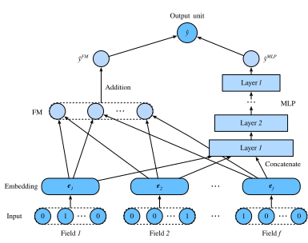

# Giliosios faktorizavimo mašinos

Efektyvių požymių derinių mokymasis yra esminis paspaudimų dažnio prognozavimo užduoties sėkmei. Faktorizavimo mašinos modeliuoja požymių sąveikas tiesiniu būdu (pvz., bitiesinėmis sąveikomis). To dažnai nepakanka realaus pasaulio duomenims, kuriuose būdingos požymių kryžminimo struktūros paprastai yra labai sudėtingos ir netiesinės. Dar blogiau, praktikoje faktorizavimo mašinose paprastai naudojamos antrosios eilės požymių sąveikos. Aukštesnių laipsnių požymių derinius modeliuoti faktorizavimo mašinomis teoriškai įmanoma, bet paprastai to nedaroma dėl skaitinio nestabilumo ir didelio skaičiavimo sudėtingumo.

Vienas veiksmingas sprendimas yra naudoti gilieji neuroniniai tinklai. Gilieji neuroniniai tinklai yra galingi požymių vaizdavimų mokymosi srityje ir gali išmokti sudėtingas požymių sąveikas. Todėl natūralu integruoti giliuosius neuroninius tinklus į faktorizavimo mašinas. Netiesinių transformacijų sluoksnių pridėjimas prie faktorizavimo mašinų suteikia joms gebėjimą modeliuoti ir žemesnės, ir aukštesnės eilės požymių derinius. Be to, giliaisiais neuroniniais tinklais galima užfiksuoti ir būdingas netiesines įvesčių struktūras. Šiame skyrelyje pristatysime reprezentatyvų modelį, vadinamą giliosiomis faktorizavimo mašinomis (angl. *deep factorization machines*, DeepFM) :cite:`Guo.Tang.Ye.ea.2017`, kuris sujungia FM ir giliuosius neuroninius tinklus.


## Modelio architektūros

DeepFM sudaro FM komponentas ir gilusis komponentas, integruoti lygiagrečioje struktūroje. FM komponentas yra toks pats kaip dvikryptės faktorizavimo mašinos, naudojamos žemesnės eilės požymių sąveikoms modeliuoti. Gilusis komponentas yra MLP, naudojamas aukštesnės eilės požymių sąveikoms ir netiesiškumams užfiksuoti. Šie du komponentai dalijasi tomis pačiomis įvestimis ir įterpiniais, o jų išvestys sumuojamos į galutinę prognozę. Verta pažymėti, kad DeepFM dvasia primena Wide \& Deep architektūrą, galinčią užfiksuoti ir įsiminimą, ir apibendrinimą. DeepFM pranašumas prieš Wide \& Deep modelį yra tas, kad jis sumažina rankinės požymių inžinerijos pastangas automatiškai nustatydamas požymių derinius.

Trumpumo dėlei FM komponento aprašymą praleidžiame ir išvestį žymime $\hat{y}^{(FM)}$. Daugiau informacijos skaitytojai ras ankstesniame skyrelyje. Tegul $\mathbf{e}_i \in \mathbb{R}^{k}$ žymi $i$-ojo lauko latentinį požymių vektorių. Giliojo komponento įvestis yra visų laukų tankiųjų įterpinių, surastų pagal retą kategorinių požymių įvestį, konkatenacija, žymima:

$$
\mathbf{z}^{(0)}  = [\mathbf{e}_1, \mathbf{e}_2, ..., \mathbf{e}_f],
$$

kur $f$ yra laukų skaičius. Ji paduodama į šį neuroninį tinklą:

$$
\mathbf{z}^{(l)}  = \alpha(\mathbf{W}^{(l)}\mathbf{z}^{(l-1)} + \mathbf{b}^{(l)}),
$$

kur $\alpha$ yra aktyvinimo funkcija. $\mathbf{W}_{l}$ ir $\mathbf{b}_{l}$ yra $l$-ojo sluoksnio svoris ir poslinkis. Tegul $y_{DNN}$ žymi prognozės išvestį. Galutinė DeepFM prognozė yra FM ir DNN išvesčių suma. Taigi turime:

$$
\hat{y} = \sigma(\hat{y}^{(FM)} + \hat{y}^{(DNN)}),
$$

kur $\sigma$ yra sigmoidinė funkcija. DeepFM architektūra iliustruota žemiau.


Verta pažymėti, kad DeepFM nėra vienintelis būdas sujungti giliuosius neuroninius tinklus su FM. Taip pat galime pridėti netiesinius sluoksnius virš požymių sąveikų :cite:`He.Chua.2017`.

```{.python .input  n=2}
#@tab mxnet
from d2l import mxnet as d2l
from mxnet import init, gluon, np, npx
from mxnet.gluon import nn
import os

npx.set_np()
```

## DeepFM įgyvendinimas
DeepFM įgyvendinimas panašus į FM. FM dalį paliekame nepakeistą ir naudojame MLP bloką su `relu` kaip aktyvinimo funkcija. Modeliui reguliarizuoti taip pat naudojamas dropout. MLP neuronų skaičių galima keisti hiperparametru `mlp_dims`.

```{.python .input  n=2}
#@tab mxnet
class DeepFM(nn.Block):
    def __init__(self, field_dims, num_factors, mlp_dims, drop_rate=0.1):
        super(DeepFM, self).__init__()
        num_inputs = int(sum(field_dims))
        self.embedding = nn.Embedding(num_inputs, num_factors)
        self.fc = nn.Embedding(num_inputs, 1)
        self.linear_layer = nn.Dense(1, use_bias=True)
        input_dim = self.embed_output_dim = len(field_dims) * num_factors
        self.mlp = nn.Sequential()
        for dim in mlp_dims:
            self.mlp.add(nn.Dense(dim, 'relu', True, in_units=input_dim))
            self.mlp.add(nn.Dropout(rate=drop_rate))
            input_dim = dim
        self.mlp.add(nn.Dense(in_units=input_dim, units=1))

    def forward(self, x):
        embed_x = self.embedding(x)
        square_of_sum = np.sum(embed_x, axis=1) ** 2
        sum_of_square = np.sum(embed_x ** 2, axis=1)
        inputs = np.reshape(embed_x, (-1, self.embed_output_dim))
        x = self.linear_layer(self.fc(x).sum(1)) \
            + 0.5 * (square_of_sum - sum_of_square).sum(1, keepdims=True) \
            + self.mlp(inputs)
        x = npx.sigmoid(x)
        return x
```

## Modelio apmokymas ir vertinimas
Duomenų įkėlimo procesas yra toks pat kaip FM. DeepFM MLP komponentą nustatome kaip trijų sluoksnių tankųjį tinklą su piramidės struktūra (30-20-10). Visi kiti hiperparametrai lieka tokie patys kaip FM.

```{.python .input  n=4}
#@tab mxnet
batch_size = 2048
data_dir = d2l.download_extract('ctr')
train_data = d2l.CTRDataset(os.path.join(data_dir, 'train.csv'))
test_data = d2l.CTRDataset(os.path.join(data_dir, 'test.csv'),
                           feat_mapper=train_data.feat_mapper,
                           defaults=train_data.defaults)
field_dims = train_data.field_dims
train_iter = gluon.data.DataLoader(
    train_data, shuffle=True, last_batch='rollover', batch_size=batch_size,
    num_workers=d2l.get_dataloader_workers())
test_iter = gluon.data.DataLoader(
    test_data, shuffle=False, last_batch='rollover', batch_size=batch_size,
    num_workers=d2l.get_dataloader_workers())
devices = d2l.try_all_gpus()
net = DeepFM(field_dims, num_factors=10, mlp_dims=[30, 20, 10])
net.initialize(init.Xavier(), ctx=devices)
lr, num_epochs, optimizer = 0.01, 30, 'adam'
trainer = gluon.Trainer(net.collect_params(), optimizer,
                        {'learning_rate': lr})
loss = gluon.loss.SigmoidBinaryCrossEntropyLoss()
d2l.train_ch13(net, train_iter, test_iter, loss, trainer, num_epochs, devices)
```

Palyginti su FM, DeepFM greičiau konverguoja ir pasiekia geresnį našumą.

## Santrauka

* Neuroninių tinklų integravimas į FM leidžia jam modeliuoti sudėtingas ir aukštesnės eilės sąveikas.
* DeepFM pranoksta originalų FM reklamos duomenų rinkinyje.

## Pratimai

* Keiskite MLP struktūrą, kad patikrintumėte jos poveikį modelio našumui.
* Pakeiskite duomenų rinkinį į Criteo ir palyginkite jį su originaliu FM modeliu.

:begin_tab:`mxnet`
[Diskusijos](https://discuss.d2l.ai/t/407)
:end_tab:
