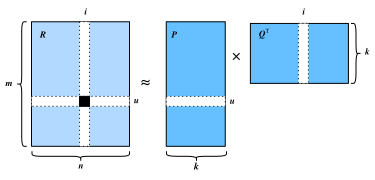

# Matricos faktorizavimas

Matricos faktorizavimas :cite:`Koren.Bell.Volinsky.2009` yra gerai įsitvirtinęs rekomendacinių sistemų literatūros algoritmas. Pirmąją matricos faktorizavimo modelio versiją pasiūlė Simon Funk garsiame [tinklaraščio
įraše](https://sifter.org/%7Esimon/journal/20061211.html), kuriame aprašė sąveikų matricos faktorizavimo idėją. Vėliau ji tapo plačiai žinoma dėl 2006 m. vykusio „Netflix“ konkurso. Tuo metu „Netflix“, medijų transliavimo ir vaizdo įrašų nuomos įmonė, paskelbė konkursą savo rekomendacinės sistemos našumui pagerinti. Geriausia komanda, galinti 10 procentų pagerinti „Netflix“ bazinį lygį (t. y. „Cinematch“), laimėtų milijono JAV dolerių prizą. Todėl šis konkursas pritraukė
daug dėmesio rekomendacinių sistemų tyrimų sričiai. Vėliau pagrindinį prizą laimėjo komanda BellKor's Pragmatic Chaos – jungtinė BellKor, Pragmatic Theory ir BigChaos komanda (dabar nereikia sukti galvos dėl šių algoritmų). Nors galutinis rezultatas buvo ansamblinio sprendimo (t. y. daugelio algoritmų derinio) vaisius, matricos faktorizavimo algoritmas galutiniame mišinyje atliko lemiamą vaidmenį. „Netflix“ pagrindinio prizo sprendimo techninė ataskaita :cite:`Toscher.Jahrer.Bell.2009` pateikia išsamų pritaikyto modelio pristatymą. Šiame skyrelyje panagrinėsime matricos faktorizavimo modelį ir jo įgyvendinimą išsamiai.


## Matricos faktorizavimo modelis

Matricos faktorizavimas yra kolaboratyviojo filtravimo modelių klasė. Konkrečiai, modelis faktorizuoja naudotojų ir elementų sąveikų matricą (pvz., įvertinimų matricą) į dviejų žemesnio rango matricų sandaugą, taip užfiksuodamas žemo rango naudotojų ir elementų sąveikų struktūrą.

Tegul $\mathbf{R} \in \mathbb{R}^{m \times n}$ žymi sąveikų matricą su $m$ naudotojų ir $n$ elementų, o $\mathbf{R}$ reikšmės reiškia aiškiuosius įvertinimus. Naudotojų ir elementų sąveika bus faktorizuojama į naudotojų latentinę matricą $\mathbf{P} \in \mathbb{R}^{m \times k}$ ir elementų latentinę matricą $\mathbf{Q} \in \mathbb{R}^{n \times k}$, kur $k \ll m, n$ yra latentinių veiksnių dydis. Tegul $\mathbf{p}_u$ žymi $u$-ąją $\mathbf{P}$ eilutę, o $\mathbf{q}_i$ – $i$-ąją $\mathbf{Q}$ eilutę. Duotam elementui $i$ vektoriaus $\mathbf{q}_i$ elementai matuoja, kiek elementas turi tokias charakteristikas kaip filmo žanrai ir kalbos. Duotam naudotojui $u$ vektoriaus $\mathbf{p}_u$ elementai matuoja, kiek naudotojas domisi atitinkamomis elementų charakteristikomis. Šie latentiniai veiksniai gali matuoti akivaizdžias dimensijas, kaip minėta pavyzdžiuose, arba būti visiškai neinterpretuojami. Prognozuojami įvertinimai gali būti apskaičiuojami kaip

$$\hat{\mathbf{R}} = \mathbf{PQ}^\top$$

kur $\hat{\mathbf{R}}\in \mathbb{R}^{m \times n}$ yra prognozuojamų įvertinimų matrica, kurios forma tokia pati kaip $\mathbf{R}$. Viena pagrindinių šios prognozavimo taisyklės problemų yra ta, kad negalima modeliuoti naudotojų ir elementų poslinkių. Pavyzdžiui, kai kurie naudotojai linkę skirti aukštesnius įvertinimus arba kai kurie elementai dėl prastesnės kokybės visada gauna žemesnius. Šie poslinkiai yra įprasti realaus pasaulio taikymuose. Kad šiuos poslinkius užfiksuotume, įvedami naudotojui ir elementui specifiniai poslinkio nariai. Konkrečiai, naudotojo $u$ elementui $i$ skiriamas prognozuojamas įvertinimas apskaičiuojamas pagal

$$
\hat{\mathbf{R}}_{ui} = \mathbf{p}_u\mathbf{q}^\top_i + b_u + b_i
$$

Tada matricos faktorizavimo modelį apmokome minimizuodami vidutinę kvadratinę paklaidą tarp prognozuojamų ir tikrų įvertinimų. Tikslo funkcija apibrėžiama taip:

$$
\underset{\mathbf{P}, \mathbf{Q}, b}{\mathrm{argmin}} \sum_{(u, i) \in \mathcal{K}} \| \mathbf{R}_{ui} -
\hat{\mathbf{R}}_{ui} \|^2 + \lambda (\| \mathbf{P} \|^2_F + \| \mathbf{Q}
\|^2_F + b_u^2 + b_i^2 )
$$

kur $\lambda$ žymi reguliarizavimo koeficientą. Reguliarizavimo narys $\lambda (\| \mathbf{P} \|^2_F + \| \mathbf{Q}
\|^2_F + b_u^2 + b_i^2 )$ naudojamas persimokymui išvengti baudžiant parametrų dydį. Poros $(u, i)$, kurioms $\mathbf{R}_{ui}$ žinomas, saugomos aibėje
$\mathcal{K}=\{(u, i) \mid \mathbf{R}_{ui} \textrm{ yra žinomas}\}$. Modelio parametrus galima išmokti optimizavimo algoritmu, pavyzdžiui, stochastiniu gradientiniu nusileidimu ar Adam.

Intuityvi matricos faktorizavimo modelio iliustracija pateikta žemiau:



Likusioje šio skyrelio dalyje paaiškinsime matricos faktorizavimo įgyvendinimą ir apmokysime modelį MovieLens duomenų rinkinyje.

```{.python .input  n=2}
#@tab mxnet
from d2l import mxnet as d2l
from mxnet import autograd, gluon, np, npx
from mxnet.gluon import nn
import mxnet as mx
npx.set_np()
```

## Modelio įgyvendinimas

Pirmiausia įgyvendiname aukščiau aprašytą matricos faktorizavimo modelį. Naudotojų ir elementų latentinius veiksnius galima sukurti naudojant `nn.Embedding`. Parametras `input_dim` yra elementų ar naudotojų skaičius, o `output_dim` – latentinių veiksnių dimensija $k$. Taip pat galime naudoti `nn.Embedding` naudotojų ir elementų poslinkiams sukurti, nustatydami `output_dim` lygų vienam. Funkcijoje `forward` naudotojų ir elementų ID naudojami įterpiniams surasti.

```{.python .input  n=4}
#@tab mxnet
class MF(nn.Block):
    def __init__(self, num_factors, num_users, num_items, **kwargs):
        super(MF, self).__init__(**kwargs)
        self.P = nn.Embedding(input_dim=num_users, output_dim=num_factors)
        self.Q = nn.Embedding(input_dim=num_items, output_dim=num_factors)
        self.user_bias = nn.Embedding(num_users, 1)
        self.item_bias = nn.Embedding(num_items, 1)

    def forward(self, user_id, item_id):
        P_u = self.P(user_id)
        Q_i = self.Q(item_id)
        b_u = self.user_bias(user_id)
        b_i = self.item_bias(item_id)
        outputs = (P_u * Q_i).sum(axis=1) + np.squeeze(b_u) + np.squeeze(b_i)
        return outputs.flatten()
```

## Vertinimo matai

Toliau įgyvendiname RMSE (vidutinės kvadratinės paklaidos šaknies) matą, kuris įprastai naudojamas modelio prognozuojamų įvertinimų ir faktiškai stebėtų įvertinimų (tikrųjų reikšmių) skirtumams matuoti :cite:`Gunawardana.Shani.2015`. RMSE apibrėžiamas taip:

$$
\textrm{RMSE} = \sqrt{\frac{1}{|\mathcal{T}|}\sum_{(u, i) \in \mathcal{T}}(\mathbf{R}_{ui} -\hat{\mathbf{R}}_{ui})^2}
$$

kur $\mathcal{T}$ yra aibė, sudaryta iš naudotojų ir elementų porų, kuriose norite vertinti. $|\mathcal{T}|$ yra šios aibės dydis. Galime naudoti `mx.metric` pateiktą RMSE funkciją.

```{.python .input  n=3}
#@tab mxnet
def evaluator(net, test_iter, devices):
    rmse = mx.metric.RMSE()  # Get the RMSE
    rmse_list = []
    for idx, (users, items, ratings) in enumerate(test_iter):
        u = gluon.utils.split_and_load(users, devices, even_split=False)
        i = gluon.utils.split_and_load(items, devices, even_split=False)
        r_ui = gluon.utils.split_and_load(ratings, devices, even_split=False)
        r_hat = [net(u, i) for u, i in zip(u, i)]
        rmse.update(labels=r_ui, preds=r_hat)
        rmse_list.append(rmse.get()[1])
    return float(np.mean(np.array(rmse_list)))
```

## Modelio apmokymas ir vertinimas


Apmokymo funkcijoje naudojame $\ell_2$ nuostolį su svorių mažinimu. Svorių mažinimo mechanizmas turi tokį patį poveikį kaip $\ell_2$ reguliarizavimas.

```{.python .input  n=4}
#@tab mxnet
#@save
def train_recsys_rating(net, train_iter, test_iter, loss, trainer, num_epochs,
                        devices=d2l.try_all_gpus(), evaluator=None,
                        **kwargs):
    timer = d2l.Timer()
    animator = d2l.Animator(xlabel='epoch', xlim=[1, num_epochs], ylim=[0, 2],
                            legend=['train loss', 'test RMSE'])
    for epoch in range(num_epochs):
        metric, l = d2l.Accumulator(3), 0.
        for i, values in enumerate(train_iter):
            timer.start()
            input_data = []
            values = values if isinstance(values, list) else [values]
            for v in values:
                input_data.append(gluon.utils.split_and_load(v, devices))
            train_feat = input_data[:-1] if len(values) > 1 else input_data
            train_label = input_data[-1]
            with autograd.record():
                preds = [net(*t) for t in zip(*train_feat)]
                ls = [loss(p, s) for p, s in zip(preds, train_label)]
            [l.backward() for l in ls]
            l += sum([l.asnumpy() for l in ls]).mean() / len(devices)
            trainer.step(values[0].shape[0])
            metric.add(l, values[0].shape[0], values[0].size)
            timer.stop()
        if len(kwargs) > 0:  # It will be used in section AutoRec
            test_rmse = evaluator(net, test_iter, kwargs['inter_mat'],
                                  devices)
        else:
            test_rmse = evaluator(net, test_iter, devices)
        train_l = l / (i + 1)
        animator.add(epoch + 1, (train_l, test_rmse))
    print(f'train loss {metric[0] / metric[1]:.3f}, '
          f'test RMSE {test_rmse:.3f}')
    print(f'{metric[2] * num_epochs / timer.sum():.1f} examples/sec '
          f'on {str(devices)}')
```

Galiausiai sujunkime viską ir apmokykime modelį. Čia latentinių veiksnių dimensiją nustatome 30.

```{.python .input  n=5}
#@tab mxnet
devices = d2l.try_all_gpus()
num_users, num_items, train_iter, test_iter = d2l.split_and_load_ml100k(
    test_ratio=0.1, batch_size=512)
net = MF(30, num_users, num_items)
net.initialize(ctx=devices, force_reinit=True, init=mx.init.Normal(0.01))
lr, num_epochs, wd, optimizer = 0.002, 20, 1e-5, 'adam'
loss = gluon.loss.L2Loss()
trainer = gluon.Trainer(net.collect_params(), optimizer,
                        {"learning_rate": lr, 'wd': wd})
train_recsys_rating(net, train_iter, test_iter, loss, trainer, num_epochs,
                    devices, evaluator)
```

Toliau naudojame apmokytą modelį prognozuoti įvertinimą, kurį naudotojas (ID 20) galėtų skirti elementui (ID 30).

```{.python .input  n=6}
#@tab mxnet
scores = net(np.array([20], dtype='int', ctx=devices[0]),
             np.array([30], dtype='int', ctx=devices[0]))
scores
```

## Santrauka

* Matricos faktorizavimo modelis plačiai naudojamas rekomendacinėse sistemose. Jį galima naudoti prognozuojant įvertinimus, kuriuos naudotojas galėtų skirti elementui.
* Galime įgyvendinti ir apmokyti matricos faktorizavimą rekomendacinėms sistemoms.


## Pratimai

* Keiskite latentinių veiksnių dydį. Kaip latentinių veiksnių dydis veikia modelio našumą?
* Išbandykite skirtingus optimizatorius, mokymosi greičius ir svorių mažinimo koeficientus.
* Patikrinkite kitų naudotojų prognozuojamus įvertinimus konkrečiam filmui.


:begin_tab:`mxnet`
[Diskusijos](https://discuss.d2l.ai/t/400)
:end_tab:
