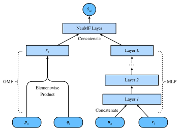

# Neuroninis kolaboratyvusis filtravimas personalizuotam rikiavimui

Šiame skyrelyje peržengiame aiškiosios grįžtamosios informacijos ribas ir pristatome neuroninio kolaboratyviojo filtravimo (NCF) sistemą rekomendavimui su numanomąja grįžtamąja informacija. Numanomoji grįžtamoji informacija yra plačiai paplitusi rekomendacinėse sistemose. Veiksmai, tokie kaip paspaudimai, pirkimai ir peržiūros, yra įprasta numanomoji grįžtamoji informacija, kurią lengva rinkti ir kuri rodo naudotojų pageidavimus. Modelis, kurį pristatysime, pavadintas NeuMF :cite:`He.Liao.Zhang.ea.2017` (neuroninio matricos faktorizavimo santrumpa), siekia spręsti personalizuoto rikiavimo užduotį su numanomąja grįžtamąja informacija. Šis modelis išnaudoja neuroninių tinklų lankstumą ir netiesiškumą, kad pakeistų matricos faktorizavimo skaliarines sandaugas, siekdamas padidinti modelio išraiškingumą. Konkrečiai, šis modelis sudarytas iš dviejų potinklių – apibendrinto matricos faktorizavimo (GMF) ir MLP – ir modeliuoja sąveikas dviem keliais, užuot naudojęs paprastas skaliarines sandaugas. Šių dviejų tinklų išvestys sujungiamos galutiniams prognozės balams apskaičiuoti. Skirtingai nei įvertinimų prognozavimo užduotyje su AutoRec, šis modelis kiekvienam naudotojui pagal numanomąją grįžtamąją informaciją sudaro surikiuotą rekomendacijų sąrašą. Šiam modeliui apmokyti naudosime ankstesniame skyrelyje pristatytą personalizuoto rikiavimo nuostolį.

## NeuMF modelis

Kaip minėta, NeuMF sujungia du potinklius. GMF yra bendroji neuroninio tinklo matricos faktorizavimo versija, kurios įvestis yra naudotojų ir elementų latentinių veiksnių sandauga po elementus. Ją sudaro du neuroniniai sluoksniai:

$$
\mathbf{x} = \mathbf{p}_u \odot \mathbf{q}_i \\
\hat{y}_{ui} = \alpha(\mathbf{h}^\top \mathbf{x}),
$$

kur $\odot$ žymi vektorių Hadamardo sandaugą. $\mathbf{P} \in \mathbb{R}^{m \times k}$ ir $\mathbf{Q} \in \mathbb{R}^{n \times k}$ atitinka atitinkamai naudotojų ir elementų latentines matricas. $\mathbf{p}_u \in \mathbb{R}^{ k}$ yra $u$-oji $P$ eilutė, o $\mathbf{q}_i \in \mathbb{R}^{ k}$ – $i$-oji $Q$ eilutė. $\alpha$ ir $h$ žymi išvesties sluoksnio aktyvinimo funkciją ir svorį. $\hat{y}_{ui}$ yra balas, kurį naudotojas $u$ galėtų skirti elementui $i$.

Kitas šio modelio komponentas yra MLP. Siekiant praturtinti modelio lankstumą, MLP potinklis nesidalija naudotojų ir elementų įterpiniais su GMF. Kaip įvestį jis naudoja naudotojų ir elementų įterpinių konkatenaciją. Dėl sudėtingų ryšių ir netiesinių transformacijų jis gali įvertinti painias naudotojų ir elementų sąveikas. Tiksliau, MLP potinklis apibrėžiamas taip:

$$
\begin{aligned}
z^{(1)} &= \phi_1(\mathbf{U}_u, \mathbf{V}_i) = \left[ \mathbf{U}_u, \mathbf{V}_i \right] \\
\phi^{(2)}(z^{(1)})  &= \alpha^1(\mathbf{W}^{(2)} z^{(1)} + b^{(2)}) \\
&... \\
\phi^{(L)}(z^{(L-1)}) &= \alpha^L(\mathbf{W}^{(L)} z^{(L-1)} + b^{(L)})) \\
\hat{y}_{ui} &= \alpha(\mathbf{h}^\top\phi^L(z^{(L-1)}))
\end{aligned}
$$

kur $\mathbf{W}^*, \mathbf{b}^*$ ir $\alpha^*$ žymi svorių matricą, poslinkio vektorių ir aktyvinimo funkciją. $\phi^*$ žymi atitinkamo sluoksnio funkciją. $\mathbf{z}^*$ žymi atitinkamo sluoksnio išvestį.

Kad sujungtų GMF ir MLP rezultatus, užuot juos paprastai sudėjęs, NeuMF sukonkatenuoja dviejų potinklių priešpaskutinius sluoksnius ir sukuria požymių vektorių, kuris gali būti perduotas tolesniems sluoksniams. Po to išvestys projektuojamos matrica $\mathbf{h}$ ir sigmoidine aktyvinimo funkcija. Prognozavimo sluoksnis formuluojamas taip:
$$
\hat{y}_{ui} = \sigma(\mathbf{h}^\top[\mathbf{x}, \phi^L(z^{(L-1)})]).
$$

Šiame paveiksle iliustruota NeuMF modelio architektūra.



```{.python .input  n=1}
#@tab mxnet
from d2l import mxnet as d2l
from mxnet import autograd, gluon, np, npx
from mxnet.gluon import nn
import mxnet as mx
import random

npx.set_np()
```

## Modelio įgyvendinimas
Toliau pateiktas kodas įgyvendina NeuMF modelį. Jį sudaro apibendrinto matricos faktorizavimo modelis ir MLP su skirtingais naudotojų ir elementų įterpinių vektoriais. MLP struktūrą valdo parametras `nums_hiddens`. Numatytoji aktyvinimo funkcija yra ReLU.

```{.python .input  n=2}
#@tab mxnet
class NeuMF(nn.Block):
    def __init__(self, num_factors, num_users, num_items, nums_hiddens,
                 **kwargs):
        super(NeuMF, self).__init__(**kwargs)
        self.P = nn.Embedding(num_users, num_factors)
        self.Q = nn.Embedding(num_items, num_factors)
        self.U = nn.Embedding(num_users, num_factors)
        self.V = nn.Embedding(num_items, num_factors)
        self.mlp = nn.Sequential()
        for num_hiddens in nums_hiddens:
            self.mlp.add(nn.Dense(num_hiddens, activation='relu',
                                  use_bias=True))
        self.prediction_layer = nn.Dense(1, activation='sigmoid', use_bias=False)

    def forward(self, user_id, item_id):
        p_mf = self.P(user_id)
        q_mf = self.Q(item_id)
        gmf = p_mf * q_mf
        p_mlp = self.U(user_id)
        q_mlp = self.V(item_id)
        mlp = self.mlp(np.concatenate([p_mlp, q_mlp], axis=1))
        con_res = np.concatenate([gmf, mlp], axis=1)
        return self.prediction_layer(con_res)
```

## Pritaikytas duomenų rinkinys su neigiamų pavyzdžių atranka

Porų rikiavimo nuostoliui svarbus žingsnis yra neigiamų pavyzdžių atranka. Kiekvienam naudotojui elementai, su kuriais jis nesąveikavo, yra kandidatiniai elementai (nestebėti įrašai). Toliau pateikta funkcija priima naudotojų tapatybes ir kandidatinius elementus kaip įvestį ir kiekvienam naudotojui atsitiktinai atrenka neigiamus elementus iš to naudotojo kandidatų aibės. Apmokymo etape modelis užtikrina, kad elementai, kurie naudotojui patinka, būtų surikiuoti aukščiau nei elementai, kurie jam nepatinka arba su kuriais jis nesąveikavo.

```{.python .input  n=3}
#@tab mxnet
class PRDataset(gluon.data.Dataset):
    def __init__(self, users, items, candidates, num_items):
        self.users = users
        self.items = items
        self.cand = candidates
        self.all = set([i for i in range(num_items)])

    def __len__(self):
        return len(self.users)

    def __getitem__(self, idx):
        neg_items = list(self.all - set(self.cand[int(self.users[idx])]))
        indices = random.randint(0, len(neg_items) - 1)
        return self.users[idx], self.items[idx], neg_items[indices]
```

## Vertintojas
Šiame skyrelyje apmokymo ir testavimo aibėms sudaryti taikome skaidymo pagal laiką strategiją. Modelio veiksmingumui įvertinti naudojami du vertinimo matai: pataikymo dažnis esant duotai ribai $\ell$ ($\textrm{Hit}@\ell$) ir plotas po ROC kreive (AUC). Pataikymo dažnis duotoje pozicijoje $\ell$ kiekvienam naudotojui rodo, ar rekomenduojamas elementas patenka į $\ell$ aukščiausiai įvertintų sąrašą. Formalus apibrėžimas yra toks:

$$
\textrm{Hit}@\ell = \frac{1}{m} \sum_{u \in \mathcal{U}} \textbf{1}(rank_{u, g_u} <= \ell),
$$

kur $\textbf{1}$ žymi indikatorinę funkciją, lygią vienetui, jei tikrasis elementas yra pirmųjų $\ell$ sąraše, kitu atveju – nuliui. $rank_{u, g_u}$ žymi naudotojo $u$ tikrojo elemento $g_u$ vietą rekomendacijų sąraše (idealus reitingas yra 1). $m$ yra naudotojų skaičius. $\mathcal{U}$ yra naudotojų aibė.

AUC apibrėžiamas taip:

$$
\textrm{AUC} = \frac{1}{m} \sum_{u \in \mathcal{U}} \frac{1}{|\mathcal{I} \backslash S_u|} \sum_{j \in I \backslash S_u} \textbf{1}(rank_{u, g_u} < rank_{u, j}),
$$

kur $\mathcal{I}$ yra elementų aibė. $S_u$ yra naudotojo $u$ kandidatiniai elementai. Atkreipkite dėmesį, kad galima naudoti ir daugelį kitų vertinimo protokolų, tokių kaip tikslumas, atkūrimas ir normalizuotas diskontuotas kaupiamasis naudingumas (NDCG).

Toliau pateikta funkcija apskaičiuoja kiekvieno naudotojo pataikymų skaičių ir AUC.

```{.python .input  n=4}
#@tab mxnet
#@save
def hit_and_auc(rankedlist, test_matrix, k):
    hits_k = [(idx, val) for idx, val in enumerate(rankedlist[:k])
              if val in set(test_matrix)]
    hits_all = [(idx, val) for idx, val in enumerate(rankedlist)
                if val in set(test_matrix)]
    max = len(rankedlist) - 1
    auc = 1.0 * (max - hits_all[0][0]) / max if len(hits_all) > 0 else 0
    return len(hits_k), auc
```

Tada bendras pataikymo dažnis ir AUC apskaičiuojami taip.

```{.python .input  n=5}
#@tab mxnet
#@save
def evaluate_ranking(net, test_input, seq, candidates, num_users, num_items,
                     devices):
    ranked_list, ranked_items, hit_rate, auc = {}, {}, [], []
    all_items = set([i for i in range(num_users)])
    for u in range(num_users):
        neg_items = list(all_items - set(candidates[int(u)]))
        user_ids, item_ids, x, scores = [], [], [], []
        [item_ids.append(i) for i in neg_items]
        [user_ids.append(u) for _ in neg_items]
        x.extend([np.array(user_ids)])
        if seq is not None:
            x.append(seq[user_ids, :])
        x.extend([np.array(item_ids)])
        test_data_iter = gluon.data.DataLoader(
            gluon.data.ArrayDataset(*x), shuffle=False, last_batch="keep",
            batch_size=1024)
        for index, values in enumerate(test_data_iter):
            x = [gluon.utils.split_and_load(v, devices, even_split=False)
                 for v in values]
            scores.extend([list(net(*t).asnumpy()) for t in zip(*x)])
        scores = [item for sublist in scores for item in sublist]
        item_scores = list(zip(item_ids, scores))
        ranked_list[u] = sorted(item_scores, key=lambda t: t[1], reverse=True)
        ranked_items[u] = [r[0] for r in ranked_list[u]]
        temp = hit_and_auc(ranked_items[u], test_input[u], 50)
        hit_rate.append(temp[0])
        auc.append(temp[1])
    return np.mean(np.array(hit_rate)), np.mean(np.array(auc))
```

## Modelio apmokymas ir vertinimas

Apmokymo funkcija apibrėžta toliau. Modelį apmokome porų būdu.

```{.python .input  n=6}
#@tab mxnet
#@save
def train_ranking(net, train_iter, test_iter, loss, trainer, test_seq_iter,
                  num_users, num_items, num_epochs, devices, evaluator,
                  candidates, eval_step=1):
    timer, hit_rate, auc = d2l.Timer(), 0, 0
    animator = d2l.Animator(xlabel='epoch', xlim=[1, num_epochs], ylim=[0, 1],
                            legend=['test hit rate', 'test AUC'])
    for epoch in range(num_epochs):
        metric, l = d2l.Accumulator(3), 0.
        for i, values in enumerate(train_iter):
            input_data = []
            for v in values:
                input_data.append(gluon.utils.split_and_load(v, devices))
            with autograd.record():
                p_pos = [net(*t) for t in zip(*input_data[:-1])]
                p_neg = [net(*t) for t in zip(*input_data[:-2],
                                              input_data[-1])]
                ls = [loss(p, n) for p, n in zip(p_pos, p_neg)]
            [l.backward(retain_graph=False) for l in ls]
            l += sum([l.asnumpy() for l in ls]).mean()/len(devices)
            trainer.step(values[0].shape[0])
            metric.add(l, values[0].shape[0], values[0].size)
            timer.stop()
        with autograd.predict_mode():
            if (epoch + 1) % eval_step == 0:
                hit_rate, auc = evaluator(net, test_iter, test_seq_iter,
                                          candidates, num_users, num_items,
                                          devices)
                animator.add(epoch + 1, (hit_rate, auc))
    print(f'train loss {metric[0] / metric[1]:.3f}, '
          f'test hit rate {float(hit_rate):.3f}, test AUC {float(auc):.3f}')
    print(f'{metric[2] * num_epochs / timer.sum():.1f} examples/sec '
          f'on {str(devices)}')
```

Dabar galime įkelti MovieLens 100k duomenų rinkinį ir apmokyti modelį. Kadangi MovieLens duomenų rinkinyje yra tik įvertinimai, prarasdami šiek tiek tikslumo, juos binarizuojame į nulius ir vienetus. Jei naudotojas įvertino elementą, numanomąją grįžtamąją informaciją laikome vienetu, kitu atveju – nuliu. Elemento įvertinimo veiksmą galima laikyti numanomosios grįžtamosios informacijos pateikimo forma. Čia duomenų rinkinį skaidome režimu `seq-aware`, kai testavimui paliekami naujausi naudotojų sąveikavimo elementai.

```{.python .input  n=11}
#@tab mxnet
batch_size = 1024
df, num_users, num_items = d2l.read_data_ml100k()
train_data, test_data = d2l.split_data_ml100k(df, num_users, num_items,
                                              'seq-aware')
users_train, items_train, ratings_train, candidates = d2l.load_data_ml100k(
    train_data, num_users, num_items, feedback="implicit")
users_test, items_test, ratings_test, test_iter = d2l.load_data_ml100k(
    test_data, num_users, num_items, feedback="implicit")
train_iter = gluon.data.DataLoader(
    PRDataset(users_train, items_train, candidates, num_items ), batch_size,
    True, last_batch="rollover", num_workers=d2l.get_dataloader_workers())
```

Tada sukuriame ir inicializuojame modelį. Naudojame trijų sluoksnių MLP su pastoviu paslėptuoju dydžiu 10.

```{.python .input  n=8}
#@tab mxnet
devices = d2l.try_all_gpus()
net = NeuMF(10, num_users, num_items, nums_hiddens=[10, 10, 10])
net.initialize(ctx=devices, force_reinit=True, init=mx.init.Normal(0.01))
```

Šis kodas apmoko modelį.

```{.python .input  n=12}
#@tab mxnet
lr, num_epochs, wd, optimizer = 0.01, 10, 1e-5, 'adam'
loss = d2l.BPRLoss()
trainer = gluon.Trainer(net.collect_params(), optimizer,
                        {"learning_rate": lr, 'wd': wd})
train_ranking(net, train_iter, test_iter, loss, trainer, None, num_users,
              num_items, num_epochs, devices, evaluate_ranking, candidates)
```

## Santrauka

* Netiesiškumo pridėjimas prie matricos faktorizavimo modelio naudingas modelio gebėjimams ir veiksmingumui gerinti.
* NeuMF yra matricos faktorizavimo ir MLP derinys. MLP kaip įvestį priima naudotojų ir elementų įterpinių konkatenaciją.

## Pratimai

* Keiskite latentinių veiksnių dydį. Kaip latentinių veiksnių dydis veikia modelio našumą?
* Keiskite MLP architektūras (pvz., sluoksnių skaičių, kiekvieno sluoksnio neuronų skaičių), kad patikrintumėte poveikį našumui.
* Išbandykite skirtingus optimizatorius, mokymosi greitį ir svorių mažinimo koeficientą.
* Pabandykite šiam modeliui optimizuoti naudoti ankstesniame skyrelyje apibrėžtą vyrio nuostolį.

:begin_tab:`mxnet`
[Diskusijos](https://discuss.d2l.ai/t/403)
:end_tab:
