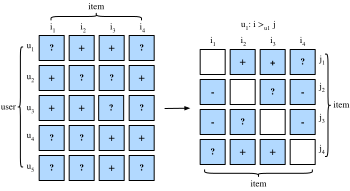

# Personalizuotas rikiavimas rekomendacinėms sistemoms

Ankstesniuose skyreliuose buvo nagrinėjama tik aiškioji grįžtamoji informacija, o modeliai buvo apmokomi ir testuojami pagal stebėtus įvertinimus. Tokie metodai turi du trūkumus. Pirma, didžioji dalis grįžtamosios informacijos realiuose scenarijuose yra ne aiškioji, o numanomoji, o aiškiąją grįžtamąją informaciją gali būti brangiau rinkti. Antra, nestebėtos naudotojų ir elementų poros, kurios gali padėti prognozuoti naudotojų interesus, visiškai ignoruojamos, todėl šie metodai netinka atvejams, kai įvertinimų trūksta ne atsitiktinai, o dėl naudotojų pageidavimų. Nestebėtos naudotojų ir elementų poros yra tikrosios neigiamos grįžtamosios informacijos (naudotojai nesidomi elementais) ir trūkstamų reikšmių (naudotojas ateityje gali sąveikauti su elementais) mišinys. Matricos faktorizavime ir AutoRec nestebėtas poras tiesiog ignoruojame. Akivaizdu, kad šie modeliai negali atskirti stebėtų ir nestebėtų porų ir paprastai netinka personalizuoto rikiavimo užduotims.

Todėl išpopuliarėjo rekomendacinių modelių klasė, skirta sudaryti surikiuotus rekomendacijų sąrašus iš numanomosios grįžtamosios informacijos. Apskritai personalizuoto rikiavimo modelius galima optimizuoti taškiniu, porų arba sąrašų požiūriu. Taškiniai požiūriai vienu metu nagrinėja vieną sąveiką ir apmoko klasifikatorių ar regresorių individualiems pageidavimams prognozuoti. Matricos faktorizavimas ir AutoRec optimizuojami taškiniais tikslais. Porų požiūriai kiekvienam naudotojui nagrinėja elementų porą ir siekia aproksimuoti optimalią tos poros tvarką. Paprastai porų požiūriai labiau tinka rikiavimo užduočiai, nes santykinės tvarkos prognozavimas primena pačią rikiavimo prigimtį. Sąrašų požiūriai aproksimuoja viso elementų sąrašo tvarką, pavyzdžiui, tiesiogiai optimizuodami rikiavimo matus, tokius kaip normalizuotas diskontuotas kaupiamasis naudingumas ([NDCG](https://en.wikipedia.org/wiki/Discounted_cumulative_gain)). Tačiau sąrašų požiūriai yra sudėtingesni ir reikalauja daugiau skaičiavimų nei taškiniai ar porų požiūriai. Šiame skyrelyje pristatysime du porų tikslus (nuostolius): Bajeso personalizuoto rikiavimo nuostolį ir vyrio nuostolį bei jų įgyvendinimus.

## Bajeso personalizuoto rikiavimo nuostolis ir jo įgyvendinimas

Bajeso personalizuotas rikiavimas (angl. *Bayesian personalized ranking*, BPR) :cite:`Rendle.Freudenthaler.Gantner.ea.2009` yra porų personalizuoto rikiavimo nuostolis, išvestas iš maksimalaus aposteriorinio vertintuvo. Jis plačiai naudojamas daugelyje esamų rekomendacinių modelių. BPR apmokymo duomenis sudaro ir teigiamos, ir neigiamos poros (trūkstamos reikšmės). Daroma prielaida, kad naudotojas teikia pirmenybę teigiamam elementui prieš visus kitus nestebėtus elementus.

Formaliai apmokymo duomenys sudaromi iš eilučių $(u, i, j)$, reiškiančių, kad naudotojas $u$ teikia pirmenybę elementui $i$ prieš elementą $j$. Žemiau pateikta BPR Bajeso formuluotė, kuria siekiama maksimizuoti aposteriorinę tikimybę:

$$
p(\Theta \mid >_u )  \propto  p(>_u \mid \Theta) p(\Theta)
$$

Čia $\Theta$ žymi savavališko rekomendacinio modelio parametrus, o $>_u$ – pageidaujamą personalizuotą visų elementų pilnąją tvarką naudotojui $u$. Galime suformuluoti maksimalų aposteriorinį vertintuvą, kad išvestume bendrąjį personalizuoto rikiavimo užduoties optimizavimo kriterijų.

$$
\begin{aligned}
\textrm{BPR-OPT} : &= \ln p(\Theta \mid >_u) \\
         & \propto \ln p(>_u \mid \Theta) p(\Theta) \\
         &= \ln \prod_{(u, i, j \in D)} \sigma(\hat{y}_{ui} - \hat{y}_{uj}) p(\Theta) \\
         &= \sum_{(u, i, j \in D)} \ln \sigma(\hat{y}_{ui} - \hat{y}_{uj}) + \ln p(\Theta) \\
         &= \sum_{(u, i, j \in D)} \ln \sigma(\hat{y}_{ui} - \hat{y}_{uj}) - \lambda_\Theta \|\Theta \|^2
\end{aligned}
$$


kur $D \stackrel{\textrm{def}}{=} \{(u, i, j) \mid i \in I^+_u \wedge j \in I \backslash I^+_u \}$ yra apmokymo aibė, $I^+_u$ žymi elementus, kurie patiko naudotojui $u$, $I$ žymi visus elementus, o $I \backslash I^+_u$ – visus kitus elementus, išskyrus tuos, kurie patiko naudotojui. $\hat{y}_{ui}$ ir $\hat{y}_{uj}$ yra atitinkamai naudotojo $u$ prognozuojami balai elementams $i$ ir $j$. Apriorinis skirstinys $p(\Theta)$ yra normalusis pasiskirstymas su nuliniu vidurkiu ir dispersijų bei kovariacijų matrica $\Sigma_\Theta$. Čia imame $\Sigma_\Theta = \lambda_\Theta I$.


Įgyvendinsime bazinę klasę `mxnet.gluon.loss.Loss` ir perrašysime metodą `forward`, kad sukonstruotume Bajeso personalizuoto rikiavimo nuostolį. Pradedame importuodami klasę Loss ir modulį np.

```{.python .input  n=5}
#@tab mxnet
from mxnet import gluon, np, npx
npx.set_np()
```

BPR nuostolio įgyvendinimas yra toks.

```{.python .input  n=2}
#@tab mxnet
#@save
class BPRLoss(gluon.loss.Loss):
    def __init__(self, weight=None, batch_axis=0, **kwargs):
        super(BPRLoss, self).__init__(weight=None, batch_axis=0, **kwargs)

    def forward(self, positive, negative):
        distances = positive - negative
        loss = - np.sum(np.log(npx.sigmoid(distances)), 0, keepdims=True)
        return loss
```

## Vyrio nuostolis ir jo įgyvendinimas

Rikiavimo vyrio nuostolis yra kitokios formos nei gluon bibliotekoje pateiktas [vyrio nuostolis](https://mxnet.incubator.apache.org/api/python/gluon/loss.html#mxnet.gluon.loss.HingeLoss), dažnai naudojamas klasifikatoriuose, tokiuose kaip SVM. Rekomendacinėse sistemose rikiavimui naudojamas nuostolis yra tokios formos.

$$
 \sum_{(u, i, j \in D)} \max( m - \hat{y}_{ui} + \hat{y}_{uj}, 0)
$$

kur $m$ yra saugos ribos dydis. Juo siekiama nustumti neigiamus elementus nuo teigiamų. Kaip ir BPR, jis siekia optimizuoti santykinį atstumą tarp teigiamų ir neigiamų pavyzdžių, o ne absoliučias išvestis, todėl gerai tinka rekomendacinėms sistemoms.

```{.python .input  n=3}
#@tab mxnet
#@save
class HingeLossbRec(gluon.loss.Loss):
    def __init__(self, weight=None, batch_axis=0, **kwargs):
        super(HingeLossbRec, self).__init__(weight=None, batch_axis=0,
                                            **kwargs)

    def forward(self, positive, negative, margin=1):
        distances = positive - negative
        loss = np.sum(np.maximum(- distances + margin, 0))
        return loss
```

Šie du nuostoliai yra pakeičiami vienas kitu personalizuotam rikiavimui rekomendavime.

## Santrauka

- Rekomendacinių sistemų personalizuoto rikiavimo užduočiai yra trys rikiavimo nuostolių tipai: taškiniai, porų ir sąrašų metodai.
- Du porų nuostoliai – Bajeso personalizuoto rikiavimo nuostolis ir vyrio nuostolis – gali būti naudojami pakaitomis.

## Pratimai

- Ar yra BPR ir vyrio nuostolio variantų?
- Ar galite rasti rekomendacinių modelių, naudojančių BPR ar vyrio nuostolį?

:begin_tab:`mxnet`
[Diskusijos](https://discuss.d2l.ai/t/402)
:end_tab:
