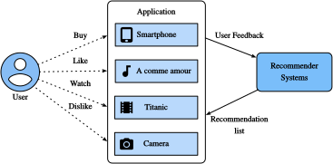

# Rekomendacinių sistemų apžvalga

Per pastarąjį dešimtmetį internetas virto platforma didelio masto internetinėms paslaugoms, kuri iš esmės pakeitė mūsų bendravimo, naujienų skaitymo, produktų pirkimo ir filmų žiūrėjimo būdus. Kartu precedento neturintis internete siūlomų elementų (terminą *elementas* vartojame filmams, naujienoms, knygoms ir produktams žymėti) skaičius reikalauja sistemos, kuri padėtų atrasti mums patinkančius elementus. Todėl rekomendacinės sistemos yra galingi informacijos filtravimo įrankiai, galintys palengvinti personalizuotas paslaugas ir suteikti individualiems naudotojams pritaikytą patirtį. Trumpai tariant, rekomendacinės sistemos atlieka esminį vaidmenį naudojant turimų duomenų gausą, kad pasirinkimai taptų valdomi. Šiandien rekomendacinės sistemos yra daugelio internetinių paslaugų teikėjų, tokių kaip Amazon, Netflix ir YouTube, pagrindas. Prisiminkite giliojo mokymosi knygų, kurias rekomenduoja Amazon, pavyzdį :numref:`subsec_recommender_systems`. Rekomendacinių sistemų naudojimo nauda yra dviguba: viena vertus, jos gali gerokai sumažinti naudotojų pastangas ieškant elementų ir sušvelninti informacijos pertekliaus problemą. Kita vertus, jos gali sukurti verslo vertę internetinių paslaugų teikėjams ir yra svarbus pajamų šaltinis. Šiame skyriuje pristatysime pagrindines sąvokas, klasikinius modelius ir naujausius giliojo mokymosi pasiekimus rekomendacinių sistemų srityje kartu su įgyvendintais pavyzdžiais.

## Kolaboratyvusis filtravimas

Kelionę pradedame nuo svarbios rekomendacinių sistemų sąvokos – kolaboratyviojo filtravimo
(angl. *collaborative filtering*, CF), kurią pirmiausia pavartojo sistema Tapestry :cite:`Goldberg.Nichols.Oki.ea.1992`, turėdama omenyje, kad „žmonės bendradarbiauja padėdami vieni kitiems atlikti filtravimo procesą, kad susidorotų su dideliu el. laiškų ir naujienų grupėse paskelbtų pranešimų kiekiu“. Šis terminas įgijo daugiau reikšmių. Plačiąja prasme tai yra informacijos ar dėsningumų filtravimo procesas, naudojant metodus, apimančius daugelio naudotojų, agentų ir duomenų šaltinių bendradarbiavimą. CF turi daug formų, o nuo jo atsiradimo pasiūlyta daugybė CF metodų.

Apskritai CF metodus galima suskirstyti į atmintimi pagrįstą CF, modeliu pagrįstą CF ir jų hibridą :cite:`Su.Khoshgoftaar.2009`. Būdingi atmintimi pagrįsti CF metodai yra artimiausių kaimynų pagrįstas CF, pavyzdžiui, naudotojais pagrįstas CF ir elementais pagrįstas CF :cite:`Sarwar.Karypis.Konstan.ea.2001`. Latentinių veiksnių modeliai, tokie kaip matricos faktorizavimas, yra modeliu pagrįsto CF pavyzdžiai. Atmintimi pagrįstas CF turi apribojimų dirbant su retais ir didelio masto duomenimis, nes panašumo reikšmes skaičiuoja pagal bendrus elementus. Modeliu pagrįsti metodai tampa populiaresni dėl geresnių gebėjimų tvarkyti retumą ir mastelį. Daugelį modeliu pagrįstų CF metodų galima išplėsti neuroniniais tinklais, gaunant lankstesnius ir geriau mastelio didėjimui pritaikytus modelius, kuriems skaičiavimus pagreitina giliojo mokymosi priemonės :cite:`Zhang.Yao.Sun.ea.2019`. Apskritai CF prognozėms ir rekomendacijoms naudoja tik naudotojų ir elementų sąveikos duomenis. Be CF, turiniu pagrįstos ir kontekstu pagrįstos rekomendacinės sistemos taip pat naudingos įtraukiant elementų ar naudotojų turinio aprašymus ir konteksto signalus, tokius kaip laiko žymos ir vietos. Akivaizdu, kad esant skirtingiems įvesties duomenims gali tekti koreguoti modelių tipus ar struktūras.

## Aiškioji ir numanomoji grįžtamoji informacija

Kad išmoktų naudotojų pageidavimus, sistema turi rinkti iš jų grįžtamąją informaciją. Ji gali būti aiškioji arba numanomoji :cite:`Hu.Koren.Volinsky.2008`. Pavyzdžiui, [IMDb](https://www.imdb.com/) renka filmų įvertinimus žvaigždutėmis nuo vienos iki dešimties. YouTube pateikia mygtukus „patinka“ ir „nepatinka“, kad naudotojai galėtų išreikšti savo pageidavimus. Akivaizdu, kad aiškiajai grįžtamajai informacijai rinkti reikia, kad naudotojai aktyviai nurodytų savo interesus. Vis dėlto aiškioji grįžtamoji informacija ne visada lengvai prieinama, nes daugelis naudotojų gali nenorėti vertinti produktų. Palyginti, numanomoji grįžtamoji informacija dažnai lengvai prieinama, nes ji daugiausia susijusi su numanomo elgesio, pavyzdžiui, naudotojų paspaudimų, modeliavimu. Todėl daugelis rekomendacinių sistemų orientuotos į numanomąją grįžtamąją informaciją, kuri netiesiogiai atspindi naudotojo nuomonę stebint jo elgesį. Numanomoji grįžtamoji informacija pasireiškia įvairiomis formomis, įskaitant pirkimų istoriją, naršymo istoriją, peržiūras ir net pelės judesius. Pavyzdžiui, naudotojas, nusipirkęs daug to paties autoriaus knygų, tikriausiai mėgsta tą autorių. Atkreipkite dėmesį, kad numanomoji grįžtamoji informacija iš prigimties yra triukšminga. Jų pageidavimus ir tikruosius motyvus galime tik *spėlioti*. Tai, kad naudotojas peržiūrėjo filmą, nebūtinai rodo teigiamą požiūrį į tą filmą.

## Rekomendavimo užduotys

Per pastaruosius dešimtmečius ištirta daug rekomendavimo užduočių. Pagal taikymo sritį yra filmų rekomendavimas, naujienų rekomendavimas, dominančių vietų rekomendavimas :cite:`Ye.Yin.Lee.ea.2011` ir t. t. Užduotis taip pat galima skirti pagal grįžtamosios informacijos ir įvesties duomenų tipus, pavyzdžiui, įvertinimų prognozavimo užduotis siekia prognozuoti aiškiuosius įvertinimus. Top-$n$ rekomendavimas (elementų rikiavimas) kiekvienam naudotojui asmeniškai surikiuoja visus elementus pagal numanomąją grįžtamąją informaciją. Jei įtraukta ir laiko žymų informacija, galime sudaryti sekai jautrų rekomendavimą :cite:`Quadrana.Cremonesi.Jannach.2018`. Kita populiari užduotis vadinama paspaudimų dažnio prognozavimu; ji taip pat pagrįsta numanomąja grįžtamąja informacija, tačiau gali būti naudojami įvairūs kategoriniai požymiai. Rekomendavimas naujiems naudotojams ir naujų elementų rekomendavimas esamiems naudotojams vadinamas šalto starto rekomendavimu :cite:`Schein.Popescul.Ungar.ea.2002`.

## Santrauka

* Rekomendacinės sistemos svarbios tiek atskiriems naudotojams, tiek pramonei. Kolaboratyvusis filtravimas yra pagrindinė rekomendavimo sąvoka.
* Yra du grįžtamosios informacijos tipai: numanomoji ir aiškioji grįžtamoji informacija. Per pastarąjį dešimtmetį ištirta nemažai rekomendavimo užduočių.

## Pratimai

1. Ar galite paaiškinti, kaip rekomendacinės sistemos veikia jūsų kasdienį gyvenimą?
2. Kokias įdomias rekomendavimo užduotis, jūsų manymu, būtų galima tirti?

[Diskusijos](https://discuss.d2l.ai/t/398)
