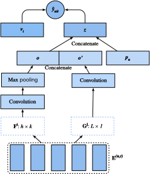
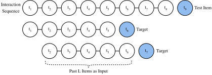

# Sekai jautrios rekomendacinės sistemos

Ankstesniuose skyreliuose rekomendavimo užduotį abstrahavome kaip matricos užbaigimo problemą, neatsižvelgdami į naudotojų trumpalaikį elgesį. Šiame skyrelyje pristatysime rekomendacinį modelį, kuris atsižvelgia į nuosekliai sutvarkytus naudotojų sąveikų žurnalus. Tai sekai jautri rekomendacinė sistema :cite:`Quadrana.Cremonesi.Jannach.2018`, kurios įvestis yra sutvarkytas ir dažnai laiko žymomis pažymėtas ankstesnių naudotojo veiksmų sąrašas. Daugelis naujausių darbų parodė tokios informacijos įtraukimo naudą modeliuojant naudotojų laikinius elgesio dėsningumus ir atrandant jų interesų dreifą.

Modelis, kurį pristatysime, Caser :cite:`Tang.Wang.2018` (konvoliucinio sekos įterpinių rekomendavimo modelio santrumpa), naudoja konvoliucinius neuroninius tinklus, kad užfiksuotų dinaminį naudotojų naujausios veiklos poveikį. Pagrindinį Caser komponentą sudaro horizontalusis konvoliucinis tinklas ir vertikalusis konvoliucinis tinklas, kuriais siekiama atskleisti atitinkamai sąjungos lygmens ir taško lygmens sekų dėsningumus. Taško lygmens dėsningumas rodo atskiro istorinės sekos elemento poveikį tiksliniam elementui, o sąjungos lygmens dėsningumas reiškia kelių ankstesnių veiksmų įtaką vėlesniam tikslui. Pavyzdžiui, nusipirkus ir pieno, ir sviesto, didesnė tikimybė, kad bus perkami miltai, nei nusipirkus tik vieną iš jų. Be to, naudotojų bendri interesai, arba ilgalaikiai pageidavimai, taip pat modeliuojami paskutiniuose pilnai sujungtuose sluoksniuose, todėl naudotojų interesai modeliuojami išsamiau. Modelio detalės aprašytos toliau.

## Modelio architektūros

Sekai jautrioje rekomendacinėje sistemoje kiekvienas naudotojas susijęs su kai kurių elementų iš elementų aibės seka. Tegul $S^u = (S_1^u, ... S_{|S_u|}^u)$ žymi sutvarkytą seką. Caser tikslas – rekomenduoti elementą atsižvelgiant į bendrą naudotojo skonį ir trumpalaikį ketinimą. Tarkime, kad atsižvelgiame į ankstesnius $L$ elementų; galima sukonstruoti įterpinių matricą, vaizduojančią ankstesnes sąveikas laiko žingsniui $t$:

$$
\mathbf{E}^{(u, t)} = [ \mathbf{q}_{S_{t-L}^u} , ..., \mathbf{q}_{S_{t-2}^u}, \mathbf{q}_{S_{t-1}^u} ]^\top,
$$

kur $\mathbf{Q} \in \mathbb{R}^{n \times k}$ žymi elementų įterpinius, o $\mathbf{q}_i$ – $i$-ąją eilutę. $\mathbf{E}^{(u, t)} \in \mathbb{R}^{L \times k}$ galima naudoti naudotojo $u$ trumpalaikiam interesui laiko žingsniu $t$ nustatyti. Įvesties matricą $\mathbf{E}^{(u, t)}$ galime vertinti kaip vaizdą, kuris yra kitų dviejų konvoliucinių komponentų įvestis.

Horizontalusis konvoliucinis sluoksnis turi $d$ horizontaliųjų filtrų $\mathbf{F}^j \in \mathbb{R}^{h \times k}, 1 \leq j \leq d, h = \{1, ..., L\}$, o vertikalusis konvoliucinis sluoksnis turi $d'$ vertikaliųjų filtrų $\mathbf{G}^j \in \mathbb{R}^{ L \times 1}, 1 \leq j \leq d'$. Po konvoliucijos ir sutelkimo operacijų serijos gauname dvi išvestis:

$$
\mathbf{o} = \textrm{HConv}(\mathbf{E}^{(u, t)}, \mathbf{F}) \\
\mathbf{o}'= \textrm{VConv}(\mathbf{E}^{(u, t)}, \mathbf{G}) ,
$$

kur $\mathbf{o} \in \mathbb{R}^d$ yra horizontaliojo konvoliucinio tinklo išvestis, o $\mathbf{o}' \in \mathbb{R}^{kd'}$ – vertikaliojo konvoliucinio tinklo išvestis. Paprastumo dėlei konvoliucijos ir sutelkimo operacijų detales praleidžiame. Jos sujungiamos ir paduodamos į pilnai sujungtą neuroninio tinklo sluoksnį, kad gautume aukštesnio lygio vaizdavimus.

$$
\mathbf{z} = \phi(\mathbf{W}[\mathbf{o}, \mathbf{o}']^\top + \mathbf{b}),
$$

kur $\mathbf{W} \in \mathbb{R}^{k \times (d + kd')}$ yra svorių matrica, o $\mathbf{b} \in \mathbb{R}^k$ – poslinkis. Išmoktas vektorius $\mathbf{z} \in \mathbb{R}^k$ yra naudotojo trumpalaikio ketinimo vaizdavimas.

Galiausiai prognozavimo funkcija sujungia naudotojų trumpalaikį ir bendrąjį skonį ir apibrėžiama taip:

$$
\hat{y}_{uit} = \mathbf{v}_i \cdot [\mathbf{z}, \mathbf{p}_u]^\top + \mathbf{b}'_i,
$$

kur $\mathbf{V} \in \mathbb{R}^{n \times 2k}$ yra kita elementų įterpinių matrica. $\mathbf{b}' \in \mathbb{R}^n$ yra elementui specifinis poslinkis. $\mathbf{P} \in \mathbb{R}^{m \times k}$ yra naudotojų įterpinių matrica naudotojų bendram skoniui. $\mathbf{p}_u \in \mathbb{R}^{ k}$ yra $u$-oji $P$ eilutė, o $\mathbf{v}_i \in \mathbb{R}^{2k}$ – $i$-oji $\mathbf{V}$ eilutė.

Modelį galima mokyti naudojant BPR ar vyrio nuostolį. Caser architektūra parodyta žemiau:



Pirmiausia importuojame reikalingas bibliotekas.

```{.python .input  n=3}
#@tab mxnet
from d2l import mxnet as d2l
from mxnet import gluon, np, npx
from mxnet.gluon import nn
import mxnet as mx
import random

npx.set_np()
```

## Modelio įgyvendinimas
Toliau pateiktas kodas įgyvendina Caser modelį. Jį sudaro vertikalusis konvoliucinis sluoksnis, horizontalusis konvoliucinis sluoksnis ir pilnai sujungtas sluoksnis.

```{.python .input  n=4}
#@tab mxnet
class Caser(nn.Block):
    def __init__(self, num_factors, num_users, num_items, L=5, d=16,
                 d_prime=4, drop_ratio=0.05, **kwargs):
        super(Caser, self).__init__(**kwargs)
        self.P = nn.Embedding(num_users, num_factors)
        self.Q = nn.Embedding(num_items, num_factors)
        self.d_prime, self.d = d_prime, d
        # Vertical convolution layer
        self.conv_v = nn.Conv2D(d_prime, (L, 1), in_channels=1)
        # Horizontal convolution layer
        h = [i + 1 for i in range(L)]
        self.conv_h, self.max_pool = nn.Sequential(), nn.Sequential()
        for i in h:
            self.conv_h.add(nn.Conv2D(d, (i, num_factors), in_channels=1))
            self.max_pool.add(nn.MaxPool1D(L - i + 1))
        # Fully connected layer
        self.fc1_dim_v, self.fc1_dim_h = d_prime * num_factors, d * len(h)
        self.fc = nn.Dense(in_units=d_prime * num_factors + d * L,
                           activation='relu', units=num_factors)
        self.Q_prime = nn.Embedding(num_items, num_factors * 2)
        self.b = nn.Embedding(num_items, 1)
        self.dropout = nn.Dropout(drop_ratio)

    def forward(self, user_id, seq, item_id):
        item_embs = np.expand_dims(self.Q(seq), 1)
        user_emb = self.P(user_id)
        out, out_h, out_v, out_hs = None, None, None, []
        if self.d_prime:
            out_v = self.conv_v(item_embs)
            out_v = out_v.reshape(out_v.shape[0], self.fc1_dim_v)
        if self.d:
            for conv, maxp in zip(self.conv_h, self.max_pool):
                conv_out = np.squeeze(npx.relu(conv(item_embs)), axis=3)
                t = maxp(conv_out)
                pool_out = np.squeeze(t, axis=2)
                out_hs.append(pool_out)
            out_h = np.concatenate(out_hs, axis=1)
        out = np.concatenate([out_v, out_h], axis=1)
        z = self.fc(self.dropout(out))
        x = np.concatenate([z, user_emb], axis=1)
        q_prime_i = np.squeeze(self.Q_prime(item_id))
        b = np.squeeze(self.b(item_id))
        res = (x * q_prime_i).sum(1) + b
        return res
```

## Sekinis duomenų rinkinys su neigiamų pavyzdžių atranka
Norėdami apdoroti sekines sąveikų duomenis, turime iš naujo įgyvendinti klasę `Dataset`. Šis kodas sukuria naują duomenų rinkinio klasę `SeqDataset`. Kiekviename pavyzdyje ji išveda naudotojo tapatybę, ankstesnius $L$ jo sąveikautų elementų kaip seką ir kitą jo sąveikautą elementą kaip tikslą. Šiame paveiksle parodytas vieno naudotojo duomenų įkėlimo procesas. Tarkime, kad šiam naudotojui patiko 9 filmai; šiuos devynis filmus sutvarkome chronologine tvarka. Naujausias filmas paliekamas kaip testavimo elementas. Iš likusių aštuonių filmų galime gauti tris apmokymo pavyzdžius, kurių kiekvienas turi penkių ($L=5$) filmų seką ir vėlesnį elementą kaip tikslinį elementą. Į pritaikytą duomenų rinkinį taip pat įtraukiami neigiami pavyzdžiai.



```{.python .input  n=5}
#@tab mxnet
class SeqDataset(gluon.data.Dataset):
    def __init__(self, user_ids, item_ids, L, num_users, num_items,
                 candidates):
        user_ids, item_ids = np.array(user_ids), np.array(item_ids)
        sort_idx = np.array(sorted(range(len(user_ids)),
                                   key=lambda k: user_ids[k]))
        u_ids, i_ids = user_ids[sort_idx], item_ids[sort_idx]
        temp, u_ids, self.cand = {}, u_ids.asnumpy(), candidates
        self.all_items = set([i for i in range(num_items)])
        [temp.setdefault(u_ids[i], []).append(i) for i, _ in enumerate(u_ids)]
        temp = sorted(temp.items(), key=lambda x: x[0])
        u_ids = np.array([i[0] for i in temp])
        idx = np.array([i[1][0] for i in temp])
        self.ns = ns = int(sum([c - L if c >= L + 1 else 1 for c
                                in np.array([len(i[1]) for i in temp])]))
        self.seq_items = np.zeros((ns, L))
        self.seq_users = np.zeros(ns, dtype='int32')
        self.seq_tgt = np.zeros((ns, 1))
        self.test_seq = np.zeros((num_users, L))
        test_users, _uid = np.empty(num_users), None
        for i, (uid, i_seq) in enumerate(self._seq(u_ids, i_ids, idx, L + 1)):
            if uid != _uid:
                self.test_seq[uid][:] = i_seq[-L:]
                test_users[uid], _uid = uid, uid
            self.seq_tgt[i][:] = i_seq[-1:]
            self.seq_items[i][:], self.seq_users[i] = i_seq[:L], uid

    def _win(self, tensor, window_size, step_size=1):
        if len(tensor) - window_size >= 0:
            for i in range(len(tensor), 0, - step_size):
                if i - window_size >= 0:
                    yield tensor[i - window_size:i]
                else:
                    break
        else:
            yield tensor

    def _seq(self, u_ids, i_ids, idx, max_len):
        for i in range(len(idx)):
            stop_idx = None if i >= len(idx) - 1 else int(idx[i + 1])
            for s in self._win(i_ids[int(idx[i]):stop_idx], max_len):
                yield (int(u_ids[i]), s)

    def __len__(self):
        return self.ns

    def __getitem__(self, idx):
        neg = list(self.all_items - set(self.cand[int(self.seq_users[idx])]))
        i = random.randint(0, len(neg) - 1)
        return (self.seq_users[idx], self.seq_items[idx], self.seq_tgt[idx],
                neg[i])
```

## MovieLens 100K duomenų rinkinio įkėlimas

Po to nuskaitome ir padalijame MovieLens 100K duomenų rinkinį sekai jautriu režimu ir įkeliame apmokymo duomenis aukščiau įgyvendintu sekiniu duomenų įkėlikliu.

```{.python .input  n=6}
#@tab mxnet
TARGET_NUM, L, batch_size = 1, 5, 4096
df, num_users, num_items = d2l.read_data_ml100k()
train_data, test_data = d2l.split_data_ml100k(df, num_users, num_items,
                                              'seq-aware')
users_train, items_train, ratings_train, candidates = d2l.load_data_ml100k(
    train_data, num_users, num_items, feedback="implicit")
users_test, items_test, ratings_test, test_iter = d2l.load_data_ml100k(
    test_data, num_users, num_items, feedback="implicit")
train_seq_data = SeqDataset(users_train, items_train, L, num_users,
                            num_items, candidates)
train_iter = gluon.data.DataLoader(train_seq_data, batch_size, True,
                                   last_batch="rollover",
                                   num_workers=d2l.get_dataloader_workers())
test_seq_iter = train_seq_data.test_seq
train_seq_data[0]
```

Apmokymo duomenų struktūra parodyta aukščiau. Pirmasis elementas yra naudotojo tapatybė, kitas sąrašas nurodo paskutinius penkis šiam naudotojui patikusius elementus, o paskutinis elementas yra elementas, kuris naudotojui patiko po tų penkių.

## Modelio apmokymas
Dabar apmokykime modelį. Naudojame tuos pačius nustatymus kaip NeuMF ankstesniame skyrelyje, įskaitant mokymosi greitį, optimizatorių ir $k$, kad rezultatai būtų palyginami.

```{.python .input  n=7}
#@tab mxnet
devices = d2l.try_all_gpus()
net = Caser(10, num_users, num_items, L)
net.initialize(ctx=devices, force_reinit=True, init=mx.init.Normal(0.01))
lr, num_epochs, wd, optimizer = 0.04, 8, 1e-5, 'adam'
loss = d2l.BPRLoss()
trainer = gluon.Trainer(net.collect_params(), optimizer,
                        {"learning_rate": lr, 'wd': wd})

# Running takes > 1h (pending fix from MXNet)
# d2l.train_ranking(net, train_iter, test_iter, loss, trainer, test_seq_iter, num_users, num_items, num_epochs, devices, d2l.evaluate_ranking, candidates, eval_step=1)
```

## Santrauka
* Naudotojo trumpalaikių ir ilgalaikių interesų nustatymas gali padaryti jo pageidaujamo kito elemento prognozavimą veiksmingesnį.
* Konvoliuciniai neuroniniai tinklai gali būti naudojami užfiksuoti naudotojų trumpalaikius interesus iš sekinių sąveikų.

## Pratimai

* Atlikite abliacijos tyrimą pašalindami vieną iš horizontaliojo ir vertikaliojo konvoliucinių tinklų: kuris komponentas svarbesnis?
* Keiskite hiperparametrą $L$. Ar ilgesnės istorinės sąveikos suteikia didesnį tikslumą?
* Be aukščiau pristatytos sekai jautraus rekomendavimo užduoties, yra kitas sekai jautraus rekomendavimo užduoties tipas, vadinamas sesijomis pagrįstu rekomendavimu :cite:`Hidasi.Karatzoglou.Baltrunas.ea.2015`. Ar galite paaiškinti šių dviejų užduočių skirtumus?


:begin_tab:`mxnet`
[Diskusijos](https://discuss.d2l.ai/t/404)
:end_tab:
