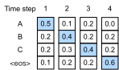
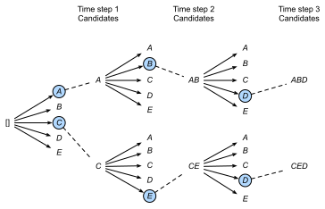

# Spindulio paieška
:label:`sec_beam-search`

:numref:`sec_seq2seq`
pristatėme kodavimo ir dekodavimo architektūrą
ir standartines jų apmokymo nuo pradžios iki galo technikas. Tačiau kalbėdami apie prognozavimą tikrinimo metu,
minėjome tik *godžiąją* strategiją,
kai kiekviename laiko žingsnyje pasirenkame
teksto vienetą, kuriam prognozuojama didžiausia
tikimybė būti kitam,
kol kuriame nors laiko žingsnyje
nuspėjame
specialų sekos pabaigos „&lt;eos&gt;“ teksto vienetą.
Šiame skyrelyje pradėsime
formalizuodami šią *godžiąją paiešką*
ir nustatydami kai kurias problemas,
su kuriomis praktikai paprastai susiduria.
Vėliau palyginsime šią strategiją
su dviem alternatyvomis:
*pilna paieška* (iliustratyvi, bet nepraktiška)
ir *spindulio paieška* (standartinis metodas praktikoje).

Pradėkime nustatydami savo matematinį žymėjimą,
pasiskolindami sutartis iš :numref:`sec_seq2seq`.
Bet kuriuo laiko žingsniu $t'$ dekodavimo blokas išveda
prognozes, vaizduojančias kiekvieno žodyno teksto vieneto
tikimybę būti kitam sekoje
(tikėtina $y_{t'+1}$ reikšmė),
sąlygojamą ankstesnių teksto vienetų
$y_1, \ldots, y_{t'}$ ir
konteksto kintamojo $\mathbf{c}$,
kurį sukuria kodavimo blokas
įvesties sekai pavaizduoti.
Skaičiavimo kainai įvertinti
pažymėkime $\mathcal{Y}$
išvesties žodyną
(įskaitant specialų sekos pabaigos teksto vienetą „&lt;eos&gt;“).
Taip pat nurodykime didžiausią išvesties sekos teksto vienetų skaičių kaip $T'$.
Mūsų tikslas yra ieškoti idealios išvesties tarp visų
$\mathcal{O}(\left|\mathcal{Y}\right|^{T'})$
galimų išvesties sekų.
Atkreipkite dėmesį, kad tai šiek tiek pervertina
skirtingų išvesčių skaičių,
nes pasirodžius „&lt;eos&gt;“ teksto vienetui
paskesnių teksto vienetų nėra.
Tačiau mūsų tikslams šis skaičius apytiksliai atspindi
paieškos erdvės dydį.

## Godžioji paieška

Apsvarstykime paprastą *godžiosios paieškos* strategiją iš :numref:`sec_seq2seq`.
Čia bet kuriuo laiko žingsniu $t'$
tiesiog pasirenkame teksto vienetą
su didžiausia sąlygine tikimybe
iš $\mathcal{Y}$, t. y.

$$y_{t'} = \operatorname*{argmax}_{y \in \mathcal{Y}} P(y \mid y_1, \ldots, y_{t'-1}, \mathbf{c}).$$

Kai tik mūsų modelis išveda „&lt;eos&gt;“
(arba pasiekiame didžiausią ilgį $T'$),
išvesties seka baigta.

Ši strategija gali atrodyti pagrįsta,
ir iš tiesų ji nėra tokia bloga!
Turint omenyje, kokia ji nereikli skaičiavimams,
sunku gauti didesnę naudą už tuos pačius pinigus.
Tačiau jei minutei nustumsime efektyvumą į šalį,
gali atrodyti pagrįsčiau ieškoti
*tikėtiniausios sekos*,
o ne (godžiai pasirinktų) *tikėtiniausių teksto vienetų sekos*.
Pasirodo, šie du objektai gali labai skirtis.
Tikėtiniausia seka yra ta, kuri maksimizuoja išraišką
$\prod_{t'=1}^{T'} P(y_{t'} \mid y_1, \ldots, y_{t'-1}, \mathbf{c})$.
Mūsų mašininio vertimo pavyzdyje,
jei dekodavimo blokas tikrai atkurtų
pagrindinio generatyvinio proceso tikimybes,
tai tai duotų mums tikėtiniausią vertimą.
Deja, nėra garantijos,
kad godžioji paieška mums duos šią seką.

Iliustruokime tai pavyzdžiu.
Tarkime, kad išvesties žodyne yra keturi teksto vienetai
„A“, „B“, „C“ ir „&lt;eos&gt;“.
:numref:`fig_s2s-prob1`
keturi skaičiai po kiekvienu laiko žingsniu reiškia
sąlygines tikimybes sugeneruoti atitinkamai „A“, „B“, „C“
ir „&lt;eos&gt;“ tuo laiko žingsniu.

:label:`fig_s2s-prob1`

Kiekvienu laiko žingsniu godžioji paieška pasirenka
teksto vienetą su didžiausia sąlygine tikimybe.
Todėl bus prognozuojama išvesties seka „A“, „B“, „C“ ir „&lt;eos&gt;“
(:numref:`fig_s2s-prob1`).
Šios išvesties sekos sąlyginė tikimybė
yra $0{,}5\times0{,}4\times0{,}4\times0{,}6 = 0{,}048$.

Toliau pažvelkime į kitą pavyzdį :numref:`fig_s2s-prob2`.
Skirtingai nei :numref:`fig_s2s-prob1`,
2 laiko žingsniu pasirenkame teksto vienetą „C“,
kuris turi *antrą* pagal dydį sąlyginę tikimybę.

:label:`fig_s2s-prob2`

Kadangi išvesties posekiai 1 ir 2 laiko žingsniais,
kuriais remiasi 3 laiko žingsnis,
pasikeitė iš „A“ ir „B“ :numref:`fig_s2s-prob1`
į „A“ ir „C“ :numref:`fig_s2s-prob2`,
kiekvieno teksto vieneto sąlyginė tikimybė
3 laiko žingsniu taip pat pasikeitė :numref:`fig_s2s-prob2`.
Tarkime, kad 3 laiko žingsniu pasirenkame teksto vienetą „B“.
Dabar 4 laiko žingsnis sąlygojamas
pirmųjų trijų laiko žingsnių išvesties posekiu
„A“, „C“ ir „B“,
kuris pasikeitė iš „A“, „B“ ir „C“ :numref:`fig_s2s-prob1`.
Todėl kiekvieno teksto vieneto generavimo sąlyginė tikimybė
4 laiko žingsniu :numref:`fig_s2s-prob2`
taip pat skiriasi nuo tos :numref:`fig_s2s-prob1`.
Dėl to išvesties sekos
„A“, „C“, „B“ ir „&lt;eos&gt;“ sąlyginė tikimybė :numref:`fig_s2s-prob2`
yra $0{,}5\times0{,}3 \times0{,}6\times0{,}6=0{,}054$,
kuri yra didesnė nei godžiosios paieškos :numref:`fig_s2s-prob1`.
Šiame pavyzdyje išvesties seka „A“, „B“, „C“ ir „&lt;eos&gt;“,
gauta godžiąja paieška, nėra optimali.

## Pilna paieška

Jei tikslas yra gauti tikėtiniausią seką,
galime svarstyti naudoti *pilną paiešką*:
išvardyti visas galimas išvesties sekas
su jų sąlyginėmis tikimybėmis
ir tada išvesti tą, kuri gauna
didžiausią prognozuojamą tikimybę.

Nors tai tikrai duotų tai, ko norime,
tai kainuotų nepriimtinai daug skaičiavimų:
$\mathcal{O}(\left|\mathcal{Y}\right|^{T'})$,
eksponentiškai pagal sekos ilgį ir su milžinišku
pagrindu, nustatomu žodyno dydžio.
Pavyzdžiui, kai $|\mathcal{Y}|=10000$ ir $T'=10$,
abi mažos, palyginti su realių taikymų skaičiais, turėsime įvertinti $10000^{10} = 10^{40}$ sekų, o tai jau viršija bet kokių numatomų kompiuterių galimybes.
Kita vertus, godžiosios paieškos skaičiavimo kaina yra
$\mathcal{O}(\left|\mathcal{Y}\right|T')$:
stebuklingai pigi, bet tolima nuo optimalios.
Pavyzdžiui, kai $|\mathcal{Y}|=10000$ ir $T'=10$,
reikia įvertinti tik $10000\times10=10^5$ sekų.

## Spindulio paieška

Sekų dekodavimo strategijas galite vertinti kaip išsidėsčiusias spektre,
kai *spindulio paieška* randa kompromisą
tarp godžiosios paieškos efektyvumo
ir pilnos paieškos optimalumo.
Paprasčiausia spindulio paieškos versija
apibūdinama vienu hiperparametru –
*spindulio dydžiu* $k$.
Paaiškinkime šią terminologiją.
1 laiko žingsniu pasirenkame $k$ teksto vienetų
su didžiausiomis prognozuojamomis tikimybėmis.
Kiekvienas iš jų bus atitinkamai pirmasis
$k$ kandidatinių išvesties sekų teksto vienetas.
Kiekvienu paskesniu laiko žingsniu,
remdamiesi $k$ kandidatinių išvesties sekų
ankstesniame laiko žingsnyje,
toliau renkame $k$ kandidatinių išvesties sekų
su didžiausiomis prognozuojamomis tikimybėmis
iš $k\left|\mathcal{Y}\right|$ galimų pasirinkimų.

:label:`fig_beam-search`

:numref:`fig_beam-search` pavyzdžiu demonstruoja
spindulio paieškos procesą.
Tarkime, kad išvesties žodyne
yra tik penki elementai:
$\mathcal{Y} = \{A, B, C, D, E\}$,
kurių vienas yra „&lt;eos&gt;“.
Tegul spindulio dydis yra du, o
didžiausias išvesties sekos ilgis – trys.
1 laiko žingsniu
tarkime, kad teksto vienetai su didžiausiomis sąlyginėmis tikimybėmis
$P(y_1 \mid \mathbf{c})$ yra $A$ ir $C$.
2 laiko žingsniu visiems $y_2 \in \mathcal{Y},$
apskaičiuojame

$$\begin{aligned}P(A, y_2 \mid \mathbf{c}) = P(A \mid \mathbf{c})P(y_2 \mid A, \mathbf{c}),\\ P(C, y_2 \mid \mathbf{c}) = P(C \mid \mathbf{c})P(y_2 \mid C, \mathbf{c}),\end{aligned}$$

ir iš šių dešimties reikšmių pasirenkame didžiausias dvi, tarkime,
$P(A, B \mid \mathbf{c})$ ir $P(C, E \mid \mathbf{c})$.
Tada 3 laiko žingsniu visiems $y_3 \in \mathcal{Y}$ apskaičiuojame

$$\begin{aligned}P(A, B, y_3 \mid \mathbf{c}) = P(A, B \mid \mathbf{c})P(y_3 \mid A, B, \mathbf{c}),\\P(C, E, y_3 \mid \mathbf{c}) = P(C, E \mid \mathbf{c})P(y_3 \mid C, E, \mathbf{c}),\end{aligned}$$

ir iš šių dešimties reikšmių pasirenkame didžiausias dvi, tarkime,
$P(A, B, D \mid \mathbf{c})$   ir  $P(C, E, D \mid  \mathbf{c}).$
Dėl to gauname šešias kandidatines išvesties sekas:
(i) $A$; (ii) $C$; (iii) $A$, $B$; (iv) $C$, $E$; (v) $A$, $B$, $D$; ir (vi) $C$, $E$, $D$.

Galiausiai gauname galutinių kandidatinių išvesties sekų aibę
remdamiesi šiomis šešiomis sekomis (pvz., atmesdami dalis, įskaitant „&lt;eos&gt;“ ir po jo einančias).
Tada pasirenkame išvesties seką, maksimizuojančią šį įvertį:

$$ \frac{1}{L^\alpha} \log P(y_1, \ldots, y_{L}\mid \mathbf{c}) = \frac{1}{L^\alpha} \sum_{t'=1}^L \log P(y_{t'} \mid y_1, \ldots, y_{t'-1}, \mathbf{c});$$
:eqlabel:`eq_beam-search-score`

čia $L$ yra galutinės kandidatinės sekos ilgis,
o $\alpha$ paprastai nustatomas 0,75.
Kadangi ilgesnė seka turi daugiau logaritminių narių
:eqref:`eq_beam-search-score` sumoje,
narys $L^\alpha$ vardiklyje baudžia
ilgas sekas.

Spindulio paieškos skaičiavimo kaina yra $\mathcal{O}(k\left|\mathcal{Y}\right|T')$.
Šis rezultatas yra tarp godžiosios paieškos ir pilnos paieškos.
Godžioji paieška gali būti laikoma ypatingu spindulio paieškos atveju,
kai spindulio dydis nustatomas 1.

## Santrauka

Sekų paieškos strategijos apima
godžiąją paiešką, pilną paiešką ir spindulio paiešką.
Spindulio paieška suteikia kompromisą tarp tikslumo ir
skaičiavimo kainos lanksčiai pasirenkant spindulio dydį.

## Pratimai

1. Ar galime pilną paiešką laikyti ypatingu spindulio paieškos tipu? Kodėl taip arba kodėl ne?
1. Pritaikykite spindulio paiešką mašininio vertimo problemai :numref:`sec_seq2seq`. Kaip spindulio dydis veikia vertimo rezultatus ir prognozavimo greitį?
1. Kalbos modeliavimą naudojome tekstui po vartotojo pateiktų priešdėlių generuoti :numref:`sec_rnn-scratch`. Kokio tipo paieškos strategiją jis naudoja? Ar galite ją patobulinti?

[Diskusijos](https://discuss.d2l.ai/t/338)
