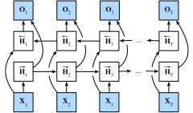

# Dvikrypčiai rekurentiniai neuroniniai tinklai
:label:`sec_bi_rnn`

Iki šiol mūsų pagrindinis sekų mokymosi užduoties pavyzdys buvo kalbos modeliavimas,
kai siekiame prognozuoti kitą teksto vienetą, žinodami visus ankstesnius sekos teksto vienetus.
Šiuo atveju norime sąlygoti tik kairiojo konteksto atžvilgiu,
todėl standartinio RNN vienakryptė grandinė atrodo tinkama.
Tačiau yra daug kitų sekų mokymosi užduočių kontekstų,
kuriuose visiškai tinka prognozę kiekvienu laiko žingsniu
sąlygoti ir kairiuoju, ir dešiniuoju kontekstu.
Pavyzdžiui, kalbos dalių nustatymas.
Kodėl neturėtume atsižvelgti į kontekstą abiem kryptimis,
vertindami su duotu žodžiu susijusią kalbos dalį?

Kita dažna užduotis – dažnai naudinga kaip išankstinio mokymo pratimas
prieš modelio patikslinimą tikrajai dominančiai užduočiai –
yra užmaskuoti atsitiktinius teksto dokumento teksto vienetus ir tada apmokyti
sekų modelį prognozuoti trūkstamų teksto vienetų reikšmes.
Atkreipkite dėmesį, kad priklausomai nuo to, kas eina po tuščios vietos,
tikėtina trūkstamo teksto vieneto reikšmė smarkiai keičiasi:

* Aš esu `___`.
* Aš esu `___` alkanas.
* Aš esu `___` alkanas ir galiu suvalgyti pusę kiaulės.

Pirmajame sakinyje „laimingas“ atrodo tikėtinas kandidatas.
Žodžiai „ne“ ir „labai“ atrodo tinkami antrajame sakinyje,
tačiau „ne“ atrodo nesuderinamas su trečiuoju sakiniu.


Laimei, paprasta technika bet kurį vienakryptį RNN paverčia
dvikrypčiu RNN :cite:`Schuster.Paliwal.1997`.
Tiesiog įgyvendiname du vienakrypčius RNN sluoksnius,
sujungtus priešingomis kryptimis
ir veikiančius tą pačią įvestį (:numref:`fig_birnn`).
Pirmajam RNN sluoksniui
pirmoji įvestis yra $\mathbf{x}_1$,
o paskutinė – $\mathbf{x}_T$,
tačiau antrajam RNN sluoksniui
pirmoji įvestis yra $\mathbf{x}_T$,
o paskutinė – $\mathbf{x}_1$.
Šio dvikrypčio RNN sluoksnio išvesčiai gauti
tiesiog sujungiame (angl. *concatenate*) atitinkamas
dviejų pagrindinių vienakrypčių RNN sluoksnių išvestis.



:label:`fig_birnn`


Formaliai, bet kuriam laiko žingsniui $t$
nagrinėjame minirinkinio įvestį $\mathbf{X}_t \in \mathbb{R}^{n \times d}$
(pavyzdžių skaičius $=n$; įvesčių skaičius kiekviename pavyzdyje $=d$)
ir tegul paslėptojo sluoksnio aktyvacijos funkcija yra $\phi$.
Dvikryptėje architektūroje
šio laiko žingsnio tiesioginė ir atvirkštinė paslėptosios būsenos
yra atitinkamai $\overrightarrow{\mathbf{H}}_t  \in \mathbb{R}^{n \times h}$
ir $\overleftarrow{\mathbf{H}}_t  \in \mathbb{R}^{n \times h}$,
kur $h$ yra paslėptųjų vienetų skaičius.
Tiesioginės ir atvirkštinės paslėptųjų būsenų atnaujinimai yra tokie:


$$
\begin{aligned}
\overrightarrow{\mathbf{H}}_t &= \phi(\mathbf{X}_t \mathbf{W}_{\textrm{xh}}^{(f)} + \overrightarrow{\mathbf{H}}_{t-1} \mathbf{W}_{\textrm{hh}}^{(f)}  + \mathbf{b}_\textrm{h}^{(f)}),\\
\overleftarrow{\mathbf{H}}_t &= \phi(\mathbf{X}_t \mathbf{W}_{\textrm{xh}}^{(b)} + \overleftarrow{\mathbf{H}}_{t+1} \mathbf{W}_{\textrm{hh}}^{(b)}  + \mathbf{b}_\textrm{h}^{(b)}),
\end{aligned}
$$

kur svoriai $\mathbf{W}_{\textrm{xh}}^{(f)} \in \mathbb{R}^{d \times h}, \mathbf{W}_{\textrm{hh}}^{(f)} \in \mathbb{R}^{h \times h}, \mathbf{W}_{\textrm{xh}}^{(b)} \in \mathbb{R}^{d \times h}, \textrm{ ir } \mathbf{W}_{\textrm{hh}}^{(b)} \in \mathbb{R}^{h \times h}$, o poslinkiai $\mathbf{b}_\textrm{h}^{(f)} \in \mathbb{R}^{1 \times h}$ ir $\mathbf{b}_\textrm{h}^{(b)} \in \mathbb{R}^{1 \times h}$ yra visi modelio parametrai.

Toliau sujungiame tiesioginę ir atvirkštinę paslėptąsias būsenas
$\overrightarrow{\mathbf{H}}_t$ ir $\overleftarrow{\mathbf{H}}_t$,
kad gautume paslėptąją būseną $\mathbf{H}_t \in \mathbb{R}^{n \times 2h}$, paduodamą į išvesties sluoksnį.
Giliuosiuose dvikrypčiuose RNN su keliais paslėptaisiais sluoksniais
tokia informacija perduodama kaip *įvestis* į kitą dvikryptį sluoksnį.
Galiausiai išvesties sluoksnis apskaičiuoja išvestį
$\mathbf{O}_t \in \mathbb{R}^{n \times q}$ (išvesčių skaičius $=q$):

$$\mathbf{O}_t = \mathbf{H}_t \mathbf{W}_{\textrm{hq}} + \mathbf{b}_\textrm{q}.$$

Čia svorių matrica $\mathbf{W}_{\textrm{hq}} \in \mathbb{R}^{2h \times q}$
ir poslinkis $\mathbf{b}_\textrm{q} \in \mathbb{R}^{1 \times q}$
yra išvesties sluoksnio modelio parametrai.
Nors techniškai dvi kryptys gali turėti skirtingą paslėptųjų vienetų skaičių,
šis dizaino pasirinkimas praktikoje daromas retai.
Dabar pademonstruosime paprastą dvikrypčio RNN įgyvendinimą.

```{.python .input}
%load_ext d2lbook.tab
tab.interact_select('mxnet', 'pytorch', 'tensorflow', 'jax')
```

```{.python .input}
%%tab mxnet
from d2l import mxnet as d2l
from mxnet import npx, np
from mxnet.gluon import rnn
npx.set_np()
```

```{.python .input}
%%tab pytorch
from d2l import torch as d2l
import torch
from torch import nn
```

```{.python .input}
%%tab tensorflow
from d2l import tensorflow as d2l
import tensorflow as tf
```

```{.python .input}
%%tab jax
from d2l import jax as d2l
from jax import numpy as jnp
```

## Įgyvendinimas nuo nulio

Jei norime įgyvendinti dvikryptį RNN nuo nulio,
galime įtraukti du vienakrypčius `RNNScratch` egzempliorius
su atskirais mokomais parametrais.

```{.python .input}
%%tab pytorch, mxnet, tensorflow
class BiRNNScratch(d2l.Module):
    def __init__(self, num_inputs, num_hiddens, sigma=0.01):
        super().__init__()
        self.save_hyperparameters()
        self.f_rnn = d2l.RNNScratch(num_inputs, num_hiddens, sigma)
        self.b_rnn = d2l.RNNScratch(num_inputs, num_hiddens, sigma)
        self.num_hiddens *= 2  # The output dimension will be doubled
```

```{.python .input}
%%tab jax
class BiRNNScratch(d2l.Module):
    num_inputs: int
    num_hiddens: int
    sigma: float = 0.01

    def setup(self):
        self.f_rnn = d2l.RNNScratch(num_inputs, num_hiddens, sigma)
        self.b_rnn = d2l.RNNScratch(num_inputs, num_hiddens, sigma)
        self.num_hiddens *= 2  # The output dimension will be doubled
```

Tiesioginio ir atvirkštinio RNN būsenos
atnaujinamos atskirai,
o šių dviejų RNN išvestys sujungiamos.

```{.python .input}
%%tab all
@d2l.add_to_class(BiRNNScratch)
def forward(self, inputs, Hs=None):
    f_H, b_H = Hs if Hs is not None else (None, None)
    f_outputs, f_H = self.f_rnn(inputs, f_H)
    b_outputs, b_H = self.b_rnn(reversed(inputs), b_H)
    outputs = [d2l.concat((f, b), -1) for f, b in zip(
        f_outputs, reversed(b_outputs))]
    return outputs, (f_H, b_H)
```

## Glaustas įgyvendinimas

:begin_tab:`pytorch, mxnet, tensorflow`
Naudodami aukšto lygio API,
dvikrypčius RNN galime įgyvendinti glausčiau.
Čia kaip pavyzdį imame GRU modelį.
:end_tab:

:begin_tab:`jax`
Flax API nesiūlo RNN sluoksnių, todėl nėra
jokio `bidirectional` argumento sampratos. Jei reikalingas dvikryptis sluoksnis,
reikia rankiniu būdu apversti įvestis, kaip parodyta
įgyvendinime nuo nulio.
:end_tab:

```{.python .input}
%%tab mxnet, pytorch
class BiGRU(d2l.RNN):
    def __init__(self, num_inputs, num_hiddens):
        d2l.Module.__init__(self)
        self.save_hyperparameters()
        if tab.selected('mxnet'):
            self.rnn = rnn.GRU(num_hiddens, bidirectional=True)
        if tab.selected('pytorch'):
            self.rnn = nn.GRU(num_inputs, num_hiddens, bidirectional=True)
        self.num_hiddens *= 2
```

## Santrauka

Dvikrypčiuose RNN kiekvieno laiko žingsnio paslėptoji būsena vienu metu nustatoma pagal duomenis prieš dabartinį laiko žingsnį ir po jo. Dvikrypčiai RNN daugiausia naudingi sekų kodavimui ir stebėjimų įvertinimui duotame dvikrypčiame kontekste. Dvikrypčius RNN apmokyti labai brangu dėl ilgų gradientų grandinių.

## Pratimai

1. Jei skirtingos kryptys naudoja skirtingą paslėptųjų vienetų skaičių, kaip pasikeis $\mathbf{H}_t$ forma?
1. Suprojektuokite dvikryptį RNN su keliais paslėptaisiais sluoksniais.
1. Polisemija natūraliosiose kalbose yra dažna. Pavyzdžiui, žodis „bank“ (angl. krantas / bankas) turi skirtingas reikšmes kontekstuose „i went to the bank to deposit cash“ ir „i went to the bank to sit down“. Kaip galime suprojektuoti neuroninio tinklo modelį, kad pagal duotą konteksto seką ir žodį būtų grąžinamas to žodžio vektorinis vaizdas teisingame kontekste? Kokio tipo neuroninės architektūros pageidautinos polisemijai spręsti?

:begin_tab:`mxnet`
[Diskusijos](https://discuss.d2l.ai/t/339)
:end_tab:

:begin_tab:`pytorch`
[Diskusijos](https://discuss.d2l.ai/t/1059)
:end_tab:

:begin_tab:`jax`
[Diskusijos](https://discuss.d2l.ai/t/18019)
:end_tab:
