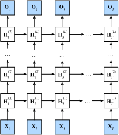

# Gilieji rekurentiniai neuroniniai tinklai

:label:`sec_deep_rnn`

Iki šiol daugiausia dėmesio skyrėme tinklų apibrėžimui,
sudarytų iš sekos įvesties,
vieno paslėptojo RNN sluoksnio
ir išvesties sluoksnio.
Nepaisant to, kad tarp įvesties bet kuriuo laiko žingsniu
ir atitinkamos išvesties yra tik vienas paslėptasis sluoksnis,
tam tikra prasme šie tinklai yra gilūs.
Įvestys iš pirmojo laiko žingsnio gali paveikti
išvestis paskutiniu laiko žingsniu $T$
(dažnai praėjus šimtams ar tūkstančiams žingsnių).
Šios įvestys $T$ kartų praeina per rekurentinį sluoksnį,
kol pasiekia galutinę išvestį.
Tačiau dažnai taip pat norime išlaikyti galimybę
išreikšti sudėtingus ryšius
tarp įvesčių duotu laiko žingsniu
ir išvesčių tuo pačiu laiko žingsniu.
Todėl dažnai kuriame RNN, kurie yra gilūs
ne tik laiko kryptimi,
bet ir kryptimi nuo įvesties iki išvesties.
Tai būtent ta gylio samprata,
su kuria jau susidūrėme
kurdami MLP ir gilius CNN.


Standartinis tokio giliojo RNN kūrimo metodas
stulbinamai paprastas: RNN sukrauname vieną ant kito.
Duotai $T$ ilgio sekai pirmasis RNN sukuria
išvesčių seką, taip pat $T$ ilgio.
Jos savo ruožtu sudaro kito RNN sluoksnio įvestis.
Šiame trumpame skyrelyje iliustruojame šį dizaino šabloną
ir pateikiame paprastą pavyzdį, kaip užprogramuoti tokius sukrautus RNN.
Toliau :numref:`fig_deep_rnn` iliustruojame
gilųjį RNN su $L$ paslėptųjų sluoksnių.
Kiekviena paslėptoji būsena veikia sekos įvestį
ir sukuria sekos išvestį.
Be to, bet kuri RNN ląstelė (balta dėžutė :numref:`fig_deep_rnn`) kiekvienu laiko žingsniu
priklauso ir nuo to paties sluoksnio
reikšmės ankstesniu laiko žingsniu,
ir nuo ankstesnio sluoksnio reikšmės
tuo pačiu laiko žingsniu.


:label:`fig_deep_rnn`

Formaliai, tarkime, kad turime minirinkinio įvestį
$\mathbf{X}_t \in \mathbb{R}^{n \times d}$
(pavyzdžių skaičius $=n$; įvesčių skaičius kiekviename pavyzdyje $=d$) laiko žingsniu $t$.
Tuo pačiu laiko žingsniu
tegul $l$-ojo paslėptojo sluoksnio ($l=1,\ldots,L$) paslėptoji būsena yra $\mathbf{H}_t^{(l)} \in \mathbb{R}^{n \times h}$
(paslėptųjų vienetų skaičius $=h$),
o išvesties sluoksnio kintamasis yra
$\mathbf{O}_t \in \mathbb{R}^{n \times q}$
(išvesčių skaičius: $q$).
Nustačius $\mathbf{H}_t^{(0)} = \mathbf{X}_t$,
$l$-ojo paslėptojo sluoksnio,
naudojančio aktyvacijos funkciją $\phi_l$,
paslėptoji būsena apskaičiuojama taip:

$$\mathbf{H}_t^{(l)} = \phi_l(\mathbf{H}_t^{(l-1)} \mathbf{W}_{\textrm{xh}}^{(l)} + \mathbf{H}_{t-1}^{(l)} \mathbf{W}_{\textrm{hh}}^{(l)}  + \mathbf{b}_\textrm{h}^{(l)}),$$
:eqlabel:`eq_deep_rnn_H`

kur svoriai $\mathbf{W}_{\textrm{xh}}^{(l)} \in \mathbb{R}^{h \times h}$ ir $\mathbf{W}_{\textrm{hh}}^{(l)} \in \mathbb{R}^{h \times h}$ kartu su
poslinkiu $\mathbf{b}_\textrm{h}^{(l)} \in \mathbb{R}^{1 \times h}$
yra $l$-ojo paslėptojo sluoksnio modelio parametrai.

Galiausiai išvesties sluoksnio skaičiavimas
remiasi tik galutinio $L$-ojo paslėptojo sluoksnio
paslėptąja būsena:

$$\mathbf{O}_t = \mathbf{H}_t^{(L)} \mathbf{W}_{\textrm{hq}} + \mathbf{b}_\textrm{q},$$

kur svoris $\mathbf{W}_{\textrm{hq}} \in \mathbb{R}^{h \times q}$
ir poslinkis $\mathbf{b}_\textrm{q} \in \mathbb{R}^{1 \times q}$
yra išvesties sluoksnio modelio parametrai.

Kaip ir MLP atveju, paslėptųjų sluoksnių skaičius $L$
ir paslėptųjų vienetų skaičius $h$ yra hiperparametrai,
kuriuos galime derinti.
Įprasti RNN sluoksnių pločiai ($h$) yra intervale $(64, 2056)$,
o įprasti gyliai ($L$) – intervale $(1, 8)$.
Be to, lengvai galime gauti gilųjį sklendėmis valdomą RNN,
pakeitę paslėptosios būsenos skaičiavimą :eqref:`eq_deep_rnn_H`
LSTM ar GRU skaičiavimu.

```{.python .input}
%load_ext d2lbook.tab
tab.interact_select('mxnet', 'pytorch', 'tensorflow', 'jax')
```

```{.python .input}
%%tab mxnet
from d2l import mxnet as d2l
from mxnet import np, npx
from mxnet.gluon import rnn
npx.set_np()
```

```{.python .input}
%%tab pytorch
from d2l import torch as d2l
import torch
from torch import nn
```

```{.python .input}
%%tab tensorflow
from d2l import tensorflow as d2l
import tensorflow as tf
```

```{.python .input}
%%tab jax
from d2l import jax as d2l
from flax import linen as nn
import jax
from jax import numpy as jnp
```

## Įgyvendinimas nuo nulio

Kad įgyvendintume daugiasluoksnį RNN nuo nulio,
kiekvieną sluoksnį galime traktuoti kaip `RNNScratch` egzempliorių
su savais mokomais parametrais.

```{.python .input}
%%tab mxnet, tensorflow
class StackedRNNScratch(d2l.Module):
    def __init__(self, num_inputs, num_hiddens, num_layers, sigma=0.01):
        super().__init__()
        self.save_hyperparameters()
        self.rnns = [d2l.RNNScratch(num_inputs if i==0 else num_hiddens,
                                    num_hiddens, sigma)
                     for i in range(num_layers)]
```

```{.python .input}
%%tab pytorch
class StackedRNNScratch(d2l.Module):
    def __init__(self, num_inputs, num_hiddens, num_layers, sigma=0.01):
        super().__init__()
        self.save_hyperparameters()
        self.rnns = nn.Sequential(*[d2l.RNNScratch(
            num_inputs if i==0 else num_hiddens, num_hiddens, sigma)
                                    for i in range(num_layers)])
```

```{.python .input}
%%tab jax
class StackedRNNScratch(d2l.Module):
    num_inputs: int
    num_hiddens: int
    num_layers: int
    sigma: float = 0.01

    def setup(self):
        self.rnns = [d2l.RNNScratch(self.num_inputs if i==0 else self.num_hiddens,
                                    self.num_hiddens, self.sigma)
                     for i in range(self.num_layers)]
```

Daugiasluoksnis tiesioginis skaičiavimas
tiesiog atlieka tiesioginį skaičiavimą
sluoksnis po sluoksnio.

```{.python .input}
%%tab all
@d2l.add_to_class(StackedRNNScratch)
def forward(self, inputs, Hs=None):
    outputs = inputs
    if Hs is None: Hs = [None] * self.num_layers
    for i in range(self.num_layers):
        outputs, Hs[i] = self.rnns[i](outputs, Hs[i])
        outputs = d2l.stack(outputs, 0)
    return outputs, Hs
```

Kaip pavyzdį apmokome gilųjį GRU modelį
*Laiko mašinos* duomenų rinkinyje (kaip :numref:`sec_rnn-scratch`).
Kad viskas būtų paprasta, sluoksnių skaičių nustatome į 2.

```{.python .input}
%%tab all
data = d2l.TimeMachine(batch_size=1024, num_steps=32)
if tab.selected('mxnet', 'pytorch', 'jax'):
    rnn_block = StackedRNNScratch(num_inputs=len(data.vocab),
                                  num_hiddens=32, num_layers=2)
    model = d2l.RNNLMScratch(rnn_block, vocab_size=len(data.vocab), lr=2)
    trainer = d2l.Trainer(max_epochs=100, gradient_clip_val=1, num_gpus=1)
if tab.selected('tensorflow'):
    with d2l.try_gpu():
        rnn_block = StackedRNNScratch(num_inputs=len(data.vocab),
                                  num_hiddens=32, num_layers=2)
        model = d2l.RNNLMScratch(rnn_block, vocab_size=len(data.vocab), lr=2)
    trainer = d2l.Trainer(max_epochs=100, gradient_clip_val=1)
trainer.fit(model, data)
```

## Glaustas įgyvendinimas

:begin_tab:`pytorch, mxnet, tensorflow`
Laimei, daug logistinių detalių, reikalingų
kelių RNN sluoksnių įgyvendinimui,
yra paruoštos aukšto lygio API.
Mūsų glaustas įgyvendinimas naudos tokias integruotas funkcijas.
Kodas apibendrina tą, kurį anksčiau naudojome :numref:`sec_gru`,
leisdamas aiškiai nurodyti sluoksnių skaičių,
užuot pasirinkus numatytąjį tik vieno sluoksnio variantą.
:end_tab:

:begin_tab:`jax`
Flax įgyvendindamas RNN laikosi minimalistinio požiūrio.
RNN sluoksnių skaičiaus apibrėžimas ar jo derinimas su dropout
nėra pasiekiamas iš dėžės.
Mūsų glaustas įgyvendinimas naudos visas integruotas funkcijas ir
papildomai pridės `num_layers` ir `dropout` galimybes.
Kodas apibendrina tą, kurį anksčiau naudojome :numref:`sec_gru`,
leisdamas aiškiai nurodyti sluoksnių skaičių,
užuot pasirinkus numatytąjį vieno sluoksnio variantą.
:end_tab:

```{.python .input}
%%tab mxnet
class GRU(d2l.RNN):  #@save
    """The multilayer GRU model."""
    def __init__(self, num_hiddens, num_layers, dropout=0):
        d2l.Module.__init__(self)
        self.save_hyperparameters()
        self.rnn = rnn.GRU(num_hiddens, num_layers, dropout=dropout)
```

```{.python .input}
%%tab pytorch
class GRU(d2l.RNN):  #@save
    """The multilayer GRU model."""
    def __init__(self, num_inputs, num_hiddens, num_layers, dropout=0):
        d2l.Module.__init__(self)
        self.save_hyperparameters()
        self.rnn = nn.GRU(num_inputs, num_hiddens, num_layers,
                          dropout=dropout)
```

```{.python .input}
%%tab tensorflow
class GRU(d2l.RNN):  #@save
    """The multilayer GRU model."""
    def __init__(self, num_hiddens, num_layers, dropout=0):
        d2l.Module.__init__(self)
        self.save_hyperparameters()
        gru_cells = [tf.keras.layers.GRUCell(num_hiddens, dropout=dropout)
                     for _ in range(num_layers)]
        self.rnn = tf.keras.layers.RNN(gru_cells, return_sequences=True,
                                       return_state=True, time_major=True)

    def forward(self, X, state=None):
        outputs, *state = self.rnn(X, state)
        return outputs, state
```

```{.python .input}
%%tab jax
class GRU(d2l.RNN):  #@save
    """The multilayer GRU model."""
    num_hiddens: int
    num_layers: int
    dropout: float = 0

    @nn.compact
    def __call__(self, X, state=None, training=False):
        outputs = X
        new_state = []
        if state is None:
            batch_size = X.shape[1]
            state = [nn.GRUCell.initialize_carry(jax.random.PRNGKey(0),
                    (batch_size,), self.num_hiddens)] * self.num_layers

        GRU = nn.scan(nn.GRUCell, variable_broadcast="params",
                      in_axes=0, out_axes=0, split_rngs={"params": False})

        # Introduce a dropout layer after every GRU layer except last
        for i in range(self.num_layers - 1):
            layer_i_state, X = GRU()(state[i], outputs)
            new_state.append(layer_i_state)
            X = nn.Dropout(self.dropout, deterministic=not training)(X)

        # Final GRU layer without dropout
        out_state, X = GRU()(state[-1], X)
        new_state.append(out_state)
        return X, jnp.array(new_state)
```

Architektūriniai sprendimai, tokie kaip hiperparametrų pasirinkimas,
labai panašūs į :numref:`sec_gru`.
Pasirenkame tiek pat įvesčių ir išvesčių,
kiek turime skirtingų teksto vienetų, t. y. `vocab_size`.
Paslėptųjų vienetų skaičius vis dar yra 32.
Vienintelis skirtumas, kad dabar
(**pasirenkame netrivialų paslėptųjų sluoksnių skaičių,
nurodydami `num_layers` reikšmę.**)

```{.python .input}
%%tab mxnet
gru = GRU(num_hiddens=32, num_layers=2)
model = d2l.RNNLM(gru, vocab_size=len(data.vocab), lr=2)

# Running takes > 1h (pending fix from MXNet)
# trainer.fit(model, data)
# model.predict('it has', 20, data.vocab, d2l.try_gpu())
```

```{.python .input}
%%tab pytorch, tensorflow, jax
if tab.selected('tensorflow', 'jax'):
    gru = GRU(num_hiddens=32, num_layers=2)
if tab.selected('pytorch'):
    gru = GRU(num_inputs=len(data.vocab), num_hiddens=32, num_layers=2)
if tab.selected('pytorch', 'jax'):
    model = d2l.RNNLM(gru, vocab_size=len(data.vocab), lr=2)
if tab.selected('tensorflow'):
    with d2l.try_gpu():
        model = d2l.RNNLM(gru, vocab_size=len(data.vocab), lr=2)
trainer.fit(model, data)
```

```{.python .input}
%%tab pytorch
model.predict('it has', 20, data.vocab, d2l.try_gpu())
```

```{.python .input}
%%tab tensorflow
model.predict('it has', 20, data.vocab)
```

```{.python .input}
%%tab jax
model.predict('it has', 20, data.vocab, trainer.state.params)
```

## Santrauka

Gilieji RNN perduoda paslėptosios būsenos informaciją
į kitą dabartinio sluoksnio laiko žingsnį
ir į dabartinį kito sluoksnio laiko žingsnį.
Egzistuoja daug skirtingų gilųjų RNN variantų, tokių kaip LSTM, GRU ar paprasti RNN.
Patogu, kad visi šie modeliai pasiekiami
kaip giliojo mokymosi karkasų aukšto lygio API dalis.
Modelių inicializavimas reikalauja atidumo.
Apskritai gilieji RNN reikalauja nemažai darbo
(pvz., mokymosi greičio ir apkarpymo derinimo),
kad būtų užtikrintas tinkamas konvergavimas.

## Pratimai

1. Pakeiskite GRU į LSTM ir palyginkite tikslumą bei apmokymo greitį.
1. Padidinkite apmokymo duomenis, įtraukdami kelias knygas. Kokio žemo painumo galite pasiekti?
1. Ar norėtumėte modeliuodami tekstą derinti skirtingų autorių šaltinius? Kodėl tai gera idėja? Kas gali nepavykti?

:begin_tab:`mxnet`
[Diskusijos](https://discuss.d2l.ai/t/340)
:end_tab:

:begin_tab:`pytorch`
[Diskusijos](https://discuss.d2l.ai/t/1058)
:end_tab:

:begin_tab:`tensorflow`
[Diskusijos](https://discuss.d2l.ai/t/3862)
:end_tab:

:begin_tab:`jax`
[Diskusijos](https://discuss.d2l.ai/t/18018)
:end_tab:
