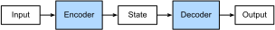

```{.python .input  n=1}
%load_ext d2lbook.tab
tab.interact_select('mxnet', 'pytorch', 'tensorflow', 'jax')
```

# Kodavimo ir dekodavimo architektūra
:label:`sec_encoder-decoder`

Bendrosiose sekos į seką problemose,
tokiose kaip mašininis vertimas
(:numref:`sec_machine_translation`),
įvestys ir išvestys yra kintamo ilgio
ir nesulygiuotos.
Standartinis tokių duomenų tvarkymo metodas
yra suprojektuoti *kodavimo ir dekodavimo* architektūrą (:numref:`fig_encoder_decoder`),
sudarytą iš dviejų pagrindinių komponentų:
*kodavimo bloko* (angl. *encoder*), kuris kaip įvestį priima kintamo ilgio seką,
ir *dekodavimo bloko* (angl. *decoder*), veikiančio kaip sąlyginis kalbos modelis,
priimančio užkoduotą įvestį
ir tikslinės sekos kairįjį kontekstą
bei prognozuojančio kitą tikslinės sekos teksto vienetą.



:label:`fig_encoder_decoder`

Paimkime kaip pavyzdį mašininį vertimą iš anglų į prancūzų kalbą.
Turint įvesties seką anglų kalba:
„They“, „are“, „watching“, „.“,
ši kodavimo ir dekodavimo architektūra
pirmiausia užkoduoja kintamo ilgio įvestį į būseną,
tada dekoduoja būseną,
kad sugeneruotų išverstą seką,
teksto vienetas po teksto vieneto, kaip išvestį:
„Ils“, „regardent“, „.“.
Kadangi kodavimo ir dekodavimo architektūra
sudaro skirtingų sekos į seką modelių pagrindą
vėlesniuose skyreliuose,
šiame skyrelyje ši architektūra
paverčiama sąsaja, kuri bus įgyvendinta vėliau.

```{.python .input}
%%tab mxnet
from d2l import mxnet as d2l
from mxnet.gluon import nn
```

```{.python .input}
%%tab pytorch
from d2l import torch as d2l
from torch import nn
```

```{.python .input}
%%tab tensorflow
from d2l import tensorflow as d2l
import tensorflow as tf
```

```{.python .input}
%%tab jax
from d2l import jax as d2l
from flax import linen as nn
```

## (**Kodavimo blokas**)

Kodavimo bloko sąsajoje
tik nurodome, kad
kodavimo blokas kaip įvestį `X` priima kintamo ilgio sekas.
Įgyvendinimą pateiks
bet kuris modelis, paveldintis šią bazinę `Encoder` klasę.

```{.python .input}
%%tab mxnet
class Encoder(nn.Block):  #@save
    """The base encoder interface for the encoder--decoder architecture."""
    def __init__(self):
        super().__init__()

    # Later there can be additional arguments (e.g., length excluding padding)
    def forward(self, X, *args):
        raise NotImplementedError
```

```{.python .input}
%%tab pytorch
class Encoder(nn.Module):  #@save
    """The base encoder interface for the encoder--decoder architecture."""
    def __init__(self):
        super().__init__()

    # Later there can be additional arguments (e.g., length excluding padding)
    def forward(self, X, *args):
        raise NotImplementedError
```

```{.python .input}
%%tab tensorflow
class Encoder(tf.keras.layers.Layer):  #@save
    """The base encoder interface for the encoder--decoder architecture."""
    def __init__(self):
        super().__init__()

    # Later there can be additional arguments (e.g., length excluding padding)
    def call(self, X, *args):
        raise NotImplementedError
```

```{.python .input}
%%tab jax
class Encoder(nn.Module):  #@save
    """The base encoder interface for the encoder--decoder architecture."""
    def setup(self):
        raise NotImplementedError

    # Later there can be additional arguments (e.g., length excluding padding)
    def __call__(self, X, *args):
        raise NotImplementedError
```

## [**Dekodavimo blokas**]

Toliau pateiktoje dekodavimo bloko sąsajoje
pridedame papildomą metodą `init_state`,
kad kodavimo bloko išvestį (`enc_all_outputs`)
paverstume užkoduota būsena.
Atkreipkite dėmesį, kad šis žingsnis
gali reikalauti papildomų įvesčių,
tokių kaip galiojantis įvesties ilgis,
paaiškintas
:numref:`sec_machine_translation`.
Kad kintamo ilgio seką sugeneruotume teksto vienetas po teksto vieneto,
kiekvieną kartą dekodavimo blokas gali atvaizduoti įvestį
(pvz., ankstesniu laiko žingsniu sugeneruotą teksto vienetą)
ir užkoduotą būseną
į išvesties teksto vienetą dabartiniu laiko žingsniu.

```{.python .input}
%%tab mxnet
class Decoder(nn.Block):  #@save
    """The base decoder interface for the encoder--decoder architecture."""
    def __init__(self):
        super().__init__()

    # Later there can be additional arguments (e.g., length excluding padding)
    def init_state(self, enc_all_outputs, *args):
        raise NotImplementedError

    def forward(self, X, state):
        raise NotImplementedError
```

```{.python .input}
%%tab pytorch
class Decoder(nn.Module):  #@save
    """The base decoder interface for the encoder--decoder architecture."""
    def __init__(self):
        super().__init__()

    # Later there can be additional arguments (e.g., length excluding padding)
    def init_state(self, enc_all_outputs, *args):
        raise NotImplementedError

    def forward(self, X, state):
        raise NotImplementedError
```

```{.python .input}
%%tab tensorflow
class Decoder(tf.keras.layers.Layer):  #@save
    """The base decoder interface for the encoder--decoder architecture."""
    def __init__(self):
        super().__init__()

    # Later there can be additional arguments (e.g., length excluding padding)
    def init_state(self, enc_all_outputs, *args):
        raise NotImplementedError

    def call(self, X, state):
        raise NotImplementedError
```

```{.python .input}
%%tab jax
class Decoder(nn.Module):  #@save
    """The base decoder interface for the encoder--decoder architecture."""
    def setup(self):
        raise NotImplementedError

    # Later there can be additional arguments (e.g., length excluding padding)
    def init_state(self, enc_all_outputs, *args):
        raise NotImplementedError

    def __call__(self, X, state):
        raise NotImplementedError
```

## [**Kodavimo ir dekodavimo blokų sujungimas**]

Tiesioginio sklidimo metu
kodavimo bloko išvestis
naudojama užkoduotai būsenai sukurti,
o ši būsena toliau naudojama
dekodavimo bloko kaip viena iš jo įvesčių.

```{.python .input}
%%tab mxnet, pytorch
class EncoderDecoder(d2l.Classifier):  #@save
    """The base class for the encoder--decoder architecture."""
    def __init__(self, encoder, decoder):
        super().__init__()
        self.encoder = encoder
        self.decoder = decoder

    def forward(self, enc_X, dec_X, *args):
        enc_all_outputs = self.encoder(enc_X, *args)
        dec_state = self.decoder.init_state(enc_all_outputs, *args)
        # Return decoder output only
        return self.decoder(dec_X, dec_state)[0]
```

```{.python .input}
%%tab tensorflow
class EncoderDecoder(d2l.Classifier):  #@save
    """The base class for the encoder--decoder architecture."""
    def __init__(self, encoder, decoder):
        super().__init__()
        self.encoder = encoder
        self.decoder = decoder

    def call(self, enc_X, dec_X, *args):
        enc_all_outputs = self.encoder(enc_X, *args, training=True)
        dec_state = self.decoder.init_state(enc_all_outputs, *args)
        # Return decoder output only
        return self.decoder(dec_X, dec_state, training=True)[0]
```

```{.python .input}
%%tab jax
class EncoderDecoder(d2l.Classifier):  #@save
    """The base class for the encoder--decoder architecture."""
    encoder: nn.Module
    decoder: nn.Module
    training: bool

    def __call__(self, enc_X, dec_X, *args):
        enc_all_outputs = self.encoder(enc_X, *args, training=self.training)
        dec_state = self.decoder.init_state(enc_all_outputs, *args)
        # Return decoder output only
        return self.decoder(dec_X, dec_state, training=self.training)[0]
```

Kitame skyrelyje
pamatysime, kaip taikyti RNN projektuojant
sekos į seką modelius, pagrįstus
šia kodavimo ir dekodavimo architektūra.


## Santrauka

Kodavimo ir dekodavimo architektūros
gali tvarkyti įvestis ir išvestis,
kurios abi yra kintamo ilgio sekos,
todėl tinka sekos į seką problemoms,
tokioms kaip mašininis vertimas.
Kodavimo blokas kaip įvestį priima kintamo ilgio seką
ir paverčia ją fiksuotos formos būsena.
Dekodavimo blokas fiksuotos formos užkoduotą būseną
atvaizduoja į kintamo ilgio seką.


## Pratimai

1. Tarkime, kad kodavimo ir dekodavimo architektūrai įgyvendinti naudojame neuroninius tinklus. Ar kodavimo ir dekodavimo blokai turi būti to paties tipo neuroniniai tinklai?
1. Be mašininio vertimo, ar galite sugalvoti kitą taikymą, kuriame galima taikyti kodavimo ir dekodavimo architektūrą?

:begin_tab:`mxnet`
[Diskusijos](https://discuss.d2l.ai/t/341)
:end_tab:

:begin_tab:`pytorch`
[Diskusijos](https://discuss.d2l.ai/t/1061)
:end_tab:

:begin_tab:`tensorflow`
[Diskusijos](https://discuss.d2l.ai/t/3864)
:end_tab:

:begin_tab:`jax`
[Diskusijos](https://discuss.d2l.ai/t/18021)
:end_tab:
