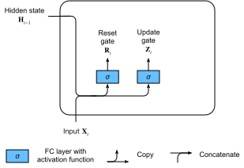
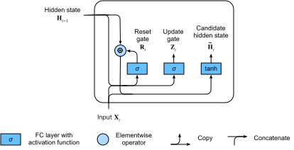
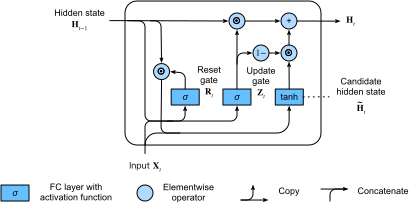

# Sklendžių rekurentiniai vienetai (GRU)
:label:`sec_gru`


Kadangi RNN, o ypač LSTM architektūra (:numref:`sec_lstm`),
greitai išpopuliarėjo 2010-aisiais,
keli tyrėjai pradėjo eksperimentuoti
su supaprastintomis architektūromis, tikėdamiesi
išlaikyti pagrindinę idėją – įtraukti
vidinę būseną ir daugybinius sklendžių mechanizmus,
bet siekdami pagreitinti skaičiavimą.
Sklendžių rekurentinis vienetas (GRU) :cite:`Cho.Van-Merrienboer.Bahdanau.ea.2014`
pasiūlė supaprastintą LSTM atminties ląstelės versiją,
kuri dažnai pasiekia panašų našumą,
tačiau turi pranašumą – yra greitesnė
skaičiuoti :cite:`Chung.Gulcehre.Cho.ea.2014`.

```{.python .input  n=5}
%load_ext d2lbook.tab
tab.interact_select(['mxnet', 'pytorch', 'tensorflow', 'jax'])
```

```{.python .input  n=6}
%%tab mxnet
from d2l import mxnet as d2l
from mxnet import np, npx
from mxnet.gluon import rnn
npx.set_np()
```

```{.python .input  n=7}
%%tab pytorch
from d2l import torch as d2l
import torch
from torch import nn
```

```{.python .input  n=8}
%%tab tensorflow
from d2l import tensorflow as d2l
import tensorflow as tf
```

```{.python .input}
%%tab jax
from d2l import jax as d2l
from flax import linen as nn
import jax
from jax import numpy as jnp
```

## Atstatymo sklendė ir atnaujinimo sklendė

Čia trys LSTM sklendės pakeičiamos dviem:
*atstatymo sklendė* ir *atnaujinimo sklendė*.
Kaip ir LSTM, šioms sklendėms taikomos sigmoidinės aktyvacijos,
verčiančios jų reikšmes gulėti intervale $(0, 1)$.
Intuityviai atstatymo sklendė valdo, kiek ankstesnės būsenos
vis dar norėtume prisiminti.
Panašiai atnaujinimo sklendė leistų valdyti,
kiek naujosios būsenos yra tiesiog senosios kopija.
:numref:`fig_gru_1` iliustruoja abiejų
atstatymo ir atnaujinimo sklendžių įvestis GRU,
duotą dabartinio laiko žingsnio įvestį
ir ankstesnio laiko žingsnio paslėptąją būseną.
Sklendžių išvestis pateikia
du pilnai sujungti sluoksniai
su sigmoidine aktyvacijos funkcija.


:label:`fig_gru_1`

Matematiškai, duotam laiko žingsniui $t$,
tarkime, kad įvestis yra minirinkinys
$\mathbf{X}_t \in \mathbb{R}^{n \times d}$
(pavyzdžių skaičius $=n$; įvesčių skaičius $=d$),
o ankstesnio laiko žingsnio paslėptoji būsena
yra $\mathbf{H}_{t-1} \in \mathbb{R}^{n \times h}$
(paslėptųjų vienetų skaičius $=h$).
Tada atstatymo sklendė $\mathbf{R}_t \in \mathbb{R}^{n \times h}$
ir atnaujinimo sklendė $\mathbf{Z}_t \in \mathbb{R}^{n \times h}$ apskaičiuojamos taip:

$$
\begin{aligned}
\mathbf{R}_t = \sigma(\mathbf{X}_t \mathbf{W}_{\textrm{xr}} + \mathbf{H}_{t-1} \mathbf{W}_{\textrm{hr}} + \mathbf{b}_\textrm{r}),\\
\mathbf{Z}_t = \sigma(\mathbf{X}_t \mathbf{W}_{\textrm{xz}} + \mathbf{H}_{t-1} \mathbf{W}_{\textrm{hz}} + \mathbf{b}_\textrm{z}),
\end{aligned}
$$

kur $\mathbf{W}_{\textrm{xr}}, \mathbf{W}_{\textrm{xz}} \in \mathbb{R}^{d \times h}$
ir $\mathbf{W}_{\textrm{hr}}, \mathbf{W}_{\textrm{hz}} \in \mathbb{R}^{h \times h}$
yra svorių parametrai, o $\mathbf{b}_\textrm{r}, \mathbf{b}_\textrm{z} \in \mathbb{R}^{1 \times h}$
yra poslinkio parametrai.


## Kandidatinė paslėptoji būsena

Toliau atstatymo sklendę $\mathbf{R}_t$ integruojame
į įprastą atnaujinimo mechanizmą
:eqref:`rnn_h_with_state`,
gaudami šią
*kandidatinę paslėptąją būseną*
$\tilde{\mathbf{H}}_t \in \mathbb{R}^{n \times h}$ laiko žingsniu $t$:

$$\tilde{\mathbf{H}}_t = \tanh(\mathbf{X}_t \mathbf{W}_{\textrm{xh}} + \left(\mathbf{R}_t \odot \mathbf{H}_{t-1}\right) \mathbf{W}_{\textrm{hh}} + \mathbf{b}_\textrm{h}),$$
:eqlabel:`gru_tilde_H`

kur $\mathbf{W}_{\textrm{xh}} \in \mathbb{R}^{d \times h}$ ir $\mathbf{W}_{\textrm{hh}} \in \mathbb{R}^{h \times h}$
yra svorių parametrai,
$\mathbf{b}_\textrm{h} \in \mathbb{R}^{1 \times h}$
yra poslinkis,
o simbolis $\odot$ yra Hadamardo (elementų lygmens) sandaugos operatorius.
Čia naudojame tanh aktyvacijos funkciją.

Rezultatas yra *kandidatas*, nes dar turime
įtraukti atnaujinimo sklendės veikimą.
Palyginti su :eqref:`rnn_h_with_state`,
ankstesnių būsenų įtaka
dabar gali būti sumažinta elementų lygmens
$\mathbf{R}_t$ ir $\mathbf{H}_{t-1}$ daugyba
:eqref:`gru_tilde_H`.
Kai tik atstatymo sklendės $\mathbf{R}_t$ elementai artimi 1,
atkuriame paprastą RNN, tokį kaip :eqref:`rnn_h_with_state`.
Visiems atstatymo sklendės $\mathbf{R}_t$ elementams, artimiems 0,
kandidatinė paslėptoji būsena yra MLP su įvestimi $\mathbf{X}_t$ rezultatas.
Bet kuri jau egzistuojanti paslėptoji būsena taip *atstatoma* į numatytąsias reikšmes.

:numref:`fig_gru_2` iliustruoja skaičiavimo srautą pritaikius atstatymo sklendę.


:label:`fig_gru_2`


## Paslėptoji būsena

Galiausiai turime įtraukti atnaujinimo sklendės $\mathbf{Z}_t$ poveikį.
Ji nustato, kiek nauja paslėptoji būsena $\mathbf{H}_t \in \mathbb{R}^{n \times h}$
atitinka senąją būseną $\mathbf{H}_{t-1}$, palyginti su tuo, kiek
ji primena naująją kandidatinę būseną $\tilde{\mathbf{H}}_t$.
Atnaujinimo sklendę $\mathbf{Z}_t$ šiam tikslui galima naudoti
tiesiog imant elementų lygmens iškilusius derinius
$\mathbf{H}_{t-1}$ ir $\tilde{\mathbf{H}}_t$.
Tai veda prie galutinės GRU atnaujinimo lygties:

$$\mathbf{H}_t = \mathbf{Z}_t \odot \mathbf{H}_{t-1}  + (1 - \mathbf{Z}_t) \odot \tilde{\mathbf{H}}_t.$$


Kai tik atnaujinimo sklendė $\mathbf{Z}_t$ artima 1,
tiesiog išlaikome seną būseną.
Šiuo atveju informacija iš $\mathbf{X}_t$ ignoruojama,
faktiškai praleidžiant laiko žingsnį $t$ priklausomybių grandinėje.
Priešingai, kai tik $\mathbf{Z}_t$ artima 0,
nauja latentinė būsena $\mathbf{H}_t$ artėja prie kandidatinės latentinės būsenos $\tilde{\mathbf{H}}_t$.
:numref:`fig_gru_3` parodo skaičiavimo srautą, kai atnaujinimo sklendė veikia.


:label:`fig_gru_3`


Apibendrinant, GRU turi šias dvi išskirtines savybes:

* Atstatymo sklendės padeda užfiksuoti trumpalaikes sekų priklausomybes.
* Atnaujinimo sklendės padeda užfiksuoti ilgalaikes sekų priklausomybes.

## Įgyvendinimas nuo nulio

Kad geriau suprastume GRU modelį, įgyvendinkime jį nuo nulio.

### (**Modelio parametrų inicializavimas**)

Pirmas žingsnis – inicializuoti modelio parametrus.
Svorius imame iš Gauso skirstinio
su standartiniu nuokrypiu `sigma`, o poslinkį nustatome į 0.
Hiperparametras `num_hiddens` apibrėžia paslėptųjų vienetų skaičių.
Sukuriame visus svorius ir poslinkius, susijusius su atnaujinimo sklende,
atstatymo sklende ir kandidatine paslėptąja būsena.

```{.python .input}
%%tab pytorch, mxnet, tensorflow
class GRUScratch(d2l.Module):
    def __init__(self, num_inputs, num_hiddens, sigma=0.01):
        super().__init__()
        self.save_hyperparameters()
        
        if tab.selected('mxnet'):
            init_weight = lambda *shape: d2l.randn(*shape) * sigma
            triple = lambda: (init_weight(num_inputs, num_hiddens),
                              init_weight(num_hiddens, num_hiddens),
                              d2l.zeros(num_hiddens))            
        if tab.selected('pytorch'):
            init_weight = lambda *shape: nn.Parameter(d2l.randn(*shape) * sigma)
            triple = lambda: (init_weight(num_inputs, num_hiddens),
                              init_weight(num_hiddens, num_hiddens),
                              nn.Parameter(d2l.zeros(num_hiddens)))
        if tab.selected('tensorflow'):
            init_weight = lambda *shape: tf.Variable(d2l.normal(shape) * sigma)
            triple = lambda: (init_weight(num_inputs, num_hiddens),
                              init_weight(num_hiddens, num_hiddens),
                              tf.Variable(d2l.zeros(num_hiddens)))            
            
        self.W_xz, self.W_hz, self.b_z = triple()  # Update gate
        self.W_xr, self.W_hr, self.b_r = triple()  # Reset gate
        self.W_xh, self.W_hh, self.b_h = triple()  # Candidate hidden state        
```

```{.python .input}
%%tab jax
class GRUScratch(d2l.Module):
    num_inputs: int
    num_hiddens: int
    sigma: float = 0.01

    def setup(self):
        init_weight = lambda name, shape: self.param(name,
                                                     nn.initializers.normal(self.sigma),
                                                     shape)
        triple = lambda name : (
            init_weight(f'W_x{name}', (self.num_inputs, self.num_hiddens)),
            init_weight(f'W_h{name}', (self.num_hiddens, self.num_hiddens)),
            self.param(f'b_{name}', nn.initializers.zeros, (self.num_hiddens)))

        self.W_xz, self.W_hz, self.b_z = triple('z')  # Update gate
        self.W_xr, self.W_hr, self.b_r = triple('r')  # Reset gate
        self.W_xh, self.W_hh, self.b_h = triple('h')  # Candidate hidden state
```

### Modelio apibrėžimas

Dabar esame pasiruošę [**apibrėžti GRU tiesioginį skaičiavimą**].
Jo struktūra tokia pati kaip pagrindinės RNN ląstelės,
tik atnaujinimo lygtys sudėtingesnės.

```{.python .input}
%%tab pytorch, mxnet, tensorflow
@d2l.add_to_class(GRUScratch)
def forward(self, inputs, H=None):
    if H is None:
        # Initial state with shape: (batch_size, num_hiddens)
        if tab.selected('mxnet'):
            H = d2l.zeros((inputs.shape[1], self.num_hiddens),
                          ctx=inputs.ctx)
        if tab.selected('pytorch'):
            H = d2l.zeros((inputs.shape[1], self.num_hiddens),
                          device=inputs.device)
        if tab.selected('tensorflow'):
            H = d2l.zeros((inputs.shape[1], self.num_hiddens))
    outputs = []
    for X in inputs:
        Z = d2l.sigmoid(d2l.matmul(X, self.W_xz) +
                        d2l.matmul(H, self.W_hz) + self.b_z)
        R = d2l.sigmoid(d2l.matmul(X, self.W_xr) + 
                        d2l.matmul(H, self.W_hr) + self.b_r)
        H_tilde = d2l.tanh(d2l.matmul(X, self.W_xh) + 
                           d2l.matmul(R * H, self.W_hh) + self.b_h)
        H = Z * H + (1 - Z) * H_tilde
        outputs.append(H)
    return outputs, H
```

```{.python .input}
%%tab jax
@d2l.add_to_class(GRUScratch)
def forward(self, inputs, H=None):
    # Use lax.scan primitive instead of looping over the
    # inputs, since scan saves time in jit compilation
    def scan_fn(H, X):
        Z = d2l.sigmoid(d2l.matmul(X, self.W_xz) + d2l.matmul(H, self.W_hz) +
                        self.b_z)
        R = d2l.sigmoid(d2l.matmul(X, self.W_xr) +
                        d2l.matmul(H, self.W_hr) + self.b_r)
        H_tilde = d2l.tanh(d2l.matmul(X, self.W_xh) +
                           d2l.matmul(R * H, self.W_hh) + self.b_h)
        H = Z * H + (1 - Z) * H_tilde
        return H, H  # return carry, y

    if H is None:
        batch_size = inputs.shape[1]
        carry = jnp.zeros((batch_size, self.num_hiddens))
    else:
        carry = H

    # scan takes the scan_fn, initial carry state, xs with leading axis to be scanned
    carry, outputs = jax.lax.scan(scan_fn, carry, inputs)
    return outputs, carry
```

### Mokymas

*Laiko mašinos* duomenų rinkinyje [**apmokyti**] kalbos modelį
veikia lygiai taip pat kaip :numref:`sec_rnn-scratch`.

```{.python .input}
%%tab all
data = d2l.TimeMachine(batch_size=1024, num_steps=32)
if tab.selected('mxnet', 'pytorch', 'jax'):
    gru = GRUScratch(num_inputs=len(data.vocab), num_hiddens=32)
    model = d2l.RNNLMScratch(gru, vocab_size=len(data.vocab), lr=4)
    trainer = d2l.Trainer(max_epochs=50, gradient_clip_val=1, num_gpus=1)
if tab.selected('tensorflow'):
    with d2l.try_gpu():
        gru = GRUScratch(num_inputs=len(data.vocab), num_hiddens=32)
        model = d2l.RNNLMScratch(gru, vocab_size=len(data.vocab), lr=4)
    trainer = d2l.Trainer(max_epochs=50, gradient_clip_val=1)
trainer.fit(model, data)
```

## [**Glaustas įgyvendinimas**]

Aukšto lygio API galime tiesiogiai sukurti GRU modelį.
Tai įkapsuliuoja visas konfigūracijos detales, kurias aukščiau pateikėme aiškiai.

```{.python .input}
%%tab pytorch, mxnet, tensorflow
class GRU(d2l.RNN):
    def __init__(self, num_inputs, num_hiddens):
        d2l.Module.__init__(self)
        self.save_hyperparameters()
        if tab.selected('mxnet'):
            self.rnn = rnn.GRU(num_hiddens)
        if tab.selected('pytorch'):
            self.rnn = nn.GRU(num_inputs, num_hiddens)
        if tab.selected('tensorflow'):
            self.rnn = tf.keras.layers.GRU(num_hiddens, return_sequences=True, 
                                           return_state=True)
```

```{.python .input}
%%tab jax
class GRU(d2l.RNN):
    num_hiddens: int

    @nn.compact
    def __call__(self, inputs, H=None, training=False):
        if H is None:
            batch_size = inputs.shape[1]
            H = nn.GRUCell.initialize_carry(jax.random.PRNGKey(0),
                                            (batch_size,), self.num_hiddens)

        GRU = nn.scan(nn.GRUCell, variable_broadcast="params",
                      in_axes=0, out_axes=0, split_rngs={"params": False})

        H, outputs = GRU()(H, inputs)
        return outputs, H
```

Kodas apmokymo metu veikia gerokai greičiau, nes naudoja sukompiliuotus operatorius,
o ne Python.

```{.python .input}
%%tab all
if tab.selected('mxnet', 'pytorch', 'tensorflow'):
    gru = GRU(num_inputs=len(data.vocab), num_hiddens=32)
if tab.selected('jax'):
    gru = GRU(num_hiddens=32)
if tab.selected('mxnet', 'pytorch', 'jax'):
    model = d2l.RNNLM(gru, vocab_size=len(data.vocab), lr=4)
if tab.selected('tensorflow'):
    with d2l.try_gpu():
        model = d2l.RNNLM(gru, vocab_size=len(data.vocab), lr=4)
trainer.fit(model, data)
```

Po apmokymo išspausdiname painumą apmokymo aibėje
ir prognozuojamą seką, einančią po pateikto priešdėlio.

```{.python .input}
%%tab mxnet, pytorch
model.predict('it has', 20, data.vocab, d2l.try_gpu())
```

```{.python .input}
%%tab tensorflow
model.predict('it has', 20, data.vocab)
```

```{.python .input}
%%tab jax
model.predict('it has', 20, data.vocab, trainer.state.params)
```

## Santrauka

Palyginti su LSTM, GRU pasiekia panašų našumą, bet skaičiavimo požiūriu yra lengvesni.
Apskritai, palyginti su paprastais RNN, sklendėmis valdomi RNN, tokie kaip LSTM ir GRU,
geriau užfiksuoja priklausomybes sekose, kai laiko žingsnių atstumai dideli.
GRU kraštutiniu atveju apima paprastus RNN, kai atstatymo sklendė yra įjungta.
Jie taip pat gali praleisti posekius įjungdami atnaujinimo sklendę.


## Pratimai

1. Tarkime, kad norime naudoti tik laiko žingsnio $t'$ įvestį išvesčiai laiko žingsniu $t > t'$ prognozuoti. Kokios yra geriausios atstatymo ir atnaujinimo sklendžių reikšmės kiekvienam laiko žingsniui?
1. Pakoreguokite hiperparametrus ir išanalizuokite jų įtaką veikimo laikui, painumui ir išvesties sekai.
1. Palyginkite `rnn.RNN` ir `rnn.GRU` įgyvendinimų veikimo laiką, painumą ir išvesties eilutes tarpusavyje.
1. Kas nutiks, jei įgyvendinsite tik dalis GRU, pvz., tik su atstatymo sklende arba tik su atnaujinimo sklende?

:begin_tab:`mxnet`
[Diskusijos](https://discuss.d2l.ai/t/342)
:end_tab:

:begin_tab:`pytorch`
[Diskusijos](https://discuss.d2l.ai/t/1056)
:end_tab:

:begin_tab:`tensorflow`
[Diskusijos](https://discuss.d2l.ai/t/3860)
:end_tab:

:begin_tab:`jax`
[Diskusijos](https://discuss.d2l.ai/t/18017)
:end_tab:
