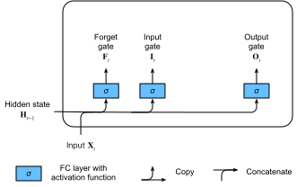
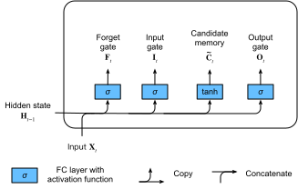
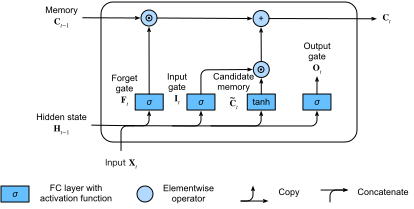
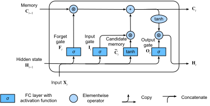

# Ilga trumpalaikė atmintis (LSTM)
:label:`sec_lstm`


Netrukus po to, kai pirmieji Elmano tipo RNN buvo apmokyti naudojant atgalinį sklidimą
:cite:`elman1990finding`, ilgalaikių priklausomybių mokymosi problemos
(dėl nykstančių ir sprogstančių gradientų)
tapo akivaizdžios, ir Bengio bei Hochreiteris
aptarė šią problemą
:cite:`bengio1994learning,Hochreiter.Bengio.Frasconi.ea.2001`.
Hochreiteris suformulavo šią problemą dar 1991 m. savo magistro darbe, nors rezultatai
nebuvo plačiai žinomi, nes darbas buvo parašytas vokiečių kalba.
Nors gradientų apkarpymas padeda sprogstantiems gradientams,
susidorojimas su nykstančiais gradientais, atrodo,
reikalauja sudėtingesnio sprendimo.
Viena pirmųjų ir sėkmingiausių technikų
nykstantiems gradientams spręsti
atsirado ilgos trumpalaikės atminties (LSTM) modelio pavidalu,
kurį pasiūlė :citet:`Hochreiter.Schmidhuber.1997`.
LSTM primena standartinius rekurentinius neuroninius tinklus,
tačiau čia kiekvienas įprastas rekurentinis mazgas
pakeičiamas *atminties ląstele*.
Kiekviena atminties ląstelė turi *vidinę būseną*,
t. y. mazgą su savęs paties rekurentine briauna, kurios fiksuotas svoris yra 1,
užtikrinantį, kad gradientas gali praeiti per daugelį laiko žingsnių
neišnykdamas ir nesprogdamas.

Terminas „ilga trumpalaikė atmintis“ kyla iš šios intuicijos.
Paprasti rekurentiniai neuroniniai tinklai
turi *ilgalaikę atmintį* svorių pavidalu.
Svoriai apmokymo metu keičiasi lėtai,
koduodami bendrąsias žinias apie duomenis.
Jie taip pat turi *trumpalaikę atmintį*
trumpalaikių aktyvacijų pavidalu,
kurios sklinda nuo kiekvieno mazgo į paskesnius mazgus.
LSTM modelis per atminties ląstelę įveda tarpinį saugojimo tipą.
Atminties ląstelė yra sudėtinis vienetas,
sudarytas iš paprastesnių mazgų
tam tikru jungčių šablonu,
naujai įtraukiant daugybos mazgus.

```{.python .input}
%load_ext d2lbook.tab
tab.interact_select(['mxnet', 'pytorch', 'tensorflow', 'jax'])
```

```{.python .input}
%%tab mxnet
from d2l import mxnet as d2l
from mxnet import np, npx
from mxnet.gluon import rnn
npx.set_np()
```

```{.python .input}
%%tab pytorch
from d2l import torch as d2l
import torch
from torch import nn
```

```{.python .input}
%%tab tensorflow
from d2l import tensorflow as d2l
import tensorflow as tf
```

```{.python .input}
%%tab jax
from d2l import jax as d2l
from flax import linen as nn
import jax
from jax import numpy as jnp
```

## Sklendžių atminties ląstelė

Kiekviena atminties ląstelė turi *vidinę būseną*
ir keletą daugybinių sklendžių, nustatančių, ar
(i) duota įvestis turėtų paveikti vidinę būseną (*atidarymo sklendė*),
(ii) vidinė būsena turėtų būti nuvalyta iki $0$ (*užmiršimo sklendė*),
ir (iii) duoto neurono vidinei būsenai
turėtų būti leista paveikti ląstelės išvestį (*išvesties* sklendė).


### Sklendėmis valdoma paslėptoji būsena

Pagrindinis skirtumas tarp paprastų RNN ir LSTM
yra tas, kad pastarieji palaiko paslėptosios būsenos sklendžių valdymą.
Tai reiškia, kad turime specialius mechanizmus tam,
kada paslėptoji būsena turėtų būti *atnaujinta* ir
kada ji turėtų būti *atstatyta*.
Šie mechanizmai yra išmokstami ir sprendžia aukščiau išvardytas problemas.
Pavyzdžiui, jei pirmasis teksto vienetas yra labai svarbus,
išmoksime neatnaujinti paslėptosios būsenos po pirmojo stebėjimo.
Panašiai išmoksime praleisti nesvarbius laikinus stebėjimus.
Galiausiai išmoksime atstatyti latentinę būseną, kai tik reikia.
Tai aptariame išsamiai toliau.

### Atidarymo sklendė, užmiršimo sklendė ir išvesties sklendė

Duomenys, paduodami į LSTM sklendes, yra
dabartinio laiko žingsnio įvestis ir
ankstesnio laiko žingsnio paslėptoji būsena,
kaip iliustruota :numref:`fig_lstm_0`.
Trys pilnai sujungti sluoksniai su sigmoidinėmis aktyvacijos funkcijomis
apskaičiuoja atidarymo, užmiršimo ir išvesties sklendžių reikšmes.
Dėl sigmoidinės aktyvacijos
visos trijų sklendžių reikšmės
yra intervale $(0, 1)$.
Be to, mums reikia *įvesties mazgo*,
paprastai skaičiuojamo su *tanh* aktyvacijos funkcija.
Intuityviai *atidarymo sklendė* nustato, kiek
įvesties mazgo reikšmės turėtų būti pridėta
prie dabartinės atminties ląstelės vidinės būsenos.
*Užmiršimo sklendė* nustato, ar išlaikyti
dabartinę atminties reikšmę, ar ją nuvalyti.
O *išvesties sklendė* nustato, ar
atminties ląstelė turėtų paveikti išvestį
dabartiniu laiko žingsniu.



:label:`fig_lstm_0`

Matematiškai, tarkime, kad yra $h$ paslėptųjų vienetų,
rinkinio dydis yra $n$, o įvesčių skaičius yra $d$.
Taigi įvestis yra $\mathbf{X}_t \in \mathbb{R}^{n \times d}$,
o ankstesnio laiko žingsnio paslėptoji būsena
yra $\mathbf{H}_{t-1} \in \mathbb{R}^{n \times h}$.
Atitinkamai sklendės laiko žingsniu $t$
apibrėžiamos taip: atidarymo sklendė yra $\mathbf{I}_t \in \mathbb{R}^{n \times h}$,
užmiršimo sklendė yra $\mathbf{F}_t \in \mathbb{R}^{n \times h}$,
o išvesties sklendė yra $\mathbf{O}_t \in \mathbb{R}^{n \times h}$.
Jos apskaičiuojamos taip:

$$
\begin{aligned}
\mathbf{I}_t &= \sigma(\mathbf{X}_t \mathbf{W}_{\textrm{xi}} + \mathbf{H}_{t-1} \mathbf{W}_{\textrm{hi}} + \mathbf{b}_\textrm{i}),\\
\mathbf{F}_t &= \sigma(\mathbf{X}_t \mathbf{W}_{\textrm{xf}} + \mathbf{H}_{t-1} \mathbf{W}_{\textrm{hf}} + \mathbf{b}_\textrm{f}),\\
\mathbf{O}_t &= \sigma(\mathbf{X}_t \mathbf{W}_{\textrm{xo}} + \mathbf{H}_{t-1} \mathbf{W}_{\textrm{ho}} + \mathbf{b}_\textrm{o}),
\end{aligned}
$$

kur $\mathbf{W}_{\textrm{xi}}, \mathbf{W}_{\textrm{xf}}, \mathbf{W}_{\textrm{xo}} \in \mathbb{R}^{d \times h}$ ir $\mathbf{W}_{\textrm{hi}}, \mathbf{W}_{\textrm{hf}}, \mathbf{W}_{\textrm{ho}} \in \mathbb{R}^{h \times h}$ yra svorių parametrai,
o $\mathbf{b}_\textrm{i}, \mathbf{b}_\textrm{f}, \mathbf{b}_\textrm{o} \in \mathbb{R}^{1 \times h}$ yra poslinkio parametrai.
Atkreipkite dėmesį, kad sumuojant
įjungiamas transliavimas
(žr. :numref:`subsec_broadcasting`).
Naudojame sigmoidines funkcijas
(kaip pristatyta :numref:`sec_mlp`),
kad įvesties reikšmes atvaizduotume į intervalą $(0, 1)$.


### Įvesties mazgas

Toliau projektuojame atminties ląstelę.
Kadangi dar nenurodėme įvairių sklendžių veikimo,
pirmiausia pristatome *įvesties mazgą*
$\tilde{\mathbf{C}}_t \in \mathbb{R}^{n \times h}$.
Jo skaičiavimas panašus į aukščiau aprašytų trijų sklendžių,
tačiau kaip aktyvacijos funkciją naudoja $\tanh$ funkciją, kurios reikšmių sritis yra $(-1, 1)$.
Tai veda prie šios lygties laiko žingsniu $t$:

$$\tilde{\mathbf{C}}_t = \textrm{tanh}(\mathbf{X}_t \mathbf{W}_{\textrm{xc}} + \mathbf{H}_{t-1} \mathbf{W}_{\textrm{hc}} + \mathbf{b}_\textrm{c}),$$

kur $\mathbf{W}_{\textrm{xc}} \in \mathbb{R}^{d \times h}$ ir $\mathbf{W}_{\textrm{hc}} \in \mathbb{R}^{h \times h}$ yra svorių parametrai, o $\mathbf{b}_\textrm{c} \in \mathbb{R}^{1 \times h}$ yra poslinkio parametras.

Trumpa įvesties mazgo iliustracija parodyta :numref:`fig_lstm_1`.


:label:`fig_lstm_1`


### Atminties ląstelės vidinė būsena

LSTM atidarymo sklendė $\mathbf{I}_t$ valdo,
kiek naujų duomenų atsižvelgiame per $\tilde{\mathbf{C}}_t$,
o užmiršimo sklendė $\mathbf{F}_t$ nustato,
kiek senos ląstelės vidinės būsenos $\mathbf{C}_{t-1} \in \mathbb{R}^{n \times h}$ išlaikome.
Naudodami Hadamardo (elementų lygmens) sandaugos operatorių $\odot$,
gauname šią atnaujinimo lygtį:

$$\mathbf{C}_t = \mathbf{F}_t \odot \mathbf{C}_{t-1} + \mathbf{I}_t \odot \tilde{\mathbf{C}}_t.$$

Jei užmiršimo sklendė visada yra 1, o atidarymo sklendė visada yra 0,
atminties ląstelės vidinė būsena $\mathbf{C}_{t-1}$
liks pastovi amžinai,
nepakitusi perduodama į kiekvieną paskesnį laiko žingsnį.
Tačiau atidarymo ir užmiršimo sklendės
suteikia modeliui lankstumą išmokti,
kada išlaikyti šią reikšmę nepakeistą
ir kada ją sutrikdyti reaguojant
į paskesnes įvestis.
Praktikoje šis dizainas sušvelnina nykstančio gradiento problemą,
dėl to modelius daug lengviau apmokyti,
ypač kai susiduriama su duomenų rinkiniais su ilgomis sekomis.

Taip prieiname prie srauto diagramos :numref:`fig_lstm_2`.



:label:`fig_lstm_2`


### Paslėptoji būsena

Galiausiai turime apibrėžti, kaip apskaičiuoti atminties ląstelės
išvestį, t. y. paslėptąją būseną $\mathbf{H}_t \in \mathbb{R}^{n \times h}$, kurią mato kiti sluoksniai.
Čia į žaidimą įsijungia išvesties sklendė.
LSTM pirmiausia pritaikome $\tanh$ atminties ląstelės vidinei būsenai,
o tada atliekame dar vieną taškinę daugybą,
šį kartą su išvesties sklende.
Tai užtikrina, kad $\mathbf{H}_t$ reikšmės
visada yra intervale $(-1, 1)$:

$$\mathbf{H}_t = \mathbf{O}_t \odot \tanh(\mathbf{C}_t).$$


Kai išvesties sklendė artima 1,
leidžiame atminties ląstelės vidinei būsenai netrukdomai paveikti paskesnius sluoksnius,
o kai išvesties sklendės reikšmės artimos 0,
neleidžiame dabartinei atminčiai paveikti kitų tinklo sluoksnių
dabartiniu laiko žingsniu.
Atkreipkite dėmesį, kad atminties ląstelė gali kaupti informaciją
per daugelį laiko žingsnių, nepaveikdama likusio tinklo
(kol išvesties sklendė įgyja reikšmes, artimas 0),
o tada staiga paveikti tinklą paskesniu laiko žingsniu,
vos tik išvesties sklendė persijungia iš reikšmių, artimų 0,
į reikšmes, artimas 1. :numref:`fig_lstm_3` pateikta grafinė duomenų srauto iliustracija.


:label:`fig_lstm_3`


## Įgyvendinimas nuo nulio

Dabar įgyvendinkime LSTM nuo nulio.
Kaip ir :numref:`sec_rnn-scratch` eksperimentuose,
pirmiausia įkeliame *Laiko mašinos* duomenų rinkinį.

### [**Modelio parametrų inicializavimas**]

Toliau turime apibrėžti ir inicializuoti modelio parametrus.
Kaip ir anksčiau, hiperparametras `num_hiddens`
nurodo paslėptųjų vienetų skaičių.
Svorius inicializuojame pagal Gauso skirstinį
su 0,01 standartiniu nuokrypiu,
o poslinkius nustatome į 0.

```{.python .input}
%%tab pytorch, mxnet, tensorflow
class LSTMScratch(d2l.Module):
    def __init__(self, num_inputs, num_hiddens, sigma=0.01):
        super().__init__()
        self.save_hyperparameters()

        if tab.selected('mxnet'):
            init_weight = lambda *shape: d2l.randn(*shape) * sigma
            triple = lambda: (init_weight(num_inputs, num_hiddens),
                              init_weight(num_hiddens, num_hiddens),
                              d2l.zeros(num_hiddens))
        if tab.selected('pytorch'):
            init_weight = lambda *shape: nn.Parameter(d2l.randn(*shape) * sigma)
            triple = lambda: (init_weight(num_inputs, num_hiddens),
                              init_weight(num_hiddens, num_hiddens),
                              nn.Parameter(d2l.zeros(num_hiddens)))
        if tab.selected('tensorflow'):
            init_weight = lambda *shape: tf.Variable(d2l.normal(shape) * sigma)
            triple = lambda: (init_weight(num_inputs, num_hiddens),
                              init_weight(num_hiddens, num_hiddens),
                              tf.Variable(d2l.zeros(num_hiddens)))

        self.W_xi, self.W_hi, self.b_i = triple()  # Input gate
        self.W_xf, self.W_hf, self.b_f = triple()  # Forget gate
        self.W_xo, self.W_ho, self.b_o = triple()  # Output gate
        self.W_xc, self.W_hc, self.b_c = triple()  # Input node
```

```{.python .input}
%%tab jax
class LSTMScratch(d2l.Module):
    num_inputs: int
    num_hiddens: int
    sigma: float = 0.01

    def setup(self):
        init_weight = lambda name, shape: self.param(name,
                                                     nn.initializers.normal(self.sigma),
                                                     shape)
        triple = lambda name : (
            init_weight(f'W_x{name}', (self.num_inputs, self.num_hiddens)),
            init_weight(f'W_h{name}', (self.num_hiddens, self.num_hiddens)),
            self.param(f'b_{name}', nn.initializers.zeros, (self.num_hiddens)))

        self.W_xi, self.W_hi, self.b_i = triple('i')  # Input gate
        self.W_xf, self.W_hf, self.b_f = triple('f')  # Forget gate
        self.W_xo, self.W_ho, self.b_o = triple('o')  # Output gate
        self.W_xc, self.W_hc, self.b_c = triple('c')  # Input node
```

:begin_tab:`pytorch, mxnet, tensorflow`
[**Tikrasis modelis**] apibrėžiamas, kaip aprašyta aukščiau,
ir sudarytas iš trijų sklendžių ir įvesties mazgo.
Atkreipkite dėmesį, kad į išvesties sluoksnį perduodama tik paslėptoji būsena.
:end_tab:

:begin_tab:`jax`
[**Tikrasis modelis**] apibrėžiamas, kaip aprašyta aukščiau,
ir sudarytas iš trijų sklendžių ir įvesties mazgo.
Atkreipkite dėmesį, kad į išvesties sluoksnį perduodama tik paslėptoji būsena.
Ilgas ciklas for metode `forward` lems itin ilgą
JIT kompiliavimo laiką pirmojo paleidimo metu. Kaip sprendimą, užuot
naudojus ciklą for būsenai atnaujinti kiekvienu laiko žingsniu,
JAX turi `jax.lax.scan` pagalbinę transformaciją tam pačiam elgesiui pasiekti.
Ji priima pradinę būseną, vadinamą `carry`, ir masyvą `inputs`, kuris
skenuojamas pagal pirmąją ašį. Transformacija `scan` galiausiai
grąžina galutinę būseną ir sukrautas išvestis, kaip tikimasi.
:end_tab:

```{.python .input}
%%tab pytorch, mxnet, tensorflow
@d2l.add_to_class(LSTMScratch)
def forward(self, inputs, H_C=None):
    if H_C is None:
        # Initial state with shape: (batch_size, num_hiddens)
        if tab.selected('mxnet'):
            H = d2l.zeros((inputs.shape[1], self.num_hiddens),
                          ctx=inputs.ctx)
            C = d2l.zeros((inputs.shape[1], self.num_hiddens),
                          ctx=inputs.ctx)
        if tab.selected('pytorch'):
            H = d2l.zeros((inputs.shape[1], self.num_hiddens),
                          device=inputs.device)
            C = d2l.zeros((inputs.shape[1], self.num_hiddens),
                          device=inputs.device)
        if tab.selected('tensorflow'):
            H = d2l.zeros((inputs.shape[1], self.num_hiddens))
            C = d2l.zeros((inputs.shape[1], self.num_hiddens))
    else:
        H, C = H_C
    outputs = []
    for X in inputs:
        I = d2l.sigmoid(d2l.matmul(X, self.W_xi) +
                        d2l.matmul(H, self.W_hi) + self.b_i)
        F = d2l.sigmoid(d2l.matmul(X, self.W_xf) +
                        d2l.matmul(H, self.W_hf) + self.b_f)
        O = d2l.sigmoid(d2l.matmul(X, self.W_xo) +
                        d2l.matmul(H, self.W_ho) + self.b_o)
        C_tilde = d2l.tanh(d2l.matmul(X, self.W_xc) +
                           d2l.matmul(H, self.W_hc) + self.b_c)
        C = F * C + I * C_tilde
        H = O * d2l.tanh(C)
        outputs.append(H)
    return outputs, (H, C)
```

```{.python .input}
%%tab jax
@d2l.add_to_class(LSTMScratch)
def forward(self, inputs, H_C=None):
    # Use lax.scan primitive instead of looping over the
    # inputs, since scan saves time in jit compilation.
    def scan_fn(carry, X):
        H, C = carry
        I = d2l.sigmoid(d2l.matmul(X, self.W_xi) + (
            d2l.matmul(H, self.W_hi)) + self.b_i)
        F = d2l.sigmoid(d2l.matmul(X, self.W_xf) +
                        d2l.matmul(H, self.W_hf) + self.b_f)
        O = d2l.sigmoid(d2l.matmul(X, self.W_xo) +
                        d2l.matmul(H, self.W_ho) + self.b_o)
        C_tilde = d2l.tanh(d2l.matmul(X, self.W_xc) +
                           d2l.matmul(H, self.W_hc) + self.b_c)
        C = F * C + I * C_tilde
        H = O * d2l.tanh(C)
        return (H, C), H  # return carry, y

    if H_C is None:
        batch_size = inputs.shape[1]
        carry = jnp.zeros((batch_size, self.num_hiddens)), \
                jnp.zeros((batch_size, self.num_hiddens))
    else:
        carry = H_C

    # scan takes the scan_fn, initial carry state, xs with leading axis to be scanned
    carry, outputs = jax.lax.scan(scan_fn, carry, inputs)
    return outputs, carry
```

### [**Mokymas**] ir prognozavimas

Apmokykime LSTM modelį, sukurdami klasės `RNNLMScratch` iš :numref:`sec_rnn-scratch` egzempliorių.

```{.python .input}
%%tab all
data = d2l.TimeMachine(batch_size=1024, num_steps=32)
if tab.selected('mxnet', 'pytorch', 'jax'):
    lstm = LSTMScratch(num_inputs=len(data.vocab), num_hiddens=32)
    model = d2l.RNNLMScratch(lstm, vocab_size=len(data.vocab), lr=4)
    trainer = d2l.Trainer(max_epochs=50, gradient_clip_val=1, num_gpus=1)
if tab.selected('tensorflow'):
    with d2l.try_gpu():
        lstm = LSTMScratch(num_inputs=len(data.vocab), num_hiddens=32)
        model = d2l.RNNLMScratch(lstm, vocab_size=len(data.vocab), lr=4)
    trainer = d2l.Trainer(max_epochs=50, gradient_clip_val=1)
trainer.fit(model, data)
```

## [**Glaustas įgyvendinimas**]

Naudodami aukšto lygio API,
galime tiesiogiai sukurti LSTM modelį.
Tai įkapsuliuoja visas konfigūracijos detales,
kurias aukščiau pateikėme aiškiai.
Kodas yra gerokai greitesnis, nes naudoja
sukompiliuotus operatorius, o ne Python,
daugeliui detalių, kurias išdėstėme anksčiau.

```{.python .input}
%%tab mxnet
class LSTM(d2l.RNN):
    def __init__(self, num_hiddens):
        d2l.Module.__init__(self)
        self.save_hyperparameters()
        self.rnn = rnn.LSTM(num_hiddens)

    def forward(self, inputs, H_C=None):
        if H_C is None: H_C = self.rnn.begin_state(
            inputs.shape[1], ctx=inputs.ctx)
        return self.rnn(inputs, H_C)
```

```{.python .input}
%%tab pytorch
class LSTM(d2l.RNN):
    def __init__(self, num_inputs, num_hiddens):
        d2l.Module.__init__(self)
        self.save_hyperparameters()
        self.rnn = nn.LSTM(num_inputs, num_hiddens)

    def forward(self, inputs, H_C=None):
        return self.rnn(inputs, H_C)
```

```{.python .input}
%%tab tensorflow
class LSTM(d2l.RNN):
    def __init__(self, num_hiddens):
        d2l.Module.__init__(self)
        self.save_hyperparameters()
        self.rnn = tf.keras.layers.LSTM(
                num_hiddens, return_sequences=True,
                return_state=True, time_major=True)

    def forward(self, inputs, H_C=None):
        outputs, *H_C = self.rnn(inputs, H_C)
        return outputs, H_C
```

```{.python .input}
%%tab jax
class LSTM(d2l.RNN):
    num_hiddens: int

    @nn.compact
    def __call__(self, inputs, H_C=None, training=False):
        if H_C is None:
            batch_size = inputs.shape[1]
            H_C = nn.OptimizedLSTMCell.initialize_carry(jax.random.PRNGKey(0),
                                                        (batch_size,),
                                                        self.num_hiddens)

        LSTM = nn.scan(nn.OptimizedLSTMCell, variable_broadcast="params",
                       in_axes=0, out_axes=0, split_rngs={"params": False})

        H_C, outputs = LSTM()(H_C, inputs)
        return outputs, H_C
```

```{.python .input}
%%tab all
if tab.selected('pytorch'):
    lstm = LSTM(num_inputs=len(data.vocab), num_hiddens=32)
if tab.selected('mxnet', 'tensorflow', 'jax'):
    lstm = LSTM(num_hiddens=32)
if tab.selected('mxnet', 'pytorch', 'jax'):
    model = d2l.RNNLM(lstm, vocab_size=len(data.vocab), lr=4)
if tab.selected('tensorflow'):
    with d2l.try_gpu():
        model = d2l.RNNLM(lstm, vocab_size=len(data.vocab), lr=4)
trainer.fit(model, data)
```

```{.python .input}
%%tab mxnet, pytorch
model.predict('it has', 20, data.vocab, d2l.try_gpu())
```

```{.python .input}
%%tab tensorflow
model.predict('it has', 20, data.vocab)
```

```{.python .input}
%%tab jax
model.predict('it has', 20, data.vocab, trainer.state.params)
```

LSTM yra prototipinis latentinio kintamojo autoregresinis modelis su netrivialiu būsenos valdymu.
Per daugelį metų buvo pasiūlyta daug jų variantų, pvz., keli sluoksniai, liekamosios jungtys, skirtingi reguliarizacijos tipai. Tačiau LSTM ir kitų sekų modelių (tokių kaip GRU) apmokymas yra gana brangus dėl ilgo sekos priklausomybių nuotolio.
Vėliau susidursime su alternatyviais modeliais, tokiais kaip transformeriai, kuriuos kai kuriais atvejais galima naudoti.


## Santrauka

Nors LSTM buvo paskelbti 1997 m.,
jie išgarsėjo
po kelių pergalių prognozavimo konkursuose 2000-ųjų viduryje
ir tapo dominuojančiais sekų mokymosi modeliais nuo 2011 m.
iki transformerių modelių iškilimo, prasidėjusio 2017 m.
Net transformeriai kai kurias savo pagrindines idėjas
yra skolingi LSTM pristatytoms architektūros dizaino naujovėms.


LSTM turi tris sklendžių tipus:
atidarymo, užmiršimo ir išvesties sklendes,
kurios valdo informacijos srautą.
LSTM paslėptojo sluoksnio išvestis apima paslėptąją būseną ir atminties ląstelės vidinę būseną.
Į išvesties sluoksnį perduodama tik paslėptoji būsena,
o atminties ląstelės vidinė būsena lieka visiškai vidinė.
LSTM gali sušvelninti nykstančius ir sprogstančius gradientus.


## Pratimai

1. Pakoreguokite hiperparametrus ir išanalizuokite jų įtaką veikimo laikui, painumui ir išvesties sekai.
1. Kaip reikėtų pakeisti modelį, kad jis generuotų tinkamus žodžius, o ne tik simbolių sekas?
1. Palyginkite GRU, LSTM ir įprastų RNN skaičiavimo kainą duotai paslėptajai dimensijai. Ypatingą dėmesį skirkite apmokymo ir išvedimo kainai.
1. Kadangi kandidatinė atminties ląstelė užtikrina, kad reikšmių sritis yra tarp $-1$ ir $1$, naudodama funkciją $\tanh$, kodėl paslėptoji būsena turi vėl naudoti funkciją $\tanh$, kad užtikrintų, jog išvesties reikšmių sritis yra tarp $-1$ ir $1$?
1. Įgyvendinkite LSTM modelį laiko eilučių prognozavimui, o ne simbolių sekos prognozavimui.

:begin_tab:`mxnet`
[Diskusijos](https://discuss.d2l.ai/t/343)
:end_tab:

:begin_tab:`pytorch`
[Diskusijos](https://discuss.d2l.ai/t/1057)
:end_tab:

:begin_tab:`tensorflow`
[Diskusijos](https://discuss.d2l.ai/t/3861)
:end_tab:

:begin_tab:`jax`
[Diskusijos](https://discuss.d2l.ai/t/18016)
:end_tab:
