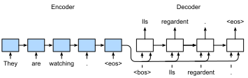
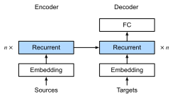
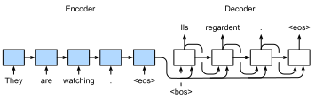

```{.python .input}
%load_ext d2lbook.tab
tab.interact_select('mxnet', 'pytorch', 'tensorflow', 'jax')
```

#  Sekos į seką mokymasis mašininiam vertimui
:label:`sec_seq2seq`

Vadinamosiose sekos į seką problemose, tokiose kaip mašininis vertimas
(aptartas :numref:`sec_machine_translation`),
kuriose įvestis ir išvestis yra
kintamo ilgio nesulygiuotos sekos,
paprastai remiamės kodavimo ir dekodavimo architektūromis
(:numref:`sec_encoder-decoder`).
Šiame skyrelyje
pademonstruosime kodavimo ir dekodavimo architektūros taikymą,
kai tiek kodavimo, tiek dekodavimo blokas
įgyvendinti kaip RNN,
mašininio vertimo užduočiai
:cite:`Sutskever.Vinyals.Le.2014,Cho.Van-Merrienboer.Gulcehre.ea.2014`.

Čia kodavimo RNN kaip įvestį priims kintamo ilgio seką
ir pavers ją fiksuotos formos paslėptąja būsena.
Vėliau, :numref:`chap_attention-and-transformers`,
pristatysime dėmesio sutelkimo mechanizmus,
leidžiančius pasiekti užkoduotas įvestis
nespaudžiant visos įvesties
į vieną fiksuoto ilgio vaizdą.

Tada, kad sugeneruotų išvesties seką
po vieną teksto vienetą,
dekodavimo modelis,
sudarytas iš atskiro RNN,
prognozuos kiekvieną paskesnį tikslo teksto vienetą,
žinodamas ir įvesties seką,
ir ankstesnius išvesties teksto vienetus.
Apmokymo metu dekodavimo blokas paprastai
bus sąlygojamas ankstesniais teksto vienetais
oficialiame „tiesos“ žymenyje.
Tačiau tikrinimo metu norėsime sąlygoti
kiekvieną dekodavimo bloko išvestį jau prognozuotais teksto vienetais.
Atkreipkite dėmesį, kad jei ignoruotume kodavimo bloką,
dekodavimo blokas sekos į seką architektūroje
elgiasi kaip įprastas kalbos modelis.
:numref:`fig_seq2seq` iliustruoja,
kaip naudoti du RNN
sekos į seką mokymuisi
mašininiame vertime.



:label:`fig_seq2seq`

:numref:`fig_seq2seq`
specialus „&lt;eos&gt;“ teksto vienetas
žymi sekos pabaigą.
Mūsų modelis gali nustoti prognozuoti,
kai tik šis teksto vienetas sugeneruojamas.
Pradiniu RNN dekodavimo bloko laiko žingsniu
yra du specialūs dizaino sprendimai, į kuriuos verta atkreipti dėmesį:
pirma, kiekvieną įvestį pradedame specialiu
sekos pradžios „&lt;bos&gt;“ teksto vienetu.
Antra, galime paduoti
galutinę kodavimo bloko paslėptąją būseną
į dekodavimo bloką
kiekvienu dekodavimo laiko žingsniu :cite:`Cho.Van-Merrienboer.Gulcehre.ea.2014`.
Kai kuriuose kituose dizainuose,
pavyzdžiui, :citet:`Sutskever.Vinyals.Le.2014`,
galutinė RNN kodavimo bloko paslėptoji būsena
naudojama dekodavimo bloko paslėptajai būsenai
inicializuoti tik pirmuoju dekodavimo žingsniu.

```{.python .input}
%%tab mxnet
import collections
from d2l import mxnet as d2l
import math
from mxnet import np, npx, init, gluon, autograd
from mxnet.gluon import nn, rnn
npx.set_np()
```

```{.python .input}
%%tab pytorch
import collections
from d2l import torch as d2l
import math
import torch
from torch import nn
from torch.nn import functional as F
```

```{.python .input}
%%tab tensorflow
import collections
from d2l import tensorflow as d2l
import math
import tensorflow as tf
```

```{.python .input}
%%tab jax
import collections
from d2l import jax as d2l
from flax import linen as nn
from functools import partial
import jax
from jax import numpy as jnp
import math
import optax
```

## Mokytojo priverstinis vedimas

Nors kodavimo bloko paleidimas įvesties sekai
yra gana paprastas,
dekodavimo bloko įvesties ir išvesties tvarkymas
reikalauja daugiau atidumo.
Dažniausias metodas kartais vadinamas *mokytojo priverstiniu vedimu* (angl. *teacher forcing*).
Čia originali tikslo seka (teksto vienetų žymenys)
paduodama į dekodavimo bloką kaip įvestis.
Konkrečiau,
specialus sekos pradžios teksto vienetas
ir originali tikslo seka,
neįskaitant paskutinio teksto vieneto,
sujungiami kaip dekodavimo bloko įvestis,
o dekodavimo bloko išvestis (apmokymo žymenys) yra
originali tikslo seka,
pastumta vienu teksto vienetu:
„&lt;bos&gt;“, „Ils“, „regardent“, „.“ $\rightarrow$
„Ils“, „regardent“, „.“, „&lt;eos&gt;“ (:numref:`fig_seq2seq`).

Mūsų įgyvendinimas
:numref:`subsec_loading-seq-fixed-len`
paruošė apmokymo duomenis mokytojo priverstiniam vedimui,
kai teksto vienetų postūmis saviraiškiam mokymuisi
panašus į kalbos modelių apmokymą
:numref:`sec_language-model`.
Alternatyvus metodas yra
paduoti *prognozuotą* teksto vienetą
iš ankstesnio laiko žingsnio
kaip dabartinę dekodavimo bloko įvestį.


Toliau išsamiau paaiškiname dizainą,
pavaizduotą :numref:`fig_seq2seq`.
Apmokysime šį modelį mašininiam vertimui
su anglų–prancūzų duomenų rinkiniu, pristatytu
:numref:`sec_machine_translation`.

## Kodavimo blokas

Prisiminkite, kad kodavimo blokas kintamo ilgio įvesties seką paverčia
fiksuotos formos *konteksto kintamuoju* $\mathbf{c}$ (žr. :numref:`fig_seq2seq`).


Nagrinėkime vienos sekos pavyzdį (rinkinio dydis 1).
Tarkime, kad įvesties seka yra $x_1, \ldots, x_T$,
o $x_t$ yra $t$-asis teksto vienetas.
Laiko žingsniu $t$ RNN paverčia
$x_t$ įvesties požymių vektorių $\mathbf{x}_t$
ir ankstesnio laiko žingsnio paslėptąją būseną $\mathbf{h} _{t-1}$
į dabartinę paslėptąją būseną $\mathbf{h}_t$.
Galime naudoti funkciją $f$ RNN rekurentinio sluoksnio
transformacijai išreikšti:

$$\mathbf{h}_t = f(\mathbf{x}_t, \mathbf{h}_{t-1}). $$

Apskritai kodavimo blokas paverčia
visų laiko žingsnių paslėptąsias būsenas
konteksto kintamuoju per pasirinktinę funkciją $q$:

$$\mathbf{c} =  q(\mathbf{h}_1, \ldots, \mathbf{h}_T).$$

Pavyzdžiui, :numref:`fig_seq2seq`
konteksto kintamasis yra tiesiog paslėptoji būsena $\mathbf{h}_T$,
atitinkanti kodavimo RNN vaizdą,
apdorojus paskutinį įvesties sekos teksto vienetą.

Šiame pavyzdyje kodavimo blokui suprojektuoti naudojome vienakryptį RNN,
kurio paslėptoji būsena priklauso tik nuo įvesties posekio
paslėptosios būsenos laiko žingsniu ir prieš jį.
Taip pat galime konstruoti kodavimo blokus naudodami dvikrypčius RNN.
Šiuo atveju paslėptoji būsena priklauso nuo posekio prieš laiko žingsnį ir po jo
(įskaitant dabartinio laiko žingsnio įvestį),
kuri užkoduoja visos sekos informaciją.


Dabar [**įgyvendinkime RNN kodavimo bloką**].
Atkreipkite dėmesį, kad naudojame *įterpimo sluoksnį*,
kad gautume kiekvieno įvesties sekos teksto vieneto požymių vektorių.
Įterpimo sluoksnio svoris yra matrica,
kurios eilučių skaičius atitinka
įvesties žodyno dydį (`vocab_size`),
o stulpelių skaičius atitinka
požymių vektoriaus dimensiją (`embed_size`).
Bet kuriam įvesties teksto vieneto indeksui $i$
įterpimo sluoksnis paima $i$-ąją svorių matricos eilutę
(skaičiuojant nuo 0),
kad grąžintų jos požymių vektorių.
Čia kodavimo bloką įgyvendiname su daugiasluoksniu GRU.

```{.python .input}
%%tab mxnet
class Seq2SeqEncoder(d2l.Encoder):  #@save
    """The RNN encoder for sequence-to-sequence learning."""
    def __init__(self, vocab_size, embed_size, num_hiddens, num_layers,
                 dropout=0):
        super().__init__()
        self.embedding = nn.Embedding(vocab_size, embed_size)
        self.rnn = d2l.GRU(num_hiddens, num_layers, dropout)
        self.initialize(init.Xavier())
            
    def forward(self, X, *args):
        # X shape: (batch_size, num_steps)
        embs = self.embedding(d2l.transpose(X))
        # embs shape: (num_steps, batch_size, embed_size)    
        outputs, state = self.rnn(embs)
        # outputs shape: (num_steps, batch_size, num_hiddens)
        # state shape: (num_layers, batch_size, num_hiddens)
        return outputs, state
```

```{.python .input}
%%tab pytorch
def init_seq2seq(module):  #@save
    """Initialize weights for sequence-to-sequence learning."""
    if type(module) == nn.Linear:
         nn.init.xavier_uniform_(module.weight)
    if type(module) == nn.GRU:
        for param in module._flat_weights_names:
            if "weight" in param:
                nn.init.xavier_uniform_(module._parameters[param])
```

```{.python .input}
%%tab pytorch
class Seq2SeqEncoder(d2l.Encoder):  #@save
    """The RNN encoder for sequence-to-sequence learning."""
    def __init__(self, vocab_size, embed_size, num_hiddens, num_layers,
                 dropout=0):
        super().__init__()
        self.embedding = nn.Embedding(vocab_size, embed_size)
        self.rnn = d2l.GRU(embed_size, num_hiddens, num_layers, dropout)
        self.apply(init_seq2seq)
            
    def forward(self, X, *args):
        # X shape: (batch_size, num_steps)
        embs = self.embedding(d2l.astype(d2l.transpose(X), d2l.int64))
        # embs shape: (num_steps, batch_size, embed_size)
        outputs, state = self.rnn(embs)
        # outputs shape: (num_steps, batch_size, num_hiddens)
        # state shape: (num_layers, batch_size, num_hiddens)
        return outputs, state
```

```{.python .input}
%%tab tensorflow
class Seq2SeqEncoder(d2l.Encoder):  #@save
    """The RNN encoder for sequence-to-sequence learning."""
    def __init__(self, vocab_size, embed_size, num_hiddens, num_layers,
                 dropout=0):
        super().__init__()
        self.embedding = tf.keras.layers.Embedding(vocab_size, embed_size)
        self.rnn = d2l.GRU(num_hiddens, num_layers, dropout)
            
    def call(self, X, *args):
        # X shape: (batch_size, num_steps)
        embs = self.embedding(d2l.transpose(X))
        # embs shape: (num_steps, batch_size, embed_size)    
        outputs, state = self.rnn(embs)
        # outputs shape: (num_steps, batch_size, num_hiddens)
        # state shape: (num_layers, batch_size, num_hiddens)
        return outputs, state
```

```{.python .input}
%%tab jax
class Seq2SeqEncoder(d2l.Encoder):  #@save
    """The RNN encoder for sequence-to-sequence learning."""
    vocab_size: int
    embed_size: int
    num_hiddens: int
    num_layers: int
    dropout: float = 0

    def setup(self):
        self.embedding = nn.Embed(self.vocab_size, self.embed_size)
        self.rnn = d2l.GRU(self.num_hiddens, self.num_layers, self.dropout)

    def __call__(self, X, *args, training=False):
        # X shape: (batch_size, num_steps)
        embs = self.embedding(d2l.astype(d2l.transpose(X), d2l.int32))
        # embs shape: (num_steps, batch_size, embed_size)
        outputs, state = self.rnn(embs, training=training)
        # outputs shape: (num_steps, batch_size, num_hiddens)
        # state shape: (num_layers, batch_size, num_hiddens)
        return outputs, state
```

Pasinaudokime konkrečiu pavyzdžiu,
kad [**iliustruotume aukščiau pateiktą kodavimo bloko įgyvendinimą.**]
Toliau sukuriame dviejų sluoksnių GRU kodavimo bloką,
kurio paslėptųjų vienetų skaičius yra 16.
Duotam sekų įvesčių minirinkiniui `X`
(rinkinio dydis $=4$; laiko žingsnių skaičius $=9$),
galutinio sluoksnio paslėptosios būsenos
visais laiko žingsniais
(`enc_outputs`, grąžinamos kodavimo bloko rekurentinių sluoksnių)
yra tenzorius, kurio forma
(laiko žingsnių skaičius, rinkinio dydis, paslėptųjų vienetų skaičius).

```{.python .input}
%%tab all
vocab_size, embed_size, num_hiddens, num_layers = 10, 8, 16, 2
batch_size, num_steps = 4, 9
encoder = Seq2SeqEncoder(vocab_size, embed_size, num_hiddens, num_layers)
X = d2l.zeros((batch_size, num_steps))
if tab.selected('pytorch', 'mxnet', 'tensorflow'):
    enc_outputs, enc_state = encoder(X)
if tab.selected('jax'):
    (enc_outputs, enc_state), _ = encoder.init_with_output(d2l.get_key(), X)

d2l.check_shape(enc_outputs, (num_steps, batch_size, num_hiddens))
```

Kadangi čia naudojame GRU,
daugiasluoksnių paslėptųjų būsenų forma
paskutiniu laiko žingsniu yra
(paslėptųjų sluoksnių skaičius, rinkinio dydis, paslėptųjų vienetų skaičius).

```{.python .input}
%%tab all
if tab.selected('mxnet', 'pytorch', 'jax'):
    d2l.check_shape(enc_state, (num_layers, batch_size, num_hiddens))
if tab.selected('tensorflow'):
    d2l.check_len(enc_state, num_layers)
    d2l.check_shape(enc_state[0], (batch_size, num_hiddens))
```

## [**Dekodavimo blokas**]
:label:`sec_seq2seq_decoder`

Duotai tikslinei išvesties sekai $y_1, y_2, \ldots, y_{T'}$
kiekvienam laiko žingsniui $t'$
(naudojame $t^\prime$, kad atskirtume nuo įvesties sekos laiko žingsnių),
dekodavimo blokas priskiria prognozuojamą tikimybę
kiekvienam galimam teksto vienetui, pasirodančiam žingsnyje $y_{t'+1}$,
sąlygojamą ankstesnių tikslo teksto vienetų
$y_1, \ldots, y_{t'}$
ir konteksto kintamojo
$\mathbf{c}$, t. y. $P(y_{t'+1} \mid y_1, \ldots, y_{t'}, \mathbf{c})$.

Kad prognozuotų paskesnį tikslinės sekos teksto vienetą $t^\prime+1$,
RNN dekodavimo blokas kaip įvestį priima ankstesnio žingsnio tikslo teksto vienetą $y_{t^\prime}$,
ankstesnio laiko žingsnio RNN paslėptąją būseną $\mathbf{s}_{t^\prime-1}$
ir konteksto kintamąjį $\mathbf{c}$
ir paverčia juos paslėptąja būsena
$\mathbf{s}_{t^\prime}$ dabartiniu laiko žingsniu.
Galime naudoti funkciją $g$ dekodavimo bloko paslėptojo sluoksnio
transformacijai išreikšti:

$$\mathbf{s}_{t^\prime} = g(y_{t^\prime-1}, \mathbf{c}, \mathbf{s}_{t^\prime-1}).$$
:eqlabel:`eq_seq2seq_s_t`

Gavę dekodavimo bloko paslėptąją būseną,
galime naudoti išvesties sluoksnį ir softmax operaciją
prognozuojamam skirstiniui
$p(y_{t^{\prime}+1} \mid y_1, \ldots, y_{t^\prime}, \mathbf{c})$
paskesniam išvesties teksto vienetui ${t^\prime+1}$ apskaičiuoti.

Laikydamiesi :numref:`fig_seq2seq`,
įgyvendindami dekodavimo bloką toliau,
tiesiogiai naudojame paskutinio laiko žingsnio paslėptąją būseną
iš kodavimo bloko
dekodavimo bloko paslėptajai būsenai inicializuoti.
Tai reikalauja, kad RNN kodavimo blokas ir RNN dekodavimo blokas
turėtų tiek pat sluoksnių ir paslėptųjų vienetų.
Kad dar labiau įtrauktume užkoduotos įvesties sekos informaciją,
konteksto kintamasis sujungiamas
su dekodavimo bloko įvestimi visais laiko žingsniais.
Kad prognozuotume išvesties teksto vieneto tikimybių skirstinį,
naudojame pilnai sujungtą sluoksnį
RNN dekodavimo bloko
paskutinio sluoksnio paslėptajai būsenai paversti.

```{.python .input}
%%tab mxnet
class Seq2SeqDecoder(d2l.Decoder):
    """The RNN decoder for sequence to sequence learning."""
    def __init__(self, vocab_size, embed_size, num_hiddens, num_layers,
                 dropout=0):
        super().__init__()
        self.embedding = nn.Embedding(vocab_size, embed_size)
        self.rnn = d2l.GRU(num_hiddens, num_layers, dropout)
        self.dense = nn.Dense(vocab_size, flatten=False)
        self.initialize(init.Xavier())
            
    def init_state(self, enc_all_outputs, *args):
        return enc_all_outputs 

    def forward(self, X, state):
        # X shape: (batch_size, num_steps)
        # embs shape: (num_steps, batch_size, embed_size)
        embs = self.embedding(d2l.transpose(X))
        enc_output, hidden_state = state
        # context shape: (batch_size, num_hiddens)
        context = enc_output[-1]
        # Broadcast context to (num_steps, batch_size, num_hiddens)
        context = np.tile(context, (embs.shape[0], 1, 1))
        # Concat at the feature dimension
        embs_and_context = d2l.concat((embs, context), -1)
        outputs, hidden_state = self.rnn(embs_and_context, hidden_state)
        outputs = d2l.swapaxes(self.dense(outputs), 0, 1)
        # outputs shape: (batch_size, num_steps, vocab_size)
        # hidden_state shape: (num_layers, batch_size, num_hiddens)
        return outputs, [enc_output, hidden_state]
```

```{.python .input}
%%tab pytorch
class Seq2SeqDecoder(d2l.Decoder):
    """The RNN decoder for sequence to sequence learning."""
    def __init__(self, vocab_size, embed_size, num_hiddens, num_layers,
                 dropout=0):
        super().__init__()
        self.embedding = nn.Embedding(vocab_size, embed_size)
        self.rnn = d2l.GRU(embed_size+num_hiddens, num_hiddens,
                           num_layers, dropout)
        self.dense = nn.LazyLinear(vocab_size)
        self.apply(init_seq2seq)
            
    def init_state(self, enc_all_outputs, *args):
        return enc_all_outputs

    def forward(self, X, state):
        # X shape: (batch_size, num_steps)
        # embs shape: (num_steps, batch_size, embed_size)
        embs = self.embedding(d2l.astype(d2l.transpose(X), d2l.int32))
        enc_output, hidden_state = state
        # context shape: (batch_size, num_hiddens)
        context = enc_output[-1]
        # Broadcast context to (num_steps, batch_size, num_hiddens)
        context = context.repeat(embs.shape[0], 1, 1)
        # Concat at the feature dimension
        embs_and_context = d2l.concat((embs, context), -1)
        outputs, hidden_state = self.rnn(embs_and_context, hidden_state)
        outputs = d2l.swapaxes(self.dense(outputs), 0, 1)
        # outputs shape: (batch_size, num_steps, vocab_size)
        # hidden_state shape: (num_layers, batch_size, num_hiddens)
        return outputs, [enc_output, hidden_state]
```

```{.python .input}
%%tab tensorflow
class Seq2SeqDecoder(d2l.Decoder):
    """The RNN decoder for sequence to sequence learning."""
    def __init__(self, vocab_size, embed_size, num_hiddens, num_layers,
                 dropout=0):
        super().__init__()
        self.embedding = tf.keras.layers.Embedding(vocab_size, embed_size)
        self.rnn = d2l.GRU(num_hiddens, num_layers, dropout)
        self.dense = tf.keras.layers.Dense(vocab_size)
            
    def init_state(self, enc_all_outputs, *args):
        return enc_all_outputs

    def call(self, X, state):
        # X shape: (batch_size, num_steps)
        # embs shape: (num_steps, batch_size, embed_size)
        embs = self.embedding(d2l.transpose(X))
        enc_output, hidden_state = state
        # context shape: (batch_size, num_hiddens)
        context = enc_output[-1]
        # Broadcast context to (num_steps, batch_size, num_hiddens)
        context = tf.tile(tf.expand_dims(context, 0), (embs.shape[0], 1, 1))
        # Concat at the feature dimension
        embs_and_context = d2l.concat((embs, context), -1)
        outputs, hidden_state = self.rnn(embs_and_context, hidden_state)
        outputs = d2l.transpose(self.dense(outputs), (1, 0, 2))
        # outputs shape: (batch_size, num_steps, vocab_size)
        # hidden_state shape: (num_layers, batch_size, num_hiddens)
        return outputs, [enc_output, hidden_state]
```

```{.python .input}
%%tab jax
class Seq2SeqDecoder(d2l.Decoder):
    """The RNN decoder for sequence to sequence learning."""
    vocab_size: int
    embed_size: int
    num_hiddens: int
    num_layers: int
    dropout: float = 0

    def setup(self):
        self.embedding = nn.Embed(self.vocab_size, self.embed_size)
        self.rnn = d2l.GRU(self.num_hiddens, self.num_layers, self.dropout)
        self.dense = nn.Dense(self.vocab_size)

    def init_state(self, enc_all_outputs, *args):
        return enc_all_outputs

    def __call__(self, X, state, training=False):
        # X shape: (batch_size, num_steps)
        # embs shape: (num_steps, batch_size, embed_size)
        embs = self.embedding(d2l.astype(d2l.transpose(X), d2l.int32))
        enc_output, hidden_state = state
        # context shape: (batch_size, num_hiddens)
        context = enc_output[-1]
        # Broadcast context to (num_steps, batch_size, num_hiddens)
        context = jnp.tile(context, (embs.shape[0], 1, 1))
        # Concat at the feature dimension
        embs_and_context = d2l.concat((embs, context), -1)
        outputs, hidden_state = self.rnn(embs_and_context, hidden_state,
                                         training=training)
        outputs = d2l.swapaxes(self.dense(outputs), 0, 1)
        # outputs shape: (batch_size, num_steps, vocab_size)
        # hidden_state shape: (num_layers, batch_size, num_hiddens)
        return outputs, [enc_output, hidden_state]
```

Kad [**iliustruotume įgyvendintą dekodavimo bloką**],
toliau sukuriame jį su tais pačiais hiperparametrais kaip aukščiau minėtas kodavimo blokas.
Kaip matome, dekodavimo bloko išvesties forma tampa (rinkinio dydis, laiko žingsnių skaičius, žodyno dydis),
kur paskutinė tenzoriaus dimensija saugo prognozuojamą teksto vienetų skirstinį.

```{.python .input}
%%tab all
decoder = Seq2SeqDecoder(vocab_size, embed_size, num_hiddens, num_layers)
if tab.selected('mxnet', 'pytorch', 'tensorflow'):
    state = decoder.init_state(encoder(X))
    dec_outputs, state = decoder(X, state)
if tab.selected('jax'):
    state = decoder.init_state(encoder.init_with_output(d2l.get_key(), X)[0])
    (dec_outputs, state), _ = decoder.init_with_output(d2l.get_key(), X,
                                                       state)


d2l.check_shape(dec_outputs, (batch_size, num_steps, vocab_size))
if tab.selected('mxnet', 'pytorch', 'jax'):
    d2l.check_shape(state[1], (num_layers, batch_size, num_hiddens))
if tab.selected('tensorflow'):
    d2l.check_len(state[1], num_layers)
    d2l.check_shape(state[1][0], (batch_size, num_hiddens))
```

RNN kodavimo ir dekodavimo modelio sluoksniai aukščiau
apibendrinti :numref:`fig_seq2seq_details`.


:label:`fig_seq2seq_details`


## Kodavimo ir dekodavimo blokai sekos į seką mokymuisi


Sujungus viską kode, gauname:

```{.python .input}
%%tab pytorch, tensorflow, mxnet
class Seq2Seq(d2l.EncoderDecoder):  #@save
    """The RNN encoder--decoder for sequence to sequence learning."""
    def __init__(self, encoder, decoder, tgt_pad, lr):
        super().__init__(encoder, decoder)
        self.save_hyperparameters()
        
    def validation_step(self, batch):
        Y_hat = self(*batch[:-1])
        self.plot('loss', self.loss(Y_hat, batch[-1]), train=False)
        
    def configure_optimizers(self):
        # Adam optimizer is used here
        if tab.selected('mxnet'):
            return gluon.Trainer(self.parameters(), 'adam',
                                 {'learning_rate': self.lr})
        if tab.selected('pytorch'):
            return torch.optim.Adam(self.parameters(), lr=self.lr)
        if tab.selected('tensorflow'):
            return tf.keras.optimizers.Adam(learning_rate=self.lr)
```

```{.python .input}
%%tab jax
class Seq2Seq(d2l.EncoderDecoder):  #@save
    """The RNN encoder--decoder for sequence to sequence learning."""
    encoder: nn.Module
    decoder: nn.Module
    tgt_pad: int
    lr: float

    def validation_step(self, params, batch, state):
        l, _ = self.loss(params, batch[:-1], batch[-1], state)
        self.plot('loss', l, train=False)

    def configure_optimizers(self):
        # Adam optimizer is used here
        return optax.adam(learning_rate=self.lr)
```

## Nuostolio funkcija su maskavimu

Kiekvienu laiko žingsniu dekodavimo blokas prognozuoja
išvesties teksto vienetų tikimybių skirstinį.
Kaip ir kalbos modeliavime,
galime taikyti softmax,
kad gautume skirstinį,
ir apskaičiuoti kryžminės entropijos nuostolį optimizavimui.
Prisiminkite iš :numref:`sec_machine_translation`,
kad specialūs užpildymo teksto vienetai
pridedami prie sekų pabaigos,
todėl skirtingo ilgio sekos gali būti efektyviai įkeliamos
į tos pačios formos minirinkinius.
Tačiau užpildymo teksto vienetų prognozė
turėtų būti neįtraukiama į nuostolio skaičiavimus.
Šiuo tikslu galime
[**užmaskuoti nesvarbius elementus nulinėmis reikšmėmis**],
kad bet kurios nesvarbios prognozės
daugyba iš nulio duotų nulį.

```{.python .input}
%%tab pytorch, mxnet, tensorflow
@d2l.add_to_class(Seq2Seq)
def loss(self, Y_hat, Y):
    l = super(Seq2Seq, self).loss(Y_hat, Y, averaged=False)
    mask = d2l.astype(d2l.reshape(Y, -1) != self.tgt_pad, d2l.float32)
    return d2l.reduce_sum(l * mask) / d2l.reduce_sum(mask)
```

```{.python .input}
%%tab jax
@d2l.add_to_class(Seq2Seq)
@partial(jax.jit, static_argnums=(0, 5))
def loss(self, params, X, Y, state, averaged=False):
    Y_hat = state.apply_fn({'params': params}, *X,
                           rngs={'dropout': state.dropout_rng})
    Y_hat = d2l.reshape(Y_hat, (-1, Y_hat.shape[-1]))
    Y = d2l.reshape(Y, (-1,))
    fn = optax.softmax_cross_entropy_with_integer_labels
    l = fn(Y_hat, Y)
    mask = d2l.astype(d2l.reshape(Y, -1) != self.tgt_pad, d2l.float32)
    return d2l.reduce_sum(l * mask) / d2l.reduce_sum(mask), {}
```

## [**Mokymas**]
:label:`sec_seq2seq_training`

Dabar galime [**sukurti ir apmokyti RNN kodavimo ir dekodavimo modelį**]
sekos į seką mokymuisi mašininio vertimo duomenų rinkinyje.

```{.python .input}
%%tab all
data = d2l.MTFraEng(batch_size=128) 
embed_size, num_hiddens, num_layers, dropout = 256, 256, 2, 0.2
if tab.selected('mxnet', 'pytorch', 'jax'):
    encoder = Seq2SeqEncoder(
        len(data.src_vocab), embed_size, num_hiddens, num_layers, dropout)
    decoder = Seq2SeqDecoder(
        len(data.tgt_vocab), embed_size, num_hiddens, num_layers, dropout)
if tab.selected('mxnet', 'pytorch'):
    model = Seq2Seq(encoder, decoder, tgt_pad=data.tgt_vocab['<pad>'],
                    lr=0.005)
if tab.selected('jax'):
    model = Seq2Seq(encoder, decoder, tgt_pad=data.tgt_vocab['<pad>'],
                    lr=0.005, training=True)
if tab.selected('mxnet', 'pytorch', 'jax'):
    trainer = d2l.Trainer(max_epochs=30, gradient_clip_val=1, num_gpus=1)
if tab.selected('tensorflow'):
    with d2l.try_gpu():
        encoder = Seq2SeqEncoder(
            len(data.src_vocab), embed_size, num_hiddens, num_layers, dropout)
        decoder = Seq2SeqDecoder(
            len(data.tgt_vocab), embed_size, num_hiddens, num_layers, dropout)
        model = Seq2Seq(encoder, decoder, tgt_pad=data.tgt_vocab['<pad>'],
                        lr=0.005)
    trainer = d2l.Trainer(max_epochs=30, gradient_clip_val=1)
trainer.fit(model, data)
```

## [**Prognozavimas**]

Kad prognozuotume išvesties seką
kiekviename žingsnyje,
prognozuotas teksto vienetas iš ankstesnio
laiko žingsnio paduodamas į dekodavimo bloką kaip įvestis.
Viena paprasta strategija yra pasirinkti tą teksto vienetą,
kuriam dekodavimo blokas priskyrė didžiausią tikimybę,
prognozuojant kiekviename žingsnyje.
Kaip ir apmokant, pradiniu laiko žingsniu
sekos pradžios („&lt;bos&gt;“) teksto vienetas
paduodamas į dekodavimo bloką.
Šis prognozavimo procesas
iliustruotas :numref:`fig_seq2seq_predict`.
Kai prognozuojamas sekos pabaigos („&lt;eos&gt;“) teksto vienetas,
išvesties sekos prognozavimas baigtas.



:label:`fig_seq2seq_predict`

Kitame skyrelyje pristatysime
sudėtingesnes strategijas,
pagrįstas spindulio paieška (:numref:`sec_beam-search`).

```{.python .input}
%%tab pytorch, mxnet, tensorflow
@d2l.add_to_class(d2l.EncoderDecoder)  #@save
def predict_step(self, batch, device, num_steps,
                 save_attention_weights=False):
    if tab.selected('mxnet', 'pytorch'):
        batch = [d2l.to(a, device) for a in batch]
    src, tgt, src_valid_len, _ = batch
    if tab.selected('mxnet', 'pytorch'):
        enc_all_outputs = self.encoder(src, src_valid_len)
    if tab.selected('tensorflow'):
        enc_all_outputs = self.encoder(src, src_valid_len, training=False)
    dec_state = self.decoder.init_state(enc_all_outputs, src_valid_len)
    outputs, attention_weights = [d2l.expand_dims(tgt[:, 0], 1), ], []
    for _ in range(num_steps):
        if tab.selected('mxnet', 'pytorch'):
            Y, dec_state = self.decoder(outputs[-1], dec_state)
        if tab.selected('tensorflow'):
            Y, dec_state = self.decoder(outputs[-1], dec_state, training=False)
        outputs.append(d2l.argmax(Y, 2))
        # Save attention weights (to be covered later)
        if save_attention_weights:
            attention_weights.append(self.decoder.attention_weights)
    return d2l.concat(outputs[1:], 1), attention_weights
```

```{.python .input}
%%tab jax
@d2l.add_to_class(d2l.EncoderDecoder)  #@save
def predict_step(self, params, batch, num_steps,
                 save_attention_weights=False):
    src, tgt, src_valid_len, _ = batch
    enc_all_outputs, inter_enc_vars = self.encoder.apply(
        {'params': params['encoder']}, src, src_valid_len, training=False,
        mutable='intermediates')
    # Save encoder attention weights if inter_enc_vars containing encoder
    # attention weights is not empty. (to be covered later)
    enc_attention_weights = []
    if bool(inter_enc_vars) and save_attention_weights:
        # Encoder Attention Weights saved in the intermediates collection
        enc_attention_weights = inter_enc_vars[
            'intermediates']['enc_attention_weights'][0]

    dec_state = self.decoder.init_state(enc_all_outputs, src_valid_len)
    outputs, attention_weights = [d2l.expand_dims(tgt[:,0], 1), ], []
    for _ in range(num_steps):
        (Y, dec_state), inter_dec_vars = self.decoder.apply(
            {'params': params['decoder']}, outputs[-1], dec_state,
            training=False, mutable='intermediates')
        outputs.append(d2l.argmax(Y, 2))
        # Save attention weights (to be covered later)
        if save_attention_weights:
            # Decoder Attention Weights saved in the intermediates collection
            dec_attention_weights = inter_dec_vars[
                'intermediates']['dec_attention_weights'][0]
            attention_weights.append(dec_attention_weights)
    return d2l.concat(outputs[1:], 1), (attention_weights,
                                        enc_attention_weights)
```

## Prognozuotų sekų vertinimas

Prognozuotą seką galime įvertinti
palygindami ją su
tikslo seka (tiesa).
Bet koks tiksliai yra tinkamas matas
dviejų sekų panašumui palyginti?


Dvikalbio vertinimo pakaitalas (angl. *Bilingual Evaluation Understudy*, BLEU),
nors iš pradžių pasiūlytas mašininio vertimo rezultatams vertinti :cite:`Papineni.Roukos.Ward.ea.2002`,
buvo plačiai naudojamas matuojant
išvesties sekų kokybę įvairiuose taikymuose.
Iš principo, kiekvienai $n$-gramai (:numref:`subsec_markov-models-and-n-grams`) prognozuotoje sekoje
BLEU vertina, ar ši $n$-grama pasirodo
tikslo sekoje.

Pažymėkime $p_n$ $n$-gramos tikslumą (angl. *precision*),
apibrėžiamą kaip sutampančių $n$-gramų skaičiaus
prognozuotoje ir tikslo sekose
santykį su $n$-gramų skaičiumi prognozuotoje sekoje.
Paaiškinimui, duotai tikslo sekai $A$, $B$, $C$, $D$, $E$, $F$
ir prognozuotai sekai $A$, $B$, $B$, $C$, $D$
turime $p_1 = 4/5$,  $p_2 = 3/4$, $p_3 = 1/3$ ir $p_4 = 0$.
Dabar tegul $\textrm{len}_{\textrm{label}}$ ir $\textrm{len}_{\textrm{pred}}$
yra atitinkamai teksto vienetų skaičius tikslo sekoje
ir prognozuotoje sekoje.
Tada BLEU apibrėžiamas kaip

$$ \exp\left(\min\left(0, 1 - \frac{\textrm{len}_{\textrm{label}}}{\textrm{len}_{\textrm{pred}}}\right)\right) \prod_{n=1}^k p_n^{1/2^n},$$
:eqlabel:`eq_bleu`

kur $k$ yra ilgiausia sutapdinimui naudojama $n$-grama.

Pagal BLEU apibrėžimą :eqref:`eq_bleu`,
kai tik prognozuota seka yra tokia pati kaip tikslo seka, BLEU yra 1.
Be to,
kadangi ilgesnių $n$-gramų sutapdinimas yra sunkesnis,
BLEU priskiria didesnį svorį,
kai ilgesnė $n$-grama pasiekia aukštą tikslumą.
Konkrečiai, kai $p_n$ fiksuotas,
$p_n^{1/2^n}$ didėja augant $n$ (originaliame straipsnyje naudojama $p_n^{1/n}$).
Be to,
kadangi
trumpesnių sekų prognozavimas
linkęs duoti didesnę $p_n$ reikšmę,
koeficientas prieš daugybos narį :eqref:`eq_bleu`
baudžia trumpesnes prognozuotas sekas.
Pavyzdžiui, kai $k=2$,
duotai tikslo sekai $A$, $B$, $C$, $D$, $E$, $F$ ir prognozuotai sekai $A$, $B$,
nors $p_1 = p_2 = 1$, baudos daugiklis $\exp(1-6/2) \approx 0{,}14$ sumažina BLEU.

[**Įgyvendiname BLEU matą**] taip.

```{.python .input}
%%tab all
def bleu(pred_seq, label_seq, k):  #@save
    """Compute the BLEU."""
    pred_tokens, label_tokens = pred_seq.split(' '), label_seq.split(' ')
    len_pred, len_label = len(pred_tokens), len(label_tokens)
    score = math.exp(min(0, 1 - len_label / len_pred))
    for n in range(1, min(k, len_pred) + 1):
        num_matches, label_subs = 0, collections.defaultdict(int)
        for i in range(len_label - n + 1):
            label_subs[' '.join(label_tokens[i: i + n])] += 1
        for i in range(len_pred - n + 1):
            if label_subs[' '.join(pred_tokens[i: i + n])] > 0:
                num_matches += 1
                label_subs[' '.join(pred_tokens[i: i + n])] -= 1
        score *= math.pow(num_matches / (len_pred - n + 1), math.pow(0.5, n))
    return score
```

Galiausiai
naudojame apmokytą RNN kodavimo ir dekodavimo modelį,
kad [**išverstume kelis anglų kalbos sakinius į prancūzų kalbą**]
ir apskaičiuotume rezultatų BLEU.

```{.python .input}
%%tab all
engs = ['go .', 'i lost .', 'he\'s calm .', 'i\'m home .']
fras = ['va !', 'j\'ai perdu .', 'il est calme .', 'je suis chez moi .']
if tab.selected('pytorch', 'mxnet', 'tensorflow'):
    preds, _ = model.predict_step(
        data.build(engs, fras), d2l.try_gpu(), data.num_steps)
if tab.selected('jax'):
    preds, _ = model.predict_step(trainer.state.params, data.build(engs, fras),
                                  data.num_steps)
for en, fr, p in zip(engs, fras, preds):
    translation = []
    for token in data.tgt_vocab.to_tokens(p):
        if token == '<eos>':
            break
        translation.append(token)        
    print(f'{en} => {translation}, bleu,'
          f'{bleu(" ".join(translation), fr, k=2):.3f}')
```

## Santrauka

Laikydamiesi kodavimo ir dekodavimo architektūros dizaino, galime naudoti du RNN modeliui sekos į seką mokymuisi suprojektuoti.
Kodavimo ir dekodavimo apmokyme mokytojo priverstinio vedimo metodas paduoda originalias išvesties sekas (priešingai nei prognozes) į dekodavimo bloką.
Įgyvendindami kodavimo ir dekodavimo blokus, galime naudoti daugiasluoksnius RNN.
Galime naudoti kaukes nesvarbiems skaičiavimams, pavyzdžiui, skaičiuojant nuostolį, atfiltruoti.
Išvesties sekoms vertinti
BLEU yra populiarus matas, sutapdinantis $n$-gramas tarp prognozuotos sekos ir tikslo sekos.


## Pratimai

1. Ar galite pakoreguoti hiperparametrus, kad pagerintumėte vertimo rezultatus?
1. Paleiskite eksperimentą iš naujo nenaudodami kaukių nuostolio skaičiavime. Kokius rezultatus stebite? Kodėl?
1. Jei kodavimo ir dekodavimo blokai skiriasi sluoksnių skaičiumi arba paslėptųjų vienetų skaičiumi, kaip galime inicializuoti dekodavimo bloko paslėptąją būseną?
1. Apmokyme pakeiskite mokytojo priverstinį vedimą ankstesnio laiko žingsnio prognozės padavimu į dekodavimo bloką. Kaip tai veikia našumą?
1. Paleiskite eksperimentą iš naujo, pakeisdami GRU į LSTM.
1. Ar yra kitų būdų suprojektuoti dekodavimo bloko išvesties sluoksnį?

:begin_tab:`mxnet`
[Diskusijos](https://discuss.d2l.ai/t/345)
:end_tab:

:begin_tab:`pytorch`
[Diskusijos](https://discuss.d2l.ai/t/1062)
:end_tab:

:begin_tab:`tensorflow`
[Diskusijos](https://discuss.d2l.ai/t/3865)
:end_tab:

:begin_tab:`jax`
[Diskusijos](https://discuss.d2l.ai/t/18022)
:end_tab:

