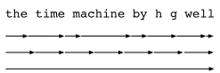
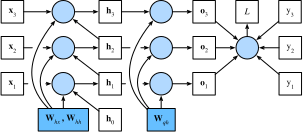

# Atgalinis sklidimas laike
:label:`sec_bptt`

Jei atlikote :numref:`sec_rnn-scratch` pratimus,
matėte, kad gradientų apkarpymas yra gyvybiškai svarbus
siekiant užkirsti kelią retkarčiais pasitaikantiems milžiniškiems gradientams
destabilizuoti apmokymą.
Užsiminėme, kad sprogstantys gradientai
kyla iš atgalinio sklidimo per ilgas sekas.
Prieš pristatydami daugybę šiuolaikinių RNN architektūrų,
atidžiau pažvelkime, kaip *atgalinis sklidimas*
veikia sekų modeliuose, matematiškai išsamiai.
Tikimės, kad ši diskusija suteiks tikslumo
*nykstančių* ir *sprogstančių* gradientų sampratai.
Jei prisimenate mūsų diskusiją apie tiesioginį ir atgalinį
sklidimą per skaičiavimo grafus,
kai pristatėme MLP :numref:`sec_backprop`,
tai tiesioginis sklidimas RNN
turėtų būti santykinai paprastas.
Atgalinio sklidimo taikymas RNN
vadinamas *atgaliniu sklidimu laike* :cite:`Werbos.1990`.
Ši procedūra reikalauja išskleisti (arba išvynioti)
RNN skaičiavimo grafą
po vieną laiko žingsnį.
Išvyniotas RNN iš esmės yra
tiesioginio sklidimo neuroninis tinklas
su ta ypatinga savybe,
kad tie patys parametrai
kartojami visame išvyniotame tinkle,
pasirodydami kiekviename laiko žingsnyje.
Tada, kaip ir bet kuriame tiesioginio sklidimo neuroniniame tinkle,
galime taikyti grandinės taisyklę,
atgaline kryptimi sklidindami gradientus per išvyniotą tinklą.
Gradientas kiekvieno parametro atžvilgiu
turi būti susumuotas per visas vietas,
kuriose parametras pasitaiko išvyniotame tinkle.
Tokio svorių susiejimo tvarkymas turėtų būti pažįstamas
iš mūsų skyrių apie konvoliucinius neuroninius tinklus.

Komplikacijų kyla dėl to, kad sekos
gali būti gana ilgos.
Nėra neįprasta dirbti su teksto sekomis,
sudarytomis iš daugiau nei tūkstančio teksto vienetų.
Atkreipkite dėmesį, kad tai kelia problemų ir
skaičiavimo (per daug atminties),
ir optimizavimo (skaitinis nestabilumas)
požiūriu.
Įvestis iš pirmojo žingsnio praeina per
daugiau nei 1000 matricų sandaugų, kol pasiekia išvestį,
ir dar 1000 matricų sandaugų
reikia gradientui apskaičiuoti.
Dabar išanalizuosime, kas gali nepavykti ir
kaip su tuo susidoroti praktikoje.

## Gradientų RNN analizė
:label:`subsec_bptt_analysis`

Pradedame nuo supaprastinto modelio, kaip veikia RNN.
Šis modelis ignoruoja paslėptosios būsenos
specifikos ir jos atnaujinimo detales.
Matematinis žymėjimas čia
aiškiai neskiria
skaliarų, vektorių ir matricų.
Tik bandome susikurti šiek tiek intuicijos.
Šiame supaprastintame modelyje
$h_t$ žymime paslėptąją būseną,
$x_t$ – įvestį, o $o_t$ – išvestį
laiko žingsniu $t$.
Prisiminkite mūsų diskusijas
:numref:`subsec_rnn_w_hidden_states`,
kad įvestis ir paslėptoji būsena
gali būti sujungtos prieš dauginant
iš vieno paslėptojo sluoksnio svorio kintamojo.
Todėl $w_\textrm{h}$ ir $w_\textrm{o}$ naudojame paslėptojo sluoksnio ir išvesties sluoksnio svoriams žymėti atitinkamai.
Dėl to paslėptosios būsenos ir išvestys
kiekvienu laiko žingsniu yra

$$\begin{aligned}h_t &= f(x_t, h_{t-1}, w_\textrm{h}),\\o_t &= g(h_t, w_\textrm{o}),\end{aligned}$$
:eqlabel:`eq_bptt_ht_ot`

kur $f$ ir $g$ yra atitinkamai
paslėptojo sluoksnio ir išvesties sluoksnio transformacijos.
Taigi turime reikšmių grandinę
$\{\ldots, (x_{t-1}, h_{t-1}, o_{t-1}), (x_{t}, h_{t}, o_t), \ldots\}$,
kurios priklauso viena nuo kitos per rekurentinį skaičiavimą.
Tiesioginis sklidimas yra gana paprastas.
Reikia tik eiti ciklu per trejetus $(x_t, h_t, o_t)$ po vieną laiko žingsnį.
Neatitikimas tarp išvesties $o_t$ ir norimo tikslo $y_t$
tada įvertinamas tikslo funkcija
per visus $T$ laiko žingsnių taip:

$$L(x_1, \ldots, x_T, y_1, \ldots, y_T, w_\textrm{h}, w_\textrm{o}) = \frac{1}{T}\sum_{t=1}^T l(y_t, o_t).$$

Atgaliniam sklidimui reikalai yra šiek tiek sudėtingesni,
ypač kai skaičiuojame gradientus
tikslo funkcijos $L$ parametrų $w_\textrm{h}$ atžvilgiu.
Konkrečiai, pagal grandinės taisyklę,

$$\begin{aligned}\frac{\partial L}{\partial w_\textrm{h}}  & = \frac{1}{T}\sum_{t=1}^T \frac{\partial l(y_t, o_t)}{\partial w_\textrm{h}}  \\& = \frac{1}{T}\sum_{t=1}^T \frac{\partial l(y_t, o_t)}{\partial o_t} \frac{\partial g(h_t, w_\textrm{o})}{\partial h_t}  \frac{\partial h_t}{\partial w_\textrm{h}}.\end{aligned}$$
:eqlabel:`eq_bptt_partial_L_wh`

Pirmąjį ir antrąjį sandaugos narį
:eqref:`eq_bptt_partial_L_wh`
lengva apskaičiuoti.
Trečiasis narys $\partial h_t/\partial w_\textrm{h}$ yra ten, kur reikalai pasidaro sudėtingi,
nes turime rekurentiškai apskaičiuoti parametro $w_\textrm{h}$ poveikį $h_t$.
Pagal rekurentinį skaičiavimą
:eqref:`eq_bptt_ht_ot`,
$h_t$ priklauso ir nuo $h_{t-1}$, ir nuo $w_\textrm{h}$,
kur $h_{t-1}$ skaičiavimas
taip pat priklauso nuo $w_\textrm{h}$.
Taigi, įvertinus pilnąją $h_t$ išvestinę
$w_\textrm{h}$ atžvilgiu pagal grandinės taisyklę, gaunama

$$\frac{\partial h_t}{\partial w_\textrm{h}}= \frac{\partial f(x_{t},h_{t-1},w_\textrm{h})}{\partial w_\textrm{h}} +\frac{\partial f(x_{t},h_{t-1},w_\textrm{h})}{\partial h_{t-1}} \frac{\partial h_{t-1}}{\partial w_\textrm{h}}.$$
:eqlabel:`eq_bptt_partial_ht_wh_recur`

Kad išvestume aukščiau pateiktą gradientą, tarkime, kad turime
tris sekas $\{a_{t}\},\{b_{t}\},\{c_{t}\}$,
tenkinančias $a_{0}=0$ ir $a_{t}=b_{t}+c_{t}a_{t-1}$, kai $t=1, 2,\ldots$.
Tada, kai $t\geq 1$, lengva parodyti, kad

$$a_{t}=b_{t}+\sum_{i=1}^{t-1}\left(\prod_{j=i+1}^{t}c_{j}\right)b_{i}.$$
:eqlabel:`eq_bptt_at`

Pakeitę $a_t$, $b_t$ ir $c_t$ pagal

$$\begin{aligned}a_t &= \frac{\partial h_t}{\partial w_\textrm{h}},\\
b_t &= \frac{\partial f(x_{t},h_{t-1},w_\textrm{h})}{\partial w_\textrm{h}}, \\
c_t &= \frac{\partial f(x_{t},h_{t-1},w_\textrm{h})}{\partial h_{t-1}},\end{aligned}$$

gradiento skaičiavimas :eqref:`eq_bptt_partial_ht_wh_recur` tenkina
$a_{t}=b_{t}+c_{t}a_{t-1}$.
Taigi, pagal :eqref:`eq_bptt_at`,
galime pašalinti rekurentinį skaičiavimą
:eqref:`eq_bptt_partial_ht_wh_recur` su

$$\frac{\partial h_t}{\partial w_\textrm{h}}=\frac{\partial f(x_{t},h_{t-1},w_\textrm{h})}{\partial w_\textrm{h}}+\sum_{i=1}^{t-1}\left(\prod_{j=i+1}^{t} \frac{\partial f(x_{j},h_{j-1},w_\textrm{h})}{\partial h_{j-1}} \right) \frac{\partial f(x_{i},h_{i-1},w_\textrm{h})}{\partial w_\textrm{h}}.$$
:eqlabel:`eq_bptt_partial_ht_wh_gen`

Nors galime naudoti grandinės taisyklę $\partial h_t/\partial w_\textrm{h}$ apskaičiuoti rekursyviai,
ši grandinė gali tapti labai ilga, kai tik $t$ didelis.
Aptarkime keletą strategijų, kaip susidoroti su šia problema.

### Pilnas skaičiavimas ###

Viena idėja gali būti apskaičiuoti pilną sumą :eqref:`eq_bptt_partial_ht_wh_gen`.
Tačiau tai labai lėta, o gradientai gali sprogti,
nes subtilūs pradinių sąlygų pokyčiai
gali potencialiai labai paveikti rezultatą.
Tai yra, galėtume pamatyti kažką panašaus į drugelio efektą,
kai minimalūs pradinių sąlygų pokyčiai
lemia neproporcingus rezultato pokyčius.
Tai paprastai nepageidautina.
Juk ieškome tvirtų įvertinių, kurie gerai apibendrina.
Todėl ši strategija praktikoje beveik niekada nenaudojama.

### Laiko žingsnių nukirtimas ###

Alternatyviai,
galime nukirsti sumą
:eqref:`eq_bptt_partial_ht_wh_gen`
po $\tau$ žingsnių.
Tai yra tai, ką iki šiol aptarinėjome.
Tai veda prie tikrojo gradiento *aproksimacijos*,
tiesiog nutraukiant sumą ties $\partial h_{t-\tau}/\partial w_\textrm{h}$.
Praktikoje tai veikia gana gerai.
Tai dažniausiai vadinama nukirstu
atgaliniu sklidimu laike :cite:`Jaeger.2002`.
Viena iš to pasekmių yra ta, kad modelis
pirmiausia sutelkia dėmesį į trumpalaikę įtaką,
o ne į ilgalaikes pasekmes.
Tai iš tikrųjų *pageidautina*, nes šališkai nukreipia įvertį
link paprastesnių ir stabilesnių modelių.

### Atsitiktinis nukirtimas ###

Galiausiai galime pakeisti $\partial h_t/\partial w_\textrm{h}$
atsitiktiniu dydžiu, kuris yra teisingas laukiamąja prasme,
bet nukirsta seką.
Tai pasiekiama naudojant seką $\xi_t$
su iš anksto nustatytais $0 \leq \pi_t \leq 1$,
kur $P(\xi_t = 0) = 1-\pi_t$ ir
$P(\xi_t = \pi_t^{-1}) = \pi_t$, taigi $E[\xi_t] = 1$.
Tai naudojame gradientui
$\partial h_t/\partial w_\textrm{h}$
:eqref:`eq_bptt_partial_ht_wh_recur`
pakeisti

$$z_t= \frac{\partial f(x_{t},h_{t-1},w_\textrm{h})}{\partial w_\textrm{h}} +\xi_t \frac{\partial f(x_{t},h_{t-1},w_\textrm{h})}{\partial h_{t-1}} \frac{\partial h_{t-1}}{\partial w_\textrm{h}}.$$

Iš $\xi_t$ apibrėžimo išplaukia,
kad $E[z_t] = \partial h_t/\partial w_\textrm{h}$.
Kai tik $\xi_t = 0$, rekurentinis skaičiavimas
nutraukiamas tuo laiko žingsniu $t$.
Tai veda prie svertinės skirtingo ilgio sekų sumos,
kur ilgos sekos yra retos, bet tinkamai persvertos.
Šią idėją pasiūlė
:citet:`Tallec.Ollivier.2017`.

### Strategijų palyginimas

:label:`fig_truncated_bptt`

:numref:`fig_truncated_bptt` iliustruoja tris strategijas,
analizuojant pirmuosius kelis *Laiko mašinos* simbolius
naudojant atgalinį sklidimą laike RNN:

* Pirmoji eilutė yra atsitiktinis nukirtimas, kuris skaido tekstą į skirtingo ilgio segmentus.
* Antroji eilutė yra įprastas nukirtimas, kuris skaido tekstą į vienodo ilgio posekius. Tai yra tai, ką darėme RNN eksperimentuose.
* Trečioji eilutė yra pilnas atgalinis sklidimas laike, vedantis prie skaičiavimo požiūriu neįgyvendinamos išraiškos.

Deja, nors teoriškai patrauklus,
atsitiktinis nukirtimas neveikia
daug geriau nei įprastas nukirtimas,
greičiausiai dėl keleto veiksnių.
Pirma, stebėjimo poveikio
po keleto atgalinio sklidimo žingsnių
į praeitį pakanka
priklausomybėms praktikoje užfiksuoti.
Antra, padidėjusi dispersija neutralizuoja faktą,
kad gradientas yra tikslesnis su daugiau žingsnių.
Trečia, mes iš tikrųjų *norime* modelių, turinčių tik
trumpą sąveikų nuotolį.
Todėl įprastai nukirstas atgalinis sklidimas laike
turi nedidelį reguliarizuojantį poveikį, kuris gali būti pageidautinas.

## Atgalinis sklidimas laike išsamiai

Aptarę bendrąjį principą,
aptarkime atgalinį sklidimą laike išsamiai.
Priešingai nei analizėje :numref:`subsec_bptt_analysis`,
toliau parodysime, kaip apskaičiuoti
tikslo funkcijos gradientus
visų išskaidytų modelio parametrų atžvilgiu.
Kad viskas būtų paprasta, nagrinėjame
RNN be poslinkio parametrų,
kurio aktyvacijos funkcija paslėptajame sluoksnyje
naudoja tapatybės atvaizdavimą ($\phi(x)=x$).
Laiko žingsniui $t$ tegul vieno pavyzdžio įvestis
ir tikslas yra atitinkamai $\mathbf{x}_t \in \mathbb{R}^d$ ir $y_t$.
Paslėptoji būsena $\mathbf{h}_t \in \mathbb{R}^h$
ir išvestis $\mathbf{o}_t \in \mathbb{R}^q$
apskaičiuojamos taip:

$$\begin{aligned}\mathbf{h}_t &= \mathbf{W}_\textrm{hx} \mathbf{x}_t + \mathbf{W}_\textrm{hh} \mathbf{h}_{t-1},\\
\mathbf{o}_t &= \mathbf{W}_\textrm{qh} \mathbf{h}_{t},\end{aligned}$$

kur $\mathbf{W}_\textrm{hx} \in \mathbb{R}^{h \times d}$, $\mathbf{W}_\textrm{hh} \in \mathbb{R}^{h \times h}$ ir
$\mathbf{W}_\textrm{qh} \in \mathbb{R}^{q \times h}$
yra svorių parametrai.
Pažymėkime $l(\mathbf{o}_t, y_t)$
nuostolį laiko žingsniu $t$.
Mūsų tikslo funkcija,
nuostoliai per $T$ laiko žingsnių
nuo sekos pradžios, todėl yra

$$L = \frac{1}{T} \sum_{t=1}^T l(\mathbf{o}_t, y_t).$$

Kad vizualizuotume priklausomybes tarp
modelio kintamųjų ir parametrų skaičiavimo
RNN metu,
galime nubraižyti modelio skaičiavimo grafą,
kaip parodyta :numref:`fig_rnn_bptt`.
Pavyzdžiui, 3 laiko žingsnio paslėptųjų būsenų skaičiavimas,
$\mathbf{h}_3$, priklauso nuo modelio parametrų
$\mathbf{W}_\textrm{hx}$ ir $\mathbf{W}_\textrm{hh}$,
ankstesnio laiko žingsnio paslėptosios būsenos $\mathbf{h}_2$
ir dabartinio laiko žingsnio įvesties $\mathbf{x}_3$.

:label:`fig_rnn_bptt`

Kaip ką tik minėta, modelio parametrai :numref:`fig_rnn_bptt`
yra $\mathbf{W}_\textrm{hx}$, $\mathbf{W}_\textrm{hh}$ ir $\mathbf{W}_\textrm{qh}$.
Apskritai šio modelio apmokymas reikalauja
gradientų skaičiavimo šių parametrų atžvilgiu
$\partial L/\partial \mathbf{W}_\textrm{hx}$, $\partial L/\partial \mathbf{W}_\textrm{hh}$ ir $\partial L/\partial \mathbf{W}_\textrm{qh}$.
Pagal :numref:`fig_rnn_bptt` priklausomybes
galime eiti priešinga rodyklėms kryptimi,
kad paeiliui apskaičiuotume ir saugotume gradientus.
Kad lanksčiai išreikštume skirtingų formų
matricų, vektorių ir skaliarų daugybą
grandinės taisyklėje,
toliau naudojame operatorių $\textrm{prod}$,
aprašytą :numref:`sec_backprop`.

Visų pirma, tikslo funkcijos diferencijavimas
modelio išvesties atžvilgiu bet kuriuo laiko žingsniu $t$
yra gana paprastas:

$$\frac{\partial L}{\partial \mathbf{o}_t} =  \frac{\partial l (\mathbf{o}_t, y_t)}{T \cdot \partial \mathbf{o}_t} \in \mathbb{R}^q.$$
:eqlabel:`eq_bptt_partial_L_ot`

Dabar galime apskaičiuoti tikslo gradientą
išvesties sluoksnio parametro $\mathbf{W}_\textrm{qh}$ atžvilgiu:
$\partial L/\partial \mathbf{W}_\textrm{qh} \in \mathbb{R}^{q \times h}$.
Remiantis :numref:`fig_rnn_bptt`,
tikslas $L$ priklauso nuo $\mathbf{W}_\textrm{qh}$
per $\mathbf{o}_1, \ldots, \mathbf{o}_T$.
Pritaikius grandinės taisyklę, gaunama

$$
\frac{\partial L}{\partial \mathbf{W}_\textrm{qh}}
= \sum_{t=1}^T \textrm{prod}\left(\frac{\partial L}{\partial \mathbf{o}_t}, \frac{\partial \mathbf{o}_t}{\partial \mathbf{W}_\textrm{qh}}\right)
= \sum_{t=1}^T \frac{\partial L}{\partial \mathbf{o}_t} \mathbf{h}_t^\top,
$$

kur $\partial L/\partial \mathbf{o}_t$
pateikiamas :eqref:`eq_bptt_partial_L_ot`.

Toliau, kaip parodyta :numref:`fig_rnn_bptt`,
paskutiniu laiko žingsniu $T$
tikslo funkcija
$L$ priklauso nuo paslėptosios būsenos $\mathbf{h}_T$
tik per $\mathbf{o}_T$.
Todėl galime lengvai rasti gradientą
$\partial L/\partial \mathbf{h}_T \in \mathbb{R}^h$
naudodami grandinės taisyklę:

$$\frac{\partial L}{\partial \mathbf{h}_T} = \textrm{prod}\left(\frac{\partial L}{\partial \mathbf{o}_T}, \frac{\partial \mathbf{o}_T}{\partial \mathbf{h}_T} \right) = \mathbf{W}_\textrm{qh}^\top \frac{\partial L}{\partial \mathbf{o}_T}.$$
:eqlabel:`eq_bptt_partial_L_hT_final_step`

Sudėtingiau yra bet kuriam laiko žingsniui $t < T$,
kur tikslo funkcija $L$ priklauso nuo
$\mathbf{h}_t$ per $\mathbf{h}_{t+1}$ ir $\mathbf{o}_t$.
Pagal grandinės taisyklę,
paslėptosios būsenos gradientą
$\partial L/\partial \mathbf{h}_t \in \mathbb{R}^h$
bet kuriuo laiko žingsniu $t < T$ galima rekurentiškai apskaičiuoti taip:

$$\frac{\partial L}{\partial \mathbf{h}_t} = \textrm{prod}\left(\frac{\partial L}{\partial \mathbf{h}_{t+1}}, \frac{\partial \mathbf{h}_{t+1}}{\partial \mathbf{h}_t} \right) + \textrm{prod}\left(\frac{\partial L}{\partial \mathbf{o}_t}, \frac{\partial \mathbf{o}_t}{\partial \mathbf{h}_t} \right) = \mathbf{W}_\textrm{hh}^\top \frac{\partial L}{\partial \mathbf{h}_{t+1}} + \mathbf{W}_\textrm{qh}^\top \frac{\partial L}{\partial \mathbf{o}_t}.$$
:eqlabel:`eq_bptt_partial_L_ht_recur`

Analizei išskleidus rekurentinį skaičiavimą
bet kuriam laiko žingsniui $1 \leq t \leq T$, gaunama

$$\frac{\partial L}{\partial \mathbf{h}_t}= \sum_{i=t}^T {\left(\mathbf{W}_\textrm{hh}^\top\right)}^{T-i} \mathbf{W}_\textrm{qh}^\top \frac{\partial L}{\partial \mathbf{o}_{T+t-i}}.$$
:eqlabel:`eq_bptt_partial_L_ht`

Iš :eqref:`eq_bptt_partial_L_ht` matome,
kad šis paprastas tiesinis pavyzdys jau
parodo kai kurias pagrindines ilgų sekų modelių problemas:
jis apima potencialiai labai dideles $\mathbf{W}_\textrm{hh}^\top$ laipsnius.
Jame tikrinės reikšmės, mažesnės nei 1, išnyksta,
o didesnės nei 1 – diverguoja.
Tai skaitiniu požiūriu nestabilu,
o tai pasireiškia nykstančiais
ir sprogstančiais gradientais.
Vienas būdas tai spręsti yra nukirsti laiko žingsnius
skaičiavimo požiūriu patogiu dydžiu,
kaip aptarta :numref:`subsec_bptt_analysis`.
Praktikoje šį nukirtimą taip pat galima atlikti
atjungiant gradientą po tam tikro laiko žingsnių skaičiaus.
Vėliau pamatysime, kaip sudėtingesni sekų modeliai,
tokie kaip ilga trumpalaikė atmintis, gali tai dar labiau sušvelninti.

Galiausiai :numref:`fig_rnn_bptt` rodo,
kad tikslo funkcija $L$
priklauso nuo modelio parametrų $\mathbf{W}_\textrm{hx}$ ir $\mathbf{W}_\textrm{hh}$
paslėptajame sluoksnyje per paslėptąsias būsenas
$\mathbf{h}_1, \ldots, \mathbf{h}_T$.
Kad apskaičiuotume gradientus šių parametrų atžvilgiu
$\partial L / \partial \mathbf{W}_\textrm{hx} \in \mathbb{R}^{h \times d}$ ir $\partial L / \partial \mathbf{W}_\textrm{hh} \in \mathbb{R}^{h \times h}$,
taikome grandinės taisyklę, gaudami

$$
\begin{aligned}
\frac{\partial L}{\partial \mathbf{W}_\textrm{hx}}
&= \sum_{t=1}^T \textrm{prod}\left(\frac{\partial L}{\partial \mathbf{h}_t}, \frac{\partial \mathbf{h}_t}{\partial \mathbf{W}_\textrm{hx}}\right)
= \sum_{t=1}^T \frac{\partial L}{\partial \mathbf{h}_t} \mathbf{x}_t^\top,\\
\frac{\partial L}{\partial \mathbf{W}_\textrm{hh}}
&= \sum_{t=1}^T \textrm{prod}\left(\frac{\partial L}{\partial \mathbf{h}_t}, \frac{\partial \mathbf{h}_t}{\partial \mathbf{W}_\textrm{hh}}\right)
= \sum_{t=1}^T \frac{\partial L}{\partial \mathbf{h}_t} \mathbf{h}_{t-1}^\top,
\end{aligned}
$$

kur $\partial L/\partial \mathbf{h}_t$,
kuris rekurentiškai apskaičiuojamas pagal
:eqref:`eq_bptt_partial_L_hT_final_step`
ir :eqref:`eq_bptt_partial_L_ht_recur`,
yra pagrindinis dydis, darantis įtaką skaitiniam stabilumui.

Kadangi atgalinis sklidimas laike yra atgalinio sklidimo taikymas RNN,
kaip paaiškinome :numref:`sec_backprop`,
RNN apmokymas kaitaliuoja tiesioginį sklidimą su
atgaliniu sklidimu laike.
Be to, atgalinis sklidimas laike
paeiliui apskaičiuoja ir saugo aukščiau pateiktus gradientus.
Konkrečiai, saugomos tarpinės reikšmės
naudojamos pakartotinai, kad būtų išvengta dubliuotų skaičiavimų,
pavyzdžiui, saugojamas $\partial L/\partial \mathbf{h}_t$,
kuris naudojamas skaičiuojant ir $\partial L / \partial \mathbf{W}_\textrm{hx}$,
ir $\partial L / \partial \mathbf{W}_\textrm{hh}$.

## Santrauka

Atgalinis sklidimas laike yra tik atgalinio sklidimo taikymas sekų modeliams su paslėptąja būsena.
Nukirtimas, įprastas ar atsitiktinis, reikalingas skaičiavimo patogumui ir skaitiniam stabilumui.
Dideli matricų laipsniai gali lemti diverguojančias ar nykstančias tikrines reikšmes. Tai pasireiškia sprogstančiais ar nykstančiais gradientais.
Efektyviam skaičiavimui atgalinio sklidimo laike metu tarpinės reikšmės talpinamos podėlyje.

## Pratimai

1. Tarkime, kad turime simetrinę matricą $\mathbf{M} \in \mathbb{R}^{n \times n}$ su tikrinėmis reikšmėmis $\lambda_i$, kurias atitinkantys tikriniai vektoriai yra $\mathbf{v}_i$ ($i = 1, \ldots, n$). Be bendrumo apribojimo, tarkime, kad jos išdėstytos tvarka $|\lambda_i| \geq |\lambda_{i+1}|$.
   1. Parodykite, kad $\mathbf{M}^k$ turi tikrines reikšmes $\lambda_i^k$.
   1. Įrodykite, kad atsitiktiniam vektoriui $\mathbf{x} \in \mathbb{R}^n$ su didele tikimybe $\mathbf{M}^k \mathbf{x}$ bus labai gerai sulygiuotas su $\mathbf{M}$ tikriniu vektoriumi $\mathbf{v}_1$.
Formalizuokite šį teiginį.
   1. Ką aukščiau pateiktas rezultatas reiškia gradientams RNN?
1. Be gradientų apkarpymo, ar galite sugalvoti kitų būdų susidoroti su gradientų sprogimu rekurentiniuose neuroniniuose tinkluose?

[Diskusijos](https://discuss.d2l.ai/t/334)
