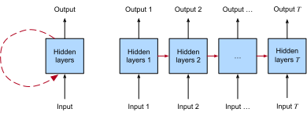

# Rekurentiniai neuroniniai tinklai
:label:`chap_rnn`

Iki šiol daugiausia dėmesio skyrėme fiksuoto ilgio duomenims.
Pristatydami tiesinę ir logistinę regresiją
:numref:`chap_regression` ir :numref:`chap_classification`
bei daugiasluoksnius perceptronus :numref:`chap_perceptrons`,
mielai darėme prielaidą, kad kiekvienas požymių vektorius $\mathbf{x}_i$
susideda iš fiksuoto skaičiaus komponenčių $x_1, \dots, x_d$,
kur kiekvienas skaitinis požymis $x_j$
atitiko tam tikrą atributą.
Šie duomenų rinkiniai kartais vadinami *lentelės pavidalo*,
nes juos galima išdėstyti lentelėse,
kuriose kiekvienas pavyzdys $i$ gauna savo eilutę,
o kiekvienas atributas – savo stulpelį.
Esminis dalykas: su lentelės pavidalo duomenimis retai
darome kokias nors prielaidas apie stulpelių struktūrą.

Vėliau :numref:`chap_cnn`
perėjome prie vaizdų duomenų, kur įvestis sudaro
neapdorotos pikselių reikšmės kiekvienoje vaizdo koordinatėje.
Vaizdų duomenys vargu ar atitiko
prototipinio lentelės pavidalo duomenų rinkinio apibrėžimą.
Ten turėjome pasitelkti konvoliucinius neuroninius tinklus (CNN),
kad susidorotume su hierarchine struktūra ir invariantiškumais.
Tačiau mūsų duomenys vis dar buvo fiksuoto ilgio.
Kiekvienas Fashion-MNIST vaizdas pateikiamas
kaip $28 \times 28$ pikselių reikšmių tinklelis.
Be to, mūsų tikslas buvo sukurti modelį,
kuris žiūrėtų tik į vieną vaizdą ir
išvestų vieną prognozę.
Bet ką daryti, kai susiduriame su
vaizdų seka, kaip vaizdo įraše,
arba kai reikia sukurti
nuosekliai struktūrizuotą prognozę,
kaip vaizdų aprašų generavimo atveju?

Daugelis mokymosi užduočių reikalauja dirbti su nuosekliais duomenimis.
Vaizdų aprašų generavimas, kalbos sintezė ir muzikos generavimas
reikalauja, kad modeliai kurtų sekas sudarančias išvestis.
Kitose srityse, tokiose kaip laiko eilučių prognozavimas,
vaizdo analizė ir muzikinės informacijos paieška,
modelis turi mokytis iš įvesčių, kurios yra sekos.
Šie reikalavimai dažnai iškyla vienu metu:
tokioms užduotims kaip teksto ištraukų vertimas
iš vienos natūraliosios kalbos į kitą,
dialogas ar roboto valdymas
reikia, kad modeliai ir priimtų, ir išvestų
nuosekliai struktūrizuotus duomenis.


Rekurentiniai neuroniniai tinklai (RNN) yra giliojo mokymosi modeliai,
užfiksuojantys sekų dinamiką per
*rekurentines* jungtis, kurias galima įsivaizduoti
kaip ciklus mazgų tinkle.
Iš pradžių tai gali atrodyti prieštaringa intuicijai.
Juk būtent neuroninių tinklų tiesioginio sklidimo prigimtis
daro skaičiavimo tvarką nedviprasmišką.
Tačiau rekurentinės briaunos apibrėžiamos tiksliai taip,
kad tokio dviprasmiškumo negalėtų kilti.
Rekurentiniai neuroniniai tinklai yra *išvynioti* per laiko žingsnius (arba sekos žingsnius),
taikant *tuos pačius* pagrindinius parametrus kiekviename žingsnyje.
Nors standartinės jungtys taikomos *sinchroniškai*,
kad kiekvieno sluoksnio aktyvacijos sklistų
į kitą sluoksnį *tuo pačiu laiko žingsniu*,
rekurentinės jungtys yra *dinaminės*
ir perduoda informaciją tarp gretimų laiko žingsnių.
Kaip atskleidžia išvyniotas vaizdas :numref:`fig_unfolded-rnn`,
RNN galima laikyti tiesioginio sklidimo neuroniniais tinklais,
kuriuose kiekvieno sluoksnio parametrai (ir įprasti, ir rekurentiniai)
yra bendri per laiko žingsnius.



:label:`fig_unfolded-rnn`


Kaip ir neuroniniai tinklai apskritai,
RNN turi ilgą, kelias discipliną apimančią istoriją:
jie atsirado kaip smegenų modeliai, kuriuos išpopuliarino
kognityvinių mokslų atstovai, o vėliau
mašininio mokymosi bendruomenė juos perėmė
kaip praktines modeliavimo priemones.
Kaip ir apskritai kalbėdami apie gilųjį mokymąsi,
šioje knygoje laikomės mašininio mokymosi perspektyvos,
sutelkdami dėmesį į RNN kaip praktines priemones, kurios išpopuliarėjo
2010-aisiais dėl proveržio rezultatų tokiose įvairiose užduotyse
kaip rankraščio atpažinimas :cite:`graves2008novel`,
mašininis vertimas :cite:`Sutskever.Vinyals.Le.2014`
ir medicininių diagnozių atpažinimas :cite:`Lipton.Kale.2016`.
Skaitytojus, norinčius daugiau
fono medžiagos, nukreipiame į viešai prieinamą
išsamią apžvalgą :cite:`Lipton.Berkowitz.Elkan.2015`.
Taip pat pažymime, kad nuoseklumas nėra būdingas vien RNN.
Pavyzdžiui, jau pristatytus CNN
galima pritaikyti kintamo ilgio duomenims apdoroti,
pvz., skirtingos skyros vaizdams.
Be to, RNN neseniai užleido didelę rinkos dalį
transformerių modeliams,
kuriuos aptarsime :numref:`chap_attention-and-transformers`.
Tačiau RNN išgarsėjo kaip numatytieji modeliai
sudėtingai nuoseklei struktūrai giliajame mokyme apdoroti
ir iki šiol išlieka pagrindiniais nuoseklaus modeliavimo modeliais.
RNN ir sekų modeliavimo istorijos yra neatskiriamai susijusios,
todėl šis skyrius yra tiek pat
apie sekų modeliavimo uždavinių ABC, kiek ir apie RNN.


Viena esminė įžvalga atvėrė kelią sekų modeliavimo revoliucijai.
Nors daugelio pagrindinių mašininio mokymosi užduočių įvesčių ir tikslų
negalima lengvai pavaizduoti fiksuoto ilgio vektoriais,
jas dažnai vis tiek galima pavaizduoti
kintamo ilgio fiksuoto ilgio vektorių sekomis.
Pavyzdžiui, dokumentus galima pavaizduoti žodžių sekomis;
medicininius įrašus dažnai galima pavaizduoti įvykių sekomis
(apsilankymai, vaistai, procedūros, laboratoriniai tyrimai, diagnozės);
vaizdo įrašus galima pavaizduoti kintamo ilgio nejudančių vaizdų sekomis.


Nors sekų modeliai pasirodė daugybėje taikymo sričių,
fundamentinius tyrimus šioje srityje daugiausia skatino
pažanga sprendžiant pagrindines natūraliosios kalbos apdorojimo užduotis.
Todėl visame šiame skyriuje savo pateikimą ir pavyzdžius
sutelksime į tekstinius duomenis.
Jei suprasite šiuos pavyzdžius,
modelių taikymas kitoms duomenų modalumo rūšims
turėtų būti santykinai paprastas.
Per kelis kitus skyrelius pristatysime pagrindinius
sekų žymėjimus ir kai kuriuos vertinimo matus,
skirtus nuosekliai struktūrizuotų modelio išvesčių kokybei įvertinti.
Po to aptarsime pagrindines kalbos modelio sąvokas
ir šią diskusiją panaudosime savo pirmųjų RNN modelių motyvacijai.
Galiausiai aprašysime gradientų skaičiavimo metodą,
kai atgaliniu sklidimu einama per RNN, ir išnagrinėsime kai kuriuos iššūkius,
dažnai pasitaikančius apmokant tokius tinklus,
kurie paskatino šiuolaikines RNN architektūras, aptariamas
:numref:`chap_modern_rnn`.

```toc
:maxdepth: 2

sequence
text-sequence
language-model
rnn
rnn-scratch
rnn-concise
bptt
```
