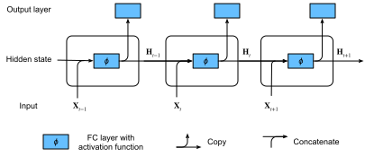
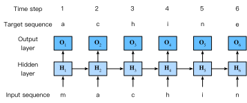

# Rekurentiniai neuroniniai tinklai
:label:`sec_rnn`


:numref:`sec_language-model` aprašėme Markovo modelius ir $n$-gramas kalbos modeliavimui, kur teksto vieneto $x_t$ sąlyginė tikimybė laiko žingsniu $t$ priklauso tik nuo $n-1$ ankstesnių teksto vienetų.
Jei norime įtraukti galimą teksto vienetų, ankstesnių nei laiko žingsnis $t-(n-1)$, poveikį $x_t$,
turime didinti $n$.
Tačiau modelio parametrų skaičius taip pat didėtų eksponentiškai, nes žodyno aibei $\mathcal{V}$ turėtume saugoti $|\mathcal{V}|^n$ skaičių.
Todėl užuot modeliavus $P(x_t \mid x_{t-1}, \ldots, x_{t-n+1})$, pageidautina naudoti latentinio kintamojo modelį,

$$P(x_t \mid x_{t-1}, \ldots, x_1) \approx P(x_t \mid h_{t-1}),$$

kur $h_{t-1}$ yra *paslėptoji būsena*, saugojanti sekos informaciją iki laiko žingsnio $t-1$.
Apskritai
paslėptąją būseną bet kuriuo laiko žingsniu $t$ galima apskaičiuoti pagal ir dabartinę įvestį $x_{t}$, ir ankstesnę paslėptąją būseną $h_{t-1}$:

$$h_t = f(x_{t}, h_{t-1}).$$
:eqlabel:`eq_ht_xt`

Pakankamai galingai funkcijai $f$ :eqref:`eq_ht_xt` latentinio kintamojo modelis nėra aproksimacija. Juk $h_t$ gali tiesiog saugoti visus iki šiol stebėtus duomenis.
Tačiau tai gali padaryti brangius ir skaičiavimus, ir saugojimą.

Prisiminkite, kad paslėptuosius sluoksnius su paslėptaisiais vienetais aptarėme :numref:`chap_perceptrons`.
Verta pažymėti, kad
paslėptieji sluoksniai ir paslėptosios būsenos reiškia dvi labai skirtingas sąvokas.
Paslėptieji sluoksniai, kaip paaiškinta, yra sluoksniai, paslėpti nuo žvilgsnio kelyje nuo įvesties iki išvesties.
Paslėptosios būsenos techniškai kalbant yra *įvestys* tam, ką darome duotame žingsnyje,
ir jas galima apskaičiuoti tik žiūrint į ankstesnių laiko žingsnių duomenis.

*Rekurentiniai neuroniniai tinklai* (RNN) yra neuroniniai tinklai su paslėptosiomis būsenomis. Prieš pristatydami RNN modelį, pirmiausia grįžkime prie MLP modelio, pristatyto :numref:`sec_mlp`.

```{.python .input}
%load_ext d2lbook.tab
tab.interact_select('mxnet', 'pytorch', 'tensorflow', 'jax')
```

```{.python .input}
%%tab mxnet
from d2l import mxnet as d2l
from mxnet import np, npx
npx.set_np()
```

```{.python .input}
%%tab pytorch
from d2l import torch as d2l
import torch
```

```{.python .input}
%%tab tensorflow
from d2l import tensorflow as d2l
import tensorflow as tf
```

```{.python .input}
%%tab jax
from d2l import jax as d2l
import jax
from jax import numpy as jnp
```

## Neuroniniai tinklai be paslėptųjų būsenų

Pažvelkime į MLP su vienu paslėptuoju sluoksniu.
Tegul paslėptojo sluoksnio aktyvacijos funkcija yra $\phi$.
Turint pavyzdžių minirinkinį $\mathbf{X} \in \mathbb{R}^{n \times d}$ su rinkinio dydžiu $n$ ir $d$ įvesčių, paslėptojo sluoksnio išvestis $\mathbf{H} \in \mathbb{R}^{n \times h}$ apskaičiuojama taip:

$$\mathbf{H} = \phi(\mathbf{X} \mathbf{W}_{\textrm{xh}} + \mathbf{b}_\textrm{h}).$$
:eqlabel:`rnn_h_without_state`

:eqref:`rnn_h_without_state` paslėptajam sluoksniui turime svorių parametrą $\mathbf{W}_{\textrm{xh}} \in \mathbb{R}^{d \times h}$, poslinkio parametrą $\mathbf{b}_\textrm{h} \in \mathbb{R}^{1 \times h}$ ir paslėptųjų vienetų skaičių $h$.
Taip pasiruošę, sumuodami taikome transliavimą (žr. :numref:`subsec_broadcasting`).
Toliau paslėptojo sluoksnio išvestis $\mathbf{H}$ naudojama kaip išvesties sluoksnio įvestis, kuri pateikiama taip:

$$\mathbf{O} = \mathbf{H} \mathbf{W}_{\textrm{hq}} + \mathbf{b}_\textrm{q},$$

kur $\mathbf{O} \in \mathbb{R}^{n \times q}$ yra išvesties kintamasis, $\mathbf{W}_{\textrm{hq}} \in \mathbb{R}^{h \times q}$ yra svorių parametras, o $\mathbf{b}_\textrm{q} \in \mathbb{R}^{1 \times q}$ yra išvesties sluoksnio poslinkio parametras. Jei tai klasifikavimo uždavinys, galime naudoti $\mathrm{softmax}(\mathbf{O})$ išvesties kategorijų tikimybių skirstiniui apskaičiuoti.

Tai visiškai analogiška anksčiau :numref:`sec_sequence` išspręstam regresijos uždaviniui, todėl detalių praleidžiame.
Pakanka pasakyti, kad galime atsitiktinai rinktis požymių ir žymenų poras ir išmokti savo tinklo parametrus per automatinį diferencijavimą ir stochastinį gradientinį nusileidimą.

## Rekurentiniai neuroniniai tinklai su paslėptosiomis būsenomis
:label:`subsec_rnn_w_hidden_states`

Reikalai visiškai skiriasi, kai turime paslėptąsias būsenas. Pažvelkime į struktūrą šiek tiek išsamiau.

Tarkime, kad turime
įvesčių minirinkinį
$\mathbf{X}_t \in \mathbb{R}^{n \times d}$
laiko žingsniu $t$.
Kitaip tariant,
$n$ sekų pavyzdžių minirinkiniui
kiekviena $\mathbf{X}_t$ eilutė atitinka vieną pavyzdį laiko žingsniu $t$ iš sekos.
Toliau
pažymėkime $\mathbf{H}_t  \in \mathbb{R}^{n \times h}$ laiko žingsnio $t$ paslėptojo sluoksnio išvestį.
Skirtingai nei su MLP, čia išsaugome ankstesnio laiko žingsnio paslėptojo sluoksnio išvestį $\mathbf{H}_{t-1}$ ir įvedame naują svorių parametrą $\mathbf{W}_{\textrm{hh}} \in \mathbb{R}^{h \times h}$, aprašantį, kaip naudoti ankstesnio laiko žingsnio paslėptojo sluoksnio išvestį dabartiniame laiko žingsnyje. Konkrečiai, dabartinio laiko žingsnio paslėptojo sluoksnio išvesties skaičiavimą lemia dabartinio laiko žingsnio įvestis kartu su ankstesnio laiko žingsnio paslėptojo sluoksnio išvestimi:

$$\mathbf{H}_t = \phi(\mathbf{X}_t \mathbf{W}_{\textrm{xh}} + \mathbf{H}_{t-1} \mathbf{W}_{\textrm{hh}}  + \mathbf{b}_\textrm{h}).$$
:eqlabel:`rnn_h_with_state`

Palyginti su :eqref:`rnn_h_without_state`, :eqref:`rnn_h_with_state` prideda dar vieną narį $\mathbf{H}_{t-1} \mathbf{W}_{\textrm{hh}}$ ir taip
realizuoja :eqref:`eq_ht_xt`.
Iš gretimų laiko žingsnių paslėptojo sluoksnio išvesčių $\mathbf{H}_t$ ir $\mathbf{H}_{t-1}$ ryšio
žinome, kad šie kintamieji užfiksavo ir išlaikė sekos istorinę informaciją iki jų dabartinio laiko žingsnio, lygiai kaip neuroninio tinklo dabartinio laiko žingsnio būsena ar atmintis. Todėl tokia paslėptojo sluoksnio išvestis vadinama *paslėptąja būsena*.
Kadangi paslėptoji būsena dabartiniame laiko žingsnyje naudoja tą patį ankstesnio laiko žingsnio apibrėžimą, :eqref:`rnn_h_with_state` skaičiavimas yra *rekurentinis*. Todėl, kaip sakėme, neuroniniai tinklai su paslėptosiomis būsenomis,
pagrįstais rekurentiniu skaičiavimu, vadinami
*rekurentiniais neuroniniais tinklais*.
Sluoksniai, kurie RNN atlieka
:eqref:`rnn_h_with_state` skaičiavimą,
vadinami *rekurentiniais sluoksniais*.


Yra daug skirtingų RNN konstravimo būdų.
Tie, kurių paslėptoji būsena apibrėžiama :eqref:`rnn_h_with_state`, yra labai įprasti.
Laiko žingsniui $t$
išvesties sluoksnio išvestis yra panaši į skaičiavimą MLP:

$$\mathbf{O}_t = \mathbf{H}_t \mathbf{W}_{\textrm{hq}} + \mathbf{b}_\textrm{q}.$$

RNN parametrai
apima paslėptojo sluoksnio svorius $\mathbf{W}_{\textrm{xh}} \in \mathbb{R}^{d \times h}, \mathbf{W}_{\textrm{hh}} \in \mathbb{R}^{h \times h}$
ir poslinkį $\mathbf{b}_\textrm{h} \in \mathbb{R}^{1 \times h}$,
kartu su išvesties sluoksnio svoriais $\mathbf{W}_{\textrm{hq}} \in \mathbb{R}^{h \times q}$
ir poslinkiu $\mathbf{b}_\textrm{q} \in \mathbb{R}^{1 \times q}$.
Verta paminėti, kad
net skirtingais laiko žingsniais
RNN visada naudoja šiuos modelio parametrus.
Todėl RNN parametrizavimo kaina
nedidėja didėjant laiko žingsnių skaičiui.

:numref:`fig_rnn` iliustruoja RNN skaičiavimo logiką trijuose gretimuose laiko žingsniuose.
Bet kuriuo laiko žingsniu $t$
paslėptosios būsenos skaičiavimą galima traktuoti taip:
(i) sujungti dabartinio laiko žingsnio $t$ įvestį $\mathbf{X}_t$ ir ankstesnio laiko žingsnio $t-1$ paslėptąją būseną $\mathbf{H}_{t-1}$;
(ii) sujungimo rezultatą paduoti į pilnai sujungtą sluoksnį su aktyvacijos funkcija $\phi$.
Tokio pilnai sujungto sluoksnio išvestis yra dabartinio laiko žingsnio $t$ paslėptoji būsena $\mathbf{H}_t$.
Šiuo atveju
modelio parametrai yra $\mathbf{W}_{\textrm{xh}}$ ir $\mathbf{W}_{\textrm{hh}}$ sujungimas bei poslinkis $\mathbf{b}_\textrm{h}$, visi iš :eqref:`rnn_h_with_state`.
Dabartinio laiko žingsnio $t$ paslėptoji būsena $\mathbf{H}_t$ dalyvaus skaičiuojant kito laiko žingsnio $t+1$ paslėptąją būseną $\mathbf{H}_{t+1}$.
Be to, $\mathbf{H}_t$ taip pat bus
paduota į pilnai sujungtą išvesties sluoksnį,
kad būtų apskaičiuota
dabartinio laiko žingsnio $t$ išvestis
$\mathbf{O}_t$.


:label:`fig_rnn`

Ką tik paminėjome, kad paslėptosios būsenos skaičiavimas $\mathbf{X}_t \mathbf{W}_{\textrm{xh}} + \mathbf{H}_{t-1} \mathbf{W}_{\textrm{hh}}$ yra ekvivalentus
$\mathbf{X}_t$ ir $\mathbf{H}_{t-1}$ sujungimo
ir
$\mathbf{W}_{\textrm{xh}}$ bei $\mathbf{W}_{\textrm{hh}}$ sujungimo
matricų daugybai.
Nors tai galima įrodyti matematiškai,
toliau tiesiog naudojame paprastą kodo fragmentą demonstracijai.
Pirmiausia
apibrėžiame matricas `X`, `W_xh`, `H` ir `W_hh`, kurių formos atitinkamai yra (3, 1), (1, 4), (3, 4) ir (4, 4).
Padauginę `X` iš `W_xh`, o `H` iš `W_hh`, ir tada sudėję šias dvi sandaugas,
gauname formos (3, 4) matricą.

```{.python .input}
%%tab mxnet, pytorch
X, W_xh = d2l.randn(3, 1), d2l.randn(1, 4)
H, W_hh = d2l.randn(3, 4), d2l.randn(4, 4)
d2l.matmul(X, W_xh) + d2l.matmul(H, W_hh)
```

```{.python .input}
%%tab tensorflow
X, W_xh = d2l.normal((3, 1)), d2l.normal((1, 4))
H, W_hh = d2l.normal((3, 4)), d2l.normal((4, 4))
d2l.matmul(X, W_xh) + d2l.matmul(H, W_hh)
```

```{.python .input}
%%tab jax
X, W_xh = jax.random.normal(d2l.get_key(), (3, 1)), jax.random.normal(
                                                        d2l.get_key(), (1, 4))
H, W_hh = jax.random.normal(d2l.get_key(), (3, 4)), jax.random.normal(
                                                        d2l.get_key(), (4, 4))
d2l.matmul(X, W_xh) + d2l.matmul(H, W_hh)
```

Dabar sujungiame matricas `X` ir `H`
išilgai stulpelių (ašis 1),
o matricas
`W_xh` ir `W_hh` – išilgai eilučių (ašis 0).
Šie du sujungimai
duoda
atitinkamai formos (3, 5)
ir (5, 4) matricas.
Padauginę šias dvi sujungtas matricas,
gauname tą pačią formos (3, 4) išvesties matricą
kaip aukščiau.

```{.python .input}
%%tab all
d2l.matmul(d2l.concat((X, H), 1), d2l.concat((W_xh, W_hh), 0))
```

## RNN pagrįsti simbolių lygio kalbos modeliai

Prisiminkite, kad kalbos modeliavimui :numref:`sec_language-model`
siekiame prognozuoti kitą teksto vienetą pagal
dabartinius ir ankstesnius teksto vienetus;
todėl originalią seką pastumiame vienu teksto vienetu
kaip tikslus (žymenis).
:citet:`Bengio.Ducharme.Vincent.ea.2003` pirmieji pasiūlė
naudoti neuroninį tinklą kalbos modeliavimui.
Toliau iliustruojame, kaip RNN galima naudoti kalbos modeliui sukurti.
Tegul minirinkinio dydis yra vienas, o teksto seka – „machine“.
Kad supaprastintume apmokymą kituose skyreliuose,
tekstą skaidome į simbolius, o ne į žodžius,
ir nagrinėjame *simbolių lygio kalbos modelį*.
:numref:`fig_rnn_train` parodo, kaip prognozuoti kitą simbolį pagal dabartinį ir ankstesnius simbolius per RNN simbolių lygio kalbos modeliavimui.


:label:`fig_rnn_train`

Apmokymo proceso metu
kiekvienam laiko žingsniui atliekame softmax operaciją su išvesties sluoksnio išvestimi, o tada naudojame kryžminės entropijos nuostolį, kad apskaičiuotume paklaidą tarp modelio išvesties ir tikslo.
Dėl rekurentinio paslėptosios būsenos skaičiavimo paslėptajame sluoksnyje 3 laiko žingsnio išvestį $\mathbf{O}_3$ :numref:`fig_rnn_train` lemia teksto seka „m“, „a“ ir „c“. Kadangi kitas sekos simbolis mokymo duomenyse yra „h“, 3 laiko žingsnio nuostolis priklausys nuo kito simbolio tikimybių skirstinio, sugeneruoto pagal požymių seką „m“, „a“, „c“, ir šio laiko žingsnio tikslo „h“.

Praktikoje kiekvienas teksto vienetas pavaizduojamas $d$ dimensijų vektoriumi, o naudojame rinkinio dydį $n>1$. Todėl įvestis $\mathbf X_t$ laiko žingsniu $t$ bus $n\times d$ matrica, identiška tam, ką aptarėme :numref:`subsec_rnn_w_hidden_states`.

Kituose skyreliuose įgyvendinsime RNN
simbolių lygio kalbos modeliams.


## Santrauka

Neuroninis tinklas, naudojantis rekurentinį skaičiavimą paslėptosioms būsenoms, vadinamas rekurentiniu neuroniniu tinklu (RNN).
RNN paslėptoji būsena gali užfiksuoti sekos istorinę informaciją iki dabartinio laiko žingsnio. Naudojant rekurentinį skaičiavimą, RNN modelio parametrų skaičius nedidėja didėjant laiko žingsnių skaičiui. Taikymų požiūriu RNN galima naudoti simbolių lygio kalbos modeliams kurti.


## Pratimai

1. Jei naudojame RNN kitam teksto sekos simboliui prognozuoti, kokia yra reikalinga bet kurios išvesties dimensija?
1. Kodėl RNN gali išreikšti teksto vieneto sąlyginę tikimybę tam tikru laiko žingsniu pagal visus ankstesnius teksto sekos teksto vienetus?
1. Kas nutinka gradientui, jei atgaline kryptimi sklidate per ilgą seką?
1. Kokios yra kai kurios šiame skyrelyje aprašyto kalbos modelio problemos?


:begin_tab:`mxnet`
[Diskusijos](https://discuss.d2l.ai/t/337)
:end_tab:

:begin_tab:`pytorch`
[Diskusijos](https://discuss.d2l.ai/t/1050)
:end_tab:

:begin_tab:`tensorflow`
[Diskusijos](https://discuss.d2l.ai/t/1051)
:end_tab:

:begin_tab:`jax`
[Diskusijos](https://discuss.d2l.ai/t/180013)
:end_tab:
