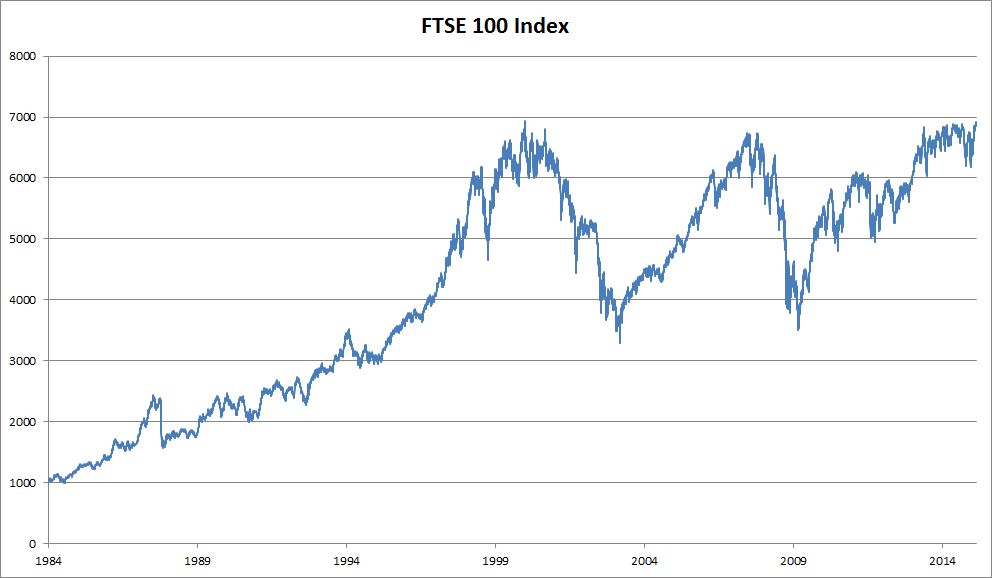
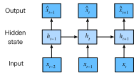

# Darbas su sekomis
:label:`sec_sequence`

Iki šiol daugiausia dėmesio skyrėme modeliams, kurių įvestis
sudarė vienas požymių vektorius $\mathbf{x} \in \mathbb{R}^d$.
Pagrindinis perspektyvos pasikeitimas kuriant modelius,
gebančius apdoroti sekas, yra tas, kad dabar
sutelkiame dėmesį į įvestis, sudarytas iš sutvarkyto
požymių vektorių sąrašo $\mathbf{x}_1, \dots, \mathbf{x}_T$,
kur kiekvienas požymių vektorius $\mathbf{x}_t$
indeksuojamas laiko žingsniu $t \in \mathbb{Z}^+$
ir yra erdvėje $\mathbb{R}^d$.

Kai kuriuos duomenų rinkinius sudaro viena milžiniška seka.
Pavyzdžiui, apsvarstykite itin ilgus jutiklių rodmenų srautus,
kurie gali būti prieinami klimato mokslininkams.
Tokiais atvejais mokymo duomenų rinkinius galime sukurti
atsitiktinai imdami iš anksto nustatyto ilgio posekius.
Dažniau mūsų duomenys pateikiami kaip sekų rinkinys.
Panagrinėkite šiuos pavyzdžius:
(i) dokumentų rinkinys,
kurių kiekvienas pavaizduotas kaip sava žodžių seka
ir turi savo ilgį $T_i$;
(ii) pacientų buvimo ligoninėje sekos atvaizdas,
kur kiekvieną buvimą sudaro keli įvykiai,
o sekos ilgis maždaug priklauso
nuo buvimo trukmės.


Anksčiau, dirbdami su atskiromis įvestimis,
darėme prielaidą, kad jos buvo atrinktos nepriklausomai
iš to paties pagrindinio skirstinio $P(X)$.
Nors vis dar darome prielaidą, kad ištisos sekos
(pvz., ištisi dokumentai ar pacientų trajektorijos)
atrenkamos nepriklausomai,
negalime daryti prielaidos, kad duomenys, gaunami
kiekvienu laiko žingsniu, yra nepriklausomi vienas nuo kito.
Pavyzdžiui, žodžiai, kurie tikėtina pasirodys vėliau dokumente,
labai priklauso nuo žodžių, pasirodžiusių anksčiau dokumente.
Vaistai, kuriuos pacientas greičiausiai gaus
10-ąją buvimo ligoninėje dieną,
labai priklauso nuo to, kas įvyko
per ankstesnes devynias dienas.

Tai neturėtų stebinti.
Jei netikėtume, kad sekos elementai yra susiję,
nė nesivargintume jų modeliuoti kaip sekos.
Apsvarstykite automatinio užbaigimo funkcijų,
populiarių paieškos įrankiuose ir šiuolaikiniuose el. pašto klientuose, naudingumą.
Jos naudingos būtent todėl, kad dažnai įmanoma
nuspėti (netobulai, bet geriau nei atsitiktinai),
kokie gali būti tikėtini sekos tęsiniai,
turint pradinį priešdėlį.
Daugeliui sekų modelių
nereikalaujame sekų nepriklausomumo
ar net stacionarumo.
Vietoj to reikalaujame tik, kad
pačios sekos būtų atrenkamos
iš tam tikro fiksuoto pagrindinio skirstinio
ištisoms sekoms.

Šis lankstus požiūris leidžia tokius reiškinius kaip
(i) dokumentai, kurių pradžia gerokai skiriasi
nuo pabaigos;
arba (ii) paciento būklė, besikeičianti
link pasveikimo arba link mirties
buvimo ligoninėje metu;
arba (iii) klientų skonis, nuspėjamai besikeičiantis
nuolat sąveikaujant su rekomendavimo sistema.


Kartais norime prognozuoti fiksuotą tikslą $y$,
turėdami nuosekliai struktūrizuotą įvestį
(pvz., nuotaikų klasifikavimas pagal filmo apžvalgą).
Kitais atvejais norime prognozuoti nuosekliai struktūrizuotą tikslą
($y_1, \ldots, y_T$),
turėdami fiksuotą įvestį (pvz., vaizdų aprašų generavimas).
Dar kitais atvejais mūsų tikslas yra prognozuoti nuosekliai struktūrizuotus tikslus
pagal nuosekliai struktūrizuotas įvestis
(pvz., mašininis vertimas ar vaizdo įrašų aprašų generavimas).
Tokios sekos į seką užduotys turi dvi formas:
(i) *sulygiuotos*: kai įvestis kiekvienu laiko žingsniu
sulygiuota su atitinkamu tikslu (pvz., kalbos dalių žymėjimas);
(ii) *nesulygiuotos*: kai įvestis ir tikslas
nebūtinai rodo atitikimą žingsnis į žingsnį
(pvz., mašininis vertimas).

Prieš rūpindamiesi bet kokių tikslų apdorojimu,
galime spręsti paprasčiausią uždavinį:
neprižiūrimąjį tankio modeliavimą (dar vadinamą *sekų modeliavimu*).
Čia, turint sekų rinkinį,
mūsų tikslas yra įvertinti tikimybių masės funkciją,
kuri parodo, kiek tikėtina matyti bet kurią duotą seką,
t. y. $p(\mathbf{x}_1, \ldots, \mathbf{x}_T)$.

```{.python .input  n=6}
%load_ext d2lbook.tab
tab.interact_select('mxnet', 'pytorch', 'tensorflow', 'jax')
```

```{.python .input  n=7}
%%tab mxnet
%matplotlib inline
from d2l import mxnet as d2l
from mxnet import autograd, np, npx, gluon, init
from mxnet.gluon import nn
npx.set_np()
```

```{.python .input  n=8}
%%tab pytorch
%matplotlib inline
from d2l import torch as d2l
import torch
from torch import nn
```

```{.python .input  n=9}
%%tab tensorflow
%matplotlib inline
from d2l import tensorflow as d2l
import tensorflow as tf
```

```{.python .input  n=9}
%%tab jax
%matplotlib inline
from d2l import jax as d2l
import jax
from jax import numpy as jnp
import numpy as np
```

## Autoregresiniai modeliai


Prieš pristatydami specializuotus neuroninius tinklus,
skirtus nuosekliai struktūrizuotiems duomenims apdoroti,
pažvelkime į tikrus sekų duomenis
ir susikurkime keletą pagrindinių intuicijų bei statistinių įrankių.
Visų pirma sutelksime dėmesį į akcijų kainų duomenis
iš FTSE 100 indekso (:numref:`fig_ftse100`).
Kiekvienu *laiko žingsniu* $t \in \mathbb{Z}^+$ stebime
indekso kainą $x_t$ tuo metu.



:width:`400px`
:label:`fig_ftse100`


Tarkime, kad prekiautojas nori sudaryti trumpalaikius sandorius,
strategiškai įeidamas į indeksą ar iš jo išeidamas,
priklausomai nuo to, ar mano,
kad jis kils ar kris
kitu laiko žingsniu.
Neturint jokių kitų požymių
(naujienų, finansinės atskaitomybės duomenų ir pan.),
vienintelis prieinamas signalas kitai reikšmei prognozuoti
yra iki šiol buvusių kainų istorija.
Todėl prekiautojui įdomu žinoti
tikimybių skirstinį

$$P(x_t \mid x_{t-1}, \ldots, x_1)$$

kainų, kurias indeksas gali įgyti
kitu laiko žingsniu.
Nors visą skirstinį
tolydžiai kintančio atsitiktinio dydžio įvertinti
gali būti sunku, prekiautojas mielai
sutelktų dėmesį į kelias pagrindines skirstinio statistikas,
ypač į laukiamąją reikšmę ir dispersiją.
Viena paprasta sąlyginės vidurkio
įvertinimo strategija

$$\mathbb{E}[(x_t \mid x_{t-1}, \ldots, x_1)],$$

būtų pritaikyti tiesinės regresijos modelį
(prisiminkite :numref:`sec_linear_regression`).
Tokie modeliai, regresuojantys signalo reikšmę
pagal ankstesnes to paties signalo reikšmes,
natūraliai vadinami *autoregresiniais modeliais*.
Yra tik viena didelė problema: įvesčių skaičius
$x_{t-1}, \ldots, x_1$ kinta priklausomai nuo $t$.
Kitaip tariant, įvesčių skaičius didėja
didėjant sutiktų duomenų kiekiui.
Todėl jei norime savo istorinius duomenis traktuoti
kaip mokymo rinkinį, lieka problema,
kad kiekvienas pavyzdys turi skirtingą požymių skaičių.
Didelė dalis to, kas bus aptarta šiame skyriuje,
sukasi apie technikas,
skirtas įveikti šiuos iššūkius
sprendžiant tokius *autoregresinio* modeliavimo uždavinius,
kur dominantis objektas yra
$P(x_t \mid x_{t-1}, \ldots, x_1)$
arba kokia nors šio skirstinio statistika (statistikos).

Kelios strategijos kartojasi dažnai.
Pirma,
galime manyti, kad nors ilgos sekos
$x_{t-1}, \ldots, x_1$ yra prieinamos,
gali būti nebūtina žvelgti taip toli atgal į istoriją,
prognozuojant artimą ateitį.
Šiuo atveju galime tenkintis
sąlygojimu pagal tam tikrą $\tau$ ilgio langą
ir naudoti tik stebėjimus $x_{t-1}, \ldots, x_{t-\tau}$.
Tiesioginė nauda ta, kad dabar argumentų skaičius
visada yra toks pat, bent jau kai $t > \tau$.
Tai leidžia apmokyti bet kokį tiesinį modelį ar gilųjį tinklą,
kuriam reikia fiksuoto ilgio vektorių kaip įvesčių.
Antra, galime kurti modelius, kurie palaiko
tam tikrą ankstesnių stebėjimų santrauką $h_t$
(žr. :numref:`fig_sequence-model`)
ir tuo pat metu atnaujina $h_t$
be prognozės $\hat{x}_t$.
Tai veda prie modelių, kurie vertina ne tik $x_t$
pagal $\hat{x}_t = P(x_t \mid h_{t})$,
bet ir atnaujinimus pavidalo
$h_t = g(h_{t-1}, x_{t-1})$.
Kadangi $h_t$ niekada nestebimas,
šie modeliai taip pat vadinami
*latentiniais autoregresiniais modeliais*.


:label:`fig_sequence-model`

Norint sukonstruoti mokymo duomenis iš istorinių duomenų,
paprastai pavyzdžiai kuriami atsitiktinai imant langus.
Apskritai nesitikime, kad laikas sustos.
Tačiau dažnai darome prielaidą, kad nors
konkrečios $x_t$ reikšmės gali keistis,
dinamika, pagal kurią generuojamas kiekvienas vėlesnis
stebėjimas, žinant ankstesnius stebėjimus, nesikeičia.
Statistikai dinamiką, kuri nesikeičia, vadina *stacionaria*.


## Sekų modeliai

Kartais, ypač dirbant su kalba,
norime įvertinti visos sekos
jungtinę tikimybę.
Tai įprasta užduotis dirbant su sekomis,
sudarytomis iš diskrečių *teksto vienetų*, pavyzdžiui, žodžių.
Apskritai šios įvertintos funkcijos vadinamos *sekų modeliais*,
o natūraliosios kalbos duomenims – *kalbos modeliais*.
Sekų modeliavimo sritį taip stipriai skatino natūraliosios kalbos apdorojimas,
kad sekų modelius dažnai vadiname „kalbos modeliais“,
net kai dirbame su ne kalbos duomenimis.
Kalbos modeliai pasirodo naudingi įvairiais tikslais.
Kartais norime įvertinti sakinių tikėtinumą.
Pavyzdžiui, galime norėti palyginti
dviejų kandidatų, sugeneruotų mašininio vertimo sistemos
ar kalbos atpažinimo sistemos, natūralumą.
Tačiau kalbos modeliavimas suteikia mums ne tik
gebėjimą *įvertinti* tikėtinumą,
bet ir gebėjimą *imti imtis* sekų
ir netgi optimizuoti pagal labiausiai tikėtinas sekas.

Nors kalbos modeliavimas iš pirmo žvilgsnio gali neatrodyti
kaip autoregresinis uždavinys,
kalbos modeliavimą galime suvesti į autoregresinę prognozę,
išskaidydami sekos jungtinį tankį $p(x_1, \ldots, x_T)$
į sąlyginių tankių sandaugą
iš kairės į dešinę,
taikydami tikimybių grandinės taisyklę:

$$P(x_1, \ldots, x_T) = P(x_1) \prod_{t=2}^T P(x_t \mid x_{t-1}, \ldots, x_1).$$

Atkreipkite dėmesį, kad jei dirbame su diskrečiais signalais, tokiais kaip žodžiai,
autoregresinis modelis turi būti tikimybinis klasifikatorius,
išvedantis pilną tikimybių skirstinį
žodyno žodžiams, kurie ateis toliau,
žinant kairiojo konteksto informaciją.


### Markovo modeliai
:label:`subsec_markov-models`


Dabar tarkime, kad norime pritaikyti aukščiau minėtą strategiją,
kai sąlygojame tik pagal $\tau$ ankstesnių laiko žingsnių,
t. y. $x_{t-1}, \ldots, x_{t-\tau}$, o ne
visą sekos istoriją $x_{t-1}, \ldots, x_1$.
Kai tik galime atmesti istoriją,
einančią už ankstesnių $\tau$ žingsnių,
neprarasdami prognozavimo galios,
sakome, kad seka tenkina *Markovo sąlygą*,
t. y. *kad ateitis yra sąlyginai nepriklausoma nuo praeities,
žinant neseną istoriją*.
Kai $\tau = 1$, sakome, kad duomenis apibūdina
*pirmosios eilės Markovo modelis*,
o kai $\tau = k$, sakome, kad duomenis apibūdina
$k$-osios eilės Markovo modelis.
Kai galioja pirmosios eilės Markovo sąlyga ($\tau = 1$),
mūsų jungtinės tikimybės faktorizacija tampa
kiekvieno žodžio tikimybių, žinant ankstesnį *žodį*, sandauga:

$$P(x_1, \ldots, x_T) = P(x_1) \prod_{t=2}^T P(x_t \mid x_{t-1}).$$

Dažnai pravartu dirbti su modeliais, kurie veikia
taip, tarsi Markovo sąlyga būtų tenkinama,
net kai žinome, kad tai tik *apytiksliai* tiesa.
Su tikrais tekstiniais dokumentais vis gauname informacijos,
įtraukdami vis daugiau kairiojo konteksto.
Tačiau šie laimėjimai sparčiai mažėja.
Todėl kartais darome kompromisą, išvengdami skaičiavimo ir statistinių sunkumų
apmokydami modelius, kurių pagrįstumas priklauso
nuo $k$-osios eilės Markovo sąlygos.
Net šiandieniniai milžiniški RNN ir transformeriais pagrįsti kalbos modeliai
retai įtraukia daugiau nei tūkstančius žodžių konteksto.


Su diskrečiais duomenimis tikras Markovo modelis
tiesiog skaičiuoja, kiek kartų
kiekvienas žodis pasirodė kiekviename kontekste, taip gaudamas
santykinio dažnio įvertį $P(x_t \mid x_{t-1})$.
Kai tik duomenys įgyja tik diskrečias reikšmes
(kaip kalboje),
labiausiai tikėtiną žodžių seką galima efektyviai apskaičiuoti
naudojant dinaminį programavimą.


### Dekodavimo tvarka

Galbūt stebitės, kodėl teksto sekos $P(x_1, \ldots, x_T)$
faktorizaciją pavaizdavome
kaip sąlyginių tikimybių grandinę iš kairės į dešinę.
Kodėl ne iš dešinės į kairę ar kita, iš pažiūros atsitiktine tvarka?
Iš principo nėra nieko blogo išvyniojant
$P(x_1, \ldots, x_T)$ atvirkštine tvarka.
Rezultatas yra galiojanti faktorizacija:

$$P(x_1, \ldots, x_T) = P(x_T) \prod_{t=T-1}^1 P(x_t \mid x_{t+1}, \ldots, x_T).$$


Tačiau yra daug priežasčių, kodėl teksto faktorizavimas
ta pačia kryptimi, kuria jį skaitome
(iš kairės į dešinę daugumai kalbų,
bet iš dešinės į kairę arabų ir hebrajų kalboms),
yra pageidautinas kalbos modeliavimo užduočiai.
Pirma, tai tiesiog mums natūralesnė mąstymo kryptis.
Juk visi kasdien skaitome tekstą,
ir šį procesą lemia mūsų gebėjimas
numatyti, kurie žodžiai ir frazės
greičiausiai ateis toliau.
Pagalvokite, kiek kartų esate pabaigę
kito žmogaus sakinį.
Taigi, net jei neturėtume jokios kitos priežasties teikti pirmenybę tokiems tvarkingiems dekodavimams,
jie būtų naudingi bent jau todėl, kad turime geresnes intuicijas,
kas turėtų būti tikėtina, prognozuojant šia tvarka.

Antra, faktorizuodami iš eilės,
galime priskirti tikimybes savavališkai ilgoms sekoms
naudodami tą patį kalbos modelį.
Norėdami tikimybę žingsniams nuo $1$ iki $t$
paversti tikimybe, besitęsiančia iki žodžio $t+1$, tiesiog
padauginame iš papildomo teksto vieneto sąlyginės tikimybės,
žinant ankstesnius:
$P(x_{t+1}, \ldots, x_1) = P(x_{t}, \ldots, x_1) \cdot P(x_{t+1} \mid x_{t}, \ldots, x_1)$.

Trečia, turime stipresnius prognozavimo modelius
gretimiems žodžiams prognozuoti nei
žodžiams savavališkose kitose vietose.
Nors visos faktorizavimo tvarkos yra galiojančios,
jos nebūtinai visos atitinka vienodai lengvus
prognozavimo modeliavimo uždavinius.
Tai teisinga ne tik kalbai,
bet ir kitokiems duomenims,
pvz., kai duomenys yra priežastiškai struktūrizuoti.
Pavyzdžiui, manome, kad ateities įvykiai negali paveikti praeities.
Todėl, jei pakeisime $x_t$, galbūt galėsime paveikti,
kas vyks su $x_{t+1}$ toliau, bet ne atvirkščiai.
Tai yra, jei pakeisime $x_t$, praeities įvykių skirstinys nepasikeis.
Kai kuriuose kontekstuose dėl to lengviau prognozuoti $P(x_{t+1} \mid x_t)$
nei $P(x_t \mid x_{t+1})$.
Pavyzdžiui, kai kuriais atvejais galime rasti $x_{t+1} = f(x_t) + \epsilon$
su tam tikru adityviuoju triukšmu $\epsilon$,
o atvirkščiai tai nėra tiesa :cite:`Hoyer.Janzing.Mooij.ea.2009`.
Tai puiki žinia, nes paprastai mus domina būtent
tiesioginės krypties vertinimas.
Daugiau šia tema pateikia :citet:`Peters.Janzing.Scholkopf.2017` knyga.
Mes vos paliečiame jos paviršių.


## Mokymas

Prieš sutelkdami dėmesį į tekstinius duomenis,
pirmiausia išbandykime tai su
tolydžių reikšmių sintetiniais duomenimis.

(**Čia mūsų 1000 sintetinių duomenų sekos trigonometrinę funkciją `sin`,
pritaikytą 0,01 karto didesniam laiko žingsniui.
Kad uždavinys būtų šiek tiek įdomesnis,
kiekvieną imtį sugadiname adityviuoju triukšmu.**)
Iš šios sekos išskiriame mokymo pavyzdžius,
kurių kiekvieną sudaro požymiai ir žymuo.

```{.python .input  n=10}
%%tab all
class Data(d2l.DataModule):
    def __init__(self, batch_size=16, T=1000, num_train=600, tau=4):
        self.save_hyperparameters()
        self.time = d2l.arange(1, T + 1, dtype=d2l.float32)
        if tab.selected('mxnet', 'pytorch'):
            self.x = d2l.sin(0.01 * self.time) + d2l.randn(T) * 0.2
        if tab.selected('tensorflow'):
            self.x = d2l.sin(0.01 * self.time) + d2l.normal([T]) * 0.2
        if tab.selected('jax'):
            key = d2l.get_key()
            self.x = d2l.sin(0.01 * self.time) + jax.random.normal(key,
                                                                   [T]) * 0.2
```

```{.python .input}
%%tab all
data = Data()
d2l.plot(data.time, data.x, 'time', 'x', xlim=[1, 1000], figsize=(6, 3))
```

Pradėkime nuo modelio, kuris veikia taip,
tarsi duomenys tenkintų $\tau$-osios eilės Markovo sąlygą,
ir todėl prognozuoja $x_t$ naudodamas tik ankstesnius $\tau$ stebėjimų.
[**Taigi kiekvienam laiko žingsniui turime pavyzdį
su žymeniu $y  = x_t$ ir požymiais
$\mathbf{x}_t = [x_{t-\tau}, \ldots, x_{t-1}]$.**]
Įžvalgus skaitytojas galėjo pastebėti,
kad taip gaunama $1000-\tau$ pavyzdžių,
nes trūksta pakankamos istorijos $y_1, \ldots, y_\tau$.
Nors galėtume pirmąsias $\tau$ sekų papildyti nuliais,
paprastumo dėlei kol kas jų atsisakome.
Gautame duomenų rinkinyje yra $T - \tau$ pavyzdžių,
kur kiekviena modelio įvestis turi sekos ilgį $\tau$.
(**Sukuriame duomenų iteratorių pirmiems 600 pavyzdžių**),
apimantiems vieną sin funkcijos periodą.

```{.python .input}
%%tab all
@d2l.add_to_class(Data)
def get_dataloader(self, train):
    features = [self.x[i : self.T-self.tau+i] for i in range(self.tau)]
    self.features = d2l.stack(features, 1)
    self.labels = d2l.reshape(self.x[self.tau:], (-1, 1))
    i = slice(0, self.num_train) if train else slice(self.num_train, None)
    return self.get_tensorloader([self.features, self.labels], train, i)
```

Šiame pavyzdyje mūsų modelis bus standartinė tiesinė regresija.

```{.python .input}
%%tab all
model = d2l.LinearRegression(lr=0.01)
trainer = d2l.Trainer(max_epochs=5)
trainer.fit(model, data)
```

## Prognozavimas

[**Kad įvertintume savo modelį, pirmiausia patikriname,
kaip gerai jis prognozuoja vieną žingsnį į priekį**].

```{.python .input}
%%tab pytorch, mxnet, tensorflow
onestep_preds = d2l.numpy(model(data.features))
d2l.plot(data.time[data.tau:], [data.labels, onestep_preds], 'time', 'x',
         legend=['labels', '1-step preds'], figsize=(6, 3))
```

```{.python .input}
%%tab jax
onestep_preds = model.apply({'params': trainer.state.params}, data.features)
d2l.plot(data.time[data.tau:], [data.labels, onestep_preds], 'time', 'x',
         legend=['labels', '1-step preds'], figsize=(6, 3))
```

Šios prognozės atrodo geros,
net pabaigoje, ties $t=1000$.

Bet ką daryti, jei stebėjome sekos duomenis
tik iki 604 laiko žingsnio (`n_train + tau`)
ir norime daryti prognozes keletą žingsnių
į ateitį?
Deja, negalime tiesiogiai apskaičiuoti
vieno žingsnio į priekį prognozės 609 laiko žingsniui,
nes nežinome atitinkamų įvesčių,
matę tik iki $x_{604}$.
Šią problemą galime spręsti įstatydami
savo ankstesnes prognozes kaip įvestis į modelį
vėlesnėms prognozėms daryti,
projektuodami į priekį, po vieną žingsnį,
kol pasieksime norimą laiko žingsnį:

$$\begin{aligned}
\hat{x}_{605} &= f(x_{601}, x_{602}, x_{603}, x_{604}), \\
\hat{x}_{606} &= f(x_{602}, x_{603}, x_{604}, \hat{x}_{605}), \\
\hat{x}_{607} &= f(x_{603}, x_{604}, \hat{x}_{605}, \hat{x}_{606}),\\
\hat{x}_{608} &= f(x_{604}, \hat{x}_{605}, \hat{x}_{606}, \hat{x}_{607}),\\
\hat{x}_{609} &= f(\hat{x}_{605}, \hat{x}_{606}, \hat{x}_{607}, \hat{x}_{608}),\\
&\vdots\end{aligned}$$

Apskritai stebėtai sekai $x_1, \ldots, x_t$
jos prognozuojama išvestis $\hat{x}_{t+k}$ laiko žingsniu $t+k$
vadinama $k$*-žingsnių į priekį prognoze*.
Kadangi stebėjome iki $x_{604}$,
jos $k$-žingsnių į priekį prognozė yra $\hat{x}_{604+k}$.
Kitaip tariant, turėsime
toliau naudoti savo pačių prognozes,
kad darytume kelių žingsnių į priekį prognozes.
Pažiūrėkime, kaip tai pavyksta.

```{.python .input}
%%tab mxnet, pytorch
multistep_preds = d2l.zeros(data.T)
multistep_preds[:] = data.x
for i in range(data.num_train + data.tau, data.T):
    multistep_preds[i] = model(
        d2l.reshape(multistep_preds[i-data.tau : i], (1, -1)))
multistep_preds = d2l.numpy(multistep_preds)
```

```{.python .input}
%%tab tensorflow
multistep_preds = tf.Variable(d2l.zeros(data.T))
multistep_preds[:].assign(data.x)
for i in range(data.num_train + data.tau, data.T):
    multistep_preds[i].assign(d2l.reshape(model(
        d2l.reshape(multistep_preds[i-data.tau : i], (1, -1))), ()))
```

```{.python .input}
%%tab jax
multistep_preds = d2l.zeros(data.T)
multistep_preds = multistep_preds.at[:].set(data.x)
for i in range(data.num_train + data.tau, data.T):
    pred = model.apply({'params': trainer.state.params},
                       d2l.reshape(multistep_preds[i-data.tau : i], (1, -1)))
    multistep_preds = multistep_preds.at[i].set(pred.item())
```

```{.python .input}
%%tab all
d2l.plot([data.time[data.tau:], data.time[data.num_train+data.tau:]],
         [onestep_preds, multistep_preds[data.num_train+data.tau:]], 'time',
         'x', legend=['1-step preds', 'multistep preds'], figsize=(6, 3))
```

Deja, šiuo atveju patiriame spektakuliarią nesėkmę.
Prognozės gana greitai po kelių žingsnių
nusilpsta iki konstantos.
Kodėl algoritmas veikė daug prasčiau,
prognozuodamas toliau į ateitį?
Galiausiai tai lemia tai,
kad klaidos kaupiasi.
Tarkime, kad po 1 žingsnio turime tam tikrą paklaidą $\epsilon_1 = \bar\epsilon$.
Dabar 2 žingsnio *įvestis* sutrikdoma $\epsilon_1$,
todėl patiriame tam tikrą paklaidą, kurios eilė
$\epsilon_2 = \bar\epsilon + c \epsilon_1$
su tam tikra konstanta $c$, ir taip toliau.
Prognozės gali sparčiai nukrypti
nuo tikrųjų stebėjimų.
Galbūt jau esate susipažinę
su šiuo įprastu reiškiniu.
Pavyzdžiui, orų prognozės artimiausioms 24 valandoms
paprastai būna gana tikslios, bet toliau
tikslumas sparčiai mažėja.
Metodus, kaip tai pagerinti, aptarsime
visame šiame skyriuje ir už jo ribų.

[**Panagrinėkime išsamiau sunkumus $k$-žingsnių į priekį prognozėse**],
apskaičiuodami prognozes visai sekai, kai $k = 1, 4, 16, 64$.

```{.python .input}
%%tab pytorch, mxnet, tensorflow
def k_step_pred(k):
    features = []
    for i in range(data.tau):
        features.append(data.x[i : i+data.T-data.tau-k+1])
    # The (i+tau)-th element stores the (i+1)-step-ahead predictions
    for i in range(k):
        preds = model(d2l.stack(features[i : i+data.tau], 1))
        features.append(d2l.reshape(preds, -1))
    return features[data.tau:]
```

```{.python .input}
%%tab jax
def k_step_pred(k):
    features = []
    for i in range(data.tau):
        features.append(data.x[i : i+data.T-data.tau-k+1])
    # The (i+tau)-th element stores the (i+1)-step-ahead predictions
    for i in range(k):
        preds = model.apply({'params': trainer.state.params},
                            d2l.stack(features[i : i+data.tau], 1))
        features.append(d2l.reshape(preds, -1))
    return features[data.tau:]
```

```{.python .input}
%%tab all
steps = (1, 4, 16, 64)
preds = k_step_pred(steps[-1])
d2l.plot(data.time[data.tau+steps[-1]-1:],
         [d2l.numpy(preds[k-1]) for k in steps], 'time', 'x',
         legend=[f'{k}-step preds' for k in steps], figsize=(6, 3))
```

Tai aiškiai iliustruoja, kaip kinta prognozės kokybė,
kai bandome prognozuoti toliau į ateitį.
Nors 4 žingsnių į priekį prognozės vis dar atrodo geros,
bet kas už jų yra beveik nenaudinga.

## Santrauka

Tarp interpoliacijos ir ekstrapoliacijos sudėtingumo yra nemažas skirtumas.
Todėl, jei turite seką, visada gerbkite
duomenų laiko tvarką apmokydami,
t. y. niekada neapmokykite naudodami ateities duomenis.
Turint tokius duomenis,
sekų modeliams vertinti reikia specializuotų statistinių įrankių.
Du populiarūs pasirinkimai yra autoregresiniai modeliai
ir latentinių kintamųjų autoregresiniai modeliai.
Priežastiniams modeliams (pvz., laikas eina pirmyn)
tiesioginės krypties vertinimas paprastai yra
daug lengvesnis nei atvirkštinės krypties.
Stebėtai sekai iki laiko žingsnio $t$
jos prognozuojama išvestis laiko žingsniu $t+k$
yra $k$*-žingsnių į priekį prognozė*.
Prognozuojant toliau laike, didinant $k$,
klaidos kaupiasi, o prognozės kokybė prastėja,
dažnai dramatiškai.

## Pratimai

1. Patobulinkite šio skyrelio eksperimento modelį.
    1. Įtraukite daugiau nei ankstesnius keturis stebėjimus? Kiek jų iš tikrųjų reikia?
    1. Kiek ankstesnių stebėjimų reikėtų, jei nebūtų triukšmo? Užuomina: $\sin$ ir $\cos$ galite užrašyti kaip diferencialinę lygtį.
    1. Ar galite įtraukti senesnius stebėjimus, išlaikydami bendrą požymių skaičių pastovų? Ar tai pagerina tikslumą? Kodėl?
    1. Pakeiskite neuroninio tinklo architektūrą ir įvertinkite našumą. Naują modelį galite apmokyti per daugiau epochų. Ką pastebite?
1. Investuotojas nori rasti gerą vertybinį popierių pirkti.
   Jis žiūri į ankstesnes grąžas, kad nuspręstų, kuris greičiausiai pasiseks.
   Kas gali nutikti blogai su šia strategija?
1. Ar priežastiškumas taip pat taikomas tekstui? Kiek?
1. Pateikite pavyzdį, kada latentinio autoregresinio modelio
   gali prireikti duomenų dinamikai užfiksuoti.

:begin_tab:`mxnet`
[Diskusijos](https://discuss.d2l.ai/t/113)
:end_tab:

:begin_tab:`pytorch`
[Diskusijos](https://discuss.d2l.ai/t/114)
:end_tab:

:begin_tab:`tensorflow`
[Diskusijos](https://discuss.d2l.ai/t/1048)
:end_tab:

:begin_tab:`jax`
[Diskusijos](https://discuss.d2l.ai/t/18010)
:end_tab:
