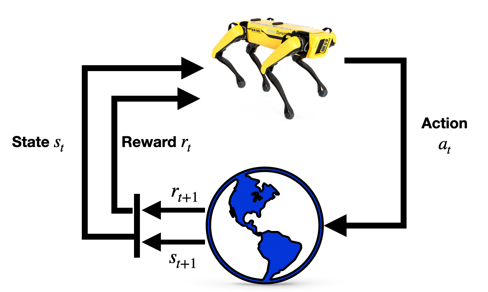

# Skatinamasis mokymasis
:label:`chap_reinforcement_learning`


**Pratik Chaudhari** (*University of Pennsylvania ir Amazon*), **Rasool Fakoor** (*Amazon*) ir **Kavosh Asadi** (*Amazon*)

Skatinamasis mokymasis (angl. *reinforcement learning*, RL) – tai metodų rinkinys, leidžiantis kurti mašininio mokymosi sistemas, kurios sprendimus priima nuosekliai. Pavyzdžiui, paketas su naujais drabužiais, kuriuos nusipirkote internetinėje parduotuvėje, atkeliauja prie jūsų durų po sprendimų sekos: pardavėjas suranda drabužius jūsų namams artimiausiame sandėlyje, sudeda juos į dėžę, dėžę gabena sausuma ar oru ir pristato ją į jūsų namus mieste. Yra daug kintamųjų, kurie kelyje veikia paketo pristatymą, pavyzdžiui, ar drabužiai buvo sandėlyje, kiek laiko užtruko dėžės gabenimas, ar ji atvyko į jūsų miestą prieš išvykstant kasdieniam pristatymo sunkvežimiui ir pan. Pagrindinė mintis ta, kad kiekviename etape šie kintamieji, kurių dažnai nekontroliuojame, veikia visą būsimą įvykių seką, pavyzdžiui, jei dėžės pakavimas sandėlyje vėlavo, pardavėjui gali tekti siųsti paketą oru, o ne sausuma, kad pristatymas būtų laiku. Skatinamojo mokymosi metodai leidžia mums kiekviename nuoseklaus sprendimų priėmimo uždavinio etape atlikti tinkamą veiksmą, kad galiausiai maksimizuotume kokią nors naudą, pavyzdžiui, laiku jums pristatytą paketą.

Tokie nuoseklaus sprendimų priėmimo uždaviniai sutinkami daugybėje kitų vietų, pavyzdžiui, žaidžiant [Go](https://en.wikipedia.org/wiki/Go_(game)) jūsų dabartinis ėjimas lemia kitus ėjimus, o varžovo ėjimai yra kintamieji, kurių negalite kontroliuoti... ėjimų seka galiausiai nulemia, laimėsite ar ne; filmai, kuriuos Netflix jums rekomenduoja dabar, lemia tai, ką žiūrėsite, o ar filmas jums patinka, Netflix nežino, galiausiai rekomenduojamų filmų seka lemia, kiek esate patenkinti Netflix. Šiandien skatinamasis mokymasis naudojamas veiksmingiems šių uždavinių sprendimams kurti :cite:`mnih2013playing,Silver.Huang.Maddison.ea.2016`. Pagrindinis skirtumas tarp skatinamojo mokymosi ir standartinio gilaus mokymosi yra tas, kad standartiniame gilaus mokymosi atveju apmokyto modelio prognozė vienam testavimo duomenų elementui neturi įtakos prognozėms būsimam testavimo duomenų elementui; skatinamajame mokymesi sprendimus ateityje (RL kontekste sprendimai taip pat vadinami veiksmais) veikia tai, kokie sprendimai buvo priimti praeityje.

Šiame skyriuje išplėtosime skatinamojo mokymosi pagrindus ir įgysime praktinės patirties įgyvendindami kai kuriuos populiarius skatinamojo mokymosi metodus. Pirmiausia pristatysime sąvoką, vadinamą Markovo sprendimų procesu (MDP), kuri leidžia mums mąstyti apie tokius nuoseklaus sprendimų priėmimo uždavinius. Algoritmas, vadinamas reikšmių iteracija, bus pirmasis mūsų žvilgsnis į skatinamojo mokymosi uždavinių sprendimą darant prielaidą, kad žinome, kaip paprastai elgiasi nekontroliuojami MDP kintamieji (RL kontekste šie nekontroliuojami kintamieji vadinami aplinka). Naudodami bendresnę reikšmių iteracijos versiją – algoritmą, vadinamą Q mokymusi, galėsime atlikti tinkamus veiksmus net tada, kai neturime pilnų žinių apie aplinką. Tada išnagrinėsime, kaip naudoti giliuosius tinklus skatinamojo mokymosi uždaviniams, mėgdžiodami eksperto veiksmus. Galiausiai sukursime skatinamojo mokymosi metodą, kuris naudoja gilųjį tinklą veiksmams nežinomose aplinkose atlikti. Šie metodai sudaro pažangesnių RL algoritmų, naudojamų šiandien įvairiose realaus pasaulio taikymo srityse, pagrindą, o kai kuriuos iš jų nurodysime šiame skyriuje.


:width:`400px`
:label:`fig_rl_big`

```toc
:maxdepth: 2

mdp
value-iter
qlearning
```
