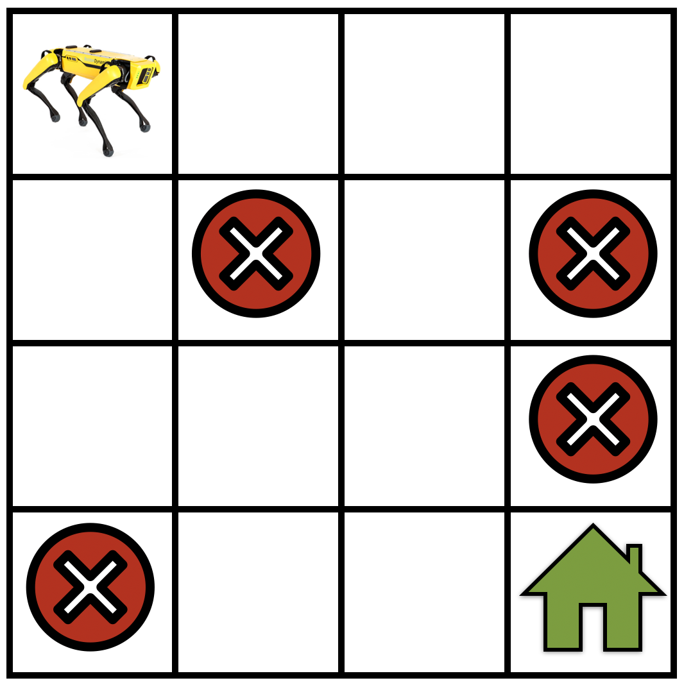

# Markovo sprendimų procesas (MDP)
:label:`sec_mdp`
Šiame skyrelyje aptarsime, kaip formuluoti skatinamojo mokymosi uždavinius naudojant Markovo sprendimų procesus (MDP), ir išsamiai apibūdinsime įvairius MDP komponentus. 

## MDP apibrėžimas

Markovo sprendimų procesas (MDP) :cite:`BellmanMDP` yra modelis, aprašantis, kaip sistemos būsena kinta, kai sistemai taikomi skirtingi veiksmai. MDP sudaro keli skirtingi dydžiai.

:width:`250px`
:label:`fig_mdp`

* Tegu $\mathcal{S}$ yra MDP būsenų aibė. Konkretų pavyzdį žr. :numref:`fig_mdp`, kuriame robotas naviguoja tinklelio pasaulyje. Šiuo atveju $\mathcal{S}$ atitinka vietų, kuriose robotas gali būti bet kuriuo laiko žingsniu, aibę.
* Tegu $\mathcal{A}$ yra veiksmų, kuriuos robotas gali atlikti kiekvienoje būsenoje, aibė, pvz., „eiti pirmyn“, „sukti į dešinę“, „sukti į kairę“, „likti toje pačioje vietoje“ ir pan. Veiksmai gali pakeisti dabartinę roboto būseną į kitą aibės $\mathcal{S}$ būseną.
* Gali būti, kad nežinome, kaip robotas juda *tiksliai*, o žinome tai tik apytiksliai. Skatinamajame mokyme šią situaciją modeliuojame taip: jei robotas atlieka veiksmą „eiti pirmyn“, gali būti nedidelė tikimybė, kad jis liks dabartinėje būsenoje, kita nedidelė tikimybė, kad jis „pasuks į kairę“, ir pan. Matematiškai tai reiškia „perėjimo funkcijos“ $T: \mathcal{S} \times \mathcal{A} \times \mathcal{S} \to [0,1]$ apibrėžimą taip, kad $T(s, a, s') = P(s' \mid s, a)$, naudojant sąlyginę tikimybę pasiekti būseną $s'$, kai robotas buvo būsenoje $s$ ir atliko veiksmą $a$. Perėjimo funkcija yra tikimybių skirstinys, todėl visiems $s \in \mathcal{S}$ ir $a \in \mathcal{A}$ turime $\sum_{s' \in \mathcal{S}} T(s, a, s') = 1$, t. y. robotas, atlikęs veiksmą, turi patekti į kokią nors būseną.
* Dabar sukonstruojame supratimą, kurie veiksmai yra naudingi, o kurie ne, naudodami „atlygio“ sąvoką $r: \mathcal{S} \times \mathcal{A} \to \mathbb{R}$. Sakome, kad robotas gauna atlygį $r(s,a)$, jei robotas būsenoje $s$ atlieka veiksmą $a$. Jei atlygis $r(s, a)$ didelis, tai rodo, kad veiksmas $a$ būsenoje $s$ yra naudingesnis roboto tikslui pasiekti, t. y. nueiti iki žaliojo namo. Jei atlygis $r(s, a)$ mažas, tada veiksmas $a$ yra mažiau naudingas šiam tikslui pasiekti. Svarbu pažymėti, kad atlygį, atsižvelgdamas į tikslą, suprojektuoja naudotojas (asmuo, kuris kuria skatinamojo mokymosi algoritmą).

## Grąža ir diskonto koeficientas

Aukščiau aprašyti komponentai kartu sudaro Markovo sprendimų procesą (MDP)
$$\textrm{MDP}: (\mathcal{S}, \mathcal{A}, T, r).$$

Dabar panagrinėkime situaciją, kai robotas pradeda nuo tam tikros būsenos $s_0 \in \mathcal{S}$ ir toliau atlieka veiksmus, taip sudarydamas trajektoriją
$$\tau = (s_0, a_0, r_0, s_1, a_1, r_1, s_2, a_2, r_2, \ldots).$$

Kiekvienu laiko žingsniu $t$ robotas yra būsenoje $s_t$ ir atlieka veiksmą $a_t$, kuris lemia atlygį $r_t = r(s_t, a_t)$. Trajektorijos *grąža* yra bendras atlygis, kurį robotas gauna išilgai tokios trajektorijos
$$R(\tau) = r_0 + r_1 + r_2 + \cdots.$$

Skatinamojo mokymosi tikslas yra rasti trajektoriją, kurios *grąža* didžiausia.

Pagalvokite apie situaciją, kai robotas toliau keliauja tinklelio pasaulyje niekada nepasiekdamas tikslo vietos. Būsenų ir veiksmų seka trajektorijoje šiuo atveju gali būti be galo ilga, o bet kurios tokios be galo ilgos trajektorijos *grąža* bus begalinė. Kad skatinamojo mokymosi formuluotė išliktų prasminga net tokioms trajektorijoms, įvedame diskonto koeficiento $\gamma < 1$ sąvoką. Diskontuotą *grąžą* užrašome kaip
$$R(\tau) = r_0 + \gamma r_1 + \gamma^2 r_2 + \cdots = \sum_{t=0}^\infty \gamma^t r_t.$$

Atkreipkite dėmesį, kad jei $\gamma$ labai mažas, atlygiai, kuriuos robotas gauna tolimoje ateityje, tarkime, kai $t = 1000$, yra stipriai diskontuojami koeficientu $\gamma^{1000}$. Tai skatina robotą rinktis trumpas trajektorijas, kuriomis pasiekiamas jo tikslas, būtent nueiti iki žaliojo namo tinklelio pasaulio pavyzdyje (žr. :numref:`fig_mdp`). Esant didelėms diskonto koeficiento reikšmėms, tarkime, $\gamma = 0.99$, robotas skatinamas *tyrinėti* ir tada rasti geriausią trajektoriją į tikslo vietą.

## Markovo prielaidos aptarimas

Pagalvokime apie naują robotą, kurio būsena $s_t$ yra vieta kaip aukščiau, bet veiksmas $a_t$ yra pagreitis, kurį robotas pritaiko savo ratams, o ne abstrakti komanda, pavyzdžiui, „eiti pirmyn“. Jei šis robotas būsenoje $s_t$ turi tam tikrą nenulinį greitį, tada kita vieta $s_{t+1}$ yra praėjusios vietos $s_t$, pagreičio $a_t$ ir roboto greičio laiko momentu $t$, kuris proporcingas $s_t - s_{t-1}$, funkcija. Tai rodo, kad turėtume turėti

$$s_{t+1} = \textrm{some function}(s_t, a_t, s_{t-1});$$

„tam tikra funkcija“ mūsų atveju būtų Niutono judėjimo dėsnis. Tai gana skiriasi nuo mūsų perėjimo funkcijos, kuri priklauso tik nuo $s_t$ ir $a_t$.

Markovo sistemos yra visos sistemos, kuriose kita būsena $s_{t+1}$ yra tik dabartinės būsenos $s_t$ ir dabartinėje būsenoje atlikto veiksmo $a_t$ funkcija. Markovo sistemose kita būsena nepriklauso nuo to, kokie veiksmai buvo atlikti praeityje ar kokiose būsenose robotas buvo praeityje. Pavyzdžiui, naujasis robotas, kurio veiksmas yra pagreitis, nėra Markovo, nes kita vieta $s_{t+1}$ priklauso nuo ankstesnės būsenos $s_{t-1}$ per greitį. Gali atrodyti, kad sistemos Markovo prigimtis yra ribojanti prielaida, bet taip nėra. Markovo sprendimų procesai vis tiek geba modeliuoti labai didelę realių sistemų klasę. Pavyzdžiui, mūsų naujam robotui, jei savo būseną $s_t$ pasirinktume kaip kortežą $(\textrm{location}, \textrm{velocity})$, tada sistema yra Markovo, nes jos kita būsena $(\textrm{location}_{t+1}, \textrm{velocity}_{t+1})$ priklauso tik nuo dabartinės būsenos $(\textrm{location}_t, \textrm{velocity}_t)$ ir dabartinėje būsenoje atlikto veiksmo $a_t$.

## Santrauka
Skatinamojo mokymosi uždavinys paprastai modeliuojamas naudojant Markovo sprendimų procesus. Markovo sprendimų procesas (MDP) apibrėžiamas keturių elementų kortežu $(\mathcal{S}, \mathcal{A}, T, r)$, kur $\mathcal{S}$ yra būsenų erdvė, $\mathcal{A}$ yra veiksmų erdvė, $T$ yra perėjimo funkcija, koduojanti MDP perėjimo tikimybes, o $r$ yra betarpiškas atlygis, gaunamas atlikus veiksmą tam tikroje būsenoje.

## Pratimai

1. Tarkime, norime sukurti MDP [MountainCar](https://www.gymlibrary.dev/environments/classic_control/mountain_car/) uždaviniui modeliuoti.
    1. Kokia būtų būsenų aibė?
    2. Kokia būtų veiksmų aibė?
    3. Kokios galėtų būti atlygio funkcijos?
2. Kaip suprojektuotumėte MDP Atari žaidimui, pavyzdžiui, [Pong žaidimui](https://www.gymlibrary.dev/environments/atari/pong/)?

:begin_tab:`pytorch`
[Diskusijos](https://discuss.d2l.ai/t/12084)
:end_tab:
