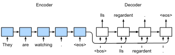
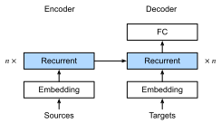
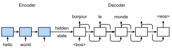

#  Seka į seką
:label:`sec_seq2seq`

Sekos į seką (angl. *sequence to sequence*, seq2seq) modelis remiasi kodavimo ir dekodavimo architektūra, kad sugeneruotų sekos išvestį sekos įvesčiai, kaip parodyta :numref:`fig_seq2seq`. Ir kodavimo, ir dekodavimo blokas naudoja rekurentinius neuroninius tinklus (RNT) kintamo ilgio sekų įvestims apdoroti. Kodavimo bloko paslėptoji būsena tiesiogiai naudojama dekodavimo bloko paslėptajai būsenai inicializuoti, kad informacija būtų perduota iš kodavimo bloko į dekodavimo bloką.


:label:`fig_seq2seq`

Kodavimo ir dekodavimo blokų sluoksniai iliustruoti :numref:`fig_seq2seq_details`.


:label:`fig_seq2seq_details`

Šiame skyriuje paaiškinsime ir realizuosime seq2seq modelį, apmokomą mašininio vertimo duomenų rinkinyje.

```{.python .input  n=1}
#@tab mxnet
from d2l import mxnet as d2l
from mxnet import np, npx, init, gluon, autograd
from mxnet.gluon import nn, rnn
from queue import PriorityQueue

npx.set_np()
```

## Kodavimo blokas

Prisiminkite, kad seq2seq kodavimo blokas gali transformuoti kintamo ilgio įvestis į fiksuoto ilgio konteksto vektorių $\mathbf{c}$, užkoduodamas sekos informaciją į $\mathbf{c}$. Kodavimo bloke dažniausiai naudojame RNT sluoksnius.
Tarkime, turime įvesties seką $x_1, \ldots, x_T$, kur $x_t$ yra $t$-asis žodis. Laiko žingsniu $t$ RNT turės du įvesties vektorius: $x_t$ požymių vektorių $\mathbf{x}_t$ ir ankstesnio laiko žingsnio paslėptąją būseną $\mathbf{h}_{t-1}$. RNT paslėptųjų būsenų transformaciją žymėkime funkcija $f$:

$$\mathbf{h}_t = f (\mathbf{x}_t, \mathbf{h}_{t-1}).$$

Toliau kodavimo blokas surenka visų paslėptųjų būsenų informaciją ir užkoduoja ją į konteksto vektorių $\mathbf{c}$ funkcija $q$:

$$\mathbf{c} = q (\mathbf{h}_1, \ldots, \mathbf{h}_T).$$

Pavyzdžiui, jei $q$ pasirinksime kaip $q (\mathbf{h}_1, \ldots, \mathbf{h}_T) = \mathbf{h}_T$, tada konteksto vektorius bus paskutinė paslėptoji būsena $\mathbf{h}_T$.

Kol kas aprašėme vienkryptį RNT, kurio kiekvieno laiko žingsnio paslėptoji būsena priklauso tik nuo ankstesnių laiko žingsnių būsenų. Sekos įvesčiai užkoduoti taip pat galime naudoti kitas RNT formas, pavyzdžiui, GRU, LSTM ir dvikryptį RNT.

Dabar realizuokime seq2seq kodavimo bloką.
Čia naudojame žodžių įterpimo sluoksnį, kad gautume požymių vektorių
pagal įvesties kalbos žodžio indeksą.
Šie požymių vektoriai bus paduodami į daugiasluoksnį LSTM.
Kodavimo bloko įvestis yra sekų paketas, t. y. 2-D tenzorius, kurio forma (paketo dydis, sekos ilgis). Kodavimo blokas grąžina ir LSTM išvestis, t. y. visų laiko žingsnių paslėptąsias būsenas, ir paskutinio laiko žingsnio paslėptąją būseną bei atminties ląstelę.

```{.python .input  n=2}
#@tab mxnet
#@save
class Seq2SeqEncoder(d2l.Encoder):
    def __init__(self, vocab_size, embed_size, num_hiddens, num_layers,
                 dropout=0, **kwargs):
        super(Seq2SeqEncoder, self).__init__(**kwargs)
        self.embedding = nn.Embedding(vocab_size, embed_size)
        self.rnn = rnn.LSTM(num_hiddens, num_layers, dropout=dropout)

    def forward(self, X, *args):
        X = self.embedding(X)  # X shape: (batch_size, seq_len, embed_size)
        # RNN needs first axes to be timestep, i.e., seq_len
        X = X.swapaxes(0, 1)
        state = self.rnn.begin_state(batch_size=X.shape[1], ctx=X.ctx)
        out, state = self.rnn(X, state)
        # out shape: (seq_len, batch_size, num_hiddens)
        # state shape: (num_layers, batch_size, num_hiddens),
        # where "state" contains the hidden state and the memory cell
        return out, state
```

Toliau sukursime mažos imties sekos įvestį su paketo dydžiu 4 ir 7 laiko žingsniais. Tarkime, kad LSTM vieneto paslėptųjų sluoksnių skaičius yra 2, o paslėptųjų vienetų skaičius – 16. Kodavimo bloko, atlikus tiesioginį skaičiavimą su įvestimi, grąžinama išvesties forma yra (laiko žingsnių skaičius, paketo dydis, paslėptųjų vienetų skaičius). Valdomojo rekurentinio vieneto daugiasluoksnės paslėptosios būsenos forma paskutiniame laiko žingsnyje yra (paslėptųjų sluoksnių skaičius, paketo dydis, paslėptųjų vienetų skaičius). Valdomajam rekurentiniam vienetui sąraše `state` yra tik vienas elementas – paslėptoji būsena. Jei naudojama ilgoji trumpalaikė atmintis, sąraše `state` bus ir kitas elementas – atminties ląstelė.

```{.python .input  n=3}
#@tab mxnet
encoder = Seq2SeqEncoder(vocab_size=10, embed_size=8, num_hiddens=16,
                         num_layers=2)
encoder.initialize()
X = np.zeros((4, 7))
output, state = encoder(X)
output.shape
```

Kadangi naudojamas LSTM, sąraše `state` bus ir paslėptoji būsena, ir atminties ląstelė su ta pačia forma (paslėptųjų sluoksnių skaičius, paketo dydis, paslėptųjų vienetų skaičius). Tačiau jei naudojamas GRU, sąraše `state` bus tik vienas elementas – paslėptoji būsena paskutiniame laiko žingsnyje su forma (paslėptųjų sluoksnių skaičius, paketo dydis, paslėptųjų vienetų skaičius).

```{.python .input  n=4}
#@tab mxnet
len(state), state[0].shape, state[1].shape
```

## Dekodavimo blokas
:label:`sec_seq2seq_decoder`

Kaip ką tik pristatėme, konteksto vektorius $\mathbf{c}$ užkoduoja informaciją iš visos įvesties sekos $x_1, \ldots, x_T$. Tarkime, kad mokymo rinkinyje duotos išvestys yra $y_1, \ldots, y_{T'}$. Kiekvienu laiko žingsniu $t'$ išvesties $y_{t'}$ sąlyginė tikimybė priklausys nuo ankstesnės išvesties sekos $y_1, \ldots, y_{t'-1}$ ir konteksto vektoriaus $\mathbf{c}$, t. y.,

$$P(y_{t'} \mid y_1, \ldots, y_{t'-1}, \mathbf{c}).$$

Todėl kaip dekodavimo bloką galime naudoti kitą RNT. Laiko žingsniu $t'$ dekodavimo blokas atnaujins savo paslėptąją būseną $\mathbf{s}_{t'}$ naudodamas tris įvestis: $y_{t'-1}$ požymių vektorių $\mathbf{y}_{t'-1}$, konteksto vektorių $\mathbf{c}$ ir ankstesnio laiko žingsnio paslėptąją būseną $\mathbf{s}_{t'-1}$. RNT paslėptųjų būsenų transformaciją dekodavimo bloke žymėkime funkcija $g$:

$$\mathbf{s}_{t'} = g(\mathbf{y}_{t'-1}, \mathbf{c}, \mathbf{s}_{t'-1}).$$


Realizuodami dekodavimo bloką, kaip pradinę dekodavimo bloko paslėptąją būseną tiesiogiai naudojame kodavimo bloko paskutinio laiko žingsnio paslėptąją būseną. Tam reikia, kad kodavimo ir dekodavimo blokų RNT turėtų tiek pat sluoksnių ir paslėptųjų vienetų.
Dekodavimo bloko LSTM tiesioginis skaičiavimas panašus į kodavimo bloko. Vienintelis skirtumas yra tai, kad po LSTM sluoksnių pridedame tankųjį sluoksnį, kurio paslėptasis dydis yra žodyno dydis. Tankusis sluoksnis prognozuos kiekvieno žodžio pasitikėjimo įvertį.

```{.python .input  n=5}
#@tab mxnet
#@save
class Seq2SeqDecoder(d2l.Decoder):
    def __init__(self, vocab_size, embed_size, num_hiddens, num_layers,
                 dropout=0, **kwargs):
        super(Seq2SeqDecoder, self).__init__(**kwargs)
        self.embedding = nn.Embedding(vocab_size, embed_size)
        self.rnn = rnn.LSTM(num_hiddens, num_layers, dropout=dropout)
        self.dense = nn.Dense(vocab_size, flatten=False)

    def init_state(self, enc_outputs, *args):
        return enc_outputs[1]

    def forward(self, X, state):
        X = self.embedding(X).swapaxes(0, 1)
        out, state = self.rnn(X, state)
        # Make the batch to be the first dimension to simplify loss
        # computation
        out = self.dense(out).swapaxes(0, 1)
        return out, state
```

Sukuriame dekodavimo bloką su tais pačiais hiperparametrais kaip kodavimo bloko. Kaip matome, išvesties forma pasikeičia į (paketo dydis, sekos ilgis, žodyno dydis).

```{.python .input  n=6}
#@tab mxnet
decoder = Seq2SeqDecoder(vocab_size=10, embed_size=8,
                         num_hiddens=16, num_layers=2)
decoder.initialize()
state = decoder.init_state(encoder(X))
out, state = decoder(X, state)
out.shape, len(state), state[0].shape, state[1].shape
```

## Nuostolių funkcija

Kiekvienu laiko žingsniu dekodavimo blokas išveda žodyno dydžio pasitikėjimo įverčių vektorių žodžiams prognozuoti. Panašiai kaip kalbos modeliavime, galime taikyti softmax, kad gautume tikimybes, o tada nuostoliams apskaičiuoti naudoti kryžminės entropijos nuostolius. Atkreipkite dėmesį, kad tikslinius sakinius užpildėme (angl. *padding*), kad jų ilgiai būtų vienodi, tačiau nuostolių užpildymo simboliams skaičiuoti nereikia.

Kad realizuotume nuostolių funkciją, kuri atfiltruoja kai kuriuos elementus, naudosime operatorių `SequenceMask`. Jis gali nurodyti kaukuoti pirmąją dimensiją (`axis=0`) arba antrąją (`axis=1`). Pasirinkus antrąją, turint galiojančio ilgio vektorių `len` ir 2 dimensijų įvestį `X`, šis operatorius visiems $i$ nustato `X[i, len[i]:] = 0`.

```{.python .input  n=7}
#@tab mxnet
X = np.array([[1, 2, 3], [4, 5, 6]])
npx.sequence_mask(X, np.array([1, 2]), True, axis=1)
```

Taikant $n$ dimensijų tenzoriui $X$, nustatoma `X[i, len[i]:, :, ..., :] = 0`. Be to, galime nurodyti užpildymo reikšmę, pavyzdžiui, $-1$, kaip parodyta toliau.

```{.python .input  n=8}
#@tab mxnet
X = np.ones((2, 3, 4))
npx.sequence_mask(X, np.array([1, 2]), True, value=-1, axis=1)
```

Dabar galime realizuoti kaukuotą softmax kryžminės entropijos nuostolių versiją. Atkreipkite dėmesį, kad kiekviena Gluon nuostolių funkcija leidžia nurodyti kiekvieno pavyzdžio svorius, pagal nutylėjimą jie yra vienetai. Tada galime tiesiog naudoti nulinį svorį kiekvienam pavyzdžiui, kurį norime pašalinti. Todėl mūsų pritaikyta nuostolių funkcija priima papildomą argumentą `valid_len`, kad būtų ignoruojami kai kurie netinkami kiekvienos sekos elementai.

```{.python .input  n=9}
#@tab mxnet
#@save
class MaskedSoftmaxCELoss(gluon.loss.SoftmaxCELoss):
    # pred shape: (batch_size, seq_len, vocab_size)
    # label shape: (batch_size, seq_len)
    # valid_len shape: (batch_size, )
    def forward(self, pred, label, valid_len):
        # weights shape: (batch_size, seq_len, 1)
        weights = np.expand_dims(np.ones_like(label), axis=-1)
        weights = npx.sequence_mask(weights, valid_len, True, axis=1)
        return super(MaskedSoftmaxCELoss, self).forward(pred, label, weights)
```

Patikrinimui sukuriame tris identiškas sekas: pirmoje sekoje paliekame 4 elementus, antroje – 2 elementus, o paskutinėje – nė vieno. Tada pirmojo pavyzdžio nuostoliai turėtų būti 2 kartus didesni nei antrojo, o paskutinio – 0.

```{.python .input  n=10}
#@tab mxnet
loss = MaskedSoftmaxCELoss()
loss(np.ones((3, 4, 10)), np.ones((3, 4)), np.array([4, 2, 0]))
```

## Mokymas
:label:`sec_seq2seq_training`

Mokymo metu, jei tikslinės sekos ilgis yra $n$, pirmąsias $n-1$ leksemų paduodame į dekodavimo bloką kaip įvestis, o paskutinės $n-1$ leksemos naudojamos kaip etaloninės žymės.

```{.python .input  n=11}
#@tab mxnet
#@save
def train_s2s_ch9(model, data_iter, lr, num_epochs, ctx):
    model.initialize(init.Xavier(), force_reinit=True, ctx=ctx)
    trainer = gluon.Trainer(model.collect_params(),
                            'adam', {'learning_rate': lr})
    loss = MaskedSoftmaxCELoss()
    animator = d2l.Animator(xlabel='epoch', ylabel='loss',
                            xlim=[1, num_epochs], ylim=[0, 0.25])
    for epoch in range(1, num_epochs + 1):
        timer = d2l.Timer()
        metric = d2l.Accumulator(2)  # loss_sum, num_tokens
        for batch in data_iter:
            X, X_vlen, Y, Y_vlen = [x.as_in_ctx(ctx) for x in batch]
            Y_input, Y_label, Y_vlen = Y[:, :-1], Y[:, 1:], Y_vlen-1
            with autograd.record():
                Y_hat, _ = model(X, Y_input, X_vlen, Y_vlen)
                l = loss(Y_hat, Y_label, Y_vlen)
            l.backward()
            d2l.grad_clipping(model, 1)
            num_tokens = Y_vlen.sum()
            trainer.step(num_tokens)
            metric.add(l.sum(), num_tokens)
        if epoch % 10 == 0:
            animator.add(epoch, (metric[0]/metric[1],))
    print('loss %.3f, %d tokens/sec on %s ' % (
        metric[0]/metric[1], metric[1]/timer.stop(), ctx))
```

Toliau sukuriame modelio objektą ir nustatome hiperparametrus. Tada galime apmokyti modelį.

```{.python .input  n=12}
#@tab mxnet
embed_size, num_hiddens, num_layers, dropout = 32, 32, 2, 0.0
batch_size, num_steps = 64, 10
lr, num_epochs, ctx = 0.005, 300, d2l.try_gpu()

src_vocab, tgt_vocab, train_iter = d2l.load_data_nmt(batch_size, num_steps)
encoder = Seq2SeqEncoder(
    len(src_vocab), embed_size, num_hiddens, num_layers, dropout)
decoder = Seq2SeqDecoder(
    len(tgt_vocab), embed_size, num_hiddens, num_layers, dropout)
model = d2l.EncoderDecoder(encoder, decoder)
train_s2s_ch9(model, train_iter, lr, num_epochs, ctx)
```

## Prognozavimas

Čia realizuojame paprasčiausią metodą – godžiąją paiešką – išvesties
sekai generuoti. Kaip iliustruota :numref:`fig_seq2seq_predict`, prognozuojant 0 laiko žingsniu į dekodavimo bloką paduodame tą pačią „&lt;bos&gt;“ leksemą kaip ir mokant. Tačiau vėlesnio laiko žingsnio įvesties leksema yra ankstesnio laiko žingsnio prognozuota leksema.


:label:`fig_seq2seq_predict`

```{.python .input  n=16}
#@tab mxnet
#@save
class BeamSearchNode(object):
    def __init__(self, hiddenstate, previousNode, wordId, logProb, length):
        self.h = hiddenstate
        self.prevNode = previousNode
        self.wordid = wordId
        self.logp = logProb
        self.length = length

    def eval(self, alpha=1.0):
        reward = 0
        return self.logp / float(self.length - 1 + 1e-6) + alpha * reward
#@save
def predict_s2s_ch9_beam(model, src_sentence, src_vocab, tgt_vocab, num_steps,
                         beam_width, ctx):
    src_tokens = src_vocab[src_sentence.lower().split(' ')]
    enc_valid_len = np.array([len(src_tokens)], ctx=ctx)
    src_tokens = d2l.truncate_pad(src_tokens, num_steps, src_vocab['<pad>'])
    enc_X = np.array(src_tokens, ctx=ctx)
    # Add the batch_size dimension
    enc_outputs = model.encoder(np.expand_dims(enc_X, axis=0),
                                enc_valid_len)
    dec_state = model.decoder.init_state(enc_outputs, enc_valid_len)
    dec_X = np.expand_dims(np.array([tgt_vocab['<bos>']], ctx=ctx), axis=0)
    
    node = BeamSearchNode(dec_state, None, dec_X, 0, 1)
    nodes = PriorityQueue()
    decoded_batch = []
    nodes.put((-node.eval(), node))
    #while True:
    for _ in range(num_steps):
        # give up when decoding takes too long
        score, n = nodes.get()
        dec_X = n.wordid
        dec_state = n.h
        if n.wordid.item() == tgt_vocab['<eos>'] and n.prevNode != None:
            endnodes = (score, n)
            break
        Y, dec_state = model.decoder(dec_X, dec_state)
        indexes = npx.topk(Y, k=beam_width)
        nextnodes = []
        for new_k in range(beam_width):
            decoded_t = indexes[:,:,new_k]
            log_p = Y.reshape(-1)[decoded_t].item()
            node = BeamSearchNode(dec_state, n, decoded_t, n.logp + log_p, n.length + 1)
            score = -node.eval()
            nextnodes.append((score, node))
        for i in range(len(nextnodes)):
            score, nn = nextnodes[i]
            nodes.put((score, nn))
            
    if len(endnodes) == 0:
        endnodes = nodes.get()
    score, n = endnodes
    predict_tokens = []
    if int(n.wordid) != tgt_vocab['<eos>']:
        predict_tokens.append(int(n.wordid))
    # back trace
    while n.prevNode != None:
        n = n.prevNode
        if int(n.wordid) != tgt_vocab['<bos>']:
            predict_tokens.append(int(n.wordid))
    predict_tokens = predict_tokens[::-1]
    return ' '.join(tgt_vocab.to_tokens(predict_tokens))
```

Išbandykite keletą pavyzdžių:

```{.python .input  n=204}
#@tab mxnet
for sentence in ['Go .', 'Wow !', "I'm OK .", 'I won !']:
    print(sentence + ' => ' + predict_s2s_ch9_beam(
        model, sentence, src_vocab, tgt_vocab, num_steps, 3, ctx))
```

## Santrauka

* Sekos į seką (seq2seq) modelis remiasi kodavimo ir dekodavimo architektūra, kad iš sekos įvesties sugeneruotų sekos išvestį.
* Ir kodavimo, ir dekodavimo blokui naudojame kelis LSTM sluoksnius.


## Pratimai

1. Ar galite sugalvoti kitų seq2seq panaudojimo atvejų, be neuroninio mašininio vertimo?
1. Kas nutiktų, jei šio skyriaus pavyzdyje įvesties seka būtų ilgesnė?
1. Kas gali nutikti, jei nuostolių funkcijoje nenaudotume `SequenceMask`?


## [Diskusijos](https://discuss.mxnet.io/t/4357)


